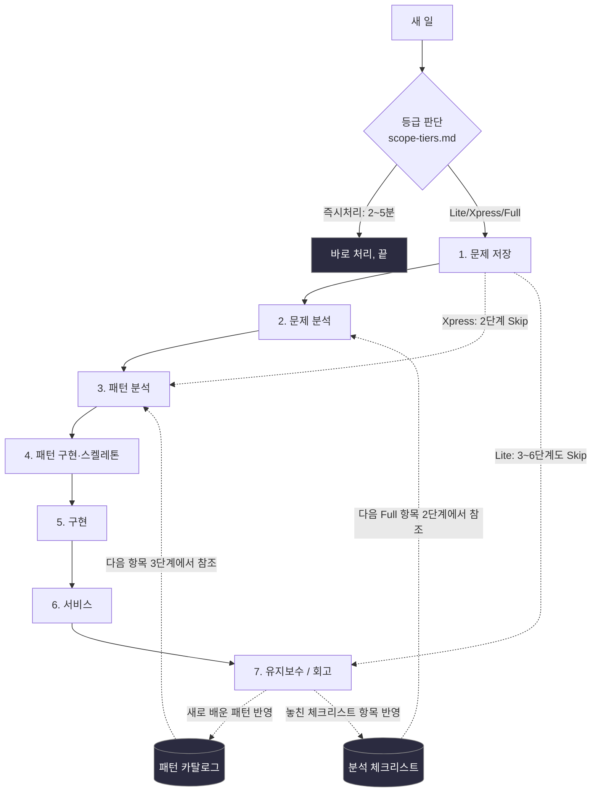
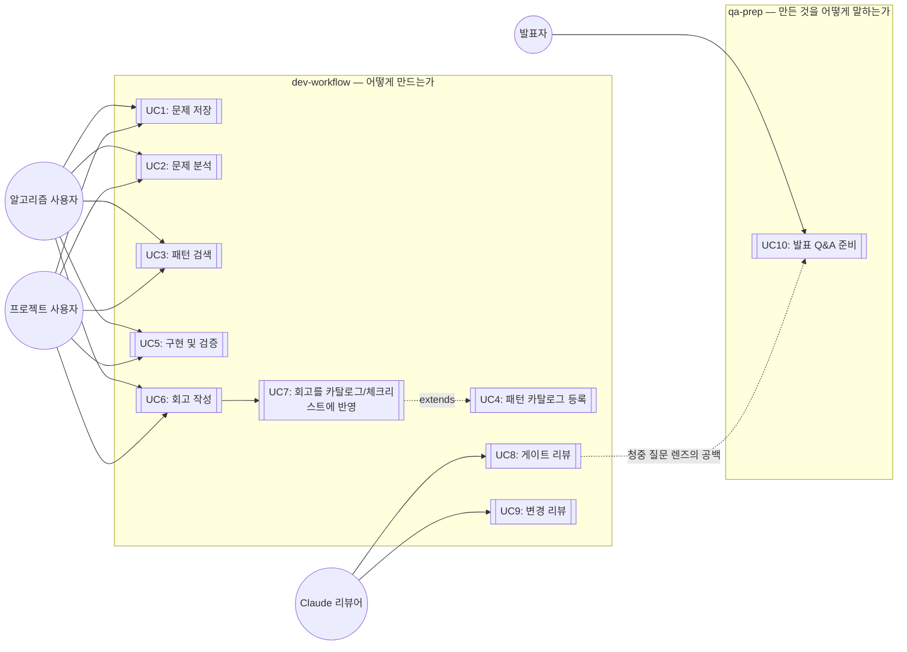

# 개요 — 나만의 개발 워크플로우 시스템

## 이 폴더 한눈에

이 폴더에는 문서 23개가 섞여 있다 — 제품(요구사항·기획안), 팀 운영(우선순위·일정·가이드), 방법론(규모 판단·게이트). 날짜가 붙은 지난 기록은 [`기록/`](기록/README.md)에 있다.
**무엇이 어디 있는지는 [문서 지도](../README.md)**를 먼저 본다. 많이 찾는 것: [요구사항](requirements.md) · [내 할 일](team-priorities.md) · [팀 작업 가이드](team-guide.md).

아래 본문은 7단계 워크플로우 **방법론**의 개요다.

*(위 "한눈에"는 사람용 안내 — Claude 초안 2026-10-17, 두승현 요청. 아래는 원래 본문이다.)*

- 이 문서는 **7단계 워크플로우 방법론**의 개요입니다. V1(이재엽 개인 워크스페이스)에서 옮겨 왔습니다
  ([migration.md](migration.md)). 팀이 만드는 제품(Floe)의 요구는 [requirements.md](requirements.md),
  팀의 할 일은 [team-priorities.md](team-priorities.md)에 있습니다. 시작하는 법은
  [`../../GETTING_STARTED.md`](../../GETTING_STARTED.md) 참고.

이 저장소는 "문제 저장 → 문제 분석 → 패턴 분석 → 패턴 구현 → 구현 → 서비스 → 유지보수"라는
7단계 개인 개발 워크플로우를 설계·기록하는 곳입니다. 각 단계는 `01-docs/` 아래 자기 폴더를 가지며,
그 단계를 수정할 땐 해당 폴더의 md 파일만 고치면 됩니다.

**새 일을 시작하기 전에 → [scope-tiers.md](scope-tiers.md)** (이 7단계를 다 밟을
가치가 있는 일인지, 아니면 Xpress/Lite/즉시처리로 줄일지부터 정하기)

**세션을 여러 개 열어 일할 때 → [session-operations.md](session-operations.md)** (주제 하나 = 브랜치 하나 = 작업 폴더 하나)

**각 단계를 제대로 마쳤는지 확인하고 넘어가려면 → [gates.md](gates.md)** (진입기준/완료기준
+ Go·Kill·Hold·Recycle 게이트 결정 규정)

## 원문제 정의

**시나리오**: 새 프로그램/프로젝트를 시작할 때마다 접근 방식이 즉흥적이라, 과거에 배운 패턴이나
실수가 다음 프로젝트에 재사용되지 않는다.

**원하는 결과**: 7단계 프로세스를 만들어서
1. 매번 같은 틀로 진행하고
2. 유지보수 단계에서 얻은 교훈이 패턴 카탈로그/체크리스트로 축적되어 다음 프로젝트에 자동 반영되게 한다.

**적용 대상**: 알고리즘 문제풀이 트랙 / 실무·사이드 프로젝트 트랙 — 두 트랙 모두 틀은 공유하되
각 단계 산출물은 다르게.

## 전체 방향 다이어그램



핵심 둘:
1. 1→7은 선형이 아니라 **7단계 회고가 2·3단계 참조 자료(카탈로그/체크리스트)로 역류하는
   피드백 루프**입니다. 이 루프가 없으면 원문제가 해결되지 않습니다.
2. 모든 일이 7단계를 다 밟지도 않습니다 — [scope-tiers.md](scope-tiers.md) 등급에 따라
   Xpress는 2단계를, Lite는 3~6단계까지 건너뜁니다.

## 폴더 구조

```
.claude/skills/dev-workflow/   Claude Code 스킬 — 명령 3개(문제 저장/패턴 검색/회고 반영)
01-docs/
  00-overview/          이 문서 + gates.md(게이트 규정) + scope-tiers.md(규모 판단)
  01-problem-save/      1단계: 문제 저장 템플릿(트랙별 + PRD) + sessions/(실제 저장된 항목)
  02-problem-analysis/  2단계: 요구사항 분석 방법론 + 적용 범위(경량화 규칙) + 적용 예시
  03-pattern-analysis/  3단계: 패턴/아키텍처 선택 (ADR-0001 완료) + adr/
  04-pattern-implementation/  4단계: 패턴 스켈레톤 구현 방법론 + 다이어그램 선택 가이드
  05-implementation/    5단계: TDD + 동등분할·경계값 분석 방법론
  06-service/           6단계: Twelve-Factor App + 성능 실측 방법론
  07-maintenance/       7단계: 회고 — 5 Whys + Blameless Postmortem 방법론
  catalog/              패턴 카탈로그(아직 비어 있음), 분석 체크리스트 — 회고 때마다 쌓임
```

## 진행상황 (Progress Log)

이 표는 **시스템 자체**(규칙·템플릿·스킬)가 얼마나 갖춰졌는지를 나타냅니다.
실제로 이 시스템으로 풀어본 항목은 [`sessions/README.md`](../01-problem-save/sessions/README.md)
트래커에 쌓입니다(`05-projects/`의 항목 포함).

| 단계 | 상태 | 상세 |
|---|---|---|
| 0. 원문제 정의 | ✅ 완료 | 위 참조 |
| 1. 문제 저장 | ✅ 완료 | [`01-docs/01-problem-save/`](../01-problem-save/README.md) — 트랙 3개(알고리즘/프로젝트/학습), 인터뷰 기반 필드 채우기 |
| 2. 문제 분석 | ✅ 완료 | 수집(BABOK)→명세(EARS)→정량화(Planguage)→우선순위(MoSCoW×Kano)→추적(RTM) 5단계 파이프라인. [`01-docs/02-problem-analysis/`](../02-problem-analysis/README.md) |
| 3. 패턴 분석 | ✅ 완료 | ADR-0001로 "파일+Claude Code 스킬 하이브리드" 채택. [`01-docs/03-pattern-analysis/`](../03-pattern-analysis/README.md) |
| 4. 패턴 구현 | ✅ 완료 (방법론) | Walking Skeleton(Cockburn)/Make it work-right-fast 원칙. `.claude/skills/dev-workflow/SKILL.md`, `sessions/` 폴더 구조. [`01-docs/04-pattern-implementation/`](../04-pattern-implementation/README.md) |
| 5. 구현 | ✅ 완료 (방법론) | TDD Red-Green-Refactor + 동등분할·경계값 분석. [`01-docs/05-implementation/`](../05-implementation/README.md) |
| 6. 서비스 | ✅ 완료 (방법론) | Twelve-Factor App + Planguage Goal 실측 규칙. [`01-docs/06-service/`](../06-service/README.md) |
| 7. 유지보수 | ✅ 완료 (방법론) | 5 Whys + Blameless Postmortem. [`01-docs/07-maintenance/`](../07-maintenance/README.md) |

**지금 (2026-10-18)**: 팀은 이 방법론으로 Floe를 진행 중입니다 — 1→2 · 2→3 · 3→4 · 4→5 Go(10/18), 5단계(주요 기능 11/3까지) →
6단계 사용 테스트(11/4~7) → 7단계 회고(11/7~8). 게이트 로그는 [Floe 세션 파일](../01-problem-save/sessions/project-track/2026-10-18-floe.md), 고칠 것은 [고칠 목록](../07-maintenance/fix-map.md). 새 문제/
프로젝트를 [`dev-workflow` 스킬](../../.claude/skills/dev-workflow/SKILL.md)로
저장하면서 시작하세요 — 자세한 절차는 [`GETTING_STARTED.md`](../../GETTING_STARTED.md).

## 유즈케이스

이 워크스페이스에는 시스템이 둘 있습니다. **dev-workflow**는 어떻게 만드는가(7단계 +
리뷰)이고, **qa-prep**은 만든 것을 어떻게 말하는가(발표 Q&A 준비)입니다. 작업물은 내가
쓰고, Claude는 질문하고 리뷰합니다([리뷰 모드](../../.claude/rules/review-mode.md)).

### 액터
- **알고리즘 사용자**: 코딩테스트/알고리즘 문제를 푸는 본인
- **프로젝트 사용자**: 실무/사이드 프로젝트를 진행하는 본인
- **발표자**: 만든 것을 발표·면접·팀 공유에서 설명해야 하는 본인
- **Claude (리뷰어 + 코치)**: 작업물을 쓰지 않고 질문·리뷰·게이트 판정을 한다



두 시스템은 서로 주고받습니다. dev-workflow에 남은 기록(세션 파일, ADR, 게이트 로그)이
qa-prep의 6슬롯 재료가 되고, qa-prep이 명세와 테스트로 다듬은 질문 방법이 리뷰 모드의
"질문하는 법"이 됩니다.

### 유즈케이스별 문답 — 이 작업을 할 때 어떤 질문을 받는가

질문은 Claude가 하고 답과 작성은 내가 한다. 질문은 한 번에 최대 2개이고, 기대하는 답을
암시하지 않으며, 각 UC 끝에 "제가 안 물어봤지만 알아야 할 게 있나요?"를 묻는다
([질문하는 법](../../.claude/rules/review-mode.md)). 아래 질문은 예시이고, 실제 질문은
작업물에 따라 달라진다.

| UC | 이런 작업을 할 때 | 시스템 | 받는 질문 (예시) | 답을 적는 곳 |
|---|---|---|---|---|
| UC1 문제 저장 | 새 문제·프로젝트를 시작할 때 | dev-workflow 명령 1 | "이걸 왜 지금 하나요?", "끝났다는 걸 무엇으로 아나요? 숫자나 날짜로요", 규모 결정 트리 질문 | 세션 파일 필드, 등급 |
| UC2 문제 분석 | 요구사항을 다듬을 때 | 2단계 | "이 요구사항의 측정 기준은 어디 있나요?", "이 조건이 안 맞으면 시스템은 어떻게 해야 하나요?" | 2단계 명세(EARS, Planguage) |
| UC3 패턴 검색 | 방법·구조를 고를 때 | dev-workflow 명령 2 | "다른 선택지는 뭐가 있었나요?", "그중 이걸 고른 기준은요?" | ADR, 3단계 결정 |
| UC5 구현 및 검증 | 코드와 테스트를 쓸 때 | 5단계 | "이 동작을 확인하는 테스트는 어디 있나요?", "경계값으로 무엇을 넣어 봤나요?" | 코드, 테스트 |
| UC8 게이트 리뷰 | 다음 단계로 넘어가려 할 때 | dev-workflow 명령 5 | "자기 판정과 한 줄 근거를 먼저 적어 주세요" → DoD 대조 → 1→2·3→4·6→7에서는 6슬롯 청중 질문("청중이 '왜 이 방법이죠?'라고 물으면 답의 재료는 어디 있나요?") | 게이트 로그(내가), [성장 로그](growth-log.md)(Claude가) |
| UC9 변경 리뷰 | 커밋 전, PR을 열었을 때, 세션 시작 알림이 떴을 때 | dev-workflow 명령 5 | "이 변경은 어느 단계의 무엇을 위한 건가요?" → 막힘/보완/잘한 점. 고치는 건 내가 한다 | 코드·문서(내가), 성장 로그 |
| UC6·UC7 회고 | 프로젝트를 마칠 때 | dev-workflow 명령 3 | 어려웠던 점마다 "왜?"를 반복(사람 탓에서 멈추면 한 번 더), "이번에 반복된 유형이 있었나요?"(성장 로그를 보고 내가 먼저) | 회고, [patterns.md](../catalog/patterns.md), [checklist.md](../catalog/checklist.md) |
| UC10 발표 Q&A 준비 | 발표·면접을 앞두고, 또는 UC8에서 공백이 나왔을 때 | [qa-prep](../../.claude/skills/qa-prep/SKILL.md) | 6슬롯 되묻기, 얕은 슬롯에 "다른 선택지는요? 실제 사례는요?", "어떤 질문에 대한 카드를 만들까요?", 근거 발언마다 "이 질문의 답이 되나요? 예/아니오/일부" | 슬롯·카드 파일, 프로젝트의 expected-questions.md |

### 유즈케이스 명세 (핵심 5개, Volere 스타일 요약)

**UC1: 문제 저장** — 사전조건 없음(시작점) → 트랙 선택 → Claude가 파일 골격을 만들고 내가
템플릿을 채움(Claude는 되묻기) → 저장. 관련: FR1
([`01-docs/01-problem-save/`](../01-problem-save/README.md))

**UC3: 패턴 검색** — 사전조건: UC2에서 태그/유형 확정 → 키워드/태그로 카탈로그 매칭 →
후보를 3단계에 반영. 관련: FR2 ([`01-docs/catalog/patterns.md`](../catalog/patterns.md))

**UC7: 회고를 카탈로그/체크리스트에 반영** — 사전조건: UC6 완료 → 새 패턴/놓친 체크리스트
항목 식별 → `catalog/` 파일에 추가 → git 커밋으로 이력 남김. 관련: FR3, 원문제 핵심 루프
([`01-docs/07-maintenance/`](../07-maintenance/README.md))

**UC8: 게이트 리뷰** — 사전조건: 현재 단계의 작업물이 있음 → 내가 자기 판정을 먼저 적음 →
Claude가 DoD·체크리스트 대조와 청중 질문 렌즈로 막힘/보완/잘한 점을 보임 → 두 판정을 맞춰
내가 게이트 로그에 기록 → 성장 로그 갱신. 관련: [gates.md](gates.md) "게이트 판정은 누가
하는가"

**UC10: 발표 Q&A 준비** — 사전조건: 프로젝트 기록이 있음(또는 UC8에서 공백이 나옴) → 6슬롯
정리 → 얕은 슬롯 꼬리 질문 → 질문 선택 → PREP 카드 → 근거 발언 확인 → 역질문 비교. 관련:
qa-prep-system 세션 파일의 FR1~FR27
(`projects/qa-prep-system/` *(V1에만 있음)*)

## 왜 지금 이런 모양인지

이 문서에는 결과만 담았습니다. 어떤 시행착오를 거쳐 지금 구조가 됐는지는
[worklog.md](worklog.md)에 날짜순으로 정리돼 있습니다.
