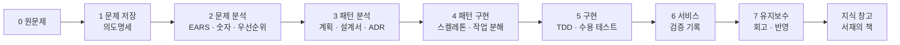
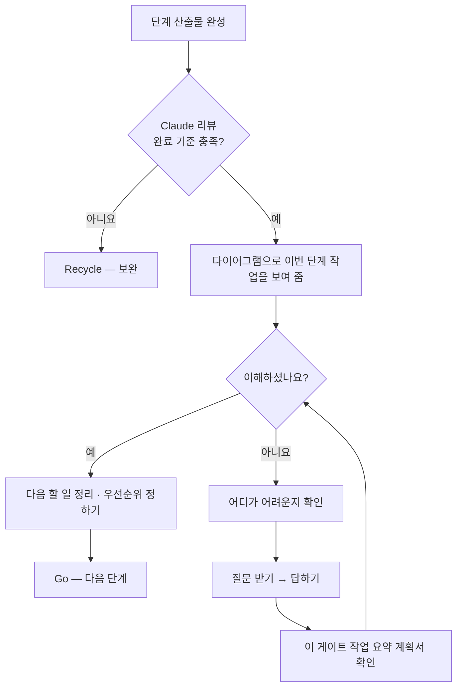
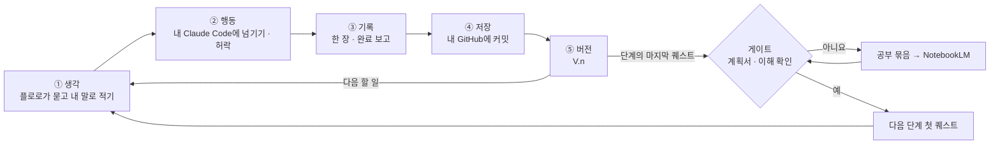

<!-- claude-drafted: 2026-10-12 — 이재엽의 답변(대화 2026-10-12)을 Claude가 요구사항으로 옮겼다. "말씀" 칸은 이재엽의 말이고, 문장·번호·"[해석]"은 Claude의 것이다. 이재엽이 확인하면 확정이다(2026-10-25부터 이재엽이 맡기면 두승현도). -->

# Floe (작업 이름 Project Navigator) — 요구사항 (V2)

> 이 문서가 V2 요구의 원천이다. 다른 문서(`final-project-plan.md` 등)와 어긋나면 이 문서를 기준으로 고친다.

> **이름 (이재엽 확정 2026-10-17, 이슈 #51):** 제품 **Floe(플로)**, 마스코트 **플로로(Floro)**. 얼음 위 서재가 배경이다. "Project Navigator"와 폴더·코드·이슈 번호의 "navigator"는 **작업 이름**으로 남긴다(바꾸면 링크가 깨진다). 중복·상표 확인은 남아 있다(2-3 8번).

## 0. 목적

> **제품 성격 (이재엽 확정 2026-10-12):** Floe는 사용자의 프로그램을 직접 만들지 않는다. **안내하고, 사용자가 쓰는 AI 코딩 도구로 넘겨 준다.** 따라서 이 프로세스는 *바이브 코딩을 하는 사람을 위한 워크 프로세스*다. "Floe"는 제품 이름이고(작업 이름 Navigator), 프로세스 이름을 "바이브 코딩 프로세스"로 부를지는 이재엽이 정한다 **[해석]**.

> **더함 (이재엽 2026-10-20, FR-17):** 넘겨 준 일을 사용자의 코딩 도구(Claude Code)가 하는 동안, Floe는 섬에서 그 일을 지켜보고 **허용 · 거절까지** 받는다(버튼 "섬에서 진짜 승인"). 코드를 쓰는 것은 여전히 사용자의 코딩 도구다. <!-- claude-drafted: 2026-10-20 -->

> **방향 더함 (이재엽 2026-10-23 — 확정 2026-10-25 두승현 — 이재엽 위임, 2-2 C-23~C-27):** AI를 구독해 바이브 코딩으로 결과물은 나오지만, 개념과 과정을 모른 채 만드는 사람이 늘었다. Floe는 개인이 아이디어를 바이브 코딩으로 만들 때 **기준을 잡아 주고, 그 과정에서 배워야 할 것을 알려 준다.** 자세히 모르는 것은 **NotebookLM**으로 스스로 공부하게 하고(C-24), 한 작업은 **자기 GitHub에 기록**해(C-25) **책으로 다시 읽으며** "나는 이렇게 만들었구나"를 이해하게 한다(C-26). 관문을 넘을 때마다 **전체 과정을 이해하는 계획서** — 목차를 누르면 그 절로 바로 가는 — 를 준다(C-27). 이 모든 것을 **퀘스트**로 진행하고, 퀘스트 하나는 **생각 → 행동 → 기록 → 저장 → 버전(V.n)** 으로 관리한다(C-23, 1절 "퀘스트 한 바퀴"). <!-- claude-drafted: 2026-10-23 --> **같은 날 둘째:** 저장소는 Floe가 만들어 주고(사용자의 Claude Code에 맡김) **책의 원본은 그 저장소의 README** — Floe는 받아 와 보여 주기만 한다(C-25 · C-26). 서재는 잠시 뺀다(대회 뒤 다시). 레벨은 사람에게 붙어 관문마다 +1, 영구히 이어진다(C-28). 섬의 명령 네 칸은 맡기기 · 살피기 · 책 · 배우기(C-29 · C-30). <!-- claude-drafted: 2026-10-23 --> **2026-10-25(확정하며 덧붙임):** NotebookLM 공부(C-24) · 관문 계획서(C-27) · 퀘스트의 기록 · 저장 · 버전 칸(C-23)은 **대회 뒤**(Could), 명령 네 칸은 C-35로 옮겼다(C-29 Won't). 위의 이재엽 말은 그대로 둔다. <!-- claude-drafted: 2026-10-25 -->

> **목표 한 문장 (이재엽 2026-10-17 말씀을 Claude가 문장으로 옮김 — 확정 2026-10-25 두승현 — 이재엽 위임, 글 그대로):** 코딩을 모르는 사람이 **GitHub와 Claude Code만 있으면**, 오버레이에서 AI에게 묻고 답하며 자기 아이디어를 현실로 만드는 여정을 돕는다. 프로젝트를 하는 것과 프로젝트를 **완성하고 회고하는 것은 다르므로**, 그 사이에 지식 관리와 회고까지 챙긴다. 갈 길은 여러 이야기를 **규격화한 길**로 정리해 보여 준다.

> 사용자가 만들고 싶은 프로그램의 작업 내용을 UI에 넣으면, Claude가 우리 워크 프로세스로 작동해 **지금 몇 단계이고, 어디까지 해야 하며, 다음에 무엇을 해야 하는지** 알려 준다. 그 과정의 기록은 지식 창고(서재의 책)에 남아 다시 펼쳐 볼 수 있다. *(2026-10-19 바뀜 — 역량 지도를 뺐다, 13-1)*

- **대상:** AI로 **바이브 코딩**을 하는 사람 (이재엽 확정). 학생·기획자·직장인·창작자는 *그중의 사례*이고, 대상이 코딩 밖으로 넓어지지 않는다.
- **일의 단위:** 프로그램 개발. (이전 초안의 "작업(과제·보고서…)"은 취소한다.)
- **소유·라이선스:** 대회 후 개인 작업은 이재엽이 이어 간다. 팀원 동의·대회 규정 확인 전까지 **미정** — 8절.

## 1. 워크 프로세스 — 코딩마라톤 루틴을 7단계에 합친다 (이재엽 확정)

두 루틴을 따로 두지 않고 **하나의 워크 프로세스**로 만든다. 단계의 뜻은 V1 7단계(V1 워크스페이스 `01-docs/00-overview/gates.md`의 DoR/DoD — 아직 이 레포로 옮기지 않았다)를 따르고, 코딩마라톤 산출물은 *그 단계 안에 들어간다.* 아래 표는 Claude의 제안 — 이재엽이 확정한다.

| 단계 | 받는 것 | 하는 일 | 나가는 것 (제안) | 코딩마라톤에서 합치는 것 |
|---|---|---|---|---|
| 0 원문제 | UI에 입력한 작업 내용 | 문제·원하는 결과·적용 대상 3요소를 묻는다. **규모(등급)를 정한다** — 즉시 처리 / Lite / Xpress / Full | 한 문장 정의, 등급 | — |
| 1 문제 저장 | 0단계 정의 | 필드를 되묻기로 채운다 | 저장된 문제 필드 | **의도명세 캔버스**, 4범주 질문(동기·범위·성공기준·메타) |
| 2 문제 분석 | 1단계 필드 | 요구 수집 → EARS 문장 → **숫자로 확정(Planguage)** → 우선순위(MoSCoW×Kano) → 출처 추적 | **확정 요구 목록** | **유스케이스**(요구의 출처), **EARS 명세**, 요구마다 **수용 테스트 명세**(Given-When-Then — 작성만) |
| 3 패턴 분석 | 확정 요구 | 후보 구조 도출 → 대안 비교(트레이드오프) → 결정 기록 | 설계 결정(ADR) | **계획**(기술 선택, 원칙 점검), **설계서**(프로세스·화면·구조) |
| 4 패턴 구현 | 설계 결정 | 가장 얇은 end-to-end 흐름을 연결(Walking Skeleton) + 작업 분해 | 연결된 최소 흐름, 작업 목록 | **작업 분해**(tasks) |
| 5 구현 | 스켈레톤·작업 목록 | 테스트 먼저 구현, **수용 테스트 실행** | 테스트 통과 코드 | 수용 테스트 실행 |
| 6 서비스 | 통과한 구현 | 2단계에서 정한 목표 수치를 실제로 재서 기록 | **검증 기록**(실제 값, 고친 결함, 못 한 것) | 검증 기록 |
| 7 유지보수 | 검증 기록 | 회고, 근본 원인(5 Whys) → **지식 창고·체크리스트에 반영** | 서재에 책으로 꽂기 | 회고 |

**이전 표(1~7 한 줄 나열)에서 고친 곳 세 가지**
1. **설계서의 자리.** 코딩마라톤은 설계서를 *명세보다 먼저* 만들었다. 이전 표는 4단계에 두었지만 실제 흐름은 2~3단계다 — 유스케이스는 요구의 출처라 2단계, 프로세스·화면·구조는 3단계.
2. **수용 테스트는 두 번 나온다.** 시나리오를 *쓰는 것*은 2단계(요구에서 나옴), *돌리는 것*은 5단계다.
3. **0단계와 "숫자로 확정"이 빠져 있었다.** 이전 표에는 원문제 정의가 없었고, 모호한 말을 숫자로 바꾸는 일(Planguage)을 "EARS" 한 칸에 뭉뚱그렸다.

### 게이트 한 번에 일어나는 일

게이트를 통과하려면 **완료 기준 충족(Claude 리뷰)과 이해 "예"가 모두** 있어야 한다.

### 퀘스트 한 바퀴 — 생각 → 행동 → 기록 → 저장 → 버전 (이재엽 2026-10-23, 확정 2026-10-25 두승현 — 이재엽 위임)

<!-- claude-drafted: 2026-10-23 — 이재엽의 말("생각-> 행동 -> 기록 -> 저장 -> 버전 (V.n) 으로 관리")을 Claude가 위의 7단계 · 게이트와 맞대어 그렸다. 후보 C-23~C-27, 확정은 이재엽. -->

7단계와 게이트는 그대로다. 단계 안의 할 일 하나가 **퀘스트** 하나이고(C-22), 퀘스트 하나가 다섯 칸을 돈다. 단계의 마지막 퀘스트가 끝나면 위의 게이트로 간다 [해석].

| 칸 | 지금 (2026-10-25 코드) | 더할 것 |
|---|---|---|
| ① 생각 | 받기 화면 · 공책 · 한 줄씩 묻기(C-22), 단계 문서 초안(FR-3), 처음 한 바퀴는 원하는 것 → 1단계 초안을 확인만(C-36) | 이 단계에서 배울 말, "왜 그렇게 정했나요?" 한 번 더 |
| ② 행동 | 요구 문장 정리 · 넘기기 · 섬의 허락(FR-17), 준비 계획 · 맡길 일과 기준마다 보고(C-32 · C-34) | 허락 카드의 쉬운 말 풀이 |
| ③ 기록 | 알림 · AI 진행(FR-7), 완료 보고 = 판정(FR-1 · FR-2) | 기록 한 장 → 내 저장소 README의 한 절(C-25 Should · 아직) |
| ④ 저장 | 설정의 GitHub 칸 — 저장소와 이어졌나 보기 · 저장소 만들기를 Claude Code에 맡기기(C-25 일부) | 단계마다 커밋 · 커밋 허락 카드(C-25 Should · 아직) |
| ⑤ 버전 | 조개 · 칭호(C-22), README를 받아 와 책으로(C-26) | V.n — README의 버전 줄(C-23 Could · 대회 뒤) |
| 게이트 | 그림 한 장 · 이해 확인 · 꼭/나중에(FR-4 · FR-5 · FR-12), 레벨 +1 — 영구 누적(C-28) | 관문 계획서와 목차(C-27), 공부 묶음(C-24) — 둘 다 Could · 대회 뒤 |

명령 네 칸(C-29, 2026-10-23): **맡기기** = ② 행동 · **살피기** = 지금 단계와 ③의 완료 보고 · **책** = ④ ⑤의 결과(README) · **배우기** = 기능마다 튜토리얼(C-30)과 공부 묶음(C-24). <!-- claude-drafted: 2026-10-23 -->
**2026-10-24 C-35 — 네 칸을 오버레이에서 뺐다:** 오버레이(섬의 채팅)는 일하는 자리, 나머지는 곁 기능. 맡기기 → 채팅의 준비 계획과 퀘스트 창의 '맡길 일' 퀘스트(순서대로) · 살피기 → 위 줄(단계 띠 · '퀘스트' 단추)과 채팅의 완료 보고 칩 · 책 → 퀘스트 창의 책 탭 · 배우기 → 도전과제의 장마다 '관문 전에 알아 둘 것'. <!-- claude-drafted: 2026-10-24 -->

## 2. 요구사항 (EARS)

상태: **확정** = 이재엽이 말한 것, **[해석]** = Claude가 읽은 것(확인 필요), **미정** = 값·결정이 아직 없음.

| ID | 요구 | 말씀 (원문 요지) | 상태 |
|---|---|---|---|
| FR-1 | 사용자가 UI에 작업 내용을 입력하면, 시스템은 통합 워크 프로세스에서 **현재 단계와 다음에 할 일**을 보여 준다 | "사용자가 작업 내용을 받으면 … 어느 단계인지 알려주는 게 중요" | 확정 |
| FR-2 | 시스템은 현재 단계에서 **어디까지 해야 하는지**(완료 기준과 충족 여부)를 보여 준다 | "프로그램 개발을 어디까지 해야 하는지" | 확정 |
| FR-3 | 단계가 설계도(명세·계획·설계서)를 요구하면, Claude가 **초안**을 만들고, 사용자가 **수정·작성**하면 Claude가 **다시 리뷰하고 안내**한다. 사람이 승인한 것만 확정으로 쓴다 | "클로드가 초안 … 사용자가 수정 … 너가 다시 리뷰" | 확정 (승인 규칙은 [해석]) |
| FR-4 | 게이트가 끝나면, 시스템은 그 게이트의 작업을 **다이어그램으로 보이며** "이 게이트가 끝나고 이렇게 작업했는데 이해하셨나요?"를 묻고 **예/아니요**를 받는다 | "설명할 수 있는가보다 다이어그램을 보이며 … 예 아니요" | 확정 |
| FR-5 | 사용자가 "아니요"라고 하면, 시스템은 **어느 부분을 모르는지 확인**하고, **질문을 받아 답하고**, 그 게이트의 작업 내용을 **요약한 계획서를 확인**할 수 있게 하며, **"예"가 나올 때까지** 이해를 돕는다 | "예가 나올 때까지 이해를 돕게" | 확정. "예" 전에는 다음 단계로 가지 않는다. 반복이 길어지면 사용자가 **Hold**를 고르고 **해제 조건(누가, 언제 다시 보나)** 을 적는다 — 이재엽 확정 2026-10-12 |
| FR-6 | 시스템은 **진행 상황, 내가 할 일, 다른 프로젝트·일정과의 충돌, Claude 토큰 사용**을 한 화면에 보여 준다 | "다른 프로젝트나 일정이 없는지 … 토큰 알림 … 한곳에서" | 확정. 시연은 **가상 숫자**(FR-10) |
| FR-7 | 사용자가 Claude에서 작업하면, 시스템은 그 작업 내용을 **알림으로 기록**하고 해당 할 일을 **끝났다고 표시**한다 | "클로드에서 작업하면 … 알람으로 작동한다면 끝났다고 보여주는게" | 확정(이재엽 2026-10-14 "맞다", 13-1) — 시연은 시뮬레이션, 실제 연동은 후속 → **2026-10-20 Should로 올림**(이재엽 버튼 Go — C-11 알림 · C-12 AI 진행으로 만들어짐) → **2026-10-23 작업을 마쳤을 때만 알린다**(이재엽 "플로로가 작업을 다 끝나면 알람이 오도록" — 새 작업을 시작했을 때는 기록 · 채팅 줄 · 한 줄 알림 모두 하지 않는다, `alerts.js notifies`) <!-- claude-drafted: 2026-10-23 --> |
| FR-8 | 프로젝트가 남으면, 시스템은 지식 창고(서재)에 책으로 쌓아 **지나온 단계 · 정한 것 · 배운 것을 다시 펼쳐 보게** 한다 | "프로젝트가 남는다면 … 역량 … 어떤 노력" | 확정 → **2026-10-19 범위 줄임**(이재엽): 역량 지도 · 서재의 '내 배움'은 뺀다, 지식 은하는 보류(추후 전공 지식이 있는 분과). 13-1 <!-- claude-drafted: 2026-10-19 --> → 2026-10-20 세부로 합침: C-3 보기 방식(**세션별 · 책별까지 지금 만든다**) · C-9 책 레이아웃(**지금 만든다**) · C-16 단계 문서는 책 안에서 → 같은 날 **C-3 · C-9 만듦**(책 보기 설정 — 구조 · 칸 · 보기 · 크기, 2-2) → **2026-10-23 서재를 화면에서 잠시 뺀다**(이재엽 버튼 "화면에서 서재를 빼고 책만" · "서재는 지금은 못들어가고 버튼을 지우고 나중에 이 대회가 끝나면 열어서 작업을 할거야") — 서고 · 책장 · 서재로 가는 단추를 지우고, 책은 명령 칸의 "책"(C-26 · C-29)이 README를 받아 와 보인다. 서재 코드는 지우지 않는다 <!-- claude-drafted: 2026-10-23 --> |
| ~~FR-9~~ | ~~사용자가 올린 글은 기본이 나만 보기이고, 팀에 보이는 것은 규칙을 거친 공유본뿐이다~~ | "개인적인 말이나 행동이 … 위험" | **Won't — 2026-10-19 뺌**(이재엽 "개인적으로 할 때 필요한 내용이었지 지금은 팀 작업이라서 필요 없는 내용"). 공유 시험 화면 · 공유 규칙 코드를 지웠다. 비밀값 가리기는 안전장치로 남김(`03-backend/navigator/sensitive.js`). 13-1 |
| FR-10 | 대회 시연은 **서버·도메인 없이** 가상 데이터와 미리 만든 응답으로 실행된다 | "도메인 서버보다 테스트 환경 … 대회에서 환경을 보여줘야" | 확정 |
| FR-11 | 시스템(레포)은 **도와준 사람** 목록을 한 곳에 두고, 교수님과 대회에서 만난 사람들을 넣는다 | "교수님 그리고 대회로 나와줬던 사람들" | 확정. 이름 수집·동의는 [ACKNOWLEDGEMENTS](../ACKNOWLEDGEMENTS.md) |
| FR-12 | 게이트가 끝나면, 시스템은 **다음 할 일들을 정리**해 사용자가 **우선순위를 생각하고 정할 수 있게** 한다 | "지금 게이트가 끝나고 다음 할 일들을 정리해서 우선순위를 생각하고 정할 수 있도록" | 확정. 순서는 사용자가 정한다. 방식은 V1 2단계의 MoSCoW×Kano를 재사용하는 안을 제안 |
| FR-13 | 프로그래밍을 배우지 않은 사용자가 쓸 때, 시스템은 단계·완료 기준·선택지를 **전문 용어 없이 쉬운 말과 그림**으로 안내하고, 사용자가 모르는 말은 **그 자리에서 풀어 준다** | "비전공자들이 바이브 코딩을 위해서 우리 툴을 사용해야 한다 … 어떻게 디자인할 거고 어떻게 다가갈 건지" (2026-10-14) | 확정 — 문장·등급 Must(이재엽 2026-10-14, 13-1) |
| FR-14 | **Where** 사용자가 자기 API 키를 제공하면, 시스템은 구독 대신 그 키로 같은 AI 기능(FR-1~5·12)을 실행한다. **If** 키가 없거나 거절되면 연습 모드로 돌아가고 이유를 쉬운 말로 알린다. 키를 저장소 · 화면 · 기록에 남기지 않는다 (2-2 C-1) | "api 키를 할당 받아서 ai를 사용하는 사람들을 위해서 api로도 움직이는 내용도 추가" (2026-10-16) | 확정 — **Should**(이재엽 2026-10-20 버튼 Go, 13-1). 만듦(처음 설정 · 앱의 `.env`) <!-- claude-drafted: 2026-10-20 --> |
| FR-15 | **When** 사용자가 섬에 파일을 끌어다 놓거나 글을 붙여 넣으면, 시스템은 **먹이 주기 화면 하나**에서 받은 내용을 구간으로 나누고 구간마다 주제 · 개인적인 일 · 비밀번호처럼 보이는 것을 확인해, 그런 구간은 **빼고** AI에게 보낸다('빠짐' 표시). 정리는 도서관의 책에 꽂는다 — 문장 전체는 2-2 C-15(C-2 · C-8을 합침) **2026-10-20 더함(C-8에서 빠졌던 것):** 빠지지 않은 구간마다 **종류**(요구 · 결정 · 배운 것 · 할 일 · 참고) 하나를 붙여 사람이 맞는지 확인하게 하고, 아직 확인하지 않은 구간은 서재의 **분류함**에 모아 보인다. | "파일을 오버레이에 주면 … 분석을 시작하는거야 … 개인적인 일인지 혹시나 비밀번호는 없는지 그리고 어떤 내용이 주제인지 … 그렇게 기능을 한곳에 통합시켜줘" (2026-10-20) | 확정 — **Must**(이재엽 2026-10-20 버튼 Go — 8.1.0부터 FR-1로 들어가는 첫 화면). 만듦(앱 8.1.0) <!-- claude-drafted: 2026-10-20 --> → 2026-10-20 분류 · 분류함을 더함(이재엽 버튼 "먹이 주기에 더하기") — **만듦(앱 9.0.0)**: 먹는 구간마다 종류 고르기(규칙으로 미리 고름, AI 없이 [제안 ⑥]), 확인하면 도서관 탭 맨 위 **'확인할 먹이'**[제안 ⑦ · ⑧]에 모이고 '맞아요'를 누르면 그 종류로 내 책의 칸(요구 · 결정 → 정한 것, 배운 것 → 배운 것, 할 일 → 할 일, 참고 → 책갈피 [제안]) — [넘김 문서](기록/fable-handoff-2026-10-20-sort-box.md) |
| FR-16 | **When** 사용자가 어느 화면에서든 오버레이(섬)를 열어 AI에게 묻거나 답하면, 시스템은 현재 단계와 다음 할 일을 그 자리에서 쉬운 말로 보이고 그 대화를 기록에 남긴다. 터미널 · 명령어를 열지 않고도 같은 일을 한다 — 2-2 C-5. 세부: C-10 켜짐과 인사 · C-13 모드 둘 | "우리는 오버레이를 띄워서 자신들이 AI들에게 묻고 답하는 방식을 이용" (2026-10-17) | 확정 — **Must**(이재엽 2026-10-20 버튼 Go). 만듦(Electron 오버레이 앱) <!-- claude-drafted: 2026-10-20 --> |
| FR-17 | **When** 사용자가 섬의 대화창에 할 일을 적으면, 시스템은 요구 문장으로 정리해 보이고 사용자가 고쳐 확정하게 한다. **When** 사용자가 그 일을 허락하면, 시스템은 그 일을 사용자의 Claude Code 세션에 넘겨 **이어서 하게** 하고, 그 세션의 진행 · 승인 요청 · 바뀔 내용을 **섬에서도** 보이고 다루게 한다 [해석]. **When** Claude Code가 파일을 고치거나 명령을 쓰기 전에 허락을 구하면, 시스템은 섬에 승인 카드(무엇을 · 바뀔 내용)를 띄우고 **사용자가 누른 허용 · 거절을 그대로 따르게** 한다. **If** 그 일이 되돌리기 어려우면(삭제 · 강제 푸시 · 키 노출), 한 번 더 묻는다. **If** 답이 늦거나 Floe 서버가 꺼져 있으면, 시스템은 대신 허용하지 않고 Claude Code 자기 확인으로 넘긴다. 승인 카드의 바뀔 내용은 가려(`sensitive.js`) 보이기만 하고 저장 · 전송하지 않는다 — AI 진행(C-12)의 '이름 · 첫 줄 · 줄 수만'은 그대로다 (2-2 C-4) | "요구사항을 정리하고 프로젝트들을 수정하고 하는 Claude UI를 베이스로 코딩 작업 또한 작업이 가능하도록" (2026-10-17) + 2026-10-20 버튼 "섬에서 진짜 승인" · "허락하면 세션이 진행하는 내용을 오버레이에서도 작동을 하면 좋겠는걸?" | 확정 — **Should**(이재엽 2026-10-20 "아니 지금 하자" — 대회 전에 만든다). **만듦(2026-10-20, 이재엽 버튼 "Go — 이대로")** — [13-task-approval](../features/13-task-approval/README.md): 할 일 적기 → 요구 문장 정리 → 고쳐 확정 → 허락하면 연결한 폴더에서 Claude Code를 열고(`provider.js` `startTask`), 허락을 구하면 PermissionRequest 훅(`approve-hook.js`)이 섬의 승인 카드에 묻는다. 대신 허용하는 길 없음 · 결정은 요청과 짝이 맞을 때만 · 바뀔 내용은 카드에서만. 세션 잇기(--resume)는 쓰지 않음 [제안] — [넘김 문서](기록/fable-handoff-2026-10-20-c4-views.md) <!-- claude-drafted: 2026-10-20 --> |

### 2-1. FR-13 상세 — 비전공자를 위한 디자인과 접근 (문장·등급 확정, 원칙 6·7과 접근 4단계는 가설)

<!-- claude-drafted: 2026-10-14 — 이재엽의 요청("비전공자들이 … 어떻게 디자인할 거고 어떻게 다가갈 건지 하나를 더 추가")으로 Claude가 이미 확정된 요구(FR-1~5·8·12)와 기획안에서만 가져와 썼다. 인터뷰로 확인하기 전의 **가설**이다. -->

**풀려는 문제:** 비전공자는 AI가 만든 결과가 맞는지, 지금 어느 단계이고 다음에 무엇을 해야 하는지 판단하지 못해 개발이 멈춘다. 대상은 바이브 코딩을 하는 사람이라는 0절 확정은 그대로이고, 이 절은 그중 **프로그래밍을 배우지 않은 사람**에게 맞춘 디자인과 접근이다.

**어떻게 디자인하나 — 원칙 7개**

| # | 원칙 | 이미 확정된 요구에서의 근거 |
|---|---|---|
| 1 | **용어 대신 질문으로 시작한다.** "무엇을 만들고 싶으세요?"처럼 일상의 말로 묻는다 | FR-1. 등급을 묻는 문구는 인터뷰 뒤 결정(9절) |
| 2 | **지금 위치를 항상 한 줄로 보인다.** "지금 N단계 · 여기까지 하면 끝" | FR-1·FR-2 |
| 3 | **말보다 그림으로 보인다.** 게이트 다이어그램, 시연 화면의 캔버스 | FR-4, 13-1 캔버스 결정 |
| 4 | **선택지는 장단점과 함께 보이고, 결정은 사용자가 한다.** 무엇을 → 왜 → 결정 → 실행 | 기획안 ①, FR-3 |
| 5 | **모르면 막히지 않는다.** "아니요"이면 어디가 어려운지부터 묻는다 | FR-5 |
| 6 | **모르는 말은 그 자리에서 풀어 준다.** 용어 옆에서 한 줄로 설명한다 | FR-13 **[새]** |
| 7 | **블록으로 하나씩 이어 보인다.** (가) **7단계 진행** — 끝난 블록·지금 블록·앞으로 올 블록이 한 줄로 이어진다. (나) **한 단계 안의 할 일** — 무엇 → 왜 → 결정 → 실행이 블록으로 이어진다. (다) **게이트·이해 확인 흐름** — 다이어그램 → 예/아니요 → (아니요면) 확인·질문·요약 계획서가 블록으로 이어진다 | 이재엽 2026-10-14 "블럭의 형식으로 하나씩 이어지는걸 보여주는 디자인도 좋아보여", "가나다" **[확정: 가+나+다]** |

**어떻게 다가가나 — 4단계 (가설, 인터뷰로 검증)**

| 단계 | 하는 일 | 담당·시점 |
|---|---|---|
| ① 대상 확인 | 인터뷰 3~5명에 **프로그래밍을 배우지 않은 사람을 최소 1명** 넣어, 이 문제가 실제로 있는지 본다 | 고한결 #10·#11, 10/16~10/25 |
| ② 첫 장면 | 입력 → 단계 안내 첫 장면을 **용어 없이** 이해하는지 본다 | 임유정 #14·#15, 고한결 #12 |
| ③ 쓰던 도구 그대로 | 새 도구를 배우게 하지 않고, 사용자가 쓰는 AI 코딩 도구로 결과를 넘긴다 | 0절 제품 성격(확정) |
| ④ 사용 전후 확인 | 사용 테스트 5명 이상에 비전공자를 넣고, 사용 전후를 비교한다 | 두승현 #18·#20, 11/5 |

**미정:** "비전공자"의 기준(프로그래밍 수업을 들었는지 등), 첫 장면 이해의 합격 기준(수치). 값은 지어내지 않는다. **채움(2026-10-25, 두승현 — C-33):** 용어 풀이 · 쉬운 말의 수준은 초등 고학년(5~6학년).

### 2-2. 접수 중인 요구 후보 (확정 전 — 요구 개수에 세지 않는다)

> **2026-10-20 등급을 정했다(이재엽 버튼).** 새 요구: C-1 → FR-14 · C-15 → FR-15 · C-5 → FR-16 · C-4 → FR-17. 나머지는 세부로 합쳤다 — 아래 '세는 법'. 각 행의 등급 칸 첫머리에 결과를 적었다. 새 후보는 **C-22**부터(C-17~C-21은 같은 날 받은 후보 — 등급 미정). <!-- claude-drafted: 2026-10-20 --> **2026-10-23 C-23~C-27을 더했다**(새 고리 · 공부 · 기록 · 책 · 계획서) — 같은 날 이재엽 버튼으로 **다섯 다 11/1 기능 동결 전에 만든다**, MoSCoW 등급은 아직. <!-- claude-drafted: 2026-10-23 --> **같은 날 둘째 — C-28~C-30을 더하고 C-25 · C-26을 고쳤다**(레벨 누적 · 명령 네 칸 · 배우기 · 저장소 만들어 주기 · README 책 · 서재 잠시 뺌). <!-- claude-drafted: 2026-10-23 --> **2026-10-24 C-31~C-33을 더했다**(시작하는 자리 — GitHub · 새 저장소 · 작업 폴더를 앱 안에서 · 플로로가 프로젝트를 알고 해낸 것을 Claude Code와 확인 · Claude Code와 나눈 대화를 초등학생 말로) — 같은 날 이재엽 버튼으로 **셋 다 11/1 전에 만든다**, MoSCoW 등급은 아직. 같은 날 **C-34**(한 번에 넣고 한 번에 확인 — 준비 계획판)를 더했다. 같은 날 **C-35**(오버레이는 일하는 자리 — 명령 네 칸을 옮긴다, C-29를 대신함)를 더했다. <!-- claude-drafted: 2026-10-24 --> **2026-10-25 C-36**(처음 한 바퀴 — 원하는 것을 받아 플로로가 1단계 초안, 확인만)을 더했다. 같은 날 **C-37**(1단계 정리 · 도전과제 지도 · 2단계 초안 · 문서를 GitHub에)을 더했다. 같은 날 **C-38**(플로로가 만든 정보를 다른 AI 도구로 넘기기 — 두승현 제안, 이재엽 결정 대기)을 더했다. 같은 날 **C-39**(3단계 초안 · 누가 정했는지 · 공식 문서 증빙)를 더했다. 새 후보는 C-40부터. <!-- claude-drafted: 2026-10-25 --> **2026-10-26 C-40**(4 ~ 8단계 초안 · 예시 셋 중 고르기 · 빠르게 · 쉬운 퀘스트 창)을 더했다. 새 후보는 C-41부터. <!-- claude-drafted: 2026-10-26 --> **2026-10-27 C-47 ~ C-52**(멘토 시스템 Simplify와 비교 — 지식 퀘스트 · 다음 프로젝트로 가져가기 · 기록의 원본 · 맡긴 일 멈춤 · 계획의 근거 · 지식과 작업의 보안)을 더했다 — [비교 자료](기록/simplify-비교-2026-10-27.md), 결정은 2-3 14번. 새 후보는 C-53부터. <!-- claude-drafted: 2026-10-27 -->

<!-- claude-drafted: 2026-10-16 — 이재엽의 요청("api 키로도 움직이게", "coucou처럼 파일 올리기·채팅", "지식 저장소 보는 방식", "계속 추가하면서 확실하게")으로 Claude가 문장 초안과 근거를 적었다. **등급과 확정은 이재엽이 한다.** 확정되면 FR-14~로 번호를 주고 README·우선순위 표의 개수를 한꺼번에 고친다(개수가 문서마다 어긋난 전례). -->

2단계는 요구를 받고 분석하는 단계라 후보를 계속 더한다. 후보는 **우선순위 표(10절)와 개수(지금 17개)에 넣지 않고** 여기에만 둔다 — 정해지면 2절 · 10절로 옮긴다.

| 후보 | 요구 문장 초안 (EARS) | 근거 | 등급 제안 | 시연(11/1)에서 | 확인할 것 |
|---|---|---|---|---|---|
| **C-1 API 키로도 움직이기** | **Where** 사용자가 자기 API 키를 제공하면, 시스템은 구독 대신 그 키로 같은 AI 기능(FR-1~5·12)을 실행한다. **If** 키가 없거나 거절되면, 시스템은 연습 모드로 돌아가고 이유를 쉬운 말로 알린다. 시스템은 키를 저장소·화면·기록에 남기지 않는다 | 이재엽 2026-10-16 "api 키를 할당 받아서 ai를 사용하는 사람들을 위해서 api로도 움직이는 내용". 참고: CouCou는 Anthropic·OpenAI 등의 키로 채팅하고 키를 OS 키 보관소에 둔다(README). 지금 구현은 이 컴퓨터의 Claude 구독이다 | **정함(2026-10-20) → FR-14 Should.** **Should / Performance** — 구독이 없는 사용자도 베타에서 쓰게 하지만 시연은 키 없이 돈다(FR-10) | 키 없이(연습·구독) | ① 지원 공급자는 Claude만인가 ② 키는 어디에 두나(환경변수 / OS 키 보관소) ③ 사용량을 화면에 보일까(FR-6) |
| **C-2 파일 올리기와 자유 채팅** | **When** 사용자가 파일을 올리거나 끌어다 놓으면, 시스템은 그 파일을 근거로 사용자의 질문에 답한다. **If** 파일에 키·비밀번호·전화번호 모양이 있으면, 시스템은 보내기 전에 멈추고 "그대로 진행 / 수정"을 고르게 한다 | 이재엽 2026-10-16 "coucou … 다른 파일들을 업로드 하고 채팅을 치는 것도 있어". **확인함:** CouCou README에 "Drop a file on the notch … ask a question about it"(📎)와 여러 AI로 하는 채팅(💬)이 있고, 채팅은 각자의 키를 쓴다. **우리 프로토타입은 파일 올리기가 없고** 질문은 게이트의 "궁금한 것" 상자로만 열린다 | **정함(2026-10-20) → C-15(FR-15)로 합침.** **Could / Excitement** — 안전 부담이 크다(파일 속 개인 정보, 보안 기준 1·3절) | 보이지 않음 | ① 파일 종류(글·이미지·PDF)와 크기·개수 상한은? ② 올린 파일은 나만 보기(FR-9)인가 ③ 자유 채팅을 FR-5 질문과 별개로 둘까 → **2026-10-20 C-15로 합침**(이재엽 "그렇게 기능을 한곳에 통합시켜줘") |
| **C-3 지식 저장소 보기 방식** | 시스템은 지식 창고를 **짧게 보기(패널), 전체 화면, 세션별, 책별**로 보이고, 보기를 바꿔도 같은 내용을 보인다. **When** 사용자가 보기를 바꾸면, 시스템은 다음에도 그 보기를 쓴다 | 이재엽 2026-10-16 "짧게 보기 아니면 큰 전체화면에서 … 세션별로 보이게 하든 여러가지". FR-8·서재 설계 2절·화면 구조 초안(패널 + 넓은 화면)에서 읽음 | **정함(2026-10-20) → FR-8 세부, 세션별 · 책별도 지금 만든다**(이재엽 "아니 지금 하자"). FR-8의 **세부**(Must 안) — 짧게·전체 화면은 시연, 세션별·책별은 Could | 짧게 + 전체 화면 | ① "세션"이 무엇인가 — 코딩 도구에서 연 작업 한 번(FR-7이 알리는 단위)으로 읽었다 [해석] ② 기본 보기는 무엇인가 ③ UC-02 확정 → **2026-10-20 만듦(이재엽 버튼):** ② 기본 보기 **책별**, 세션별은 기록의 날짜로 묶는다(①의 해석대로 — 날짜가 남은 기록만), 짧게 = 섬의 도서관 탭 · 전체 화면 = 서고의 펼친 책(열어 둔 책도 펼친다). 설정은 C-9와 한 '보기 설정'에서, `floe:book-view`에 저장. ③ UC-02는 그대로 <!-- claude-drafted: 2026-10-20 --> |
| **C-4 Claude 같은 대화 화면에서 요구 정리·프로젝트 수정·코딩 작업 지켜보기** | **When** 사용자가 대화창에 요구를 글로 적으면, 시스템은 그것을 요구 문장으로 정리해 보이고 사용자가 고친 뒤 확정하게 한다(FR-3과 같은 초안→수정→리뷰). **When** 사용자가 프로젝트의 수정을 말하면, 시스템은 바뀔 파일과 내용을 미리 보이고 **사용자가 허락한 것만** 사용자의 AI 코딩 도구(Claude Code)에 넘겨 실행하게 한다. **While** 코딩 도구가 일하는 동안, 시스템은 진행·승인 요청·바뀐 내용(diff)을 같은 화면에 쉬운 말로 보이고, 허용·거절은 사용자가 누르게 한다. **If** 허용하려는 일이 되돌리기 어렵다면(삭제·강제 푸시·키 노출), 시스템은 한 번 더 확인한다. 시스템은 코드를 스스로 쓰지 않는다 — 쓰는 것은 사용자의 코딩 도구다(0절 확정 유지) | 이재엽 2026-10-17 "우리가 사용자 친화적으로 하는 거고 요구사항을 정리하고 프로젝트들을 수정하고 하는 Claude UI를 베이스로 코딩 작업 또한 작업이 가능하도록" + 범위 답 "UI 안에서 Claude Code 실행·승인·diff 보기"(직접 작성은 아님). **확인함(2026-10-17):** CouCou 홈페이지에 코딩 에이전트(Claude Code·Cursor 등)를 한곳에서 지켜보고, 허용·거절을 누르고, diff를 읽고, 다음 지시를 글로 보내며, 허용에만 본인 확인을 요구한다고 적혀 있다. 우리 쪽 근거: V1 후보 W-25(위험한 쪽만 확인을 강하게)·W-26(요청과 짝이 맞는 결정만 적용) | **정함(2026-10-20) → FR-17 Should, 지금 만든다**(이재엽 "아니 지금 하자" · "섬에서 진짜 승인"). **Should / Excitement** — 사용자 친화(FR-13)와 "AI API를 넘어선" 자리에 닿지만 FR-1~5가 먼저다. FR-7(작업 알림)과 겹친다 | 미리 만든 승인 카드·diff 한 장면(서버 없이, FR-10) | ① FR-7과 합쳐 확장할지, 새 요구(FR-16)로 둘지 ② 실제 Claude Code와의 연결 방식(훅·세션 기록 읽기) — 베타(설치형) 범위 ③ 허용 보안: 허용에만 본인 확인, 늦거나 다른 요청용 결정은 버림(W-25·W-26 참고) ④ 0절 "안내하고 넘겨 준다"에 "지켜보고 승인까지"를 더할지 → 2026-10-20: ① 새 요구 FR-17 ③ 섬에서 진짜 승인 — 늦거나 서버가 꺼지면 Claude Code 자기 확인으로 ④ 0절에 '지켜보고 허용 · 거절까지'를 더함 |
| **C-5 오버레이로 묻고 답하기** | **When** 사용자가 어느 화면에서든 오버레이를 열어 AI에게 묻거나 답하면, 시스템은 현재 단계와 다음 할 일을 그 자리에서 쉬운 말로 보이고 그 대화를 기록에 남긴다. 시스템은 사용자가 터미널·명령어를 열지 않고도 같은 일을 할 수 있게 한다 | 이재엽 2026-10-17 "우리는 오버레이를 띄워서 자신들이 AI들에게 묻고 답하는 방식을 이용" / "비전공자들은 사용하기 힘든 내용들". 확인함: CouCou는 화면 위(노치·작은 바)에 떠서 에이전트를 지켜보고 답하게 한다. 팀 PR의 서재 시안에 오버레이 위젯(열어 둔 책 4권)이 이미 있다(`library-prototype`, 커밋 기록). 2026-10-19 이재엽 결정 — Mac에서는 노치(다이내믹 아일랜드) 자리에 붙이고 노치 크기는 Swift 도우미로 읽는다(`02-frontend/electron/notch/`) <!-- claude-drafted: 2026-10-19 --> | **정함(2026-10-20) → FR-16 Must.** **Must 후보 / Excitement** — 제품이 쓰이는 방식 자체라 이재엽이 등급을 정한다. 시연은 웹 화면 안의 오버레이 | 웹 오버레이 시안 한 장면 | ① 실제 오버레이(데스크톱 앱)는 베타 범위인가 ② FR-1·2·4와 같은 화면인가 따로인가 ③ 화면 구조 초안(패널+넓은 화면)과의 관계 |
| **C-6 아이디어 → 현실화 여정, 규격화한 길** | **When** 사용자가 아이디어를 한 줄 넣으면, 시스템은 미리 규격화한 길(등급별 단계·산출물·완료 기준)에서 시작할 곳을 정해 보이고, 필요한 것은 **GitHub 계정과 Claude Code뿐**임을 확인한다. **When** 길의 끝(완성)에 닿으면, 시스템은 회고를 별도 단계로 요구한다 | 이재엽 2026-10-17 "깃허브와 클로드 코드만 있다면 자신들의 아이디어들을 현실화 시키기 위한 여정" / "프로젝트를 하는 것과 프로젝트를 완성하고 회고 하는 것은 다름" / "획일화된 이야기들로 갈 길들을 정리하고 규격화". 기존 근거: 0단계 등급(즉시·Lite·Xpress·Full), 7단계 회고, README 대상(깃허브 계정·Claude 구독) | **정함(2026-10-20) → FR-1 · FR-2 세부.** **FR-1·2·8의 세부 + 대상 문장** — 새 FR 없이 합칠 수 있다. 규격 개수는 미정 | 등급 하나(Full)와 짧은 길 하나 | ① 규격화한 길을 몇 개로 시작하나(등급 4개 그대로?) ② "아이디어만 있는 사람"의 첫 질문은 FR-1 첫 장면과 같은가 ③ 0절 대상 문장에 "아이디어를 현실로"를 넣을지 |
| **C-7 삶의 일 정리와 구글 캘린더 — 결정: Floe 밖(개인 프로젝트), 이재엽 2026-10-17 "반영해"** | **When** 사용자가 삶의 일(일정·할 일)을 넣으면, 시스템은 정리해 보이고, 사용자가 확인한 것만 구글 캘린더에 일정으로 만들고 관리한다. **If** 사용자가 확인하지 않았거나 캘린더 연결이 없으면, 시스템은 아무것도 쓰지 않는다. 시스템은 일정 제목에 할 일 원문·비밀값을 넣지 않는다 | 이재엽 2026-10-17 "삶에서 여러가지 내용들을 여기서 정리하면 구글캘린더에서 작업을 해주고 관리". 기존 근거: FR-6의 일정 충돌 표시(데이터원 미확인), V1 세컨드 브레인의 마감 캘린더 방식 | **Floe 요구에서 제외(결정 (가)).** 삶·캘린더는 개인 프로젝트(세컨드 브레인)에서 한다. Floe 0절 범위는 바뀌지 않는다 — 0절은 "일의 단위는 프로그램 개발, 비개발 작업은 범위 밖"으로 확정돼 있어 **이 후보와 부딪히므로** 범위를 지켰다 | 제외 (FR-6의 가상 일정은 그대로) | 남은 것: 베타에서 FR-6 "일정 충돌"의 데이터원으로 캘린더를 읽는 것만 따로 볼지(쓰기는 하지 않음) — 지금은 미정 |
| **C-8 넣은 내용 분석·확인 · 서재의 분류함** | **When** 사용자가 내용을 넣으면, 시스템은 그것이 무엇인지(요구·결정·배운 것·할 일·참고) 분석해 분류 결과를 보이고, 사용자가 맞는지 확인한 뒤 서재에 꽂는다. 시스템은 서재에서 **아직 분석·분류하지 않은 것**을 따로 모아 보인다 | 이재엽 2026-10-17 "내가 어떤 내용들을 넣으면 분석하고 확인 시켜주는 내용" / "서재 창고로 내가 어떤 내용들을 분석하고 분류 해야하는지 보여줌". 기존 근거: FR-8 지식 창고, C-2 파일·채팅, C-3 보기 방식 | **정함(2026-10-20) → C-15(FR-15)로 합침.** **Should / Performance** — FR-8의 세부(C-3과 함께) | 분류 결과 한 장과 분류 대기 목록 | ① 분류 종류(요구·결정·배운 것·할 일·참고)로 충분한가 ② 분석은 Claude 판단이라 틀릴 수 있다 — 틀렸을 때 고치는 방법 ③ C-2(올린 파일)와 같은 입구인가 → **2026-10-20 C-15로 합침**(이재엽 "그렇게 기능을 한곳에 통합시켜줘") → 2026-10-20: C-15로 합칠 때 분류 종류 · 분류함이 문장에서 빠졌던 것을 C-15에 다시 넣음(이재엽 "서재에도 내가 요구사항들을 넣어뒀을텐데 기억이 나?" → 버튼 "먹이 주기에 더하기") |
| **C-9 책 레이아웃 고르기** <!-- claude-drafted: 2026-10-19 — 이재엽 요청("이것처럼 우리 책들도 레이아웃을 설정해서 변경하는 기능" + "요구사항에 넣어줘")으로 Claude가 문장 초안·근거를 적었다. 범위·등급은 이재엽이 정한다. --> | **When** 사용자가 책 화면의 "보기 설정"에서 구조(예: 간결 · 탭 · 짧게)를 고르면, 시스템은 같은 책의 내용을 그 구조로 다시 보인다. **When** 사용자가 칸(지나온 단계 · 정한 것 · 배운 것 · 만든 것 · 책갈피 · 할 일)을 켜거나 끄면, 시스템은 그 칸만 숨기거나 보이고 **내용은 지우지 않는다**. **When** 사용자가 설정을 바꾸면, 시스템은 이 컴퓨터에 저장해 다음에 책을 열 때도 그 설정을 쓴다(서버 없이, FR-10). 시스템은 모든 책에 같은 칸을 유지한다 — 사용자가 새 칸을 만들거나 칸을 자유롭게 옮기지는 않는다(규격화한 길, C-6) | 이재엽 2026-10-19 Notion 데이터베이스 페이지의 "페이지 설정" 화면(구조: 간결한 구조 / 탭 구조, 옵션 토글, 블록 순서)을 보이며 "이것처럼 우리 책들도 레이아웃을 설정해서 변경하는 기능". 기존 근거: 책 데이터가 이미 칸으로 나뉨(`02-frontend/library/books.js`의 `steps` · `decided` · `insights` · `made` · `bookmarks` · `todos`), C-3 보기 방식, FR-13(비전공자는 필요한 칸만). **걸리는 것(Claude 의견):** 자유 배치 편집기는 이재엽의 원래 문제("Notion은 파일이 많아지자 정리가 무너졌다")와 목표 문장의 "규격화한 길"과 부딪칠 수 있고, 11/3 뒤에는 새 기능을 받지 않는다(schedule.md) | **정함(2026-10-20) → FR-8 세부, 지금 만든다**(이재엽 "아니 지금 하자"). FR-8의 **세부**(C-3과 함께) 제안 — 구조 고르기 + 칸 켜기·끄기까지만. 자유 배치 · 블록 끌어 옮기기는 베타 | **미정** — 넣는다면 구조 2개와 칸 토글 한 장면 | ① **누가 어떤 불편을 덜게 되나** — 사례·인터뷰 근거 공백 ② 11/3 안에 넣나, 베타로 미루나 ③ 구조는 몇 개 · 무엇(간결 · 탭 · 짧게는 [제안]) ④ 기본 구조 ⑤ C-3(패널 · 전체 화면 보기)과 한 설정 화면으로 합칠지 → **2026-10-20 만듦(이재엽 버튼):** ② 지금 ③ 구조 **둘**(간결 · 탭 — '짧게'는 C-3의 크기로) ④ 기본 **간결** ⑤ **한 설정**(구조 · 보기 · 크기 · 칸 여섯). ①은 공백 그대로 — 사용 테스트에서 "어떤 칸을 끄고 싶나요?"로 묻는다. 만든 곳: [05-library](../features/05-library/README.md) <!-- claude-drafted: 2026-10-20 --> |
| **C-10 켜짐과 인사** <!-- claude-drafted: 2026-10-20 — 이재엽 요청("기능을 사용하기 전의 상태를 만들고 싶은데 https://github.com/louis-cfm/coucou 여기서 처음에 반갑다고 인사하고 하는 모습이랑 켜지는 모습들 추가해주는 기획과 이 바이브 코딩을 선택해서 들어오는 공간 알람을 보는 공간 / 우리 AI가 진행하면 보이는 공간 … 요구사항에 추가해서 페이블로 만들고 릴리즈 할 내용까지 준비")과 버튼 답 넷으로 Claude가 문장 초안 · 근거를 적었다. 만드는 법은 [페이블 넘김 문서](기록/fable-handoff-2026-10-20.md). --> | **When** 사용자가 Floe를 켜면, 시스템은 섬이 켜지는 모습(노치가 있는 Mac은 노치 자리에서)을 보인 뒤 플로로가 물 위로 나와 인사하고(지느러미 흔들기 · 시간대 인사말) 인사 카드로 자리 잡는다 — **켤 때마다**. **While** 서버가 켜지는 동안, 시스템은 빈 화면 대신 켜지는 중임을 보인다. **When** 사용자가 인사 중에 누르거나 Esc를 누르면, 시스템은 움직임을 바로 끝내고 인사 카드(보여 주기 / 이어서 하기)를 보인다. **Where** 움직임 줄이기 설정이면, 시스템은 움직임 없이 인사 카드만 보인다. 시스템은 주소로 장면을 연 경우(`#start` · `#ex=` 등 — 녹화 · 시험)에는 인사를 건너뛴다 | 이재엽 2026-10-20 "처음에 반갑다고 인사하고 하는 모습이랑 켜지는 모습들" + 버튼 "켤 때마다". 기존 근거: 인사 카드(`app.js` `greetHTML`, 6초 뒤 접힘), 띠의 물결 위로 얼굴만 빼꼼(`stripHTML`), Mac 노치 자리(#128), 우리 소리 `chime`(기본 꺼짐). coucou: 켤 때 노치에서 떨어지듯 나와 튀어 오르고, 옆으로 가 손을 흔든 뒤 작은 섬으로 돌아간다(약 4.6초, `windows/src/mochi/greeting.ts`). **코드는 MIT, 이름 · Mochi 캐릭터 · 소리 · 그림은 저작권**(`LICENSE-ASSETS.md`, 2026-10-20 원문 확인) — 움직임의 순서만 참고하고 그림 · 소리는 우리 것 | **정함(2026-10-20) → FR-16 세부.** **등급 미정** — 이재엽 2026-10-20 "현 지금 작업할거임 토큰이 남고 시간이 남아서 작업해볼 예정임"(등급 대신 지금 만든다). FR-13 · C-5의 세부로 합칠 수 있다 [해석] | 켤 때 인사 한 번(브라우저로 열어도) | ① 인사 길이 상한 — 5초 [제안] ② 숨은 띠에 마우스를 올릴 때도 짧게 인사할지(coucou의 빼꼼) ③ 소리는 기본 꺼짐 그대로인가 |
| **C-11 모아 보기 창 — 바이브 코딩 고르기 · 알림** **→ 2026-10-23 뺌**(이재엽 "브라우저 나오는건 기능자체를 빼줘" — 따로 뜨는 창 · 여는 길 · 섬의 격자 단추를 모두 뺐다. 알림은 섬 안의 판에) <!-- claude-drafted: 2026-10-23 --> | 시스템은 섬과 **따로 창 하나**(이름 미정 — 화면에는 쉬운 말, 예: '모아 보기')를 두고, 왼쪽에 세 공간 **바이브 코딩 · 알림 · AI 진행**(C-12)을 둔다. 섬은 그대로 코딩 도구 위에 뜬다. **When** 사용자가 바이브 코딩 공간을 열면, 시스템은 **할 일 종류**(바이브 코딩 · 서재)를 카드로 보이고, 바이브 코딩을 고르면 섬의 '이번 단계'로 들어가게 한다. **When** 사용자가 알림 공간을 열면, 시스템은 AI 코딩 도구가 보낸 알림 기록(FR-7 — 때 · 도구 · 한 줄 · 끝낸 할 일)을 새것부터, 섬과 같은 기록으로 보인다. **When** 사용자가 메뉴 · 트레이 · 섬의 단추로 부르면, 시스템은 그 창을 연다. 창을 닫아도 섬과 서버는 계속 돈다. **Where** 서버 없이 브라우저로 열면(FR-10), 시스템은 같은 창을 예시 데이터로 열고 "예시 데이터예요 · 시연용"을 보인다 | 이재엽 2026-10-20 "이 바이브 코딩을 선택해서 들어오는 공간 알람을 보는 공간 / 우리 AI가 진행하면 보이는 공간 이렇게 확인 할 수 있는공간이 있으면 좋겠어" + 버튼 "따로 창 하나" · "할 일 종류 고르기". 기존 근거: 시연 입구 카드(`02-frontend/index.html`), 알림 기록은 지금 설정 안에 접혀 있다(`app.js` `alertLog`), 서고가 내비게이터의 저장 열쇠를 읽는 전례(`library/my-books.js`). coucou 0.4: Dock에 앉는 자기 창, 왼쪽에 묶음 | **정함(2026-10-20) → FR-6 · FR-7 세부.** **등급 미정**(C-10과 같은 답). FR-7 · FR-6의 세부 [해석] | 창 한 장 — 바이브 코딩 카드 + 알림 예시 | ① 창 이름 ② 켤 때 같이 열지 — 기본은 열지 않음 [제안] ③ '알림 기록 비우기'를 이 창에도 둘지 |
| **C-12 AI 진행 — Claude Code가 하는 일 보기 (바이브 코딩이 아님)** | **While** 연결한 폴더에서 Claude Code가 일하는 동안, 시스템은 AI 진행 공간에 그 도구가 한 일을 **한 줄씩**(때 · 읽음 / 고침 / 만듦 / 실행함 / 찾음 · 파일 이름이나 명령 첫 줄 · 고친 줄 수 +N −M) 프로젝트별로 보인다. 시스템은 파일 내용 · 고친 글 · 명령 결과를 받지도 보이지도 않는다 — 이름 · 첫 줄 · 줄 수만 받고, 비밀값 모양은 가린다(`sensitive.js`). 이 공간은 바이브 코딩 안내(단계 · 판정)와 **따로다** — 판정을 부르지 않고 토큰을 쓰지 않는다. **If** 서버가 꺼져 있거나 늦으면, 시스템은 Claude Code를 막지 않는다(훅은 조용히 끝난다). 시스템은 이 기록을 이 컴퓨터의 메모리에만 두고 밖으로 보내지 않으며, '알림 기록 비우기'로 함께 지운다. **Where** 서버 없이 열면(FR-10), 시스템은 미리 만든 예시 세션을 보인다 | 이재엽 2026-10-20 버튼 "Claude Code의 일" + "이 내용은 우리 바이브 코딩보단 AI가 하는 내용을 보이게 할 수 있는 공간으로 하고 싶어. 이건 바이브 코딩이 아니야". 기존 근거: 훅 두 개(UserPromptSubmit · Stop — `connect.js` `EVENTS`), 서버 알림(`server.js` `addEvent`, 가림 S4 · 비우기 S5). **C-4의 '지켜보기' 중 읽기 전용 부분만** — 승인 · diff 내용 · 지시 보내기는 C-4에 남는다. coucou: 세션마다 읽고 · 고치고 · 실행한 것을 단계별로, 고친 파일은 이름과 +N −M | **2026-10-23: 화면은 섬의 AI 진행 판만 — 모아 보기 창은 뺐다(C-11).** **정함(2026-10-20) → FR-7 세부.** **등급 미정**(C-10과 같은 답). C-4의 첫 조각, 또는 FR-7을 넓힘 [해석] | 예시 세션 하나(서버 없이) | ① 하기 전(PreToolUse)도 걸어 '지금 하는 중'까지 보일지 — 기본은 끝난 일만(PostToolUse) [제안] ② Codex도 같은 모양으로 오는지 실측 뒤 ③ 이미 연결한 사람은 다시 연결해야 새 훅이 걸린다 — 안내 문구 |
| **C-13 모드 둘 — 기본 모드(단추 판)와 바이브 코딩 모드** <!-- claude-drafted: 2026-10-20 — 이재엽 요청("우리 알람이나 작업들을 보여주는 공간이 저렇게 버튼식으로 준비가 되어있는 공간이 기본값이면 좋겠어 … 모드를 넣는다는게 맞는 표현인거같아")과 버튼 답으로 Claude가 문장 초안 · 근거를 적었다. 만드는 법은 [넘김 문서](기록/fable-handoff-2026-10-20-modes.md). --> | **When** 사용자가 Floe를 켜면, 시스템은 인사(C-10) 뒤 섬을 **기본 모드**로 보인다 — 플로로와 지금 한 줄(가장 최근 알림 또는 AI가 한 일), 단추 넷(**바이브 코딩 · 서재 · 알림 · AI 진행**). 켤 때는 지난번 모드와 상관없이 늘 기본 모드다. **When** 사용자가 기본 모드에서 알림이나 AI 진행 단추를 누르면, 시스템은 그 내용을 **섬 안에서 바로** 펼쳐 보인다(FR-7 알림 기록 · C-12와 같은 기록). 모아 보기 창(C-11)은 '크게 보기'로 남는다. **When** 사용자가 바이브 코딩 단추를 누르면, 시스템은 **바이브 코딩 모드**로 바꾸고 '이번 단계'를 보인다. **While** 바이브 코딩 모드인 동안, 시스템은 섬이 접혔다 펼쳐지거나 서고에 다녀와도 바이브 코딩 모드를 그대로 둔다. **When** 사용자가 기본 화면(집) 단추를 누르면, 시스템은 기본 모드로 돌아간다. **Where** 서버 없이 열면(FR-10), 시스템은 알림 · AI 진행을 예시 데이터로 보이고 "예시 데이터예요 · 시연용"을 보인다 | 이재엽 2026-10-20 "우리 알람이나 작업들을 보여주는 공간이 저렇게 버튼식으로 준비가 되어있는 공간이 기본값이면 좋겠어" · "처음 시작했을때는 기본으로 두지만 사람들이 바이브 코딩 환경에 들어가면 기본 화면에 나오지 않는 이상 그 오버레이는 바이브 코딩 오버레이로 계속 남는거야" · "모드를 넣는다는게 맞는 표현인거같아" + 버튼 "섬 안에서 바로". 보인 화면: coucou 섬의 집 화면(왼쪽 카드 + 오른쪽 단추 2×2)과 에이전트 화면(단계 목록 + 고치는 파일) — **자리 나눔만** 참고하고 그림 · 이름 · 예시 데이터는 옮기지 않는다(legal.md D-1). 기존 근거: 섬 안 탭 넷(`app.js` `TABS`), 인사 카드(`greetHTML`), 모아 보기 창의 순수 함수(`hub.js` `FloeHub`) | **정함(2026-10-20) → FR-16 세부.** **등급 미정** — C-11 · C-12를 섬 안으로 넓힘, C-5(오버레이)의 세부 [해석] | 기본 모드 단추 판 + 알림 판 한 장면(예시 데이터) | ① 등급 · 11/3 전에 넣을지 ② '지금 한 줄'에 무엇을 — 알림과 AI 진행 중 더 최근 것 [제안] ③ 인사 카드(보여 주기 / 이어서 하기)를 기본 모드로 바꿀지 — 바꾼다 [제안] ④ 주소로 연 장면(녹화 · 시험)은 바이브 코딩 모드로 [제안] |
| **C-14 섬의 움직임 — 올리면 살짝 커지고, 접히고 펼쳐질 때 늘고 줄어든다** <!-- claude-drafted: 2026-10-20 — 같은 요청("마우스를 가져다가 두면 조금 커져서 … 높이는 조금 높이고 옆으로 늘어나는 에니메이션" · "오버레이가 켜지고 꺼질때 에니메이션")과 버튼 답 "섬이 접히고 펼쳐질 때"로 Claude가 적었다. 숫자는 [제안]. --> | **When** 사용자가 접힌 섬(띠 · 한 줄)에 마우스를 올리면, 시스템은 섬을 **조금 높이고 옆으로 늘려**(세로 +6px · 가로 +24px, 약 0.2초 [제안]) 오버레이가 여기 있음을 알리고, 마우스가 떠나면 돌아온다. **When** 섬이 접히거나 펼쳐지면(띠 ↔ 한 줄 ↔ 펼친 섬), 시스템은 모양을 순간적으로 바꾸는 대신 크기가 늘어나고 줄어드는 움직임으로 바꾼다(펼치기 약 0.3초 · 접기 약 0.24초 [제안], 노치 Mac은 노치에서 자라나듯). **Where** 움직임 줄이기 설정이면, 시스템은 움직임 없이 바로 바꾼다. 시스템은 움직이는 동안 뒤 창의 클릭을 가로채는 빈 영역을 늘리지 않는다 — 커질 때는 창을 먼저 키우고, 작아질 때는 움직임이 끝난 뒤 줄인다(F-24) | 이재엽 2026-10-20 "사람들이 작아졌다가 커졌다가 하는건 마우스를 가져다가 두면 조금 커져서 이 오버레이를 확인 시킨다는 느낌으로 높이는 조금 높이고 옆으로 늘어나는 에니메이션을 추가해줬으면 좋겠어" · "오버레이가 켜지고 꺼질때 에니메이션도 추가해줘" + 버튼 "섬이 접히고 펼쳐질 때"(앱을 켜고 끄는 때가 아님). 기존 근거: 올리면 띠 → 한 줄, 누르면 펼침(`navigator.js` `nextView`), 그릴 때마다 갈아 끼움(`app.js` `renderDesk`), 창 크기는 바로 바뀜(`main.js` `floe:resize`). coucou SPEC: 섬 모양 hidden · peek · compact · expanded — peek이 올렸을 때 | **정함(2026-10-20) → FR-13 세부.** **등급 미정** — FR-13(비전공자 디자인) · C-5의 세부 [해석] | 웹 화면에서 올림 · 접힘 · 펼침 | ① 숫자(+24 · +6px, 0.2 · 0.3 · 0.24초) ② 펼친 섬에도 올리면 커질지 — 아니요 [제안] ③ 소리는 없음 [제안] |
| **C-15 플로로에게 먹이 주기 — 받기 · 나누기 · 확인 · 정리를 한곳에서** <!-- claude-drafted: 2026-10-20 — 이재엽 요청("설계도를 넣는 공간보다는 파일을 오버레이에 주면 … 분석을 시작하는거야" · "그렇게 기능을 한곳에 통합시켜줘")과 버튼 답으로 Claude가 문장 초안 · 근거를 적었다. 숫자 · 규칙은 [제안]. 만드는 법은 [넘김 문서](기록/fable-handoff-2026-10-20-feed.md). --> | **When** 사용자가 섬(띠 · 한 줄 · 펼침 어디든)에 파일을 끌어다 놓거나 먹이 주기 화면에 글을 붙여 넣으면, 시스템은 섬을 펼쳐 **먹이 주기 화면 하나**를 보이고 그 내용을 읽는다 — 지금의 '보여 주기' 칸 · '바뀐 작업 다시 보여 주기', C-2(파일 올리기), C-8(넣은 내용 분석)을 이 화면 하나로 합친다. 시스템은 받은 내용을 **구간으로 나누고**, 구간마다 **주제**, **개인적인 일인지**, **비밀번호처럼 보이는 것이 있는지**를 표시한 정리를 보인다. **If** 구간에 비밀번호 · 비밀 열쇠처럼 보이는 것이 있거나 개인적인 일로 표시되면, 시스템은 그 구간을 **AI에게 보내지 않고** '빠짐'으로 표시한다(예: "이건 못 먹어요 — 비밀번호 같아요"). 개인적인 일인지는 AI에게 보내기 전이라 **이 컴퓨터에서** 먼저 표시하고, 사람이 구간마다 고칠 수 있다. **When** 사용자가 정리를 확인하면, 시스템은 그것을 도서관의 책(C-16)에 꽂고, 단계 안내(FR-1)와 초안(FR-3)이 빠지지 않은 구간을 쓴다. **Where** 서버 없이 열면(FR-10), 시스템은 예시 먹이(미리 만든 예시 글)로 같은 흐름을 보이고 "예시예요 · 시연용"을 보인다. 화면의 말: 파일을 주는 것은 **"플로로에게 먹이 주기"**, 그 밑에 늘 "파일을 끌어다 놓거나 글을 붙여 넣으면 플로로가 읽고 나눠 정리해요" 한 줄(FR-13 — 비유만으로는 무엇을 하는지 모를 수 있다) [제안] **(2026-10-20 더함 — C-8의 분류 · 분류함)** 시스템은 빠지지 않은 구간마다 **종류** 하나(요구 · 결정 · 배운 것 · 할 일 · 참고)를 붙여 보이고, 사용자가 맞는지 확인하거나 고치게 한다. 빠진 구간(비밀번호 · 개인적인 일)은 분류하지 않는다. **While** 사용자가 아직 확인하지 않은 구간이 있으면, 시스템은 서재에 **분류함**(아직 분류하지 않은 것)을 따로 두어 모아 보이고, 거기서 확인하면 그 종류로 책에 들어간다 | 이재엽 2026-10-20 "지금 설계도 받는거 보단 지금 내용이 이런 상태인데 요구서를 받는거를 생각하고 있었어 설계도는 너무 어려운 말 같아" · "파일을 오버레이에 주면 설계도 받는 화면이 나와서 설계도를 받고 분석을 시작하는거야 … 개인적인 일인지 혹시나 비밀번호는 없는지 그리고 어떤 내용이 주제인지 그런것들을 확인하고 정리해야해" · "그렇게 기능을 한곳에 통합시켜줘" + 버튼 "정리 먼저, 초안은 그대로" · "파일 + 붙여 넣기" · "그 구간만 빼고 보냄" + 이름 "플로로에게 먹이를 주세요 어때?". 기존 근거: C-2 · C-8, 보내기 전 멈춤(`app.js` `sensitive` — `03-backend/navigator/sensitive.js`), 보안 기준 6-1(빠진 것을 표시) · 6-3(입력의 민감정보). coucou의 "Drop a file on the notch"는 **동작만** 참고 — 이름 · 그림 · 소리는 옮기지 않는다(legal.md D-1) | **정함(2026-10-20) → FR-15 Must.** **등급 미정** — C-2 · C-8을 합침, FR-1 · FR-3의 입구 [해석] | 예시 먹이 하나 → 구간 셋(주제 · 개인적인 일 · 비밀번호) → 둘은 빠짐 → 책에 꽂힘 [제안] | ① 등급 · 11/3 전에 넣을지 ② 파일 종류 · 크기 — 글(.md · .txt)부터, 1MB 이하 [제안] · PDF · 이미지는 뒤로 ③ 구간 나누는 법 — 제목 줄, 없으면 빈 줄 문단 [제안] ④ 개인적인 일을 이 컴퓨터에서 어떻게 알아보나 — 연락처 · 주민번호 모양 같은 규칙 + 사람이 고침 [제안], 맞히는 비율은 미정 ⑤ 먹이는 지금 만드는 프로젝트의 책에, 주제가 다르면 새 책을 제안 [제안] ⑥ 종류를 누가 붙이나 — 연습은 미리 만든 값, 진짜 AI는 provider.js 한 곳 [제안] ⑦ 분류함은 서재의 어디에 — 도서관 탭 맨 위 [제안] ⑧ **이름** — C-21의 '분류 안 함' 책장(책을 꽂는 곳)과 소리가 거의 같아 헷갈린다. 이것은 **구간**을 책 안 칸에 넣기 전에 확인하는 곳이라 다른 말로 [제안: '확인할 먹이'] |
| **C-16 설계도 탭 대신 도서관의 책 — 책에 들어가 확인하고 작업** <!-- claude-drafted: 2026-10-20 — 같은 요청의 버튼 답("우리 도서관이 있잖아 책들로 정리를 해서 거기에 저장을 하고 …")으로 Claude가 적었다. --> | 시스템은 바이브 코딩 모드에 '설계도' 탭을 따로 두지 않고, 단계마다 만드는 문서(아이디어 정리표 · 꼭 필요한 기능 목록 · 방법을 고른 기록 · 작은 할 일 목록)와 먹이 주기의 정리(C-15)를 **도서관의 책**(지금 만드는 프로젝트의 책 — 내 책)에 저장한다. **When** 사용자가 도서관에서 책에 들어가면, 시스템은 그 내용을 보이고, 사용자가 확인한 뒤 **그 자리에서 작업**하게 한다 — 단계 문서의 AI 초안 → 사람이 고침 → 다시 봐 줌 → 확정(FR-3 그대로). 시스템은 화면에 '설계도'라는 말을 쓰지 않는다(FR-13) — 이번 단계 카드의 단추 · 플로로의 말은 책 · 단계 문서 이름으로 | 이재엽 2026-10-20 "우리 도서관이 있잖아 책들로 정리를 해서 거기에 저장을 하고 책에 들어가서 내용 확인 후 작업을 시행할 수 있도록 해주면 좋겠어 지금의 목표는 기능들을 하나씩 합쳐야할 거 같아"(탭 이름을 묻는 버튼에 한 답). 기존 근거: 섬 안 탭 넷(`app.js` `TABS` — 이번 단계 · 설계도 · 단계 지도 · 도서관), 내 책(`my-books.js` — 확정한 설계도를 '정한 것'으로 이미 담는다), FR-8 서재 | **정함(2026-10-20) → FR-3 · FR-8 세부.** **등급 미정** — FR-3 · FR-8의 세부 [해석] | 도서관 → 내 책 → 1단계 아이디어 정리표 → 초안 · 고침 · 다시 봐 줌 [제안] | ① 등급 · 11/3 전에 넣을지 ② 탭을 셋(이번 단계 · 단계 지도 · 도서관)으로 줄여도 되나 — 예 [제안] ③ 내 책은 끝내기 전에도 도서관에 보이나 — '만드는 중'으로 보인다 [제안] ④ 녹화 · 시험 장면 `#ex=1&tab=doc`은 책 안 장면으로 옮긴다 [제안] ⑤ 예시 책에도 단계 문서를 넣을지 |
| **C-17 섬이 작아질 때의 움직임** <!-- claude-drafted: 2026-10-20 — 이재엽 요청을 Claude가 문장 초안 · 근거로 적었다. 숫자 · 규칙은 [제안], 등급은 이재엽이 정한다. 만드는 법은 [넘김 문서](기록/fable-handoff-2026-10-20-motion.md) --> | **When** 섬이 작아지면(펼침 → 한 줄 → 띠), 시스템은 바탕이 끝 크기까지 줄어드는 움직임을 보인 **뒤에** 창을 줄인다. 시스템은 줄어드는 동안 섬의 위 가운데를 제자리에 둔다 | 이재엽 2026-10-20 "오버레이가 작아질때 에니메이션 추가". C-14(→ FR-13 세부)가 접힐 때 0.24초 줄어듦을 정했지만, 기준점이 둘이라 섬이 옆으로 밀리고 창이 먼저 바뀌어 줄어듦이 보이지 않을 수 있다(F-45) | **확정(2026-10-25, 두승현 — 이재엽 위임) → FR-13 세부(C-14와 같은 자리) · Could.** **만듦(2026-10-20, 앱 9.0.0 — 이재엽 "모두 포함해서 앱을 만들어줘")** — F-45와 같이: 줄어드는 움직임(0.24초)이 보인 뒤 창을 줄이고 위 가운데를 제자리에. FR-13 세부 [해석] · FR-13 세부(C-14와 같은 자리) [제안] | 앱에서 펼침 → 한 줄 → 띠 | ① 어느 순간인지 — 펼침 → 한 줄 · 한 줄 → 띠 · 서고에서 돌아올 때 중 무엇이 안 보였나 ② 길이 0.24초 그대로인지 ③ F-45와 같이 고칠지 |
| **C-18 파일을 끌고 오면 파란 먹이 층** <!-- claude-drafted: 2026-10-20 — 이재엽 요청을 Claude가 문장 초안 · 근거로 적었다. 숫자 · 규칙은 [제안], 등급은 이재엽이 정한다. 만드는 법은 [넘김 문서](기록/fable-handoff-2026-10-20-motion.md) --> | **While** 사용자가 파일을 섬 위로 끌고 있는 동안, 시스템은 섬 전체를 덮는 **파란 층**을 띄우고 가운데에 "플로로에게 먹이를 주세요"와 **폴더 안의 물고기** 그림을 보인다. **When** 파일을 놓으면 층을 거두고 먹이 주기 화면(FR-15)으로 간다. **When** 놓지 않고 벗어나면 층만 거둔다 | 이재엽 2026-10-20 "오버레이가 파일을 받을려고 하면 파란색 레이어가 나와서 플로로에게 먹이를 주세요라고 중앙에 메세지와 폴더 모양안에 물고기 모양으로". 지금은 놓아야 바로 먹이 주기 화면으로 가고, 끌고 오는 동안 보이는 것이 없다(app.js `drop`) | **확정(2026-10-25, 두승현 — 이재엽 위임) → FR-15 세부 · Should.** **만듦(2026-10-20, 앱 9.0.0)** — 끌고 있는 동안 파란 층 + '플로로에게 먹이를 주세요' + 폴더 안 물고기(SVG). ① 띠로 접혀 있으면 한 줄로 살짝 열어 받는다 ② 글이 아닌 파일도 같은 층(놓으면 "아직 글 파일만") ③ 움직임 줄이기면 나타남 움직임 없음 [제안]. FR-15 세부 · FR-15 세부 [제안] | 섬에 파일 끌어 오기 | ① 한 줄 · 띠로 접혀 있을 때도 층을 띄울지(창이 작다) ② 글이 아닌 파일(그림 등)을 끌 때도 같은 층인지 ③ 움직임 줄이기면 나타남 움직임 없이 |
| **C-19 먹이 검사와 다른 작업은 서로 막는다 — 화난 플로로의 X 표지판** <!-- claude-drafted: 2026-10-20 — 이재엽 요청을 Claude가 문장 초안 · 근거로 적었다. 숫자 · 규칙은 [제안], 등급은 이재엽이 정한다. 만드는 법은 [넘김 문서](기록/fable-handoff-2026-10-20-motion.md) --> | **While** 먹이(받은 내용)를 검사하는 동안, 시스템은 다른 작업(어디쯤인지 보기 · AI 판정 등)을 실행하지 않는다. **While** 다른 작업이 진행 중이면, 시스템은 먹이 검사를 시작하지 않는다. 막을 때 시스템은 플로로가 까닭을 말하게 하고, 플로로의 눈을 **화난 눈**으로 바꾸고 손에 **X 표지판**을 들게 한다 | 이재엽 2026-10-20 "내용물을 검사하고 있으면 작업을 실행하지 못하게 하고 다른 작업들을 하고 있으면 내용물 검사하지 못하게 하고 이거에 대한 내용은 플로로가 대답하고 플로로 눈을 화난 눈으로 바꾸고 손에는 X모양 표지판을 들어서 모양으로 막아주도록". 지금 플로로 표정(seal.js `MOODS`)에 화난 눈이 없다 | **확정(2026-10-25, 두승현 — 이재엽 위임) → FR-15 세부 · Must — 뺄 구간을 가리는 중에 판정이 먼저 돌지 않게 하는 안전장치(근거는 이 행의 막는 범위에서 읽음, 코드로 재지는 않음).** **만듦(2026-10-20, 앱 9.0.0)** — ① 검사 중 = 나눈 구간을 확인하는 화면(`st.meal`)이 떠 있는 동안 전부 ② 다른 작업 = AI 판정 · 초안 · 다시 봐 주기(`st.busy`), 막는 것: 어디쯤인지 보기 · 초안 · 다시 봐 주기 · 서고 들어가기 ↔ 파일 놓기 · 예시 먹이 ③ 막힌 뒤 이어서 하지 않고 끝나면 다시 ④ 플로로가 까닭을 말하고 화난 눈 · X 표지판 2.6초 [제안]. FR-15 세부 · FR-15 세부 [제안] | 먹이를 나누는 중에 '어디쯤인지 보기' 누르기 · 판정 중에 파일 놓기 | ① '검사 중'의 범위 — 나눈 구간을 확인하는 화면(`st.meal`)이 떠 있는 동안 전부인지 ② '다른 작업'의 범위 — AI 판정(`st.busy`) · 자동 살펴보기 · 서고 들어가기 ③ 막힌 뒤 — 끝나면 이어서 할지, 다시 하게 할지 ④ 플로로의 말 문구 · 화난 얼굴이 얼마나 머무는지 |
| **C-20 접히기까지의 시간과 테두리 빛** <!-- claude-drafted: 2026-10-20 — 이재엽 요청과 버튼 답으로 Claude가 문장 초안 · 근거를 적었다. 만드는 법은 [넘김 문서](기록/fable-handoff-2026-10-20-fold-glow.md). --> | **When** 사용자가 설정의 '접히기까지'에서 시간을 고르면(단추 **5 · 10 · 15 · 30 · 60초**, 기본 **15초** — 지금 값), 시스템은 펼친 섬에서 마우스가 나간 뒤 그 시간이 지나면 섬을 한 줄로 접고, 다음에 켤 때도 그 값을 쓴다(이 컴퓨터에 저장). **While** 접히기를 기다리는 동안, 시스템은 아래 게이지바 대신 섬의 **테두리**를 따라 빛이 차오르게 한다 — **위 가운데에서 켜져 양쪽 테두리를 따라 내려가고, 아래 가운데에서 만나면(다 밝아지면) 접는다.** 빛의 밝기는 리퀴드 글래스 반짝임 정도로 은은하게. **When** 마우스가 섬에 다시 들어오거나 핀을 누르면, 시스템은 빛을 거두고 다음에 나갈 때 처음부터 센다(지금 규칙 그대로). **Where** 움직임 줄이기 설정이면, 시스템은 빛을 움직이지 않는다 [제안: 테두리가 움직임 없이 은은하게 밝아졌다가 접힘] | 이재엽 2026-10-20 "플로로 화면이 커진상태에서 마우스를 밖으로 나가서 일정 시간이 지나면 작아지는걸 설정에서 초를 정할 수 있도록 해줘" · "밑에 게이지바로 하면 너무 촉박한 느낌이 드니까 옆 테두리를 따라 시간에 맞춰서 밝아지고 다 밝아지면 줄어들도록 해줘" · "밝음은 래퀴드 글래스 반짝임 정도로 해줘" + 버튼 "단추로 고르기" · "양옆으로 나눠 한 바퀴". 기존 근거: 접히기까지 `app.js` `DELAY.home`(15초), 아래 게이지바 `countdown()` · `app.css` `.cd`, 설정의 고르는 칸(글자 크기), 리퀴드 글래스(`lg-on`), C-14 섬의 움직임 | **확정(2026-10-25, 두승현 — 이재엽 위임) → FR-16 세부 · Could.** **만듦(2026-10-20, 앱 9.0.0)** — 설정 '접히기까지' 5 · 10 · 15 · 30 · 60초(기본 15), 테두리 빛이 위 가운데에서 양쪽으로 내려가 아래에서 만나면 접힘(같은 시계). ② 펼친 섬만 ③ 노치 섬은 양쪽 모서리에서 보이기 시작 ④ 움직임 줄이기면 은은하게 켜진 채 [제안]. FR-16 · FR-13 세부 · **등급 미정** — FR-16 · C-14(FR-13)의 세부 [해석]. 접히는 움직임 자체는 C-17 | 펼친 섬 → 마우스 나감 → 테두리 빛이 아래에서 만남 → 접힘 한 장면 | ① 등급 ② 한 줄 → 띠(지금 30초)도 이 설정을 따를지 — 펼친 섬만 [제안] ③ 노치에 붙은 섬은 위 가운데가 노치에 가려진다 — 노치 아래 두 모서리에서 시작 [제안] ④ 움직임 줄이기 때의 모양 |
| **C-21 서고의 분류는 내가 만든다 — 떠 있는 배운 말 · 잇는 선은 뺀다** <!-- claude-drafted: 2026-10-20 — 이재엽 요청(서고 화면 두 장)으로 Claude가 문장 초안 · 근거를 적었다. 숫자 · 규칙은 [제안], 등급은 이재엽이 정한다. 만드는 법은 [넘김 문서](기록/fable-handoff-2026-10-20-shelves.md) --> | 시스템은 서고의 책장(분류)을 **사용자가 직접** 만들고 · 이름을 바꾸고 · 지우게 한다. **When** 책이 서고에 꽂히면(끝냄), 시스템은 사용자가 고른 책장에 꽂고, 고르지 않으면 '분류 안 함' 책장에 둔다. 사용자는 꽂힌 책을 다른 책장으로 옮길 수 있다. **When** 사용자가 책장을 지우면, 시스템은 그 안의 책을 지우지 않고 '분류 안 함'으로 옮긴다. 시스템은 처음에 '분류 안 함' 책장 하나로 시작하고, 책장 수에 상한을 두지 않는다(많아지면 서고를 아래로 내려 본다). 예시 책도 같은 책장 목록을 쓴다. 시스템은 서고에서 **배운 말(EARS 같은 꼬리표)을 쓰지 않는다** — 떠 있는 표, 책을 잇는 선, 배운 말로 찾기를 모두 뺀다. 책 안의 '배운 것' 칸(FR-8)은 남는다 | 이재엽 2026-10-20 "[떠 있는 'EARS' 표] 이렇게 떠있는 싫고 ['★ MoSCoW · 2권' 점선] 이렇게 연결되어 보이는게 너무 많아질거 같아서 싫어 지금 도서관 책을 분류하는 기준은 자신이 하나씩 지정해서 만들 수 있도록 하면 좋겠어" → "페이블에서 작업할 수 있도록 요구사항에 추가". 지금 책장 넷('기록 · 폼' · '알림' · '숫자 · 돈' · '정리 도구')은 코드에 고정이고, 끝낸 책은 늘 '숫자 · 돈'에 꽂힌다(library.js `SHELVES` · `CHIPS` · `drawArcs`) | **확정(2026-10-25, 두승현 — 이재엽 위임) → FR-8 세부 · Could — 서재와 함께 대회 뒤.** **만듦(2026-10-20, 앱 9.0.0)** — '분류 안 함' 하나로 시작 · 책장 만들기 · 이름 바꾸기 · 지우기(책은 '분류 안 함'으로) · 펼친 책에서 책장 고르기 · 이 브라우저에 저장(`floe:shelves`). 떠 있는 배운 말 · 잇는 선 · 배운 말로 찾기를 뺐고 책 안 '배운 것' 칸은 그대로. FR-8 세부 · FR-8 세부 [제안] → **2026-10-23 서재와 함께 화면에서 잠시 뺀다**(대회 뒤 다시 연다, FR-8) | 서고에서 책장 만들기 → 책 옮기기 | **정함(2026-10-20, 이재엽 버튼)** — ① '분류 안 함' 하나로 시작 ② 책장 수 제한 없음 ③ 배운 말은 필요 없음(서고에서 뺌) ④ 예시 책도 내 것처럼 |
| **C-22 게임처럼 — 플로로와 대화하며 퀘스트를 받고, 7단계는 도전과제 나무로** <!-- claude-drafted: 2026-10-21 — 이재엽 요청(참고 화면 넷)으로 Claude가 문장 초안 · 근거를 적었다. 등급 · 범위는 이재엽이 정한다. 스토리보드 · 목업: 04-pattern-implementation/game-overlay/quest-storyboard.md --> | 시스템은 오버레이 위 줄을 홈과 바이브 코딩에서 **하나로**(집 · Floe · 진행 줄 · 설정 · 핀 · 접기) 두고, 진행 줄(장 · 몇 번째 퀘스트)은 **위 줄에만** 보인다. 시스템은 왼쪽을 **플로로와 대화하는 공간**(플로로 말 · 내 말 · 고르는 단추 · 입력 · 파일 놓기)으로, 오른쪽을 **퀘스트 · 도전과제 · 서고** 판으로 둔다. **When** 사용자가 퀘스트를 받으면, 시스템은 오른쪽에 퀘스트 카드(제목 · 요약 0/N · 설명 · 완료 보고 · 힌트 · 나중에)를 보이고, 대화로 수행하며 요약이 찬다. 시스템은 7단계를 **도전과제 나무**(장마다 주 퀘스트 · 곁 퀘스트 · 관문)로 보이고, 단계 · 할 일 · 판정 규칙은 바꾸지 않는다. 시스템은 LV · EXP 줄을 쓰지 않고 보상은 **조각 · 도장 · 책갈피 · 책 한 권**으로 한다. **둘째 레프런스(2026-10-21 저녁):** 퀘스트 창은 **왼쪽**, 플로로와 대화가 **오른쪽 주 공간**. **When** 사용자가 무엇을 만들고 싶은지 말하면, 시스템(플로로)은 그 말과 코드에 준비된 할 일로 **퀘스트를 만들어** 보이고 '이대로 / 고쳐 주세요' 확인을 받은 뒤 진행한다. **While** Claude Code가 일하는 동안 시스템은 대화에 진행을 보이고, 끝나면 **초등학생도 알 말**로 풀어 준다. 퀘스트를 끝내면 **무지개 조개** 1, 3개로 **뽑기**(확률을 화면에 적음) → 플로로 **꾸미기**. 설정 창은 왼쪽 위 **사용자 이름**, 가운데 플로로, **칭호**(장을 지나면 바뀜 — 숫자 레벨은 설정 창에만), **서재로** 단추, **세션마다 칸**. **셋째(같은 날, 그림):** 위 줄은 지금 제품 그대로, 왼쪽에 큰 플로로 하나, 가운데 채팅(플로로 채팅 · 나의 채팅 · 채팅 입력 — **채팅 안에 플로로 그림 없음**). 퀘스트 · 도전과제는 **따로 뜨는 오버레이(위젯)** 로, 사용자가 끌어 옮기고 크기를 키우고 줄이며, **세션마다** 나눠 본다. **넷째(같은 날, 그림 넷):** 설정은 ⚙로 **켰다 끄는 왼쪽 창**(이름 + 플로로 · 초기 개발자 → 중급자 → 상급자 · 서재로 가기 · 설정 줄). 퀘스트는 **더 큰 오른쪽 창** — **When** 퀘스트를 처음 받으면 이벤트 창 짜임(제목 띠 · 그림 · 참여 조건 · 할 일 · 기간 · REWARD 칸 · 큰 받기 단추)으로 보이고, 받은 뒤에는 공책(왼쪽 목차 · 오른쪽 줄)으로 정리되며 **여기서 이름 · 할 일을 고친다**. 도전과제는 **그림만 크게**(세로 탭 = 장), 마우스를 올리면 이름 · 상태 · 보상이 뜬다. **다섯째(같은 날, 글):** 퀘스트 창도 📜로 **켜고 끈다**. **When** 처음 실행해서 무엇을 만들지 말하면, 플로로는 **"퀘스트를 시작하시겠습니까?"** 를 묻고, 시작하면 **퀘스트 창이 바로 떠서** 1단계 퀘스트(할 일 넷)를 보이고 한 줄씩 입력받는다. **여섯째(같은 날, 글 — 마무리):** 설정 줄에 **설정 창 자리(왼쪽 · 오른쪽)** 가 있고, 퀘스트 창은 **반대쪽**에 뜬다. 이재엽 "이걸 다 만들면 마무리하고 이제 저 설계대로 제작을 시작할 예정" — 만들 때 보는 요약은 스토리보드 10절. 캔버스: 04-pattern-implementation/game-overlay/quest-canvas.html **제작(2026-10-21 밤, 이재엽 결정: 창 셋 = 설정 창 · 퀘스트 창 · 채팅 창, 단계는 1단계부터, 지금부터 만들어 릴리즈 · 버튼: 제자리에서 고치기 · 첫 PR은 뼈대):** 1차 뼈대가 제품에 들어갔다 — 위 줄 하나 · 채팅 중심 섬 · 설정 창 · 퀘스트 창(받기 화면 · 공책 · 도전과제 · 서고) · 처음 실행 흐름 · 조개 · 칭호 · 화면의 단계 번호 1~8(규칙 `quest.js`, 판정은 그대로). **같은 날 밤 "전부 해보자" → 같은 PR에:** 앱에서는 설정 창 · 퀘스트 창이 Electron 창 둘(상태는 섬 하나), AI 퀘스트 제작(`/api/quest`, 말투 `FLORO_VOICE`는 이재엽), 뽑기 · 꾸미기, 서고 · 모아 보기 창의 번호 1~8, 곁 퀘스트, 채팅의 '일하고 있어요' 띠. 기록: [스토리보드 11절](../04-pattern-implementation/game-overlay/quest-storyboard.md) · [기능 14](../features/14-quest/README.md) <!-- claude-drafted: 2026-10-21 --> | 이재엽 2026-10-21 "새로운 사람들도 어렵지 않게 … 게임처럼 다가가기 쉽게 … 7개의 과정이 도전과제로 이어지고 수행 … 퀘스트를 받고 수행하는 공간 … 오버레이의 오른쪽에서 정보를 더 … 플로로와 대화하는 공간 … [LV/EXP] 지워줘 … [진행 줄] 맨 위에서 나오고 채팅창에서는 안 보이도록 … 홈의 하나와 바이브 코딩의 넷을 하나로 통일" (참고: 마인크래프트 발전 과제 · 메이플 퀘스트 창). 기존 근거: 레벨 오버레이 목업 3번(2026-10-19 "굿굿")이 지금 제품 | **확정(2026-10-25, 두승현 — 이재엽 위임) → FR-16 세부 · Must.** **2026-10-25 #191: 설정은 옆 창이 아니라 섬 안의 판(채팅 자리, 탭 여섯) — 따로 뜨는 창은 퀘스트 창만, '설정 창 자리'는 '퀘스트 창 자리'로(F-56).** <!-- claude-drafted: 2026-10-25 --> **제작 중(2026-10-21 이재엽 "지금부터 만들어서 릴리즈")** — FR-13 · FR-16 · FR-1 · 2 · 4 · 5 · 12의 **보이는 방식**을 바꾸는 큰 묶음 [해석]. **2026-10-25 C-36: 처음 실행은 원하는 것 → 1단계 초안 확인으로 바뀌었다('퀘스트를 시작하시겠습니까?' · 1단계 받기 화면을 뺌, 2단계부터는 받기 화면 그대로)** <!-- claude-drafted: 2026-10-25 --> 1차 뼈대 PR이 들어갔고, 릴리즈(앱 버전업)는 나머지 판이 들어간 뒤 이재엽이 정한다 | [목업](../04-pattern-implementation/game-overlay/quest-overlay.html) 한 장면 — 홈 → 퀘스트 받기 → 대화로 수행 → 완료 보고 → 도전과제 나무 | ① 위 줄의 탭 넷(이번 단계 · 단계 지도 · 도서관)을 없애도 되나 ② 보상 이름(조각 · 도장 · 책갈피 · 꾸미기)과 꾸미기 그림은 누가 ③ 곁 퀘스트를 권하는 빈도 ④ '퀘스트' · '도전과제'라는 말이 처음 쓰는 사람에게 통하는지(사용 테스트) ⑤ 언제 만드나 |
| **C-23 퀘스트 한 바퀴 — 생각 → 행동 → 기록 → 저장 → 버전(V.n)** <!-- claude-drafted: 2026-10-23 — 이재엽 요청으로 Claude가 문장 초안 · 근거를 적었다. C-23~C-27 모두 등급 · 범위는 이재엽이 정한다. --> | **When** 사용자가 퀘스트(단계의 할 일 하나)를 받으면, 시스템은 그 퀘스트를 다섯 칸 — **생각**(플로로가 묻고 사용자가 자기 말로 적는다) → **행동**(요구 문장으로 정리해 사용자의 Claude Code에 넘기고 허락은 섬에서, FR-17) → **기록**(한 일 · 정한 것 · 배운 말 · 다음 할 일을 한 장으로, C-25) → **저장**(사용자의 GitHub 저장소에 커밋, C-25) → **버전**(V.n을 하나 올린다) — 순서로 진행하고, 지금 몇 번째 칸인지 보인다. **When** 단계의 마지막 퀘스트의 버전 칸이 끝나면, 시스템은 게이트(FR-4 · FR-5 · FR-12, 계획서 C-27)로 간다. | 이재엽 2026-10-23 "이것들을 작업들을 하면서 퀘스트를 진행할 수 있도록 할것인데 생각-> 행동 -> 기록 -> 저장 -> 버전 (V.n) 으로 관리 할 수 있도록 할거야" | **확정(2026-10-25, 두승현 — 이재엽 위임) → C-22(FR-16) 세부 · Could. '11/1 전에 만든다'(이재엽 2026-10-23)를 바꿈 — 아직 만들지 않았고 11/1까지 6일 · 11/4~7 사용자 시험이 먼저라 대회 뒤로(기록 · 저장 · 버전 칸은 C-25가 먼저).** **11/1 전에 만든다** (이재엽 2026-10-23 버튼 "다섯 다 지금") — 등급은 미정. C-22의 퀘스트 흐름 위에 칸을 더하는 것 [해석]. 생각 · 행동은 앱 10.0.0에 있고 기록 · 저장 · 버전이 새로 | 연습 예시로 한 바퀴(저장은 가상 저장소) [제안] | ① V.n 규칙 — 한 바퀴마다 n+1인가, 게이트를 넘을 때 큰 번호인가 ② GitHub가 없는 사람은 저장 칸을 건너뛰나 ③ 판정(완료 보고)은 기록 칸 안인가 뒤인가 |
| **C-24 모르는 것 공부 — NotebookLM 공부 묶음** | **When** 사용자가 용어 풀이나 게이트의 "아니요" 뒤에 "더 공부하기"를 누르면, 시스템은 지금 단계 설명 · 관문 계획서 · 용어 풀이 · 사용자의 기록 중 **사용자가 고른 것**을 공부 묶음(글 파일 + 먼저 물을 질문 다섯)으로 만들어 내려받게 하고, NotebookLM에 올리는 법을 한 장으로 보인다. **If** 묶음에 비밀값 · 개인적인 내용으로 보이는 구간이 있으면, 시스템은 그 구간을 가리고(`sensitive.js`) 무엇을 가렸는지 알린다. 시스템은 NotebookLM에 직접 보내지 않는다 — 올리는 것은 사용자다 [해석]. | 이재엽 2026-10-23 "자세히 모르는 부분들은 우리가 노트북 LM을 사용해서 이것들에 대한 개인적으로 궁금한 내용들을 공부 시켜줄 수 있도록 해주고 싶어" · 2026-10-23 조사: 개인용 NotebookLM은 공개 API가 없고, NotebookLM Enterprise는 Google Cloud의 v1alpha API(노트북 만들기 · 소스 넣기)가 있다 | **확정(2026-10-25, 두승현 — 이재엽 위임) → FR-5 세부 · Could. '11/1 전에 만든다'(이재엽 2026-10-23)를 바꿈 — 아직 만들지 않았고 11/1까지 6일 · 11/4~7 사용자 시험이 먼저라 대회 뒤로(NotebookLM은 밖으로 보내는 길이 늘어 보안 기준표 security-records.md 3절에 먼저 더해야 한다).** **11/1 전에 만든다** (이재엽 2026-10-23 버튼 "다섯 다 지금") — 등급은 미정 | 공부 묶음 하나를 미리 만들어 둔다 [제안] | ① 직접 올리기(지금) / 기관용 Enterprise API(나중, 기관용 상품 후보와 함께) 중 어디까지 ② 밖으로 나가는 길이 늘어 [security-records.md](../../.claude/rules/security-records.md) 3절 표에 한 줄 더할지 ③ 질문 다섯은 AI가 만드나 코드 목록인가 |
| **C-25 내 GitHub 저장소 · README에 기록 · 버전** | **When** 사용자가 프로젝트를 시작했는데 GitHub 저장소가 없으면, 시스템은 **저장소를 만들어 주겠다고** 묻고, 허락하면 사용자의 Claude Code 세션에 저장소 만들기(`gh repo create` [제안] · README 첫 장)를 맡긴다(FR-17 허락 카드). **When** 퀘스트의 기록 칸에 오면, 시스템은 대화 · 알림 · 바뀐 파일 이름으로 **기록 한 장** 초안(생각 · 한 일 · 정한 것 · 배운 말 · 다음 할 일)을 만들고, 사용자가 고쳐 확정하면 그 저장소 **README.md의 한 절**로 더한다. 책의 작업은 README에서 한다 — 사용자가 README를 직접 고쳐도 된다. **When** 사용자가 저장을 허락하면, 시스템은 README와 바뀐 코드를 **한 커밋**으로 묶어 사용자의 Claude Code 세션에 맡기고, README의 버전 줄에 `V.n · 날짜 · 제목` 한 줄을 더한다. **If** 저장소를 만들지 않기로 했거나 원격이 없으면, 시스템은 저장 칸을 건너뛰고 README는 이 컴퓨터의 프로젝트 폴더에만 둔 채 이유를 쉬운 말로 보인다. 강제 푸시 · 지우기는 한 번 더 묻고, 비밀값 파일은 올라갈 목록에서 빼고 알린다. | 이재엽 2026-10-23 "자신들이 바이브 코딩으로 작업물이 나온다면 자신들이 한 작업들을 깃허브에 기록하고" · 같은 날 "작업을 할떄는 자신들의 깃허브 레지스토리를 만들어주고 그리고 책의 작업들은 readme 에서 작업해서" | **확정(2026-10-25, 두승현 — 이재엽 위임) → FR-8 세부 · Should — 설정의 GitHub 칸 · 저장소 만들기 맡기기는 있음, 단계마다 README에 쌓기는 아직.** **11/1 전에 만든다**(이재엽 2026-10-23 버튼 "다섯 다 지금") — 등급은 미정. **커밋 · 저장소 만들기는 사용자의 Claude Code가 한다 — 정함**(이재엽 2026-10-23 버튼 "Claude Code에 맡기기", 0절 "직접 만들지 않는다"와 맞는다). **기록 자리는 README — 정함**(2026-10-23) | 연습 예시는 가상 저장소의 README [제안] | ~~① 커밋을 누가 하나~~ → Claude Code(정함) ~~② 기록 폴더 이름~~ → README(정함) ③ README 한 파일에 단계마다 절(`## 1단계 …`)로 쌓을지 [제안], 길어지면 나눌지 ④ 새 저장소의 기본 — 비공개 [제안] / 공개 ⑤ 사용자가 고른 저장소에 올리는 것이 "기록은 내 컴퓨터에" 원칙과 부딪치지 않는지 [해석: 사용자가 허락한 곳이라 괜찮다] **2026-10-24 만듦(첫 조각):** 설정 창의 GitHub 칸 — gh 로그인 · 연결한 폴더의 저장소를 읽기만 보이고, 없으면 공개 범위(비공개 기본)를 골라 저장소 만들기를 Claude Code에 맡긴다. Floe는 토큰을 받지 않는다([API.md](../../03-backend/navigator/API.md) 3-19). 기록 한 장 · 저장 커밋 · 버전 줄은 아직 <!-- claude-drafted: 2026-10-24 --> |
| **C-26 내 작업 책 — README를 받아 와 책으로** | **When** 사용자가 명령 칸의 **책**(C-29 — 2026-10-24부터 위 줄의 '퀘스트' 단추 → 책 탭, C-35)을 누르면, 시스템은 그 프로젝트 저장소의 README.md를 받아 와(연결한 폴더의 파일 [제안], 없으면 GitHub) 절마다 한 장으로 나눠 **보여 주기만** 한다 — 목차(절 제목), 맨 앞에 버전 줄(V.1 → V.n)과 관문 계획서(C-27). 책에서는 고치지 않는다 — 고치는 곳은 README다. 서재 없이 지금 프로젝트의 책 한 권만 보인다(2026-10-23 서재 잠시 뺌). | 이재엽 2026-10-23 "자신들이 한 내용들을 책으로 보며 나는 이렇게 작업을 했구나를 이해할 수 있도록" · 같은 날 "책의 작업들은 readme 에서 작업해서 우리가 그 내용들을 받아서 오고 책에서 보여주는 역할만 수행하면 돼" · "서재 작업은 빼줘 우리는 일단 책까지의 기능을 넣고 싶어" | **확정(2026-10-25, 두승현 — 이재엽 위임) → FR-8 세부 · Must.** **11/1 전에 만든다**(이재엽 2026-10-23 버튼 "다섯 다 지금") — 등급은 미정. FR-8(책)의 세부로 합칠 수 있다 [해석] → **만듦(2026-10-23, 브랜치 v2/cmd4-level-book)** — 책 탭 · GET /api/readme(API.md 3-18) · readme-book.js, 서버 없이 · 연습 모드는 예시 README <!-- claude-drafted: 2026-10-23 --> | 예시 README로 책 한 권 [제안] | ① README를 어디서 읽나 — 연결한 폴더의 파일 [제안] / GitHub에서 받기(비공개면 로그인 필요) ② 절을 장으로 나누는 기준 — `##` 제목 [제안] |
| **C-28 레벨은 사람에게 — 관문마다 +1, 영구히 이어진다** <!-- claude-drafted: 2026-10-23 — 이재엽 요청 · 버튼으로 Claude가 문장 초안을 적었다. C-28~C-30 모두 등급은 이재엽이 정한다. --> | 시스템은 레벨을 **사람에게** 붙인다. **When** 사용자가 관문을 넘으면(FR-4 · 확인 질문까지), 레벨이 **1 오르고**, 프로젝트를 바꾸거나 새로 시작해도 **줄지 않는다.** 칭호와 묶음(초기 개발자 → 중급자 → 상급자)도 이 레벨로 정한다. 지금 단계는 단계 띠가 따로 보인다. 레벨은 기록 비우기 · 프로젝트 바꾸기와 따로 이 컴퓨터에 남는다 [제안]. | 이재엽 2026-10-23 "우리 레벨은 이제 계속 영구적으로 지속하는걸로 하고 싶어" + 버튼 "누적 — 관문마다 +1" | **확정(2026-10-25, 두승현 — 이재엽 위임) → C-22(FR-16) 세부 · Could.** **11/1 전에 만든다** [해석 — 이재엽 "11월 1일까지는 만들어야하니까"] — 등급은 미정. 지금 규칙(`quest.js` `lvOf` = 지금 단계)을 바꾼다 [해석] → **만듦(2026-10-23, 같은 브랜치)** — quest.js startLevel · levelUp, `floe:level`(기록과 따로). 정할 것 ③은 [제안]대로(처음 한 번만 지금 단계로 시작), 연습 모드는 영구 레벨에 쓰지 않음 <!-- claude-drafted: 2026-10-23 --> | 연습 예시는 레벨 0부터 [제안] | ① 칭호 여덟을 넘으면(레벨 8 이상) — 마지막 칭호 유지 / 두 번째 바퀴 칭호 ② 묶음 경계(0~2 · 3~5 · 6~)를 누적 레벨에 맞게 다시 ③ 지금까지 넘은 관문을 첫 값으로 넣을지 |
| **C-29 명령 네 칸 — 맡기기 · 살피기 · 책 · 배우기** | 시스템은 섬의 채팅 아래에 **명령 네 칸**을 늘 둔다(숫자 1~4로도 누른다): **맡기기**(② 행동 — 적은 생각을 요구 문장으로 정리해 사용자의 Claude Code에 넘기기, 허락은 섬에서, FR-17) · **살피기**(지금 단계 · 남은 할 일 · 완료 보고 판정, FR-1 · FR-2) · **책**(README에서 받아 온 내 작업 책, C-26) · **배우기**(기능마다 튜토리얼, C-30). 쉬어 가기(보류 · 접기)는 위 줄의 접기와 관문의 보류가 맡는다. 서재로 가는 단추는 화면에서 뺀다(대회 뒤 다시 연다). | 이재엽 2026-10-23 그림(앱 9.0.0의 명령 네 칸 — 맡기기 · 살피기 · 꺼내기 · 쉬어 가기) "나는 이칸을 수정해보고 싶은거야 이것들을 우리 기준에서 어떻게 수정하면 좋을까?" + 버튼 "안 A — 맡기기 · 살피기 · 책 · 배우기" · "튜토리얼을 보여줄 수 있는 칸을 버튼 4개중에 하나를 할당 받아서" | **확정(2026-10-25, 두승현 — 이재엽 위임) → Won't(뺌) — C-35로 대체.** **11/1 전에 만든다** [해석 — 이재엽 "11월 1일까지는 만들어야하니까"] — 등급은 미정. 10.0.0에서 채팅 속 단추로 녹였던 네 칸(C-22 스토리보드 3절)을 다시 살린다 [해석]. F-26(밖의 칸 4 → 2)은 이 줄을 만들 때 같이 본다 → **만듦(2026-10-23, 같은 브랜치)** — 채팅 아래 · 알림/AI 진행 판에도, 숫자는 답 칩이 쓰지 않을 때만, 서재 단추는 SHELF_ON=false로 숨김 <!-- claude-drafted: 2026-10-23 --> → **뺌(2026-10-24, 이재엽 "버튼 4개의 기능들을 다른곳으로 이동") — C-35로 옮겼다** <!-- claude-drafted: 2026-10-24 --> | 네 칸 모두 연습 예시로 돈다 [제안] | ① 게임 말(공격 · 행동 · 아이템 · 자비) 설정을 남길지 ② 휴대폰(지금 탭 둘)과 맞출지 — 휴대폰은 제출 일정에서 뺐다 |
| **C-30 배우기 — 기능마다 튜토리얼, 하나씩 시험** | **When** 사용자가 명령 칸의 **배우기**를 누르면, 시스템은 기능 목록(퀘스트 받기 · 맡기기와 허락 · 살피기 · 기록 한 장 · 저장소 만들기와 저장 · 버전과 레벨 · 관문 계획서 · 책 · 먹이 주기 · 공부 묶음)을 보이고, 하나를 고르면 **온보딩 자료처럼** 그 기능이 어떻게 움직이는지(장면 그림 몇 장 · 순서), 어떻게 쓰면 되는지(예시 입력과 결과), 막히면 무엇을 보는지를 보인다. 예시는 연습 모드로 바로 해 볼 수 있고 AI를 부르지 않는다. 모르는 말은 그 자리 풀이(FR-13)와 공부 묶음(C-24)으로 잇는다. 사용 테스트에서는 기능 하나씩 이 튜토리얼을 보고 해 본다. | 이재엽 2026-10-23 "우리 작업들은 하나씩 나누어서 테스트를 할것이고 온보딩 자료처럼 하나씩 작업들을 어떻게 작동할것이고 어떻게 만들어야할지 예시들을 보여줘야하는데 이런 튜토리얼을 보여줄 수 있는 칸을" | **확정(2026-10-25, 두승현 — 이재엽 위임) → FR-13 세부 · Should.** **11/1 전에 만든다** [해석 — 이재엽 "11월 1일까지는 만들어야하니까"] — 등급은 미정 → **만듦(2026-10-23, 같은 브랜치)** — tutorial.js 기능 열 개(있음 6 · 만드는 중 4), 장면 그림은 정할 것 ①이 남아 아직 없음 <!-- claude-drafted: 2026-10-23 --> → **2026-10-24 C-35: 배우기 탭 대신 도전과제의 장마다 '관문 전에 알아 둘 것'**(기능마다 처음 쓰는 장 — `tutorial.js` `chap` [제안]) <!-- claude-drafted: 2026-10-24 --> | 기능 하나의 튜토리얼이 끝까지 돈다 [제안] | ① 튜토리얼 그림을 첫 5분 스토리보드처럼 그림판(장면 넘기기)으로 / 짧은 움직이는 그림(features/ 기능 지도의 GIF)으로 ② 기능마다 사용 테스트 과제 한 줄을 같이 둘지 |
| **C-27 관문 계획서 — 목차를 누르면 바로** | **When** 사용자가 게이트에 들어서면, 시스템은 그 단계까지의 **계획서 한 권**을 만든다 — ① 목차 ② 일곱 단계 그림과 지금 자리 ③ 이번 단계에서 한 일 · 정한 것 · 배운 말 ④ 다음 단계의 할 일 · 끝 조건 ⑤ 공부할 말. **When** 사용자가 목차의 줄을 누르면, 시스템은 그 절로 바로 이동한다. 절 · 목차 · 순서는 코드(규칙)가, 요약 문장은 AI가 쓴다. 계획서는 책의 그 단계 자리에 꽂힌다. | 이재엽 2026-10-23 "우리가 게이트를 넘어갈때마다 전체 프로세서를 이해할 수 있도록 계획서를 만들어서 줄것이고 이 내용은 목차가 있고 그 목차를 들어가면 바로 확인이 가능하도록 하고 싶어" | **확정(2026-10-25, 두승현 — 이재엽 위임) → FR-5 세부 · Could. '11/1 전에 만든다'(이재엽 2026-10-23)를 바꿈 — 아직 만들지 않았고 11/1까지 6일 · 11/4~7 사용자 시험이 먼저라 대회 뒤로(FR-5가 '아니요'일 때 요약 계획서를 이미 준다).** **11/1 전에 만든다** (이재엽 2026-10-23 버튼 "다섯 다 지금") — 등급은 미정. FR-5의 "요약한 계획서"를 게이트마다 늘 주는 것으로 넓힌다 [해석] | 1단계 관문 계획서 하나 [제안] | ① "아니요"일 때만(FR-5 지금) / 게이트마다 늘(이 후보) ② 계획서를 파일로도 내보내나 — C-24 공부 묶음의 재료 |
| **C-31 시작하는 자리 — GitHub 연결 · 새 저장소 · 이 컴퓨터의 작업 폴더를 앱 안에서** <!-- claude-drafted: 2026-10-24 — 이재엽 "요구사항 업로드"로 Claude가 문장 초안 · 근거를 적었다. C-31~C-33 모두 등급 · 범위는 이재엽이 정한다. --> | **When** 사용자가 앱에서 새 프로젝트를 시작하면, 시스템은 **시작하는 자리** 한 화면에서 세 가지를 차례로 보인다 — ① GitHub 연결(gh가 있나 · 로그인했나, 아니면 쉬운 말 안내) ② 저장소(**새로 만들기** · 내 GitHub의 저장소 내려받기 [해석] · 이 컴퓨터에 있는 폴더 쓰기) ③ 이 컴퓨터의 작업 폴더. **When** 사용자가 새로 만들기를 고르고 이름 · 공개 범위(비공개 기본)를 정하면, 시스템은 이 컴퓨터에 작업 폴더를 만들고 그 폴더를 **연결**(훅)한 뒤, 저장소 만들기를 사용자의 Claude Code에 맡긴다(C-25 · FR-17 허락 카드). **플로로가 움직이는 자리는 둘이다**(이재엽 2026-10-24 버튼 "둘 다") — 사용자와 대화하는 곳은 **앱의 섬**, 실제 일이 도는 곳은 **작업 폴더**다. **When** 작업 폴더가 정해지면, 시스템은 그 폴더를 섬과 잇고 일 넘기기(FR-17) · 책(C-26) · 저장(C-25) · 프로젝트 읽기(C-32)를 모두 이 폴더에서 돌린다. 사용자는 터미널 · 브라우저를 열지 않고 **앱 안에서** 이 모두를 한다. **If** GitHub를 연결하지 않으면, 시스템은 작업 폴더만으로 시작하게 하고 저장 칸은 건너뛴다(C-25). Floe는 GitHub 토큰 · 비밀번호를 받지 않는다([API.md](../../03-backend/navigator/API.md) 3-19와 같다). | 이재엽 2026-10-24 "처음 작업을 진행할때 깃허브를 연동해야하고 새로운 repo를 만드는 공간 필요 / 로컬에서 작업할 환경이 있어야함 플로로가 움직이는 공간 또한 필요 -> APP에서 작동해야함". **지금(코드로 확인):** 설정 창의 GitHub 칸(C-25 첫 조각, PR #179)은 **이미 연결한 폴더**의 저장소만 보고, 원격이 없으면 그 폴더로 저장소 만들기를 맡긴다. 새 작업 폴더를 만들거나 저장소를 내려받는 자리, 처음 시작할 때 이 순서로 이끄는 화면은 없다. 폴더 연결은 따로 '폴더 고르기'(`main.js` `pickAndConnect` — 그 폴더의 `.claude/settings.local.json`에 훅)로 한다 | **확정(2026-10-25, 두승현 — 이재엽 위임) → FR-16 세부 · Should.** **11/1 전에 만든다**(이재엽 2026-10-24 버튼 "셋 다 11/1 전에") — 등급은 미정. C-25의 앞부분을 넓힘 [해석]. 처음 설정(C-10 · `setup.js`)과 한 흐름으로 묶을지도 | 연습 모드는 가상 저장소 이름으로 세 칸을 지나가 보기 [제안] | ~~① 작업 폴더의 기본 자리~~ → **홈/Floe/이름**(정함 2026-10-24 버튼) ~~② 내 GitHub 저장소 내려받기(clone)도 넣나~~ → 넣는다, **Floe 앱이 바로**(정함 — gh · git, 토큰 0, GitHub에는 아무것도 바꾸지 않는다. 저장소 만들기 · 커밋은 그대로 Claude Code) ~~③ 처음 설정 바로 뒤인가, 첫 맡기기 때인가~~ → **켜자마자 인사 뒤**(정함 — 이재엽 "1번을 따르고 나중에 튜토리얼 내용이 생기면 저기 내용에 추가될 수 있도록 확장성 기반으로 제작"; UI/UX 제안 장면 2 "설정 미루기"([onboarding-scene-additions.md](../04-pattern-implementation/onboarding-scene-additions.md))는 쓰지 않음) ~~④ "플로로가 움직이는 공간"이 작업 폴더인가, 섬인가~~ → **둘 다**(정함 2026-10-24) **2026-10-24 만듦(첫 판, 브랜치 `v2/start-space-c31`):** 처음 설정이 인사 → AI 연결(Claude Code · API 키) → **GitHub**(gh 찾기 · 로그인) → **프로젝트**(내 GitHub 저장소 가져오기 — 내 저장소 단추 · 새로 만들기 · 이 컴퓨터에 있는 폴더) → 준비 끝(요약 세 줄, 새로 만든 폴더면 저장소도 만들지)으로 이어진다. 칸 순서는 한 줄(`setup.js` `FLOW`), 튜토리얼 같은 칸은 `FloeSetup.addStage`로 끼운다. 고른 폴더는 앱이 훅을 더하고 서버에 바로 알린다(`useProject` — F-49 ①) · git 저장소면 훅 설정 파일이 커밋되지 않게 `.git/info/exclude`. **가져오기는 내가 쓸 수 있는(push) 저장소만**(새 맥락 리뷰 — 맡기는 `claude -p`는 폴더를 믿는지 묻지 않아 남의 저장소의 설정 · 훅이 확인 없이 돌 수 있다. 남의 것은 fork한 뒤) [제안 — 이재엽 확인]. 설정의 '프로젝트 바꾸기'는 프로젝트 칸부터. 같은 PR에 **옆 창이 섬을 덮지 않게**(F-50)와 **토큰 장부**(설정의 토큰 칸 — Floe의 AI · Claude Code에 맡긴 일, 이재엽 "테스트를 진행하면서 토큰값도 계산") — [API.md](../../03-backend/navigator/API.md) 3-5 · 3-16. **아직:** 앱 안에서 GitHub 로그인(지금은 `gh auth login` 한 줄 안내) <!-- claude-drafted: 2026-10-24 --> |
| **C-32 플로로가 프로젝트를 안다 — 문제 읽기 · 퀘스트를 Claude Code에 넘기기 · 해낸 것 확인** | **When** 작업 폴더가 정해지면(C-31), 시스템은 사용자의 Claude Code에 그 폴더에서 **프로젝트 읽기**를 맡긴다 — README · 사용자가 가리킨 문제(과제) 글 · 파일 목록을 읽고 "이 프로젝트가 풀려는 문제 · 이미 있는 것 · 아직 없는 것"을 짧게 답하게 한다. 시스템은 그 답을 플로로의 말로 보이고 사용자가 **맞는지 확인**하게 한다(맞아요 / 고칠래요). 확인한 문제가 퀘스트의 출발점(① 생각)이 된다. **When** 사용자가 퀘스트를 맡기면(명령 맡기기 · FR-17), 시스템은 요구 문장과 함께 **퀘스트 내용**(이번 단계 · 할 일 · 끝 조건)을 같은 폴더의 Claude Code에 넘긴다. **When** Claude Code가 일을 마치면, 시스템은 Claude Code에 퀘스트의 끝 조건을 하나씩 대어 **무엇을 해냈고 무엇이 남았는지**를 근거(파일 이름 · 바뀐 줄 수)와 함께 답하게 하고 그 답을 받아 온다. 시스템은 그 판단을 **혼자 확정하지 않는다** — 플로로가 사용자와 대화로 보이고(해냈어요 n개 · 남았어요 m개 · 왜 그렇게 봤는지), 사용자가 맞아요 / 다르게 봐요 / 물어보기를 고른 뒤에만 할 일을 끝냄으로 표시한다(FR-2 · FR-7). **If** 작업 폴더가 연결되지 않았거나 Claude Code가 다른 폴더에서 열렸으면, 시스템은 "플로로가 이 프로젝트를 아직 못 봤어요"처럼 까닭을 쉬운 말로 알리고 맞는 폴더를 연결하거나 그 폴더에서 Claude Code를 여는 단추를 보인다 — 조용히 넘어가지 않는다. 받아 오는 것은 Claude Code가 쓴 **요약 글만**이다 — 파일 내용 · 명령 결과를 그대로 받지 않고(C-12와 같다), 비밀값 모양은 가린다(`sensitive.js`). | 이재엽 2026-10-24 "문제가 주어줬지만 플로로가 인식하지 못함 (아마 플로로가 그 깃허브에 들어가서 작동하지 않고 클로드 코드도 클론된 터미널에서 작동하지 않아서로 보임) -> 사람이 하나씩 넣어야하는 문제 / 플로로가 클로드 코드에 내용을 전달하고 이것들을 파악해서 어느 정도는 내용을 인지하고 우리 퀘스트 내용을 받아서 어떤 점들을 해냈는지 확인이 가능하도록 해야함 -> 판단을 한 내용들은 사용자와 대화하도록 해야함". **코드로 확인한 지금 모습**(재현은 아직 — [fix-map](../07-maintenance/fix-map.md) F-49): ① Floe는 프로젝트 폴더를 **훅 알림의 cwd로만** 안다(`server.js` `workSession` · `startTask`). 훅은 연결한 폴더에만 걸리므로, 클론한 폴더를 연결하지 않았거나 Claude Code를 다른 폴더에서 열면 Floe는 그 프로젝트를 모른다 ② 일 넘기기는 요구 문장만 보낸다 — 퀘스트 · 단계 · 끝 조건은 넘기지 않는다(`provider.js` `startTask`) ③ Claude Code의 답은 버린다(`stdio` ignore) — 끝 코드만 안다 ④ 살피기 · 완료 보고 판정은 사용자가 섬에 적은 글로만 하고 프로젝트 파일은 보지 않는다 | **확정(2026-10-25, 두승현 — 이재엽 위임) → FR-17 세부 · Should.** **11/1 전에 만든다**(같은 버튼) — 등급은 미정. FR-17(넘기기)과 FR-2(완료 기준)를 잇는 것 [해석] — 새 FR인지 FR-17 세부인지도. **잇는 방식은 앱 + 훅 그대로 — 정함**(이재엽 2026-10-24 버튼): MCP · 스킬을 더하지 않는다. 훅(Claude Code → Floe)과 `claude -p`(Floe → Claude Code)를 그대로 쓰고, 퀘스트 내용 · 쉬운 말 지시(C-33)는 넘기는 글에 담는다 | 녹화한 답(NAV_REPLAY)으로 프로젝트 읽기 한 번 · 해낸 것 확인 한 번 [제안] — 서버 없이(FR-10) | ~~① 문제 글을 어떻게 가리키나~~ → 사용자가 **한 번에 붙여 넣은 글 + README · 파일 이름**(C-34 계획판, 정함 2026-10-24) ~~② Claude Code의 답을 받는 길~~ → `claude -p --json-schema`(기준마다 보고, 정함 — 버튼 "Claude Code가 기준마다 보고") · MCP는 쓰지 않음, 토큰은 사용자의 Claude Code 몫 ~~③ 판단이 다르면~~ → 사용자가 '다르게 봐요'로 의견을 달고 다시 맡긴다(사람이 맞아요를 눌러야 끝냄) ④ 같은 세션을 이어 쓰나(--resume) — 지금은 잇지 않는다(FR-17 [제안]) **2026-10-24 만듦(브랜치 `v2/c32-plan-report`):** 계획판에서 확정한 줄을 기준과 함께 맡기면(`/api/task/start` `checks`) 그 실행이 끝에 기준마다 해냄 · 근거 · 쉬운 말 요약을 답하고, 섬이 보고 카드로 보인다 — 맞아요(끝냄) / 다르게 봐요(의견 달고 다시) / 물어보기(그 보고를 플로로에게 — Floe의 AI 한 번). Claude Code가 물은 것에는 답 칸이 있어 답하면 그 답을 붙여 이어서 맡긴다(C-33). 보고의 경로 · 비밀값은 가린다. 프로젝트 읽기는 계획판이 맡는다(C-34). F-49 ② ③ <!-- claude-drafted: 2026-10-24 --> |
| **C-33 Claude Code와 나눈 대화를 초등학생도 아는 말로** | 시스템은 플로로의 대화를 **사용자의 Claude Code와 나눈 대화**에 기대어 만든다 — 플로로가 Claude Code에 묻고(C-32), Claude Code가 답하면, 플로로가 그 답을 사용자에게 옮긴다 [해석]. **When** Claude Code가 답하면(프로젝트 읽기 · 해낸 것 확인 · 질문 · 허락 요청), 시스템은 그 답을 **초등학생이 알아듣는 말**로 바꿔 섬에 보인다 — 한 번에 두 문장 · 60자 안(`navigator.js` `SAY_MAX`), 전문 용어는 쓰지 않거나 그 자리에서 풀고(FR-13 원칙 6), 비유는 하나까지. **When** Claude Code가 사용자에게 묻는 것이 있으면, 시스템은 그 질문도 쉬운 말로 옮기고 고를 답(단추)을 붙여, 사용자의 답을 Claude Code에 다시 넘긴다. **When** 사용자가 원래 말 보기를 누르면, 시스템은 Claude Code의 원래 답(가린 것)을 접힌 칸으로 보인다 [제안]. **If** 바꾸면 뜻이 달라지는 것(파일 이름 · 명령 · 숫자)이면, 시스템은 그대로 두고 풀이만 붙인다. | 이재엽 2026-10-24 "기준이 클로드 코드와 대화하는것이고 대화한 내용을 이해하기 쉽도록 초등학생 정도의 말로 대답해야함". 기존: FR-13(Must — 쉬운 말 · 모르는 말은 그 자리에서 풀기), 플로로 말 규칙(`SAY_MAX = 60`). 지금 Claude Code의 답은 섬에 오지 않는다(C-32 ③) | **확정(2026-10-25, 두승현 — 이재엽 위임) → FR-13 세부 · Must, 쉬운 말의 수준은 초등 고학년(5~6학년).** **11/1 전에 만든다**(같은 버튼). FR-13 세부 [제안] — "쉬운 말"의 수준을 **초등학생**으로 정한다(11절 FR-13 "용어 풀이의 수준 — 미정" 칸을 채우는 후보) | 녹화한 Claude Code 답 하나와 쉬운 말 옮김 한 쌍 [제안] | ~~① "초등학생"은 몇 학년쯤~~ → **고학년(5~6학년) — 정함(2026-10-25, 두승현)** ~~② 옮기는 일을 누가~~ → Claude Code에 처음부터 쉬운 말로 답하라고 함께 시킨다(보고의 `easy`, 계획의 `FLORO_VOICE` — 부르기를 더하지 않음) ③ 원래 말 보기를 둘지 — 지금은 두지 않음(결과 글을 받지 않는다) ④ 쉬운 말 시험이 이 글도 보게 할지 **2026-10-24 일부 만듦:** 계획 · 보고 요청문에 초등학생 말 규칙, 섬은 보고의 쉬운 말 요약을 플로로 말(60자)로 <!-- claude-drafted: 2026-10-24 --> |
| **C-34 한 번에 넣고 한 번에 확인 — 준비 계획판** <!-- claude-drafted: 2026-10-24 — 이재엽 요청과 버튼 넷으로 Claude가 문장 초안을 적었다. 등급은 이재엽이 정한다. --> | **When** 사용자가 처음 설정의 **계획** 칸(프로젝트 칸 다음)이나 명령 칸의 **맡기기**에서 만들고 싶은 것 · 요구 · 문제(과제) 글을 **한 번에** 붙여 넣으면, 시스템은 그 글과 작업 폴더의 README · 파일 이름만 읽어(도구 없이 — 저장소의 설정이 돌지 않는다) **준비 계획**을 세운다 — ① 이해한 것(풀려는 문제 · 이미 있는 것 · 아직 없는 것) ② 요구마다 **기준**(다 됐는지 눈으로 볼 수 있는 한 줄) ③ 준비할 것 ④ 사용자에게 물을 것. 말은 초등학생도 아는 말로(C-33). 시스템은 그 계획을 **한 화면(계획판)** 에 모두 보이고, 줄마다 **맞아요 / 고칠래요**(+ 의견 칸), 물을 것마다 답 칸을 둔다. **When** 사용자가 '의견 보내고 다시 세우기'를 누르면, 시스템은 의견 · 답을 넣어 계획을 다시 세운다(판 번호 +1). **When** 모든 줄이 맞아요면, '이대로 확정'으로 확정한다. 확정한 계획의 요구 하나하나는 '② 행동'에서 **맡길 일 목록**이 된다 — 7단계 퀘스트 · 관문은 그대로(C-32가 그 기준으로 해낸 것을 확인한다). **2026-10-24 C-35:** 계획판(판) 대신 **섬의 채팅**에서 넣고 확인하고, 확정한 줄은 퀘스트 창의 **'맡길 일' 퀘스트**(순서대로 하나씩)가 된다. <!-- claude-drafted: 2026-10-24 --> **2026-10-25 C-36:** 처음 설정의 **계획 칸은 뺐다**(이재엽 "처음 시작할때 모든 내용을 넣어달라는 페이지 삭제") — 채팅의 '계획 세우기' 칩은 그대로. <!-- claude-drafted: 2026-10-25 --> | 이재엽 2026-10-24 "지금 내가 원하는 요구사항들을 먼저 다 말하면 너가 지금 준비하고 어떻게 해야할지들을 한번에 체크해서 이게 맞는지만 확인이 가능하도록 하고 싶어 … 하나씩 하는건 나중에 일이고 지금은 한번에 내용들을 넣으면 어떻게 준비하고 기준들을 사람들이 확인해서 너한테 의견들을 바로바로 넣을 수 있도록 해줘" · 버튼 넷(넣는 곳 "처음 설정 새 칸 + 맡기기" · 세우는 쪽 "Floe의 AI 한 번" · 해낸 것 확인 "Claude Code가 기준마다 보고" · 퀘스트와 "맡길 일 목록으로") | **확정(2026-10-25, 두승현 — 이재엽 위임) → FR-17 세부 · Should.** **바로 만든다**(이재엽 2026-10-24 "C-32 만들어줘"와 같은 요청) — 등급은 미정. C-32의 '프로젝트 읽기'를 이 계획판이 맡는다 [해석] | 녹화한 계획 하나로 계획판 · 확정 · 맡기기 [제안] | ① 의견을 몇 번까지 주고받나(지금 상한 없음 [제안]) ② 확정한 계획을 README에 남기나(C-25 기록과 함께, 다음) ③ 팀원이 같은 계획을 보며 의견을 넣는 길(지금은 한 사람의 섬에서만) |
| **C-35 오버레이는 일하는 자리 — 명령 네 칸을 옮긴다** <!-- claude-drafted: 2026-10-24 — 이재엽 그림 · 요청과 버튼 둘로 Claude가 문장 초안을 적었다. 등급은 이재엽이 정한다. --> | 시스템은 섬(오버레이)을 **일하는 자리**로 두고 — 위 줄 · 플로로 · 채팅(플로로 말 · 내 말 · 칩 · 입력) — 명령 네 칸(C-29)을 두지 않는다. 퀘스트 창 · 설정 창은 **곁 기능**이다. 시스템은 위 줄에 **'퀘스트' 단추**를 두고, 누르면 퀘스트 창(퀘스트 · 도전과제 · 책)을 켜고 끈다. **When** 사용자가 채팅의 '계획 세우기' 칩을 누르거나 처음 설정의 계획 칸에 적으면, 시스템은 **채팅에서** 한 번에 붙여 넣기 → 계획 세우기 → 줄마다 맞아요 / 고칠래요 · 의견 → 확정을 한다(C-34). **When** 계획을 확정하면, 시스템은 퀘스트 창의 퀘스트 탭에 **'맡길 일' 퀘스트**를 더하고(목차 = 줄 순서, 지금 · 아직 · 끝냄), 채팅에서 **지금 줄 하나만** 맡기게 한다 — 보고에 사람이 맞아요를 눌러야 다음 줄이 열린다. 맡김 중 · 허락 카드 · 보고(맞아요 / 다르게 봐요 / 물어보기)는 **채팅에** 보인다. 단계 퀘스트와 맡길 일이 둘 다 있으면, 퀘스트 창에서 **지금 할 퀘스트**를 고르고 채팅이 그쪽을 따른다. 판정 규칙 · 7단계는 그대로. **When** 사용자가 도전과제에서 장을 고르면, 시스템은 나무 위에 그 장의 **관문 전에 알아 둘 것**(그 장에서 처음 쓰는 기능의 튜토리얼 · 이 장에서 쓰는 말 풀이)을 보인다(C-30). | 이재엽 2026-10-24 (그림 — 위 줄에 '퀘스트' 단추, 채팅에 질문과 고르는 칩, 명령 칸 없음) "나 이렇게 작업할거고 너가 했던 맡기기의 기능은 밖에서 우리 오버레이에서 확인이 가능하게 그리고 이것들을 순차적으로 할려면 퀘스트내용에서 진행하도록 해줘 기능들을 통합할거고 배우기 내용은 게이트마다 필요한것들은 도전과제에서 확인이 가능하도록해서 버튼 4개의 기능들을 다른곳으로 이동시켜줘 그래서 우리는 오버레이는 작업하는 공간이고 다른 곳들은 부가적인 기능으로 작동하도록 해줘" · 버튼 "맡길 일 퀘스트 하나로" · "채팅에서 전부" | **확정(2026-10-25, 두승현 — 이재엽 위임) → FR-16 세부 · Must.** **바로 만든다**(같은 요청) — 등급은 미정. C-29를 대신하고 C-30 · C-34의 **보이는 곳**을 바꾼다 [해석] → **만듦(2026-10-24, v2/overlay-workspace)** — 살피기는 위 줄 · 완료 보고 칩, 책은 퀘스트 창의 책 탭 <!-- claude-drafted: 2026-10-24 --> | 연습 예시로 채팅 한 바퀴 — 붙여 넣기 → 확정 → 맡길 일 둘을 순서대로 → 보고 → 맞아요 [제안] | ① 기능마다 처음 쓰는 장(지금 1단계에 일곱, 2단계에 셋 — `tutorial.js` `chap`) ~~② 설정의 '버튼 말'(명령 칸의 말 — 일 말 · 게임 말)은 쓰는 곳이 없어졌다 — 뺄지~~ → **뺌(2026-10-25, 두승현 — #192, F-57: 고른 명령 칸 `cmd`도 함께)** ③ 맡길 일을 다 끝내면 단계 퀘스트와 어떻게 잇나(지금은 각자) ④ 단계 퀘스트를 보는 중에 보고가 오면 맡길 일로 저절로 넘어갈지 — 지금은 넘어가지 않고 채팅에 한 줄 · 칩 '맡길 일 — 보고가 왔어요'로 알린다(고르는 것은 사람 [제안], 2026-10-24 새 맥락 리뷰) |
| **C-36 처음 한 바퀴 — 원하는 것을 받아 플로로가 1단계 초안, 사람은 확인만** <!-- claude-drafted: 2026-10-25 — 이재엽 요청과 버튼 둘로 Claude가 문장 초안을 적었다. 등급은 이재엽이 정한다. --> | 시스템은 처음 설정에서 **모든 내용을 한 번에 넣으라는 칸을 두지 않는다**. **When** 무엇을 만들지 아직 없는 사용자가 채팅에 원하는 것을 보내면(한 줄이 아니어도 — 과제 글을 그대로 붙여 넣어도), 시스템은 그 글 **전체**를 AI에 한 번 보내(`/api/start`, 도구 없이 글만) 1단계 할 일 넷의 **초안**과 **주제(제목)** 를 만든다. 시스템은 1단계 퀘스트를 **제목 = 주제**로, 받기 화면 없이 바로 열고 칸마다 **확인만** 하게 한다 — Ⅰ 불편 · Ⅱ 달라지는 것: "**플로로가 생각한 내용인데 맞나요?**"(맞아요 / 고칠래요 — 고치면 채팅 칸에 적은 대로) · Ⅲ 누가: 글에 사람이 있으면 그 내용이 맞는지 묻고, 없으면 **본인 / 소수 / 불특정다수** 중에 고르게 한다 · Ⅳ 크기: 플로로가 **규모 판단표**(scope-tiers — 세컨드 브레인 1단계에서 쓴 것)로 본 크기와 까닭을 알리고 **짧음 / 보통 / 긺**(= Lite · Xpress · Full) 중에 고르게 한다 — 고른 것이 만드는 크기가 된다. **When** 넷을 다 확인하면, 시스템은 저절로 완료 보고(판정 — 규칙 그대로)를 하고 넘어가기 전 확인을 거쳐 **2단계 퀘스트(제목 = 주제)** 로 간다. **If** 초안을 받지 못하면, 시스템은 까닭을 말하고 전처럼 1단계를 한 줄씩 묻는다. | 이재엽 2026-10-25 "지금 처음 시작할때 모든 내용을 넣어달라는 페이지 삭제 / 이제 원하는 내용을 한줄로 작성해달라고 하지말고 원하는 내용을 플로로에게 받는걸로 내용을 수정해줘 / 그리고 원하는 내용을 받으면 너가 전체적으로 글들을 확인해서 어떤 내용이고 우리 내용들에 맞춰서 너가 초안을 백엔드로 제작을 해 그리고 이 주제에 대한 내용을 제목으로 2단계 퀘스트로 넘어가 / 그리고 불편한게 맞는 내용은 이게 플로로가 생각한 내용인데 맞나요로 해서 맞는지 아닌지 확인하도록 해주고 / 누가 쓰는 내용은 너가 위에서 분석한 내용에서 사람에 대한 내용이 있으면 이 내용이 맞는지 요청을 보내고 없다면 본인 / 소수 / 불특정다수로 해서 선택지를 줘 / 얼마 크게도 너가 위 내용을 분석해서 세컨드 브레인에 있던 내용으로 분류 판단으로 짧음 / 보통 / 긺 으로 해서 나타나도록 해줘" · 버튼 "1단계는 확인만 → 관문 → 2단계" · "규모 판단표 scope-tiers" | **확정(2026-10-25, 두승현 — 이재엽 위임) → FR-1 세부 · Must.** **바로 만든다**(같은 요청) — 등급은 미정. C-22의 처음 실행('퀘스트를 시작하시겠습니까?' · 1단계 받기 화면)과 C-34의 처음 설정 계획 칸을 바꾼다 [해석]. 만드는 크기의 화면 이름도 작게 · 보통 · 크게 → **짧음 · 보통 · 긺** → **만듦(2026-10-25, v2/start-draft)** <!-- claude-drafted: 2026-10-25 --> | 받은 글 하나로 초안 → 넷 확인 → 관문 → 2단계(제목 = 주제), 사람이 없는 글은 셋 중 고르기 [제안] | ⓪ 크기 판단 — scope-tiers의 순서(Xpress → Lite → Full) 그대로 묻되, '알고리즘 문제 · 표준 패턴'을 앱에서는 '흔히 쓰는 방법 하나로 바로 풀리는 일'로 읽었다 [제안] ① '다 만들면 무엇이 달라지는지'(Ⅱ)도 불편처럼 맞나요로 묻는다 — 요청에 없던 칸이라 [해석] ② 연습(서버 없이)은 무엇을 보내도 같은 예시 초안(동아리 행사 신청 앱) ③ 2단계부터도 초안을 먼저 만들지(지금은 1단계만) ④ 진짜 AI로 초안을 받아 본 기록이 아직 없다 |
| **C-37 한 장씩 이어지는 퀘스트 — 1단계 정리 · 도전과제 지도 · 2단계 초안 · 문서를 GitHub에** <!-- claude-drafted: 2026-10-25 — 이재엽 요청과 버튼 넷으로 Claude가 문장 초안을 적었다(vibe-coding-skills 절차 — 문제 · 원인 · 결과 정리 뒤 작업). 등급은 이재엽이 정한다. --> | 시스템은 초안을 확인하는 동안 칸마다 지난 말 · '맞아요'를 채팅에 쌓지 않고 **카드 하나**에 그 장의 칸을 모두 보이며(확인한 칸 ✓), 끝나면 **한 줄로 정리**해 남긴다. 채팅은 늘 **질문 → 답** 순서로 쌓인다. **When** 퀘스트를 보고하면(완료 보고), 시스템은 그 장의 **결과**(할 일 · 적은 줄)를 남긴다. 시스템은 도전과제의 기본을 **한눈에 보기**로 둔다 — 단계 블록이 위에서 아래로 이어지고 사이에 넘겨주는 것(한 문장 목표 → 정리된 아이디어 …), 칸마다 적은 글, **지금 장의 빈 칸은 눈에 띄게 + '채우기'**(채팅으로), 장마다 채운 수. **When** 1단계 관문을 지나면, 시스템은 받은 글 · 1단계 결과로 **2단계 초안**(그 등급의 할 일마다, `/api/stagedraft`)을 만들어 받기 화면 없이 칸마다 동의를 구한다 — 기획서로 키울지는 플로로가 권한 것 + 경량 / 상세 / 키우지 않아요 중에 사람이 고른다. 못 받으면 전처럼 받기 화면. **When** 2단계 관문을 지나면, 시스템은 **계획서와 단계 폴더를 GitHub에 올릴지** 묻는다 — 파일 목록 · 계획서 미리 보기 → '올리기'면 작업 폴더에 docs/ 단계 폴더 여덟(끝낸 단계는 결과 md, 아직인 단계는 틀) · README · CLAUDE.md의 Floe 절을 쓰고(`/api/docs`, 내 글은 그대로), 커밋 · 푸시는 사용자의 Claude Code가 한다(허락 카드는 채팅). 나중에는 한눈에 보기에서 다시 올린다. | 이재엽 2026-10-25 "1단계에서 플로로 채팅이 너무 많이 올라오는 문제 해결 / 한곳에서 보이는 것들 해결해야함 / 1단계 결과들을 정리해서 한번에 보는 곳을 도전과제에 올렸다면 그 내용들이 이어지는 다이어그램을 이용해 도전과제들을 보여주는 공간을 한번에 보기 좋도록꾸미기 / 그리고 다이어그램에서 우리가 어느 곳이 부족한지 보여주고 이 다이어그램들을 채워 나가도록 해주는게 좋아보임 / 지금 처음에 작업하고 진행하는 퀘스트까지 진행해서 2단계에서는 또 우리 과정을 가져가지 못하는 상황이 발생함 / 이를 해결하기 위해서 1단계에서 받은 내용들을 2단계에서도 초안들을 진행하며 생각들을 2단계 진행하기 전에 먼저 생각하고 동의들을 구한후 / 2단계가 끝나면 우리 단계별로 했던 내용들과 같이 docs와 같은 폴더들을 만들고 md들을 정리해서 깃허브에 올릴 수 있도록 할것 / 1단계는 아이디어들을 받고 2단계가 끝나면 계획서와 그리고 환경들을 깃허브에 올리는 방향으로 정할 것임 / 그리고 이내용은 vibe-coding-skills 두승현님이 만드신 스킬로 해서 원인과 결과들을 확인해서 정리후 작업들을 진행하도록 해줘" · 버튼 "docs 단계 폴더 + CLAUDE.md" · "Floe가 만들고, 커밋 · 푸시는 Claude Code" · "단계가 이어지는 흐름" · "한 PR로" | **바로 만든다**(같은 요청) — 등급은 미정. C-36 위에 2단계 · 문서를 잇는다 [해석] → **만듦(2026-10-25, v2/quest-flow-docs)** <!-- claude-drafted: 2026-10-25 --> | 연습 예시로 1단계 → 지도 → 2단계 초안 → 관문 → 문서 목록, 진짜 AI 가로챔으로 초안 · 올리기 요청 [제안] | ① 3단계부터도 초안을 먼저(지금은 2단계까지 → 3단계는 C-39로 만듦, 4단계는 다음) ② 올릴 때 푸시할 브랜치 — 지금은 '지금 브랜치'(main일 수 있다) ③ 지난 장의 빈 칸을 지도에서 다시 채우는 길(지금은 지금 장만) ④ 진짜 GitHub 저장소(test-1)에 올려 본 기록이 아직 없다 |
| **C-38 플로로가 만든 정보를 다른 AI 도구로 넘기기 — 웹 Claude · 웹 ChatGPT · VS Code** <!-- claude-drafted: 2026-10-25 --> | **When** 사용자가 Claude Code 밖의 AI 도구(웹 Claude · 웹 ChatGPT · VS Code의 AI)로 일하면, 시스템은 Floe가 아는 것(지금 단계 · 다음 할 일 · 완료 기준과 채운 칸 · 퀘스트 · 계획 · 쉬운 말 규칙)을 그 도구에 넘기고, 그 도구가 한 일 · 끝냈다는 보고를 받아 **판정은 Floe의 코드로** 한다 [해석]. **If** 넘기는 길이 Floe를 밖에 연다면(원격 MCP · 터널), 시스템은 인증 없이 열지 않고 **읽기 도구만** 연다 — 일 넘기기 · 문서 쓰기 · 허용 · 거절은 밖에 열지 않는다. 비밀값 · 먹이 주기가 뺀 구간 · 파일 원문은 넘기지 않는다 | 두승현 2026-10-25 "현재 플로로는 초보자가 사용하는 웹페이지에서 가동하는 클로드, 웹페이지에서 가동하는 gpt 또는 VS코드와 같은 환경과 같이 작업하기에는 적합하지 않다 … MCP 등으로 플로로가 생성한 정보를 넘기는 방안을 검토중" · [결정 자료](기록/C-38-다른-AI-도구로-넘기기-2026-10-25.md) | **결정 대기 — 이재엽**(10/24 "MCP · 스킬을 더하지 않는다"와 닿음). 제안: 길 1 넘김 카드(복사 · 붙여 넣기) **Should — 11/1 전**, 길 2 내 컴퓨터 안 MCP(VS Code · Claude Desktop, 읽기 도구) **Could — 대회 뒤**, 길 3 외부 브라우저 확장으로 웹 ChatGPT **Could — 점검 뒤**, 길 4 원격 MCP(공개 서버) **Won't — 이번**. FR-16 · FR-17 세부 [해석] | 넘김 카드 한 장 — 지금 단계 · 할 일 · 기준을 복사해 웹 채팅에 붙여 넣고, 답을 먹이 주기로 돌려받기 [제안] | ① 10/24 결정이 Claude Code 밖의 도구에도 해당하나 ② 넘김 카드를 11/1 전에 ③ 내 컴퓨터 안 MCP를 대회 뒤 후보로 ④ 원격 MCP는 Won't ⑤ 외부 확장(MCP SuperAssistant 등)을 점검할지 — [결정 자료](기록/C-38-다른-AI-도구로-넘기기-2026-10-25.md) 6절. 웹 Claude는 원격 MCP만 받는다 · 웹 ChatGPT는 개발자 모드의 원격 MCP만 · VS Code · Claude Desktop은 내 컴퓨터 안(stdio)도 받는다(2026-10-25 확인). 길 2 ~ 4는 화면 쪽(브라우저 저장소)의 상태를 서버로 옮기는 일이 먼저. 같은 날 **시험판** — 길 2(Claude Desktop, 처음 설정 '같이 쓸 앱') · 길 4(원격, 기본은 꺼짐 `NAV_MCP=1`) — [API.md](../../03-backend/navigator/API.md) 3-24 |
| **C-39 3단계도 초안부터 — 준비할 것 · 누가 정했는지 남기기 · 공식 문서로 증빙 · 도전과제에서 과정까지** <!-- claude-drafted: 2026-10-25 — 이재엽 요청과 버튼 넷으로 Claude가 문장 초안을 적었다(vibe-coding-skills 절차 — 원인 · 결과 정리 뒤 작업). 등급은 이재엽이 정한다. --> | **When** 2단계 관문을 지나면, 시스템은 받은 글과 지난 단계 결과 **전부**(1 · 2단계)로 **3단계 초안**(그 등급의 할 일마다, `/api/stagedraft`)을 만들고, 카드 맨 위에 **이 단계 전에 준비할 것**(3줄까지)을, 칸마다 **재료**(플로로가 초안을 쓸 때 본 지난 단계 칸)를 보인다. 2단계 초안도 같은 틀이다. 시스템은 칸마다 **누가 정했는지**를 남긴다 — 그대로(플로로 초안을 그대로) · 고침(고쳤으면 플로로 초안도) · 직접(초안 없이) · 고름(셋 중에서, 플로로가 권한 것도). 단계마다 칸을 다 확인한 날 · 관문을 지난 날 · 완료 기준과 근거를 남긴다. **When** 2단계부터 관문을 지날 때마다, 시스템은 문서를 다시 묶어 올릴지 묻는다 — 단계 문서마다 **증빙 칸**(재료 · 준비할 것 · 칸마다 어떻게 · 날짜 · 완료 기준과 근거) + `docs/PRD.md`(**기획서** — 끝낸 단계마다 한 절, 단계 상태 표) + `docs/decisions.md`(**결정 기록** — 칸마다 한 줄 + 관문마다 한 줄). 기획서 · 결정 기록도 표시 사이 한 절만 바꾼다(내 글은 그대로). 커밋 · 푸시는 C-37처럼 사용자의 Claude Code. 시스템은 도전과제의 한눈에 보기를 단계마다 **네 칸 흐름**으로 보인다 — 넣은 것(처음 말한 것 · 지난 단계) → 플로로가 한 것(초안 · 준비할 것) → 내가 정한 것(칸마다 그대로 · 고침 · 직접 · 고름) → 관문(지난 날 · 기준). 칸의 재료에 올리면 그 칸이 빛나고 그 칸의 글이 풍선으로 뜬다 | 이재엽 2026-10-25 "우리가 2단계까지 오면서 작업들을 구체화 했는데 3단계에서 다시 작업을 하지만 작업들을 어떻게 해야할지를 정해야한다면 지금까지 준비한 내용들을 초안들로 해서 정리해서 무엇들을 준비해야하는지 생각해서 초안들 보여줘 / 그리고 지금 깃허브에 작업하는 환경에 우리의 작업 내용들이 PRD처럼 공식문서들로 우리의 내용이 어떻게 증빙해서 관리될 수 있는지 확인 할 수 있도록 해주면 좋겠다 / 지나간 결과들을 도전과제에서만 볼 수 있는데 이 도전과제에서 1단계 2단계에 맞춰진 다이어그램으로 너가 어떻게 넣고 어떤 부분을 했는지 이어져서 보도록 시각화된 자료로 자세히 보이게 해줘 / 3단계 기능적 보수작업이고 다음은 4단계 보수작업을 시작할 예정임" · 버튼 "할 일 초안 + 준비할 것" · "증빙 칸 + 기획서 + 결정 기록" · "2단계부터 관문마다" · "흐름 + 칸마다 재료까지". 원인(코드): 초안은 2단계만(`DRAFT_STAGES = [1]`) · 단계 결과에 할 일 이름과 적은 줄만 남아 누가 · 언제 · 근거가 없었다 · 올리기는 2단계 뒤 한 번 · 지도는 칸마다 마지막 줄만 | **바로 만든다**(같은 요청) — 등급은 미정. C-37 위에 3단계 · 증빙을 잇는다 [해석] → **만듦(2026-10-25, v2/stage3-evidence)** <!-- claude-drafted: 2026-10-25 --> | 연습 예시로 1 → 2 → 3단계 초안(준비할 것 · 재료) → 도전과제 흐름(재료에 올리면 그 칸이 빛남) → 3단계 관문에서 다시 묶기(기획서 · 결정 기록 미리 보기) [제안] | ① 4단계 초안(다음 보수작업 — 할 일의 꼴 STAGE_HINT와 연습 예시만 더하면 같은 틀 → 4 ~ 8단계는 C-40으로 만듦) ② 재료는 플로로(AI)가 말한 것이다 — 맞는지 따로 확인하지 않는다(없는 칸 번호만 버린다) ③ 날짜는 단계 단위(칸마다 시각이 아니다) ④ 진짜 AI 초안 · 진짜 GitHub 저장소(test-1)에 올려 본 기록이 아직 없다 ⑤ 화면의 파일 목록에 `PRD.md`가 그대로 보인다(이름 옆 글은 '기획서') |
| **C-40 4 ~ 8단계도 초안부터 — 예시 셋 중 고르기 · 빠르게 · 쉬운 퀘스트 창** <!-- claude-drafted: 2026-10-26 — 이재엽 요청과 버튼 셋(속도는 넷 다)으로 Claude가 문장 초안을 적었다. 등급은 이재엽이 정한다. --> | **When** 관문을 지나면, 시스템은 2 ~ 8단계 모두 지난 단계 결과로 그 장의 초안을 만들고(`/api/stagedraft`), 4 ~ 8단계는 칸마다 **예시 셋**(플로로가 권하는 것 + 다른 길 둘)을 보여 사람이 하나를 고르게 한다 — 다 아니면 적거나 **다른 예시**(그 칸만 다시, 이미 본 예시를 피해). 7단계(재 보기)는 잰 값을 지어내지 않고 '(재고 적기)' 틀만 낸다. 시스템은 초안 카드에 **남은 칸 모두 맞아요**를 둔다 — 남은 칸마다 권한 것을 적고 누가 정했나는 '그대로'(사람이 골라야 하는 칸 앞에서 멈춘다). 시스템은 지금 장 초안을 받자마자 '모두 맞아요라면' 결과로, 지금 장을 다 적으면 실제 결과로 **다음 장 초안을 뒤에서 미리** 부른다 — 관문을 지나 지난 결과가 같으면 기다리지 않고 바로 연다(다르면 그때 다시). **When** 초안을 칸마다 확인한 장의 완료 보고면, 시스템은 **AI 판정을 다시 부르지 않고** 확인한 대로 본다(채팅 · 문서에 '확인한 대로'라고 적는다 — FR-1 · FR-2의 판정 방식이 바뀜, ADR-0003 '판정은 코드 규칙'과 같은 방향). 초안 없이 한 줄씩 적은 장은 지금처럼 AI가 살펴본다. 시스템은 초안(처음 초안 · 단계 초안)만 **빠른 모델 · 낮은 생각 깊이**로 부른다(claude -p `--model sonnet --effort low`, API는 빠른 모델 — 바꾸려면 `NAV_DRAFT_MODEL`, 중계 서버는 그대로). 시스템은 퀘스트 창 · 초안 카드에서 할 일을 **짧은 이름 + 쉬운 한 줄**로 보이고, 원래 할 일 문장 · 용어는 '자세히 보기'에서만 보인다. 칸의 0 / 1은 ✓로 | 이재엽 2026-10-26 "지금 4번째 5번째 6번째 7번째 8번째 과정들을 한번에 작업하는건데 계속 예시를 만들어서 확인해서 우리가 선택해서 하는거로 만들어줘 / 그리고 지금 보통길이이고 작업들을 하나씩 하는건데 왜 그냥 넣었을때 보다 너무 느려... / 하나씩 하는것도 좋지만 지금 작업들을 하나씩 구현내용들을 퀘스트에서도 자세히 보이지만 어렵게 보이고 있어" · 버튼 "예시 셋 중 고르기" · 속도 넷 다("다음 단계 초안 미리" · "남은 칸 모두 맞아요" · "확인한 단계는 판정 AI 건너뛰기" · "초안은 빠른 모델로") · "짧은 이름 + 쉬운 한 줄". 원인(코드): 단계마다 AI를 두 번 차례로(초안 → 판정) · `claude -p`를 모델 · 생각 깊이 없이 매번 새로 연다 · 칸마다 맞아요 한 번 · 퀘스트 창이 할 일 문장 그대로 | **바로 만든다**(같은 요청) — 등급은 미정. C-37 · C-39 위에 4 ~ 8단계와 속도를 잇는다 [해석] → **만듦(2026-10-26, v2/stages-all)** <!-- claude-drafted: 2026-10-26 --> | 연습 예시로 4단계 예시 셋 → 고르기 → 남은 칸 모두 맞아요 → 8단계 관문까지(마지막에도 문서로 묶기), 퀘스트 창 짧은 이름 · 쉬운 한 줄 · 자세히 보기 [제안] | ① 진짜 AI로 한 단계에 걸리는 시간(초안 · 미리 부르기)을 재 본 기록이 아직 없다 ② 미리 부른 초안이 맞지 않으면(고르거나 고치면) AI를 한 번 더 쓴다 — 토큰이 는다 ③ 빠른 모델의 초안 품질 — 써 보고 판정 ④ AI 판정을 건너뛰면 '적은 줄이 기준에 맞는지'는 사람의 확인에만 기댄다 — 초안이 있는 장에서 칸을 모두 직접 적어도 확인한 대로 본다 ⑤ 5 ~ 8단계는 실제 코드 · 잰 값이 생기기 전의 계획 초안이다 ⑥ '다른 예시'는 그 장 초안을 통째로 다시 만들어 한 칸만 쓴다(기다림 · 토큰이 첫 초안만큼) |
| **C-41 작업실은 그대로, 섬은 가장자리에 — 화면 방향(작업실 캔버스 + 가장자리 섬)** <!-- claude-drafted: 2026-10-26 — 이재엽 요청(디자인 캔버스 지금 방향 · 0~8단계 스토리보드)과 버튼 "Go"로 Claude가 문장 초안을 적었다. 등급은 이재엽이 정한다. --> | 시스템은 **작업실**(퀘스트 한 바퀴 캔버스 — 다섯 칸 카드 · 맨 위 '지금 하는 일' · 바뀐 줄이 보이는 파일 카드 · 지난 장과 다음 장 보드 · 지금 칸 위의 작은 플로로)을 늘 열어 두고 줄이지 않는다. 마우스를 따라오는 플로로는 두지 않는다. **When** 사용자가 섬 자리를 고르면(위 · 아래 · 왼쪽 · 오른쪽, 처음은 오른쪽 — 섬 머리의 네 칸 단추와 설정), 시스템은 섬(지금 앱의 섬 모양)을 그 가장자리에 붙이고 작업실이 비켜 크기를 맞춘다 — 섬 창을 옮기는 것이 아니라 **작업실 안의 옆 칸**으로(섬 창은 작업실이 열려 있는 동안 숨고, 닫으면 다시 뜬다). <!-- 2026-10-27 두승현 결정 ⑤: 창 둘을 좌표로 붙이던 ②~④는 두승현 PC에서 안 붙어 뺐다 --> ~~섬을 접으면 그 가장자리에 띠만 남긴다~~ → 작업실이 열려 있는 동안은 섬을 접지 않는다(띠 없음 — 두승현 결정 2026-10-27). **When** 사용자가 섬의 안쪽 가장자리 손잡이를 끌면, 시스템은 섬 크기를 바꾼다 — 옆 자리는 너비 320 ~ 760(그리고 작업실 너비의 반까지), 위 · 아래 자리는 높이 320 ~ 480, 화살표 키 20씩, 두 번 누르면 처음(420 · 360). <!-- 2026-10-27 두승현 결정: 240 → 320 · 옆 가장 크게는 작업실 반까지(스토리보드 열린 질문 6 · 8) --> **When** 작업실 너비가 바뀌면, 시스템은 ~~줌하지 않고 퀘스트 보드의 칸 배치를 다시 잡는다 — 보드 너비 900 이상 한 줄 · 640 ~ 899 두 줄 · 640 미만 세로 한 줄~~ → 디자인 캔버스의 1100×640 판을 칸에 맞춰 **줌한다**(.75 아래로는 줄이지 않고 넘치면 스크롤), '지금' 칸이 보이게 옮긴다. 작업실은 **머리 한 줄**(프로젝트 · 단계 이름 · 탭 · LV · 조개) + **왼쪽 파일 칸**(폴더 트리 — 지금은 예시 데이터, 작업 폴더를 읽는 API는 이재엽 몫) + 판 + 옆 칸의 섬. <!-- 2026-10-27 두승현 ⑥ "의도했던 것은 첨부한 이미지처럼 펼쳐져 있는 환경" · "3번은 이재엽 몫으로 남기고 더미 데이터로 UI 출력만" — ①이 목업의 보드만 옮겼던 것을 목업 전체(DockPrototype)로. 900 결정(열린 질문 7)은 줌으로 대체. 접힌 띠는 만들지 않는다 · 파일 카드는 이름과 +/− 줄 수만 --> 섬은 일하기(대화 · 맡기기 · 고르기 · 허락), 작업실은 확인하기(칸 · 바뀐 파일과 줄 · 책)를 맡는다 | 이재엽 2026-10-26 "메인 환경을 작아지게 하지말고 … 뮤즈형도 겹쳐서 … 오버레이가 켜지면 창이 스스로 이동하고 … 위 아레 좌우 옆에 설치할수 있도록" · "크기도 자유자재로" · "캔버스도 스스로 크기가 조절하도록" · 버튼(세 가지 배치 1000 · 640). 그림: 디자인 캔버스 DockPrototype · DockPositions, 0~8단계 스토리보드([PR #205](https://github.com/2026-Codyssey-Final-Proj/Final-Proj/pull/205), `01-docs/04-pattern-implementation/stage-storyboard/`), 기준 [넘김 문서](기록/opus-handoff-2026-10-26-storyboard.md) 2절 | **만든다 — 2026-10-26 이재엽 · 두승현 결정**(11/1 기능 동결 전에). C-22(FR-16) 세부. <!-- claude-drafted: 2026-10-26 — 두승현 "이재엽과 결정했다" · "작업실이 퀘스트 창으로 옮긴다"로 Claude가 등급 칸을 고쳤다. 그 전은 "결정 대기 — 이재엽(버튼 "Go"는 후보로 적기까지) · [제안] Could(대회 뒤)"였다. --> | 두승현이 브랜치 `v2/ui-overhaul_du`에서 — 스토리보드 [열린 질문 5](../04-pattern-implementation/stage-storyboard/README.md)에 적은 대로 작업실 창 뼈대 → 섬 자리 넷 · 손잡이 → 다시 배치 순 | ① ~~지금 앱의 퀘스트 창(C-22)을 작업실로 바꾸나, 옆에 두나~~ → **바꾼다**(2026-10-26 두승현) ② 섬 '위' 자리가 Mac 노치 · Electron 창 위치와 맞나 ③ ~~고칠 목록 F-60을 같이 할까~~ → **같이 한다**(2026-10-27 이재엽 버튼 "Go" — C-42 R-10) ④ 버전 V.n 규칙(C-23 ①) — 스토리보드는 관문마다 하나로 그렸다. 단계 칩에 보이는 것은 C-42 R-9 [해석: 관문마다 하나] |
| **C-42 스토리보드대로 작업실 마저 — 화면 가득 · 보드 줌과 다시 배치 · 칸의 내용 · 진짜 파일 목록 · 단계 칩 · 관문(F-60)** <!-- claude-drafted: 2026-10-27 — 이재엽 요청("스토리보드랑 지금 진행된 앱이랑 비교해서 … 요구사항을 만들어서" · "병합문제 해결")으로 Claude가 앱과 스토리보드를 두 번 비교해(#211 뒤 · #212 뒤) 문장 초안을 적었다. 정한 값은 버튼. --> | **페이블이 만들 것:** **R-1 작업실은 화면 가득.** **When** 작업실을 처음 열면, 시스템은 작업실 창을 섬이 있는 화면의 작업 영역 크기로 연다 — 사람이 줄이거나 옮기면 그 크기 · 자리를 기억한다. S/M/L은 '화면 가득 · 기억한 크기'로 바꾸거나 뺀다. **R-11 보드는 줌하되 모자라면 다시 배치.** **When** 캔버스 칸이 1100 × 640 판을 0.85배 이상으로 담을 수 있으면, 시스템은 판을 줌해 보인다(#212 그대로). **If** 0.85배 밑으로 줄어야 하면, 시스템은 줌하지 않고 칸 배치를 다시 잡는다 — 두 줄(① ② ③ / ④ ⑤ 관문), 더 좁으면 세로 한 줄, 글자 크기는 그대로. 어느 쪽이든 옆으로 넘치지 않는다. **R-5 칸에는 상태 대신 내용.** 시스템은 ① 생각에 지금 칸에 적은 말(없으면 플로로 초안 + '초안'), ② 행동에 맡길 일 이름과 진행(n/m), ③ 기록에 그 장에서 정한 줄(3단계는 꼭 / 있으면 좋음 두 칸), ④ 저장에 올라갈 파일 이름, 관문에 남은 기준 수와 '안 됨'인 기준 이름을 보인다. **R-8 진짜 파일 목록.** 화면(왼쪽 파일 칸)은 #212에 있다(예시 데이터 `FILES_DUMMY`). 시스템은 연결한 프로젝트 폴더의 파일 · 폴더 **이름만** 보인다(읽기만, 내용은 읽지 않는다) — 지금 장 문서는 '● 지금', 재료로 쓴 앞 장 문서는 '읽음'. 숨김 파일 · 비밀값 파일(`.env` · `*.pem` 등)은 빼고, 깊이 · 개수에 한계를 둔다. 폴더를 연결하지 않았으면 지금처럼 '예시'. **R-9 단계 칩은 앱 번호로.** 지금 칩은 코드 번호('0 ✓ 1 ✓ 2 3 ~ 7')라 머리의 '3단계'와 어긋난다. 시스템은 '시작 ✓' · 지난 장 'n ✓ V.n' · 지금 장 'n 짧은 이름' · 뒤 장 'n+1 ~ 8'로 보인다 [해석: V.n은 스토리보드대로 관문마다 하나 — C-23 ①이 정해지면 그 규칙으로]. **R-10 관문(F-60).** **If** 완료 기준에 '안 됨'이 남으면, 시스템은 관문에서 멈추고 '채우러 가기 / 까닭 적고 넘기기'를 묻는다 — 넘기면 그 까닭을 결정 기록의 관문 줄에 남긴다. **If** 칸에 빈칸 표시('(재고 적기)' 같은 틀 글)가 남으면, 시스템은 그 칸을 '됨'으로 보지 않는다. 증거가 있어야 하는 칸(5단계 도는지 보기 · 6단계 작은 확인 · 7단계 잰 값)은 '확인한 대로'(C-40)여도 증거가 없으면 '됨'이 아니다. **만듦 · 안 만듦:** R-3 뮤즈형 칸(쪽지 · 화살표 · 굽은 화살표 · 지금 칸 플로로) · R-6 배울 말 · R-7 창 머리 — **#212로 만듦**. R-4 파일 카드 — **#211로 만듦**(Claude Code 세션이 고친 파일의 이름 · +/− 줄 수만, 이재엽 버튼 "이름 · 줄 수만"). ~~R-2 섬 접기~~ — **만들지 않음**(두승현 #211 결정 · 이재엽 버튼 "만들지 않음") | 이재엽 2026-10-27 "지금 업데이트 된 상태인데 왜 스토리보드랑 따라가지 못하는 상황이야" · "병합문제 해결". **첫 비교(`main` 4a7668c, C-41 ① ~ ③):** 작업실 창 S 720 · M 920 · L 1120에 섬(420)이 붙으면 퀘스트 보드 89 · 289 · 489px → 늘 세로 한 줄(스토리보드 1500 화면 662px · 두 줄). **#212 뒤 다시 잼(`main` 113fff4):** 섬은 작업실 안 옆 칸(420), 판은 줌 — S · M · L · 화면 가득 1280 · 1440 **모두 판이 가장 작은 0.75배(글자 9.8px · 825px)인데 캔버스 칸은 336 · 476 · 676 · 636 · 796px라 옆으로 넘친다**, 단계 칩이 코드 번호, 칸은 상태 글이 많다, 파일 칸은 예시. 근거 그림: [스토리보드](../04-pattern-implementation/stage-storyboard/README.md) 3단계 · [넘김 문서](기록/fable-handoff-2026-10-27-workspace.md) | **만듦 — 2026-10-27 페이블 세션 `v2/workspace-storyboard`(PR #214)**: R-1 · R-11 · R-5 · R-9 · R-8 · R-10 전부(버튼: '화면 가득' 하나 · 깊이 3 · 200개 · 증거가 있어야 됨). <!-- claude-drafted: 2026-10-27 --> **만든다 — 2026-10-27 이재엽 버튼**: 작업실 크기 "화면을 채움" · 범위 "전부" · F-60 "Go" · "한 PR · 차례대로" · (#211과 맞추며) 섬 접기 "만들지 않음" · 파일 카드 "이름 · 줄 수만" · (#212와 맞추며) 보드 "줌 + 모자라면 다시 배치". 11/1 기능 동결 전, 페이블 세션. 페이블이 만들 것은 **R-1 · R-11 · R-5 · R-8(진짜 목록) · R-9 · R-10**. C-41(→ C-22, FR-16) 세부 · R-10은 FR-4 · C-40 판정 방식이 바뀐다. 섬 크기는 #211 · #212대로(옆 320 ~ min(760, 창 너비의 반) · 위아래 320 ~ 480) | 3단계 장면이 스토리보드와 같은 모양 · 판이 넘치지 않음 | ① R-8은 서버가 사용자 폴더를 읽는다 — 새 길의 보안(연결한 폴더 안만 · 이름만 · 숨김 · 비밀값 파일 빼기 · 경로를 요청에서 만들지 않기)을 API.md에 적고 시험으로 ② R-9 V.n 규칙(C-23 ①) ③ R-10이 C-40의 '확인한 대로'를 얼마나 되돌리나 — 증거 칸의 범위 ④ R-11의 다시 배치 경계(0.85배 = 캔버스 칸 935px)와 #212의 바닥(0.75 × 글자 크기 설정)을 어떻게 맞추나 ⑤ 플로로 밑 기분 글은 스토리보드에 있지만 F-52(두승현)로 뺀 것 — 앱 그대로 [제안] |
| **C-43 파일 보기 · 고치기 — Orca처럼 작업실 옆 칸에서 코드 · md를 열고 고친다** <!-- claude-drafted: 2026-10-27 — 이재엽 요청("orca 를 인용해서 우리도 코드나 md파일을 확인이 가능하게" · "md파일을 수정하거나 다른 문서들을 수정하기 위한 프리셋" · "내 스킬을 이용한 아치보드로 문서들이 이어지고 확인이 가능한 기능")과 버튼 넷으로 Claude가 문장 초안을 적었다. 만들지 않았다("지금 작업은 계획을 준비하고 제작하지 말아줘"). --> | **When** 사용자가 작업실 왼쪽 파일 칸(C-42 R-8의 진짜 목록)에서 파일을 누르면, 시스템은 그 파일을 작업실에 연다 — md는 보기 좋게(원문으로 바꿔 보기 가능), 코드는 줄 번호와 함께. 여러 파일은 '열린 파일' 탭으로, 파일 이름 찾기가 있다. 지금 장 문서와 Claude Code가 고친 파일은 바뀐 줄을 표시한다. **When** 사용자가 연 파일을 고쳐 저장하면, 시스템은 그 파일에 쓴다 — 저장 전에 키 · 비밀번호 모양이 보이면 멈추고 묻고(막지는 않는다, `sensitive.js`), 저장 이력(되돌리기)을 이 컴퓨터에 남긴다. 커밋 · 푸시는 지금처럼 Claude Code가 허락받고 한다 [제안]. **If** 그 파일이 연결한 프로젝트 폴더 밖이거나 숨김 · 비밀값 파일(`.env` · `*.pem` · `*.key` · `id_rsa` · `credentials.json` 등)이거나 글 파일이 아니거나 너무 크면, 시스템은 열지도 쓰지도 않고 까닭을 쉬운 말로 알린다. **If** Claude Code가 같은 파일을 고치는 중이면, 시스템은 저장 전에 알린다 | 이재엽 2026-10-27 "우리 옆 레이아웃에 작업하면 보이게 되어있는데 orca 를 인용해서 우리도 코드나 md파일을 확인이 가능하게 해주고" · 버튼 "읽기 + 고치기". 참고: Orca(작업마다 worktree, 편집기 탭 · 바뀐 곳 미리보기), md.sumzip.com 스크린샷(파일 목록 · 열린 파일 · 임시저장 목록 — 이재엽의 짧은 자료 2026-10-27, 로그인 뒤 기능은 미확인) | **만든다 — 2026-10-27 이재엽 버튼** "C-42 끝난 뒤, 11/1 전" · "읽기 + 고치기". 페이블 세션(C-42 다음). C-41(→ C-22, FR-16) 세부 | 3단계 장면에서 문서를 열어 보고 한 줄 고치기 | ① **쓰기 규칙이 바뀐다** — 지금은 사용자 파일에 쓰는 것은 Claude Code가 허락받고(FR-17 · C-37). 사람이 Floe에서 직접 고쳐 저장하는 길이 더해진다(이재엽 버튼) — 저장도 섬에서 한 번 확인할지 ② 저장이 커밋까지 하나(제안: 안 한다 — 커밋은 Claude Code) ③ 크기 한계 · 열 수 있는 확장자 ④ 서버 새 길(읽기 · 쓰기)의 보안 — 연결한 폴더 안만 · 경로를 요청에서 만들지 않기(목록에서 받은 번호로) · 심볼릭 링크 밖 금지 · 다른 컴퓨터 요청 막기(`allowed`) — API.md와 시험 먼저 |
| **C-44 문서 고치기 맡기기 틀(프리셋)** <!-- claude-drafted: 2026-10-27 — 이재엽 요청("orca 를 인용해서 우리도 코드나 md파일을 확인이 가능하게" · "md파일을 수정하거나 다른 문서들을 수정하기 위한 프리셋" · "내 스킬을 이용한 아치보드로 문서들이 이어지고 확인이 가능한 기능")과 버튼 넷으로 Claude가 문장 초안을 적었다. 만들지 않았다("지금 작업은 계획을 준비하고 제작하지 말아줘"). --> | **When** 사용자가 파일을 연 채(C-43) 또는 지금 장 문서에서 틀을 고르면, 시스템은 그 틀과 그 문서를 요구 문장으로 정리해 맡기기(Claude Code)에 넘긴다 — 허락은 섬에서(FR-17), 끝나면 바뀐 줄을 파일 보기에 표시한다. 틀 [제안]: 단계 문서 칸 채우기 · 요구 줄 더하기('~하면, 앱은 ~한다') · 결정 기록 한 줄 · 고칠 목록 한 줄 · 돌아보기(잘된 점 · 아쉬운 점 · 왜 다섯 번) · 넘김 문서 · README 한 절 · 목차 만들기 · 머리말(YAML — 단계 · 누가 · 날짜) · 표 정리 · 쉬운 말로 다듬기(FR-13). 틀은 한 파일에 모아 사람이 더하고 고칠 수 있다 [제안] | 이재엽 2026-10-27 "이게 md파일을 수정하거나 다른 문서들을 수정하기 위한 프리셋들을 너가 확인해서 세팅해주면 좋겠어" · 버튼 "Floe의 맡기기 틀". 참고: md.sumzip.com의 넣기 · 제목 · 목차 · YAML · 찾기 [추정] | **만든다 — 2026-10-27 이재엽 버튼** "C-42 끝난 뒤, 11/1 전" · "Floe의 맡기기 틀". 페이블 세션. FR-17 · C-32(준비 계획 · 맡기기) 세부 | 틀 하나로 맡기기 한 번 | ① 틀 목록과 이름(쉬운 말) — 이재엽이 고른다 ② md.sumzip.com에 직접 세팅은 하지 않는다(로그인이 필요 — 계정은 다루지 않는다) ③ 틀이 쓰는 문서 칸 이름은 `docs.js`의 단계 문서와 맞춘다 |
| **C-45 문서 지도 — archi-board로 문서가 이어진 모습을 작업실 탭에** <!-- claude-drafted: 2026-10-27 — 이재엽 요청("orca 를 인용해서 우리도 코드나 md파일을 확인이 가능하게" · "md파일을 수정하거나 다른 문서들을 수정하기 위한 프리셋" · "내 스킬을 이용한 아치보드로 문서들이 이어지고 확인이 가능한 기능")과 버튼 넷으로 Claude가 문장 초안을 적었다. 만들지 않았다("지금 작업은 계획을 준비하고 제작하지 말아줘"). --> | **When** 사용자가 작업실의 '문서 지도' 탭을 열면, 시스템은 프로젝트 문서(단계 문서 · 기획서 · 결정 기록 · README)를 상자로, 문서의 '재료' 줄(어느 단계 칸에서 왔나)과 md 링크를 화살표로 이은 보드를 보인다 — 그리는 것은 archi-board 엔진 v1(데이터는 board-data 형식). 지금 장 · 바뀐 문서를 표시하고, 상자를 누르면 파일 보기(C-43)로 연다 | 이재엽 2026-10-27 "기록하는 상황이나 그것들이 하나로 이어져서 자신들의 작업을 도와주고 하는것들이 있는데 그런것들은 내 스킬을 이용한 아치보드로 문서들이 이어지고 확인이 가능한 기능도 있으면 좋겠어" · 버튼 "작업실의 새 탭". archi-board는 이재엽의 공개 저장소 gamercross/archi-board(엔진 v1) | **만든다 — 2026-10-27 이재엽 버튼** "C-42 끝난 뒤, 11/1 전" · "작업실의 새 탭". 페이블 세션. C-26(책) · C-39(증빙 · 결정 기록) 이웃 | 3단계 장면에서 문서 지도 탭 | ① 엔진을 앱에 한 벌 넣어 인터넷 없이도 볼지(제안), 바깥 주소(GitHub Pages)에서 불러 자동으로 새로워질지 — 바깥 주소면 앱이 밖으로 요청을 보낸다(security-records 3절에 한 줄) ② 이음의 근거 — `docs.js`의 '재료' 줄이 1순위, md 링크는 2순위 ③ 문서가 많을 때(20개 넘음) 보이는 방식 |
| **C-46 켤 때는 알약 · 작업실 안의 섬은 펼치면 비키고 접으면 알약** <!-- claude-drafted: 2026-10-27 — 이재엽 요청("나는 플로가 켜지면 이런식으로 켜졌으면 좋겠어 그냥 오버레이 환경은 앱 안에서 오버레이로 커졌다가 작아졌다가 할 수 있도록" + 스크린샷)과 버튼 넷으로 Claude가 문장 초안을 적었다. 만들지 않았다(계획만). --> | **R-1 켤 때 알약.** **When** Floe가 켜지면, 시스템은 큰 인사 카드 없이 화면 위 가운데의 알약(플로로 · '눌러서 지금 만드는 걸 보여 주세요' · 프로젝트 이름)으로 켜지고, 인사는 **알약 안에서** 한다(플로로가 솟아 손을 흔들고 시간대 인사 한 줄 — `greet.js` 시간표를 알약 크기로). 처음 설정이 필요할 때(`setup.js shouldOpen`)는 지금처럼 크게 연다. **R-2 작업실 안의 섬 — 펼치면 비키고 접으면 알약.** **When** 작업실이 열린 동안 사람이 섬을 접으면, 시스템은 섬을 **고른 가장자리**(위 · 아래 · 왼쪽 · 오른쪽)의 알약으로 접고 작업실이 그만큼 넓어진다(퀘스트 보드는 C-42 R-11 규칙으로 다시 맞춘다). **When** 알약을 누르면, 시스템은 그 가장자리에서 옆 칸(고른 크기)으로 펼치고 작업실이 비킨다. 알릴 일(허락 카드 · 질문 · 오류)이 오면 스스로 펼친다. 움직임 0.3초(움직임 줄이기면 바로) | 이재엽 2026-10-27 "나는 플로가 켜지면 이런식으로 켜졌으면 좋겠어 그냥 오버레이 환경은 앱 안에서 오버레이로 커졌다가 작아졌다가 할 수 있도록 하면 좋겠어" + 스크린샷(브라우저 위 화면 위 가운데의 알약 — 플로로 · '눌러서 지금 만드는 걸 보여 주세요' · test-1). 버튼: "알약 안에서 인사 해주도록 해줘" · "펼치면 비킴 · 접으면 알약" · "고른 가장자리에" · "C-42 바로 다음". 지금: 켜면 큰 인사 카드(약 6초) 뒤 알약 · 작업실이 열린 동안 섬은 고정 옆 칸(#212 ⑤)이고 접히지 않음(#211) | **만듦 — 2026-10-27 페이블 세션 `v2/pill-overlay`**: R-1(켜면 알약 · 인사는 알약 안에서 · 같은 날은 인사 없이) · R-2(접으면 고른 가장자리의 알약 · 누르면 펼침 · 작업실이 그만큼 넓어짐). 버튼: 왼쪽 · 오른쪽은 **세로 알약** · 저절로 접히기는 **설정의 시간대로** · 인사는 **하루에 한 번**. <!-- claude-drafted: 2026-10-27 --> **만든다 — 2026-10-27 이재엽 버튼** "C-42 바로 다음"(C-43 ~ 45보다 먼저), 11/1 전, 페이블 세션. **바꾸는 결정:** #211 "접힌 띠는 만들지 않음"(두승현) · C-42 R-2 "만들지 않음"(이재엽 버튼, 같은 날 앞서) → 이 결정. #212 ⑤의 옆 칸은 펼친 모습으로 남는다. C-41(→ C-22, FR-16) 세부 · C-10(켤 때 인사) 세부 | 켜면 알약 · 작업실에서 섬 접고 펼치기 | ① 왼쪽 · 오른쪽 가장자리의 알약 — 세로로 세우나, 가로 알약을 그 가장자리 가운데에 두나 ② 저절로 접히기(지금 펼침 15초 · 설정 '접히기까지')를 작업실 안에서도 쓰나 — 답을 기다리는 중(pinned)이면 접지 않는다 ③ 인사를 알약 안에서 — 켤 때마다인가(지금 매번, 움직임 줄이기면 없음) ④ 작업실을 닫으면 떠 있는 작은 섬(#212)과 같은 알약 모양 · 같은 글인가 ⑤ 알약에서 펼칠 때 위 · 아래 자리는 높이, 옆 자리는 너비(지금 손잡이 범위 그대로) |
| **C-47 지식 퀘스트 — 재료는 저절로, 한 장은 확인만, 배운 것은 내 말로** <!-- claude-drafted: 2026-10-27 — 이재엽 요청("Simplify_기능_전체정리.md 이거를 먼저 우리랑 비교 했을때 어떤 점을 챙겨야하고 지식 관리를 위한 퀘스트는 어떻게 준비하면 좋을지 그리고 작업하는데 어떤 점들을 보안해야하는지 다 정리해서 요구사항에 올려")으로 Claude가 비교 자료와 문장 초안을 적었다. 만들지 않았다. C-48 ~ C-52도 같다. --> | 시스템은 퀘스트를 하는 동안 **재료**(플로로와 나눈 말의 한 줄 · 맡긴 일의 완료 보고 · 허락 카드의 결정 · 바뀐 파일 이름 · 먹이로 넣은 구간의 종류)를 사람 손 없이 모은다 — 가린 뒤(`sensitive.js`) 이름 · 한 줄 · 수만 [제안]. **When** 퀘스트가 ③ 기록 칸에 오면, 시스템은 그 재료로 **한 장** 초안(생각 · 한 일 · 정한 것 · 배운 말 · 다음 할 일 — C-25)을 만들고, 사용자는 맞아요 / 고칠래요만 누른다. **When** 사용자가 관문에 들어서면, 시스템은 그 단계의 한 장들을 나란히 보이고 **이번 단계에서 배운 것을 사용자가 자기 말로 한 줄 이상** 쓰게 한다 — 플로로는 빈 곳을 묻기만 하고 대신 쓰지 않는다. 같은 자리에 1단계에서 적은 '원하는 결과'를 다시 보이고 "아직 같은가요?"(예 / 바뀜)를 묻는다 — 바뀌면 새 말을 옆에 덧붙이고 처음 말은 지우지 않는다. **If** 사용자가 배운 것을 비워 두면, 시스템은 관문을 막지 않고 '비어 있음'으로 남겨 책 · 관문 계획서에 보인다 [제안 — 막을지는 이재엽] | 이재엽 2026-10-27 "지식 관리를 위한 퀘스트는 어떻게 준비하면 좋을지". 참고: 멘토 시스템 Simplify의 D → I → K → W(사람은 md만 쓰고 K까지 자동, W만 사람이 채택) — [비교 자료](기록/simplify-비교-2026-10-27.md) 4절. **다른 점:** Floe는 배움이 목적이라(0절 목표) K(배운 것)를 사람이 쓴다 [제안]. 우리 쪽: 퀘스트 다섯 칸(1절) · C-25 기록 한 장(아직) · C-27 관문 계획서(Could) · FR-4 · 5 이해 확인 | **결정 대기.** 제안 — FR-8 세부(한 장 · 배운 것) + FR-4 세부(처음 뜻 다시 보기) · Should. 11/1 전에는 관문의 '배운 것 한 줄' · '처음 뜻 다시 보기'만 [제안] | 3단계 관문에서 배운 것 한 줄 · 처음 뜻 '예' | ① 배운 것이 관문을 막나(2-3 14번) ② 재료를 어디까지 모으나 — 대화 원문은 남기지 않는다(제안) ③ 배운 것의 자리 — 단계 문서의 '배운 것' 칸(제안) / README 절 ④ C-25 · C-27과 한 PR로 할지 |
| **C-48 다음 프로젝트로 가져가기 — 돌아보기에서 '가져갈 것'을 채택하고 새 프로젝트에서 꺼낸다** | **When** 사용자가 8단계(돌아보기)에 오면, 시스템은 단계마다 쓴 배운 것(C-47)과 결정 기록(`docs/decisions.md`)을 묶어 **가져갈 것** 초안 1~3개를 만들고, 초안마다 기준 다섯으로 재서 보인다 — ① 근거 단계가 둘 이상 ② 왜(무슨 일이 있었나) ③ 다음엔 이렇게(할 일 한 줄) ④ 언제 쓰나(어떤 단계에서) ⑤ 언제 다시 볼까(날짜) [제안]. 못 채운 초안은 한 번만 다시 쓴다. **When** 사용자가 초안을 고쳐 **채택**하면, 시스템은 그것을 '가져갈 것'에 넣고 근거 단계 문서를 잇는다. **When** 사용자가 **반려**하면, 시스템은 까닭과 함께 보관한다 — 지우지 않는다. **When** 사용자가 새 프로젝트를 시작하면(C-31 · 1단계), 시스템은 지난 프로젝트에서 채택한 가져갈 것 중 이번 단계에 닿는 것을 **최대 3개** 보이고 이번에 쓸지 고르게 한다. 고른 것은 그 단계의 준비 계획(C-34) 근거로 들어간다(C-51). 가져갈 것은 여러 프로젝트에 걸치므로 한 저장소가 아니라 이 컴퓨터의 Floe 자리에 글 파일로 둔다 [제안 — 자리는 이재엽] | 참고: Simplify의 W(지혜) — 여러 K를 묶은 초안 → 측정(W1~W10) → 사람이 채택 / 반려(반려도 보관), 30일 미승인이면 보류. 기준 다섯은 W1~W10을 쉬운 말로 줄인 것 [제안]. 우리 쪽: 9절 열린 물음 "7단계 '반영': 이번 프로젝트의 지식 창고만인가, 워크 프로세스 자체까지인가" — 이 후보는 **다음 프로젝트에 꺼내 쓰기**로 답을 제안한다. 이 레포의 reference-intake.md ⑤ 꺼내 쓰기(단계마다 최대 3개, 고르는 건 사람)와 같은 모양. 원문제 "배운 게 다음 프로젝트에 재사용되지 않는다"(review-mode.md) | **결정 대기.** 제안 — FR-8 세부 · Could · 대회 뒤(8단계까지 가는 시연이 없다) | 없음(대회 뒤) | ① 자리 — 이 컴퓨터의 Floe 폴더 파일 하나(제안) / 사용자 GitHub 저장소 하나 / 둘 다(2-3 14번) ② 기준 다섯이 맞는가 · 쉬운 말 ③ 프로젝트당 몇 개(3개 제안) ④ 미루면(Simplify는 30일) 어떻게 |
| **C-49 기록의 원본은 내 프로젝트 폴더 — 바뀌면 '낡음', 지우면 보관** | 시스템은 사람이 확인한 기록(한 장 · 배운 것 · 단계 문서 · 결정 기록)의 **원본을 사용자 프로젝트 폴더의 글 파일**(`docs/` · README)로 둔다. 브라우저 저장소는 빨리 보이기 위한 사본이고, 지워져도 폴더에서 다시 읽어 온다 [제안]. **When** 원본 문서가 바뀌면(사용자가 고침 · Claude Code가 고침), 시스템은 그 문서로 만든 요약(한 장 · 관문 계획서 · 책의 장)에 **'낡음'** 을 표시하고, 다음에 열 때 **같은 파일을 고쳐 쓰자고** 묻는다 — 새 파일을 쌓지 않는다. **When** 원본 문서가 지워지거나 옮겨지면, 시스템은 그 문서로 만든 기록을 지우지 않고 '근거 없음'으로 표시해 보관한다(이름 바꿈은 지움 + 새로 넣음). 요약마다 근거 문서(파일 이름 · 절)를 적는다 — 단계 문서의 '재료' 줄 · 문서 지도(C-45)와 같은 것 | 참고: Simplify "디스크의 md가 정본, DB는 큐 · 상태 · 이력만" · 문서 변경 처리(수정 → 낡음 표시 뒤 같은 info를 고쳐 씀, 삭제 → 보관) · 계보 감사. 우리 쪽: `app.js` "기록(작업 글 · 진행 · 배운 말 · 설계도 · 플로로와 친해진 정도)은 이 브라우저(localStorage)에만 남는다" — 브라우저 기록을 지우거나 다른 컴퓨터로 가면 사라진다. 단계 문서(C-37 · C-39, `docs.js`)는 폴더에 쓰고 README 책(C-26)은 폴더에서 읽는다 — 절반은 이미 이 방향 | **결정 대기.** 제안 — FR-8 세부 · Should · 대회 뒤 | 없음(대회 뒤) | ① 폴더로 옮길 범위 — 사람이 확인한 기록만(제안) / 대화까지(2-3 14번) ② 낡음을 알아보는 법 — 글 지문(제안) / 고친 시각 ③ 공개 저장소면 C-52 |
| **C-50 맡긴 일이 멈추거나 실패하면 — 까닭 · 다시 맡기기 · 보고 미리 판정** | **While** 맡긴 일이 진행 중이면, 시스템은 마지막 움직임(훅 알림)부터 지난 시간으로 **조용함 → 멈춤 의심 → 시간 초과**를 쉬운 말로 보인다 — 시간 값은 미정(재서 정한다). **If** 맡긴 일이 실패하면(끝 코드가 0이 아님 · 열지 못함 · 시간 초과), 시스템은 까닭 한 줄과 **다시 맡기기 · 직접 하기 · 그만두기**를 보이고 실패를 기록에 남긴다 — 조용히 '남음'으로 되돌리지 않는다. **When** 사용자가 다시 맡기면, 시스템은 앞에서 한 일(보고 · 바뀐 파일 이름 · 실패 까닭)을 붙여 넘긴다. 다시 맡기기는 상한을 둔다(2번 [제안]) — 넘으면 멈추고 알린다. **When** 보고가 오면, 시스템은 기준마다의 해냄을 세어 **미리 판정**(다 됨 / 덜 됨 / 막힘 / 직접 확인 필요)을 보인다. '다 됨'일 때만 '맞아요'가 큰 단추이고, 그 밖에는 누르기 전에 덜 된 기준을 한 번 더 보인다. 끝냄은 지금처럼 사람이 누른다 | 참고: Simplify 작업 사이클 — 진행 상태(작업 중 n/N · 수신 대기 · 조용함 · 멈춤 의심 · 중지됨 · 시간 초과 · 오류 · 시작 실패), 재전달은 앞 세션의 맥락을 이어서, 보고서 판정 다섯, '완결'일 때만 완료가 주 버튼. 조사 때 실패 누적 149건 — 까닭은 확인하지 못함. 우리 쪽: `server.js` startTask는 끝 코드로 done / failed만 정하고 시간 제한 · 멈춤 알아보기가 없다, `plan.js` failed는 그 줄을 까닭 없이 '남음'으로 되돌린다. 보안 기준 6-1 "자동화가 실패하면 숨기지 않는다 · 재시도는 상한" | **결정 대기.** 제안 — FR-17 세부 · Should · **11/4~7 사용자 시험 전**(맡긴 일이 멈추면 사용자가 기다리기만 한다 [해석]) | 연습 장면에 '멈춤 의심' 하나 · 실패 까닭 한 줄 | ① 시간 값(2-3 14번) ② 시간 초과면 Floe가 그 일을 끄나 — 끄지 않고 묻는다(제안) ③ 앞 세션을 이을지(`claude --resume`) / 새로 맡기며 앞 보고만 붙일지(제안) — Claude Code 문서로 확인 ④ 미리 판정은 규칙(기준을 셈)으로 — AI를 더 부르지 않는다(제안) |
| **C-51 계획의 근거로 내가 정한 것 · 배운 것을 쓴다** | **When** 시스템이 준비 계획(C-34)을 세우면, 지금 넣는 것(넣은 글 · README · 맨 위 파일 이름)에 더해 **이 프로젝트의 결정 기록(`docs/decisions.md`) · 앞 단계 문서의 정한 것 · 고른 가져갈 것(C-48)** 을 근거로 넣고, 계획 줄마다 어느 근거에서 왔는지 한 줄로 보인다(근거가 없으면 '새로 정함'). **If** 계획 줄이 앞의 결정과 부딪치면, 시스템은 그 줄에 '앞의 결정과 다름'을 표시하고 어느 쪽을 따를지 묻는다. 근거로 넣는 글은 가리고(`sensitive.js`) 크기 한계를 둔다(지금 README 6,000자처럼) | 참고: Simplify "계획 만들기 — 고른 To-do + 프로젝트 info · knowledge + 참조 파일을 근거로". 우리 쪽: `server.js` planAsk는 넣은 글 + README(가림 · 6,000자) + 맨 위 파일 이름 60개만 보낸다 — 단계 문서 · 결정 기록은 넣지 않는다. C-39(누가 정했는지 · 결정 기록 표)와 이웃 | **결정 대기.** 제안 — C-34(FR-17) 세부 · Should · 대회 뒤 | 없음 | ① 넣을 근거와 크기 — 토큰이 는다(토큰 장부로 잰다) ② 부딪침 표시를 AI가 할지 규칙(결정 기록의 낱말)으로 할지 ③ 근거 줄이 화면에 너무 많을 때 |
| **C-52 지식 · 작업의 보안 — 쓰기 전 가리기 · 빼 둘 곳 · 넣은 글은 자료로만 · 크기와 정지선 · 보관** | **When** 시스템이 기록(한 장 · 배운 것 · 가져갈 것 · 단계 문서)을 사용자 저장소에 쓰려 하면, 비밀값은 가리고(`sensitive.js`) 개인적인 일로 보이는 구간은 먹이 주기처럼(`feed.js`) 빼고 미리 보인다. **If** 그 저장소가 공개면, 쓰기 전에 "누구나 볼 수 있어요 — 올리면 지워도 이력에 남아요"를 한 번 더 묻는다. 시스템은 사용자가 고른 폴더 · 파일을 Floe의 AI(정리 · 계획 · 요약)에 보내지 않는다 — 비밀값 파일 목록(`files.js` · `check-secrets.sh`)과 같은 목록에 사용자가 더한다 [제안]. 시스템은 먹이 · README · 문서에서 온 글을 AI에게 **자료로만** 넘기고 그 안의 지시를 따르지 않게 한다 — 정리 · 요약 · 계획은 지금처럼 도구 없는 호출(`provider.js` `--tools ""`)로만 하고, 파일을 쓰는 일만 Claude Code(허락 카드, FR-17)에 맡긴다. 시스템은 정해진 시각에 저절로 도는 정리를 두지 않는다 — 퀘스트 칸 · 관문에서 사람이 움직일 때만. 정리에 보내는 글마다 크기 한계를 두고, 같은 문서의 정리 요청이 쌓이면 마지막 하나만 보낸다. 한도 80%에서 알리고 다 쓰면 멈춘다(지금 `provider.js` meter). 시스템은 반려 · 낡음 · 근거 없음 기록을 지우지 않고 보관하며, 지우는 것은 사용자만 한다. 시스템은 다른 서비스의 아이디 · 비밀번호를 묻지도 두지도 않는다 | 참고: Simplify — 기밀 문서는 로컬 LLM으로 · DIKW 제외(파일 · 폴더) · 80KB 절단 · 같은 파일은 최신 1건만 · 한도 95% 정지선 · 도구를 제한한 레인 · 반려 보관 · 매시 · 매일 스케줄. 이재엽 2026-10-27 "작업하는데 어떤 점들을 보안해야하는지" · 같은 날 그 사이트에 아이디 · 비밀번호를 주면 로그인이 되는지 물음(비밀번호는 대화로 받지 않는다고 안내함). 우리 쪽: `docs.js` redact("공개 저장소일 수 있다") · `feed.js` · `provider.js` cliArgs · `files.js` · `project.js`("Floe는 GitHub 토큰을 받지도 두지도 않는다", "`claude -p`는 폴더를 믿는지 묻지 않는다"). 보안 기준 [security-records.md](../../.claude/rules/security-records.md) 2 · 3 · 5절 · 6-1 · 6-3 · 6-4(OWASP Top 10 for LLM Applications의 프롬프트 주입 — 원문은 쓸 때 확인) | **결정 대기.** 제안 — 공개 저장소 확인 · 자료로만 · 스케줄 없음은 **C-25 · C-47 · C-48을 만드는 PR의 조건**(따로 세지 않음), 빼 둘 곳 · 보관 기간은 Could | 없음(만드는 PR마다 시험으로) | ① 공개 저장소 확인 — 매번 / 저장소마다 처음 한 번 ② 빼 둘 곳의 자리 — 설정 창 / 프로젝트의 파일 하나 ③ 보관 기간(보안 기준 5절 빈칸) ④ NotebookLM(C-24) · 웹 주소 넣기 같은 새 길은 보안 기준 3절 표에 먼저 |

**세는 법 (2026-10-20 정함 — 이재엽 버튼):** 새 요구는 C-1 → **FR-14**, C-15(C-2 · C-8을 합침) → **FR-15**, C-5 → **FR-16**, C-4 → **FR-17**. 세부로 합친 것: C-3 · C-9 → FR-8, C-16 → FR-3 · FR-8, C-6 → FR-1 · FR-2, C-10 · C-13 → FR-16, C-11 → FR-6 · FR-7, C-12 → FR-7, C-14 → FR-13. **C-7은 Floe 밖(2026-10-17, 개인 프로젝트) — 세지 않는다.** 요구는 이제 **17개**(FR-1~17, FR-9 Won't 포함)이고, 새 후보는 C-21부터 받는다(C-17~C-20은 2026-10-20 접수, 등급 미정). <!-- claude-drafted: 2026-10-20 -->

**확정 1차 (2026-10-25, 두승현 — 이재엽 위임):** 세부로 합친 것 — C-22 · C-28 → FR-16(C-28은 C-22의 세부, Could), C-26 → FR-8, C-30 → FR-13. C-29는 **Won't**(C-35로 대체). 새 FR은 없다 — 요구는 그대로 **17개**. <!-- claude-drafted: 2026-10-25 -->

**확정 2차 (2026-10-25, 두승현 — 이재엽 위임):** C-31 · C-35 → FR-16, C-32 · C-34 → FR-17, C-33 → FR-13(쉬운 말의 수준 = 초등 고학년 5~6학년). 요구는 그대로 **17개**. <!-- claude-drafted: 2026-10-25 -->

**확정 3차 (2026-10-25, 두승현 — 이재엽 위임):** C-36 → FR-1(Must), C-25 → FR-8(Should), C-23 → C-22(FR-16) 세부 · C-27 · C-24 → FR-5 세부 — 셋 다 **Could**, '11/1 전에 만든다'(이재엽 2026-10-23)에서 대회 뒤로 바꿈. 이로써 C-22 ~ C-36은 모두 자리 · 등급이 정해졌다. 요구는 그대로 **17개**. <!-- claude-drafted: 2026-10-25 -->

**확정 4차 (2026-10-25, 두승현 — 이재엽 위임):** C-17 → FR-13(Could), C-18 → FR-15(Should), C-19 → FR-15(Must), C-20 → FR-16(Could), C-21 → FR-8(Could, 서재와 함께 대회 뒤). **이로써 C-1 ~ C-36 모든 후보의 자리 · 등급이 정해졌다** — 새 FR은 C-1 · C-4 · C-5 · C-15에서 나온 넷(FR-14 ~ 17)뿐이고 나머지는 세부, C-7은 Floe 밖, C-29는 Won't. 요구는 **17개**. 다음 후보는 C-37부터(같은 날 C-37 · C-38이 들어왔다 — 지금은 C-39부터). <!-- claude-drafted: 2026-10-25 -->

### 2-3. 이재엽 확인이 필요한 것 — 2단계를 닫기 전 (2026-10-16)

| # | 일 | 어디에 있나 | 제안 |
|---|---|---|---|
| 1 | ~~후보 C-1~C-16 등급과 채택~~ | 2-2 | **끝(2026-10-20, 이재엽 버튼)** — 2-2 '세는 법' · 10절 · 13-1 |
| 2 | 숫자 미정 7개 중 이재엽 몫: ~~FR-2 항목 수~~(채움 2026-10-25 — 지금 앱의 값), ~~성공 수치~~(1차 확정 2026-10-19, 11-1), FR-8·FR-13(고한결과 인터뷰 뒤) | 11절 | 남은 것은 FR-13 "비전공자" 기준 · 첫 장면 합격 기준 — 인터뷰 뒤 (FR-8 역량 지도는 2026-10-19에 빠져 해당 없음) |
| 3 | **UC-01·UC-02 확정** — 초안은 있음(2026-10-16) | `01-docs/04-pattern-implementation/uc/` | 읽고 고친 뒤 확정 |
| 4 | ~~ADR 0002~0006 결정~~ — **결정됨(이재엽 2026-10-17): 0002~0006 · 0008 · 0009 모두 Accepted** | `01-docs/03-pattern-analysis/adr/` | 끝 |
| 5 | 서재 설계 결정 7개 중 8번(테마)은 확정, 1~7번 | `library-view-design.md` 7절 | 모두 "예" 제안 |
| 6 | 서재 질문 묶음 승인 칸(고한결·두승현·임유정 답이 온 뒤) | `library-questions-2026-10-16.md` | 답 온 뒤 한 줄 |
| 7 | 담당별 질문 승인 칸 | `definition-questions-2026-10-16.md` | 답 온 뒤 한 줄 |
| 8 | 이름 안건(Floe·플로로) — **확정 2026-10-17(이재엽, #51)**. 남은 것: 중복·상표 확인, 마스코트 이용 조건 | #51 | 늦은 의견은 새 안건으로 |
| 9 | 라이선스 표기(팀 이름만 / 이름 나열), 공개 범위 | #51 안건 5·6 | MIT·비공개 유지는 3명 동의, 고한결 응답 대기 |
| 10 | 베타 형태(설치형 / 호스팅 웹)와 대상 | `roadmap-demo-to-beta.md` 6절 | 설치형, 팀 밖 아는 사람부터 |
| 11 | 마스코트 이미지 이용 조건 확인 | `02-frontend/assets/mascot/README.md` | 고한결 확인 후 |
| 12 | 2→3 게이트 판정(자기 판정 먼저) | 멘토링 1(10/17) 다음 날 10/18 | 열기 |
| 13 | **C-38 다른 AI 도구로 넘기기** — 10/24 "MCP · 스킬을 더하지 않는다"가 Claude Code 밖의 도구에도 해당하나, 넘김 카드 · 내 컴퓨터 안 MCP · 원격 MCP를 언제 (2026-10-25, 두승현 제안) | 2-2 C-38 · [결정 자료](기록/C-38-다른-AI-도구로-넘기기-2026-10-25.md) | 물음 다섯을 하나씩 |
| 14 | **C-47 ~ C-52 지식 퀘스트 · 맡긴 일 멈춤 · 지식 보안**(멘토 시스템 Simplify와 비교, 2026-10-27) — ① 배운 것 한 줄이 관문을 막나 ② 가져갈 것의 자리 ③ 브라우저에만 있는 기록을 폴더로 옮기는 범위 ④ 맡긴 일 멈춤의 시간 값 ⑤ 등급과 11/1 전 범위 | 2-2 C-47 ~ C-52 · [비교 자료](기록/simplify-비교-2026-10-27.md) 8절 | ① 막지 않고 '비어 있음' ② 이 컴퓨터의 Floe 폴더 파일 하나 ③ 사람이 확인한 기록만 ④ 재서 정한다 ⑤ 11/1 전에는 C-47의 '배운 것 한 줄 · 처음 뜻 다시 보기'와 C-50만 <!-- claude-drafted: 2026-10-27 --> |

**새 요구가 오면:** 후보로 2-2에 한 줄을 더하고, 이재엽 몫은 위 표에 한 줄을 더한다. 확정 기록은 13-1에 이재엽이 말한 것만 적는다 — **2026-10-25부터 이재엽이 맡긴 확정은 두승현의 답도 적는다**(답 칸에 '두승현(이재엽 위임)'). <!-- claude-drafted: 2026-10-25 -->

## 3. 바뀐 것 — 이전 초안과 달라지는 곳

| 이전 초안 | 이번 확정 | 고칠 문서 |
|---|---|---|
| 대상: AI를 다양하게 쓰는 사람, 일의 단위 "작업" | **바이브 코딩하는 사람**, 일의 단위 프로그램 개발 | `final-project-plan.md` (고침) |
| ② 이해 확인: 1~2개 질문 + 답변 카드 | **다이어그램 + 예/아니요**, 아니요면 확인·질문·요약 계획서. 답변 카드는 더 이상 필수가 아니다 | `final-project-plan.md` (고침) |
| 알람 = 마감 캘린더 | **한곳에서 보기** (진행·할 일·충돌·토큰) | 같은 문서(고침) |
| 두 루틴(코딩마라톤 / 7단계) | **하나로 합친 워크 프로세스** | 1절 |
| 설계도는 사용자가 먼저 쓰고 Claude가 리뷰(V1 규칙) | 제품에서는 **Claude 초안 → 사람 수정 → 리뷰** | V1 워크스페이스 규칙은 그대로 둔다(워크스페이스용) |

## 4. 시연 환경 — 서버 없이 보여 주기

| 요구 | 시연에서 | 실제 서비스에서 (후속) |
|---|---|---|
| FR-1·2 단계 안내 | 미리 만든 단계·완료 기준 데이터 | Claude API가 작업 내용을 읽고 판단 |
| FR-3 초안·리뷰 | 미리 만든 초안과 리뷰 응답 | Claude API |
| FR-6 한곳에서 보기 | **가상 숫자**(토큰·일정) | 사용량·캘린더 연동 — 데이터원 **미확인** |
| FR-7 Claude 작업 알림 | 버튼으로 "작업 완료" 이벤트를 흘려 알림이 뜨고 끝남 표시 | Claude 쪽 이벤트를 받는 방식 — **미확인** |

미리 만든 응답은 코딩마라톤의 "키 없이 도는 fixture 모드"와 같은 방식이다. 시연이 실제 Claude를 부르지 않는다는 점은 화면에 표시한다.

## 5. 지식 창고 — V1에서 가져오는 것과 새로 만드는 것

| 항목 | V1 | V2 |
|---|---|---|
| 할 일 문서·목록·번호 | 있음 | 가져옴(일반화) |
| 프로젝트 기록(단계·결정·게이트 결과) | 세션 파일·게이트 로그 | 프로젝트별 기록으로 정리 |
| **역량 지도** (무엇을 아는가) | 성장 로그의 "익힘/반복" 판정이 가장 가깝다 | **새로 정함** — 4단계 레벨(처음 봄→이해함→직접 씀→응용함, 기획안) |
| **노력 기록** (무엇을 해 왔는가) | 없음 | **새로 정함** — 단계 통과, 아니요→재확인 횟수 등 후보 |

## 6. 도와준 사람

- 넣을 사람: **교수님**, **대회에서 만난 사람들** (이재엽 확정).
- "대회에서 만난 사람들"은 **이재엽이 추후 채운다**(2026-10-12). 그때까지 빈 칸으로 둔다.
- 이름을 레포에 올리려면 **본인 동의**를 받는다. 동의가 없으면 이름 없이 "N명"으로 둔다 — [ACKNOWLEDGEMENTS](../ACKNOWLEDGEMENTS.md).

## 7. 비기능 — 이미 정해진 것

- 사람은 `main`에 직접 커밋, Claude는 브랜치만 ([CLAUDE.md](../../CLAUDE.md)).
- 비공개 레포, 개인 데이터·계정·서버 주소 없음.
- 수치·일정·기술 스택은 지어내지 않는다 — **미정**.

## 8. 이 프로세스가 우리 작업에서 작동하는가 — 검증

이재엽의 질문("원래 내용이 더 정확한지")에 대한 확인이다. 근거는 V1 기록과 코딩마라톤 기록이고, 판정은 이재엽이 한다.

### 8-1. 확인한 사실

| 항목 | 확인한 것 | 의미 |
|---|---|---|
| 기획안의 "프로젝트 8건으로 검증한 7단계" | V1 트래커에 세션으로 진행한 프로젝트는 **2건**(세컨드 브레인, 발표 준비 시스템). 8은 *분석한 레프런스 8개*(`참고 자료 8개에서…`)와 *코딩마라톤의 고친 결함 8건*에서 나온 숫자로 보이며, 프로젝트 8건 검증의 근거는 찾지 못했다 | 이 문장은 **사실과 다를 수 있다.** 수정안을 `final-project-plan.md`에 반영했다 |
| 7단계 완주 | 세컨드 브레인은 4→5 Go(2026-10-11)까지, 발표 준비 시스템은 6→7 **Hold**. **7단계(회고→반영)까지 끝낸 프로젝트는 아직 없다** | "검증됐다"가 아니라 "5~6단계까지 적용해 봤다" |
| 속도 | 세컨드 브레인: 2026-09-30 시작 → 1→2 Go 10-01, 2→3 10-07, 3→4 10-08, 4→5 10-11 (Full 등급) | Full은 무겁다 — 등급 판단(0단계)이 빠지면 바이브 코더가 첫 게이트에서 멈출 수 있다 |
| 리뷰와 자기 판정이 어긋남 | 2→3에서 자기 판정 Go, 리뷰 판정 Recycle(보안 요구 근거) | 게이트가 실제로 빠진 곳을 잡았다 — 게이트 방식은 작동한다 |
| 코딩마라톤 | 명세 554줄, 계획 137줄, 작업 535줄(체크 142개). 검증 기록에 "고친 결함"과 "하지 못한 것"이 있다 | 산출물은 AI가 만들기 좋은 모양이다. 단 게이트·회고·등급은 없다 |

### 8-2. 비교 — 어느 쪽이 정확한가

| | V1 7단계 (원래) | 코딩마라톤 루틴 (원래) | 합친 것 (이 문서) |
|---|---|---|---|
| 강점 | 단계마다 완료 기준, 등급(규모별 축소), 회고→반영 | AI가 실행하기 좋은 산출물(명세·작업·수용 테스트), 검증 기록 | 둘의 강점을 모음 |
| 약점 | 문서가 무겁고 사람이 쓰는 전제 | 게이트·등급·회고가 없다 | **더 무겁다.** 등급과 위임 규칙이 없으면 바이브 코더에게 과하다 |
| 바이브 코딩 적합 | 단독으로는 무거움 | 구현 쪽은 맞고 사람의 이해·결정 자리가 없다 | **적합 조건:** 등급 + 사람의 결정은 1~3단계와 6단계에 모으고 4~5는 AI 도구에 위임 |

**결론(Claude의 판단):** 틀(단계·게이트·등급·회고)은 **V1이 더 정확하다.** 코딩마라톤은 틀이 아니라 **각 단계 안에 들어갈 산출물**로 합치는 것이 맞고, 합친 것이 그렇게 되어 있다. 다만 *합친 상태로 돌려 본 적은 없다* — 아래 8-3으로 확인한다.

### 8-3. 지금 우리 작업을 이 프로세스에 넣어 보면

> **초안 시점(2026-10-13)의 기록이다.** 지금은 우선순위·숫자·출처 추적표가 10~12절에 있고 요구는 17개다(FR-13 추가, 2026-10-20 FR-14~17 추가 — 13-1). 아래 표는 당시 판정을 그대로 둔다.

| 단계 | 이 레포에 있는 것 | 완료 기준 충족? |
|---|---|---|
| 0 원문제 | PDF 기획안, 목적 한 문장 | 충족 |
| 1 문제 저장 | `final-project-plan.md`, 요구 12개 | 충족(등급 판단은 아직 안 함) |
| 2 문제 분석 | EARS 요구 12개, 유스케이스 없음 | **미충족** — 숫자 확정 없음, 우선순위 없음, 출처 추적표 없음 |
| 3~7 | 없음 | — |

**읽는 법:** 우리 작업은 지금 **2단계 중간**이다. 이 프로세스는 이 상태에서 "다음 할 일은 ① 요구의 우선순위(MoSCoW×Kano) ② 모호한 값을 숫자나 미정으로 ③ 출처 추적표 ④ 인터뷰로 근거 채우기"라고 구체적으로 말해 준다. 이것이 FR-1·2가 하려는 일이므로, 최소한 *우리 작업을 안내하는 데는 작동한다.*

### 8-4. 작동한다고 보는 기준 (제안 — 수치는 미정)

| 기준 | 어떻게 보나 |
|---|---|
| Claude가 단계 산출물을 보고 완료 기준 충족 여부를 판정할 수 있다 | 게이트 로그에 판정이 남는다 |
| 사용자가 게이트 뒤 "다음 할 일"을 자기 말로 말할 수 있다 | 이해 확인 "예"의 근거 |
| 사용자가 한 번 돌고 막힌 곳을 말할 수 있다 | 막힌 곳 목록이 남는다 |
| 같은 프로세스를 우리 작업과 다른 작은 프로젝트(Lite) 하나에 돌려 본다 | 등급이 실제로 도움이 되는지 |

숫자(소요 일수, Recycle 횟수)는 **미정** — 한 번 돌려 본 뒤에 정한다.

## 9. 아직 정하지 않은 것

| 칸 | 누가 | 언제 |
|---|---|---|
| ~~FR-7 "Claude 작업 알림"의 [해석]이 맞는가~~ | 이재엽 | **확정(2026-10-14, 13-1)** |
| 프로세스 이름: "Navigator의 바이브 코딩 프로세스" 등 | 이재엽 | 이 문서 확인 때 |
| 등급을 바이브 코더에게 어떻게 묻는가(질문 문구) | 고한결(인터뷰 뒤) | 인터뷰 뒤 |
| 사람의 결정 자리(1~3, 6단계)와 AI 위임 자리(4~5단계)의 경계 | 이재엽 | 3단계 설계 전 |
| 7단계 "반영": 이번 프로젝트의 지식 창고만인가, 워크 프로세스 자체(체크리스트)까지인가 | 이재엽 | 7단계 설계 전 — 2026-10-27 후보 C-48이 '다음 프로젝트에 꺼내 쓰기'로 답을 제안(결정 대기, 2-3 14번) <!-- claude-drafted: 2026-10-27 --> |
| ~~역량·노력 기록의 항목과 단위~~ | — | 해당 없음 — 역량 지도를 뺌(2026-10-19) |
| 라이선스·대회 후 소유 | 이재엽 + **팀원 동의** + 대회 규정 | **지금부터 합의** — 법적 판단은 Claude가 하지 않는다 |
| 토큰 사용량·Claude 작업 이벤트의 데이터원 | 이재엽·임유정 | 실제 연동을 시작할 때 |
| 도와준 사람 명단 | 이재엽 (추후) | 이재엽이 채울 때 |

## 10. 우선순위 (MoSCoW × Kano) — 확정(2026-10-25 두승현 — 이재엽 위임)

<!-- claude-drafted: 2026-10-13 — 이재엽의 요청("너가 원하는 걸로 시작")으로 Claude가 요구 12개에 우선순위를 붙였다. **이재엽이 확인하기 전에는 확정이 아니다.** 근거는 이재엽의 발언, 대회 평가 기준([schedule.md](schedule.md) 1절), 11/1 기능 동결이다. -->

기준: **11/1(일) 기능 동결까지 시연 시나리오 하나가 처음부터 끝까지 도는가.** 평가는 기획 30·기술 20·협업 30·발표 10·실용 10이고, 시연은 구동 GIF·영상으로 대신한다.

| ID | MoSCoW | Kano | 판단 근거 |
|---|---|---|---|
| FR-1 단계·다음 할 일 | **Must** | Basic | 없으면 제품이 성립하지 않는다. 잘 만들어도 "당연한 것" — 최소로 만든다 |
| FR-2 어디까지(완료 기준) | **Must** | Performance | "어느 단계이고 어디까지 해야 하는가"가 이재엽이 말한 핵심이다. 완료 기준의 질이 곧 제품의 가치다 |
| FR-3 설계도 초안→수정→리뷰 | **Must** | Performance | **"AI API를 그대로 쓴 수준을 넘어"(기획 20점)를 보여 줄 가장 큰 자리**다. 잘 만들수록 점수가 오른다 |
| FR-4 게이트 이해 확인(다이어그램+예/아니요) | **Must** | Performance | 이 제품의 차별점이다("성장하는 건 사람"). 기획안 ②와 평가의 사용자 플로우 논리를 한 번에 보여 준다 |
| FR-5 "아니요" → 확인·질문·요약 계획서 | **Must** *(1회 루프)* / Could *(Hold)* | Performance | 시연은 아니요 → 질문 → 요약 계획서 → 예, **한 번의 루프**면 충분하다. "예까지 반복"과 Hold 탈출은 구조만 두고 시연에서 뺀다 |
| FR-6 한곳에서 보기 | **Must** | Excitement | **Must로 확정(이재엽 2026-10-14, 13-1).** 이유: "보기 편해서". 데이터원은 미확인이므로 시연은 가상 숫자로 한다 |
| FR-7 Claude 작업 → 알림·끝남 표시 | **Should** *(2026-10-20 Could에서 올림)* | Excitement | 해석은 확정(13-1). C-11 알림 · C-12 AI 진행으로 만들어졌다(앱 8.0.0) — 우선순위 표가 '시간이 남을 때만'으로 적던 어긋남을 맞췄다(이재엽 버튼 Go) |
| FR-8 지식 창고(서재의 책) | **Must** | Performance | **Must로 확정(이재엽 2026-10-14, 13-1).** 이유: 시연에서는 텍스트로 적힌 부분만 보이므로 실제로 어디에 저장했는지 확인하는 시각 자료이자 표현 방식이다. **2026-10-19 범위 줄임** — 역량 지도 · '내 배움'을 빼고 서고의 책(펼치기 · 전체 돌아보기)만, 지식 은하는 보류 |
| ~~FR-9 기본 나만 보기~~ | **Won't (2026-10-19)** | — | 팀 작업에는 필요 없다(이재엽, 13-1). 코드 · 시험을 지웠다 |
| FR-10 서버·도메인 없이 시연 | **Must** | Basic | 대회가 시연을 GIF·영상으로 대신하는 구조 자체다. 선택이 아니라 전제다 |
| FR-11 도와준 사람 | Could | 해당 없음 | **확정(2026-10-25 두승현 — 이재엽 위임).** 제품 기능이 아니라 레포 문서다. 이름은 이재엽이 추후 채운다. Kano는 사용자가 쓰는 기능의 만족을 나누는 틀이라 문서에는 매기지 않는다 *(claude-drafted 2026-10-18, 2→3 게이트 해제 — 이재엽 이름으로 진행)* |
| FR-12 게이트 후 다음 할 일·우선순위 | Should | Performance | **확정(2026-10-25 두승현 — 이재엽 위임).** '꼭 할 일 / 나중에'로 만들어져 있다(priority.js). V1의 MoSCoW×Kano를 재사용한다. 게이트 화면에 목록 하나를 더하는 비용 |
| FR-13 비전공자 디자인·접근 | **Must** | Basic *(확정 2026-10-25 두승현 — 이재엽 위임)* | **Must로 확정(이재엽 2026-10-14, 13-1).** 이유: "보기 편해서". 원칙 1~5·7은 FR-1~5·8의 화면과 같고, 새 일은 원칙 6(용어 즉시 풀이)이다. **Kano 초안(claude-drafted 2026-10-18): Basic** — 대상(코딩을 모르는 사람)에게 전문 용어 화면은 쓰지 못하는 화면이라, 있으면 당연하고 없으면 바로 불만이 된다. 투자 규칙상 Basic은 최소로 만든다 — 용어 풀이(원칙 6)는 PR #99로 이미 들어갔다 |
| FR-14 API 키로도 움직이기 (C-1) | Should | Performance | 구독이 없는 사람도 쓰게 한다. 시연은 키 없이 돈다(FR-10). 확정 2026-10-20 <!-- claude-drafted: 2026-10-20 --> |
| FR-15 플로로에게 먹이 주기 (C-15 — C-2 · C-8을 합침) | **Must** | Excitement | 8.1.0부터 FR-1로 들어가는 첫 화면이라 시연 흐름이 여기를 지난다. 확정 2026-10-20 <!-- claude-drafted: 2026-10-20 --> |
| FR-16 오버레이로 묻고 답하기 (C-5 — 세부 C-10 · C-13) | **Must** | Excitement | 제품이 쓰이는 방식 자체다(오버레이 앱). 확정 2026-10-20 <!-- claude-drafted: 2026-10-20 --> |
| FR-17 대화로 일 넘기기 · 섬에서 허용 · 거절 (C-4) | Should | Excitement | 이재엽 "아니 지금 하자"(2026-10-20) — 11/1 전에 만든다. 되돌리기 어려운 일을 다뤄 보안 점검이 가장 많다 <!-- claude-drafted: 2026-10-20 --> |

**요약**
- **Must 11개**(FR-1·2·3·4·5·6·8·10·13·15·16 — 2026-10-19 FR-9를 Won't로, 2026-10-20 FR-15 · FR-16을 더함)는 모두 *시연 시나리오 하나*로 묶인다: 입력 → 단계 안내 → 설계도 초안·수정·리뷰 → 게이트 이해 확인(아니요 1회 → 예) → 한곳에서 보기(FR-6) · 서고의 책(FR-8). FR-10은 구조 결정이라, **새로 만들 큰 것은 FR-1~5와 FR-6·FR-8의 화면, FR-13의 용어 풀이**이다.
- **Should 4개**(FR-7 · FR-12 · FR-14 · FR-17 — 2026-10-20 FR-7을 올리고 FR-14 · FR-17을 더함). FR-12는 가상 데이터로 화면 하나, FR-17은 넘김 문서로 만든다.
- **Could 1개**(FR-11)는 시간이 남을 때만.

**투자 규칙 (V1 방법)**
- Must + Basic(FR-1·10·13 — 2026-10-25 고침: FR-9는 Won't로 빠졌고 FR-13 Kano가 Basic으로 확정): 최소 기능만, 더 투자하지 않는다.
- Must/Should + Performance(FR-2·3·4·5·8·12): **여기에 시간을 쓴다.**
- ~~Could + Excitement(FR-7): 여유가 있을 때만.~~ — 2026-10-20 FR-7을 Should로 올려 해당하는 요구가 없다.

## 11. 숫자 확정 점검 — 모호한 말과 빠진 값

값을 지어내지 않는다. 아래는 **정해야 할 값**이고, "후보"는 근거가 있는 것만 적었다.

| ID | 모호한 말·빠진 값 | 후보 (근거) | 정할 사람 | 언제 |
|---|---|---|---|---|
| FR-1 | "다음에 할 일" 표시 개수 | **1개 — 지금 할 것 하나(이재엽 2026-10-16).** 나머지는 눌러야 펼친다. 인터뷰(#11)에서 읽는 개수를 보고 바꿀 수 있다 | 고한결(인터뷰 뒤 재확인) | 인터뷰 뒤 |
| FR-2 | 단계마다 완료 기준 항목 수와 충족 판정 | 판정 기준은 V1 DoD(게이트 규정)를 쓴다. **항목 수 — 채움(2026-10-25 두승현 — 이재엽 위임): 지금 앱의 값** — 8단계 모두 Full 4~5개 · Xpress 4~5개 · Lite 2~5개(`navigator.js` `STAGES` · `criteriaFor`, 2026-10-25 셈) | 이재엽 | 확정 |
| FR-3 | 초안→수정→리뷰의 반복 상한 | **시연은 1바퀴, 설계는 상한 없음(이재엽 2026-10-16)** — 사람이 "확정"을 누를 때까지 돈다 | 이재엽 | 확정 |
| FR-4 | 게이트마다 다이어그램 종류 | 미정 — 다이어그램 가이드의 "질문→다이어그램" 표에서 고른다 | 고한결 | 화면 설계(10/25) |
| FR-5 | "아니요" 몇 번 뒤 Hold로 가는가 | **3회(이재엽 2026-10-16)** — 설계에만 두고 시연은 1회 루프 *(V1 재시도 상한 3회는 참고였다)* | 이재엽 | 확정 |
| FR-6 | 가상 숫자의 범위(토큰 한도, 일정 충돌의 정의) | 미정 — 시연용 값이라 임의로 정하되 *가상임을 화면에 표시* | 임유정 | 시연 화면(11/1) |
| FR-8 | ~~역량 지도의 항목·단위~~ | **해당 없음** — 역량 지도를 뺐다(2026-10-19) | — | — |
| FR-10 | 시연 GIF·영상 길이 | 미정 — 발표는 10분이고 질의응답이 10분이다 | 고한결 | 발표 설계(11/6) |
| FR-13 | "비전공자"의 기준, ~~용어 풀이의 수준~~(채움 2026-10-25 — 초등 고학년 5~6학년, C-33), 첫 장면 이해의 합격 기준 | 미정 — 기획안 검증 계획이 다른 유형 최소 1명을 요구한다 | 이재엽 + 고한결 | 인터뷰 뒤 |
| 전체 | 성공 수치(완주율, 설명 성공률) | **1차 확정(이재엽 2026-10-19) — 11-1의 다섯 칸**(2026-10-25 이 줄을 맞춤: 전에는 '미정'으로 남아 있었다). 10/26 인터뷰 기준선을 보고 한 번 다시 본다 | 두승현 + 이재엽 | 인터뷰 뒤 다시 보기 |
| FR-9·11 | 해당 없음 | FR-9는 Won't(2026-10-19), FR-11은 문서 | — | — |

숫자로 확정된 것은 **단계 수(0~7), MoSCoW 4단계, 게이트당 이해 확인 1회, FR-1 표시 개수 1개, FR-3 시연 1바퀴·설계 상한 없음, FR-5 Hold 3회(2026-10-16)**, **FR-2 단계마다 완료 기준 항목 수(지금 앱의 값) · FR-13 쉬운 말의 수준 초등 고학년(2026-10-25)**, **성공 수치 다섯 칸(11-1, 2026-10-19)** 이다. 나머지는 **미정**이고 담당과 시점이 적혀 있다.

### 11-1. 성공 수치 — Planguage (2→3 게이트 해제 초안)

<!-- claude-drafted: 2026-10-18 — 이재엽의 요청("초안 작성 후 내 이름으로 게이트 진행")으로 2→3 리뷰의 막힘(체크리스트 2번: 비기능·성공 수치에 Scale/Meter/Goal 없음)을 풀려고 썼다. 수치와 식은 interviews/results-to-decisions.md 4절의 제안에서, 실측값은 verification/live-check-2026-10-18.md에서 옮겼다. **목표(Goal) 숫자는 지어내지 않았다** — 그 문서의 결정대로 10/26 인터뷰 기준선을 본 뒤 정한다. -->

6단계(실제로 써 보고 재기)는 아래 값을 **실제로 재서 기록**해야 넘어간다(gates.md). 사용 테스트는 **11/4~11/7**(이재엽 2026-10-18), 5명 이상 · 비전공자 포함(#18). 사람 수가 적어 비율과 함께 **사람 수**로도 적는다(예: 5명 중 4명).

| 이름 | 무엇을 재나 (Scale) | 어떻게 재나 (Meter) | 지난 값 (Past) | 목표 (Goal) |
|---|---|---|---|---|
| **완주율** | 정해 준 작은 과제(예: 0→3단계)를 끝까지 간 사람 ÷ 시작한 사람 | 사용 테스트에서 시연 과제 하나를 Floe로 — 시작·끝 단계를 기록 | 인터뷰 Q5 "최근 시작한 것 중 끝낸 비율"(10/25 #11) | **5명 중 4명 이상 (80%)** — 사용성 연구의 평균 과제 완료율 78%(MeasuringU)에 맞춤 · 이재엽 2026-10-19 |
| **이해 확인 '예' 비율** | 게이트에서 처음 물었을 때 '예' ÷ 게이트 수, '아니요' 뒤 한 바퀴 만에 '예'가 된 비율, **확인 질문 정답률**(2026-10-18 대책) | 화면 기록(지나온 단계의 확인 질문 결과) | — (인터뷰에 없음) | **확인 질문 정답률 70% 이상**(게이트 약 15번 중 11번 이상) — 처음 '예' 비율 · 한 바퀴 회복은 기록만 · 이재엽 2026-10-19 |
| **1분 설명 성공률** | "왜 이렇게 만들었나요?"에 1분 안에 이유 2개 이상을 말한 사람 ÷ 테스트한 사람 | 테스트 끝에 같은 질문, 시간을 잰다 | 인터뷰 Q8 "만든 것을 설명하다 막힌 적"(10/25) | **5명 중 3명 이상 (60%)** · 이재엽 2026-10-19 |
| AI 판정 일치율 *(시스템)* | 연습 예시 칸 중 실제 AI 판정이 미리 만든 정답과 같은 비율 | `03-backend/navigator/live-check.js --all --report` | **98%** (9개 · 2026-10-18, 다른 칸 1개) | **95% 이상** — 판정 규칙 · 프롬프트를 고칠 때마다 live-check로 다시 잰다 · 이재엽 2026-10-19 |
| 판정 한 번의 토큰 *(시스템)* | `/api/judge` 한 번에 드는 토큰 | 같은 점검의 토큰 칸 | **평균 8,042** (2026-10-18, Claude Code 구독) | **한 번 8,000 이하**(Claude Code 구독 경로 — 지금 값을 넘지 않게) · 이재엽 2026-10-19. API 키 경로는 따로 재서 기록만 |

**목표 숫자 — 1차 확정(이재엽 2026-10-19, Claude와 함께 고름):** 다섯 칸 모두 숫자가 생겼다(고칠 목록 F-01 고침). **10/26 인터뷰 기준선(Q5 · Q8)을 보고 한 번 다시 본다** — 바꾸면 13-1에 기록한다. 6단계 DoD는 사용 테스트(11/4~7)에서 이 목표 대비로 재서 기록하는 것(F-23).
<!-- claude-drafted: 2026-10-19 — 목표는 이재엽이 고른 값만 적었다. 후보와 근거는 Claude가 냈다(완주율의 78%는 MeasuringU https://measuringu.com/task-completion/ ). -->

## 12. 출처 추적표 (RTM)

V1 RTM 형식이다. 유스케이스가 생기기 전에 써서 "출처"는 발언·문서로 적었다. 3단계 패턴·구현 위치·테스트 열은 단계가 진행되며 채운다. **2026-10-25 코드와 맞춤(두승현 — 이재엽 위임):** 구현 파일 · 자동 시험 · 설계 결정(ADR)을 채우고 FR-14 ~ 17 행을 더했다. <!-- claude-drafted: 2026-10-25 -->

| 요구 | 출처 | 3단계 패턴 | 구현 위치 | 테스트/충족 기준 | 상태 |
|---|---|---|---|---|---|
| FR-1 | 이재엽 2026-10-12 "어느 단계인지 알려주는 게 중요" · 기획안 ① | [ADR-0003](../03-pattern-analysis/adr/0003-ai-boundary-and-judgement.md) | `navigator.js` 단계 · 판정, `app.js` 지금 말(momentToday) · 처음 한 바퀴(C-36) | 시연에서 입력 후 현재 단계와 다음 할 일이 보인다 · 시험 `navigator.test.js` · `demo-flow.test.js` | **만듦 · 자동 시험 있음**(2026-10-25 맞춤) — 사람이 써 본 확인은 사용 테스트(11/4~7) |
| FR-2 | 이재엽 2026-10-12 "어디까지 해야 하는지" | [ADR-0003](../03-pattern-analysis/adr/0003-ai-boundary-and-judgement.md) | `navigator.js` `criteriaFor` | 단계마다 완료 기준과 충족 여부가 보인다 · 시험 `navigator.test.js` | **만듦 · 자동 시험 있음**(2026-10-25 맞춤) — 사람이 써 본 확인은 사용 테스트(11/4~7) · 항목 수는 11절 |
| FR-3 | 이재엽 2026-10-12 "클로드가 초안, 사용자가 수정, 다시 리뷰" · 평가 기획 20점 | [ADR-0003](../03-pattern-analysis/adr/0003-ai-boundary-and-judgement.md) | `navigator.js` 초안 · 다시 봐 주기, `server.js` | 초안→수정→리뷰 한 바퀴가 시연된다 · 시험 `api-contract.test.js` | **만듦 · 자동 시험 있음**(2026-10-25 맞춤) — 사람이 써 본 확인은 사용 테스트(11/4~7) |
| FR-4 | 이재엽 2026-10-12 "다이어그램을 보이며 예 아니요" · 기획안 ② | — | `app.js` 관문 · `understand.js`(확인 질문) | 게이트 직후 다이어그램과 예/아니요가 나온다 · 시험 `screen-gaps.test.js` | **만듦 · 자동 시험 있음**(2026-10-25 맞춤) — 사람이 써 본 확인은 사용 테스트(11/4~7) |
| FR-5 | 이재엽 2026-10-12 "예가 나올 때까지 이해를 돕게" | — | `app.js` 관문의 '아니요' 루프 | 아니요 → 질문 → 요약 계획서 → 예가 한 번 시연된다 · 시험 `demo-flow.test.js` | **만듦 · 자동 시험 있음**(2026-10-25 맞춤) — 사람이 써 본 확인은 사용 테스트(11/4~7) · Hold 3회는 11절 |
| FR-6 | 이재엽 2026-10-12 "한곳에서 … 토큰 알림" | — | `token-view.js` · `tokens.js` · `alerts.js`(설정의 토큰 · 알림 탭) | 가상 숫자 4개 항목이 한 화면에 보이고 *가상*이라 표시된다 · 시험 `token-view.test.js` · `tokens.test.js` | **만듦 · 자동 시험 있음**(2026-10-25 맞춤) — 사람이 써 본 확인은 사용 테스트(11/4~7) |
| FR-7 | 이재엽 2026-10-12 "클로드에서 작업하면 … 알람" · 해석 확정 2026-10-14 | — | `hook.js` · `steps.js` · `alerts.js` · `server.js` 알림 받기 | 버튼으로 작업 완료 이벤트 → 알림 → 끝남 표시 · 시험 `hook-steps.test.js` · `hub.test.js` | **만듦 · 자동 시험 있음**(2026-10-25 맞춤) — 사람이 써 본 확인은 사용 테스트(11/4~7) |
| FR-8 | 이재엽 2026-10-12 "역량이 무엇인지 어떤 노력" · 기획안 ③ | [ADR-0004](../03-pattern-analysis/adr/0004-long-term-memory.md) | `02-frontend/library/` · `readme-book.js` · `my-books.js` — 서재는 대회 뒤, 책은 퀘스트 창의 책 탭(C-26) | 서고에서 책을 펼치고 전체 돌아보기가 보인다 · 시험 `readme-book.test.js` · `book-view.test.js` · `shelves.test.js` | **만듦 · 자동 시험 있음**(2026-10-25 맞춤) — 사람이 써 본 확인은 사용 테스트(11/4~7) · 2026-10-19 범위 줄임, 2026-10-23 서재 잠시 뺌 |
| FR-9 | 이재엽 2026-10-12 "개인적인 말이나 행동 … 위험" | [team-sharing-security](team-sharing-security.md) | (지움 — 비밀값 가리기만 `03-backend/navigator/sensitive.js`) | — | **Won't (2026-10-19)** |
| FR-10 | 이재엽 2026-10-12 "도메인 서버보다 테스트 환경" · 평가 기술 10점(GIF·영상) | [ADR-0002](../03-pattern-analysis/adr/0002-demo-structure.md) · [schedule.md](schedule.md) 1절 | `scenario.js`(연습 예시) · `02-frontend/index.html` | 서버 없이 열리고 가상 데이터만 쓴다 · 시험 `demo-safety.test.js` | **만듦 · 자동 시험 있음**(2026-10-25 맞춤) — 사람이 써 본 확인은 사용 테스트(11/4~7) |
| FR-11 | 이재엽 2026-10-12 "교수님 … 대회에서 만난 사람들" | — | [ACKNOWLEDGEMENTS](../ACKNOWLEDGEMENTS.md) | 이름은 본인 동의 뒤 | 틀만 있음 |
| FR-12 | 이재엽 2026-10-12 "다음 할 일 정리·우선순위" | — | `priority.js`(꼭 할 일 / 나중에) | 게이트 후 목록과 사용자 순위 지정이 시연된다 · 시험 `screen-gaps.test.js` | **만듦 · 자동 시험 있음**(2026-10-25 맞춤) — 사람이 써 본 확인은 사용 테스트(11/4~7) |
| FR-13 | 이재엽 2026-10-14 "비전공자들이 바이브 코딩을 위해서 우리 툴을 사용해야 한다 … 어떻게 디자인하고 어떻게 다가갈지" | — | `glossary.js` · `navigator.js` 쉬운 말 규칙 · `tutorial.js` | 사용 테스트에서 비전공자가 첫 장면을 용어 설명 없이 이해했는지 확인 [제안] · 시험 `terms.test.js` · `screen-gaps.test.js` | **만듦 · 자동 시험 있음**(2026-10-25 맞춤) — 사람이 써 본 확인은 사용 테스트(11/4~7) · "비전공자" 기준은 인터뷰 뒤(11절) |
| FR-14 | 이재엽 — 2-2 C-1(2026-10-16 "api 키로도 움직이게") | [ADR-0009](../03-pattern-analysis/adr/0009-ai-provider-subscription-first.md) | `provider.js`(밖의 AI는 여기 한 곳) · `setup-status.js` · 처음 설정 `setup.js` | 키가 없거나 거절되면 연습 모드로 돌아가고 까닭을 쉬운 말로 · 시험 `provider.test.js` · `setup-status.test.js` | **만듦 · 자동 시험 있음**(2026-10-25 맞춤) — 사람이 써 본 확인은 사용 테스트(11/4~7) |
| FR-15 | 이재엽 — 2-2 C-15(C-2 · C-8을 합침, 2026-10-20) | — | `feed.js` · `sensitive.js` · `app.js` 먹이 주기 | 비밀번호 같은 구간은 '빠짐'으로 보내지 않는다 · 시험 `feed.test.js` · `sensitive.test.js` | **만듦 · 자동 시험 있음**(2026-10-25 맞춤) — 사람이 써 본 확인은 사용 테스트(11/4~7) |
| FR-16 | 이재엽 — 2-2 C-5(2026-10-20) · 세부 C-10 · C-13 · C-14 · C-17 · C-20 · C-22 · C-28 · C-31 · C-35 | — | `app.js` 섬 · `quest.js` · `greet.js` · `morph.js` · `02-frontend/electron/` | 터미널 없이 섬에서 단계와 다음 할 일 · 시험 `quest.test.js` · `greet.test.js` · `modes.test.js` · e2e `modes-flow.test.js` | **만듦 · 자동 시험 있음**(2026-10-25 맞춤) — 사람이 써 본 확인은 사용 테스트(11/4~7) |
| FR-17 | 이재엽 — 2-2 C-4(2026-10-20 "섬에서 진짜 승인") · 세부 C-32 · C-34 | — | `approve.js` · `approve-hook.js` · `plan.js` · `server.js` 일 넘기기 | 허락해야 넘기고, 되돌리기 어려운 일은 한 번 더 · 시험 `approve.test.js` · `plan-board.test.js` · `plan-api.test.js` | **만듦 · 자동 시험 있음**(2026-10-25 맞춤) — 사람이 써 본 확인은 사용 테스트(11/4~7) |

**유스케이스**는 **UC 하나로 시작한다**(이재엽 2026-10-16) — 시연 시나리오 전체(입력 → 단계 안내 → 설계도 루프 → 게이트 → 한곳에서 보기)를 UC 하나로 쓰고, 막히는 곳이 보이면 나눈다. 초안: [UC-01](../04-pattern-implementation/uc/UC-01-demo-scenario.md)(시연 시나리오 전체), 서재 보기는 [UC-02](../04-pattern-implementation/uc/UC-02-library-views.md) — 둘 다 2026-10-16 초안, 확정은 2-3 3번.

## 13. 확인 요청 — 이 초안에서 가장 다툴 만한 다섯 곳 (다섯 곳 모두 확정)

게이트 규정상 **이재엽 님의 판단을 먼저** 적고 Claude 판단과 맞춘다. 이 초안은 Claude의 판단이므로 아래 다섯 곳을 *본인 판단으로* 한 번 보고 고쳐 주세요.

1. **FR-8(지식 창고)을 Should로 두었다.** 기획안 3기능 중 하나라 Must로 올릴지. → **확정됨: Must**(아래 13-1).
2. **FR-5를 Must(1회 루프)와 Could(Hold)로 쪼갰다.** 이 분리가 맞는지. → **확정됨: 맞다**(아래 13-1).
3. **FR-6을 Should로 두었다.** 이재엽 님이 중요하다고 한 기능인데 데이터원이 미확인이라 내렸다. → **확정됨: Must**(아래 13-1).
4. **FR-3을 Must/Performance로 두고 "AI 적용 합리성"의 주력으로 삼았다.** 게이트 판정 규칙(FR-2·4)과 장기 기억(FR-8) 중 어디를 주력으로 보일지(S4). → **확정됨: 둘 다**(아래 13-1). 2026-10-19부터 장기 기억은 서고의 책(펼치기 · 전체 돌아보기)으로만 보인다 — 발표 근거는 판정 규칙 중심(이재엽 확인, 13-1).
5. **Must가 7개다(초안 시점, 현재 11개 — 2026-10-25 숫자 맞춤).** 11/1 동결 기준으로 많은지 적은지. → **확정됨**(아래 13-1).

### 13-1. 확정 기록

<!-- claude-drafted: 2026-10-14 — 이재엽의 대화 답변을 Claude가 옮겼다. 이 표의 행은 이재엽이 말한 것만 적는다. 2026-10-25부터 이재엽이 맡긴 확정은 두승현의 답도 적는다(위임 표시). -->

| 날짜 | 무엇을 물었나 | 이재엽의 답 | 영향 |
|---|---|---|---|
| 2026-10-14 | Must 7개(FR-1·2·3·4·5·9·10)가 11/1 시연 시나리오 한 줄기에서 각각 어떤 장면으로 나오는가 | "전부 그대로" — 7개 모두 장면으로 설명할 수 있다 | 10절 Must 7개 유지. 13절 5번 확정 |
| 2026-10-14 | FR-8(역량·노력 기록)을 Should로 둘까, Must로 올릴까 | "우리 프로젝트를 시연하게 된다면 우리 택스[텍스트 **[해석]**]라고 적혀있는 부분만 보이게 될텐데 … 실질적으로 어디에 저장했는지 확인하기 위한 시각적 자료 … 표현의 방식이라고 생각해 MUST" | FR-8 Must. Must 8개(FR-1·2·3·4·5·8·9·10). 13절 1번 확정 |
| 2026-10-14 | (a) "이런 내용들은 캔버스로 보이게 해주고" — 캔버스는 시연 화면 안의 캔버스 형태인가, 문서(의도명세 캔버스)인가 | "(다) 둘 다" | 시연 화면 안의 캔버스 형태 **와** 의도명세 캔버스 문서 둘 다 만든다. 어떤 요구 문장으로 쓸지·누가 쓸지는 대기 |
| 2026-10-14 | FR-5를 Must(1회 루프)와 Could(Hold)로 나눈 것이 맞는가 | "맞다" | FR-5 분리 유지. 시연은 1회 루프, Hold는 설계에만 남김. 13절 2번 확정 |
| 2026-10-14 | 하나를 더 추가 요청 | "비전공자들이 바이브 코딩을 위해서 우리 툴을 사용해야 한다는 건데 어떻게 디자인할 거고 어떻게 다가갈 건지에 대해서 하나를 더 추가해줘" | FR-13과 2-1 절을 추가. 문장·등급은 아래 행에서 확정, 담당은 대기 |
| 2026-10-14 | 디자인 아이디어 | "아니면 블럭의 형식으로 하나씩 이어지는걸 보여주는 디자인도 좋아보여" | 2-1 원칙 7로 추가. 블록이 잇는 대상은 아래 행에서 가+나+다로 확정 |
| 2026-10-14 | 블록이 잇는 대상: (가) 7단계 진행 (나) 한 단계 안의 할 일 (다) 게이트·이해 확인 흐름 | "가와 나로 진행해줘" 뒤 "가" → 확인 질문 뒤 "가나다" | 원칙 7 확정: (가)+(나)+(다) 모두. 처음 답(가+나)은 (다)까지로 바뀌었다 |
| 2026-10-14 | FR-6(한곳에서 보기)을 Should로 둘까, Must로 올릴까 | "must 보기 편해서" | FR-6 Must. Must 9개(FR-1·2·3·4·5·6·8·9·10). 13절 3번 확정 |
| 2026-10-14 | "AI 적용 합리성"(기획 20점)의 주력은 — (가) 게이트 판정 규칙 (나) 장기 기억 (다) 둘 다 | "다 둘 다" | 주력은 게이트 판정 규칙(FR-2·4)과 장기 기억(FR-8) 둘 다. 13절 4번 확정. #7 이슈 범위에 둘 다 들어간다 |
| 2026-10-14 | FR-7(Claude 작업 → 알림·끝남 표시)의 해석이 맞는가 | "맞다" | FR-7 해석 확정. 상태 [해석] → 확정. 등급은 Could 그대로. 시연 시나리오 작성 전 조건 해소 |
| 2026-10-14 | FR-13 요구 문장이 맞는가 (프로그래밍을 배우지 않은 사용자에게 전문 용어 없이 쉬운 말과 그림으로 안내하고 모르는 말은 그 자리에서 풀어 준다) | "맞다" | FR-13 문장 확정. 등급(Must/Should/Could)은 확인 대기 |
| 2026-10-14 | FR-13의 등급은 | "Must 이유는 보기 편해서" | FR-13 Must. Must 10개(FR-1·2·3·4·5·6·8·9·10·13). #5 확인 항목 모두 완료 |
| 2026-10-14 | (b) "유즈케이스나 이런 부분들도 빠지면 안된다" — 어디에 둘지 | "가나다" — (가) requirements.md 새 절 + (나) `01-docs/04-pattern-implementation/uc/` 유스케이스별 파일 + (다) 시연 화면에서도 유스케이스 다이어그램 | 세 곳 모두에 둔다. **[제안, 확정 전]** 같은 내용이 두 문서에 있으므로 목록·개요의 원천은 requirements.md, uc/ 파일은 그 UC 번호를 가리킨다. 담당과 기한은 대기 |
| 2026-10-15 | 이슈 #47(두승현의 화면 방식 실험)을 어떻게 이어 갈까 — 계속 / 기간 한정 / 접기 | "두승현님이 올린 내용은 나한테 확인이 되었고 임유정님은 이런 작업에 대해서 자세히 모르는 상태임" · "가설은 계혹 이어지도록" | 실험을 **기간을 정하지 않고 가설로 이어 간다** [해석: 10/22 중단 제안은 받지 않음]. 임유정은 이 작업의 배경을 모르므로 이어받기 전에 설명 자료가 필요하다 |
| 2026-10-15 | 화면 담당을 임유정 한 명으로 둘까 | "화면담당은 둘로 정해서 계속 작업이 가능하도록 해주고" 뒤에 "지금 임유정님은 대학생이고 시험때문에 많이 바쁜상황이야 … 지금 상태는 두승현님이 작업을 이어받아서 작업을 하고 잠시 확인하고 테스트하는건 임유정님이야" | 화면 담당은 둘이고 **지금은 두승현이 작업을 이어받아 진행, 임유정은 확인·테스트**를 맡는다(시험 기간 동안). 담당 이슈 #14·#15의 이름은 임유정으로 남기되 이어받은 일은 두승현이 한다 [해석] |
| 2026-10-15 | 캐릭터(프로토타입의 고양이 "나비")를 제품 정체성으로 쓸까 | "아직 동물은 만들어 둔 상태가 아니라서 우리가 캐릭터를 정하고 이미지를 만들 예정임" 뒤에 "캐릭터 올리면 고한결이 올렸다고 커밋해주고" | 프로토타입의 고양이는 **임시**다. 캐릭터와 이미지는 팀이 정해 만들고, **올릴 때 고한결이 올린 것으로 커밋에 남긴다** — 시기는 대기 |
| 2026-10-15 | 시연 때 실제 대화를 연결할까, 연습 예시만 쓸까 | "시연 때도 실제 대화가 가능하도록" 뒤에 "안전장치를 필수고" | 시연에서 **실제 대화가 가능해야 한다.** FR-10(서버 없이 가상 데이터)은 서버가 꺼지면 미리 만든 응답으로 돌아가는 현재 구조로 만족한다 [해석]. **개인 대화 노출을 막는 안전장치는 필수**다 — 항목은 `navigator-prototype-rules-review.md` 6절 |
| 2026-10-15 | 외부 API를 어디까지 쓸까 | "다른 API는 필요할때만 기능적인 내용은 우리 클로드에서" | 기능 판단은 **Claude(이 컴퓨터의 구독)** 에서 하고, 다른 외부 API는 필요할 때만 붙인다. #6·#7 ADR의 전제로 쓴다 |
| 2026-10-15 | 프로토타입의 판정 규칙(단계 표·할 일)을 #7로 받을까 | "판정 규칙은 자세히 보고 판정" 뒤에 검토 제안에 "판정 규칙은 예" | **#7의 출발점으로 받는다.** 확정본은 아니며 먼저 고칠 4가지(근거 구절 검증·단계 계산·빠진 항목·등급별 5단계)를 반영한 뒤 #7로 정한다 — 검토 결과는 `navigator-prototype-rules-review.md` |
| 2026-10-15 | 이벤트 주소에 확인 값(토큰)을 붙일까 | "시연전 한줄로 말해줘" | 시연 전에 한 줄로 붙이는 것으로 받는다 [해석: "시연 전 한 줄로 붙여 달라"로 읽음 — 아니면 알려 주세요]. 두승현이 반영한다 |
| 2026-10-16 | 유스케이스를 몇 개로 시작할까 — UC 하나(시연 시나리오 전체) / 셋 / 다섯 | "UC 하나 — 시연 시나리오 전체" | UC 하나로 시작. 작성은 대기(12절 아래 문장 갱신) |
| 2026-10-16 | FR-5 "아니요" 몇 번 뒤 Hold로 갈까 — 3회 / 2회 / 미정 | "3회" | 11절 FR-5 확정. 시연은 1회 루프(2026-10-14)이고 3회는 설계값 |
| 2026-10-16 | FR-3 초안→수정→리뷰의 반복 — 시연 1바퀴·설계 상한 없음 / 3바퀴 / 미정 | "시연 1바퀴, 설계는 상한 없음" | 11절 FR-3 확정. 확정은 사람의 버튼(FR-3)이라 횟수가 아니라 사람이 끝낸다 |
| 2026-10-16 | FR-1 "다음에 할 일"을 한 번에 몇 개 — 1개 / 3개 / 인터뷰 뒤 | "1개 — 지금 할 것 하나" | 11절 FR-1: 1개. 인터뷰 뒤 재확인 가능 [해석: 인터뷰 근거로 바꿀 수 있다고 읽음] |
| 2026-10-16 | 팀 화면의 테마는 | "7번 팀 테마 얼음 파랑으로 확정" | 팀 테마는 **얼음 파랑**(서재 설계 7절 8번). 보라 도서관 테마는 팀 화면에 얹지 않는다 |
| 2026-10-16 | 3단계와 이후의 범위 | "시연정도만 하고 싶어 / 11월 8일에 마무리가 된다고 하면 그 이후로 더 업데이트 해서 실사용에서도 사용이 가능하도록 / 베타로 배포하는걸 마지막으로 목표고 지금은 시연을 위한 그리고 다른 사람들에게 우리 작업이 이렇게 되었다고 말하고 싶은 정도로" | **시연이 지금 목표, 제출(11/8) 이후 실사용 가능하게 업데이트, 최종 목표는 베타 배포.** 3단계는 시연 수준(`roadmap-demo-to-beta.md`) |
| 2026-10-16 | 새 요구 접수(후보, 2-2) | "api 키를 할당 받아서 ai를 사용하는 사람들을 위해서 api로도 움직이는 내용도 추가" / "coucou를 배경으로 … 다른 파일들을 업로드 하고 채팅을 치는 것도 있어" / "지식 저장소를 짧게 보기 아니면 큰 전체화면에서 보이기 세션별로 보이게" | 후보 C-1·C-2·C-3으로 2-2에 접수. **등급·확정은 대기**, 개수(13개)에는 넣지 않음 |
| 2026-10-17 | 이름 반영 — 문서에 Floe가 없다 | "플로우라고 한 내용들은 반영이 안 된 거 같은데" → Floe(제품 이름·플로로) | 이 문서 머리·0절과 기획안 표에 Floe를 쓴다(작업 이름 Navigator는 병기). 파일·폴더 이름은 바꾸지 않는다 |
| 2026-10-17 | 새 요구 접수(후보, 2-2) | "사용자 친화적으로 … 요구사항을 정리하고 프로젝트들을 수정하고 하는 Claude UI를 베이스로 코딩 작업 또한 가능하도록" / 범위: "UI 안에서 Claude Code 실행·승인·diff 보기" | 후보 C-4로 2-2에 둔다. 직접 코드를 쓰는 것이 아니라 코딩 도구를 지켜보고 승인하는 것이라 0절 확정과 충돌하지 않는다 [해석] |
| 2026-10-17 | 새 요구 접수(후보, 2-2) — 목표와 방식 | "우리 삶에 AI가 접목해 지내야하는데 … 비전공자들은 사용하기 힘든 내용들 / 오버레이를 띄워서 … 묻고 답하는 방식 / 깃허브와 클로드 코드만 있다면 아이디어들을 현실화 / 지식관리 … 프로젝트를 완성하고 회고 하는것은 다름 / 규격화 / 구글캘린더에서 작업 / 분석하고 확인 / 서재 창고로 분석·분류" | 목표 한 문장을 0절에 [해석]으로 두고, 후보 C-5~C-8로 2-2에 나눠 접수. C-7만 확정된 범위(0절)와 부딪혀 결정이 필요했고, 같은 날 "반영해"로 (가) Floe 밖으로 정했다 |
| 2026-10-19 | (버튼으로 물음 — 이재엽 지시 "선택지는 2개 또는 4개, 판정은 Go / Hold / Recycle / 모르겠음") ① FR-8 범위 줄임을 알고 정했나 ② Mac 노치(다이내믹 아일랜드) 붙이기는 어느 길로 ③ 비즈니스 캔버스 폴더의 올리지 않은 파일 2개 ④ CHANGELOG 조각 파일 제안 | ① "Go" ② "Swift 도우미로 정확히" ③ "Hold" ④ "Go" | ① 위 줄("서고의 책으로 충분해")과 같은 답 — 발표 근거는 판정 규칙 중심 ② Mac에서는 섬이 노치 자리에 붙고 노치 크기는 Swift 도우미로 읽는다(2-2 C-5, `02-frontend/electron/`) ③ 그대로 둠 · 미정(인수인계 C) ④ PR은 CHANGELOG 대신 `changes/<브랜치>.md` 조각, 번호는 병합될 때(`changes/README.md`) <!-- claude-drafted: 2026-10-19 --> |
| 2026-10-18 | 남은 요구 작업(판정 규칙 확정 후보·시연 안전장치·수용 테스트·화면 빈칸·API 약속·녹화)을 누가 어떻게 진행할까 | "모든 요구사항들을 나의 권한으로 다른 사람들은 동의는 사후공지야 쭉 진행해" | 이재엽의 권한으로 Claude가 초안을 만들어 진행한다(`claude-drafted`). 담당자(#15·#17·#19 등)에게는 PR 리뷰 요청과 이슈 댓글로 **사후 공지**한다 |
| 2026-10-18 | 이해 확인에서 '예'만 누르고 지나가는 것(지도의 "대책 없음")을 어떻게 다룰까 — 짧은 확인 질문 1개 / 자기 말로 한 줄 쓰기 / 막지 않고 한계로 기록 | "짧은 확인 질문 1개" | FR-4 보강: '예'를 누르면 확인 질문 하나("이번 단계가 끝나면 무엇이 남나요?", 3개 중 고르기). **틀려도 막지 않고** 풀이를 보인 뒤 넘어가며, 결과는 기록에 남긴다 |
| 2026-10-18 | 실제 AI 점검과 시연 녹화를 이 컴퓨터에 로그인된 Claude Code로 지금 돌릴까 — 모두 / 점검만 / 나중에 | "점검과 녹화 모두 진행" | 판정 규칙 확정 후보가 들어간 뒤 실제 AI 점검(연습 예시 정답과 비교·토큰 실측)과 시연 녹화를 한다. 이재엽의 구독 사용량을 쓴다 |
| 2026-10-18 | 3단계 이후의 범위 — 2026-10-16 "시연 정도만"을 바꾸는가 | "지금 나는 3단계가 아니라 7단계까지 진행해서 지금 10월 30일까지 우리 주요기능 작업은 마무리하고 유지보수로 업데이트를 통해서 작업들을 하고 싶어" 뒤에 "10월 30일에서 11월 3일 사이에 우리 주요기능들이 마무리 되고 8일에 발표일이니까 그전까지 버그들 수정할거야" | **제출 전에 7단계까지 간다.** 주요 기능 10/30~11/3, 그 뒤 11/8 제출까지는 버그 수정. "8일 발표일"은 일정표의 11/8 제출 마감으로 읽음 **[해석]** — 평가 · 발표는 11/12~13. schedule.md 2절 |
| 2026-10-18 | 바깥 사람 5명 이상 사용 테스트(6단계)를 새 일정의 어디에 | "11/4~11/7 버그 수정 기간에" | 11/3까지 5단계, 11/4~7 사용 테스트로 성공 수치를 재며 나온 버그를 바로 고침, 7단계 회고 11/7~8 |
| 2026-10-18 | 2→3 게이트 자기 판정 / 리뷰 판정(Recycle)과 다를 때 | "Go" / "초안 작성 후 내 이름으로 게이트 진행" | Claude가 해제 초안(10절 Kano · 11-1절 성공 수치)을 쓰고 이재엽 이름으로 진행. 목표 숫자는 10/26(이재엽 · 두승현). 게이트 로그: [Floe 세션 파일](../01-problem-save/sessions/project-track/2026-10-18-floe.md) 3절 |
| 2026-10-18 | Floe를 PRD로 확장할까 — 안 함 / 경량형 / 상세형 | "확장 — 상세형(11섹션)" | PRD 상세형 초안을 Floe 세션 파일 2절에 둠. 11섹션을 이재엽이 확인해야 1→2가 Go(gates.md 1단계 DoD) |
| 2026-10-18 | 남은 게이트의 자기 판정과 리뷰에서 나온 문제를 어떻게 | "나는 항상 GO이고 지금 내용들은 폴더별로 둔 상태로 계속 진행해줘 문제들은 우리가 7단계가 진행이 된다면 수정하면서 할게 그러면 다른 사람들도 이게 문제라고 하면 너가 어느 곳에 어느곳을 고쳐야할지 알도록 해줘" | 남은 게이트의 자기 판정은 모두 Go. 리뷰 문제는 게이트를 막지 않고 [고칠 목록](../07-maintenance/fix-map.md)으로 → 7단계에서 고친다. 문서 · 코드는 지금 폴더 그대로. "이게 문제예요"를 받으면 고칠 곳 지도(같은 파일 1절)로 찾게 CLAUDE.md 라우팅 표에 한 줄 |
| 2026-10-18 | 고칠 곳 지도와 남은 결정 뒤 — 계속 진행할까 | "다 GO 계속 진행해" | 고칠 목록 중 지금 할 수 있는 것은 고치고, **초안으로 이미 정해진 것은 그대로 확정으로 받는다 [해석]** — 판정 규칙 확정 질문 4개(F-02)는 #96에서 고른 그대로 확정. 기본값이 없는 F-03 · F-04 · F-14는 따로 묻는다 |
| 2026-10-18 | 고칠 목록에서 기본값이 없던 셋 — F-03 6단계 2번 항목 · F-04 AI 주소 확인 값 · F-14 내부 제출일 | "둘로 나눔" / "네 주소에도 거름" / "11/7(토) 저녁으로 옮김" | 6단계 할 일을 '잰 값 적어 두기' · '못 한 것 적어 두기'로 나누고 6단계 녹화만 다시. AI 네 주소도 알림과 같은 확인 값(쿠키 범위를 /api로). 내부 제출 목표 11/6 → **11/7 저녁** |
| 2026-10-18 | 역할별로 서로 동의를 받고 커밋하니 오래 걸린다 — 올린 것을 vN.M으로 어떻게 매길까 | "역할 보단 각자가 작업하고 업데이트 한 상황들을 v n.m (n,m상수)로 표기해서 업데이트 방향성으로" 뒤에 "N=큰 묶음, M=작은 고침" | 기능을 더하거나 바꾸면 N+1·M=0, 버그·문서·시험이면 M+1. **올린 사람이 PR에서 고르고**, 오늘(PR #104까지)의 `main`을 **v1.0**으로 한다 — [CHANGELOG.md](../../CHANGELOG.md), 규칙은 git-workflow.md "버전과 알림" |
| 2026-10-18 | 남의 작업에 대한 동의를 어떻게 — PR 리뷰 동의 / 사후 알림 | "동의 없이 병합 + 버전 기록으로 알림" | **동의를 기다리지 않고 올린 사람이 병합한다.** CHANGELOG의 버전 한 줄과 PR이 알림이다(남의 담당 폴더여도). 역할은 책임자로 남는다(TEAM.md). 읽은 사람의 병합 뒤 코멘트는 협업 증빙으로 남기면 좋다 — 선택 [해석: 이슈 완료 기준의 "리뷰어 코멘트"를 살리려 Claude가 붙인 것] |
| 2026-10-18 | 버전 기록을 Jira에서 어떻게 쓸까 — 무엇을 / 어떻게 잇나 | "이걸 지라에서 활용하도로 해줘" 뒤에 "버전을 Jira 릴리스로, PR·커밋을 Jira 이슈에 연결, 할 일 관리를 Jira로 옮기기" / "Jira 앱 + 자동화 규칙 (Recommended)" | 할 일은 이미 Jira 프로젝트 Floe로 옮겨져 있었다(두승현, #102) — 레포의 가리킴만 고친다. PR · 커밋은 **GitHub for Jira 앱**으로 잇는다(설치는 Jira 관리자 + 이재엽). [jira.md](jira.md) |
| 2026-10-18 | 버전 → Jira 릴리스를 Jira 자동화로 하면 무료 한도(한 달 150걸음)를 이틀이면 다 쓴다 — 방법을 바꿀까 | "GitHub Action + API 토큰 (Recommended)" | `main`에 올라오면 Action이 CHANGELOG 맨 위 버전을 Jira 릴리스로 만들고 커밋에 적힌 이슈에 붙인다. 토큰 · 사이트 주소는 GitHub 비밀값에만. 비밀값을 넣기 전에는 건너뛴다 — jira.md 3절 |
| 2026-10-18 | 시연 화면을 넘어 실제로 쓰며 시험할 수 있게 — 범위 | "지금 요구 사항은 우리가 이제 화면에서만 실행해서 보이는게 아니라 실질적으로 테스트를 진행할 수 있도록 하고 우리가 사용하면서 느끼고 싶어" | **실사용 시작(v2.0, 2026-10-19 구현).** 한 줄로 켜기 `floe.js <폴더>`(훅 → 서버 → 브라우저), 도서관 · 서재의 **내 책**(이 화면의 기록), 설정의 **느낀 점 남기기**(화면 · 단계 · 때가 저절로, Jira용 복사). 베타 이정표 M3(알파)를 앞당긴 것 — [roadmap](roadmap-demo-to-beta.md) 4절, [팀 가이드](team-guide.md) 2-b절 |
| 2026-10-19 | 오버레이 화면을 게임처럼 — 목업 셋(RPG 전투 · 친구 대화 · 레벨 오버레이) 중 무엇을 제품에 | "굿굿 전체 디자인 올려줘"(3번, PR #109) 뒤에 "UI가 내가 변해라고 했는 Ui가 아니야 지금 앱에 있는 UI들을 변경해줘야해" | **레벨 오버레이를 제품에 넣음**(PR #111, v3.0): PC '이번 단계' 카드 = 플로로 · 가벼운 상자(지금 하는 일) · LV/EXP 줄 · 명령 네 칸(맡기기 · 살피기 · 꺼내기 · 쉬어 가기 — 고르면 상자 안에 길). 판정 · 게이트 규칙은 그대로(FR-1~5). [목업 README](../04-pattern-implementation/game-overlay/README.md) "정할 것" 1~6은 남아 있다 |
| 2026-10-18 | 서재의 예시(더미) 책을 실사용에서 어떻게 — 바로 지울까, 같이 둘까 | "예시 책들로 처음에 실사용 테스트 이후에 예시책 지우기 예" | **[해석]** 처음에는 예시 책과 내 책이 같이 보이고(예시에 '예시' 꼬리표), **"예시 책 지우기"** 단추로 예시 책 · 레퍼런스 · 물어볼 것을 숨긴다('다시 보기'로 되돌림, 이 브라우저에 저장). 숨기면 시안의 고정 '오늘'(10/17)도 실제 날짜가 된다 — `02-frontend/library/my-books.js` |
| 2026-10-19 | 처음 켤 때 플로로가 무엇을 도울까 | "플로로가 켜졌을때 초기 세팅을 도와주는 내용도 포함했으면 좋겠어 api키를 받든 아니면 클로드코드로 연동이 되도록 하든 둘중 하나를 선택해서 설정 할 수 있도록 처음에 도와주도록 해주고 처음에 들어가면 반갑다고 해주는 내용도 추가 되면 좋겠어" | **처음 설정 화면**: 반가워요 → Claude Code로 연결 / API 키 넣기 중 하나 → 할 일(찾기 · 로그인 · 폴더 연결 · 연결 확인) → 준비 끝. 키는 앱(.dmg)에서만 화면으로 받아 앱 설정 폴더의 `.env`(600)에 쓰고, 브라우저로 연 화면은 `.env` 안내만 한다. [해석: "나중에 할게요"와 "AI 없이 연습용 예시로 둘러보기"도 둠, 시연 장면 주소(#…)에서는 띄우지 않음] — [setup.js](../../02-frontend/navigator/setup.js), [API.md](../../03-backend/navigator/API.md) 3-10 · 3-11 |
| 2026-10-19 | dmg에 병합한 화면이 빠진 것 같다 | "UI들이 dmg 파일에 업데이트가 안된 상태이니 한번 확인해봐 병합된 내용들이 뭔가 누락이 된거 같아 수정해" | dmg 안 파일은 main과 같았다. 원인은 옛 checkout에서 켠 서버가 같은 포트를 잡고 있던 것 → 앱이 지문을 맞대어 묻게 고치고 0.4.0으로 다시 묶음 — [고칠 목록 F-19](../07-maintenance/fix-map.md) |
| 2026-10-19 | 휴대폰에서 서재가 겹친다 — 고치되 휴대폰은 어디까지 | "휴대폰 서재 겹치는 것도 고쳐줘 근데 내가 휴대폰을 넣지는 않는데 나중에 휴대폰을 사용해야하는 경우에서 넣는건데 휴대폰 기능도 추후 업데이트 상황으로 남겨줘" | 휴대폰 폭의 서재는 **겹치지 않게만** 고친다(차례로 쌓기 · 세로로 밀어 보기, 겹침 시험 추가). **휴대폰 기능은 지금 범위 밖 — 추후 업데이트**([시연에서 베타까지](roadmap-demo-to-beta.md) 5절 9번) |
| 2026-10-19 | 남은 게이트(5→6 · 6→7)를 언제 — 예정 11/3 · 11/7 | "플로로 게이트 7번까지해서 우리가 이제 테스트 후 업데이트 차원에서 진행 할 수 있도록 해줘" | **10/19에 둘 다 Go**(이재엽) — 7단계로, 써 보고 고치고 올리는 고리(fix-map.md 0-1절). 리뷰 판정: 5→6 Go(보완) · 6→7 Recycle(목표 숫자 F-01 · 실측 F-23은 사용 테스트에서). 날짜 칸(사용 테스트 · 회고 · 제출)은 그대로 |
| 2026-10-19 | 성공 수치의 목표 숫자를 같이 정하자 — 완주율 · 1분 설명(5명 기준) | "목표 숫자 정하는 거 같이 해줘" 뒤에 "5명 중 4명 (80%)" · "5명 중 3명 (60%)" | 11-1 완주율 4/5, 1분 설명 3/5 |
| 2026-10-19 | 이해 확인은 무엇을 몇으로 · AI 판정 일치율은 | "확인 질문 정답률 70% 이상" · "95% 이상" | 11-1 이해 확인은 확인 질문 정답률 ≥70%(처음 '예'는 기록만), AI 일치율 ≥95% |
| 2026-10-19 | 판정 토큰은 무엇을 목표로 · 인터뷰 뒤 다시 볼까 | "판정 한 번 8,000 이하(지금 값)" · "인터뷰 뒤 한 번 다시 본다" | 11-1 토큰 ≤8,000(구독 경로), 10/26 인터뷰 기준선을 보고 한 번 다시 — 고칠 목록 F-01 고침 |
| 2026-10-19 | 서재의 '내 배움' · 역량 지도 · 나만 보기(공유 규칙) · 지식 은하를 어떻게 | "지금 내가 배운 내용들과 아니면 역량지도 이런것들은 지워주면 좋겠고 나만 보기 - 공유 규칙은 필요없어 개인적으로 할때 필요한 내용이었지 지금은 팀작업이라서 필요없는 내용이야" + 고른 답 "서고의 '내 배움', 역량 지도, 나만 보기 · 공유 규칙" · "지식 은하는 잠시 막아줘 추후 전공 지식이 있으신 분이 오시면 작업을 할 예정임" · "요구사항 + 화면 코드" | **FR-9 Won't**(Must 10 → 9). **FR-8 범위 줄임** — 서고의 책 · 전체 돌아보기만 남고 역량 지도 · '내 배움'은 지움, 지식 은하는 길만 막음(파일은 남김). 비밀값 · 연락처 가리기는 안전장치라 `03-backend/navigator/sensitive.js`로 옮겨 남김. 10/14의 "AI 적용 합리성의 주력 = 판정 규칙 + 장기 기억(FR-8)" 중 장기 기억은 이제 서고의 책으로 보인다 — 이재엽 확인(다음 줄). 이전 설계 문서(3단계 초안 · ArchiMate · UC · 와이어 · 서재 설계)는 그날의 기록이라 고치지 않았다 |
| 2026-10-19 | 역량 지도를 지우면 장기 기억(FR-8)은 서고의 책으로만 보인다 — 10/14 "AI 적용 합리성의 주력"(판정 규칙 + 장기 기억)의 발표 근거가 줄어도 되나 | "그대로 진행해 장기 기억은 서고의 책으로 충분해" | 10/14 결정(주력 = 판정 규칙 + 장기 기억)은 그대로. 장기 기억을 보이는 화면은 **서고의 책**(엮은 책 · 펼치기 · 전체 돌아보기)이다 |
| 2026-10-19 | 앱 Release를 언제 — PR마다 앱 버전을 올려 Release가 10/19 하루(한국 시간)에 일곱 개(4.0.0 · 5.0.0 · 5.2.0 · 6.0.0 · 6.0.1 · 6.2.0 · 7.0.0) 생겼다 | "지금 작업들에서 릴리즈는 나중에 우리가 버전업을 할때 해줘" | 앱 버전(`02-frontend/electron/package.json`)은 **팀이 버전업을 정할 때만** 올리고, 작업 PR은 CHANGELOG vN.M 한 줄만. 그사이 써 보기는 각자 `npm run dist`. 규칙: [git-workflow.md](../../.claude/rules/git-workflow.md) "버전과 알림". Jira 릴리스(CHANGELOG 맨 위를 읽음)는 비밀값이 없어 지금은 만들어지지 않는다 — 비밀값을 넣을 때 같은 규칙으로 맞출지 그때 본다 [해석] |
| 2026-10-20 | 기능을 쓰기 전의 상태(켜짐 · 인사)와 확인하는 공간 — coucou를 참고해 | "기능을 사용하기 전의 상태를 만들고 싶은데 https://github.com/louis-cfm/coucou 여기서 처음에 반갑다고 인사하고 하는 모습이랑 켜지는 모습들 추가해주는 기획과 이 바이브 코딩을 선택해서 들어오는 공간 알람을 보는 공간 / 우리 AI가 진행하면 보이는 공간 이렇게 확인 할 수 있는공간이 있으면 좋겠어" + 버튼: 공간은 "따로 창 하나" · 바이브 코딩 공간은 "할 일 종류 고르기" · AI 진행은 "2번이고 이 내용은 우리 바이브 코딩보단 AI가 하는 내용을 보이게 할 수 있는 공간으로 하고 싶어. 이건 바이브 코딩이 아니야" · 인사는 "켤 때마다" | 요구 후보 **C-10 켜짐과 인사 · C-11 모아 보기 창 · C-12 AI 진행(Claude Code가 하는 일 — 바이브 코딩과 따로)**을 2-2에. 만드는 법 · 시험 · 릴리스 준비는 [페이블 넘김 문서](기록/fable-handoff-2026-10-20.md), 고칠 목록 F-28 |
| 2026-10-20 | C-10~C-12의 등급(Must / Should) — 11/3 뒤에는 새 기능을 받지 않는다 | "현 지금 작업할거임 토큰이 남고 시간이 남아서 작업해볼 예정임" | **등급은 미정으로 두고 지금 만든다**(페이블 세션). Must 개수(9)는 그대로. 릴리스는 셋을 만든 뒤 팀 버전업으로(앱 버전 규칙, 2026-10-19) [해석] |
| 2026-10-20 | 서재 전환 · 서고 창 · 플로로 크기 · 서고 로딩(FR-8 세부, 오버레이 C-5 세부) — 그리고 C-10~C-12와 함께 **한 PR · 앱 버전업** | "플로로가 오버레이가 작어졌다가 다시 켜지는 에니메이션 추가 그리고 서재에서 오버레이로 넘어갈떄 에니메이션 추가 그리고 서재에서 들어갈때 오버레이가 우리가 크기를 조정할 수 있도록 하고 플로로가 잠수해서 들어가는 곳이 오버레이 중앙에서 떨어지도록 함 오버레이 크기에 따라서 플로로 크기 조정 그리고 서재에 들어갈때 로딩이 화면이 느리게 나오는 문제 해결까지 … 릴리즈까지 해서 올려줘" · "오퍼스 세션에서 받은 내용도 다 합치고 지금까지 PR 다 합친 내용들로 다 올려야해" | 고칠 목록 **F-30 · F-31**로 고침(앱 8.0.0). 넘김 문서의 "기능마다 PR 하나"는 이 결정으로 **한 PR**(base `main`)로 바뀜 — PR을 쌓지 않는 규칙은 그대로. 앱 버전은 이 PR에서 **8.0.0**(C-10~C-12 + F-30 · F-31 = 큰 묶음) [해석: "릴리즈까지"를 팀 버전업 결정으로 읽음] <!-- claude-drafted: 2026-10-20 --> |
| 2026-10-20 | 기본 화면 · 모드 · 섬의 움직임 · 서고 전환 끊김 — coucou 섬 화면 두 장(단추 2×2 · 에이전트 진행)을 보이며 | "나는 이렇게 우리 알람이나 작업들을 보여주는 공간이 저렇게 버튼식으로 준비가 되어있는 공간이 기본값이면 좋겠어 그리고 사람들이 작아졌다가 커졌다가 하는건 마우스를 가져다가 두면 조금 커져서 이 오버레이를 확인 시킨다는 느낌으로 높이는 조금 높이고 옆으로 늘어나는 에니메이션을 추가해줬으면 좋겠어 그리고 처음 시작했을때는 기본으로 두지만 사람들이 바이브 코딩 환경에 들어가면 기본 화면에 나오지 않는 이상 그 오버레이는 바이브 코딩 오버레이로 계속 남는거야 기본화면은 이사람이 바이브 코딩 세팅 이 아닌 기본화면으로 돌아가면 다시 기본 화면 모드로 진행하는거고 모드를 넣는다는게 맞는 표현인거같아 그리고 오버레이가 켜지고 꺼질때 에니메이션도 추가해줘 이 모든 사항들을 요구사항에 업데이트 해주고 아직 서고에 들어가고 나올때 에니메이션이 끊기는 모션들이 남아있어 수정하는 방향을 잡아줘" + 버튼: 알림 · AI 진행은 "섬 안에서 바로" · 켜지고 꺼질 때는 "섬이 접히고 펼쳐질 때" · 서고 고치는 방향은 "가볍게, 그리기만" | 요구 후보 **C-13 모드 둘(기본 · 바이브 코딩) · C-14 섬의 움직임**을 2-2에, 고칠 목록 **F-34**(새 기능) · **F-35**(서고 끊김 — 무거운 그리기와 시간으로 넘기기만 고치고, 창 크기 · 페이지 넘김에서 오는 끊김은 남는다고 적음). 만드는 법: [넘김 문서](기록/fable-handoff-2026-10-20-modes.md). 등급은 묻지 않았다 — 미정 <!-- claude-drafted: 2026-10-20 --> |
| 2026-10-20 | C-13 · C-14 · F-35를 어떻게 올리나 — PR 하나인지 셋인지, 열린 #138(요구 · 넘김 문서)은 | 버튼 "한 PR에 셋 다" · "지금 먼저 병합해 주세요"(#138) + "오퍼스 세션에서 진행한거 확인하고 전체적으로 진행 시작" | 넘김 문서 0절의 "하나에 PR 하나"를 **한 PR**(base `main`, 브랜치 v2/island-modes)로 — `app.js`를 셋이 같이 건드려 따로 올리면 서로 충돌. 등급은 여전히 미정, **앱 버전은 그대로**(버전업은 팀이 정할 때). 고칠 목록 F-34 고침 · F-35 고침(일부) <!-- claude-drafted: 2026-10-20 --> |
| 2026-10-20 | '설계도'라는 말과 넣는 곳 — 파일을 섬에 주면 받는 화면이 나와 나누고 확인하고 정리, 기능을 한곳에 | "지금 설계도 받는거 보단 지금 내용이 이런 상태인데 요구서를 받는거를 생각하고 있었어 설계도는 너무 어려운 말 같아 더 쉬운말은 없을까? 그리고 설계도를 넣는 공간보다는 파일을 오버레이에 주면 설계도 받는 화면이 나와서 설계도를 받고 분석을 시작하는거야 어떤 내용인지 확인하고 구간을 나눠야겠네 개인적인 일인지 혹시나 비밀번호는 없는지 그리고 어떤 내용이 주제인지 그런것들을 확인하고 정리해야해 그렇게 기능을 한곳에 통합시켜줘" + 버튼: AI 초안 "정리 먼저, 초안은 그대로" · 합칠 범위 "파일 + 붙여 넣기" · 빼는 구간 "그 구간만 빼고 보냄" · 쉬운 말 "플로로에게 먹이를 주세요 어때?" · 탭 이름 "우리 도서관이 있잖아 책들로 정리를 해서 거기에 저장을 하고 책에 들어가서 내용 확인 후 작업을 시행할 수 있도록 해주면 좋겠어 지금의 목표는 기능들을 하나씩 합쳐야할 거 같아" | 후보 **C-15**(먹이 주기 — C-2 · C-8 · 보여 주기 칸을 합침)와 **C-16**(설계도 탭을 없애고 도서관의 책에서 확인 · 작업). FR-3 문장은 그대로 — 입구와 자리만 바뀐다. 기능은 **하나씩** 합친다(넘김 문서 [fable-handoff-2026-10-20-feed.md](기록/fable-handoff-2026-10-20-feed.md)의 차례). 등급 미정 <!-- claude-drafted: 2026-10-20 --> |
| 2026-10-20 | F-40(한 줄 말풍선)과 C-15 · C-16을 어떻게 올리고, 릴리스는 | "1. … F-40 고쳐 줘 2. (PR #145 병합 뒤) … 차례대로 시작해 줘 그리고 이 작업이 끝나면 8.1 버전으로 새롭게 릴리즈 시켜줘" + 버튼 "한 PR에 다 + 8.1.0" | 한 브랜치(v2/petit-say-feed)에서 F-40 → 먹이 주기(C-15) → 책 안 단계 문서(C-16) → '설계도' 말 빼기를 차례로, **앱 8.1.0**(팀 버전업 — 이재엽이 정함). C-15 · C-16 등급은 여전히 미정. 넘김 문서 둘의 "PR은 따로 · 앱 버전은 그대로"는 이 결정으로 바뀜 <!-- claude-drafted: 2026-10-20 --> |
| 2026-10-20 | 요구 후보 C-1~C-16의 등급 — 새 요구로 번호를 줄 것 · 세부로 합칠 것 · 이번 대회에서 뺄 것 · FR-7 등급, 그리고 C-4의 허용 · 거절 범위 | "c 등급 해결 및 릴리즈 파일 만들기" + 버튼: 새 요구 셋(C-1 → FR-14 Should · C-15 → FR-15 Must · C-5 → FR-16 Must) **Go** · 세부로 합치기 **Go** · C-4 · C-9 · C-3 세션별 · 책별을 베타로 미루기 → **"아니 지금 하자"** · FR-7 Could → Should **Go** · C-4 허용 · 거절 → **"섬에서 진짜 승인"** · 대화로 적은 일 → **"허락하면 세션이 진행하는 내용을 오버레이에서도 작동을 하면 좋겠는걸?"** | 요구 **17개**(FR-14~17 더함), Must 11 · Should 4(FR-7 · 12 · 14 · 17) · Could 1. C-4 → FR-17(Should, 지금 만든다), C-3 · C-9는 FR-8 세부로 지금 만든다. 0절 제품 성격에 '지켜보고 허용 · 거절까지'를 더함. 대화로 적은 일은 허락하면 Claude Code 세션이 이어서 하고 섬에서도 진행 · 승인을 다룬다 [해석]. 앱 8.1.0 파일(Mac · Windows · Linux 여섯)은 CI가 만들었다 — 두 작업 폴더의 `dist`에 받아 둠. 만드는 법: [넘김 문서](기록/fable-handoff-2026-10-20-c4-views.md) <!-- claude-drafted: 2026-10-20 --> |
| 2026-10-20 | 넘김 문서 c4-views의 할 일 둘을 어떻게 올릴지, FR-17 해석, 책 보기 설정의 기본 구조 · 기본 보기 | 버튼: PR "둘로 — ① 먼저, ② 따로" · FR-17 해석 "Go — 이대로" · 기본 구조 "간결 — 한 줄로 쌓기" · 기본 보기 "책별 — 책 한 권 전체" | ① 책 보기 설정(C-3 · C-9)은 PR 하나(`v2/book-view-settings`), ② FR-17은 따로 PR(보안 점검). FR-17은 넘김 문서의 해석대로 — 허락하면 연결한 폴더에서 Claude Code를 실행해 이어서 하고 승인 카드는 섬에서. 책 보기 설정 기본값은 간결 · 책별 · 짧게 · 칸 여섯 모두 켬. 앱 버전은 그대로(버전업은 이재엽이 정할 때) <!-- claude-drafted: 2026-10-20 --> |
| 2026-10-20 | 대기 중 검은 띠 · 작아질 때 움직임 · 파란 먹이 층 · 먹이 검사와 다른 작업 서로 막기를 어디에 | "여기에 플로로가 대기하는 상태일때 뒷배경이 검은색으로 되는 경우 수정해줘 그리고 오버레이가 작아질때 에니메이션 추가 … 이것들은 전부 저기 요구사항에 들어갈 예정이야" + 버튼 "PR #150에 함께" + 검은 배경은 "1번이고 지금 노치가 더 커진 상태같아 그래서 그냥 원래대로 배경은 투명으로 해줘" | 2-2에 C-17 · C-18 · C-19(등급 미정), 고칠 목록 F-47(노치 띠 바탕을 투명으로). 구현은 페이블 세션 — [넘김 문서](기록/fable-handoff-2026-10-20-motion.md) <!-- claude-drafted: 2026-10-20 --> |
| 2026-10-20 | 펼친 섬이 접히기까지의 시간 · 아래 게이지바 | "플로로 화면이 커진상태에서 마우스를 밖으로 나가서 일정 시간이 지나면 작아지는걸 설정에서 초를 정할 수 있도록 해줘" · "밑에 게이지바로 하면 너무 촉박한 느낌이 드니까 옆 테두리를 따라 시간에 맞춰서 밝아지고 다 밝아지면 줄어들도록 해줘" · "밝음은 래퀴드 글래스 반짝임 정도로 해줘" + 버튼: 시간 고르기 **"단추로 고르기"**(5 · 10 · 15 · 30 · 60초) · 빛의 길 **"양옆으로 나눠 한 바퀴"** | 후보 **C-20**(2-2 — 처음 C-17로 적었다가 #150의 C-17~19에 번호를 양보). 기본 15초는 지금 값. 등급 미정. 만드는 법: [넘김 문서](기록/fable-handoff-2026-10-20-fold-glow.md) <!-- claude-drafted: 2026-10-20 --> |
| 2026-10-20 | FR-17을 어떻게 만들지 — 해석 확인, 그리고 Claude가 정한 기본값 | 버튼 "Go — 이대로"(허락하면 연결한 폴더에서 Claude Code를 실행해 이어서 하고, 허락을 구하면 섬의 승인 카드, 늦거나 서버가 꺼지면 대신 허용하지 않음) · PR은 책 보기 설정과 "둘로" | FR-17 만듦(`v2/task-approval`). [제안]으로 정한 것: 세션 잇기(`--resume` · `--continue`)는 쓰지 않고 같은 폴더에서 새 `claude -p`(열어 둔 창과 한 세션을 두 곳에서 쓰지 않게), 기다림 훅 95초 · 서버 90초 · 훅 시간 상한 120초, 카드 줄 12줄 · 200자, 되돌리기 어려운 일 목록은 `approve.js`, 기다리는 요청 20개, 넘긴 일은 한 번에 하나. 앱 버전은 그대로 <!-- claude-drafted: 2026-10-20 --> |
| 2026-10-20 | 서고 — 떠 있는 배운 말 표 · 책을 잇는 선, 분류 기준 | "이렇게 떠있는 싫고 이렇게 연결되어 보이는게 너무 많아질거 같아서 싫어 지금 도서관 책을 분류하는 기준은 자신이 하나씩 지정해서 만들 수 있도록 하면 좋겠어"(서고 화면 두 장 — 'EARS' 표, '★ MoSCoW · 2권' 점선) + "페이블에서 작업할 수 있도록 요구사항에 추가" | 2-2에 C-21(등급 미정). 구현은 페이블 세션 — [넘김 문서](기록/fable-handoff-2026-10-20-shelves.md) <!-- claude-drafted: 2026-10-20 --> |
| 2026-10-20 | 서재에 넣어 둔 요구 — 그리고 C-8(넣은 내용 분석 · 서재의 분류함)이 C-15로 합쳐지며 빠진 것 | "서재에도 내가 요구사항들을 넣어뒀을텐데 기억이 나?" + 버튼: C-8의 분류 · 분류함 → **"먹이 주기에 더하기"** · 앱의 서재 열어 보기 → **"열어 봐"** | C-15(FR-15)에 종류 다섯(요구 · 결정 · 배운 것 · 할 일 · 참고)과 서재의 분류함을 더함. 이 Mac의 앱 서재(저장소 사본에서 제목 · 개수만 읽음)에는 직접 넣은 책 · 먹이가 없었다 — 오늘 기록 33번 중 예시 먹이 한 번(11:47)과 적다 지운 글 하나(12:22)뿐, 둘 다 곧 비워짐. 브라우저(Chrome)에 남은 기록은 보지 않았다. 만드는 법: [넘김 문서](기록/fable-handoff-2026-10-20-sort-box.md) <!-- claude-drafted: 2026-10-20 --> |
| 2026-10-20 | 남은 요구 후보 · 고칠 목록 전부를 앱으로 — C-17~C-21, FR-15 더한 것, F-26 · F-32 · F-41 · F-42 · F-44 · F-45 · F-46 · F-47, 그리고 앱 버전 | "너는 지금 모든 요구사항들을 보고 정리해서 병합까지 전부 작업을 할거야 모두 포함해서 앱을 만들어줘 이전에 넣었던 세션들과 지금 요구사함들을 전부 확인하고 하나 도 빠짐없이 해서 전부 병합하고 우리 앱을 만들어줘 토큰 최대치" | 한 브랜치(`v2/app-9`)에서 모두 만들고 **앱 9.0.0**("앱을 만들어줘"를 팀 버전업으로 읽음 [해석]). 등급 미정이던 C-17~C-21은 각각 FR 세부로 **지금 만듦**(이 지시가 "지금 하자"와 같은 뜻 [해석]). 병합은 훅이 Claude를 막아 사람이 한다. 넘김 문서의 [제안]은 그대로 두고, 바꾸고 싶은 것은 앱에서 보고 정한다 <!-- claude-drafted: 2026-10-20 --> |
| 2026-10-20 | C-21 확인할 것 넷 — 처음 책장 · 책장 수 · 배운 말 · 예시 책 | "1번부터" + 버튼: "'분류 안 함' 하나로" · "제한 없음" · "배운 말은 필요 없을거 같아" · "예시도 내 것처럼" | 2-2 C-21 문장 · 확인할 것을 고침, 넘김 문서 1 · 3 · 4절. '배운 것' 칸(FR-8)은 그대로 [해석 — 배운 말(꼬리표)만 뺀다] <!-- claude-drafted: 2026-10-20 --> |
| 2026-10-21 | 새 디자인 — 게임처럼: 7단계를 도전과제로, 플로로와 대화하며 퀘스트, 오른쪽에 정보, LV/EXP 삭제, 진행 줄은 맨 위, 홈 · 바이브 코딩 UI 통일 | "새로운 디자인으로 스토리보드를 만들어서 목업파일을 만들어서 한번 보이게 … 게임처럼 다가가기 쉽게 … 7개의 과정이 도전과제로 이어지고 … 퀘스트를 받고 수행하는 공간 … 플로로와 대화하는 공간 … 이 내용은 지워줘 … 맨 위에서 나오고 채팅창에서는 안보이도록 … 하나로 통일된 UI" (참고 화면 넷) | 후보 **C-22**(등급 미정). [스토리보드](../04-pattern-implementation/game-overlay/quest-storyboard.md) · [목업](../04-pattern-implementation/game-overlay/quest-overlay.html). 코드는 바꾸지 않았다 — 정할 것 다섯은 C-22 행 <!-- claude-drafted: 2026-10-21 --> |
| 2026-10-21 | 둘째 레프런스 — 퀘스트 창 왼쪽 · 대화 오른쪽(주), 요구를 말하면 플로로가 퀘스트를 만들어 확인, Claude Code가 움직이는 동안 쉬운 말로 풀이, 무지개 조개 → 뽑기 → 꾸미기, 설정 창(이름 · 칭호 · 서재로 · 세션마다 칸) | "이게 우리의 다음 버전의 레프런스야 … UI 캔버스를 만들어 줘 … 메인은 버튼이 아니라 플로로와 소통 … 초등학생도 쉽게 … 왼쪽은 퀘스트 창 … 퀘스트를 제작해서 확인을 받고 … 무지개 조개로 확률형 아이템 … 플로로를 꾸밀 수 … 설정창은 중앙에 플로로 … 사용자 이름을 왼쪽 위에 … 칭호 … 서재로 이동하는 버튼 … 세션마다 칸" (레프런스 그림 둘은 세션에 붙지 않아 글로만) | C-22 행에 덧붙임. [캔버스 목업](../04-pattern-implementation/game-overlay/quest-canvas.html) · [스토리보드 9절](../04-pattern-implementation/game-overlay/quest-storyboard.md). 코드는 바꾸지 않았다 — 더 정할 것은 9-5절 <!-- claude-drafted: 2026-10-21 --> |
| 2026-10-21 | 셋째 레프런스(그림) — 퀘스트 · 도전과제는 따로 뜨는 위젯(크기 조절 · 세션 나눔), 위 줄은 지금 제품 그대로, 왼쪽 큰 플로로 하나, 채팅 안에 플로로 그림 없음 | "퀘스트랑 도전과제들은 새로운 오버레이로 보이게 해서 사용자가 위젯처럼 크기를 키우고 작게 해두고 싶어 세션을 나누고 [그림] 이걸 기준으로 하고 채팅창 안에 플로로는 없애줘" | C-22 행에 덧붙임. [캔버스](../04-pattern-implementation/game-overlay/quest-canvas.html) 고침 · [스토리보드 9-6](../04-pattern-implementation/game-overlay/quest-storyboard.md). 정할 것 10(위젯 = Electron 둘째 창인지) <!-- claude-drafted: 2026-10-21 --> |
| 2026-10-21 | 넷째 레프런스(그림 넷) — 설정은 켰다 끄는 왼쪽 창, 퀘스트는 더 큰 오른쪽 창(처음 받을 때 이벤트 창 짜임 → 받은 뒤 공책 목차 · 줄, 여기서 고침), 도전과제는 그림만 크게 + 마우스 설명 | "설정은 설정창이 뜨면 좋겠어 … 켰다가 끄는 게 … 퀘스트를 처음 받을 때는 이 [짜임]을 지켜줬으면 … 설정은 왼쪽 창 그리고 퀘스트는 오른쪽 창에서 수정 … 퀘스트 창은 더 크게 … 퀘스트를 먼저 받고 저렇게 정리 … 무조건 그림만 그리고 크게 그리고 버튼에 마우스를 두면 어떤 내용인지" | C-22 행에 덧붙임. [캔버스](../04-pattern-implementation/game-overlay/quest-canvas.html) 고침 · [스토리보드 9-7](../04-pattern-implementation/game-overlay/quest-storyboard.md). 정할 것 11 · 12 <!-- claude-drafted: 2026-10-21 --> |
| 2026-10-21 | 다섯째(글) — 퀘스트 창도 켜고 끄기, 처음 실행 → 요구 입력 → "퀘스트를 시작하시겠습니까?" → 1단계 퀘스트를 입력받고 퀘스트 창이 바로 떠서 확인 | "저 퀘스트도 켜고 끄고가 가능해졌으면 … 처음 실행해서 요구사항들을 넣으면 퀘스트를 시작하시겠습니까? 해서 1단계 퀘스트를 입력받고 … 바로 퀘스트 창이 떠서 바로 확인" | C-22 행에 덧붙임. [캔버스](../04-pattern-implementation/game-overlay/quest-canvas.html) 고침 · [스토리보드 9-8](../04-pattern-implementation/game-overlay/quest-storyboard.md). 정할 것 13(0단계를 1단계로 부를지) <!-- claude-drafted: 2026-10-21 --> |
| 2026-10-21 | **제작 시작** — 창 셋(설정 창 · 퀘스트 창 · 채팅 창), 단계는 1단계부터, 지금부터 만들어 릴리즈. 버튼: 지금 화면을 제자리에서 고친다 · 첫 PR은 뼈대 | "설정 창과 퀘스트창 그리고 채팅을 입력하는 창 이렇게 3개로 정할 것 같아 … 단계는 1단계부터 시작 … 지금부터 만들어서 릴리즈 할 예정" | C-22 1차 뼈대 PR — `quest.js`(규칙) · `app.js`(채팅 중심 섬 · 창 둘) · 시험 · [스토리보드 11절](../04-pattern-implementation/game-overlay/quest-storyboard.md) · [기능 14](../features/14-quest/README.md). 정할 것 10 · 13 · 14는 정함(10-5절) <!-- claude-drafted: 2026-10-21 --> |
| 2026-10-21 | "전부 해보자" — 다음 PR로 미뤘던 넷(Electron 창 둘 · AI 퀘스트 제작 · 뽑기 · 꾸미기 · 번호 1~8 · 곁 퀘스트 · 진행 띠)을 같은 PR에 | "전부 해보자" | 같은 PR(#163)에 더함 — [스토리보드 11-2](../04-pattern-implementation/game-overlay/quest-storyboard.md). 플로로 말투 프롬프트(`FLORO_VOICE`)는 이재엽 <!-- claude-drafted: 2026-10-21 --> |
| 2026-10-21 | "앱까지 해서 저 모습으로 버전업" — 앱(Electron)으로 창 둘을 확인하고 앱 버전을 올린다 | "화면까지는 만들고 앱으로는 안 했다는 거구나 … 앱까지 해서 저 모습으로 버전업 해줘" | 앱을 켜 자동으로 눌러 확인(오류 0, 기능 14 README) · 창 색을 섬과 같은 네이비로 · **앱 10.0.0**(같은 PR). 사람 눈으로 본 기록 · 진짜 그림은 아직 <!-- claude-drafted: 2026-10-21 --> |
| 2026-10-21 | 여섯째(글) — 설정 창 자리(왼쪽 · 오른쪽)를 설정에서 고르고 퀘스트 창은 반대쪽에. 캔버스 마무리 — 이 설계대로 제작 시작 | "설정창이 왼쪽에서 뜰 것인가 오른쪽에서 뜰 것인가를 정하는 설정 버튼 … 오른쪽이면 퀘스트창은 왼쪽 … 반대도 … 이걸 다 만들면 마무리하고 이제 저 설계대로 제작을 시작할 예정" | C-22 행에 덧붙임. [스토리보드 10절](../04-pattern-implementation/game-overlay/quest-storyboard.md) = 만들 때 보는 요약(창 셋 · 흐름 · 자료 모양 · 코드 자리 · 정할 것 1~14). 등급 · 일정은 이재엽 <!-- claude-drafted: 2026-10-21 --> |
| 2026-10-23 | 새 방향 — 기준 · 배울 것 · NotebookLM 공부 · GitHub 기록 · 책 · 관문 계획서(목차) · 퀘스트 생각 → 행동 → 기록 → 저장 → 버전(V.n) · 온보딩 장면마다 더할 것 · 이번 주 계획 | "우리 프로젝트는 개인들이 아이디어들을 바이브 코딩으로 작업물을 만드는데 기준을 잡아 줄것이고 이것들을 진행할때 배워야할 내용들을 알려줄거야 … 노트북 LM을 사용해서 … 공부 시켜줄 수 있도록 … 깃허브에 기록하고 … 책으로 보며 나는 이렇게 작업을 했구나 … 게이트를 넘어갈때마다 전체 프로세서를 이해할 수 있도록 계획서 … 목차 … 생각-> 행동 -> 기록 -> 저장 -> 버전 (V.n) 으로 관리 … 유저들이 온보딩으로 하나씩 작업이 진행될때의 씬마다 내가 추가할것들" | 0절 방향 더함 · 1절 "퀘스트 한 바퀴" · 2-2 C-23~C-27(등급 미정) · [team-priorities.md](team-priorities.md) 0절 이번 주 계획. 작업 보드 아티팩트에 퀘스트 다섯 칸 · 관문 계획서 · GitHub 기록 · NotebookLM 공부 · 온보딩 장면 열둘(장면마다 더할 것을 적는 칸) <!-- claude-drafted: 2026-10-23 --> |
| 2026-10-23 | 버튼 넷 — C-23~C-27을 언제까지 · 기능 동결 날짜(11/1 · 11/3이 문서마다 다름) · 저장 칸의 커밋은 누가 · PR | "다섯 다 지금" · "11/1(일)" · "Claude Code에 맡기기" · "Go — 지금 PR" | C-23~C-27 다섯 다 11/1 전에 만든다(등급은 아직) · 기능 동결 **11/1(일)**로 맞춤 — [schedule.md](schedule.md) · [team-priorities.md](team-priorities.md) 고침 · C-25 커밋은 사용자의 Claude Code가(허락 카드) <!-- claude-drafted: 2026-10-23 --> |
| 2026-10-23 | 레벨 · 서재 · README 책 · 튜토리얼 칸 — 버튼 넷(명령 네 칸 그림 포함) | "우리 레벨은 이제 계속 영구적으로 지속하는걸로 하고 싶어 … 11월 1일까지는 만들어야하니까 서재 작업은 빼줘 우리는 일단 책까지의 기능을 넣고 싶어 … 자신들의 깃허브 레지스토리를 만들어주고 그리고 책의 작업들은 readme 에서 작업해서 우리가 그 내용들을 받아서 오고 책에서 보여주는 역할만 수행하면 돼 … 온보딩 자료처럼 하나씩 작업들을 어떻게 작동할것이고 어떻게 만들어야할지 예시들을 보여줘야하는데 이런 튜토리얼을 보여줄 수 있는 칸을 버튼 4개중에 하나를 할당 받아서" · 버튼 "누적 — 관문마다 +1" · "서재는 지금은 못들어가고 버튼을 지우고 나중에 이 대회가 끝나면 열어서 작업을 할거야 잠시 빼줘" · (그림 — 명령 네 칸) "이것들을 우리 기준에서 어떻게 수정하면 좋을까?" → "안 A — 맡기기 · 살피기 · 책 · 배우기" | 새 후보 C-28(레벨 누적) · C-29(명령 네 칸) · C-30(배우기 — 튜토리얼). C-25를 저장소 만들어 주기 · README에 기록으로, C-26을 README를 받아 와 보여 주기만(서재 없이)으로 고침. FR-8 · C-21 서재 잠시 뺌. 1절 표 · [team-priorities.md](team-priorities.md) 0절 <!-- claude-drafted: 2026-10-23 --> |
| 2026-10-23 | 다음 주에 만들 것을 어디서 — 페이블 세션에 넘기기 / 이 세션에서 차례로 | "이 세션에서 차례로" | 서재 단추 지우기 → 레벨 누적 → 명령 네 칸 → 배우기 → README 책을 한 브랜치(v2/cmd4-level-book)에서 만듦 — C-26 · C-28 · C-29 · C-30 줄. 저장소 만들기 · README에 쓰기 · 커밋(C-25)과 관문 계획서(C-27) · 공부 묶음(C-24)은 다음 <!-- claude-drafted: 2026-10-23 --> |
| 2026-10-23 | 위 줄의 퀘스트 창 단추 · 모아 보기 단추, 따로 뜨는 브라우저 창 | (그림 — 위 줄의 조개 · 두루마리 · 격자) "퀘스트도 지우고 브라우저 창도 켜지는거 지워줘 그리고 브라우저 나오는건 기능자체를 빼줘" | 위 줄에서 퀘스트 창 단추(두루마리) · 모아 보기 단추(격자)를 뺐다 — 퀘스트 창은 명령 칸의 책 · 배우기와 채팅의 '공책 보기'로 연다. C-11 모아 보기 창을 기능째 뺐다: 앱의 창 · 메뉴 '모아 보기 열기' · 트레이 · Dock 클릭(이제 섬 창을 앞으로) · 알림 · AI 진행 판의 '크게 보기' · 브라우저의 새 탭. ~~메뉴 '브라우저로 열기'도 뺐다~~ → 같은 날 되살림(아래 줄). 사람이 고를 때만 브라우저가 열리는 길 셋 — 메뉴 '새 버전 확인(Releases)' · 처음 설정의 'Claude Code 설치 안내' 링크 · 웹 모드(`floe.js`)가 켤 때 여는 브라우저 — 은 이재엽 "남겨나"(버튼, 웹 모드를 쓰는 곳을 본 뒤)로 그대로 <!-- claude-drafted: 2026-10-23 --> |
| 2026-10-23 | 고쳐 말함 — 단추와 모아 보기 창만 · 알림은 마칠 때만 · 무지개 조개 그림 | (그림 — 모아 보기 창 · 위 줄의 동그라미 '0') "나는 그냥 버튼들을 없애고 이 기능만 지우고 싶었어 그리고 지금 알람은 플로로가 작업을 다 끝나면 알람이 오도록 하고 싶은거야 그리고 지금 무지개 조개를 이미지를 만들어서 우리만의 재화를 보여줘 그리고 반영할 수 있도록 하고 지금 이렇게만 보이는 문제 해결해줘" | 메뉴 '브라우저로 열기'를 되살렸다(모아 보기 창과 단추만 뺌). FR-7 알림은 작업을 마쳤을 때(stop)만. 무지개 조개 그림(무지개 여섯 빛의 부채꼴 조개, SVG)을 만들어 위 줄 · 보상 · 뽑기 창 · 설정의 조개 열기에 같이 씀 — '0'만 보이던 까닭은 재화 아이콘의 이름(class 'shell')이 섬의 바탕 껍데기와 겹쳐 단추 뒤로 숨은 것(C-22) <!-- claude-drafted: 2026-10-23 --> |
| 2026-10-24 | 요구 업로드 — GitHub 연결 · 새 저장소 · 작업 폴더를 앱 안에서(C-31), 플로로가 문제를 못 알아봄 → Claude Code에 퀘스트를 넘기고 해낸 것을 확인 · 판단은 사용자와 대화(C-32), Claude Code와의 대화를 초등학생 말로(C-33) · 버튼 둘 | "처음 작업을 진행할때 깃허브를 연동해야하고 새로운 repo를 만드는 공간 필요 … 플로로가 움직이는 공간 또한 필요 -> APP에서 작동해야함" · "문제가 주어줬지만 플로로가 인식하지 못함 … 판단을 한 내용들은 사용자와 대화하도록 해야함 … 초등학생 정도의 말로 대답해야함" · "셋 다 11/1 전에" · "둘 다" | C-31~C-33 셋 다 11/1 전에 만든다(등급은 아직) · 플로로가 움직이는 자리는 앱의 섬(대화)과 작업 폴더(일) 둘 다 · 고칠 목록 F-49(재현 전) <!-- claude-drafted: 2026-10-24 --> |
| 2026-10-24 | 새 저장소에서 Floe와 Claude Code를 무엇으로 잇나 — MCP · 스킬 · 앱 | "지금 깃허브 레포를 만들고 너를 가져와서 사용을 할려고 하면 너는 mcp가 되는거야 스킬이 되는거야 아니면 app에서 전부 작동이 되는거야?" · 버튼 "앱 + 훅 그대로" | MCP · 스킬을 더하지 않는다. 앱(섬 · 로컬 서버) + 그 폴더의 훅(`.claude/settings.local.json`) + `claude -p` — 퀘스트 · 쉬운 말 지시는 넘기는 글에, 답은 JSON으로 받는다(C-32 · C-33) <!-- claude-drafted: 2026-10-24 --> |
| 2026-10-24 | C-31부터 만들기 — 오버레이 겹침 · 5분 온보딩에 GitHub · Claude Code / API 키를 잇기 · 테스트 저장소 · 토큰 계산 · 버튼 넷 | "병합했고 C-31부터 만들어줘 / 지금 오버레이가 겹치지 않도록 해주고 / 우리 5분짜리 온보딩 시스템을 바탕으로 깃허브를 연동하고 클로드 코드나 api키를 받는거도 이어져서 만들어지면 좋겠어 / 내 테스트 레포는 https://github.com/gamercross/test-1 여기서 작동을 할거야 테스트를 진행하면서 토큰값도 계산을 할거야" · 버튼 "Floe 앱이 바로" · "홈/Floe/이름" · "이번 PR에 같이" · "1번을 따르고 나중에 튜토리얼 내용이 생기면 저기 내용에 추가될 수 있도록 확장성 기반으로 제작" | 가져오기(clone)는 Floe 앱이 바로(토큰 0) · 작업 폴더는 홈/Floe/이름 · 토큰 장부를 같은 PR에(Floe의 AI · 맡긴 일, Claude Code가 알려 준 값만) · 처음 설정은 켜자마자 인사 뒤, 칸은 더할 수 있게 · 옆 창은 섬을 덮지 않는다(F-50) — C-31 행 <!-- claude-drafted: 2026-10-24 --> |
| 2026-10-24 | C-32 만들기 + 한 번에 넣고 한 번에 확인(C-34) — 버튼 넷 | "병합했고 C-32 만들어줘 / 지금 내가 원하는 요구사항들을 먼저 다 말하면 너가 지금 준비하고 어떻게 해야할지들을 한번에 체크해서 이게 맞는지만 확인이 가능하도록 하고 싶어 … 한번에 내용들을 넣으면 어떻게 준비하고 기준들을 사람들이 확인해서 너한테 의견들을 바로바로 넣을 수 있도록 해줘" · "처음 설정 새 칸 + 맡기기" · "Floe의 AI 한 번" · "Claude Code가 기준마다 보고" · "맡길 일 목록으로" | 넣는 곳은 처음 설정의 계획 칸 + 맡기기 · 계획은 Floe의 AI 한 번(도구 없이 — 넣은 글 · README · 파일 이름만) · 해낸 것은 같은 실행이 기준마다 보고(`--json-schema`) · 확정한 계획은 맡길 일 목록(7단계 퀘스트 · 관문 그대로) — C-34 행 · C-32 행 <!-- claude-drafted: 2026-10-24 --> |
| 2026-10-24 | 오버레이는 일하는 자리 — 맡기기를 오버레이에서 · 순서대로는 퀘스트에서 · 배우기는 도전과제에서 · 명령 네 칸 옮기기 · 버튼 둘 | (그림) "나 이렇게 작업할거고 너가 했던 맡기기의 기능은 밖에서 우리 오버레이에서 확인이 가능하게 그리고 이것들을 순차적으로 할려면 퀘스트내용에서 진행하도록 해줘 … 배우기 내용은 게이트마다 필요한것들은 도전과제에서 확인이 가능하도록해서 버튼 4개의 기능들을 다른곳으로 이동시켜줘 … 오버레이는 작업하는 공간이고 다른 곳들은 부가적인 기능" · "맡길 일 퀘스트 하나로" · "채팅에서 전부" | 후보 **C-35** — 명령 네 칸을 빼고 위 줄에 '퀘스트' 단추, 계획 · 맡기기 · 허락 · 보고는 채팅, 확정한 계획은 퀘스트 창의 '맡길 일' 퀘스트(순서대로), 배우기는 도전과제의 장마다. C-29 뺌 · C-30 · C-34 행에 덧붙임 <!-- claude-drafted: 2026-10-24 --> |
| 2026-10-25 | 처음 한 바퀴 — 모든 내용을 넣는 처음 설정 칸 삭제 · 원하는 것을 플로로에게 · AI가 1단계 초안 · 제목 = 주제 · 맞나요 · 누가(본인 / 소수 / 불특정다수) · 크기(짧음 / 보통 / 긺) · 버튼 둘 | "지금 처음 시작할때 모든 내용을 넣어달라는 페이지 삭제 … 원하는 내용을 플로로에게 받는걸로 … 초안을 백엔드로 제작 … 이 주제에 대한 내용을 제목으로 2단계 퀘스트로 넘어가 … 맞나요 … 본인 / 소수 / 불특정다수 … 세컨드 브레인에 있던 내용으로 분류 판단으로 짧음 / 보통 / 긺" · "1단계는 확인만 → 관문 → 2단계" · "규모 판단표 scope-tiers" | 후보 **C-36** — 처음 설정의 계획 칸 뺌, 처음 채팅이 원하는 것을 받아 `/api/start`로 1단계 초안, 1단계는 칸마다 확인만(제목 = 주제) → 저절로 완료 보고 → 관문 → 2단계(제목 = 주제). 크기 이름 짧음 · 보통 · 긺. C-22 · C-34 행에 덧붙임 <!-- claude-drafted: 2026-10-25 --> |
| 2026-10-25 | 확정 1차 — 이미 만든 후보 다섯의 자리 · 등급: C-22 FR-16 세부 Must · C-26 FR-8 세부 Must · C-28 C-22 세부 Could · C-29 Won't(C-35로 대체) · C-30 FR-13 세부 Should (Claude 제안, 번호마다 예 / 고침) | **두승현(이재엽 위임 — "확정도 내가 진행해도 상관없다 허락받음")**: "1 예, 2 예, 3 예, 4 예, 5 예" | 2-2의 다섯 행 등급 칸 첫머리 · '세는 법' 아래. 요구 개수 17개 그대로 |
| 2026-10-25 | 확정 2차 — C-31 FR-16 세부 Should · C-32 FR-17 세부 Should · C-33 FR-13 세부 Must(수준 초등 고학년 5~6학년) · C-34 FR-17 세부 Should · C-35 FR-16 세부 Must (Claude 제안, 번호마다 예 / 고침) | **두승현(이재엽 위임)**: "1 예, 2 예, 3 예, 4 예, 5 예" | 2-2 다섯 행 · '세는 법' 아래 · 2-1 미정 줄 · 11절 FR-13 줄(용어 풀이의 수준을 채움). 요구 17개 그대로 |
| 2026-10-25 | 확정 3차 — C-36 FR-1 세부 Must · C-25 FR-8 세부 Should · C-23 C-22 세부 Could · C-27 FR-5 세부 Could · C-24 FR-5 세부 Could. 셋(C-23 · C-27 · C-24)은 '11/1 전에 만든다'(이재엽 2026-10-23)를 바꾸는 것이라고 짚고 물음 (Claude 제안, 번호마다 예 / 고침) | **두승현(이재엽 위임)**: "1 예, 2 예, 3 예, 4 예, 5 예" | 2-2 다섯 행 · '세는 법' 아래. C-23 · C-24 · C-27은 대회 뒤로. 요구 17개 그대로 |
| 2026-10-25 | 확정 4차 — 만들었지만 등급이 없던 C-17 ~ C-21: C-17 FR-13 세부 Could · C-18 FR-15 세부 Should · C-19 FR-15 세부 Must(근거가 추정이라고 짚음) · C-20 FR-16 세부 Could · C-21 FR-8 세부 Could(대회 뒤) (Claude 제안, 번호마다 예 / 고침) | **두승현(이재엽 위임)**: "1 예, 2 예, 3 예, 4 예, 5 예" | 2-2 다섯 행 · '세는 법' 아래. C-1 ~ C-36 모두 정함 |
| 2026-10-25 | 확정 5차 — 0절 목표 한 문장(글 그대로) · 0절 방향 더함(대회 뒤 · C-35로 옮긴 것을 한 줄 덧붙임) · 1절 퀘스트 한 바퀴('지금' 칸을 오늘 코드로) (Claude 제안, 번호마다 예 / 고침) | **두승현(이재엽 위임)**: "1 예, 2 예, 3 예" | 0절 두 문장 · 1절 제목과 표 |
| 2026-10-25 | 확정 6차 — FR-11 Could · FR-12 Should · FR-13 Kano Basic · 10절 제목의 '초안' 떼기(투자 규칙 줄의 FR-9 → FR-13) · 11절 FR-2 완료 기준 항목 수를 지금 앱의 값으로 (Claude 제안, 번호마다 예 / 고침) | **두승현(이재엽 위임)**: "1 예, 2 예, 3 예, 4 예, 5 예" | 10절 확정. 11절 FR-2 채움, '성공 수치 미정' 줄은 11-1에 맞춤(사실 고침) |
| 2026-10-25 | 확정 7차 — 기록 맞추기: 12절 출처 추적표를 코드와 맞춤(구현 · 시험 · ADR, FR-14 ~ 17 행) · 13절 숫자(Must 11개)와 '다섯 곳 모두 확정' · 기록 규칙에 위임 확정 덧붙임 · 2-3 #2를 오늘 채운 값으로 (Claude 제안, 번호마다 예 / 고침) | **두승현(이재엽 위임)**: "1 예, 2 예, 3 예, 4 예" | 12절 · 13절 · 2-3 · 13-1 규칙 |
| 2026-10-25 | 1단계 채팅 정리 · 한곳에서 보기 · 도전과제 지도(빈 칸 채우기) · 2단계 초안과 동의 · 2단계 뒤 계획서와 단계 폴더를 GitHub에 · 두승현의 vibe-coding-skills 절차로 · 버튼 넷 | "1단계에서 플로로 채팅이 너무 많이 올라오는 문제 해결 … 도전과제 … 다이어그램 … 어느 곳이 부족한지 … 2단계에서도 초안들을 진행하며 … 동의들을 구한후 … docs와 같은 폴더 … md … 깃허브 … vibe-coding-skills" · "docs 단계 폴더 + CLAUDE.md" · "Floe가 만들고, 커밋 · 푸시는 Claude Code" · "단계가 이어지는 흐름" · "한 PR로" | 후보 **C-37** — 원인: 칸마다 말 두 개가 쌓이고 내 말이 질문 위에 기록됨 · 결과를 남기는 곳이 없음 · 초안이 1단계만 · 문서를 올리는 기능이 없음. 초안 확인은 카드 하나 + 한 줄 정리, 단계 결과(results), 도전과제 한눈에 보기, `/api/stagedraft`, `/api/docs`(docs.js) <!-- claude-drafted: 2026-10-25 --> |
| 2026-10-25 | 3단계 초안(준비할 것 · 재료) · 누가 정했는지 · 공식 문서 증빙(기획서 · 결정 기록) · 2단계부터 관문마다 올리기 · 도전과제 네 칸 흐름 · 버튼 넷 | "3단계에서 다시 작업을 하지만 … 지금까지 준비한 내용들을 초안들로 해서 정리해서 무엇들을 준비해야하는지 생각해서 초안들 보여줘 … PRD처럼 공식문서들로 … 증빙 … 도전과제에서 1단계 2단계에 맞춰진 다이어그램으로 너가 어떻게 넣고 어떤 부분을 했는지 이어져서 … 3단계 기능적 보수작업이고 다음은 4단계 보수작업" · "할 일 초안 + 준비할 것" · "증빙 칸 + 기획서 + 결정 기록" · "2단계부터 관문마다" · "흐름 + 칸마다 재료까지" | 2-2 C-39 행 · C-37 행 확인할 것 ① · API.md 3-22 · 3-23(v1.7) |
| 2026-10-26 | 4 ~ 8단계 초안 · 예시 셋 중 고르기 · 다른 예시 · 남은 칸 모두 맞아요 · 다음 단계 초안 미리 · 확인한 장은 AI 판정 없이 · 초안은 빠른 모델 · 퀘스트 창 짧은 이름 + 쉬운 한 줄 · 버튼 셋(속도는 넷 다) | "4번째 5번째 6번째 7번째 8번째 과정들을 한번에 … 계속 예시를 만들어서 확인해서 우리가 선택해서 … 보통길이이고 … 너무 느려 … 퀘스트에서도 자세히 보이지만 어렵게" · "예시 셋 중 고르기" · "다음 단계 초안 미리 · 남은 칸 모두 맞아요 · 확인한 단계는 판정 AI 건너뛰기 · 초안은 빠른 모델로" · "짧은 이름 + 쉬운 한 줄" | 2-2 C-40 행(FR-1 · FR-2 판정 방식 — 초안을 확인한 장은 확인한 대로) · C-39 행 확인할 것 ① · API.md 3-6 · 3-21 · 3-22(v1.8) |
| 2026-10-26 | 0~8단계 스토리보드(test-1 예시) · 화면 방향(작업실은 그대로 · 섬은 가장자리 넷) · 버튼 일곱 · 이 방향을 요구 후보로 | "메인 환경을 작아지게 하지말고 그냥 상태를 그대로 두고 … 오버레이 위치는 사용자가 위치를 위 아레 좌우 옆에 설치할수 있도록해서 편의성을 챙기고 싶어" · "크기도 자유자재로 바꿀수 있도록 해줘" · "캔버스도 스스로 크기가 조절하도록 해주고 … 0단계부터 8단계까지 … 스토리보드로 … 새로운 웹페이지로" · "이거를 기준으로 다시 스토리보드 재작성" · 버튼: "세로로 길게" · "0 = 시작, 1~8" · "그대로 보이기" · "세 가지 배치" · 제안 셋 다 · F-60 "Go" · 요구 후보 "Go" | 2-2 C-41 행 · [fix-map](../07-maintenance/fix-map.md) F-60 · 스토리보드 [PR #205](https://github.com/2026-Codyssey-Final-Proj/Final-Proj/pull/205) |
| 2026-10-27 | 스토리보드와 지금 앱(C-41 ① ~ ③ 뒤)의 차이 · 고칠 요구 · 페이블 세션 진행 방식 · 버튼 넷 | "지금 업데이트 된 상태인데 왜 스토리보드랑 따라가지 못하는 상황이야 너가 스토리보드랑 지금 진행된 앱이랑 비교해서 어떤 점들이 다르고 수정해야하는 부분이 있는지 요구사항을 만들어서 나한테 전달하고 페이블 세션이 어떻게 작동해야할지 정할것" · 버튼: "화면을 채움" · "전부" · F-60 "Go" · "한 PR · 차례대로" · (#211과 맞추며) 섬 접기 "만들지 않음" · 파일 카드 "이름 · 줄 수만" | 2-2 C-42 행 · C-41 확인할 것 ③ ④ · [fix-map](../07-maintenance/fix-map.md) F-60 · F-61 · [넘김 문서](기록/fable-handoff-2026-10-27-workspace.md) |
| 2026-10-27 | 병합 충돌을 풀며 #212(C-41 ⑤ · ⑥)와 맞추기 — 판 줌(0.75배로 넘침)과 스토리보드 기준 7(줌 대신 다시 배치)이 부딪침 | "병합문제 해결" · 버튼 "줌 + 모자라면 다시 배치" | 2-2 C-42 행(R-11 새로, R-3 · R-6 · R-7은 #212로 만듦) · [fixes](../07-maintenance/fixes/workspace-storyboard.md) F-61-11 |
| 2026-10-27 | 파일 보기 · 고치기(Orca처럼) · 문서 고치기 프리셋 · archi-board 문서 지도 · md.sumzip.com 참고 · 버튼 넷 | "우리 옆 레이아웃에 작업하면 보이게 되어있는데 orca 를 인용해서 우리도 코드나 md파일을 확인이 가능하게 해주고 … md파일을 수정하거나 다른 문서들을 수정하기 위한 프리셋들을 너가 확인해서 세팅해주면 좋겠어 … 내 스킬을 이용한 아치보드로 문서들이 이어지고 확인이 가능한 기능도 있으면 좋겠어" · "지금 작업은 계획을 준비하고 제작하지 말아줘" · 버튼: "C-42 끝난 뒤, 11/1 전" · "읽기 + 고치기" · "Floe의 맡기기 틀" · "작업실의 새 탭" | 2-2 C-43 · C-44 · C-45 행 · [넘김 문서](기록/fable-handoff-2026-10-27-files.md) |
| 2026-10-27 | 켤 때 모습 · 작업실 안 섬의 펼치고 접기 · 알약 자리 · 차례 (스크린샷 — 화면 위 가운데 알약) | "나는 플로가 켜지면 이런식으로 켜졌으면 좋겠어 그냥 오버레이 환경은 앱 안에서 오버레이로 커졌다가 작아졌다가 할 수 있도록 하면 좋겠어" · 버튼: "알약 안에서 인사 해주도록 해줘" · "펼치면 비킴 · 접으면 알약" · "고른 가장자리에" · "C-42 바로 다음" | 2-2 C-46 행(#211 '접힌 띠 안 만듦' · C-42 R-2 '만들지 않음'을 바꿈) · [넘김 문서](기록/fable-handoff-2026-10-27-pill.md) |
