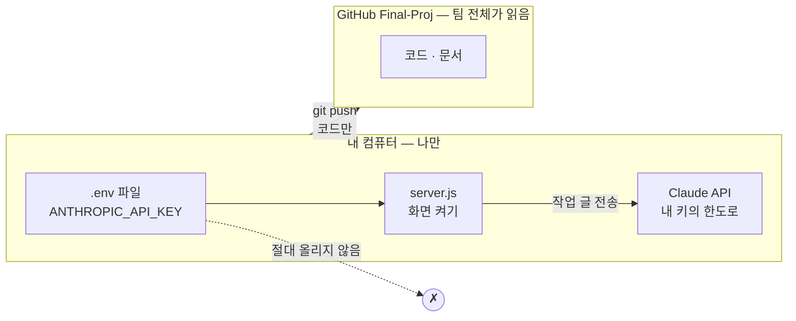
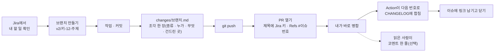

<!-- claude-drafted: 2026-10-17 — 이재엽의 요청("어디에 올리고 어떻게 해야 하는지, 사용하는 법")으로 Claude가 팀이 실제로 쓰는 방식(PR #54~#74)을 보고 썼다. 키 관련 동작은 PR #74(provider.js) 기준이다. -->

# 팀 작업 가이드 — 내 키는 어디에 두고, 작업은 어디에 올리나

한 줄: **키는 내 컴퓨터에만 두고, 올라가는 것은 코드와 문서뿐이다.**



## 1. 처음 한 번

| 할 일 | Mac | Windows |
|---|---|---|
| 받기 | `git clone https://github.com/2026-Codyssey-Final-Proj/Final-Proj.git` | 같음 (Git Bash 또는 PowerShell) |
| 폴더 들어가기 | `cd Final-Proj/backend/navigator` | `cd Final-Proj\backend\navigator` |
| Node 확인 | `node --version` → **v20.6 이상** | 같음 |
| 도구 받기 *(내 키로 쓸 때만)* | `npm install` | 같음 |

Claude Code를 열면 이름과 역할을 묻는다 — 대답하면 된다([CLAUDE.md](../../CLAUDE.md)).

## 2. 내 키로 시연 화면 켜기

**어느 방식으로 쓸지 고른다.**

| 방식 | 언제 | 비용·한도 |
|---|---|---|
| ① 내 API 키 | 키가 있다 | 내 키의 한도 |
| ② 내 Claude 구독 | 키는 없고 Claude Code에 로그인했다 | 내 구독 |
| ③ 연습용 예시 | 아무것도 없다 / 전송 없이 보고 싶다 | 없음 |

②·③은 키 설정이 필요 없다 — 3단계의 `server.js`만 켜면 된다.

### ① 내 API 키로 쓰기

1. **`.env` 만들기** — 이 폴더(`03-backend/navigator`)에서:

   | Mac | Windows (PowerShell) | Windows (cmd) |
   |---|---|---|
   | `cp .env.example .env` | `Copy-Item .env.example .env` | `copy .env.example .env` |

2. **편집기로 `.env`를 열어** `ANTHROPIC_API_KEY=` 바로 뒤에 키를 붙여 넣고 저장한다.

   ```
   ANTHROPIC_API_KEY=sk-ant-…내 키…
   NAV_TOKEN_BUDGET=…내 한도의 80% 정도…
   ```

   - **따옴표·공백 없이** 한 줄로. `NAV_TOKEN_BUDGET`은 이 키로 쓸 한도(토큰 수) — 80%에서 알려 주고 100%에서 멈춘다. 한도가 얼마인지는 키를 만든 콘솔에서 확인한다.
   - **키를 명령어로 치지 않는다**(`echo`, `set` 등). 터미널 기록에 남는다. 꼭 편집기에서 붙여 넣는다.

3. **되는지 확인** (아주 작은 호출 1번):

   ```bash
   node --env-file=.env smoke.js
   ```

   `성공 — 이번 호출 …토큰`이 나오면 된다. 실패하면 아래 "막혔을 때".

4. **화면 켜기:**

   ```bash
   node --env-file=.env server.js
   ```

   시작 로그에 `AI: 내 API 키(…)`가 나오면 내 키로 부르는 중이다. 브라우저에서 `http://127.0.0.1:4317`을 연다.
   끄려면 터미널에서 `Ctrl + C`.

> `--env-file`이 안 되면(Node가 낡았다) 터미널에서 직접 설정해도 된다: Mac `export ANTHROPIC_API_KEY=…`, PowerShell `$env:ANTHROPIC_API_KEY="…"`. 그 터미널을 닫으면 사라진다.

### 코디세이에서 받은 키가 "가상 키"라면

코디세이 운영팀이 **중계 서버 주소와 함께 준 키**는 공식 주소로는 통하지 않는다(`API 키가 맞지 않아요 (401)`). `.env`에 세 줄을 둔다.

```
ANTHROPIC_API_KEY=<가상 키>
ANTHROPIC_BASE_URL=<운영팀이 알려 준 주소>
NAV_MODEL=<운영팀이 알려 준 모델 이름>
```

주소를 두면 호환 모드가 자동으로 켜진다. `smoke.js` 첫 줄에 **보내는 곳**이 나오니 주소가 맞는지 본다. 이때 작업 글은 **그 중계 서버를 거친다.**

### 화면에서 알아 둘 것

- 보기 방식이 **"진짜 AI"** 이면 쓴 글이 Claude로 **전송된다**. 비밀번호·다른 사람 연락처는 넣지 않는다.
- 전송 없이 보려면 보기 방식을 **연습용 예시**로 바꾼다.
- `http://127.0.0.1:4317/api/usage`에서 지금까지 쓴 토큰을 볼 수 있다(키 값은 나오지 않는다).

## 2-b. 실제 프로젝트에 붙여 써 보기 — 한 줄로 켜기

<!-- claude-drafted: 2026-10-19 — 이재엽의 결정(2026-10-18 "화면에서만 실행해서 보이는게 아니라 실질적으로 테스트를 진행할 수 있도록 하고 우리가 사용하면서 느끼고 싶어")으로 Claude가 썼다. -->

시연 장면이 아니라 **내가 지금 Claude Code로 만드는 프로젝트**에 Floe를 붙여 쓴다. 세 단계(훅 연결 · 서버 · 브라우저)를 한 줄이 한다.

```bash
node 03-backend/navigator/floe.js ~/내-프로젝트      # 훅 연결 → 서버 → 브라우저. 키(.env)가 있으면 내 키로, 없으면 내 Claude 구독으로
node 03-backend/navigator/floe.js ~/내-프로젝트 --off   # 다 써 본 뒤 그 폴더의 훅을 뺀다 (서버는 켜지 않는다)
```

| 그 뒤에 | 어디서 | 무엇이 보이나 |
|---|---|---|
| **그 폴더에서 Claude Code를 새로 연다** | 터미널 | 요청을 보내거나 작업이 끝나면 플로로가 "바뀐 작업을 보고 어디쯤인지 볼까요?"라고 묻는다(위쪽 줄에 초록 불) |
| 처음에는 예시 책과 **내 책**이 같이 보인다 | 오버레이 → 도서관 탭, 서고 | 내 책 = 이 화면의 단계 · 할 일 · 확정한 설계도 · 배운 말. 예시 책에는 '예시' 꼬리표 |
| **예시 책 지우기** | 도서관 탭 아래 · 서고 오른쪽 위 | 예시 책 · 레퍼런스 · 물어볼 것이 비고 내 기록만 남는다(이 브라우저에 저장). '다시 보기'로 되돌린다 |
| **느낀 점 남기기** | 톱니(설정) → 느낀 점 | 한 줄 적으면 어느 화면 · 몇 단계 · 언제가 저절로 붙는다. 이 컴퓨터에만 남는다 |
| **Jira용 복사** | 같은 자리 | 느낀 점을 시간 순 목록 글로 복사한다 — Jira 프로젝트 Floe의 이슈에 붙인다(비밀값 · 연락처 모양은 가려진다) |

- 훅은 그 폴더의 `.claude/settings.local.json`에만 들어간다(개인 설정 — 저장소에 올라가지 않는다). 다른 훅은 건드리지 않고, 백업을 먼저 만든다.
- 끄기는 그 터미널에서 `Ctrl + C`. 훅은 남아 있으니 다음에 또 쓰면 같은 한 줄이다. 그만 쓸 때 `--off`.
- 보기 방식이 **진짜 AI**면 최근 작업 대화가 Claude로 전송된다 — 비밀번호 · 다른 사람 연락처가 섞인 프로젝트에는 붙이지 않는다([시연 안전장치](../../03-backend/navigator/README.md) S1~S6도 그대로).
- Windows: `node 03-backend\navigator\floe.js C:\내-프로젝트`. Codex도 같이 알아채게 하려면 `--codex`(Codex는 전체에 걸린다).

## 2-c. 앱으로 쓰기 — 내려받아 더블클릭 (알파)

<!-- claude-drafted: 2026-10-19 — 이재엽의 요청("coucou처럼 다운만 받으면 사용할 수 있도록")으로 Claude가 썼다. -->

2-b의 한 줄 대신 **실행 파일**로 쓸 수 있다. 화면과 서버가 그대로 들어 있고, 창이 **항상 위에** 떠서 진짜 코딩 도구 위에 겹친다(`02-frontend/electron`).

| 순서 | Mac | Windows | 우분투 Linux (6.0.0부터) |
|---|---|---|---|
| 받기 | `Floe-<버전>-arm64.dmg` — [GitHub Releases](https://github.com/2026-Codyssey-Final-Proj/Final-Proj/releases) (지금 알파 `app-v8.1.0`, 2026-10-20, Apple Silicon — 비공개 저장소라 팀원만 받는다) | `Floe-Setup-<버전>.exe` — 같은 Release에 **CI가 묶어 올린다**(main 병합 뒤) | `Floe-<버전>-x86_64.AppImage`(보통 PC) 또는 `Floe-<버전>-amd64.deb` — 같은 Release(ARM 컴퓨터는 `-arm64`) |
| 처음 열기 | ① 켜진 Floe를 끈다(Cmd+Q — 9.0.0부터는 한 번에 하나만 켜진다) ② dmg에서 Floe를 **'응용 프로그램'으로 끌어 놓는다**(물으면 '대치') ③ 연다 — 9.0.0부터 간이 서명이라 경고가 뜨면 **시스템 설정 → 개인정보 보호 및 보안 → '그래도 열기'**(사람 확인 전, F-41) ④ 그래도 막히면 터미널에서 `xattr -dr com.apple.quarantine /Applications/Floe.app` 뒤 다시 연다. 8.1.0까지는 서명이 깨져 '손상된 앱'으로 막혔고, macOS 15부터는 우클릭 → 열기가 없다(F-41 · F-43) | SmartScreen 경고 → "추가 정보 → 실행" | AppImage: `chmod +x Floe-*.AppImage && ./Floe-*.AppImage` (또는 파일 속성 → 실행 허용 → 더블클릭). deb: `sudo apt install ./Floe-*.deb` 뒤 앱 메뉴의 Floe. AppImage가 FUSE를 찾으면 `sudo apt install libfuse2t64`(22.04는 `libfuse2`) |
| 연결 | 메뉴 **Floe → 프로젝트 폴더 연결…** 또는 톱니 → 연결 칸의 단추 | **창 우클릭** 또는 알림 영역(트레이)의 Floe 아이콘 → 같은 메뉴 | 같음(창 우클릭 · 트레이) |
| AI | **처음 켜면 플로로가 물어본다** — Claude Code로 연결하거나 API 키를 넣는다(2026-10-19). 나중에 바꾸려면 톱니 → 처음 설정 다시 하기 | 같음 | 같음 |
| 끄기 | 메뉴 **Floe → Floe 끄기** (Cmd+Q) | 우클릭 → Floe 끄기 | 우클릭 → Floe 끄기 |

- 직접 묶으려면: `cd 02-frontend/electron && npm install && npm run dist`(Mac) · `dist:win` · `dist:linux` — [electron/README.md](../../02-frontend/electron/README.md).
- 앱은 늘 자기 서버를 켠다(4317이 막혀 있으면 옆 포트). 터미널의 서버와 섞이지 않는다.
- **새 버전을 깔기 전에 켜진 Floe를 끈다** — 옛 버전이 켜져 있으면 새 것을 열어도 옛 것이 앞에 나온다(F-42). 직접 `npm run dist`로 묶은 앱은 인터넷 표시가 없어 ③이 필요 없다. <!-- claude-drafted: 2026-10-20 -->
- **8.0.0으로 올렸으면 프로젝트 폴더를 한 번 다시 연결한다** — 모아 보기 창의 AI 진행(C-12)이 쓰는 훅이 그때 새로 걸린다.
- **새 버전:** 메뉴 **Floe → 새 버전 확인**이 Releases를 연다. 앱 버전(`02-frontend/electron/package.json`)이 main에서 바뀌면 CI가 Mac · Windows · Linux를 묶어 올린다 — 앱 버전은 **팀이 버전업을 정할 때만** 올린다(2026-10-19) — [electron/README.md](../../02-frontend/electron/README.md) "받기 · 업데이트".
- 느낀 점 · 내 책은 앱 안에 남고, 브라우저로 연 것과는 따로다.

## 3. 작업은 어디에 올리나 — 팀이 하는 방식

**GitHub `2026-Codyssey-Final-Proj/Final-Proj`** 에 올린다. 2026-10-18부터 **브랜치 → PR → 올린 사람이 바로 병합**이다 —
서로 동의를 기다리지 않고, 올릴 때마다 [CHANGELOG.md](../../CHANGELOG.md)에 생기는 버전(vN.M) 한 줄로 알린다(팀 결정 — 이재엽).
**2026-10-19부터 PR은 CHANGELOG를 직접 고치지 않는다** — [`changes/<브랜치 끝 이름>.md`](../../changes/README.md) 조각 한 장(종류 · 누가 · 무엇 · 건드린 곳)을 넣으면,
병합될 때 Action이 다음 번호를 붙여 CHANGELOG에 합친다. 종류는 **큰 묶음**(기능을 더하거나 바꿈 → N+1·M=0) 또는 **작은 고침**(버그·문서·시험 → M+1) — 올린 사람은 종류만 고르고 번호는 병합될 때 정해진다.
할 일은 **Jira 프로젝트 Floe**에 있고(#102), Jira 이슈가 있으면 브랜치 · PR 제목에 키(`<키>-12`)를 넣는다 — 병합되면 그 이슈에 버전이 붙는다([jira.md](jira.md)).
`main`에 직접 올려도 되고 그때도 버전 한 줄을 넣는다. 읽은 사람이 병합 뒤에 남기는 PR 코멘트 한 줄은 **협업 증빙(평가 10점)** 이 된다(선택).



```bash
git checkout main && git pull                 # 최신으로
git checkout -b docs/내-주제                  # 브랜치 — v2/…, docs/…, fix/… 중 하나로 시작
# …작업…
git add <바꾼 파일>                            # git add -A 보다 파일을 골라서 (.env가 섞이지 않게)
# changes/내-주제.md 네 줄: 종류: 작은 고침 / 누가: 내 이름 / 무엇: 무엇이 달라졌나 / 건드린 곳: 폴더  (CHANGELOG.md는 고치지 않는다)
git commit -m "docs(범위): 무엇을 했는지"      # 제목은 `타입(범위): 설명` — docs · feat · fix · chore · refactor
git push -u origin docs/내-주제
gh pr create --title "<키>-12 docs(범위): 무엇을 했는지"   # 또는 GitHub 웹의 "Compare & pull request" — 버전 번호는 적지 않는다
gh pr merge --merge --delete-branch           # 동의를 기다리지 않고 내가 병합
```

**PR 본문에는** ① 무엇인가 ② 종류(큰 묶음/작은 고침) ③ 확인한 것(테스트·링크)을 적고, 맨 위에 `Refs #이슈번호`를 둔다.
병합은 **올린 사람이** 한다. 번호는 병합될 때 Action이 붙이므로 같은 번호 충돌은 없다 — 병합 1분 뒤 CHANGELOG 맨 위에 내 줄이 `(#PR번호)`와 함께 생겼는지 한 번 본다.
Claude는 병합하지 못한다(훅) — Claude에게 시킨 PR은 내가 병합한다.

### 올리기 전에 한 번

| 확인 | 명령 |
|---|---|
| 테스트가 통과한다 | `python3 04-tests/run_all_tests.py` (Windows: `python`) — 노드 시험까지 함께 돈다 |
| **키·비밀번호가 안 섞였다** | `git status`에 `.env`가 **없어야** 한다(무시되는 파일이라 안 보이는 게 정상). 커밋 때 `check-secrets.sh`가 한 번 더 막는다 |
| 개인 정보가 없다 | 인터뷰 응답자 이름·연락처, 다른 사람의 메시지는 올리지 않는다(`응답자 A`로) |

## 4. 하지 말 것

- ❌ **키를 채팅·이슈·PR·스크린샷·커밋에 붙이지 않는다.** 한 번 올라가면 지워도 이력에 남고, 남은 키는 폐기해야 한다.
- ❌ 남의 키를 빌려 쓰지 않는다 — 한도가 같이 줄고, 새면 책임이 불분명하다.
- ❌ `git push --force`, `main`에 Claude가 올리게 하기(훅이 막는다).
- ❌ `.env`를 `git add -f`로 억지로 올리기.

**키가 실수로 올라갔다면:** 바로 콘솔에서 그 키를 **폐기하고 새로 만든다.** GitHub에서 지우는 것만으로는 소용없다. 그리고 이재엽에게 알린다.

## 5. 막혔을 때

| 보이는 것 | 뜻 | 해결 |
|---|---|---|
| `API 키가 맞지 않거나 권한이 없어요` | 키가 틀리거나 잘렸다 | `.env`의 키를 다시 붙여 넣는다 — 따옴표·공백·줄바꿈 없이 |
| `API 호출 도구가 없어요 … npm install` | SDK를 안 받았다 | 이 폴더에서 `npm install` |
| `이 키의 토큰 한도에 다다랐어요` | `NAV_TOKEN_BUDGET`에 도달했다 | 보기 방식을 연습용 예시로 바꾸거나, 한도를 올린다. 새 키·새 시작이면 `~/.navigator-usage.json`을 지운다 |
| `잠시 너무 많이 불렀어요` | 짧은 시간에 너무 많이 눌렀다 | 잠깐 기다렸다가 다시 |
| `claude 명령을 찾지 못함` | 키가 없고 Claude Code도 없다 | 키를 넣거나, 보기 방식을 연습용 예시로 |
| `node: bad option: --env-file` | Node가 20.6보다 낡았다 | Node를 올리거나 2절의 `export` / `$env:` 방법 |
| `요청이 받아들여지지 않았어요 (400/404)` | 모델 이름이 그 서버에 없다 / 새 기능을 못 받는다 | `NAV_MODEL`을 운영팀이 알려 준 이름으로, `NAV_COMPAT=1` |
| `API 키가 맞지 않아요 (401)` + 가상 키 | 공식 주소로 보내고 있다 | `.env`에 `ANTHROPIC_BASE_URL`(운영팀 주소) |
| `답이 길어서 잘렸어요` | 한 번에 받는 토큰이 모자라다 | `.env`에 `NAV_MAX_TOKENS=4096` |
| 그 밖 | | 화면의 오류 문구를 이슈나 팀 채널에 붙이되, **키는 지우고** |

## 6. 더 보기

- 환경변수 전체와 동작 원리: [navigator-prototype/README.md](../../03-backend/navigator/README.md)
- 일정·역할·마감: [schedule.md](schedule.md) · [TEAM.md](../../TEAM.md)
- 공유·개인정보 규칙: [team-sharing-security.md](team-sharing-security.md)
