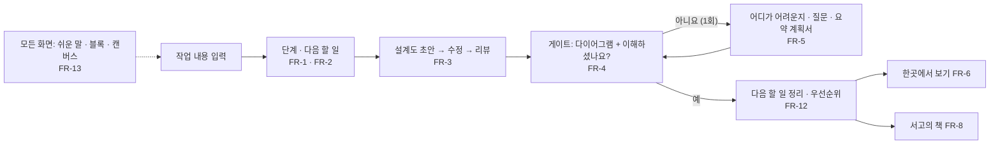
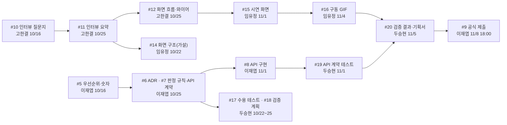

<!-- claude-drafted: 2026-10-13 — 이재엽의 요청("우선순위를 정리하고 각자의 클로드가 확인할 수 있도록")으로 Claude가 requirements.md 10~11절, schedule.md, 열린 이슈 #5~#20을 한 장으로 모았다. 원천은 그 문서들과 이슈이고, 어긋나면 그쪽이 맞다. 2026-10-14 개정 — 이재엽이 대화에서 확정한 결과(requirements.md 13-1, PR #34)에 맞춰 Claude가 고쳤다. 확정은 이재엽의 답에서만 가져왔고, 담당이 정해지지 않은 일은 "담당 대기"로 표시했다. -->

# 팀 우선순위와 이어지는 순서

> **이 문서는 길잡이다. 원천이 아니다.** 우선순위 등급과 근거는 [requirements.md](requirements.md) 10절, 숫자 점검은 11절,
> 날짜는 [schedule.md](schedule.md), 할 일은 **Jira 프로젝트 Floe**에 있다(2026-10-18 GitHub 이슈 #5~#20에서 옮김 — #102, [jira.md](jira.md)). 어긋나면 그쪽이 맞고, 이 문서를 고친다.
> 기준일: 2026-10-14 (4절 "내 몫"은 2026-10-17). 등급은 [PR #34](https://github.com/2026-Codyssey-Final-Proj/Final-Proj/pull/34)(병합됨)의 확정 기록을 따른다.

**Claude에게:** 처음 세션이면 [CLAUDE.md](../../CLAUDE.md)의 "처음 세션이면"으로 이름과 역할을 확인한 뒤, 이 문서의
**"내 몫"**에서 그 사람의 줄을 읽고 "지금 무엇을 해야 하는지, 누구를 기다리는지, 누구가 나를 기다리는지"를 먼저 알려 준다.
할 일 상태는 Jira에 있다 — Claude는 Jira를 읽지 못하므로 이 문서로 말하고, "Jira와 같은지 한 번 봐 주세요"라고 덧붙인다(이 문서는 낡을 수 있다).

## 0. 2026-10-18 진행 — 남은 요구 작업 한 묶음

<!-- claude-drafted: 2026-10-18 — 이재엽의 결정("모든 요구사항들을 나의 권한으로 다른 사람들은 동의는 사후공지야 쭉 진행해", requirements.md 13-1)으로 Claude가 진행한 작업의 상태. 담당자에게는 PR 리뷰 요청과 이슈 댓글로 사후 공지했다. 아래 4절 "내 몫"의 담당·기한은 그대로다. -->

| 일 | 이슈 | PR | 상태 | 리뷰 |
|---|---|---|---|---|
| 판정 규칙 확정 후보 — 빠진 항목·보안 점검 한 줄·등급별 항목 | #7 | #96 | **병합됨** — 확정 질문 4개는 2026-10-18 "다 GO"로 확정(F-02) | 두승현 |
| 수용 테스트 틀(Given-When-Then) + 자동 시험 | #17 | #95 | **병합됨** | 두승현 |
| 시연 안전장치 S3~S5(알림 확인 값·받은 글 검사·기록 비우기), S6 한 줄 점검 | #15 | #94 | **병합됨**(10/18) | 두승현 |
| 화면 빈칸 — 용어 풀이(FR-13)·'예' 뒤 확인 질문(FR-4)·보류(FR-5)·꼭/나중에(FR-12)·작업 알림(FR-7)·만드는 크기·연결 끊기(S2) | #15 | #99 | **병합됨**(10/18) | 임유정 |
| 로컬 API 약속 문서 + 계약 테스트, 서버 결함 6개 | #7 · #19 | #100 | **병합됨**(10/18) | 두승현 |
| 실제 AI 점검(정답과 98% 일치, 한 번에 약 8천 토큰) · 시연 녹화 17개 | #7 | #98 | **병합됨**(10/18) | 두승현 |

**2026-10-19 — 7단계(유지보수)로 들어갔다.** 게이트 5→6 · 6→7 Go(이재엽). 이제 써 보기 → 고칠 목록 → 고침(vN.M) → 다시 묶기 고리로 간다([fix-map.md](../07-maintenance/fix-map.md) 0-1절). 6→7 리뷰가 남긴 일: 목표 숫자(F-01 — **10/19 1차로 정함**, 10/26 다시 보기) · 사용 테스트로 재기(F-23).

**남은 것 — 사람이 해야 한다:** 인터뷰 결과(#11 → FR-2 항목 수 · FR-13 용어 목록 — FR-8 역량 단위는 역량 지도를 지워 해당 없음, 2026-10-19), 사용자 테스트(#13 · #20), 화면을 사람이 직접 보고 수용 테스트 기록표에 남기기, 공식 제출(#9). **이재엽이 정할 것:** ~~요구 후보 C-1~C-16의 등급~~ — 2026-10-20 정함(requirements.md 2-2 '세는 법'). #96의 확정 질문 4개 · 6단계 2번 나누기 · #100의 AI 주소 확인 값은 2026-10-18에 끝났다(F-02 · F-03 · F-04 고침) <!-- claude-drafted: 2026-10-20 — F-29 -->.

**2026-10-20 — 켜짐 · 인사(C-10), 모아 보기 창(C-11 — 바이브 코딩 · 알림), AI 진행(C-12 — Claude Code가 하는 일)은 페이블 세션에서 만들어 앱 8.0.0에 들어갔다**(이재엽 "현 지금 작업할거임 토큰이 남고 시간이 남아서 작업해볼 예정임" — 등급 미정). 만드는 법 · 시험: [페이블 넘김 문서](기록/fable-handoff-2026-10-20.md), 고칠 목록 F-28.

**2026-10-20(둘째) — 기본 모드 · 바이브 코딩 모드(C-13), 섬의 움직임(C-14), 서고 전환 끊김(F-35)을 요구와 고칠 목록에 올렸다** — 같은 날 **한 PR로 만들었다**(이재엽 버튼, 브랜치 v2/island-modes): F-34 고침 · F-35 고침(일부). 등급 미정(11/3 전에 넣을지는 병합 때), 앱 버전은 그대로. 만드는 법: [넘김 문서](기록/fable-handoff-2026-10-20-modes.md), 고칠 목록 F-34 · F-35. <!-- claude-drafted: 2026-10-20 -->

**2026-10-20(셋째) — 플로로에게 먹이 주기(C-15)와 설계도 탭 대신 도서관의 책(C-16)을 요구에 올렸다**(이재엽 "그렇게 기능을 한곳에 통합시켜줘" · "지금의 목표는 기능들을 하나씩 합쳐야할 거 같아"). C-15는 C-2 · C-8 · 보여 주기 칸을 먹이 주기 화면 하나로 합친다. 등급 미정, 앱 버전은 그대로. 만드는 법 · 차례: [넘김 문서](기록/fable-handoff-2026-10-20-feed.md). <!-- claude-drafted: 2026-10-20 -->

**2026-10-20(넷째) — 요구 후보의 등급을 정했다**(이재엽 "c 등급 해결 및 릴리즈 파일 만들기" + 버튼). 새 요구 FR-14(C-1) · FR-15(C-15) · FR-16(C-5) · FR-17(C-4), 나머지는 세부로 합침, FR-7은 Should로. 이번 대회에서 빼자던 C-4 · C-9 · C-3 세션별 · 책별은 이재엽 "아니 지금 하자" — **11/1 전에 만든다**: [넘김 문서](기록/fable-handoff-2026-10-20-c4-views.md). C-15 · C-16 · F-40은 앱 8.1.0으로 나갔다. <!-- claude-drafted: 2026-10-20 -->

**2026-10-23 — 새 방향으로 이번 주 계획을 다시 짰다**(이재엽 "요구사항들을 정리해서 이번주 계획들을 파악해야해"). 퀘스트를 생각 → 행동 → 기록 → 저장 → 버전(V.n)으로 돌리고, NotebookLM 공부 · GitHub 기록 · 내 작업 책 · 관문 계획서를 더한다 — 요구 후보 C-23~C-27([requirements.md](requirements.md) 2-2, 등급 미정). 아래 담당은 4절 역할에서 가져온 **제안**이다. 이 세션은 Jira를 읽지 못했다(연결 실패) — Jira와 같은지 한 번 봐 주세요. <!-- claude-drafted: 2026-10-23 --> **같은 날 둘째**(이재엽 버튼): 레벨은 관문마다 +1 누적(C-28), 섬의 명령 네 칸은 맡기기 · 살피기 · 책 · 배우기(C-29 · C-30), 저장소는 만들어 주고 책은 README를 받아 와 보여 주기만(C-25 · C-26), **서재는 단추를 지우고 대회 뒤 다시 연다.** <!-- claude-drafted: 2026-10-23 -->

| 언제 | 일 | 담당 (제안) | 끝 조건 |
|---|---|---|---|
| 10/23(금) | ~~C-23~C-27을 동결 전에 넣을지~~ → **다섯 다 11/1 전에**(이재엽 버튼). MoSCoW 등급은 아직 | 이재엽 | 13-1에 답 — 정함 |
| 10/24(토) | ~~C-31~C-33을 동결 전에 넣을지~~ → **셋 다 11/1 전에**(이재엽 버튼, [requirements.md](requirements.md) 2-2) · 플로로가 움직이는 자리는 섬과 작업 폴더 **둘 다**. MoSCoW 등급은 아직 <!-- claude-drafted: 2026-10-24 --> | 이재엽 | 13-1에 답 — 정함 |
| 10/24(토)~25(일) | 온보딩 장면 열둘에 더할 것 적기(작업 보드의 장면 카드) | 이재엽 → UI/UX | 장면마다 더할 것이 정해짐 |
| 10/25(일) | 3→4 게이트 묶음 — 판정 규칙(#7) · 인터뷰 요약(#11) · 화면 흐름(#12) · ADR(#6) · 검증 계획(#18) | 4절 각 담당 | 3→4 Go |
| 10/25(일) | 앱 10.0.0을 사람 눈으로(창 끌기 · 노치 · 두 화면), 진짜 AI로 퀘스트 만들기 한 번 | 전원 각자 | 본 것 한 줄씩(지금은 자동으로 눌러 본 기록만 있다) |
| 10/26(월) | 성공 수치 다시 보기 | 이재엽 · 두승현 | 13-1에 그대로 / 바꾼 값 |
| 10/26~29 | 퀘스트의 기록 · 저장 · 버전 칸(C-23 · C-25) — 저장소 만들어 주기 · 기록은 README의 한 절 · 커밋은 사용자의 Claude Code가(허락 카드, 정함) | 이재엽 | 연습 예시로 한 바퀴 |
| 10/26~31 | 시작하는 자리(C-31 — GitHub · 새 저장소 · 작업 폴더를 앱 안에서) · 플로로가 프로젝트를 안다(C-32 — 퀘스트를 Claude Code에 넘기고 해낸 것을 확인, 판단은 사용자와 대화) · 초등학생 말로(C-33). 먼저 F-49(플로로가 문제를 못 알아봄)를 연습용 저장소로 재현 <!-- claude-drafted: 2026-10-24 --> | 이재엽 · 화면 구현 | 연습용 저장소 하나로: 앱에서 새 저장소 → 프로젝트 읽기 확인 → 퀘스트 맡기기 → 해낸 것을 쉬운 말로 대화 |
| 10/26~29 | 명령 네 칸 — 맡기기 · 살피기 · 책 · 배우기(C-29), 레벨 누적(C-28), 서재 단추 지우기 | 이재엽 · 화면 구현 | 네 칸이 숫자 1~4로도 돈다 · 새 프로젝트에서 레벨이 그대로 |
| 10/24(토) | 오버레이는 일하는 자리(C-35) — 명령 네 칸을 빼고 위 줄의 '퀘스트' 단추, 계획 · 맡기기 · 허락 · 보고는 채팅, 확정한 계획은 퀘스트 창의 '맡길 일' 퀘스트(순서대로), 배우기는 도전과제의 장마다 <!-- claude-drafted: 2026-10-24 --> | 이재엽 · 화면 구현 | 만듦(PR) — test-1로 채팅 한 바퀴를 사람 눈으로 · 기능마다 처음 쓰는 장 정하기 |
| 10/25(일) | 처음 한 바퀴(C-36) — 처음 설정의 계획 칸 뺌, 원하는 것을 플로로에게 → AI가 1단계 초안(제목 = 주제) → 칸마다 맞나요 · 누가(본인 / 소수 / 불특정다수) · 크기(짧음 / 보통 / 긺) → 관문 → 2단계 <!-- claude-drafted: 2026-10-25 --> | 이재엽 · 화면 구현 | 만듦(PR) — 진짜 AI로 test-1 문제 글을 넣어 초안 한 번 보기 |
| 10/28~30 | 관문 계획서와 목차(C-27), 공부 묶음(C-24) | 이재엽 · 화면 구현 | 1단계 관문에서 목차를 눌러 그 절로 |
| 10/30~11/1 | 책 — README를 받아 와 보여 주기만(C-26, 서재 없이) | 이재엽 · 화면 구현 | 예시 README로 책 한 권 |
| 10/28~31 | 배우기 — 기능마다 튜토리얼(C-30): 어떻게 움직이나 · 예시 · 막히면 | 이재엽 · UI/UX · 시험 · 검증 | 기능 하나의 튜토리얼이 끝까지 돈다 · 사용 테스트에서 기능마다 하나씩 |
| 10/27~11/1 | 처음 한 바퀴 온보딩을 화면으로 | UI/UX · 화면 구현 | 정한 장면이 화면에 |
| 10/31(토) | 멘토링 2 (2주 간격 가정 — 멘토 확인 전) | 이재엽 | — |
| **11/1(일)** | 기능 동결 — 이재엽 버튼 "11/1(일)"로 맞춤([schedule.md](schedule.md)의 11/3도 고침). 11/2~3은 녹화 · 수용 테스트 기록 | 전원 | 새 기능을 받지 않는다 |

## 1. 기준 한 줄

**11/1(일) 기능 동결까지 시연 시나리오 하나가 처음부터 끝까지 도는 것.** 시연은 서버 없이 가상 데이터로 하고, 구동 GIF·영상으로 제출한다.

## 2. 우선순위 — 요구사항 17개 (이재엽 확정 2026-10-14 · 2026-10-20 넷 더함)

| 등급 | 요구 | 한 줄 이유 |
|---|---|---|
| **Must** | FR-1 단계·다음 할 일 | 없으면 제품이 성립하지 않는다. 최소로 만든다 |
| **Must** | FR-2 어디까지(완료 기준) | 핵심 가치. 완료 기준의 질이 곧 제품의 질이다 |
| **Must** | FR-3 설계도 초안 → 수정 → 리뷰 | "AI API를 그대로 쓴 수준을 넘어"(기획 20점)를 보일 큰 자리 |
| **Must** | FR-4 게이트 이해 확인(다이어그램 + 예/아니요) | "성장하는 건 사람"이라는 차별점 |
| **Must** | FR-5 "아니요" → 확인·질문·요약 계획서 | 시연은 **1회 루프**, Hold 탈출은 Could로 나눔(확정) |
| **Must** | FR-6 한곳에서 보기 | 이재엽: "보기 편해서". 시연은 가상 숫자 |
| **Must** | FR-8 지식 창고(서재의 책) | 저장된 것을 시각으로 보이는 표현 수단(이재엽). **2026-10-19 범위 줄임** — 역량 지도 · '내 배움' 뺌, 지식 은하 보류 |
| ~~Must~~ **Won't** | ~~FR-9 기본 나만 보기~~ | 2026-10-19 뺌 — 팀 작업에는 필요 없다(이재엽) |
| **Must** | FR-10 서버·도메인 없이 가상 데이터 시연 | 선택이 아니라 전제 |
| **Must** | FR-13 비전공자를 위한 디자인과 접근 | 이재엽: "보기 편해서". 새 요구, 새 일은 용어 즉시 풀이 |
| **Must** | FR-15 플로로에게 먹이 주기(C-15 — C-2 · C-8을 합침) | 8.1.0부터 FR-1로 들어가는 첫 화면(2026-10-20) |
| **Must** | FR-16 오버레이로 묻고 답하기(C-5 — 세부 C-10 · C-13) | 제품이 쓰이는 방식 자체(2026-10-20) |
| Should | FR-12 게이트 뒤 다음 할 일·우선순위 | 게이트 화면에 목록 하나 |
| Should | FR-7 Claude 작업 → 알림 | 2026-10-20 Could에서 올림 — C-11 알림 · C-12 AI 진행으로 만들어짐 |
| Should | FR-14 API 키로도 움직이기(C-1) | 구독이 없는 사람도. 시연은 키 없이(2026-10-20) |
| Should | FR-17 대화로 일 넘기기 · 섬에서 허용 · 거절(C-4) | 이재엽 "아니 지금 하자" — 11/1 전에 만든다(2026-10-20) |
| Could | FR-11 도와준 사람 | 제품 기능이 아니라 문서 |

**Must 11개**(초안은 7개, 10/14에 10개, 2026-10-19 FR-9를 Won't로 9개, **2026-10-20 FR-15 · FR-16을 더해 11개**). Should 4개(FR-7 · 12 · 14 · 17), Could 1개(FR-11). 새 확정은 FR-6·8·13의 등급 상승과 FR-13의 추가다. 투자 규칙: Must 중 Basic(FR-1·10)은 최소 기능만 만들고, Performance(FR-2·3·4·5·8)에 시간을 쓴다.

**같이 확정된 것**

| 결정 | 내용 |
|---|---|
| AI 적용 합리성의 주력 | 게이트 판정 규칙(FR-2·4) **+** 장기 기억(FR-8) 둘 다 — 장기 기억은 **서고의 책**으로 보인다(2026-10-19, 역량 지도를 지운 뒤 이재엽 "서고의 책으로 충분해") |
| 캔버스 | 시연 화면 안의 캔버스 형태 **+** 의도명세 캔버스 문서 |
| 유스케이스 | requirements.md 새 절 + `01-docs/04-pattern-implementation/uc/` + 시연 화면 |
| 블록 디자인 | 7단계 진행 + 단계 안의 할 일 + 게이트 흐름을 블록으로 이어 보임 |

## 3. 어떻게 이어지는가

시연 시나리오 하나:

일의 순서(누구의 결과가 누구의 입력이 되는가):

## 4. 내 몫

사람별 할 일의 **원천은 이 절이다.** [schedule.md](schedule.md) 3-2-1과 [work-split-2026-10-16.md](기록/work-split-2026-10-16.md) 3절에 있던 표를 여기로 합쳤다(2026-10-17).
이슈 상태는 2026-10-17에 `gh issue list`로 확인한 값이다. 리뷰어는 각 이슈에 적힌 사람이다.

### 이재엽 — 팀장 · 총괄 · AI 에이전트 · API 연동

| 이슈 | 일 | 기한 | 리뷰어 | 받는 것 | 주는 것 |
|---|---|---|---|---|---|
| #5 | 우선순위·숫자 확정·출처 추적표 | 10/16 | 두승현 | — | **완료** (이슈 닫힘, PR #34·#44·#60) |
| #6 | 구조 결정(ADR)·아키텍처·파이프라인 다이어그램 | 10/25 | 임유정 | 고한결의 인터뷰 요약(#11) | 두승현의 검증 계획, 임유정의 화면 구조 |
| #7 | 판정 규칙·프롬프트·장기 기억·API 계약 — **주력은 판정 규칙 + 장기 기억 둘 다**. 판정 규칙은 프로토타입을 출발점으로(4가지 수정 반영은 두승현) | 10/25 | 두승현 | #5 | 두승현의 수용 테스트(#17), API 구현(#8) |
| #8 | API 구현·연동 | 11/1 | 임유정 | #7 | 임유정의 화면 연결, 두승현의 계약 테스트(#19) |
| #9 | 공식 제출 | 11/7 저녁 내부 · 11/8 18:00 | — | #20 | — (팀장만 제출, 제출 후 수정 불가) |
| #50·#51 | 합의 안건 모으기(이름·라이선스·공개 범위) | #51 이름 10/17 18:00 | — | 팀원 의견 | 확정 기록 |

결정 대기: ① 새 일(캔버스 문서·유스케이스)의 담당·기한(아래 4-1) ② #7 이슈 설명에 장기 기억 포함 ③ 라이선스·대회 후 소유(팀원 동의 필요).
**주의:** 구조·판정 규칙·API·제출이 모두 한 사람에게 걸려 있다. 두승현의 수용 테스트(#17)를 일찍 받으면 작업을 나눠 확인할 수 있다.

### 고한결 — UI/UX · 인터뷰 · 발표 흐름

| 이슈 | 일 | 기한 | 리뷰어 | 받는 것 | 주는 것 |
|---|---|---|---|---|---|
| #10 | 인터뷰 질문지·대상 유형 — **프로그래밍을 배우지 않은 사람 최소 1명 포함(FR-13)** | 10/16 | 이재엽 | 기획안 "검증 계획" | **완료** (이슈 닫힘, PR #55) |
| #11 | 인터뷰 3~5명 요약 — 대상자 목록을 먼저 적는다 | 10/25 | 두승현 | #10 | 이재엽의 ADR(#6), 임유정의 화면 구조(#14), 역량·노력 항목(FR-8), "비전공자" 기준(FR-13) |
| #12 | 화면 흐름·와이어 — 인터뷰 전에는 가설로 | 10/25 | 임유정 | #11 | 임유정의 시연 화면(#15) |
| #13 | 사용자 테스트 진행·발표 스토리·자료 디자인, 마스코트 후속(투명 배경·표정) | 11/5 | 이재엽 | #15 | 발표 |
| #14 리뷰 | PR #58(`02-frontend/README.md`)에 리뷰어 코멘트 | — | — | — | #14 닫기 |
| #51 | 합의 안건에 의견 남기기, 마스코트 이미지 이용 조건 확인 | 10/17 18:00 | — | — | — |

**역할 동의:** 완료 (2026-10-15, [PR #54](https://github.com/2026-Codyssey-Final-Proj/Final-Proj/pull/54)).
**주의:** 인터뷰가 늦어지면 임유정의 #14와 이재엽의 #6이 가설 상태로 남는다. 응답자의 이름·연락처는 레포에 올리지 않는다.

### 임유정 — 프론트엔드

시험 기간에는 **두승현이 화면 작업을 이어받고 임유정은 확인·테스트**를 맡는다(이재엽 2026-10-15, requirements.md 13-1). 이슈 담당 이름은 임유정 그대로다.

| 이슈 | 일 | 기한 | 리뷰어 | 받는 것 | 주는 것 |
|---|---|---|---|---|---|
| #14 | 화면 구조 초안(인터뷰 전이라 가설) — PR #58 병합됨, 이슈만 열림. 시험 기간에는 이슈 닫기와 `02-frontend/README.md` 확인만 | 10/22 | 고한결 | 요구사항, 기획안 | 고한결의 와이어(#12)와 맞춘다 |
| #15 | 시연 화면: 단계 안내·게이트 이해 확인·한곳에서 보기 — **FR-8 역량 지도·블록·캔버스·UC 다이어그램이 들어갈 후보(4-1, 확정 전)**. 구현은 두승현, 시험 뒤 써 보고 막힌 곳 적기 | 11/1 | 고한결 | #12, 이재엽의 API 계약(#7) | #16, 두승현의 수용 테스트 |
| #16 | 구동 GIF·영상 — 시험 뒤 | 11/4 | 두승현 | #15 | 기획서(#20), 발표 |

**주의:** 서버 규칙(판정·권한)을 화면에서 다시 만들지 않는다. 시연은 미리 만든 응답으로 움직이고, 가상 데이터임을 화면에 표시한다(FR-10).

### 두승현 — 시연 프로토타입 · 테스트 · 검증 · 문서 · 협업 증빙 (2026-10-25 역할 수정, KAN-22)

| 이슈 | 일 | 기한 | 리뷰어 | 받는 것 | 주는 것 |
|---|---|---|---|---|---|
| #17 | 수용 테스트 틀(Given-When-Then) — **Must 10개가 대상**. 산출물 위치를 이슈에 한 줄로 | 10/22 | 이재엽 | requirements.md의 EARS 요구 | 이재엽·임유정이 만들 때의 기준 |
| #47 | 화면 방식 실험 — 확인 결과 3가지 대응 | 10/18 | — | 이재엽의 확인 코멘트 | #15 |
| #7·#15 | 판정 규칙 4가지 수정(근거 구절 검증·단계 계산·빠진 항목·등급별 5단계), 안전장치 S1~S6 | 10/20 · 10/25 | 이재엽 | `navigator-prototype-rules-review.md` | #7 확정본 |
| #18 | 검증 계획 — **사용 테스트 5명 이상에 비전공자 포함(FR-13)** | 10/25 | 고한결 | #6, 11절 숫자 점검 | #19, #20 |
| #15 | 시연 화면 구현(임유정에게서 이어받음) | 11/1 | 고한결 | #12, #7 | 임유정의 확인·테스트, #16 |
| #19 | API 계약 테스트 | 11/1 | 이재엽 | #7, #8 | #20 |
| #20 | 사용 전후 검증 결과·기획서 취합·협업 증빙 정리 | 11/5 | 이재엽 | #16, #19, 인터뷰 요약 | 이재엽의 제출(#9) |
| #71 | 역할 조정 제안(시연 프로토타입 추가) | — | 이재엽 | — | TEAM.md 고칠지 결정 |

**주의:** 확인하지 않은 것을 "확인함"으로 쓰지 않는다. 협업 증빙(커밋 로그·이슈·리뷰 기록)은 평가 30점 중 10점이다.

**모두:** #79 — 코디세이에서 받은 키로 Navigator를 진짜 AI로 켜 보기(각자 10분).

### 4-1. 담당이 정해지지 않은 새 일 (이재엽이 정한다)

2026-10-14 확정으로 생긴 일이다. 후보는 일정 문서의 역할(schedule.md 3절)에서 가져온 **제안**이고 확정이 아니다.

| 일 | 근거 | 후보 담당 | 상태 |
|---|---|---|---|
| 의도명세 캔버스 문서 ([canvas.md](canvas.md)) | 캔버스 둘 다 | 이재엽 | **초안 있음** · 담당·기한 대기 |
| 유스케이스 새 절 + `uc/` 파일 | 유스케이스 가+나+다 | 이재엽 (리뷰 두승현) | **초안 있음** — UC-01·UC-02(2026-10-16), 확정 대기 |
| 시연 화면: 블록·캔버스 형태·UC 다이어그램 | 블록 디자인, 캔버스, 유스케이스(다) | 임유정 #15, 고한결 #12 | **담당 대기** — #15에 화면이 늘어남 |
| ~~FR-8 역량 지도 화면~~ | Must 상승 | — | **안 함** — 2026-10-19 역량 지도를 뺌 |
| FR-13 용어 즉시 풀이 | 새 요구 | 임유정 #15 (문구는 고한결) | **구현됨 — PR #99(병합 대기)**, 2026-10-18 이재엽의 권한으로 Claude가 진행. 문구는 고한결 확인 대기 |
| #7 이슈 설명에 장기 기억 반영 | 주력 둘 다 | 이재엽 | 대기 |

## 5. 날짜

| 날짜 | 일 |
|---|---|
| 10/16(목) | 인터뷰 질문지(#10), 우선순위·숫자(#5) |
| **10/17(토)** | **멘토링 1** (확정) |
| 10/22(목) | 화면 구조 초안(#14), 수용 테스트 틀(#17) |
| 10/25(일) | 인터뷰 요약(#11), 화면 흐름(#12), ADR(#6), 판정 규칙·API 계약(#7), 검증 계획(#18) — 3→4 게이트 |
| 10/31(토) | 멘토링 2 (2주 간격 가정, 멘토 확인 전) |
| **11/1(일)** | **기능 동결** — API(#8), 시연 화면(#15), 계약 테스트(#19) |
| 11/4~5 | 구동 GIF(#16), 사용자 테스트(#13), 검증 결과·기획서(#20) |
| 11/7(토) 저녁 | 내부 제출 목표 (11/6에서 옮김, 이재엽 2026-10-18) |
| **11/8(일) 18:00** | **공식 제출** (팀장만) |
| 11/12~13 | 평가 — 발표 10분 + 질의응답 10분 (날짜는 팀별로 미정) |

## 6. 이 문서를 고칠 때

- 우선순위 등급을 바꾸면 **requirements.md 10절을 먼저** 고치고, 여기는 그 뒤에 맞춘다. 확정의 근거는 requirements.md 13-1의 확정 기록이다.
- 이슈 기한이 바뀌면 이슈가 맞다. 이 문서 5절과 4절의 기한 칸을 고친다.
- 담당자별 "내 몫"의 이슈가 닫히면 표에서 지우지 말고 `완료 (날짜)`로 바꾼다 — 협업 증빙이다.
