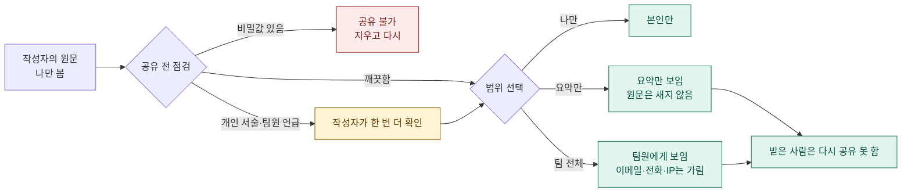

<!-- claude-drafted: 2026-10-12 — 이재엽의 요청("개인 프로그램이 팀에서 쓰이려면 어떤 조건이 필요한지, 개인적인 말·행동이 보이는 위험, UI 시험 환경으로 먼저 보여 주기")으로 Claude가 V1 코드·ADR을 읽고 썼다. 시험 환경은 `03-backend/share/`. 판단은 이재엽이 확정한다. -->

# 개인 프로그램 → 팀 프로그램 — 공유 조건과 보안

## 0. 한 줄

개인용일 때는 **내 글을 나만 읽었다.** 팀이 되면 같은 글이 *읽는 사람이 있는 글*이 된다.
그래서 조건은 하나로 모인다: **공유는 올리는 사람이 고르고, 기본값은 "나만"이며, 남이 보는 것은 규칙을 거친 공유본뿐이다.**

서버를 열지 않고 규칙만 먼저 시험했다. 실행: `02-frontend/share/index.html`을 브라우저로 열거나
`node --test 04-tests/share/share-rules.test.js`(17개 통과).

## 1. 팀에서 무엇을 주고받을 수 있나

| 받는 것 | 기본 공유 범위 | 공유본의 모양 | 절대 받지 않는 것 |
|---|---|---|---|
| 결정 기록 (무엇을 왜 정했나) | 팀 전체 | 결정·이유·대안 | 결정 과정의 감정·누구 탓 |
| 내 작업 메모 | **나만** | 올릴 때 "요약만"으로 공유 | 원문의 개인 서술 |
| 레프런스 분석 | 팀 전체 | 무엇·어디에 썼나·출처 | 원문 복사, 다른 사람의 이름·메시지 |
| 인터뷰 기록 | 요약만 | `응답자 A` 요약, 핵심 발언 | 이름·연락처·식별 가능한 사연 |
| 테스트·검증 결과 | 팀 전체 | 실제 값, 고친 결함, 못 한 것 | 확인하지 않은 것을 "확인함"으로 쓴 것 |
| 코드 | 팀 전체 | `main`/브랜치 | 키·토큰·서버 주소 |
| 다른 사람이 준 자료 | 받은 범위 그대로 | 출처 표시 | **다시 공유**(재공유는 작성자만) |

## 2. 공유 모델

| 규칙 | 시험 |
|---|---|
| level이 없거나 모르면 **나만** | 시나리오 1·2 |
| 다른 팀원에게 "나만" 글은 **존재도** 보이지 않는다 | 시나리오 1 |
| 요약 공유는 요약만 보이고 원문 문장은 새지 않는다. 요약이 비면 공유되지 않는다 | 시나리오 4·5 |
| 비밀값(키·토큰·비밀번호 대입·주민번호 모양)은 어떤 범위로도 공유되지 않는다 | 시나리오 6 |
| 이메일·전화·IP는 가려서 보인다 | 시나리오 7 |
| 받은 자료는 받은 사람이 다시 공유할 수 없다 | 시나리오 8 |
| 다른 팀원 이름 언급·개인 서술은 **막지 않고** 알린다. 팀 공유라면 올리는 사람이 한 번 더 확인한다 | 시나리오 9·10, `needsConfirm` |

**일부러 막지 않은 것:** 개인 서술과 팀원 언급이다. 기계가 "개인적인가"를 정확히 알 수 없고(약한 휴리스틱), 막으면 팀원이 우회한다.
그래서 *알리고, 사람이 고르게* 했다 — 워크스페이스의 "입력 경고는 막지 않고 고르게 한다"(보안 기준 6-3)와 같다.

## 3. 개인용이 팀에서 쓰이려면 필요한 조건

시험 환경의 "다른 환경에서는?" 탭에 V1의 가정 10개를 코드·ADR 위치와 함께 정리했다. 요약:

| 상태 | 개수 | 내용 |
|---|---|---|
| **그대로는 안 됨** | 3 | 저장(`data` 브랜치 하나에 여러 명), 입력(팀 레포 이슈는 전원이 읽음), 처리(세션이 남의 글을 읽을 수 있음) |
| 고치면 됨 | 6 | 승인 주체, 캘린더 계정, 고정된 분류, pre-commit 설치, AI 전송 동의, 입력 틀 안내 |
| 그대로 가능 | 1 | 창고 경로(인자로 받음) |

**팀 프로그램의 필요 조건**

1. **저장은 사람마다 따로.** 개인 글을 한 저장소·한 이력에 섞지 않는다. 팀과는 *공유본만* 주고받는다.
2. **공유는 작성자가 승인한다.** 남이 대신 올리거나 대신 승인하지 못한다.
3. **개인 입력 창구는 팀 이슈가 아니다.** 팀 레포 이슈·PR·커밋 메시지는 전원이 읽는다.
4. **분류와 기본값은 설정이다.** "학교"가 기본인 것은 학생 경험이다 — 인터뷰로 정한다.
5. **안전장치는 설치 여부를 확인한다.** 새 클론에서 비밀값 검사가 켜져 있는지 한 줄로 본다.
6. **AI에는 공유본만 붙인다.** 내용이 AI 서비스로 전송되므로, 남의 원문을 내 세션에 붙이지 않는다.
7. **입력 틀은 화면이 만들어 준다.** 외운 제목 틀 대신 폼. 틀 오류는 이유와 고치는 법을 보여 준다.

## 4. 보안 — "내 개인적인 말과 행동이 다른 사람에게 보이는" 경로

이재엽이 짚은 위험이다. 비밀값과 달리 **패턴으로 못 찾는다.** 그래서 *새는 길*을 막는 쪽으로 본다.

| 새는 길 | 어떻게 보이나 | 막는 법 | 이 시험에서 |
|---|---|---|---|
| 팀 레포의 이슈·PR·커밋 메시지 | 협업자 전원이 읽고, 한 번 올라가면 이력에 남는다 | 개인 입력은 팀 레포에 쓰지 않는다(조건 3). 올릴 때 "요약만" | 시험함(요약 규칙) |
| 한 저장소·한 이력에 섞인 원문 | 지워도 이력에 남는다 | 원문은 개인 저장소, 팀에는 공유본(조건 1) | 설계만 — 저장 구조는 아직 없음 |
| 실행 기록·세션 파일 | 처리한 내용이 기록으로 남는다 | 기록에는 이름·번호·마감만, 본문 없음(V1 listing 방식) | 설계만 |
| AI 대화(Claude) | 붙여 넣은 글은 AI 서비스로 전송된다 | 공유본만 붙인다(조건 6) | 시험 못 함 — 사람 습관의 영역 |
| 화면 공유·스크린샷·발표 | 시연하다 원문이 보인다 | 시연 데이터는 가상만(이 시험 환경이 그렇게 만들었다) | 시험함 — 가상 데이터만 |
| 공유 캘린더 제목 | 일정 제목이 구성원에게 보인다 | 알림 제목은 한 줄, 개인 서술 금지(V1이 이미 그렇다) | 설계만 |
| 다른 팀원 이름이 든 글 | 비난처럼 읽힌다 | 올릴 때 확인(`needsConfirm`) | 시험함 |
| 재공유 | 받은 사람이 더 넓게 퍼뜨린다 | 재공유는 작성자만 | 시험함 |

**이 시험이 보장하지 못하는 것 (솔직하게)**
- 개인 서술 탐지는 단어 목록이다. "나는"이 없는 글, 돌려 말한 글은 놓친다.
- 이 화면은 규칙만 시험한다. 실제 저장·인증·접근 제어는 없다. "누가 누구인지"는 선택 상자일 뿐이다.
- 레포 권한(누가 읽는지)은 GitHub 설정이다. 비공개여도 협업자는 전원이 읽는다.

## 5. 다음에 시험할 것

| 시험 | 방법 | 담당(제안) |
|---|---|---|
| 규칙이 팀원이 실제로 쓰는 글에서도 맞는가 | 각자 *자기 글 한 개*로 이 화면을 시험하고 "무엇이 걸렸나, 놓쳤나"를 한 줄 | 전원 |
| 요약이 쓸 만한가 | 요약만 공유된 글을 다른 팀원이 읽고 "이걸로 충분한가" | 고한결 |
| 새 클론에서 안전장치가 켜지는가 | 빈 폴더에 클론해 설치 한 줄과 비밀값 검사 확인 | 두승현 |
| 저장 구조(사람마다 따로)가 가능한가 | 개인 저장소 방식 후보 2~3개 비교 — 이재엽이 먼저 고른다 | 이재엽 |

## 6. 정해 주실 것

| ID | 질문 | 추천 |
|---|---|---|
| S1 | 팀 공유에 개인 서술이 있으면 **확인만** 할지, 아예 **요약만 허용**할지 | 확인만 (사람이 판단) |
| S2 | 인터뷰 기록의 기본 범위를 "요약만"으로 고정할지 | 고정 |
| S3 | 원문 개인 글을 둘 곳 — 각자 개인 저장소 / 각자 로컬 파일 | 로컬 파일부터, 백업이 필요하면 개인 저장소 |
