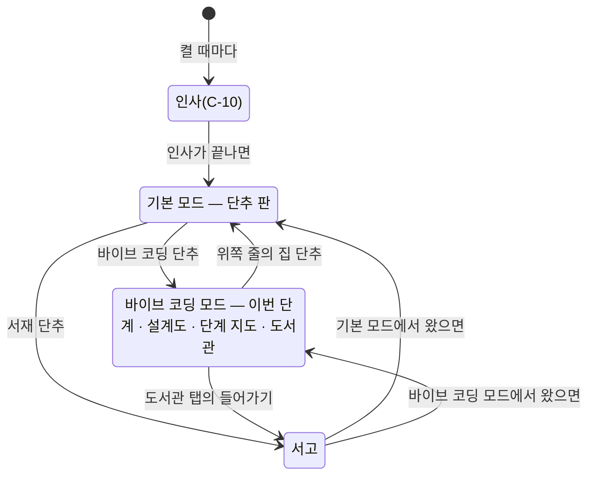

<!-- claude-drafted: 2026-10-20 — 이재엽 요청("이 모든 사항들을 요구사항에 업데이트 해주고 아직 서고에 들어가고 나올때 에니메이션이 끊기는 모션들이 남아있어 수정하는 방향을 잡아줘")과 버튼 답 셋으로 Claude가 썼다. 코드는 고치지 않았다. -->

# 넘김 — 기본 모드 · 바이브 코딩 모드(C-13), 섬의 움직임(C-14), 서고 전환 끊김(F-35)

> **낡음(2026-10-30, [결정 모음](결정-모음-2026-10-28.md) X-09):** F-35(서고 전환 끊김)는 고침(일부) 뒤, 서재가 2026-10-23부터 화면에서 빠져 지금은 서고로 들어가지 않는다. 모아 보기 창(C-11)도 같은 날 뺐고, 띠는 알약이 대신한다(C-46 · C-55). 아래는 10/20 기록으로 둔다. <!-- claude-drafted: 2026-10-30 -->

> **기록 문서.** 2026-10-20 `main` c109b10(앱 8.0.0) 기준이다. 요구 문장은 [requirements.md](../requirements.md) 2-2의 **C-13 · C-14**, 결정은 13-1의 2026-10-20 마지막 줄, 고칠 목록은 [fix-map.md](../../07-maintenance/fix-map.md) **F-34 · F-35**. 만드는 세션(페이블이면 이 문서부터)이 읽고 바로 시작할 수 있게 적었다. `[제안]`은 Claude가 정한 기본값이다. 만드는 세션은 기본값으로 시작하고, 막히면 버튼으로 묻는다.

## 0. 먼저

1. 이름 확인(CLAUDE.md "처음 세션이면") → 이 문서 → 1절의 원문.
2. **순서: ① F-35(작고 따로 선다) → ② C-14(섬 움직임의 바탕 — C-13의 모드 바뀜도 이 움직임을 쓴다) → ③ C-13.** 하나에 PR 하나(base `main`, 쌓지 않는다), 조각 `changes/<브랜치>.md` 하나씩.
3. **앱 버전은 올리지 않는다** — 팀이 "버전업"이라고 할 때만(7절).
4. **11/3 뒤에는 새 기능을 받지 않는다**(schedule.md 2절). C-13 · C-14는 등급이 미정이다 — 11/3 전에 병합하지 못하면 대회 뒤로 미루는 것을 이재엽에게 묻는다.
5. **바뀜(2026-10-20, 이재엽 버튼 "한 PR에 셋 다"):** 2번과 달리 F-35 → C-14 → C-13을 **한 브랜치(v2/island-modes) · 한 PR**로 만들었다 — `app.js`를 셋이 같이 건드려 따로 올리면 서로 충돌한다. 순서는 2번대로 만들었다(F-35 → C-14 → C-13). 결과는 [fix-map.md](../../07-maintenance/fix-map.md) F-34 · F-35, 잰 것은 [verification/dive-frames-2026-10-20.md](../../verification/dive-frames-2026-10-20.md). 앱 버전은 올리지 않았다(3번). <!-- claude-drafted: 2026-10-20 -->

## 1. 정하신 것 — 원문

**요청(2026-10-20, coucou 섬 화면 두 장을 보이며):**

> "나는 이렇게 우리 알람이나 작업들을 보여주는 공간이 저렇게 버튼식으로 준비가 되어있는 공간이 기본값이면 좋겠어 그리고 사람들이 작아졌다가 커졌다가 하는건 마우스를 가져다가 두면 조금 커져서 이 오버레이를 확인 시킨다는 느낌으로 높이는 조금 높이고 옆으로 늘어나는 에니메이션을 추가해줬으면 좋겠어 그리고 처음 시작했을때는 기본으로 두지만 사람들이 바이브 코딩 환경에 들어가면 기본 화면에 나오지 않는 이상 그 오버레이는 바이브 코딩 오버레이로 계속 남는거야 기본화면은 이사람이 바이브 코딩 세팅 이 아닌 기본화면으로 돌아가면 다시 기본 화면 모드로 진행하는거고 모드를 넣는다는게 맞는 표현인거같아 그리고 오버레이가 켜지고 꺼질때 에니메이션도 추가해줘 이 모든 사항들을 요구사항에 업데이트 해주고 아직 서고에 들어가고 나올때 에니메이션이 끊기는 모션들이 남아있어 수정하는 방향을 잡아줘"

**보인 화면(모양만 — 그림 · 이름 · 예시 데이터는 옮기지 않는다, legal.md D-1):** 섬의 위쪽 줄에 집 · 대화 · + 단추와 오른쪽에 설정 · 소리. ① 집 화면은 왼쪽 카드(마스코트 + 요약 숫자 · 최근 몇 줄)와 오른쪽 단추 2×2. ② 에이전트 화면은 왼쪽(마스코트 · 이름 · 도구 이름 · 단계 목록 Read ✓ / Edit … / Bash / Done)과 오른쪽(고치는 파일).

**버튼 답:**

| 물은 것 | 답 |
|---|---|
| 기본 모드에서 알림 · AI 진행을 누르면 어디서 보이나 | **섬 안에서 바로** — 모아 보기 창(C-11)은 '크게 보기'로 남는다 |
| '켜지고 꺼질 때'는 언제 | **섬이 접히고 펼쳐질 때**(띠 ↔ 한 줄 ↔ 펼친 섬) — 앱을 켜고 끄는 때가 아니다 |
| 서고 전환 끊김을 어떤 방향으로 | **가볍게, 그리기만** — 무거운 그리기를 바꾸고 시간이 아니라 움직임이 끝나면 넘긴다. 창 크기 · 페이지 넘김에서 오는 끊김은 남는다(5절) |

## 2. 지금 코드 — 어디를 고치나

| 무엇 | 어디 | 알아 둘 것 |
|---|---|---|
| 섬의 접힘 모양 | [app.js](../../../02-frontend/navigator/app.js) `st.ui` = `hidden`(띠) · `greet`(인사 카드) · `petit`(한 줄) · `home`(펼친 섬), `DELAY` | 바뀜 규칙은 [navigator.js](../../../03-backend/navigator/navigator.js) `nextView` — 올림(enter) hidden→petit, 누름(click) petit · greet→home, Esc · 저절로(idle) 접힘 |
| 섬 안 탭 | `app.js` `TABS`(이번 단계 · 설계도 · 단계 지도 · 도서관), `topbar()`, `islandHTML()` | 이 넷이 **바이브 코딩 모드**의 탭이 된다 |
| 그리기 | `app.js` `renderDesk()` | 그릴 때마다 `$nav.innerHTML`을 갈아 끼운다 → 모양이 **순간적으로** 바뀐다(C-14가 고칠 곳) |
| 창 크기 | `app.js` `measureSize` · `reportSize`(ResizeObserver) → [main.js](../../../02-frontend/electron/main.js) `floe:resize` → `setContentBounds(…, false)` | 움직임 없이 바로 바뀐다. 잠수 · 떠오름 동안은 크기를 보내지 않는다(`diving` · `surfacing`) |
| 모아 보기 창 | [hub.js](../../../02-frontend/hub/hub.js) — 순수 함수 `window.FloeHub`(`alertsHTML` · `mergeSessions` · `aiHTML` · `readAlerts` …), `/api/steps` 2초마다 | 알림 · AI 진행 판을 섬에서 만들 때 **이 함수를 다시 쓴다**(같은 말 · 같은 기록) |
| 서고 전환 | [dive.js](../../../02-frontend/navigator/dive.js) `out` · `arrive` · `leave` · `surface`, [dive.css](../../../02-frontend/navigator/dive.css), `app.js` `enterLibrary` · `startSurfacing`, [library.js](../../../02-frontend/library/library.js) `arrive`(층 넷), `main.js` `expandWindow` · `restoreWindow` · `did-start-navigation` | 5절 |
| 유리판 | [app.css](../../../02-frontend/navigator/app.css) `.lg-on .isl`(`backdrop-filter: url(#lg-isl)`) | 움직이는 동안 매 프레임 다시 그려 무겁다(10절) |
| 시험 | [dive.test.js](../../../04-tests/navigator/dive.test.js) · [electron-window.test.js](../../../04-tests/navigator/electron-window.test.js) · [hub.test.js](../../../04-tests/navigator/hub.test.js) · [navigator.test.js](../../../04-tests/navigator/navigator.test.js) · e2e [responsive.test.js](../../../04-tests/e2e/responsive.test.js) · [demo-flow.test.js](../../../04-tests/acceptance/demo-flow.test.js) | `canAdvance`(넘어가기 규칙)는 바뀌면 안 된다 |

## 3. C-13 — 모드 둘: 기본 모드와 바이브 코딩 모드

**모드는 접힘과 따로다.** 모드(어떤 판을 보이나)와 접힘(`st.ui` — 띠 · 한 줄 · 펼침)은 서로 다른 칸이다. 바이브 코딩 모드에서 섬이 띠로 접혔다가 펼쳐지면 다시 바이브 코딩 판이 나온다.



**기본 모드 섬(펼침) [제안]** — 보인 그림 ①의 자리 나눔만 따른다:

```
┌───────────────────────────────────────────────────────────────┐
│ (집)                                         (톱니) (핀)        │  위쪽 줄 — 바이브 코딩 모드에서는 집 + 탭 넷
│ ┌──────────────────────────────┐ ┌──────────────────────────┐ │
│ │ (플로로)  지금                │ │ [ 바이브 코딩 ] [ 서재 ]   │ │
│ │           Claude Code가       │ │ [ 알림  3 ]   [ AI 진행 ●]│ │
│ │           app.js를 고쳤어요 · 2분 │ └──────────────────────────┘ │
│ └──────────────────────────────┘          (크게 보기 → C-11 창) │
└───────────────────────────────────────────────────────────────┘
```

| 칸 | 만드는 법 [제안] |
|---|---|
| 지금 한 줄 | 알림(`st.alerts`)과 AI 진행(`/api/steps`)의 마지막 것 중 **더 최근 것** 하나. 없으면 플로로의 시간대 인사(`seal.js greeting`) |
| 단추 넷 | 바이브 코딩 → 모드를 바꾸고 `tab: "today"` · 서재 → `enterLibrary()` · 알림 → 섬 안 알림 판 · AI 진행 → 섬 안 AI 진행 판. 알림에는 읽지 않은 수, AI 진행에는 일하는 중 점(`FloeHub.unread` · `anyWorking`) |
| 알림 판 · AI 진행 판 | 보인 그림 ②의 자리 나눔 — 왼쪽: 플로로 · 프로젝트 · 도구 이름 · 단계 목록(읽음 · 고침 · 실행 · 끝), 오른쪽: 줄 목록(때 · 동사 · 파일 이름 · +N −M). `FloeHub.aiHTML` · `alertsHTML`을 그대로 쓴다. 위쪽 줄의 집으로 단추 판에 돌아온다 |
| 크게 보기 | `floeApp.openHub()`(C-11 창, 그 칸으로 — `#alerts` · `#ai`) |
| 인사 카드 | 인사가 끝나면 지금의 인사 카드(보여 주기 / 이어서 하기) 대신 기본 모드로 자리 잡는다. '이어서 하기'는 바이브 코딩 단추가 맡고, '보여 주기'(연습 예시)는 바이브 코딩 모드 안에 남긴다 [제안 — 9절 3번] |

**모드를 기억하는 곳 [제안]:** `sessionStorage`(섬 창 하나에만). 앱을 켤 때마다 새 창이라 **늘 기본 모드**로 시작하고, 서고에 다녀와 내비게이터가 다시 읽혀도 모드가 남는다. `localStorage`의 KEY(`save()`)에는 넣지 않는다 — 넣으면 다음에 켤 때도 바이브 코딩으로 열린다.

**주소로 연 장면(`#ex=` · `#start` · `#gate` …)은 바이브 코딩 모드로 연다** [제안]. 그러면 GIF 녹화(`record-demo-gifs.py`)와 e2e 장면이 그대로다. 기본 모드 장면은 새 주소 `#base` [제안].

**서버 없이(FR-10):** 알림 · AI 진행 판은 `FloeHub.exampleSessions`와 예시 알림, 머리에 "예시 데이터예요 · 시연용"을 둔다(C-11과 같다).

**AI 진행 판도 C-12 규칙을 따른다** — 파일 내용 · 고친 글 · 명령 결과는 받지도 보이지도 않는다. 보인 그림 ②의 오른쪽 **코드 칸은 따라 만들지 않는다** — 파일 이름과 +N −M만.

## 4. C-14 — 섬의 움직임

| 때 | 움직임 [제안] | 움직임 줄이기 |
|---|---|---|
| 접힌 섬(띠 · 한 줄)에 마우스를 올림 | 섬 바탕이 **세로 +6px · 가로 +24px**(양옆 12px씩) 커진다. 0.2초, 살짝 튕김 `cubic-bezier(.3,1.4,.5,1)`. 떠나면 0.16초에 돌아온다. 펼친 섬에는 하지 않는다 | 바뀌지 않는다 |
| 접힘 ↔ 펼침(띠 ↔ 한 줄 ↔ 펼친 섬) | 모양을 갈아 끼우는 대신 **바탕이 늘어나고 줄어든다** — 펼치기 0.3초(살짝 튕김), 접기 0.24초. 내용은 바탕이 60% 자란 뒤 나타나고, 접을 때는 먼저 사라진다. 노치 Mac은 위 가장자리를 붙든 채 아래 · 옆으로만 자란다 | 바로 바뀐다 |
| 모드 바뀜(기본 ↔ 바이브 코딩) | 펼친 섬 안에서 판만 옆으로 밀려 바뀐다 — 지금 탭 바뀜과 같은 움직임(`renderDesk`의 `.isl-body` 0.34초) | 바로 바뀐다 |

**만드는 법 [제안]:**

1. **바탕 껍데기 하나** — 섬 뒤에 자식이 없는 둥근 사각형(`.shell`)을 두고 그것만 `width` · `height`로 움직인다. 자식이 없어 다시 배치할 것이 적다. 내용은 `opacity` · `transform`만 움직인다. `clip-path`로 자르지 않는다(5절의 교훈).
2. **처음 · 끝 크기를 재고 움직인다(FLIP)** — `renderDesk`가 갈아 끼우기 전에 지금 상자를 재고, 새 모양을 그린 뒤 다시 재서 그 사이를 움직인다.
3. **창 크기 순서(F-24와 같은 원칙):** 커질 때는 **먼저 창을 목표 크기로 키우고** 그 안에서 움직인다. 작아질 때는 **움직임이 끝난 뒤** 창을 줄인다. 움직이는 동안은 크기를 보내지 않는다 — 지금 ResizeObserver는 바탕이 움직이는 프레임마다 IPC를 보내 버벅인다.
4. **올림 커짐은 창을 바꾸지 않는다** — 접힌 창에 늘 여유(가로 24px · 세로 8px)를 둬, 올릴 때 창 크기 IPC가 생기지 않게 한다. 이 여유 띠는 뒤 창의 클릭을 가로챈다 — 12px이라 받아들인다 [제안, 9절 4번].
5. **순수 모듈로 뺀다:** `02-frontend/navigator/morph.js`(가칭) — `peekSize(w, h)`, `plan(from, to)` → `{ order: "resize-then-animate" | "animate-then-resize", ms, easing }`, `still` → 바로. 브라우저 · Node 둘 다(`greet.js`와 같은 방식).

## 5. F-35 — 서고 전환 끊김: 가볍게, 그리기만

**찾은 곳 넷**(코드를 읽어 찾았다 — 아직 재지 않았다):

| # | 무엇 | 어디 | 이번에 고치나 |
|---|---|---|---|
| ① | 들어갈 때 창이 **한 번에** 화면만큼 커지고, 그다음 `floe:expanded`로 섬을 옮겨 붙든다 — 그 사이 한두 프레임 섬이 창 왼쪽 위로 튄다 | `main.js expandWindow` → `app.js enterLibrary`(`--dx` · `--dy`) | **아니요 — 남는다** |
| ② | 정한 시간(1.15초)에 페이지를 넘긴다. 새 페이지는 스크립트가 돈 뒤에야 물방울을 만들어(`fill`) 첫 그림에 물방울이 없고 처음부터 다시 오르며, 다 읽힐 때까지 물이 멈춰 있다 | `dive.js out`(`OUT_GO`) · `arrive` | **일부** — 시간 대신 끝나면 넘기기, 첫 그림의 물방울 |
| ③ | 나올 때 주소를 넘기기 시작하는 순간 Mac이 창을 줄인다(`setContentBounds` animate) — 물이 찌그러지고, 물 빠짐은 들어가기 전의 섬 창 크기 안에서만 보인다 | `main.js did-start-navigation` → `restoreWindow` | **아니요 — 남는다** |
| ④ | 화면 전체 물의 `clip-path: inset(… round)` 움직임, 서고 큰 층 넷의 `filter: blur(5px)` 움직임 — 매 프레임 다시 그린다(투명 창이라 더 무겁다) | `dive.js out` · `library.js arrive` 층 넷 | **예** |

**고칠 것:**

0. **먼저 잰다.** 앱(`npm start` 또는 묶은 앱)에서 들어가기 · 나오기를 3번씩 하며 `PerformanceObserver({ type: "long-animation-frame" })`로 50ms 넘는 프레임 수와 가장 긴 프레임을 센다(CDP 트레이스로 재도 된다). 고치기 전 · 뒤를 같은 컴퓨터에서 재서 `01-docs/verification/`에 남긴다. 목표 [제안]: 50ms 넘는 프레임 0~1개, 가장 긴 프레임 33ms 이하.
1. **물이 커지는 움직임** — `clip-path` 대신 둥근 사각형 요소의 `transform`(섬 자리 → 화면 전체, translate + scale)으로. 둥근 모서리는 마지막 20%에서 사라지게(scale 때문에 휘어 보이면 모서리 조각을 따로 두거나 마지막에 opacity로 바꾼다). 물방울 · 빛줄기는 늘이지 않게 다른 층에 두고 물이 다 덮은 뒤 `opacity`로 나타낸다.
2. **서고 층이 떠오르는 움직임** — `filter: blur` 빼고 `opacity` · `transform`만. 층 넷을 따로 움직이는 대신 `#s-lib` 하나만 움직여도 되는지 사람이 보고 정한다.
3. **물방울** — 22개 → 12개 [제안], `will-change: transform`. 빛줄기(`.rays`)는 움직이지 않으니 그대로.
4. **시간 대신 끝나면 넘긴다** — `setTimeout(OUT_GO)` → `Promise.all([물.finished, 플로로.finished])` 뒤 `location.href`. 멈춤 막이로 상한 시간은 남긴다(예: `OUT_MS + 300`). `leave()`는 `LEAVE_GO`(620) < `LEAVE_MS`(650)로 끝나기 30ms 전에 넘긴다 — 일부러 겹친 것인지 재 보고 주석에 이유를 남긴다.
5. **첫 그림의 물방울** [해석: '그리기'에 넣었다] — 새 페이지의 `#dive-cover`가 처음 그려질 때부터 같은 씨앗의 물방울을 갖게(머리의 한 줄 스크립트에서 `fill`을 먼저, 또는 정적 마크업).

**남는 것(①·③)과 다음 방향:** 고친 뒤에도 끊기면 그 끊김은 창 크기 · 페이지 넘김에서 온다. 그때는 이재엽에게 다시 묻는다 — 이번에 고르지 않은 두 방향: **창 둘로 나누기**(서고를 미리 띄운 따로 창에서 — 섬 창은 크기도 페이지도 바꾸지 않음), **한 창 그대로 순서 바꾸기**(물이 덮었을 때만 창 크기를 바꾸고, 나올 때는 물이 다 빠진 뒤 줄이고, 두 페이지를 View Transitions로 잇기).

## 6. 먼저 쓸 시험

| 시험 | 무엇을 잡나 |
|---|---|
| `04-tests/navigator/morph.test.js`(새) | `peekSize`가 +24 · +6, 커질 때 `resize-then-animate` · 작아질 때 `animate-then-resize`, 움직임 줄이기면 0ms |
| `navigator.test.js` | 모드 규칙(순수 함수로 — 예: `nextPlace(place, ev)`): 켤 때 기본, 바이브 코딩 단추 → 바이브 코딩, 집 → 기본, 접힘 · 펼침 · 서고 다녀옴으로는 **바뀌지 않음**, 주소 장면 → 바이브 코딩 |
| `hub.test.js` | 섬 판이 쓰는 `FloeHub` 함수가 파일 내용을 받지 않음(C-12 규칙 그대로) |
| `dive.test.js` | `out()`에 `clipPath` 키프레임이 없다, 서고 층 움직임에 `filter`가 없다, 넘기기가 `.finished` 뒤다(상한 시간은 남음), F-31의 시간 상한은 그대로 |
| `electron-window.test.js` | 움직이는 동안 `floe:resize`가 처음 · 끝 두 번만 간다 |
| e2e `responsive.test.js` | `#base` 장면을 PAGES · SCENES에 더함(390px 가로 스크롤 · axe 0), 한 줄에 올리면 0.25초 뒤 상자가 약 +24 · +6 커짐, 움직임 줄이기면 그대로 |
| `demo-flow.test.js` | 손대지 않는다 — `canAdvance`가 그대로인지만 |

## 7. 릴리스

- 작업 PR은 앱 버전을 건드리지 않는다. 셋이 들어가고 이재엽이 "버전업"이라고 하면 앱 버전을 한 번 올린다 — 번호는 그때 이재엽이 정한다(기능이 바뀌니 **9.0.0 [제안]**). 순서는 [지난 넘김 문서](fable-handoff-2026-10-20.md) 7절과 같다(GIF 다시 찍기 → `release-notes.md` → 버전 → Release 파일 6개 확인).
- 릴리스 노트 초안 [제안]:

  > - **켜면 기본 화면이 먼저 나와요.** 바이브 코딩 · 서재 · 알림 · AI 진행 단추가 준비돼 있고, 알림과 AI 진행은 섬 안에서 바로 펼쳐 봐요.
  > - **바이브 코딩에 들어가면 그 모드로 남아요.** 섬이 접혔다 펼쳐져도 '이번 단계'가 그대로예요. 위쪽 줄의 집 단추로 기본 화면에 돌아와요.
  > - **섬이 살아 움직여요.** 마우스를 올리면 살짝 커지고, 접히고 펼쳐질 때 늘어나고 줄어들어요.
  > - 서고에 들어가고 나올 때 덜 끊겨요.

## 8. 사람이 볼 것

- 묶은 앱에서 접힌 섬에 마우스를 올려 커지는 느낌(+6 · +24가 "확인시키는 느낌"인지), 노치 Mac에서 노치에서 자라나는지.
- 바이브 코딩 모드에서 접힘 → 펼침 → 서고 다녀오기 → 앱 끄고 켜기: 앞의 셋은 바이브 코딩, 마지막은 기본이어야 한다.
- 서고 들어가기 · 나오기 3번 — 5절 0번의 숫자와 눈으로 본 것을 같이 적는다. ①·③이 남아 있는지.
- Windows · 우분투의 투명 창에서도 같은지.

## 9. 정할 것 — 기본값으로 시작

| # | 무엇 | 기본값 |
|---|---|---|
| 1 | C-13 · C-14의 등급, 11/3 전에 넣을지 | 미정 — 만드는 세션이 시작할 때 묻는다 |
| 2 | 기본 모드 '지금 한 줄'에 무엇을 | 알림과 AI 진행 중 더 최근 것 |
| 3 | 인사 카드(보여 주기 / 이어서 하기)를 기본 모드로 바꿀지 | 바꾼다 — '보여 주기'는 바이브 코딩 모드 안에 |
| 4 | 올림 커짐 숫자와 접힌 창의 여유 띠 | +24 · +6px, 0.2초 · 여유 가로 24 · 세로 8px |
| 5 | 펼친 섬에도 올리면 커질지 | 아니요 — 접힌 섬만 |
| 6 | 화면에 모드 이름을 보일지 | 보이지 않는다 — 집 단추가 눌린 모양으로 안다 |
| 7 | 주소로 연 장면의 모드 | 바이브 코딩(GIF · e2e 그대로), 기본 모드는 `#base` |

## 10. 함정

- **이름이 겹친다.** `st.mode`는 이미 보기 방식(`live` · `fixture`)이고, `st.ui === "home"`은 '펼친 섬'이다. 모드 칸 이름에 `mode` · `home`을 쓰지 않는다 — 예: `st.place = "base" | "vibe"` [제안].
- **hub.js를 섬에 넣으면 아래 화면 코드도 돈다.** `hub.js`는 `typeof document === "undefined"`일 때만 화면 코드를 건너뛴다 — 내비게이터에 그대로 넣으면 모아 보기 창의 그리기 · 2초 물음이 섬 안에서도 돈다. 순수 부분을 `hub-core.js`로 나누거나, 화면 코드를 `[data-space]`가 있을 때만 돌게 한다(`hub.test.js`가 그 경계를 잡게).
- **C-12 규칙** — AI 진행 판은 파일 이름 · 명령 첫 줄 · 줄 수만. 보인 그림의 코드 칸을 따라 만들지 않는다.
- **coucou** — 자리 나눔만 참고한다. 마스코트 · 이름 · 아이콘 · 소리 · 화면 그림 · 예시 데이터(사람 이름 · 금액)를 옮기지 않는다(legal.md D-1).
- **유리판(`backdrop-filter: url(#lg-isl)`)** 은 움직이는 동안 매 프레임 다시 그린다 — 움직이는 동안은 끄거나 껍데기에만 두고 멈춘 뒤 켠다.
- **ResizeObserver** — 바탕이 움직이는 동안 크기를 보내지 않는다(4절 3번). 안 그러면 창이 매 프레임 바뀌어 F-24의 버벅임이 돌아온다.
- 주소로 연 장면 · 휴대폰 화면 · 움직임 줄이기는 지금처럼 움직임 없이 — GIF 녹화와 e2e가 이것에 기댄다.
