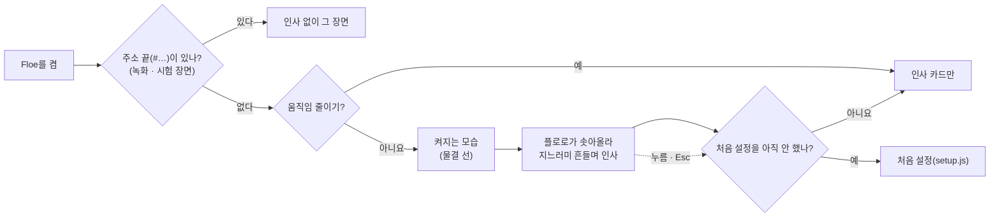

<!-- claude-drafted: 2026-10-20 — 이재엽이 "요구사항에 추가해서 페이블로 만들고 릴리즈 할 내용까지 준비해서 페이블 세션에 넘길 수 있도록 준비해보자"라고 요청해서 '요구사항' 세션(Claude Opus)이 썼다.
     '지금 코드' 칸은 이 세션이 cb61158(main)에서 직접 읽은 것만 적었다. 시간 · 크기 같은 숫자는 [제안]이고 정해진 값이 아니다. -->

# 페이블 넘김 — 켜짐 · 인사, 모아 보기 창, AI 진행 (2026-10-20)

> **기록 문서.** 2026-10-20 `main` cb61158 기준이다. 요구 문장은 [requirements.md](../requirements.md) 2-2의 **C-10 · C-11 · C-12**, 결정은 13-1의 2026-10-20 두 줄, 고칠 목록은 [fix-map.md](../../07-maintenance/fix-map.md) F-28이다. 어긋나면 그쪽이 맞다.

## 0. 페이블 세션이 먼저 할 것

1. [CLAUDE.md](../../../CLAUDE.md)의 "처음 세션이면"에 따라 이름을 확인한다. 이 문서를 맡긴 사람은 이재엽(팀장)이지만, 새 세션은 추측하지 않는다.
2. `git fetch` 뒤 최신 `main`에서 브랜치를 딴다. **기능마다 PR 하나, base는 늘 `main`** — PR을 쌓지 않는다(2026-10-19에 #123 · #124가 `main`이 아닌 브랜치로 병합된 일).
   버전 기록은 CHANGELOG를 고치지 않고 `changes/<브랜치 끝 이름>.md` 조각 한 장으로 남긴다([changes/README.md](../../../changes/README.md)).
3. 순서 [제안]: ① C-10 켜짐과 인사 → ② C-11 모아 보기 창(바이브 코딩 · 알림) → ③ C-12 AI 진행 → ④ 앱 버전업(7절).
   같은 세션의 F-26(밖의 명령 칸 4개 → 2개)은 `levelCard`만 건드려 ①~③과 겹치는 곳이 적다. 먼저 해도 되고 사이에 끼워도 된다.
4. **①~③의 PR은 앱 버전(`02-frontend/electron/package.json`)을 올리지 않는다.** 앱 버전은 ④에서 한 번만 올린다(git-workflow.md "버전과 알림", 2026-10-19).
5. **바뀜(2026-10-20, 이재엽 "오퍼스 세션에서 받은 내용도 다 합치고 지금까지 PR 다 합친 내용들로 다 올려야해 … 릴리즈까지 해서 올려줘"):** 2~4번과 달리 ①~④를 서재 전환(F-30 · F-31)과 함께 **한 PR**(base `main`)로 올리고 그 PR에서 앱 버전을 8.0.0으로 올렸다. 결과는 [fix-map.md](../../07-maintenance/fix-map.md) F-28 · F-30 · F-31. <!-- claude-drafted: 2026-10-20 -->

## 1. 이재엽이 정한 것 — 한 말 그대로

| 물은 것 | 이재엽의 답 |
|---|---|
| 처음 요청 | "기능을 사용하기 전의 상태를 만들고 싶은데 https://github.com/louis-cfm/coucou 여기서 처음에 반갑다고 인사하고 하는 모습이랑 켜지는 모습들 추가해주는 기획과 이 바이브 코딩을 선택해서 들어오는 공간 알람을 보는 공간 / 우리 AI가 진행하면 보이는 공간 이렇게 확인 할 수 있는공간이 있으면 좋겠어 / 요구사항에 추가해서 페이블로 만들고 릴리즈 할 내용까지 준비해서 페이블 세션에 넘길 수 있도록 준비해보자" |
| 세 공간을 어디에 | 버튼 "따로 창 하나" — 섬은 그대로 두고 창을 하나 더 |
| 바이브 코딩 공간에서 무엇을 고르나 | 버튼 "할 일 종류 고르기" — 입구 카드(바이브 코딩 · 서재 …)에서 바이브 코딩을 골라 들어간다 |
| AI 진행 공간에 무엇을 | "2번이고 이 내용은 우리 바이브 코딩보단 AI가 하는 내용을 보이게 할 수 있는 공간으로 하고 싶어. 이건 바이브 코딩이 아니야" — 2번은 "Claude Code의 일"(읽은 파일 · 고친 파일 · 실행한 명령) |
| 켤 때 인사는 언제 | 버튼 "켤 때마다" |
| 등급(Must / Should) | "현 지금 작업할거임 토큰이 남고 시간이 남아서 작업해볼 예정임" — **등급은 미정, 지금 만든다** |

## 2. 지금 코드 — 어디에 무엇이 있나 (cb61158)

| 무엇 | 어디 | 이번에 쓰는 법 |
|---|---|---|
| 섬의 상태 넷 — 띠 · 인사 · 한 줄 · 펼침 | `02-frontend/navigator/app.js` `st.ui`("hidden" · "greet" · "petit" · "home"), `renderDesk` | C-10은 "greet"로 들어가기 **전에** 움직임을 한 번 넣는다 |
| 인사 카드 | `app.js` `greetHTML` — "안녕하세요! 저는 길잡이 물범 플로로예요." / 다시 오면 "다시 오셨네요!", 6초 뒤 접힘(`DELAY.greet`) | 움직임이 끝나면 이 카드로 자리 잡는다. 글은 그대로 |
| 띠 — 물결 선 위로 얼굴만 | `app.js` `stripHTML` · `WAVE`, `app.css` `.strip` · `html.notch .strip`(노치 검정 · 폭) | '켜지는 모습'은 이 물결 선이 그려지는 것으로 [제안] |
| 플로로 그림 · 움직임 | `navigator/seal.js` — `MOODS`, `greeting(hour)`(시간대 인사말), `burst`(튀는 것), `chime`(우리 소리, 기본 꺼짐). `app.js` `playOn(host, "swim")`, `app.css` `squish` · `hop` · `bob` | 지느러미 흔들기는 새로 만든다(`seal.js`에 포즈 하나) |
| 움직임 줄이기 | `app.js` `STILL`(prefers-reduced-motion) | 켜져 있으면 움직임 없이 인사 카드만 |
| 처음 설정(반가워요 → 고르기 → 연결) | `navigator/setup.js` `shouldOpen(saved, hash)` — 주소 끝(`#…`)이 있으면 안 띄움 | 처음 켤 때는 인사 움직임 → 처음 설정으로 이어지게(인사가 두 번 나오지 않게) |
| 앱 창 | `02-frontend/electron/main.js` — `startServer()`를 **기다린 뒤** `createWindow()`(테두리 없음 · 투명 · 항상 위), 노치 크기는 `floe:notch`, 크기는 `floe:resize`(F-24: 앱 안에서는 높이 애니메이션 없이 바뀔 때만) | 서버를 기다리는 동안은 지금 아무것도 안 보인다 → C-10 '켜지는 중' |
| 화면이 앱에 부탁하는 것 | `electron/preload.js` `window.floeApp`(connect · disconnect · openSettings · saveKey · clearKey · onCursor · onNotch · resize · expand) | C-11은 `openHub`(가칭)와 섬으로 돌아가는 `enter` 하나씩 더한다 |
| 메뉴 · 트레이 · Dock | `main.js` `floeItems()`(메뉴 줄), `tray`, `app.on("activate")` | 모아 보기 창을 여는 자리 |
| 서버가 내주는 파일 목록 | `03-backend/navigator/server.js` `STATIC` — `02-frontend/<폴더>`는 `/<폴더>/<파일>`로도 열린다 | 새 폴더 `02-frontend/hub/`를 넣지 않으면 앱에서 404. `static-files.test.js`가 맞대어 본다 |
| 알림 기록(FR-7) | `03-backend/navigator/alerts.js`(순수 함수 — 때 · 도구 · 한 줄 · 끝낸 할 일), `app.js` `st.alerts` · `alertLog`(설정 안에 접힘), 서버 `addEvent` · `GET /api/events?since=` | C-11 알림 공간은 이 기록을 그대로 보인다 |
| 저장 열쇠 | `app.js` `KEY = "navigator-prototype:v1"`, 서고 `library/my-books.js`도 같은 열쇠를 읽는다(시험이 맞대어 봄) | 모아 보기 창도 **읽기만** 한다 — 같은 전례 |
| Claude Code 훅 | `03-backend/navigator/connect.js` `EVENTS = ["UserPromptSubmit", "Stop"]`(timeout 5초), `hook.js`(아무것도 출력하지 않음 · 실패해도 0으로 끝냄 · 요청 1.5초 상한 · 확인 값 `X-Nav-Token`) | C-12는 `PostToolUse`를 더한다 |
| 서버의 알림 저장 | `server.js` `addEvent` — 저장 전에 `Sensitive.redact`(S4), 메모리에만, 20개, `clearEvents`(S5) | C-12의 '한 일' 줄도 같은 방식 |
| 시연 입구 | `02-frontend/index.html` — 카드 둘(내비게이터 · 플로로의 얼음 서고) | C-11 바이브 코딩 공간의 카드와 같은 내용 |

## 3. C-10 켜짐과 인사

### 흐름



### 시간표 [제안] — 다 합쳐 3.5초 안, 상한 5초

| 시각 | 무엇 | 지금 있는 것 |
|---|---|---|
| 0 – 0.4초 | **켜지는 모습** — 띠(Mac 노치면 검정 노치 폭)의 물결 선이 가운데에서 양옆으로 그려진다. 서버를 기다리는 중이면 물결이 숨 쉬듯 되풀이 | `WAVE` SVG, `html.notch .strip` |
| 0.4 – 0.9초 | 섬이 인사 크기로 열린다(살짝 넘쳤다 돌아오는 곡선) | `app.css` `.enter`의 `cubic-bezier(.34,1.56,.64,1)` |
| 0.6 – 1.1초 | 플로로가 물속에서 솟아올라 내려앉는다(물방울 · 눌렸다 펴짐) | `burst`, `squish` |
| 1.1 – 2.6초 | 옆으로 살짝 헤엄쳐 가서 **앞지느러미를 흔들고**, 시간대 인사말 말풍선 | `swim`, `greeting(hour)` — 지느러미 흔들기는 새로 |
| 2.6 – 3.4초 | 가운데로 돌아와 눈을 깜빡, 인사 카드의 글 · 단추가 나타난다 | `greetHTML` |
| 3.4초 뒤 | 지금 인사 카드 규칙 그대로(6초 뒤 접힘, 마우스가 올라가 있으면 안 접힘) | `scheduleIdle` |

### 규칙

- **켤 때마다**(이재엽). 다시 온 사람은 글만 "다시 오셨네요!"로 — 움직임은 같다.
- **건너뛰기:** 인사 중 아무 데나 누르거나 Esc → 움직임을 바로 끝내고 인사 카드(또는 처음 설정). 남은 타이머가 없어야 한다.
- **주소 끝(`#start` · `#ex=1` · `#tab=lib` · `#setup` …)이 있으면 인사를 하지 않는다** — `setup.js` `shouldOpen`과 같은 규칙. 녹화(`record-demo-gifs.py`) · e2e(`responsive.test.js`의 PAGES · SCENES)가 모두 주소 끝으로 장면을 연다. 이 규칙이 빠지면 GIF와 접근성 시험이 깨진다.
- **움직임 줄이기**(`STILL`)면 움직이지 않고 인사 카드만. 휴대폰 화면(`isPhone`)은 지금처럼 따로.
- **앱 창:** 움직이기 **전에** 창을 인사 크기로 먼저 맞추고(투명이라 보이지 않는다), 섬 모양은 창 안에서 CSS로 움직인다. 창 크기를 프레임마다 바꾸지 않는다(F-24에서 덜컹거렸다).
- **서버를 기다리는 빈틈:** 지금은 `startServer()`가 끝나야 창이 생긴다. **먼저 잰다** — 묶은 앱에서 켤 때부터 창이 뜰 때까지. 0.5초 [제안]보다 길면 창을 먼저 만들고 앱에 든 작은 켜짐 화면을 띄운 뒤, 서버가 준비되면 `loadURL` 한다. 짧으면 화면 안의 '켜지는 모습'만으로 충분하다.
- **소리:** 기본 꺼짐 그대로(`st.sound`). 켜져 있을 때만 `chime` 하나.

### coucou에서 가져오는 것 · 가져오지 않는 것

coucou(`Louis-CFM/coucou`, 2026-10-20 커밋 98a767c)를 읽었다. **코드는 MIT, 이름("Coucou" · "Mochi") · 캐릭터 · 아이콘 · 소리 · `docs/media/` · `design/`의 그림은 저작권자 소유**다(`LICENSE-ASSETS.md`).

| 가져온다(생각만) | 가져오지 않는다 |
|---|---|
| 켤 때 노치에서 나와 튀어 오르고, 옆으로 가 손을 흔든 뒤 작은 섬으로 돌아가는 **순서**(약 4.6초, `windows/src/mochi/greeting.ts`의 시간표) | Mochi의 모양 · 표정 · 움직임 그 자체, 소리 파일(`greet.wav` 등), `design/animations/greeting-v2.html` |
| "인사가 섬에 잘리지 않는다"를 **시험으로** 확인하는 방식(`windows/tests/greeting.test.mjs` — 열리는 중 · 줄어드는 중 · 중간에 끊겨도) | 코드 복사. 혹시 옮기면 MIT 고지를 남기고 [legal.md](../legal.md) D-1에 적는다 |
| 숨은 상태에서 마우스를 올리면 빼꼼 나와 인사(SPEC 3절 2번) — **C-10 확인할 것 ②**, 기본은 하지 않음 | — |

## 4. C-11 모아 보기 창 — 바이브 코딩 · 알림 (AI 진행은 5절)

### 화면 [제안]

```
┌────────────┬──────────────────────────────────────────────┐
│ Floe        │  바이브 코딩                                   │
│             │  무엇을 할까요?                                 │
│ ▸ 바이브 코딩 │  ┌──────────────┐  ┌──────────────┐          │
│   알림   3  │  │ 바이브 코딩    │  │ 서재           │          │
│   AI 진행 ● │  │ 단계마다 어디까지│  │ 끝낸 책을 다시  │          │
│             │  │ [들어가기]     │  │ [열기]         │          │
│             │  └──────────────┘  └──────────────┘          │
│ 예시 데이터예요│  지금: 2단계 · 프로젝트 이름(연결했으면)              │
└────────────┴──────────────────────────────────────────────┘
```

- **자리:** 새 폴더 `02-frontend/hub/`(이름은 가칭 — 화면 글은 쉬운 말, FR-13). 서버로는 `/hub/index.html`, 서버 없이 파일로도 열린다(FR-10).
- **바이브 코딩:** 할 일 종류 카드 — 바이브 코딩(들어가기 → 섬의 '이번 단계'), 서재(열기 → 서고). 지식 은하는 막아 두었으니 넣지 않는다(2026-10-19). 카드 아래 한 줄로 지금 단계 · 연결한 프로젝트(저장 열쇠에서 읽음).
- **알림:** 알림 기록을 새것부터 — 때 · 도구 · 한 줄 · 끝낸 할 일. 섬의 기록과 같은 것(`KEY`를 읽기만, `storage` 이벤트로 바로 다시 그림). 왼쪽 칸에 읽지 않은 개수.
- **열기:** 메뉴 "Floe → 모아 보기 열기"(가칭), 트레이 클릭, Mac Dock 클릭(`app.on("activate")`), 섬 위쪽 줄의 단추 하나. 브라우저로 연 섬에서는 같은 단추가 새 탭으로 연다.
- **창:** 보통 창(테두리 있음, 항상 위 아님, Dock에 앉음), 크기 900×600 [제안] · 최소 폭은 휴대폰 폭에서도 깨지지 않게. 닫아도 섬 · 서버는 그대로. 하나만 연다(이미 열려 있으면 앞으로).
- **들어가기:** 앱이면 모아 보기 창 → 앱(main.js) → 섬 화면에 "이번 단계로"를 보내고 섬을 앞으로(새 IPC 하나). 브라우저면 `navigator/index.html`로 간다.
- **하지 않는 것:** 이 창이 판정 규칙 · 단계 넘어가기를 다시 만들지 않는다(서버 규칙은 서버에 — CLAUDE.md 역할표). 설정은 섬에 그대로 둔다.

## 5. C-12 AI 진행 — Claude Code가 하는 일 (바이브 코딩이 아님)

이재엽: "이건 바이브 코딩이 아니야". 단계 · 판정 · 토큰과 섞지 않는 **지켜보기 전용** 공간이다. C-4(대화 화면에서 승인 · diff · 지시 보내기)의 읽기 전용 조각만 하고, 허용 · 거절 단추는 만들지 않는다.


### 훅이 넘길 칸 — 내용은 절대 넘기지 않는다

| 도구 | 화면의 말 | 넘기는 것 | 넘기지 않는 것 |
|---|---|---|---|
| Read | 읽었어요 | 파일 경로(작업 폴더 안이면 상대 경로, 밖이면 파일 이름만) | 파일 내용 |
| Edit · MultiEdit | 고쳤어요 | 경로 + 줄 수 `+N −M`(old · new 글의 줄 수로 hook.js가 센다) | `old_string` · `new_string` |
| Write | 만들었어요 | 경로 + `+N` | `content` |
| Bash | 실행했어요 | 명령 첫 줄, 80자까지 | 결과(`tool_response`) · 나머지 줄 |
| Grep · Glob | 찾았어요 | 찾을 말 · 무늬(80자까지) | 찾은 결과 |
| 그 밖 | 했어요 | 도구 이름만 | 나머지 전부 |

- 서버는 저장하기 **전에** `Sensitive.redact`로 가린다(`export API_KEY=…` 같은 명령). 세션(프로젝트)마다 최근 50줄 [제안], 메모리에만, 밖으로 보내지 않는다. '알림 기록 비우기'(S5 `clearEvents`)가 함께 지운다.
- 세션 상태는 이미 있는 훅으로 — UserPromptSubmit이면 "일하는 중", Stop이면 "마쳤어요".
- **Claude Code를 느리게 하지 않는다:** `PostToolUse`는 도구를 쓸 때마다 불리고, Claude Code는 훅이 끝날 때까지 기다린다. 지금 hook.js의 요청 상한(1.5초)은 이 훅에는 길다 — 보내기만 하고 답을 기다리지 않거나 상한을 300ms [제안]로. 서버가 꺼져 있을 때 걸리는 시간을 시험으로 잰다.
- 하기 전 훅(`PreToolUse`)은 **기본으로 걸지 않는다**(C-12 확인할 것 ①). 건다면 hook.js는 출력 없이 0으로만 끝나야 한다 — 그 훅은 종료 코드 2나 출력으로 도구를 막을 수 있다.
- **matcher:** `connect.js`가 만드는 칸에 도구 이름 무늬를 넣을지(비우면 모든 도구인지) Claude Code 문서에서 확인하고 적는다.
- **이미 연결한 폴더**에는 새 훅이 없다. 한 일이 한 줄도 안 오는데 알림은 오면 "프로젝트 폴더를 한 번 다시 연결해 주세요"를 보인다.
- **Codex:** 같은 모양으로 오는지 모른다(미정). Claude Code부터.
- **서버 없이(FR-10):** 미리 만든 예시 세션 하나(`scenario.js`에 '한 일' 몇 줄)와 "예시 데이터예요 · 시연용".

### 같이 고칠 문서

- `03-backend/navigator/API.md` — 새 주소 `GET /api/steps`(확인 값 · 쿠키), `/api/event`가 받는 새 종류.
- [3단계 초안](../../03-pattern-analysis/navigator-architecture-draft.md) 1-1 위협 표 — 새로 받는 것(파일 경로 · 명령 첫 줄)과 지키는 법.
- [fix-map.md](../../07-maintenance/fix-map.md) 1절 지도 — 새 화면(모아 보기 창 · AI 진행)에 줄을 더한다.
- `01-docs/features/` — 새 기능 폴더와 GIF(7절).

## 6. 시험 — 코드보다 먼저 쓰고, 고치기 전 코드로 실패하는 것을 본다

| 무엇 | 파일 [제안] | 확인하는 것 |
|---|---|---|
| 인사 시간표 | `04-tests/navigator/greet.test.js` (순수 모듈 `navigator/greet.js`) | 단계 순서(켜짐 → 열림 → 솟음 → 흔들기 → 자리 잡기), 끝 ≤ 5,000ms, 건너뛰면 바로 끝 · 남은 타이머 없음 |
| 인사를 할지 | 같은 파일 | 주소 끝이 있으면 안 함 · 움직임 줄이기면 카드만 · 처음 설정이 남았으면 인사 뒤 설정으로 |
| 섬에 잘리지 않음 | 같은 파일 | 열리는 중 · 줄어드는 중 · 중간에 끊겨도 플로로가 섬 안(coucou 시험과 같은 생각, 코드는 우리 것) |
| 앱 창 | `04-tests/navigator/electron-hub.test.js` | main.js에 창 여는 IPC · 메뉴 줄 · 트레이, preload에 `openHub`(electron-cursor.test.js처럼 글로 맞대기), `lib.js`의 창 크기 순수 함수 |
| 모아 보기 창 | `04-tests/navigator/hub.test.js` | 공간이 셋(바이브 코딩 · 알림 · AI 진행), 할 일 카드, 저장 열쇠가 app.js `KEY`와 같음, 알림 줄이 alerts.js와 같은 모양, 빈 상태 글 |
| 서버 목록 | `static-files.test.js`(있는 시험) | `02-frontend/hub/`의 파일이 `STATIC`에 있고 화면이 부르는 파일이 다 있다 |
| 훅이 내용을 넘기지 않음 | `04-tests/navigator/hook-steps.test.js` | Edit · Write · Bash 보기 입력을 넣으면 본문에 `old_string` · `content` · `tool_response`의 글이 **없고**, 경로 · `+N −M` · 첫 줄만 있다 |
| 훅 연결 | 같은 파일 또는 있는 connect 시험 | `EVENTS`에 PostToolUse, 두 번 더해도 하나, 빼면 셋 다 빠짐 |
| 서버의 '한 일' | 같은 파일 또는 `api-contract.test.js` | 가림, 50줄 상한, 비우기로 지워짐, 확인 값 없으면 403 |
| 훅이 느리지 않음 | 같은 파일 | 서버가 꺼져 있을 때 hook.js가 300ms [제안] 안에 끝남 |
| 화면 폭 · 접근성 | `04-tests/e2e/responsive.test.js` | PAGES · SCENES에 `hub/index.html` · `#alerts` · `#ai`(주소는 가칭) — 390px 가로 스크롤 없음, axe 위반 0(밝은 · 어두운) |
| 바뀌면 안 되는 것 | `04-tests/acceptance/demo-flow.test.js` `canAdvance` | 단계 넘어가기 규칙은 그대로 |

커밋 전에 `python3 04-tests/run_all_tests.py`와 `bash .claude/hooks/check-links.sh`(긴 출력은 `verify` 에이전트에).

## 7. 릴리스 준비 — 다음 앱 버전업 (①~③이 `main`에 들어간 뒤)

**조건:** C-10 · C-11 · C-12 병합 + 8절의 사람 확인 + 이재엽이 "버전업"이라고 할 때. 번호는 **8.0.0 [제안]**(지금 7.0.0) — 버전업 때 이재엽이 정한다. 그사이 앱으로 써 보려면 각자 `npm run dist`.

1. 최신 `main`에서 브랜치 하나(예: `v2/app-8-0-0`).
2. **GIF 다시 찍기** — `python3 01-docs/features/record-demo-gifs.py`(파일로 열어 연습 예시만, 토큰 0). 지금 GIF는 10/18에 찍어 지운 '내 배움'과 레벨 오버레이 전 화면이 담겨 있다(F-29). 새 기능 GIF 둘(켜짐 · 인사, 모아 보기 창)은 `01-docs/features/`에 새 폴더로.
3. `02-frontend/electron/release-notes.md` 맨 위에 아래 초안을 붙인다(만든 것과 다르면 고친다).
4. `02-frontend/electron/package.json`과 `package-lock.json`(맨 위 두 곳)의 `version`을 같이 8.0.0으로.
5. 조각 `changes/app-8-0-0.md` — 종류: 큰 묶음.
6. 시험 · e2e · 링크 검사 → PR(base `main`) → 사람이 병합.
7. 병합되면 `app-release` Action이 Mac · Windows · Linux를 묶어 Release `app-v8.0.0`(미리 보기판)을 만든다. `gh release view app-v8.0.0`으로 파일 6개(dmg · exe · AppImage 둘 · deb 둘)를 확인한다.
8. Jira 릴리스는 비밀값 4개가 없어 건너뛴다(정상). 넣은 뒤라면 같은 규칙으로 맞출지는 그때 정한다.

### release-notes.md에 붙일 초안

```markdown
**이번에 바뀐 것 (8.0.0)**
- **켤 때 플로로가 인사해요.** 섬이 켜지고(노치가 있는 Mac은 노치 자리에서) 플로로가 물 위로 나와 지느러미를 흔들어요. 누르거나 Esc를 누르면 바로 넘어가요. 움직임 줄이기 설정이면 움직이지 않아요.
- **모아 보기 창이 생겼어요.** 메뉴 **Floe → 모아 보기 열기**, 트레이, 섬의 단추로 열어요. 왼쪽에 세 공간이 있어요.
  - 바이브 코딩 — 할 일(바이브 코딩 · 서재)을 골라 들어가요.
  - 알림 — AI 코딩 도구가 보낸 알림 기록이에요. 섬의 기록과 같아요.
  - AI 진행 — Claude Code가 읽고 · 고치고 · 실행한 것을 한 줄씩 보여요. 파일 내용과 명령 결과는 받지 않고, 이 컴퓨터 밖으로 보내지 않아요.
- 그사이 들어온 것: Mac 노치 자리에 섬이 붙어요 · 창 밖 커서를 따라올 때 눈이 부드럽게 움직여요.
- **전에 프로젝트 폴더를 연결했다면 한 번 다시 연결해 주세요**(Floe → 프로젝트 폴더 연결…). AI 진행이 쓰는 훅이 새로 걸려요.
```

## 8. 사람이 볼 것 — 자동 시험이 못 보는 것

| 무엇 | 어디서 |
|---|---|
| 켤 때 인사가 잘리지 않고 5초 안에 끝나는지, 누름 · Esc로 바로 넘어가는지 | Mac(노치) · Mac(노치 없음 · 외장 화면) · Windows · 우분투 — Windows는 두승현(#121) |
| 움직임 줄이기를 켜면 움직이지 않는지 | 운영체제 설정 |
| 모아 보기 창이 메뉴 · 트레이 · Dock · 섬 단추로 열리고, 닫아도 섬이 남는지 | 묶은 앱 |
| 바이브 코딩 '들어가기'가 섬의 '이번 단계'로 가는지, 알림이 섬의 기록과 같은지 | 묶은 앱 |
| AI 진행: 폴더를 다시 연결하고 Claude Code로 파일 하나를 고치면 한 줄(+N −M)이 오는지, 키 모양 명령이 가려지는지, Claude Code가 느려지지 않는지 | 묶은 앱 + 실제 Claude Code |
| 서버를 끄고 Claude Code를 써도 막히지 않는지 | 실제 Claude Code |

확인한 것만 "확인함"으로 적는다(security-records.md 6-2).

## 9. 정할 것 — 기본값으로 시작하고, 막히면 버튼으로 묻는다

| # | 무엇 | 기본값 [제안] |
|---|---|---|
| 1 | 모아 보기 창의 이름 | '모아 보기'(FR-6 '한곳에서 보기'와 헷갈리면 바꾼다) |
| 2 | 켤 때 모아 보기 창도 같이 열지 | 열지 않음 |
| 3 | 인사 길이 상한 | 5초(시간표는 3.5초) |
| 4 | 숨은 띠에 마우스를 올릴 때도 짧게 인사할지 | 하지 않음 |
| 5 | AI 진행에 '하기 전'(PreToolUse)도 | 걸지 않음 — 끝난 일만 |
| 6 | Codex도 | 같은 모양인지 실측한 뒤 |
| 7 | '알림 기록 비우기'를 모아 보기 창에도 | 섬의 설정에만 |
| 8 | C-10~C-12의 등급 | 미정 그대로 — 이재엽이 정할 때 13-1에 |

이재엽에게 물을 때는 버튼으로(선택지 2개 또는 4개, 판정은 Go / Hold / Recycle / 모르겠음).

## 10. 함정

- **주소 끝 장면에 인사가 끼면** 녹화 · e2e가 모두 깨진다(3절 규칙).
- **앱 창 크기를 프레임마다 바꾸지 않는다**(F-24). 먼저 키우고 안에서 움직인다.
- **새 폴더를 `server.js` `STATIC`에 안 넣으면** 브라우저 파일로는 열리는데 앱에서는 404.
- **저장 열쇠(`KEY`)를 바꾸면** 섬 · 서고 · 모아 보기 창이 함께 깨진다. 바꾸지 않는다.
- **훅은 절대 출력하지 않고 0으로 끝낸다** — UserPromptSubmit의 출력은 Claude에게 가고, PreToolUse는 도구를 막을 수 있다.
- **coucou의 그림 · 소리 · 이름을 쓰지 않는다**(3절 표).
- **①~③ PR에서 앱 버전을 올리면** 그 자리에서 Release가 생긴다(10/19 하루에 일곱 개).
- PR을 쌓지 않는다. 같은 줄 충돌은 조각 파일로 피한다.
