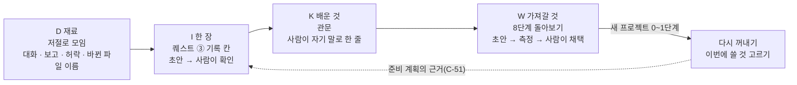

<!-- claude-drafted: 2026-10-27 — 이재엽 요청("Simplify_기능_전체정리.md 이거를 먼저 우리랑 비교 했을때 어떤 점을 챙겨야하고 지식 관리를 위한 퀘스트는 어떻게 준비하면 좋을지 그리고 작업하는데 어떤 점들을 보안해야하는지 다 정리해서 요구사항에 올려")으로 Claude가 이재엽의 정리 문서와 이 저장소의 코드 · 요구사항을 맞대어 썼다. 결정은 이재엽이 한다. -->

# 멘토 시스템 Simplify와 Floe 비교 — 챙길 점 · 지식 퀘스트 · 보완할 점 (2026-10-27)

| 항목 | 내용 |
|---|---|
| 자료 | 이재엽의 정리 문서 「Simplify 기능 전체 정리」(2026-10-27, **저장소 밖**). 멘토님이 만든 지식 · 작업 운영 웹앱 Simplify v1.0.0의 화면 · 도움말 · 내장 매뉴얼(DIKW 메뉴얼 · 운영가이드 v2.3)을 읽기 전용 계정으로 보고 적은 것. 데이터를 바꾸는 단추는 누르지 않았다 |
| 이 문서에 옮기지 않은 것 | 서버 구성 · 포트 · 주소 · 계정 이름(보안 기준 2절). 멘토님 시스템의 **원리와 기능 이름만** 옮겼다 |
| 맞대어 본 우리 쪽 | 이 문서를 쓴 날의 `main` — `03-backend/navigator/*.js`, `02-frontend/navigator/app.js`, [requirements.md](../requirements.md) FR-1~17 · 후보 C-1~C-45 |
| 요구 후보 | [requirements.md](../requirements.md) 2-2 **C-47 ~ C-52** · 2-3 14번 |
| 결정 | 이재엽 |

## 0. 한 줄로

**구조는 가져오고, 사람의 자리는 반대로 둔다.** Simplify는 "사람은 쓰기만, 정돈은 시스템이"라서 지식(K)까지 저절로 만든다. Floe는 "만들면서 이해하고 배우게"(0절 목표)라서 **배운 것은 사람이 쓰고** AI는 재료를 모으고 빈 곳을 묻는다 [제안].

## 1. 두 시스템의 출발점

| | Simplify | Floe |
|---|---|---|
| 누구 | 문서를 많이 쓰는 연구 · 업무 사용자(멘토님 본인 · 팀) | 코딩을 모르고 바이브 코딩을 하는 사람(0절) |
| 사람이 하는 일 | md를 쓰고 고치기만. 지혜(W) 채택만 주 1~3회 | 단계마다 묻고 답하며 정하고, 관문에서 이해했는지 확인(FR-4 · 5) |
| AI가 하는 일 | D → I → K는 완전 자동, W는 초안과 측정 | 초안을 만들고(FR-3) 사람이 확인한 것만 확정, 코드는 사용자의 Claude Code(0절) |
| 도는 곳 | 늘 켜진 서버 한 대, 정해진 시각의 스케줄 · 큐 | 사용자의 컴퓨터 한 대(Electron 앱 + 로컬 서버), 사람이 움직일 때만 |
| 목표 | 쌓인 문서가 저절로 정돈된다 | 끝까지 만들고, 이해하고, 배움이 남는다 |

[정리] 같은 "지식 관리"라도 Simplify는 **정돈**이 목적이고 Floe는 **배움**이 목적이다. 그래서 그대로 옮기면 Floe의 핵심(사람이 이해하는 자리)이 빠진다.

## 2. 나란히 놓기 — 이미 있음 · 가져올 것 · 가져가지 않음

| 영역 | Simplify | Floe 지금 (근거) | 판정 |
|---|---|---|---|
| 넣는 곳 | Quick Memo · 공유함 · 음성 · 녹음 · Notion · URL | 먹이 주기 — 파일 · 붙여 넣기(FR-15, `feed.js`), 섬의 대화(FR-16) | **이미 있음.** 입력 채널을 늘리는 것은 가져가지 않음(아래 6절) |
| 넣은 것 나누기 | D 메타 추출 · 토픽 정리 · 폴더 재분류(AI) | 구간 나누기 · 비밀값 · 개인적인 일 · 주제 · 종류 다섯(요구 · 결정 · 배운 것 · 할 일 · 참고) · 분류함(FR-15) | **이미 있음** |
| 층 나누기 | D 데이터 → I 정보 → K 지식 → W 지혜, 앞 단계가 끝나면 다음 단계가 저절로(cascade) | 퀘스트 다섯 칸(생각 → 행동 → 기록 → 저장 → 버전, 1절)은 있지만 **기록이 쌓여 무엇이 되는지는 없다** — 기록 한 장(C-25)은 아직, 관문 계획서(C-27)는 대회 뒤 | **가져올 것 → C-47.** 단 K는 사람이 쓴다 |
| 지혜 · 회고 | W 초안 → 측정(W1~W10) → 사람이 채택 / 반려(반려도 보관) · 30일 미승인이면 보류 | 8단계 기획서 '배운 것' 절(`docs.js` PRD_PART), 1절 7단계 "지식 창고 · 체크리스트에 반영" — 무엇을 어디에 반영하는지는 9절의 열린 물음 | **가져올 것 → C-48** (다음 프로젝트로 가져가기) |
| 정본(원본) | 디스크의 md가 정본, DB는 큐 · 상태 · 이력만 | 단계 문서 · README는 사용자 폴더(C-37 · C-26), **그 밖의 기록은 브라우저 저장소에만**(`app.js` 9줄 "기록(작업 글 · 진행 · 배운 말 · 설계도 · 플로로와 친해진 정도)은 이 브라우저(localStorage)에만") | **가져올 것 → C-49** |
| 문서가 바뀌면 | 추가 → 가까운 주제에 넣고 다시 종합 · 수정 → '낡음' 표시 뒤 **같은 파일을 고쳐 씀** · 삭제 → archive · 이름 바꿈 = 삭제 + 추가 | README 책은 열 때마다 다시 읽는다(C-26). 요약(관문 계획서 · 한 장)이 낡았는지 알아보는 길은 없다 | **가져올 것 → C-49** |
| 근거 잇기 | 계보(lineage) 감사 · 지혜는 근거 K를 짚는다(W8) | 단계 문서의 '재료' 줄(`docs.js`, C-39), 문서 지도(C-45, 만들 예정) | **이미 있음(만드는 중)** |
| 할 일 → 계획 | To-do + 프로젝트 info · knowledge + 참조 파일을 **근거로** 계획 | 준비 계획판(C-34) — 넣은 글 + README 6,000자(가림) + 맨 위 파일 이름 60개만(`server.js` planAsk). 결정 기록 · 앞 단계 문서는 넣지 않는다 | **가져올 것 → C-51** |
| 넘기기 | 연결된 세션 inbox 또는 계획 전용 작업 세션(`claude -p`) · 꺼진 세션에는 보내지 않음 | 사용자의 Claude Code에 `claude -p`로(FR-17), 한 번에 하나만(`plan.js` · `server.js` 409) | **이미 있음** |
| 진행 보기 | 작업 중 n/N · 수신 대기 · 조용함 · 멈춤 의심 · 중지됨 · 시간 초과 · 오류 · 시작 실패, 빨간 상태면 재전달 | 맡김 중(running) → 끝 코드로 done / failed만(`server.js` startTask). **시간 제한 · 멈춤 알아보기가 없다.** 실패하면 그 줄이 까닭 없이 '남음'으로 돌아간다(`plan.js` failed) | **가져올 것 → C-50** |
| 보고와 판정 | 결과 보고서 → AI 판정 다섯(완결 · 미완결 · 진행 중 · 막힘 · 직접 확인), **완결일 때만** 완료가 큰 단추 | 기준마다 해냄 · 근거 · 쉬운 말 보고(C-32, `navigator.js` parseReport), 끝냄은 사람이 '맞아요'(`plan.js` accept) | **절반 있음 → C-50** (보고를 세어 미리 판정) |
| 모아 보기 | 작업 총괄 — 등록 · 제안 · 계획 · 진행 · 보고 · 막힘 · 완료 수 | 계획판의 진행 n/N(`plan.js` progress), 퀘스트 창 | **이미 있음(작게).** 프로젝트가 여럿일 때는 대회 뒤 |
| 비용 | 같은 파일은 최신 1건만 · 80KB 절단 · 한도 95% 정지선 · 한도면 로컬 LLM | 토큰 장부(`tokens.js`) · 한도 80% 알림 · 100% 멈춤(`provider.js` meter) · 글 길이 한계(계획 8,000자 · 맡길 글 4,000자 · README 256KB) · 녹화 재생(`recording.js`) | **이미 있음.** 지식 정리에도 같은 한계 → C-52 |
| 도구 제한 | sandbox 레인(도구 제한 REPL) | Floe 자신의 AI 호출은 도구 없이(`provider.js` cliArgs `--tools ""` · `--strict-mcp-config` · `--setting-sources ""`) | **이미 있음.** 지식 정리도 이 길로만 → C-52 |
| 기밀 문서 | confidential → 로컬 LLM(Ollama) | 비밀값 · 개인적인 일 구간은 **빼고** 보냄(`feed.js`), 저장소에 쓰는 글은 가림(`docs.js` redact) | **다르게 이미 있음.** 로컬 LLM은 가져가지 않음 |
| 빼 두기 | DIKW 제외 / 해제(파일 · 폴더) | 비밀값 파일은 목록에서 뺌(`files.js`) — 사용자가 고르는 길은 없다 | **가져올 것 → C-52** |
| 실패 기록 | 큐 상태 7종, 실패 누적(조사 때 149건 — 까닭은 확인 못 함) · 장애진단 PASS / WARN / FAIL | 처음 설정의 상태(`setup-status.js`) · 연결 확인 | **보완 → C-50.** 쌓이기만 하는 실패를 만들지 않는다 |
| 다시 돌아왔을 때 | 일일 브리핑 · 주간 계획 · 의도분석(처음 뜻 · 흐름 · 바뀜 감지) | 지금 단계와 다음 할 일 하나(FR-1) | **가져올 것(일부) → C-47** — 관문에서 처음 뜻을 다시 보기 |
| 파일 보기 · 고치기 | MD 편집기 · 임시저장(200개 · 같은 이름 5판) · 최근 바뀜 'N' 표시 | C-43(만들 예정 — 저장 이력) | **이미 정함(C-43)** |
| 문서 틀 | 변환 도구 · 프롬프트 프리셋 | C-44 맡기기 틀(만들 예정) | **이미 정함(C-44)** |
| 계정 | 사이트 로그인(아이디 · 비밀번호), 3개월마다 Claude OAuth 다시 로그인 | Floe는 계정을 받지 않는다 — GitHub는 gh · git이 자기 것을 쓴다(`project.js`), AI는 사용자의 키나 로그인(`provider.js`) | **이미 있음.** 지켜야 할 것으로 C-52에 적음 |

## 3. 챙길 점 — 차례대로

1. **사람의 자리를 지킨다.** 정리를 자동으로 늘릴수록 사용자가 배우는 자리가 줄어든다. 재료 모으기(D)와 한 장 초안(I)은 자동으로, **배운 것(K)은 사람이 쓰고, 가져갈 것(W)은 사람이 채택**한다 [제안] — C-47 · C-48.
2. **기록이 사라지지 않게.** 지금 기록의 상당수가 브라우저 저장소에만 있다. 사용자가 확인한 기록은 사용자의 프로젝트 폴더가 원본이어야 다른 컴퓨터 · 다음 프로젝트에서도 남는다 — C-49.
3. **요약이 낡았는지 안다.** 원본이 바뀌면 그걸로 만든 요약에 '낡음'을 붙이고 같은 파일을 고쳐 쓴다. 새 파일을 쌓지 않는다 — C-49.
4. **맡긴 일이 조용히 멈추지 않게.** 지금은 맡긴 일이 멈춰도 사용자가 기다리기만 한다. 11/4~7 사용자 시험 전에 가장 먼저 부딪칠 수 있는 곳이다 [해석] — C-50.
5. **계획이 앞에서 정한 것을 안다.** 결정 기록 · 앞 단계 문서 · 가져갈 것을 계획의 근거로 넣고, 앞의 결정과 부딪치면 표시한다 — C-51.
6. **정리하는 길이 늘어도 보안 규칙은 그대로.** 저장소에 쓰기 전 가리기 · 공개 저장소 한 번 더 · 넣은 글은 자료로만 · 도구 없는 호출 · 크기 한계 — C-52.

## 4. 지식 관리 퀘스트 — 어떻게 준비하나

### 4-1. 네 층을 퀘스트 칸에 얹는다

Simplify의 D → I → K → W를 Floe의 퀘스트 한 바퀴(1절)와 관문에 맞춘다 [제안].

| 층 | 퀘스트의 어디 | 누가 | 사람이 하는 일 | 남는 곳 [제안] | 후보 |
|---|---|---|---|---|---|
| D 재료 | 퀘스트 내내 | 시스템 | 없음 | 이 컴퓨터(이름 · 한 줄 · 수만, 가림) | C-47 |
| I 한 장 | ③ 기록 칸 | AI 초안 | 맞아요 / 고칠래요 | 저장소 README의 한 절(C-25) | C-25 · C-47 |
| K 배운 것 | 관문 | **사람** | 배운 것 한 줄 이상 · 처음 뜻이 아직 같은지 | 그 단계 문서의 '배운 것' 칸 | C-47 |
| W 가져갈 것 | 8단계 돌아보기 | AI 초안 · 측정 | 고치고 채택 / 반려 | 이 컴퓨터의 Floe 자리 + 저장소 `docs/` (이름 미정) | C-48 |
| 다시 꺼내기 | 다음 프로젝트 0~1단계 | 시스템이 보이고 사람이 고름 | 이번에 쓸 것 고르기(최대 3개) | 그 단계의 준비 계획 근거 | C-48 · C-51 |

### 4-2. 지식 퀘스트 다섯

| 퀘스트 | 언제 나오나 | 끝나는 조건 [제안] | 관문을 막나 |
|---|---|---|---|
| ① 모으기 | 먹이를 줄 때(FR-15) | 구간마다 종류 확인 · 분류함 비움 | 막지 않음 |
| ② 한 장 쓰기 | 퀘스트의 ③ 기록 칸 | 한 장을 '맞아요' | 막지 않음 [제안] |
| ③ 배운 것 한 줄 | 관문에 들어설 때 | 내 말로 한 줄 이상 + 처음 뜻 '예 / 바뀜' | **미정 — 이재엽** (2-3 14번) |
| ④ 가져갈 것 고르기 | 8단계 돌아보기 | 초안을 채택 또는 반려(하나 이상) | 8단계 끝의 조건 [제안] |
| ⑤ 다시 꺼내기 | 새 프로젝트 0~1단계 | 쓸 것을 고르거나 '이번엔 없음' | 막지 않음 |

**막지 않는 게 기본인 까닭:** 지금 관문의 조건은 완료 기준 충족 + 이해 "예"(1절)다. 지식 퀘스트까지 조건으로 걸면 바이브 코더가 첫 관문에서 멈출 수 있다(8-1 "Full은 무겁다"). 빈 곳은 막지 않고 '비어 있음'으로 남겨 보인다.

### 4-3. 준비하는 차례 [제안]

1. **이재엽 결정 넷**(2-3 14번) — 배운 것이 관문을 막나 · 가져갈 것의 자리 · 기록 원본을 폴더로 옮기는 범위 · 맡긴 일 멈춤의 시간 값.
2. **11/1 전에 할 수 있는 가장 작은 것** — 관문에 '배운 것 한 줄' 칸과 '처음 뜻 다시 보기' 한 줄(C-47의 K층만). 단계 문서의 '배운 것' 칸에 쓴다. 새 서버 길이 필요 없다.
3. **맡긴 일 멈춤 · 실패**(C-50) — 사용자 시험(11/4~7) 전.
4. **대회 뒤** — 한 장(C-25와 같이) · 원본 옮기기 · 낡음(C-49) · 가져갈 것(C-48) · 계획의 근거(C-51).
5. 만들 때마다 C-52의 보안 줄을 같은 PR의 시험으로 확인한다.

### 4-4. 열린 물음과 닿는 곳

- 9절 "7단계 '반영': 이번 프로젝트의 지식 창고만인가, 워크 프로세스 자체(체크리스트)까지인가" — C-48은 **다음 프로젝트에 꺼내 쓰는 것**으로 답을 제안한다. 워크 프로세스 자체를 고치는 것까지는 넣지 않았다 [제안].
- [기획-정리-2026-10-24.md](기획-정리-2026-10-24.md)의 공백 "늘었다는 것은 무엇으로 아나" — 관문마다 남는 '배운 것 한 줄'과 채택한 '가져갈 것'은 이 물음에 답할 **재료**가 될 수 있다. 답은 문답한 사람이 낸다.
- 이 저장소의 [reference-intake.md](../../../.claude/rules/reference-intake.md) ⑤ 꺼내 쓰기(단계마다 최대 3개, 고르는 건 사람)가 C-48 '다시 꺼내기'와 같은 모양이다 — 우리가 이미 써 본 방식이다.

## 5. 보완할 점

### 5-1. 작업 흐름

| 보완 | 지금 | 왜 | 후보 |
|---|---|---|---|
| 멈춤 · 시간 초과 알아보기 | 끝 코드로만 done / failed | 멈춘 일을 사용자가 알 길이 없다 | C-50 |
| 실패의 까닭 남기기 | 실패하면 줄이 '남음'으로 되돌아가고 까닭이 없다 | Simplify도 실패가 쌓이기만 했다(149건, 까닭 미확인). 보안 기준 6-1 "실패를 숨기지 않는다" | C-50 |
| 다시 맡길 때 앞 일 잇기 | 매번 새로 넘긴다 | 앞에서 한 일을 다시 하거나 같은 실수를 되풀이한다 | C-50 |
| 보고를 세어 미리 판정 | 사람이 보고를 보고 '맞아요' | 덜 된 보고에도 '맞아요'를 누르기 쉽다 | C-50 |
| 계획의 근거 | README · 파일 이름만 | 3단계 결정과 부딪치는 계획이 나올 수 있다 | C-51 |
| 요약이 낡음 | 알아보지 않는다 | 원본을 고친 뒤 관문 계획서 · 책이 옛 내용을 보인다 | C-49 |

### 5-2. 보안

| 보완 | 지금 | 더할 것 | 근거 |
|---|---|---|---|
| 공개 저장소에 쓰는 기록 | 단계 문서는 가림(`docs.js`). 한 장 · 배운 것은 아직 없다 | 쓰기 전에 가리고 · 개인적인 일 구간은 빼고 · 공개 저장소면 한 번 더 묻기 | 보안 기준 2절 · "한 번 올라가면 지워도 이력에 남는다"(CLAUDE.md) |
| 사용자가 고른 빼 둘 곳 | 비밀값 파일만 자동으로 뺌(`files.js`) | 고른 폴더 · 파일은 Floe의 AI에 보내지 않기, 같은 목록을 한 곳에 | Simplify DIKW 제외, `check-secrets.sh` FORBIDDEN |
| 넣은 글 속 지시 | Floe의 호출은 도구 없이(`--tools ""`) | 먹이 · README · 문서의 글은 **자료로만** — 정리는 계속 도구 없는 호출로, 파일 쓰기는 Claude Code 허락 카드로만 | OWASP Top 10 for LLM Applications의 프롬프트 주입(원문은 쓸 때 확인 — 보안 기준 6-4) |
| 저절로 도는 정리 | 없다 | 스케줄을 두지 않는다 — `claude -p`는 폴더를 믿는지 묻지 않으므로(`project.js` 주석) 사람이 움직일 때만 | Simplify는 매시 · 매일 스케줄 |
| 크기 · 중복 · 정지선 | 길이 한계 · 한도 80% 알림 · 100% 멈춤 | 지식 정리에도 같은 한계, 같은 문서의 정리 요청은 마지막 하나만 | Simplify 80KB 절단 · 최신 1건 · 95% 정지선 |
| 보관과 지우기 | '잊기'는 브라우저 저장소를 지움(`app.js` forget) | 반려 · 낡음 · 근거 없음은 보관, 지우는 것은 사용자만. 보관 기간은 미정 | 보안 기준 5절 빈칸 "보관 기간과 지우는 방법" |
| 계정 | Floe는 계정을 받지 않는다 | 그대로 지킨다 — 다른 서비스의 아이디 · 비밀번호를 묻지도 두지도 않는다 | 2026-10-27 대화(비밀번호를 대화로 받지 않음) |
| 밖으로 나가는 길 | security-records 3절 표 | NotebookLM(C-24) · 웹 주소 넣기 같은 새 길은 **표에 먼저** 더한 뒤 만든다 | 보안 기준 3절 |

## 6. 가져가지 않을 것

| Simplify에 있는 것 | 까닭 |
|---|---|
| K(지식)까지 완전 자동 | Floe의 목표는 사람이 배우는 것 — 자동이면 배우는 쪽이 사람이 아니게 된다(review-mode.md 첫머리의 원문제) |
| 늘 켜진 서버 · 큐 · 정해진 시각의 스케줄 · tmux 대시보드 | Floe는 사용자의 컴퓨터 한 대에서 돈다. 시연은 서버 없이(FR-10), 사용자는 터미널을 열지 않는다(FR-16) |
| 로컬 LLM(Ollama)으로 돌리기 | 대상이 따로 깔고 운영하기 어렵다 — Floe는 가려야 할 구간을 **빼고** 보낸다(FR-15) |
| 입력 채널 늘리기(음성 · 녹음 · 모바일 공유 · Notion · URL) | 대회 범위 밖. 늘리면 밖으로 나가는 길과 프롬프트 주입 위험이 같이 는다 — 필요하면 C-52을 먼저 |
| DOCX · PDF 변환 · 슬라이드 · 오디오 만들기 | 일의 단위는 프로그램 개발(0절) |
| NotebookLM에 바로 보내기 | C-24대로 사용자가 올린다 |
| 여러 사람 · 역할(RBAC) | 한 사람의 컴퓨터. 팀 기능은 대회 뒤 |

## 7. 확인하지 못한 것

- Simplify의 실제 info · knowledge · wisdom 파일 내용과 머리말 필드 — 조사 계정의 프로젝트에 기록이 없었다(이재엽 정리 17절).
- 품질 게이트 G1~G6의 세부 — 이름만 보였다. C-48의 '기준 다섯'은 W1~W10을 보고 Claude가 줄인 것이다 [제안].
- 실패 149건의 까닭.
- 멘토님 원문 문서(매뉴얼 · 운영가이드 원본) — 받으면 C-47 · C-48의 기준을 다시 맞춘다.
- Floe 쪽: '배운 것' 칸이 단계 문서마다 있는지는 8단계 기획서 절(`docs.js` PRD_PART "배운 것")까지만 확인했다. 1~7단계 문서에 둘 자리는 만들 때 정한다.

## 8. 이재엽께 묻는 것

[requirements.md](../requirements.md) 2-3 14번과 같다.

1. **배운 것 한 줄이 관문을 막나** — 막음 / 막지 않고 '비어 있음' 표시(제안)
2. **가져갈 것의 자리** — 이 컴퓨터의 Floe 폴더 파일 하나(제안) / 사용자 GitHub 저장소 하나 / 둘 다
3. **브라우저에만 있는 기록을 폴더로 옮기는 범위** — 사람이 확인한 기록만(제안) / 대화까지 전부
4. **맡긴 일 멈춤의 시간 값** — 재서 정한다(제안) / 지금 정한다
5. **C-47 ~ C-52의 등급과 11/1 전 범위** — 제안: 11/1 전에는 C-47의 '배운 것 한 줄 · 처음 뜻 다시 보기'와 C-50만
