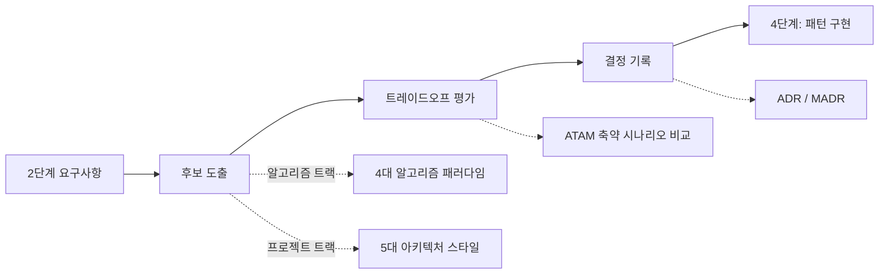

# 3단계: 패턴 분석

## 한눈에

**이 단계는:** 어떤 구조로 만들지 후보를 비교하고, 고른 것과 이유를 기록하는 단계다.

| 이 폴더 | 무엇 |
|---|---|
| `01`~`03` | 후보 찾기 · 비교하는 방법 설명 |
| `adr/` | 구조 결정 기록(ADR) — 정한 것과 이유 |
| `navigator-architecture-draft.md` · `navigator-archimate.md` | Floe 구조 초안과 층 그림 |

**우리 팀(Floe)의 이 단계 결과물:** [ADR 목록](adr/README.md)(0002~0006·0008·0009 확정 2026-10-17), [구조 초안](navigator-architecture-draft.md)

*(위 "한눈에"는 사람용 안내 — Claude 초안 2026-10-17, 두승현 요청. 아래는 원래 본문이다.)*

> 방법론 문서 상태: ✅ 완료 (ADR-0001)

2단계에서 확정된 요구사항을 놓고, 어떤 패턴/아키텍처로 풀지 정하는 단계. **후보 도출 →
트레이드오프 평가 → 결정 기록** 3단계 파이프라인으로 진행합니다.

## 1. 후보 도출

- **알고리즘 트랙** → [01-algorithm-paradigms.md](01-algorithm-paradigms.md) — CLRS 계열
  4대 설계 패러다임(Divide and Conquer / Dynamic Programming / Greedy / Backtracking)
  **+** Two Pointers/Sliding Window 같은 구현 기법 패턴, 두 계층을 함께 확인
- **프로젝트 트랙** → [02-architecture-styles.md](02-architecture-styles.md) (Mark Richards
  5대 아키텍처 스타일: Layered / Event-Driven / Microkernel / Microservices / Space-Based)

두 경우 모두 `01-docs/catalog/patterns.md`에서 과거 경험을 먼저 검색합니다.

### 1-1. 가정 지도 — Full 등급에서

<!-- claude-drafted: 2026-10-21 — 장부 W-36(ai-engineering-from-scratch 49강), 이재엽 채택 2026-10-21 -->
요구 밑에 깔린 "이게 맞아야 한다"를 **반증할 수 있는 문장**으로 적는다. 다섯 종류로 나눠 빠진 것이 없는지 본다 —
가치(결과가 그만큼 중요한가) · 쓰기 쉬움(사용자가 이해하고 쓸 수 있나) · 만들 수 있음(가진 데이터 · 제약으로 되나) ·
이어 갈 수 있음(비용 · 맡을 사람 · 운영) · 안전(실패해도 감당할 수 있나).

| 가정 | 종류 | 영향(1~5) | 불확실(1~5) | 되돌리기 어려움(1~5) | 가장 싼 확인 방법 |
|---|---|---|---|---|---|

- 점수 식은 정하지 않는다 — **왜 이 가정을 먼저 확인하는지** 말하게 하는 것이 목적이다.
- 영향 · 불확실이 크고 되돌리기 어려운 것부터, 결과를 바꿀 수 있는 가장 싼 방법(읽기만 하는 시험, 손으로 해 보기, 사람에게 확인)으로 확인한다.
  반증되면 그 요구를 다시 본다(2단계로 Recycle).
- 예: "다이어그램을 보고 '예'라고 답하면 이해한 것이다"(쓰기 쉬움) — 확인 질문 정답률로 반증할 수 있다.
- Xpress · Lite는 건너뛴다.

## 2. 트레이드오프 평가

후보가 2개 이상이면 → [03-tradeoff-evaluation-atam.md](03-tradeoff-evaluation-atam.md)
(SEI ATAM을 개인 프로젝트용으로 축약: 2단계 Planguage 시나리오에 후보들을 대입해 비교)

후보가 1개뿐이거나 요구사항이 Kano "Basic"이면 이 단계는 생략 가능.

## 3. 결정 기록

- **알고리즘 트랙**: 선택 근거 한 줄만 남기면 충분 (해당 문제 저장 항목에)
- **프로젝트 트랙**: [adr/](adr/README.md)에 ADR로 기록 — 번호 매기기·불변성·상태
  생애주기 등 실무 규칙 포함

### 이 저장소의 ADR 목록

| ID | 제목 | 상태 |
|---|---|---|
| [0001](adr/0001-storage-and-interface.md) | 워크플로우 인터페이스를 파일+Claude Code 스킬 하이브리드로 결정 | Accepted |

여러분의 첫 ADR은 `0002`부터 시작하세요 — [adr/README.md](adr/README.md) 참고.

## 출처
- Cormen et al., *Introduction to Algorithms* (알고리즘 패러다임 분류)
- Richards, M., *Software Architecture Patterns*, O'Reilly (아키텍처 스타일 카탈로그)
- Kazman, Klein, Clements, *ATAM*, SEI/CMU (트레이드오프 평가)
- Nygard, M., *Documenting Architecture Decisions* (2011); [MADR](https://adr.github.io/madr/) (결정 기록)
