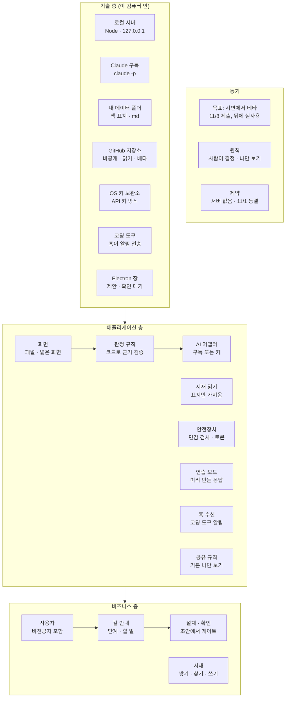

# Navigator 전체 구동 구조 — ArchiMate 스타일 층 그림 (초안)

<!-- claude-drafted: 2026-10-16 — 이재엽(총괄)의 요청("아키메이트 다이어그램으로 전체적으로 어떻게 구동을 할 것인지")으로 Claude가 requirements.md, ADR 0002~0006, 서재 설계, 프로토타입 코드, `02-frontend/README.md`에서 읽은 것만 층으로 나눈 **초안**이다. 확정은 이재엽. 대화에서 보인 그림과 같은 내용을 Mermaid와 표로 옮겼다. -->

## 0. 읽는 법

**ArchiMate의 층 구분과 "아래가 위를 돕는다"(serving) 관계만 따른 단순판**이다. ArchiMate의 공식 요소 모양·관계 종류(실현·할당·접근 등)는 전부 쓰지 않았다. 기존 다이어그램 가이드(`../04-pattern-implementation/03-diagramming-guide.md`)의 "질문 → 다이어그램" 표에는 ArchiMate가 없고, 이 그림이 답하는 질문은 **"전체가 어떤 층으로, 어디서 구동되는가"** 다. 청중마다 줌을 다르게 보이려면 C4(같은 가이드)가 맞다.

| 층 | 뜻 | 색(그림) |
|---|---|---|
| 동기 | 왜·무엇을 지키며 | 회색 |
| 비즈니스 | 누가 무엇을 하나 | 노랑 |
| 애플리케이션 | 무엇이 돌아가나 | 파랑 |
| 기술 | 어디서 돌아가나 | 청록 |

## 1. 그림 (Mermaid)

## 2. 돌아가는 세 가지 방식

같은 화면이 아래 셋 중 하나로 움직인다. **화면과 판정 규칙은 같고 AI 어댑터가 부르는 곳만 다르다.**

| 방식 | AI 어댑터가 부르는 것 | 필요한 것 | 상태 |
|---|---|---|---|
| **연습 모드** | 미리 만든 응답(fixture) | 없음 | 확정(FR-10) — 서버가 꺼져 있으면 자동 |
| **실제 모드(구독)** | 이 컴퓨터의 Claude 구독(`claude -p`) | Claude Code 로그인 | 확정(2026-10-15) — 시연에서 실제 대화 가능 |
| **실제 모드(API 키)** | 사용자의 API 키 | OS 키 보관소 또는 환경변수 | **후보 C-1** — 확정 대기 |

## 3. 한 번의 흐름 — "작업을 입력하면"

1. **화면**이 글을 받고 **안전장치**가 키·전화번호 모양을 먼저 검사한다.
2. **판정 규칙**(코드)이 단계·완료 기준을 정하되, 근거 구절은 입력 글에 있는 것만 인정한다.
3. 판단이 필요한 부분만 **AI 어댑터**가 Claude에게 묻고, 답의 모양이 틀리면 쓰지 않는다.
4. 결과는 **화면**이 보이고, 확정은 사람이 버튼을 눌러야 한다.
5. 서재는 **표지만** 읽어 보이고, 쓰기를 눌렀을 때만 인용이 올라간다.
6. 코딩 도구가 작업을 마치면 **훅 수신**이 알림을 받아 끝남을 표시한다(FR-7, 안전장치를 거친 뒤).

## 4. 요구·결정과의 연결

| 요소 | 닿는 것 |
|---|---|
| 화면 | FR-1·2·4·5·6·13, 팀 테마 얼음 파랑 |
| 판정 규칙 | FR-2·4, ADR-0003, 판정 규칙 검토(근거 구절 검증·단계 계산) |
| AI 어댑터 | FR-3·5, ADR-0002·0003, 후보 C-1 |
| 서재 읽기 | FR-8, 서재 설계(표지만 가져오기), 후보 C-3 |
| 안전장치 | FR-9, 안전장치 S1~S6 |
| 연습 모드 | FR-10 |
| 훅 수신 | FR-7 |
| 공유 규칙 | FR-9, ADR-0005 |
| 로컬 서버 | ADR-0002 (서버 없음 = 호스팅 서버가 없다는 뜻, 로컬 프로세스는 있다) |
| GitHub 저장소 | 베타. 안건: 권한·안전장치 확인 뒤 읽기(서재 설계 4절) |
| Electron 창 | `02-frontend/README.md`의 제안, 이재엽 확인 대기 |

## 5. 확정과 제안

| 구분 | 내용 |
|---|---|
| **확정** | 서버 없이 시연, 이 컴퓨터의 Claude 구독, 나만 보기 기본, 안전장치 필수, 팀 테마 얼음 파랑, 시연에서 실제 대화 가능 |
| **제안·후보** | API 키 방식(C-1), 파일 올리기(C-2), 서재 보기 방식(C-3), Electron 오버레이, GitHub 읽기(베타), "표지만 가져오기" |
| **미확인** | 토큰 사용량·일정 데이터원(`../04-pattern-implementation/api-intake.md`) |

## 6. 이 그림의 한계

- 층 사이 관계는 "돕는다" 하나만 그렸다. 데이터가 어디서 어디로 가는지는 데이터 파이프라인 그림(`navigator-architecture-draft.md` 4절)이 맡는다.
- 위의 "Electron 창"은 제안 단계라 점선으로 그렸다.
- 이 그림은 시연 수준이다. 베타에서 서버·로그인이 생기면 기술 층이 바뀐다(베타 형태 결정 대기).
