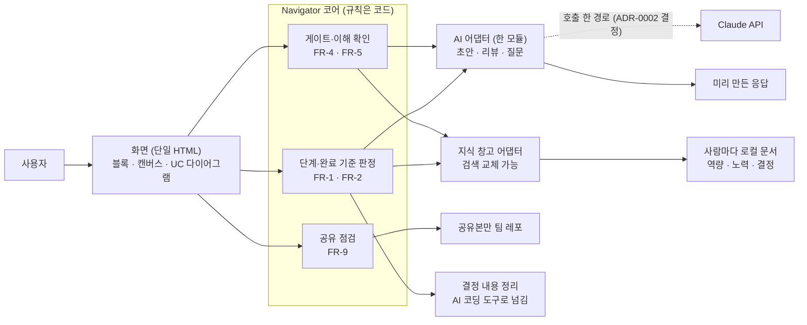
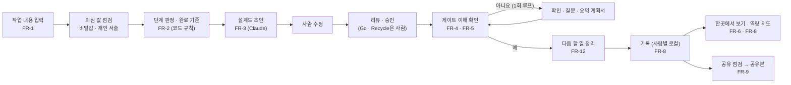

<!-- claude-drafted: 2026-10-15 — 이재엽의 요청("전부 내 권한이 필요한 내용 및 전체적인 초안")으로 Claude가 이슈 #6의 3단계 초안을 썼다. 근거는 requirements.md(13-1 확정 기록), 기획안, team-sharing-security.md, V1 ADR이다. "Claude 제안"은 결정이 아니며 이재엽이 고르기 전에는 모든 ADR이 Proposed다. -->

# Project Navigator — 3단계 초안 (이슈 #6)

> 상태: **결정됨** — 이 문서가 제안한 ADR 0002~0006은 2026-10-17에 이재엽이 모두 Accepted로 정했다(0008 · 0009도 같은 날). 1절 원칙표에 **설계 뒤 대조**(2026-10-18)를, 1-1절에 **위협 표**를 더했다. *(claude-drafted 2026-10-18, 고칠 목록 F-06 · F-07 · F-08)*
> 이전 상태: 초안, 결정 전. 요구의 원천은 [requirements.md](../00-overview/requirements.md)이고 이 문서는 그 요구를 구조로 옮긴 것이다. 어긋나면 requirements.md가 맞다.
> 기한: 10/25. 인터뷰 요약(#11)도 같은 날이라 **가설 상태로 먼저 쓰고** 인터뷰 뒤 확인한다.

## 0. 먼저 읽을 것 — 이재엽의 결정이 필요한 것

→ **2026-10-17 모두 결정됨**(제안대로 Accepted). 아래 표는 그때의 기록이다.

| # | 결정 | 선택지 | Claude 제안 | 기한(제안) |
|---|---|---|---|---|
| 1 | [ADR-0002](adr/0002-demo-structure.md) 시연 구조 | 미리 만든 응답만 / + 실제 Claude 호출 한 경로 / 서버 | 미리 만든 응답 기본, 멘토 답에 따라 한 경로 추가 | 10/17(멘토링) |
| 2 | [ADR-0003](adr/0003-ai-boundary-and-judgement.md) 판정의 위치 | 프롬프트 / **코드 규칙 + Claude는 초안·리뷰** / 사람만 | 코드 규칙, AI 호출은 한 모듈 | 10/20 |
| 3 | [ADR-0004](adr/0004-long-term-memory.md) 장기 기억 | 문서+키워드 / 문서+의미 검색(RAG) / DB | 문서+키워드, 검색은 바꿀 수 있게 | 10/20 |
| 4 | [ADR-0005](adr/0005-personal-vs-shared-storage.md) 저장 분리 | **각자 로컬 + 공유본만 레포** / 개인 저장소 / 팀 레포 한 곳 | 각자 로컬 (팀원 동의 필요) | 10/20 |
| 5 | [ADR-0006](adr/0006-second-brain-integration.md) 세컨드 브레인 통합 | 별도 모듈+연결 / 합침 / 대회 뒤 | 별도 모듈 | 10/22 |

각 ADR 끝의 체크박스에 표시하시면 됩니다. 정하신 뒤에 Status를 `Accepted`로 바꾸고 날짜·결정자를 적습니다.

### 그 밖에 이재엽의 권한이나 확인이 필요한 것

| 구분 | 일 | 왜 이재엽인가 | 상태 |
|---|---|---|---|
| 확정 | PR #43 캔버스의 `[Claude 제안]` 두 줄(부정적 영향) 채택 여부 | 의도명세는 이재엽의 의도 | 대기 |
| 확정 | 새 일 6개의 담당·기한 ([team-priorities.md](../00-overview/team-priorities.md) 4-1) | 역할 배분은 팀장 | 대기 |
| 확정 | 라이선스·대회 후 소유 | 팀원 동의가 필요한 합의 | 대기 |
| 확정 | 코드 변경에 리뷰 기록(PR 또는 코멘트)을 남길지 | 협업 증빙 10점과 부딪힘 | 대기 |
| 확정 | 멘토링 10/17에 가져갈 질문(아래 8절) | 대외 질의 | 대기 |
| 레포 설정 | 팀원 3명의 쓰기 권한이 맞게 들어갔는지 | 저장소 관리자만 가능 | 확인 필요 |
| 레포 설정 | 병합 시 브랜치 자동 삭제 옵션 | 저장소 관리자만 가능 (오늘 브랜치 24개를 손으로 지움) | 제안 |
| 레포 설정 | main 보호 규칙(병합 전 리뷰 1건 요구) | 협업 증빙에 직접 닿음 — 다만 "사람은 main에 직접 커밋" 결정과 부딪힘 | 이재엽이 정함 |
| 계정 | 실제 Claude 호출을 넣는다면 키 관리(환경변수) | 키는 레포에 없다 | ADR-0002 결정 뒤 |

## 1. 프로젝트 원칙표 (3단계 체크리스트 5번)

설계를 하기 전에 쓰고, **설계를 마친 뒤 한 번 더 대조**한다. "제안 ADR이 지키는가"는 설계 전(10/15)의 예상이고, **"설계 뒤 대조"는 2026-10-18 main의 코드 · 시험으로 다시 본 것**이다(claude-drafted, 이재엽 이름으로 진행 — 고칠 목록 F-06).

| # | 원칙 | 출처 | 제안 ADR이 지키는가 | 설계 뒤 대조 (2026-10-18) |
|---|---|---|---|---|
| P1 | 서버·도메인 없이 시연한다 | FR-10 | 0002 ✔ (미리 만든 응답 기본) | ✔ 화면 파일을 바로 열면 연습 예시로 0→7단계가 돈다 — `04-tests/acceptance/demo-flow.test.js`가 네트워크를 막고 확인 |
| P2 | 외부 AI 호출은 한 모듈에서만 | [code.md](../../.claude/rules/code.md) 6번 | 0003 ✔ | ✔ `03-backend/navigator/provider.js` 한 곳 — `navigator.test.js`가 다른 파일의 호출을 막음 |
| P3 | 비밀값은 환경변수로만, 레포에 없다 | 기록·보안 기준 | 0002 ✔ (키는 환경변수) | ✔ 키는 환경에만, 커밋 전 검사 훅. 알림 확인 값은 홈 폴더 파일(레포 밖, 600) · 녹화 · 사용량에 키 없음 |
| P4 | 개인 데이터는 팀 레포에 두지 않는다 | 공유 조건 1 | 0005 ✔ | ✔ 기록은 각자 브라우저에만, 알림은 서버 메모리에만, 녹화는 연습 예시에 대한 AI 답만 |
| P5 | 사람이 승인한 것만 확정, Claude 초안은 표시 | FR-3 | 0003 ✔ (Go/Recycle은 사람) | ✔ 설계도 확정은 사람의 버튼, 넘어가기는 '예' + 할 일 모두(`canAdvance`), 문서의 `claude-drafted` 표시 |
| P6 | 올린 글의 기본은 나만 보기 | FR-9 | 0005 ✔ | ✔ `share-rules.js` — 시험 |
| P7 | 가상 데이터는 화면에 가상이라고 표시 | FR-6·10 | 0002 ✔ | **일부** — 한곳에서 보기에는 "가상 숫자예요 · 시연용"이 보이지만, **서재 · 지식 은하 화면에는 더미 데이터라는 표시가 없다**(코드 주석에만) → 고칠 목록 F-17 |
| P8 | ~~11/1 기능 동결까지~~ **11/3 주요 기능 마무리까지** 시나리오 하나가 돈다 | 요구사항 10절 기준 · 일정 바뀜(13-1, 2026-10-18) | 0002·0006 ✔ (합치지 않음) | ✔ 지금 시나리오 하나가 처음부터 끝까지 돈다(수용 시험). 남은 5단계 일은 고칠 목록 |
| P9 | 판정은 규칙(코드)이 하고, AI가 준 근거는 글에 실제로 있어야 한다 | ADR-0003, 판정 규칙 검토 ① · ② | *(설계 뒤 추가)* | ✔ `parseJudgement`가 근거 구절을 글에서 찾고 단계는 코드가 정함 — 지어낸 근거 시험 |
| P10 | AI는 사용자 본인의 구독(또는 키)으로 부른다 — 우리 서버 비용 없음 | ADR-0009 | *(설계 뒤 추가)* | ✔ `provider.js` 순서(키 → 로그인 → 연습 예시) |

### 1-1. 위협 — 무엇으로부터 지키나 (3단계 보안 점검, 2026-10-18 추가)

<!-- claude-drafted: 2026-10-18 — 고칠 목록 F-08(checklist.md 보안 3단계 "위협 · 권한 · 인증 · 저장 위치를 대안 비교 · ADR에")을 풀려고 지금 결정 · 코드에서만 옮겼다. 새 결정은 없다. -->

| # | 위협 | 지키는 것 | 막는 곳 | 확인 | 남은 것 |
|---|---|---|---|---|---|
| T1 | 개인 대화가 시연 화면이나 팀 레포에 보인다 | 사용자의 대화 · 기록 | 안전장치 S1~S6, 원문은 각자 로컬(ADR-0005) | `demo-safety.test.js`, 시연 전 한 줄 점검(사람) | S1 · S6은 사람이 확인 |
| T2 | 다른 웹페이지가 내 구독으로 AI를 부른다 | 구독 사용량 | Host · Origin 검사(`server.js` `allowed`) | `api-contract.test.js` 403 | ~~같은 컴퓨터의 다른 프로그램은 부를 수 있다~~ → **F-04로 막음(2026-10-18)**: AI 네 주소도 확인 값 |
| T3 | 비밀값이 커밋 · 문서에 섞인다 | 키 · 토큰 | 환경변수만, 커밋 전 검사 훅 | `04-tests/hooks/test_check_secrets.py` | — |
| T4 | 받은 알림 글에 비밀 · 연락처가 섞여 화면에 나온다 | 키 · 연락처 | 저장 전에 가림(S4, `share-rules.js` `redact`) | `demo-safety.test.js` S4 | 패턴으로 가리므로 띄어 쓴 번호 등은 놓칠 수 있다 |
| T5 | AI가 지어낸 근거로 "했다"가 표시된다 | 판정의 믿음 | 근거 구절 확인 · 단계는 코드가 정함(P9) | 지어낸 근거 시험, 실제 AI 점검 98% 일치 | — |
| T6 | 토큰이 한도를 넘게 든다 | 사용자의 구독 · 예산 | 예산 통 — 80%에서 알리고 100%에서 멈춤(`provider.js`) | `provider.test.js` | 판정 한 번 약 8천 토큰(실측) |
| T7 | 공유본이 다른 사람에게 다시 퍼진다 | 팀원의 글 | 재공유는 글쓴이만(`share-rules.js`) | `share-rules.test.js` | — |
| T8 | AI 진행(C-12, 2026-10-20)으로 **새로 받는 것** — 파일 경로 · 명령 첫 줄 · 고친 줄 수 — 에 파일 내용이나 비밀값이 섞여 화면에 나온다 | 사용자의 코드 · 비밀값 | 훅(`hook.js`)이 `steps.js`로 이름 · 첫 줄 · 줄 수만 뽑아 보낸다 — `tool_input`(content · old_string · new_string) · `tool_response`는 싣지 않고 서버도 받으면 버린다. 작업 폴더 밖 파일은 이름만. 서버는 저장 전에 가리고(S4 `sensitive.js` `redact`) 메모리에만 세션당 50줄 · 세션 10개, '알림 기록 비우기'(S5)로 같이 지운다. 읽기는 확인 값(S3) | `hook-steps.test.js`(hook.js를 실제로 돌려 본문에 내용이 없음), `api-contract.test.js` 3-12(가림 · 50줄 · 비우기 · 403) | 명령 첫 줄에 든 비밀값은 패턴으로만 가린다(T4와 같은 한계). 훅은 답을 기다리지 않으므로 서버가 꺼져 있어도 Claude Code를 막지 않는다 |

**권한 · 인증 · 저장 위치 한 줄씩:** 사람 계정과 로그인은 두지 않는다(각자 컴퓨터에서 혼자 쓰는 설치형). 이 컴퓨터의 화면만 서버를 부르고(Origin), 알림은 확인 값이 있어야 받는다(S3). 원문은 각자 로컬, 팀 레포에는 공유본만(ADR-0005).

## 2. 후보 스타일 — 5대 스타일에서 먼저 찾기 (체크리스트 1번)

| 스타일 | 이 서비스에 맞는가 | 이유 |
|---|---|---|
| **Layered (계층형)** | **후보 1** | 개인·작은 프로젝트의 기본값. 화면 → 규칙 코어 → 저장 계층으로 나뉜다 |
| Microkernel (마이크로커널) | 후보 2 (부분) | "핵심 규칙 + 바꿔 끼는 부품"은 AI 어댑터·검색 계층에 해당 |
| Event-Driven | 제외 | 비동기 확장이 필요한 요구가 없다 |
| Microservices | 제외 | 서버 없이 시연(FR-10), 4인 팀 일정과 맞지 않다 |
| Space-Based | 제외 | 극한 확장 요구 없음 |

**Claude 제안: Layered를 뼈대로 하고, AI 호출과 검색만 어댑터(바꿔 끼는 부품)로 둔다.** 근거: 요구에 확장성 시나리오가 없고, 바꿔야 하는 곳은 AI 호출(ADR-0002·0003)과 검색(ADR-0004) 두 곳뿐이다.

## 3. 시스템 아키텍처 (제안)

읽는 법: 화면은 규칙 코어만 부르고, 규칙 코어만 AI 어댑터와 지식 창고 어댑터를 부른다. AI는 어댑터 밖에서 호출되지 않는다(P2).

## 4. 데이터 파이프라인 (제안)

## 5. ATAM 간소 비교 — 전체 구조 후보 (체크리스트 2번)

후보 A = 위 제안(정적 화면 + 코드 규칙 코어 + AI·검색 어댑터), B = 서버 기반 3계층, C = 프롬프트 중심(규칙을 코드로 두지 않음). **O/△/X는 Claude의 채점이다.**

| 품질 시나리오 | 출처 | A | B | C | 트레이드오프 |
|---|---|---|---|---|---|
| 시연이 서버 없이 열린다 | FR-10 | O | X | △ | B는 서버·도메인이 필요 |
| 같은 입력에 같은 판정이 나온다(시험 가능) | #17·#19 | O | O | X | C는 응답이 매번 달라질 수 있다 |
| 개인 원문이 팀에 새지 않는다 | FR-9 | O | △ | △ | B는 서버 저장소 관리가 새로 생긴다 |
| 11/1까지 시나리오 하나가 돈다 | 일정 | O | △ | O | B는 구축 비용이 크다 |
| "API를 그대로 쓴 수준"을 넘는다 | 기획 20점 | O | O | X | C는 규칙이 코드로 보이지 않는다 |
| 비전공자가 첫 장면을 이해한다 | FR-13 | — | — | — | 구조가 아니라 화면 문제 — 인터뷰로 확인 |

**선택 근거 한 줄(체크리스트 4번):** 서버 없이 시험 가능한 판정을 코드로 두고 AI는 어댑터로 한정하는 A가 시연·시험·협업 증빙 세 가지를 동시에 만족한다. (제안)

## 6. 화면 원칙 — 요구에서 역산 (체크리스트 6번)

| 원칙 | 근거 | 배제한 흔한 선택 |
|---|---|---|
| 단계를 블록으로 이어 보인다 | FR-1·2, 13-1 블록 확정 | 긴 문서 목록으로 단계를 설명 |
| 지금 위치를 한 줄로 항상 보인다 | FR-1·2·13 | 단계 번호만 표시 |
| 모르는 말은 그 자리에서 풀어 준다 | FR-13 | 용어집 페이지로 이동시키기 |
| 이해 확인은 다이어그램 + 예/아니요 | FR-4·5 | 자유 입력 답변 카드 (기획안 ②에서 취소) |
| 가상 숫자는 가상이라고 표시한다 | FR-6·10 | 가상 숫자를 실제처럼 보이기 |
| 올린 글의 기본 범위는 나만 | FR-9 | 기본 공유 후 해제 |
| 막힌 자리는 이유와 푸는 법을 같이 보인다 | FR-5 | "아니요"를 토스트로만 알리기 |

## 7. 일정 제안 (10/15 ~ 10/25)

| 날짜 | 할 일 |
|---|---|
| 10/16 | ADR-0002·0005의 방향 정하기(체크박스) |
| 10/17 | 멘토링: 8절 질문 5개 |
| 10/20 | ADR-0003·0004 방향 정하기, 0002·0005 Accepted |
| 10/22 | ADR-0006, 다이어그램을 임유정(#14)·두승현(#17)에게 공유 |
| 10/25 | 원칙표를 설계 뒤에 다시 대조, 인터뷰 요약(#11)으로 가설 확인, 3→4 게이트 |

## 8. 멘토링(10/17)에 가져갈 질문

1. "AI 기술 적용의 합리성"을 **게이트 판정 규칙 + 장기 기억**으로 보이면 "API를 그대로 쓴 수준을 넘었다"고 인정되는가?
2. 시연을 구동 GIF·영상으로 대신해도 되는가, 실제 호출 한 경로가 필요한가? (ADR-0002)
3. 협업 증빙으로 직접 푸시(PR 없음)가 인정되는가?
4. 대회 후 결과물의 소유·사용 범위 규정이 있는가?
5. 평가일(11/12·13)과 팀별 발표 순서가 정해졌는가?

## 9. 이 초안이 하지 않은 것

- 값을 정하는 것: 완료 기준 항목 수, 역량·노력 항목·단위, 반복 상한 — requirements.md 11절의 미정이다.
- 화면 기술(정적 HTML인지 프레임워크인지)과 화면 구조 — 임유정(#14·#15)·고한결(#12)의 몫이다.
- 인터뷰로 확인할 것(대상 문제의 실재, "비전공자" 기준).
