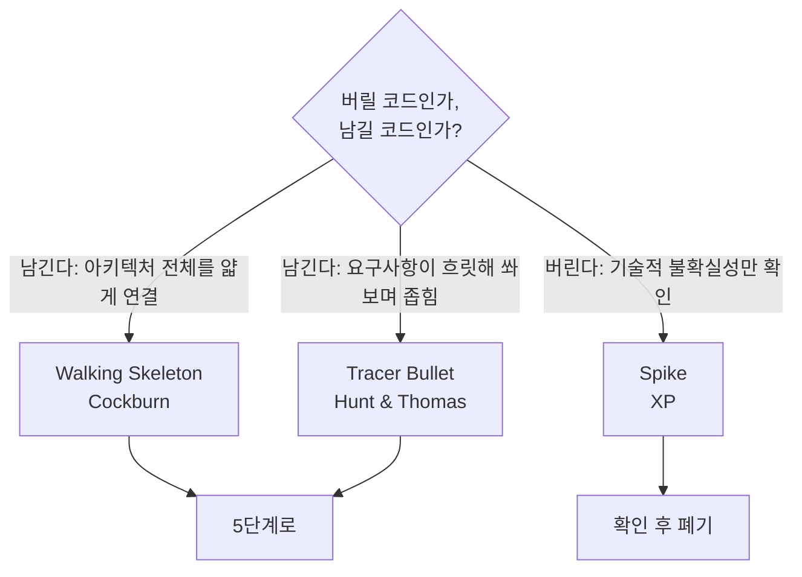

# 4단계: 패턴 구현 (스켈레톤)

## 한눈에

**이 단계는:** 처음부터 끝까지 가장 얇게 이어 보고(뼈대), 화면과 사용 장면을 설계하는 단계다.

| 이 폴더 | 무엇 |
|---|---|
| `01` · `02` | 뼈대 만드는 방향 |
| `03-diagramming-guide.md` | 어떤 그림을 그릴지 고르는 법 |
| `uc/` | 유스케이스(사용 장면) — 시연 시나리오 |
| `screen-flow-wireframe.md` · `library-view-design.md` | 화면 흐름·와이어, 서재 설계 |
| `api-intake.md` | 외부 API를 받았을 때 분석하는 법 |
| [`game-overlay/`](game-overlay/README.md) | 게임처럼 일하는 오버레이 목업 세 개 — 지금 고른 방향은 레벨 오버레이(2026-10-19, 제품 코드는 그대로) |
| [`website/`](website/README.md) | Floe 소개 웹사이트 초안 — 고른 방향은 'C-1 플로로 그림책'을 파스텔로 낮춘 한 페이지, 고르기까지의 캔버스도 (2026-10-21, 제품 코드는 그대로) |
| [`presentation-story.md`](presentation-story.md) | 10분 발표 스토리 · 슬라이드 구성안 초안 — 시간표 · 평가 배점 대응 · 비어 있는 칸 (2026-10-24, KAN-14, 슬라이드 파일은 아직 없음) |
| [`onboarding-scene-additions.md`](onboarding-scene-additions.md) | 처음 한 바퀴 장면 열둘마다 더할 것 [제안] — UI/UX 초안 (2026-10-24, 고한결 몫, 고르는 사람 이재엽) |
| [`onboarding-storyboard.md`](onboarding-storyboard.md) · [그림판](onboarding-storyboard.html) | 첫 5분 스토리보드 초안 — 한 줄 적기 → AI 없이 LV 0 · 첫 경험치 → 그다음 Claude 연결 (2026-10-20, KAN-55, 제품 코드는 그대로) |

**우리 팀(Floe)의 이 단계 결과물:** [유스케이스](uc/README.md), [화면 흐름](screen-flow-wireframe.md). 코드는 [frontend](../../02-frontend/README.md)·[backend](../../03-backend/README.md)

*(위 "한눈에"는 사람용 안내 — Claude 초안 2026-10-17, 두승현 요청. 아래는 원래 본문이다.)*

> 방법론 문서 상태: ✅ 완료 (스켈레톤) — 실전 문제로 검증하는 건 5단계에서 진행

3단계(ADR-0001)에서 선택한 패턴을, 실제 문제 데이터 없이 최소 골격으로 구현해서
구조만 검증하는 단계. 핵심 질문 하나로 방향이 갈립니다: **이 코드는 버릴 건가, 남겨서
키울 건가?**

## 트랙별 방향

| 트랙 | 문서 | 핵심 |
|---|---|---|
| 알고리즘 | [01-algorithm-track-skeleton.md](01-algorithm-track-skeleton.md) | "Make it work, make it right, make it fast" — 브루트포스로 정답부터 |
| 프로젝트 | [02-project-track-skeleton.md](02-project-track-skeleton.md) | Walking Skeleton / Tracer Bullet / Spike 중 상황에 맞게 |
| 다이어그램 | [03-diagramming-guide.md](03-diagramming-guide.md) | 순서도(ISO 5807) / C4 모델 / UML 구조·행동 다이어그램 선택 기준 |

## 이 저장소에 실제로 적용한 결과

- [`.claude/skills/dev-workflow/SKILL.md`](../../.claude/skills/dev-workflow/SKILL.md) —
  ADR-0001의 "파일+스킬 하이브리드"를 구현한 **Walking Skeleton**. 명령 3개(문제 저장/
  패턴 검색/회고 반영)의 실행 절차를 담고 있고, 버릴 코드가 아니라 5단계에서 그대로
  자라날 골격입니다.
- [`01-docs/01-problem-save/sessions/`](../01-problem-save/sessions/README.md) — 1단계
  세션 폴더 구조.

첫 몇 개 항목을 이 스켈레톤으로 실제로 저장해보면서 트랙 자동 인식·명령
1·2 절차가 실전에서도 매끄러운지 검증하는 게 다음 순서입니다.

## 아직 검증 안 된 것 (5단계로 넘김)

- **자연어 트리거 자체**는 Walking Skeleton의 일부가 아니라 [Spike](02-project-track-skeleton.md)
  성격의 불확실성입니다 — 확인만 하고 코드를 키우지 않습니다.
- Planguage Usability Goal(템플릿 작성 5분 이내) 실측 — [6단계](../06-service/README.md)에서.
