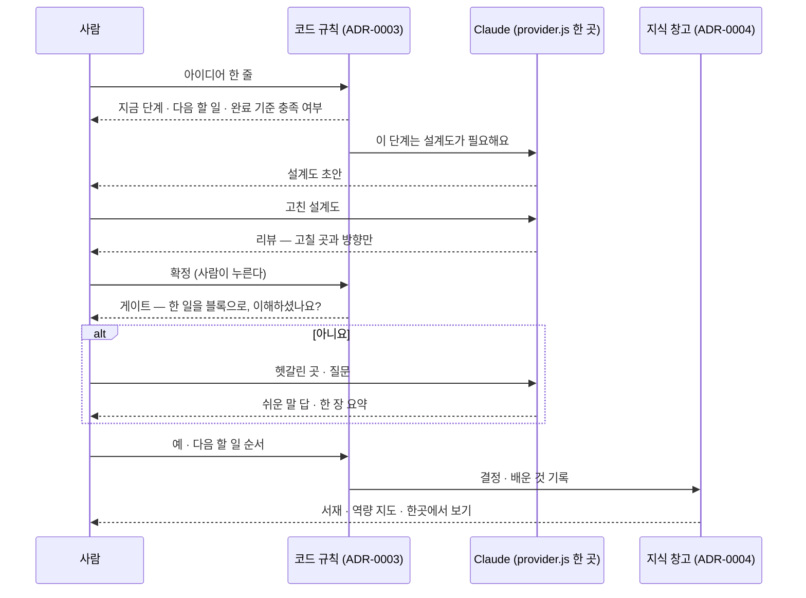

# 3분 시연 스토리 — 장면마다 평가 항목을 붙인다 (초안)

<!-- claude-drafted: 2026-10-17 — 이재엽의 요청(기획 아이디어 중 "시연 한 줄기를 심사 스토리로")으로 Claude가 UC-01(시연 시나리오), schedule.md 평가 배점, ADR-0003·0004·0009, 두 시안(navigator-prototype · library-prototype)을 읽고 썼다. 장면 순서 · 시간은 제안이고, 발표 흐름은 고한결(#13), 녹화는 임유정(#16)이 정한다. -->

## 0. 한 문장

**아이디어 한 줄에서 시작해, 이해하고 넘어가며, 끝나면 한 권의 책으로 남는 3분.** UC-01의 기본 흐름을 그대로 따르고,
장면마다 "평가의 어느 칸에 답하는가"를 붙였다. 기획 30 · 기술 20 · 실용 10 · 협업 30 · 발표 10 중, 시연은 **기획 20(AI 적용의 합리성)과 기술 10(실행 가능성)** 을 직접 보여 준다.

## 1. 장면

| # | 시간 | 화면에 보이는 것 | 요구 · UC-01 | 평가 칸 | 어디서 (지금) |
|---|---|---|---|---|---|
| 1 | 0:00–0:15 | 문제 한 줄 — 인터뷰에서 들은 말(응답자 A, 이름 없이) | 기획안 "문제" | 기획 · 문제 정의 10 | 내비게이터 `#start` (글은 인터뷰 뒤 채움, #11) |
| 2 | 0:15–0:35 | 아이디어 한 줄을 넣으면 **지금 0단계 · 다음 할 일 1개** | FR-1 · C-6 · UC-01 1~2 | 기획 20 | 내비게이터 `#ex=0` |
| 3 | 0:35–0:55 | 완료 기준 충족 여부, 모르는 말 옆의 풀이 | FR-2 · FR-13 · UC-01 3~4 | 기획 20 · 실용 | 내비게이터 `#ex=0&crit` |
| 4 | 0:55–1:25 | **Claude 초안 → 사용자가 고침 → Claude 리뷰 → 사용자가 "확정"** | FR-3 · UC-01 5~7 | **기획 20** — AI가 쓰고 사람이 정한다 | 내비게이터 `#ex=1&tab=doc` |
| 5 | 1:25–1:55 | 게이트: 한 일을 블록으로 → "이해하셨나요?" → 아니요 → 헷갈린 곳 → 한 장 요약 → 예 → 다음 할 일 순서 | FR-4 · 5 · 12 · UC-01 8~9 · A1 | **기획 20** — 판정은 코드 규칙(ADR-0003) | 내비게이터 `#ex=1&done&gate` |
| 6 | 1:55–2:15 | 한곳에서 보기: 진행 · 할 일 · **일정 충돌** · 토큰 (가상 표시) | FR-6 · UC-01 10 | 실용 | 내비게이터 `#tab=all` (한곳에서 보기 탭) |
| 7 | 2:15–2:35 | 7단계 돌아보기 → "한 권의 책으로 엮을까요?" → 서고에 꽂힌 표지 | FR-8 · 목표 한 문장("완성하고 회고") | 기획 · 실용 | 내비게이터 `#tab=lib&book=s3` → 엮기 → 서고 `#lib-bound-s3` |
| 8 | 2:35–2:50 | 전체 돌아보기 · 역량 지도(레벨 4단계 · 노력) | FR-8 · UC-01 11 | 실용(BM: 교육 현장 역량 현황판) | 서고 `#lib-review` |
| 9 | 2:50–3:00 | 비전: 한 해 별자리 하늘 — "쌓인 배움이 하늘이 된다" | 비전(이번엔 안 함) | 발표 | 지식 은하 `sky.html#year` |

**합쳤다(2026-10-17):** 작업 화면 위 위젯은 내비게이터 하나다 — 서재 시안의 '지금 · 단계 지도 · 한곳에서 보기 · 도서관' 탭을 내비게이터의 '한곳에서 보기' · '도서관' 탭으로 옮겼다([기획 확정 한 장](../00-overview/plan-confirm-2026-10-18.md) 4절). 장면 1~7은 내비게이터, 8은 서고, 9는 지식 은하이고, 9장면은 주소 끝으로 하나씩 연다(화면 위의 시연 길잡이 띠 `tour.js`는 2026-10-19에 지웠다 — 이재엽). 입구는 `02-frontend/index.html`.

## 2. 누가 무엇을 맡는가 — "API를 그대로 쓴 수준을 넘어"의 답

| 왜 이렇게 나눴나 | 근거 |
|---|---|
| 판정을 프롬프트에 맡기면 같은 입력에 다른 답이 나와 시험할 수 없고, "API를 그대로 쓴 것"으로 보인다 | ADR-0003, 기획 20점 |
| 확정 · 순서 · 이해 여부는 사람이 누른다 — "성장하는 건 사람" | FR-3, FR-4, 미션 |
| Claude 호출은 한 파일에서만 — 키 · 실패 처리 · 비용을 한곳에서 본다. 구독 → 키 → 연습 예시 순서 | ADR-0009, `provider.js` |
| 기록은 사용자 컴퓨터의 파일로 — 서버 없이 시연(FR-10), 검색은 나중에 바꿀 수 있게 한 인터페이스 뒤 | ADR-0004, ADR-0005 |

## 3. 녹화 메모 (#16)

- 아홉 장면 모두 주소로 바로 열린다(위 표의 주소). 주소로 여는 장면은 연습 예시만 써서 **토큰 0**이다. 진짜 AI 답을 보이려면 내비게이터의 녹화본 재생(`NAV_REPLAY`)을 켠다.
- 화면에 "가상 숫자예요"가 보이는 장면(6)은 그 표시를 가리지 않는다 — FR-10 확정 규칙.
- 마스코트는 이미지 이용 조건을 확인하기 전까지 **그림 코드(seal.js) 물범만** 쓴다. `mascot-v1.webp`는 넣지 않는다.
