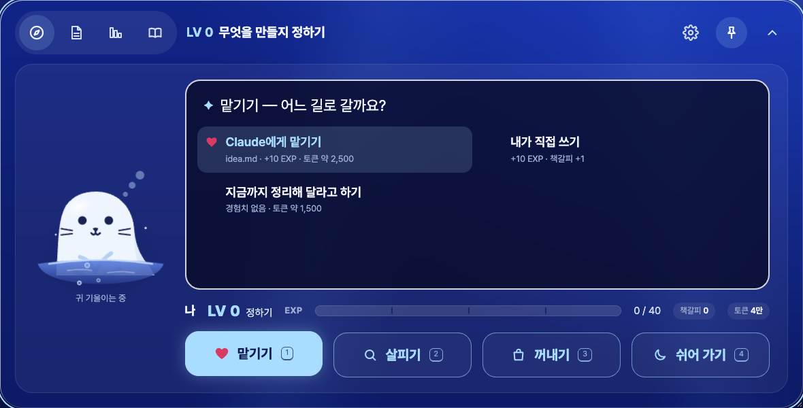
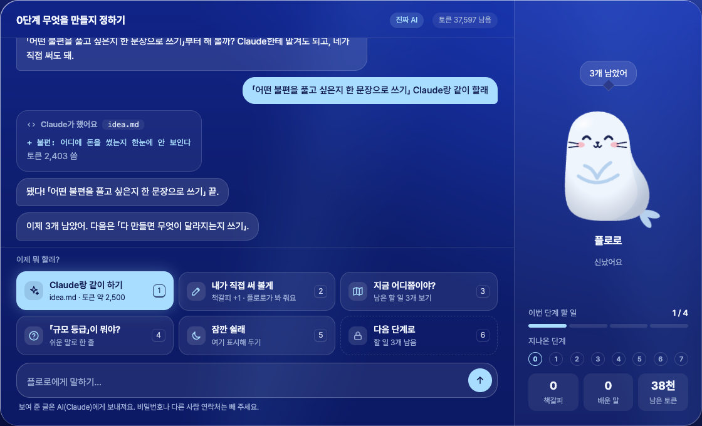
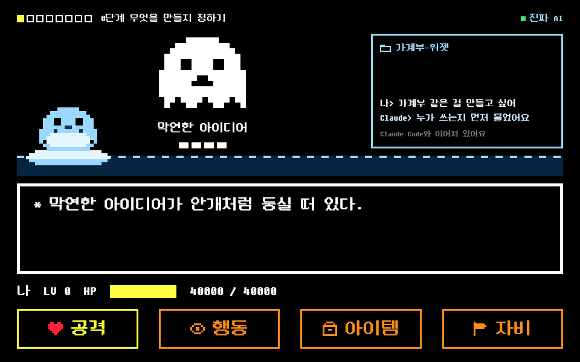
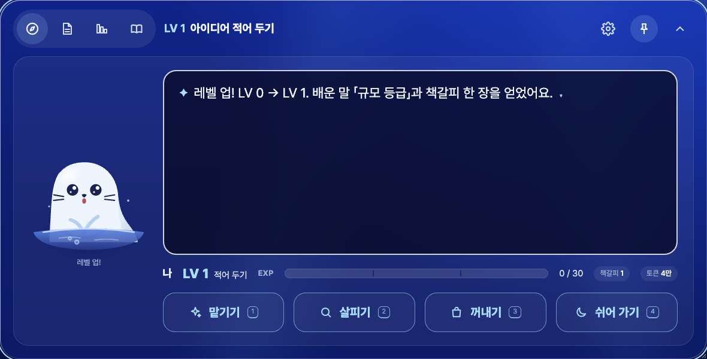

<!-- claude-drafted: 2026-10-19 — 이재엽의 요청으로 Claude가 만든 화면 목업 세 개와 이 안내. 이재엽이 셋째 안을 보고 "굿굿 전체 디자인 올려줘"라고 해서 레포에 올렸다. -->

# 게임처럼 일하는 오버레이 — 목업 세 개

**지금 고른 방향은 3번 레벨 오버레이다** (이재엽 "굿굿", 2026-10-19). 1·2번은 거쳐 온 길로 남긴다.
**2026-10-19 저녁, 3번을 제품에 넣었다**(이재엽 "지금 앱에 있는 UI들을 변경해줘야해" — PR #111, v3.0): `02-frontend/navigator/app.js`의 PC '이번 단계' 카드가 이 목업의 짜임(플로로 · 상자 · LV/EXP 줄 · 명령 네 칸)이다. 규칙은 그대로다 — LV는 코드가 정한 단계, EXP는 할 일 × 10, 다 차도 '확인하고 넘어가기'(확인 질문)를 지나야 레벨이 오른다(아래 "정할 것" 1번은 그대로 둠). 버튼 말은 설정에서 일 말 / 게임 말을 고른다(2번은 인터뷰 뒤).

| # | 파일 | 무엇 | 이재엽 요청 |
|---|---|---|---|
| 1 | [rpg-battle.html](rpg-battle.html) | 고전 RPG 전투 화면처럼 — 검은 화면, 흰 테두리 상자, 주황 명령 네 칸, 도트 그림 | "우리 작업하는 공간이랑 대화하는 창을 이런식으로 디자인해서 게임처럼 작업이 가능하도록" |
| 2 | [friend-chat.html](friend-chat.html) | 친구와 이야기하듯 — 왼쪽 대화 · 고르는 버튼 · 입력, 오른쪽 플로로 | "도트가 아니라 친구랑 대화하는 느낌으로 그리고 버튼들로 자신이 실행할 것들을 정하는 느낌으로" |
| 3 | [level-overlay.html](level-overlay.html) | 지금 오버레이를 키우고, 가벼운 상자 · 명령 네 칸 · 레벨과 경험치 바. 플로로는 물에 잠긴 그대로, 오버레이 크기를 따라 커지고 작아진다 | "작업하는것들을 가볍게 보이게만 … 검은 사각형에서 작업들을 선택 … 단계가 레벨로 … 체력바는 경험치바로", "원래 플로로는 물에 잠긴 상태로 그대로 하고 오버레이 크기만큼 크기가 크고 작고가 정해지면" |

| 2 친구 대화 | 1 RPG 전투 |
|---|---|
|  |  |

## 2026-10-21 — 그다음 모양: 퀘스트 오버레이 (스토리보드)

| # | 파일 | 무엇 | 이재엽 요청 |
|---|---|---|---|
| 4 | [quest-overlay.html](quest-overlay.html) · [quest-storyboard.md](quest-storyboard.md) | 위 줄 하나로 통일, 왼쪽은 플로로와 대화, 오른쪽은 퀘스트 카드 · 도전과제 나무 · 서고. LV/EXP 없음, 진행 줄은 위 줄에만. 7단계는 챕터 · 할 일은 퀘스트 · 관문은 그대로 | "게임처럼 다가가기 쉽게 … 7개의 과정이 도전과제로 이어지고 … 플로로와 대화하면서 퀘스트를 받고 수행"(참고: 마인크래프트 발전 과제 · 메이플 퀘스트 창). 요구 후보 C-22(등급 미정) |
| 5 | [quest-canvas.html](quest-canvas.html) · [스토리보드 9 · 10 · 11절](quest-storyboard.md) | **제작 중(2026-10-21 — 1차 뼈대가 제품에 들어감, 스토리보드 11절 · [기능 14](../../features/14-quest/README.md)).** 이재엽 결정: 창 셋 · 단계는 1단계부터 · 지금부터 만들어 릴리즈. 마무리 캔버스 — 설정 창 자리(왼쪽 · 오른쪽)를 고르면 퀘스트 창은 반대쪽. 처음 실행 → 요구 입력 → '퀘스트를 시작하시겠습니까?' → 1단계 퀘스트 창이 바로 뜸(📜로 켜고 끔). 설정은 켰다 끄는 왼쪽 창(이름 · 초기 개발자 → 중급자 → 상급자 · 서재로 · 설정 줄), 퀘스트는 더 큰 오른쪽 창(처음 받을 때 이벤트 창 짜임 → 받은 뒤 공책 목차 · 줄, 여기서 고침), 도전과제는 그림만 크게 + 마우스 설명. 위 줄은 지금 제품 그대로, 왼쪽에 큰 플로로 하나, 가운데 채팅(채팅 안에 플로로 그림 없음), 퀘스트 · 도전과제는 **따로 뜨는 위젯**(끌기 · S/M/L 크기 · 세션 고르기). 요구를 말하면 플로로가 퀘스트를 만들어 확인을 받는다. 보상은 무지개 조개 → 뽑기 → 꾸미기, 설정 창(이름 · 칭호 · 서재로 · 세션마다 칸) | "다음 버전의 레프런스 … UI 캔버스 … 메인은 버튼이 아니라 플로로와 소통 … 왼쪽은 퀘스트 창 … 무지개 조개 … 확률형 … 설정창은 중앙에 플로로" (2026-10-21 둘째). C-22 세부 |

<!-- claude-drafted: 2026-10-21 -->

## 여는 법

파일을 브라우저로 바로 연다 — 서버도 AI도 부르지 않고, 아무것도 저장하지 않는다. 플로로의 말과 Claude가 한 일은 미리 정해 둔 글이다.

- 글꼴(Pretendard, 1번의 둥근모꼴)을 CDN에서 받으므로 인터넷이 필요하다.
- 2·3번의 플로로는 [seal.js](../../../02-frontend/navigator/seal.js) · [seal.css](../../../02-frontend/navigator/seal.css)를 **그대로 불러온다** — 제품의 플로로가 바뀌면 목업도 같이 바뀐다.
- 할 일 문구는 [navigator.js](../../../03-backend/navigator/navigator.js), 쉬운 말 풀이는 [glossary.js](../../../03-backend/navigator/glossary.js)에서 옮겼다(2026-10-19). 판정 규칙이 바뀌면 목업의 글은 낡는다.
- 조작: 3번은 <kbd>←</kbd> <kbd>→</kbd> 고르기, <kbd>Enter</kbd> 정하기, <kbd>Esc</kbd> 뒤로, <kbd>1</kbd>~<kbd>4</kbd> 바로 고르기. 페이지 위의 "Claude Code에서 일한 것처럼 알림 보내기"로 밖에서 일했을 때를 흉내 낸다.

## 3번 레벨 오버레이 — 무엇이 어디로

| 화면 | 하는 일 | 지금 오버레이의 자리 |
|---|---|---|
| 위 아이콘 줄 | 이번 단계 · 설계도 · 단계 지도 · 도서관, 설정 · 열어 두기 · 접기 — 지금 모양 그대로 | 같음 |
| 플로로 | 얼음 숨구멍에서 물에 잠긴 채 고개를 내민다. 크기는 오버레이를 따라(플로로 칸 너비의 86%와 높이의 70% 중 작은 쪽, 90~300px). 20초 가만히 있으면 한 번 헤엄친다 | 카드 속 플로로 |
| 가벼운 상자 | 지금 하는 일 한 줄, 지금 할 일, Claude Code에서 온 마지막 알림 한두 줄 | 큰 글 칸 자리 |
| 명령 네 칸 | 맡기기(공격) · 살피기(행동) · 꺼내기(아이템) · 쉬어 가기(자비). 고르면 상자 안에 길이 펼쳐지고, 길마다 경험치 · 토큰 · 책갈피가 먼저 보인다 | '예시 글 넣기' · '어디쯤인지 보기' 버튼 — 이제 길 안에 있다 |
| LV | 단계 = 레벨. 위 제목도 "LV 0 무엇을 만들지 정하기" | 단계 이름 |
| EXP 바 | 할 일 하나에 10. 다 차면 레벨 업(별, 플로로 깜짝 표정) → 다음 레벨의 할 일로 다시 빈다 | 할 일 진행 |
| 직접 쓰기 | 길에서 '내가 직접 쓰기'를 고를 때만 한 줄 입력이 열린다. 직접 쓰면 책갈피 +1 | 큰 글 칸 |

## 정할 것

| # | 무엇 | 왜 | 누가 |
|---|---|---|---|
| 1 | 레벨이 저절로 오르면 지금의 '넘어가기 전 확인'(확인 질문 하나, FR-4)이 빠진다 — 레벨 업 직전에 확인 질문을 넣을지 | 게이트를 사람이 확인한다는 지금 규칙과 부딪친다 | 이재엽 |
| 2 | 버튼 말 — 일 말(맡기기)과 게임 말(공격) 중 무엇 | 처음 쓰는 사람에게 무엇이 쉬운지 | 고한결(인터뷰) |
| 3 | 직접 쓴 할 일에 경험치를 더 줄지(지금은 둘 다 10, 직접 쓰면 책갈피만 더) | 맡기기만 하면 배움이 쌓이지 않는다 | 이재엽 |
| 4 | 큰 글 칸 없이도 처음에 무엇을 만드는지 말하기 충분한지 | '직접 쓰기' 한 줄만 남았다 | 고한결 |
| 5 | 휴대폰 화면 — 네 칸을 2×2로 둘지 | 3번은 PC만 그렸다 | 임유정 |
| 6 | 제품에 넣는다면 언제 — 주요 기능 마감(11/3) 전인지 뒤인지 | [일정](../../00-overview/schedule.md) | 이재엽 |

## 지킨 것

- 1번은 고전 RPG 전투 화면의 짜임새만 빌렸다. 특정 게임의 캐릭터 · 이름 · 그림 · 소리는 쓰지 않았다.
- 글꼴: Pretendard(SIL OFL), 둥근모꼴 — 제품에 넣기 전에 이용 조건을 확인한다.
- 화면 안의 "보여 준 글은 AI(Claude)에게 보내져요" 안내는 지금 오버레이와 같다([기록·보안 기준](../../../.claude/rules/security-records.md) 1절).
