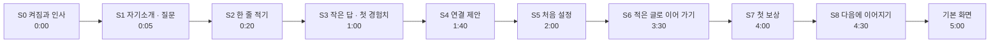
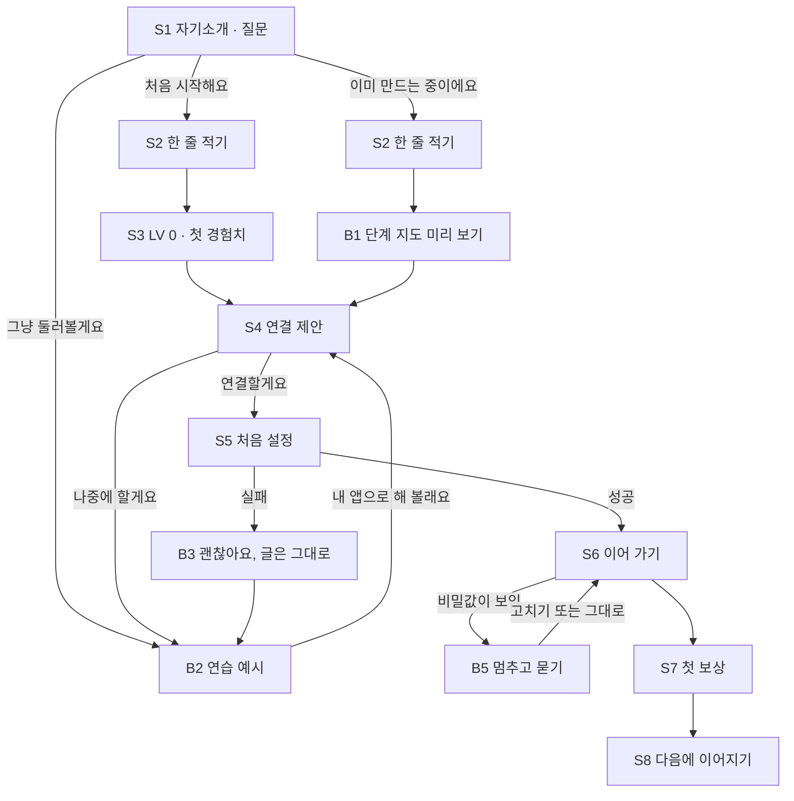

<!-- claude-drafted: 2026-10-20 — 두승현의 요청("onboarding.md 내용을 바탕으로 첫 5분 흐름을 스토리보드로 … 초안을 짜줘")으로 Claude가 썼다. 근거는 onboarding.md "첫 5분" 제안 절과 지금 코드(setup.js · greet.js · app.js · navigator.js · seal.js · sensitive.js · library.js)다. 대사 · 시간 · 갈래는 초안이고, 방향은 이재엽 · 화면은 임유정 · 말투는 고한결(인터뷰)이 정한다. Jira KAN-55. -->

# 첫 5분 스토리보드 — 켜서 "다음 할 일"을 보고, 다시 오고 싶어질 때까지 (초안)

**한 문장:** 플로로가 먼저 인사하고 "무엇을 만들고 있어요?"라고 묻는다. 사용자가 한 줄을 적으면 **AI 없이도** 지금 단계와 첫 할 일을 보여 주고 첫 경험치를 준다. 그 **뒤에** "이어 가려면 Claude 연결이 필요해요"라고 말한다.

- **근거:** [온보딩 안내](../00-overview/onboarding.md)의 "첫 5분" 제안(두승현, 2026-10-20) — 가치 먼저, 설정은 필요한 순간에. 보완 ①(작은 답 먼저) · ②(적은 글로 이어 가기)와 코드 검토가 그 절에 있다.
- **그림으로 보기:** [onboarding-storyboard.html](onboarding-storyboard.html) — 브라우저로 바로 연다(서버 · AI 없음). **한 장면씩 실제 화면처럼**(코딩 도구 위에 뜬 섬) 크게 보이고, ‹ › · ← → 로 넘긴다. 갈래는 장면 아래의 칩으로 열고, 설명은 아래 한 줄과 접힌 "자세히"에만 둔다. 주소 끝으로 바로 연다(`#S3`, `#B2`). 플로로는 제품의 `seal.js`를 그대로 불러온다.
- **상태:** 초안. **목업은 확정이 아니라 참고용이다**(두승현 2026-10-20) — 섬 모양 · 짜임은 지금 앱 화면과 다르고, 실제 화면은 담당(임유정)이 정한다. 지금 앱(9.0.0)은 이 순서가 **아니다** — 처음 켜면 처음 설정이 먼저 뜬다(`02-frontend/navigator/setup.js`의 `shouldOpen`). 이 문서는 바꿀 모습을 그린 것이다.

## 0. 이 스토리보드가 지키는 것

| # | 원칙 | 어디서 왔나 |
|---|---|---|
| 1 | **2분 안에 첫 가치** — 설치 뒤 AI 연결 없이 "LV 0 · 첫 할 일 · 경험치 +10"까지 | onboarding.md 제안 · Duolingo "첫 수업 먼저" |
| 2 | **설정은 가치를 본 뒤에** — Claude 연결은 4번째 장면에서 처음 묻는다 | 두승현 제안 · Codecademy Go "답을 넣은 뒤 문을 연다" |
| 3 | **적은 글은 사라지지 않는다** — 연결 중에도, 실패해도, 다시 켜도 | 보완 ② · `app.js` `KEEP`에 `text`가 이미 있다 |
| 4 | **AI는 사용자가 누를 때만** — 5분 안에 AI 호출은 한 번(장면 6), 누르기 전에는 0 토큰 | ADR-0009 · 이슈 #79(한 번에 평균 약 1,800토큰) |
| 5 | **플로로의 말은 한 번에 두 문장 · 60자 안** | `navigator.js` `SAY_MAX = 60` |
| 6 | **화면의 큰 글에는 전문 용어를 쓰지 않는다** — 용어는 작게 | FR-13 · `navigator.js` 쉬운 말 규칙 |
| 7 | **확정 · 이해 여부는 사람이 누른다** | FR-3 · FR-4 |
| 8 | **보낼 글에 비밀값이 보이면 멈추고 묻는다 — 막지는 않는다** | security-records.md 6-3 · `sensitive.js` |

## 1. 5분 한눈에

| 시간 | 장면 | 사용자가 느낄 것 | AI 호출 | 지금 앱에 있나 |
|---|---|---|---|---|
| 0:00–0:05 | S0 켜짐과 인사 | "귀엽다, 살아 있네" | 0 | **있음** (`greet.js`, 3.4초) |
| 0:05–0:20 | S1 자기소개 · 질문 | "나를 도와주러 왔구나" | 0 | 바꿈 — 지금은 "AI를 어떻게 불러 올지"를 먼저 묻는다 |
| 0:20–1:00 | S2 한 줄 적기 | "내 얘기를 들어 주네" | 0 | 일부 — 입력 칸은 있다(`app.js` `deskInput`) |
| 1:00–1:40 | S3 작은 답 · 첫 경험치 | **"벌써 한 걸음 갔다"** — 아하 모먼트 | 0 | 일부 — LV · 할 일 표시는 있고, 인용 · 스스로 확인은 새로 |
| 1:40–2:00 | S4 연결 제안 | "이어 가려면 필요하구나" | 0 | 새로 |
| 2:00–3:30 | S5 처음 설정 | "1분이면 된다더니 정말이네" | 확인 1회(수십 토큰) | **있음** (`setup.js`) — 적은 글을 위에 보이는 것만 새로 |
| 3:30–4:00 | S6 적은 글로 이어 가기 | "다시 안 적어도 되네" | **1회** (약 1,800토큰) | 일부 — 신호(`floe:setup-done`)는 있고 단추는 새로 |
| 4:00–4:30 | S7 첫 보상 | "게임 같다, 재밌다" | 0 | **있음** (레벨 오버레이 · 별 튀기기) |
| 4:30–5:00 | S8 다음에 이어지기 | **"내일도 켜야지"** | 0 | **있음** (서재 '지금 쓰는 책', `welcome()`) |

## 2. 장면

모든 장면에서 섬은 화면 위쪽 가운데에 뜬다. 섬 안의 짜임(두승현 2026-10-20) — **플로로 줄**에는 플로로와 옆의 말(말풍선 · 제목)만 둔다. 플로로는 그 말과 **같은 세로 크기로** 선다(CouCou처럼 마스코트와 글의 높이를 맞춘다. 말이 한 줄이면 플로로가 너무 작아지지 않게 아래 한계를 둔다). **그 아래**(내용 · 단추 · 안내)는 섬 폭을 다 써서 플로로 밑이 비지 않는다.

| 층 | 무엇 | 보이는 방식 |
|---|---|---|
| ① 상태 | LV · EXP | 맨 위 한 줄, 아래에 옅은 선 |
| ② 플로로의 말 | 말풍선 | 가장 밝게 — 이 화면의 주인공 |
| ③ 내용 | 할 일 · 입력 · 미리 보기 | 옅은 바탕의 카드 |
| ④ 행동 | 단추 | 주 단추는 하나만, 맨 앞에 채운 색으로 · 나머지는 테두리만 |
| ⑤ 안내 | 작은 글 | 맨 아래, 가장 흐리게 |

간격은 8(층 안) · 14(층 사이) · 20(섬 가장자리) 셋만 쓴다. 처음 설정 창과 갈래 화면도 같은 짜임이다. 섬의 모양은 **띠**(가장 작음) · **한 줄**(플로로와 한 줄) · **펼침**(상자 · 단추) · **넓은 창**(처음 설정처럼 넓게 띄운 창) 중 하나다.

### S0 켜짐과 인사 — 0:00–0:05

| 칸 | 내용 |
|---|---|
| 섬 | 띠 → 펼침 |
| 화면 | 띠의 물결 선이 그려지고(wave) → 섬이 열리고(open) → 플로로가 물속에서 솟아(pop) → 옆으로 가서 지느러미를 흔들며 인사(hello) → 가운데로 돌아온다(settle). 합쳐 3.4초, 상한 5초 |
| 플로로 | 표정 `happy` · 말 "오후도 같이 힘내요!" (시간대 인사 — 지금 `seal.js` `greeting` 그대로, 아침이면 "좋은 아침이에요!") |
| 사용자 | 아무것도 안 해도 된다. 누르거나 Esc면 바로 S1로(`skip`) |
| 설득하는 것 | 마스코트의 첫인상 — 이 앱은 살아 있고 나를 반긴다 |
| 구현 | **있음** — `02-frontend/navigator/greet.js` `TIMELINE` · `play`, 움직임 줄이기면 인사 카드만(`shouldGreet`) |

### S1 자기소개 · 질문 — 0:05–0:20

| 칸 | 내용 |
|---|---|
| 섬 | 펼침 |
| 플로로 말 1 | "반가워요! 저는 길잡이 물범 플로로예요." (21자) |
| 플로로 말 2 | "지금 어떤 앱을 만들고 있어요? 알려 주면 길을 잡고 정리해 줄게요." (37자) |
| 표정 | `happy` → 말 2에서 `look`(귀 기울이는 중) |
| 단추 | **처음 시작해요** (주) · **이미 만드는 중이에요** · 작게 "그냥 둘러볼게요" |
| 설득하는 것 | 이 앱이 무엇을 해 주는지를 한 문장으로 — "길을 잡고 정리해 준다" |
| 구현 | 바꿈 — 지금 `setup.js`의 `hello` 단계("반가워요! 저는 길잡이 물범 플로로예요. … AI를 어떻게 불러 올지 하나만 고르면 돼요")를 이 질문으로. 처음 설정은 S5로 미룬다(`shouldOpen`) |

- **왜 두 단추부터:** 새로 시작하는 사람은 늘 0단계라 AI 없이도 "LV 0"이 맞는 말이다. 이미 만드는 중인 사람에게는 틀린 말이라 먼저 가른다(onboarding.md 코드 검토).
- "그냥 둘러볼게요" → 갈래 B2(연습 예시).

### S2 한 줄 적기 — 0:20–1:00

| 칸 | 내용 |
|---|---|
| 섬 | 펼침 — 상자 안에 입력 칸 한 줄 |
| 플로로 말 | (처음 시작해요) "좋아요! 만들고 싶은 걸 한 줄로 적어 주세요." / (이미 만드는 중이에요) "멋져요! 지금 만드는 걸 한 줄로 적어 주세요." |
| 표정 | `look` — 글자를 칠 때마다 눈이 입력 칸 쪽을 본다(`gaze`) |
| 입력 칸 | 예시 글(흐리게): "예) 동아리 행사 신청을 받는 앱을 만들고 싶어요" · 아래 작게 **예시 넣기** |
| 단추 | **다 적었어요** (비어 있으면 누를 수 없음) |
| 안내(작게) | "여기 적은 글은 이 컴퓨터에만 있어요. AI에게는 아직 보내지 않아요." |
| 설득하는 것 | 내 문제를 꺼내 놓는다 — 이미 시간을 들였다(뒤의 설정을 견디게 하는 힘) |
| 구현 | 일부 — 입력 칸과 예시 글은 있다(`app.js` `deskInput` · `PLACEHOLDER`, '예시 글 넣기'). 문구만 한 줄용으로 |

- 연결 전이라 아직 아무것도 보내지 않는다 — 그래서 이 장면에서는 비밀값 검사가 멈추지 않는다. 검사는 보내기 직전(S6)에 한다(갈래 B5).

### S3 작은 답 · 첫 경험치 — 1:00–1:40 ★ 아하 모먼트

| 칸 | 내용 |
|---|---|
| 섬 | 펼침 — 레벨 오버레이: 위에 **LV 0 무엇을 만들지 정하기**, 아래 **EXP 0 / 40** |
| 플로로 말 1 | "'동아리 행사 신청을 받는 앱…' 좋은 시작이에요!" (적은 글 앞 20자 안쪽을 그대로 인용) |
| 플로로 말 2 | "처음 시작하는 거라 LV 0부터예요. 첫 할 일을 같이 봐요." (32자) |
| 상자 | 이번 할 일 넷 — ① 어떤 불편을 풀고 싶은지 한 문장으로 쓰기 ② 다 만들면 무엇이 달라지는지 쓰기 ③ 누가 쓰는지 쓰기 ④ 얼마나 크게 만들지 정하기 (작게 `규모 등급`) |
| 스스로 확인 | "방금 적은 한 줄이 ①을 말하고 있나요?" — **네, 말하고 있어요** / 아직이에요 |
| '네'를 누르면 | ①에 체크 · **EXP +10** · 별 튀기기 · 플로로 `happy` · 말 "첫 할 일 끝! 경험치 10을 받았어요." |
| '아직이에요'면 | 플로로 `look` · 말 "괜찮아요. 어떤 불편을 풀고 싶은지 한 문장만 더해 볼까요?" → 입력 칸을 다시 연다 |
| 설득하는 것 | **핵심 가치** — 멈춘 자리에서 다음 한 걸음이 보인다. AI 없이, 2분 안에 |
| 구현 | 일부 — LV · 할 일 넷은 코드에 고정된 데이터(`navigator.js` `STAGES[0]` · `criteriaFor`), 레벨 오버레이와 별 튀기기는 있음(`app.js` · `seal.js` `burst`). **새로:** 인용 말풍선, 스스로 확인 단추 |

- **결정이 필요하다 (이재엽):** 지금은 할 일을 채웠는지 AI가 보고 코드가 정한다. 스스로 확인으로 경험치를 주는 건 새 규칙이다. 다만 "이해 여부는 사람이 누른다"(FR-4)와 같은 방향이고, 첫 바퀴의 첫 할 일 하나에만 쓴다. 안 받아들이면: 경험치 없이 "①을 쓴 것 같아요 — 연결하면 Claude가 같이 확인해 줄게요"로 줄인다.
- **이미 만드는 중이에요**를 골랐다면 이 장면 대신 갈래 B1.

### S4 연결 제안 — 1:40–2:00

| 칸 | 내용 |
|---|---|
| 섬 | 펼침 |
| 플로로 말 1 | "남은 할 일 셋은 Claude와 같이 보면 빨라요." (22자) |
| 플로로 말 2 | "연결하면 어디쯤인지 같이 봐 줄게요. 1분이면 돼요." (27자) |
| 표정 | `idle` |
| 미리 보기 | 작은 카드 — "연결하면 받는 것: 지금 몇 단계인지 · 다음 할 일 하나 · 다 했는지 확인" |
| 단추 | **연결할게요** (주) · 나중에 할게요 |
| 안내(작게) | "연결하면 보여 준 글이 AI(Claude)에게 가요. 비밀번호나 다른 사람 연락처는 빼 주세요." (지금 `setup.js` 문구 그대로) |
| 설득하는 것 | 번거로운 일에 이유를 준다 — 이미 본 가치를 이어 가려면 필요하다 |
| 구현 | 새로 — 연결 제안 카드. '나중에 할게요'는 갈래 B2 |

### S5 처음 설정 — 2:00–3:30

| 칸 | 내용 |
|---|---|
| 섬 | 넓은 창 (지금 처음 설정과 같은 크기 — 9.0.0에서 Windows가 작게 끼던 것을 고친 v10.4) |
| 맨 위 띠 (새로) | "적어 둔 한 줄: 동아리 행사 신청을 받는 앱… — 그대로 있어요" |
| 고르기 | **Claude Code로 연결** (이 컴퓨터에서 찾으면 '추천') · **API 키 넣기** · 작게 "AI 없이 연습용 예시로 둘러보기" |
| Claude Code로 | 찾기 → 로그인 → 폴더 연결 → 연결 확인(아주 작은 요청 하나) |
| API 키로 | 키 넣기 → 폴더 연결(선택) → 연결 확인 |
| 플로로 | 단계마다 표정 `think` · 끝나면 `done` · 말 "준비 끝!" |
| 설득하는 것 | "1분이면 끝나요"를 지킨다 — 단계가 보이고 하나씩 체크된다 |
| 구현 | **있음** — `02-frontend/navigator/setup.js`(`cliSteps` · `apiSteps` · `recommend` · `chipCli`). **새로:** 맨 위 띠(적은 글 앞부분을 보이기만 한다) |

- 실패하면(설치 안 됨 · 로그인 안 됨 · 키가 틀림) 갈래 B3.

### S6 적은 글로 이어 가기 — 3:30–4:00

| 칸 | 내용 |
|---|---|
| 섬 | 넓은 창 → 펼침으로 돌아옴 |
| 플로로 말 | "준비 끝! 적어 둔 내용으로 어디쯤인지 볼까요?" (24자) |
| 단추 | **어디쯤인지 보기** (주) — 작게 "보여 준 글을 AI(Claude)가 봐요 · 약 1,800토큰" |
| 누르면 | 보내기 전 비밀값 검사(`sensitive.js`) → 플로로 `think` · 말 "Claude와 같이 보고 있어요…" → 결과 |
| 설득하는 것 | 믿음 — 다시 적지 않아도 된다. 내 글이 그대로 이어진다 |
| 구현 | 일부 — 처음 설정이 끝나면 `floe:setup-done` 신호가 이미 온다(`app.js`). **새로:** 적은 글이 있으면 이 단추를 띄운다. 자동으로 부르지 않는다(누를 때만 토큰) |

### S7 첫 보상 — 4:00–4:30

| 칸 | 내용 |
|---|---|
| 섬 | 펼침 — 레벨 오버레이 |
| 결과 (예) | Claude가 본 결과 ①② 충족 → EXP 10 → **20 / 40**, ③④는 남음 |
| 플로로 말 | "벌써 할 일 둘을 하셨네요! 남은 건 둘이에요." (24자) — 결과에 따라 숫자가 바뀐다 |
| 표정 | `happy` · 별 튀기기. 할 일을 다 채웠으면 `wow` · "넘어가기 전 확인부터 해요!" |
| 상자 | 다음 할 일 하나에 불 — "③ 누가 쓰는지 쓰기" |
| 설득하는 것 | 게임 같은 보상 — 내가 한 만큼 막대가 찬다 |
| 구현 | **있음** — 판정(`/api/judge`, `navigator.js` `judgePrompt` · `parseJudgement`), LV = 코드가 정한 단계, EXP = 채운 할 일 × 10 |

### S8 다음에 이어지기 — 4:30–5:00

| 칸 | 내용 |
|---|---|
| 섬 | 펼침 → 기본 화면 |
| 플로로 말 1 | "오늘 한 건 내 책 첫 장으로 남았어요." (19자) |
| 플로로 말 2 | "다음에 켜면 여기서 이어져요. 언제든 불러 주세요!" (25자) |
| 표정 | `love` |
| 화면 | 도서관 탭에 **지금 쓰는 책 1권** (서고에는 "끝내면 여기 꽂혀요") → 기본 화면: 단추 넷 **바이브 코딩 · 서재 · 알림 · AI 진행** |
| 다음에 켜면 | "어제 0단계 할 일 4개 중 2개까지 하셨어요. 이어서 해요!" |
| 설득하는 것 | **다시 올 이유** — 배운 게 쌓이고, 끊긴 자리에서 이어진다(H4) |
| 구현 | **있음** — '지금 쓰는 책'(`02-frontend/library/library.js`), 다시 켤 때 인사(`navigator.js` `welcome`), 기본 화면(C-13) |

## 3. 갈래 — 길이 다른 사람

| 갈래 | 언제 | 플로로 말 · 화면 | 구현 |
|---|---|---|---|
| **B1 이미 만드는 중** | S1에서 "이미 만드는 중이에요" | "어디쯤인지는 Claude와 같이 봐야 정확해요." + 단계 지도 미리 보기(0~7단계 여덟 칸, 아직 불 없음) — "연결하면 이 중 어디인지 불을 켜 줄게요" → S4 | 단계 지도는 있음(바이브 코딩의 단계 지도 탭). 미리 보기 문구는 새로 |
| **B2 연습 예시** | "그냥 둘러볼게요" · "나중에 할게요" · 처음 설정의 "연습용 예시로" | "그럼 연습 예시로 한 바퀴 돌아봐요. 토큰은 안 들어요." → 동아리 행사 등록 앱 예시로 0단계부터. 끝나면 "내 앱으로 해 볼래요?" → S4 | **있음** — 연습 모드(`scenario.js`, `mode: "fixture"`). 끝의 되돌아가기 단추는 새로 |
| **B3 연결 실패** | Claude Code 없음 · 로그인 안 됨 · 키 401/404 | "괜찮아요, 적어 둔 건 그대로예요." "연습 예시로 먼저 둘러봐요. 연결은 언제든 다시 할 수 있어요." + 무엇이 안 됐는지 한 줄(지금 처음 설정의 칩: "설치가 필요해요" · "로그인이 필요해 보여요") | 칩은 있음(`chipCli` · `chipApi`). 플로로 말은 새로 |
| **B4 아무것도 안 적음** | S2에서 비어 있음 | '다 적었어요'가 눌리지 않는다. 10초 넘게 비어 있으면 플로로 "막막하면 예시를 넣어 봐요" + 예시 넣기에 불 | 예시 넣기는 있음. 10초 안내는 새로 |
| **B5 비밀값이 보임** | S6에서 보내기 직전 | "보내기 전에 잠깐! 키 · 토큰 모양이 보여요." — **고치기** / 그대로 보내기. 값은 다시 보이지 않는다 | **있음** — `sensitive.js`(보내기 전에 멈추고 묻기) |
| **B6 인사 건너뛰기** | S0에서 누름 · Esc | 바로 S1 | **있음** — `greet.js` `skip` |
| **B7 다음 날 다시 켬** | 두 번째부터 | S0 인사 → 이어지기 말(S8의 "다음에 켜면") → 기본 화면. S1~S5는 다시 안 나온다 | **있음** — `welcome()` · 처음 설정 기록(`floe:setup:v1`) |

## 4. 바꿀 곳 — 지금 코드와 맞대기

| # | 무엇 | 파일 | 크기 | 담당 |
|---|---|---|---|---|
| 1 | 처음 설정을 처음 켤 때가 아니라 **S4에서** 띄운다 | `02-frontend/navigator/setup.js` `shouldOpen` · `app.js` | **가장 큼** | 이재엽(방향) · 임유정(화면) |
| 2 | S1 자기소개 · 질문과 두 단추 | `setup.js` `hello` 단계 또는 `app.js` 새 카드 | 중간 | 임유정 |
| 3 | S2 한 줄 입력 문구 | `app.js` `PLACEHOLDER` · `deskInput` | 작음 | 임유정 |
| 4 | S3 인용 말풍선 · 스스로 확인 단추 · 첫 EXP | `app.js` (+ 규칙이면 `navigator.js`) | 중간 — **규칙 결정 필요** | 이재엽 |
| 5 | S4 연결 제안 카드 | `app.js` | 작음 | 임유정 |
| 6 | S5 맨 위 "적어 둔 한 줄" 띠 | `setup.js` | 작음 | 임유정 |
| 7 | S6 이어 가기 단추 | `app.js` `floe:setup-done` 받는 곳 | 작음 | 임유정 |
| 8 | B1 단계 지도 미리 보기 · B2 끝의 "내 앱으로" · B3 플로로 말 · B4 10초 안내 | `app.js` | 작음 각각 | 임유정 |
| — | 그대로 쓰는 것 | `greet.js` · `setup.js` 단계 · 판정 · 레벨 오버레이 · `sensitive.js` · 서재 · `welcome()` | — | — |

- 새 대사는 `SAY_MAX`(60자)와 쉬운 말 시험(`navigator.test.js`)을 지나야 한다.
- 시험(`04-tests/navigator/`): `setup-ui.test.js`(언제 뜨나 — 1번을 바꾸면 이 시험의 기대도 바뀐다), `greet.test.js`(그대로), e2e 장면 하나("처음 켜기 → 한 줄 → LV 0 → 연결 제안")를 더한다.

## 5. 잴 것 — 이 스토리보드가 맞는지

사용자 테스트(#13)에서 사람마다 잰다. 글 내용은 남기지 않고 **시각만** 남긴다(기록·보안 기준 6-1 "실행 기록에 비밀값 · 다른 사람의 정보를 쓰지 않는다").

| 잴 것 | 처음 시각 → 끝 시각 | 목표 |
|---|---|---|
| 첫 가치까지 | 켬(S0) → LV 0 · 첫 할 일이 보임(S3) | **미정** (제안: 2분 안) |
| 첫 경험치까지 | 켬 → EXP +10 | 미정 |
| 연결 화면에서 떠난 사람 | S5에 들어온 사람 중 S6에 못 간 사람 수 | 미정 |
| 연결에 걸린 시간 | S5 시작 → 준비 끝 | 미정 (지금 문구는 "1분이면 끝나요") |
| 다시 온 사람 | 다음 날 다시 켠 사람 수 | 미정 |

목표 숫자는 팀이 정한다 — 이 문서는 지어내지 않는다. 느낀 점은 지금 있는 **느낀 점 남기기**(톱니 → 느낀 점)로 모은다.

## 6. 정할 것

| # | 무엇 | 왜 | 누가 |
|---|---|---|---|
| 1 | 처음 설정을 S4로 미룰지 | 제품 흐름이 바뀐다 — 이 스토리보드의 전제 | 이재엽 |
| 2 | S3의 스스로 확인으로 첫 경험치를 줄지 | 지금은 AI가 보고 코드가 정한다 — 새 규칙 | 이재엽 |
| 3 | 플로로 말투 · 길이 | 처음 보는 사람이 끝까지 읽는지 | 고한결(인터뷰 · 사용 테스트) |
| 4 | "이미 만드는 중"인 사람에게 연결 전에 무엇을 더 줄지 | B1은 미리 보기뿐이라 가치가 약하다 | 이재엽 · 두승현 |
| 5 | 5절의 목표 숫자 | 맞는지 말하려면 기준이 있어야 한다 | 팀 |
| 6 | 넣는다면 언제 — 주요 기능 마감(11/3) 전인지 | [일정](../00-overview/schedule.md) | 이재엽 |
| 7 | 휴대폰 화면 | 이 스토리보드는 PC만 그렸다 | 임유정 |

## 7. 확인하지 않은 것 (2026-10-20)

- 이 흐름을 **사람이 실제로 써 본 적은 없다.** 시간은 장면마다 걸릴 만한 길이를 어림한 것이다.
- H1("어디까지 왔고 다음에 뭘 할지 몰라 멈춘다")은 인터뷰(10/25까지)로 아직 확인하지 않았다. 다른 이유가 나오면 S3의 중심이 바뀐다.
- 지금 코드와 맞대 본 것은 **코드를 읽어서** 판단했다 — 실행해 보지 않았다.
