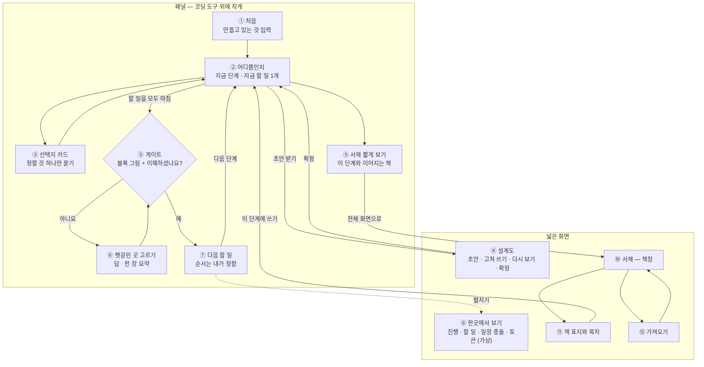

<!-- claude-drafted: 2026-10-17 — 고한결의 요청("이슈에서 내 할 일을 다 하자", 형식은 "문서 + 흐름 그림")으로 Claude가 UC-01·UC-02, 서재 설계, 화면 구조 초안(PR #58), 프로토타입의 문구·동작, #12에 올린 K1에서 K5·W1에서 W5 답을 옮겨 그린 가설안이다. 인터뷰(#11) 전이라 가설이고, 10/25 갱신본에서 9절 "인터뷰로 바뀐 곳"을 채운다. -->

# 화면 흐름 · 와이어 — 인터뷰 전 가설 (#12)

> **가설이다.** 인터뷰(#11) 전에 팀 문서와 프로토타입만 보고 그렸다. 인터뷰 뒤(10/25)에 고친다.

| 항목 | 내용 |
|---|---|
| 이슈 | #12 화면 흐름·와이어 |
| 담당 | 고한결 (UI/UX) |
| 리뷰어 | 임유정 |
| 마감 | 가설 10/22 · 인터뷰 반영 10/25 |
| 재료 | [UC-01](uc/UC-01-demo-scenario.md) · [UC-02](uc/UC-02-library-views.md) · [서재 설계](library-view-design.md) · [화면 구조 초안](../../02-frontend/README.md) · [프로토타입](../../03-backend/navigator/README.md) |

## 목차

1. 이 와이어가 따르는 결정
2. 화면 흐름도
3. 화면 목록
4. 와이어 — 패널
5. 와이어 — 넓은 화면
6. 선택지 카드의 세부
7. 마스코트 표정이 나오는 자리
8. 좁은 화면 (폭 390px)
9. 인터뷰로 바뀐 곳 (10/25에 채움)
10. 아직 정하지 않은 것

## 1. 이 와이어가 따르는 결정

| 결정 | 내용 | 출처 |
|---|---|---|
| 화면 구조 | 평소엔 **패널**(코딩 도구 위에 작게), 넓어야 하는 것만 **넓은 화면**으로 펼친다 | 화면 구조 초안 3절 (임유정) |
| 이름 | 제품 **Floe**, 마스코트 **플로로** | #51 안건 7 (2026-10-17 확정) |
| 테마 | 얼음 파랑. 유리 효과는 **마스코트 카드에만**, 글자 뒤는 불투명 면 | 서재 설계 7절 8번, W3 |
| 지금 할 일 | **1개만** 보이고 나머지는 눌러야 펼쳐진다 | FR-1 (이재엽 2026-10-16) |
| 게이트 그림 | 모든 게이트에 **같은 종류 — 블록으로 이어 보이기** | K1 |
| 설계도 | 초안 → 고쳐 쓰기 → 다시 보기를 시연에서는 **한 바퀴**, 확정은 **사람만** | FR-3 |
| "아니요" 루프 | 시연은 **한 번**, 설계상 3번이면 Hold | FR-5 |
| 서재 | 넓은 화면 **3장**(책장 · 책 표지와 목차 · 가져오기), 책장은 **책 한 줄**, 마스코트는 **안내 패널에만**, 빈 화면은 **도서관 비유 한 줄** | W1 · W2 · W4 · W5 |
| 쉬운 말 | 화면에 전문 용어를 크게 쓰지 않는다. 나오면 그 자리에서 한 줄로 풀어 준다 | FR-13 |
| 단계 이름 | 프로토타입의 쉬운 이름을 그대로 쓴다 (아래) | `03-backend/navigator/navigator.js` |
| 마스코트 표정 | 6가지 — 기본 · 생각 · 기쁨 · 완료 · 알림 · 살펴봄 | K5 |

**단계 이름** (프로토타입 `STAGES`)

| 단계 | 화면에 보이는 이름 | 짧게 |
|---|---|---|
| 0 | 무엇을 만들지 정하기 | 정하기 |
| 1 | 아이디어 적어 두기 | 적어 두기 |
| 2 | 꼭 필요한 기능 정리하기 | 기능 정리 |
| 3 | 만드는 방법 고르기 | 방법 고르기 |
| 4 | 뼈대 먼저 이어 보기 | 뼈대 |
| 5 | 하나씩 만들고 확인하기 | 만들기 |
| 6 | 실제로 써 보고 재 보기 | 재 보기 |
| 7 | 돌아보고 배운 것 남기기 | 돌아보기 |

## 2. 화면 흐름도



- 설계도(④)는 설계도가 필요한 단계(1단계에서 4단계)에서만 열린다(프로토타입 안내 문구와 같음).
- 게이트(⑤)는 **모든 단계 사이**에 있다(화면 구조 초안 7절 4번).
- 넓은 화면은 패널에서 펼치고, 닫으면 패널로 돌아온다. 패널의 위치(어느 단계·어느 할 일)는 그대로다.

## 3. 화면 목록

| # | 화면 | 어디 | 하는 일 | FR | 근거 |
|---|---|---|---|---|---|
| ① | 처음 | 패널 | 만들고 있는 것을 한두 줄로 입력 | FR-1 · 9 · 13 | UC-01 기본 1 |
| ② | 어디쯤인지 | 패널 | 지금 단계, 지금 할 일 1개, 완료 기준과 근거 구절, 용어 풀이 | FR-1 · 2 · 13 | UC-01 기본 2·3·4 |
| ③ | 선택지 카드 | 패널 | 정할 것 하나를 묻고 선택지 2개에서 4개, "기타"면 입력창 | FR-1 · 3 | 화면 구조 초안 3절 |
| ④ | 설계도 | 넓은 화면 | 초안(빈칸 표시) → 고쳐 쓰기 → 다시 보기 → 확정 | FR-3 | UC-01 기본 5·6·7 |
| ⑤ | 게이트 | 패널 | 이번 단계에서 한 일을 블록으로 이어 보이고 "이해되셨나요?" | FR-4 · 13 | UC-01 기본 8, K1 |
| ⑥ | 게이트 — 아니요 | 패널 | 헷갈린 곳 고르기 → 답 → 한 장 요약 → 다시 묻기 | FR-5 | UC-01 대안 A1 |
| ⑦ | 다음 할 일 | 패널 | 다음 할 일 정리(순서는 사용자가 정함), 작업 끝남 표시 | FR-7 · 12 | UC-01 기본 9, 대안 A2 |
| ⑧ | 한곳에서 보기 | 넓은 화면 | 진행 · 내가 할 일 · 일정 충돌 · 토큰 사용, "가상" 표시 | FR-6 · 10 | UC-01 기본 10 |
| ⑨ | 서재 짧게 보기 | 패널 | 지금 단계와 이어지는 책 몇 권과 한 줄 요약 | FR-8 | UC-02 기본 1 |
| ⑩ | 서재 — 책장 | 넓은 화면 | 책 한 줄(책등), 권수 | FR-8 | UC-02 대안 A1, W2 |
| ⑪ | 책 표지와 목차 | 넓은 화면 | 목차 표, 본문은 안 보임, "이 단계에 쓰기" | FR-8 | UC-02 기본 2·3 |
| ⑫ | 가져오기 | 넓은 화면 | 폴더 · 링크 · GitHub (시연은 모두 가상), 표지만 | FR-9 | 서재 설계 4절 |

- ⑨는 패널 안의 한 칸이라 W1의 "서재 3장"에 세지 않았다.
- 역량 지도(FR-8)는 W1에 따라 이 문서에서 그리지 않았다. 지금 가장 가까운 화면은 서재의 "내 배움"(지나온 단계 · 배운 말 · 확정한 설계도 — 2026-10-18 오버레이 탭에서 옮김, F-05)이다. 항목이 인터뷰 뒤 정해지면 그린다.

## 4. 와이어 — 패널

와이어 안의 글(장보기 앱)은 **화면을 보이기 위한 가상 예시**다. `[ ]`는 버튼, `·` 뒤는 단축키다.

### ① 처음

```
┌─ 패널 ─────────────────────────────
│ [연습] [나만 보기]
│ 🦭 플로로  "무엇을 만들고 있어요?"
│
│ ┌ 만들고 있는 것을 한두 줄로 써 주세요
│ │ 주말마다 장보기 목록을 가족이랑 같이 쓰는 앱
│ └──────────────────────────
│ [ 어디쯤인지 보기 · Enter ]
└────────────────────────────────────
```

| 자리 | 내용 | 근거 |
|---|---|---|
| `[연습]` | 지금 연습(가상 데이터)인지 실제인지 늘 보인다. 누르면 한 번에 바꾼다 | FR-10, 안전장치 S2 |
| `[나만 보기]` | 기본값. 공유 범위는 보이기만 한다 | FR-9 |
| 보내기 전 | 키·전화번호 같은 모양이 보이면 노란 카드 **"보내기 전에 잠깐!"** → `[그대로 진행] [수정]` | UC-01 예외 E3 |

### ② 어디쯤인지

```
┌─ 패널 ─────────────────────────────
│ [연습] [나만 보기]      1단계 · 아이디어 적어 두기
│ 🦭 "여기까지 왔어요"
│
│ 지금 할 일 ▸ 정해진 빈칸에 아이디어 채우기
│   [ 남은 할 일 3개 펼치기 ▾ ]
│
│ 완료 기준
│  ✓ 정해진 빈칸에 아이디어 채우기
│      근거: "주말마다 장보기 목록을 가족이랑…"
│  · 왜 만드는지, 어디까지, 언제 성공인지 답하기
│  · 한 문장에 한 가지 일만 쓰기
│      💬 '의도명세 캔버스'? 만들 것을 빈칸 표로 정리하는 방법이에요
│
│ [ 초안 받기 ]  [ 서재 ]  [ 한곳에서 보기 ]
└────────────────────────────────────
```

| 자리 | 내용 | 근거 |
|---|---|---|
| 지금 할 일 | **1개만**, 나머지는 펼치기 | FR-1 |
| 완료 기준 | 항목마다 충족 여부, 충족한 항목에는 **입력 글에서 따온 구절** | FR-2 |
| 💬 풀이 | 용어 옆에서 한 줄로. 화면 크게는 용어를 쓰지 않는다 | FR-13 |
| 살펴보는 중 | 회색 카드 "살펴보고 있어요…" (마스코트 표정: 살펴봄) | 프로토타입 |
| 잘 안 됨 | 빨간 카드 "음, 잘 안 됐어요" — 지어내지 않고 연습 예시로 돌아갈 수 있다 | UC-01 예외 E1 |

### ③ 선택지 카드

```
┌─ 패널 ─────────────────────────────
│ 🦭 "하나만 정해 볼까요?"
│ 이 앱은 누가 쓰나요?
│   [ 1 · 나 혼자 ]      [ 2 · 가족이 같이 ]
│   [ 3 · 친구들 ]       [ 기타 — 직접 쓰기 ]
│                              [ 나중에 · Esc ]
└────────────────────────────────────
```

| 자리 | 내용 | 근거 |
|---|---|---|
| 질문 | **한 번에 하나만** 묻는다 | 화면 구조 초안 3절, #47 |
| 선택지 | 2개에서 4개, 숫자 키 | 프로토타입 |
| `[기타]` | 누를 때만 입력창이 열린다 | 화면 구조 초안 3절 |

### ⑤ 게이트

```
┌─ 패널 ─────────────────────────────
│ 🦭 "이번 단계에서 한 일, 이해되셨나요?"
│ 1단계 · 아이디어 적어 두기
│
│ [빈칸 채우기] → [왜·어디까지·언제] → [한 문장 한 가지] → [다음: 2단계]
│
│ [ 예, 이해했어요 · Enter ]   [ 아니요, 헷갈려요 · N ]
└────────────────────────────────────
```

| 자리 | 내용 | 근거 |
|---|---|---|
| 블록 줄 | 이번 단계의 할 일을 **블록으로 이어** 보이고 마지막 블록이 다음 단계 | K1, FR-4 |
| 버튼 | 예 / 아니요 둘만. 한글 자판의 ㅛ·ㅜ도 Y·N으로 받는다 | 프로토타입 |

### ⑥ 게이트 — 아니요

```
┌─ 패널 ─────────────────────────────
│ 🦭 "어디가 헷갈렸나요?"
│ 여러 개 골라도 돼요. 고른 곳부터 같이 풀어요.
│   [✓ 1 · 빈칸 채우기 ]  [ 2 · 왜·어디까지·언제 ]
│   [ 3 · 한 문장 한 가지 ]
│ [ 궁금한 걸 물어보기 ]
├─ 다음 화면 ────────────────────────
│ 1단계 한 장 요약
│  · 이번 단계에서 한 일
│  · 왜 했는지
│  · 다음 단계에 넘기는 것
│ [ 다시 확인하기 · Enter ]
└────────────────────────────────────
```

| 자리 | 내용 | 근거 |
|---|---|---|
| 고르기 → 답 → 한 장 요약 | 이 순서로 한 번 돌고 게이트(⑤)로 돌아간다 | FR-5, UC-01 대안 A1 |
| Hold | 시연에는 보이지 않는다. 설계상 "아니요"가 3번이면 사람에게 넘긴다 | FR-5 |

### ⑦ 다음 할 일

```
┌─ 패널 ─────────────────────────────
│ 🦭 "다음은 2단계 · 꼭 필요한 기능 정리하기"
│ 다음 할 일 (▲ ▼ 로 순서 바꾸기)
│  1. 기능을 문장으로 쓰기            ▲ ▼
│  2. 애매한 말을 숫자로 바꾸기        ▲ ▼
│  3. 꼭 필요한지 표시하기            ▲ ▼
│ [ 시작하기 · Enter ]
│ [ 작업이 끝났다고 알리기 (시연) ]
└────────────────────────────────────
```

| 자리 | 내용 | 근거 |
|---|---|---|
| 순서 | **사용자가 정한다.** 끌기 대신 ▲ ▼ 버튼(키보드로도 쓸 수 있게) | FR-12, [가설] |
| 끝남 알리기 | 코딩 도구에서 작업이 끝난 알림을 시연에서는 버튼 하나로 흉내 낸다 | FR-7, UC-01 대안 A2 |

### ⑨ 서재 짧게 보기

```
┌─ 패널 ─────────────────────────────
│ 📚 서재 · 이 단계와 이어지는 책
│  📘 결정    "가족이 같이 쓴다" 외 2개
│  📗 배운 말  "의도명세 캔버스" 외 4개
│ [ 전체 화면으로 보기 ]
└────────────────────────────────────
```

| 자리 | 내용 | 근거 |
|---|---|---|
| 먼저 보이는 책 | 지금 단계와 이어지는 책 | UC-02 기본 1, 8절 "짧게 보기" |
| 패널의 제안 | "이 단계와 이어지는 책이 있어요"라고 **제안만** 하고, 여는 것은 사용자 | 서재 설계 3절 규칙 1 |

## 5. 와이어 — 넓은 화면

### ④ 설계도

```
┌─ 넓은 화면 · 설계도 — 1단계 아이디어 정리표 ──────────────
│ [연습]                                   [ 패널로 돌아가기 ]
│
│ 아이디어 정리표 (초안)
│  왜 만드나요?      주말 장보기를 잊지 않으려고
│  누가 쓰나요?      [채워 주세요: 누가 쓰는지]
│  언제 성공인가요?   [채워 주세요: 성공의 기준]
│
│ [ 직접 고치기 ]  [ 고칠 곳 물어보기 ]
│ ── 다시 보기 ────────────────────
│  "누가 쓰나요" 칸이 비어 있어요. 혼자 쓰는지 가족이 같이 쓰는지 정해 보세요.
│
│ [ 확정 ]
└──────────────────────────────────────────────
```

| 자리 | 내용 | 근거 |
|---|---|---|
| `[채워 주세요: …]` | 모르는 자리는 지어내지 않고 비운다 | FR-3 |
| 다시 보기 | **고칠 곳과 방향만** 알려 주고 정답 문장은 주지 않는다. 시연은 한 바퀴 | FR-3 |
| `[확정]` | **사람만** 누른다. 빈칸이 남았으면 한 번 더 묻는다 | FR-3, UC-01 기본 7 |
| 고치는 방법 | 직접 고치기와 물어보기를 **둘 다** 보인다 [가설 — 10절] | 화면 구조 초안 7절 1번 |

### ⑧ 한곳에서 보기

```
┌─ 넓은 화면 · 한곳에서 보기 ─────────────── [가상 숫자예요]
│ 진행 상황    ■■□□□□□□   N / 8 단계
│ 내가 할 일   N개 남음
│ 일정 충돌    같은 시간에 겹치는 일 한 쌍
│ 토큰 사용    ○○ / ○○
└──────────────────────────────────────────────
```

| 자리 | 내용 | 근거 |
|---|---|---|
| `[가상 숫자예요]` | 가상임을 **화면에 표시**한다 | FR-6, FR-10 |
| 숫자 | 와이어에서는 비워 둔다. 가상 숫자를 만드는 방식은 임유정이 정한다(Y2) | 담당별 질문 Y2 |

### ⑩ 서재 — 책장

```
┌─ 넓은 화면 · 서재 ──────────────────────────────
│ [ 책별 ▾ ]                                  [ 가져오기 + ]
│
│  ┃요┃┃결┃┃지┃┃점┃
│  ┃구┃┃정┃┃식┃┃검┃
│  ┃ 3┃┃ 2┃┃ 5┃┃ 1┃      ← 책등: 이름 · 권수
│ ━━━━━━━━━━━━━━━━━━━━━━━━━━━━
│ 책등을 누르면 표지와 목차가 열려요
└────────────────────────────────────────────────
```

빈 서재일 때 (W5 — 도서관 비유 한 줄)

```
┌─ 넓은 화면 · 서재 ──────────────────────────────
│ 📚 책장이 아직 비어 있어요
│    단계를 마치면 여기에 하나씩 꽂혀요
│ [ 가져오기 + ]
└────────────────────────────────────────────────
```

| 자리 | 내용 | 근거 |
|---|---|---|
| 책 한 줄 | 책 한 권 = 종류 하나(요구·결정·지식·점검). 책등에 이름과 권수 | W2, UC-02 2절 "책별" |
| `[책별 ▾]` | 보기 바꾸기(책별 · 세션별). 세션별은 Could | UC-02 대안 A2·A3 |
| 마스코트 | 서재에는 두지 않는다 | W4 |
| 유리 효과 | 쓰지 않는다(불투명 면) | W3 |
| 빈 화면 | 도서관 비유는 이 보조 문구에만. 버튼 이름은 기능 이름 그대로 | W5, 서재 설계 0절 |

### ⑪ 책 표지와 목차

```
┌─ 넓은 화면 · 책 표지 — 결정 (1판 2쇄) ─────────────
│ 목차
│  가족이 같이 쓴다         10/17 · 1단계 대화 · 인용 2
│  장보기는 주말에 한 번     10/17 · 1단계 대화 · 인용 0
│
│ 본문은 여기 없어요 — [열기]를 누르면 원래 있던 곳에서 가져와요
│ 확인: 자동으로 만든 날 10/17 · 내가 훑은 날 —
│
│ [ 열기 ]  [ 이 단계에 쓰기 ]               [ 책장으로 ]
└────────────────────────────────────────────────
```

| 자리 | 내용 | 근거 |
|---|---|---|
| 목차 | 이름 · 만든 날 · 출처 · 인용 횟수 | 서재 설계 2절 ② |
| 본문 | 표지에서는 **안 보인다.** "열기"를 눌러야 가져온다 | 서재 설계 4절 |
| 확인 칸 | 자동으로 만든 날과 사람이 훑은 날을 따로 | 서재 설계 2절 ③ |
| `[이 단계에 쓰기]` | 누를 때만 인용 +1. 열어 보기만 해서는 올라가지 않는다 | 서재 설계 3절 규칙 2 |

### ⑫ 가져오기

```
┌─ 넓은 화면 · 가져오기 ─────────────────── [시연: 모두 가상이에요]
│ 어디서 가져올까요?
│  ( ) 이 컴퓨터의 폴더
│  ( ) 링크
│  ( ) GitHub 저장소 (내 권한으로 읽기)
│ 표지만 가져와요. 자세한 내용은 열 때 가져와요.
│ [ 연결하기 ]
│ ── 걸린 것이 있으면 ──
│ ⚠ 비밀번호처럼 보이는 줄이 있어요     [ 그대로 진행 ] [ 수정 ]
└────────────────────────────────────────────────
```

| 자리 | 내용 | 근거 |
|---|---|---|
| 세 경로 | 시연에서는 **모두 가상**으로 보인다 | 서재 설계 4절·7절 2번 |
| 표지만 | 본문은 가져오지 않는다. 원본은 고치지 않는다(읽기 전용) | 서재 설계 4절 |
| 걸린 것 | 무엇이 의심되는지만 말하고 값은 다시 보이지 않는다 | 서재 설계 4절, 보안 기준 6-3 |

## 6. 선택지 카드의 세부

화면 구조 초안 8절이 "고한결(#12) · 임유정"이 정할 것으로 남긴 칸이다. **이 가설안은 프로토타입(#47)의 지금 값을 그대로 쓰자고 제안한다.**

| 세부 | 프로토타입의 지금 값 | 이 가설안 |
|---|---|---|
| 카드 색 | 상태마다 다르다 — 파랑(묻기 · 지금 할 일), 노랑(보내기 전 확인 · 게이트), 초록(다 함 · 다음 단계), 빨강(잘 안 됨), 회색(살펴보는 중) | 그대로 |
| 키보드 | 버튼에 키를 적는다. Enter = 주 버튼, Esc = 나중에 · 접기, 선택지 = 숫자 키, 글을 쓰는 중에는 Esc와 Ctrl+Enter만, 한글 자판의 ㅛ·ㅜ도 Y·N | 그대로 |
| 저절로 접히는 시간 | 처음 인사 6초, 평소 15초, 작게 접힌 모양 30초. 글을 쓰는 중과 답을 기다리는 중에는 접히지 않고, "열어 두기" 핀으로 고정할 수 있다 | 그대로 |

출처: `02-frontend/navigator/app.js` (카드 색 `tone`, 단축키 `keydown`, 접힘 `DELAY`).

## 7. 마스코트 표정이 나오는 자리

K5에서 정한 6가지가 어느 화면에 나오는지. 프로토타입이 이미 쓰는 표정 이름을 옆에 적었다.

| 표정 | 나오는 자리 | 프로토타입 |
|---|---|---|
| 기본 | ① 처음, ② 평소 | (기본) |
| 살펴봄 | ② 살펴보는 중, 코딩 도구에서 새 알림을 받았을 때 | `look` |
| 생각 | ⑥ 어디가 헷갈렸나요, 잘 안 됐어요 | `think` |
| 알림 | 보내기 전에 잠깐! | `alert` |
| 기쁨 | ⑦ 다음 단계로 | `happy` |
| 완료 | 모든 단계를 마쳤을 때, 작업 끝남 알림 | 프로토타입은 `happy`를 같이 쓴다 — **새로 그릴 표정** |

마스코트는 **패널에만** 나온다(W4). 표정 그림 6장은 #13에서 만든다.

## 8. 좁은 화면 (폭 390px)

| 화면 | 바뀌는 것 | 근거 |
|---|---|---|
| ⑤ 게이트의 블록 | 가로로 잇던 블록을 **세로로** 쌓는다 | [가설] |
| ⑩ 서재 책장 | 책 한 줄을 **두 줄로** 바꿔 꽂는다. 가로 스크롤은 없다 | W2, UC-02 예외 E5 |
| 넓은 화면 전체 | **한 열로** 쌓는다 | UC-02 예외 E5 |
| ③ 선택지 카드 | 선택지를 한 줄에 하나씩 | [가설] |

## 9. 인터뷰로 바뀐 곳 (10/25에 채움)

| 가설 | 인터뷰에서 들을 곳 | 결과 | 바꾼 곳 |
|---|---|---|---|
| 지금 할 일은 1개만 보인다 | Q7 — 한 번에 몇 개쯤 보면서 일했는지 | | |
| 용어는 그 자리에서 한 줄로 푼다 | Q11 — 뜻을 몰라 멈췄던 단어 | | |
| 게이트에서 블록 그림으로 확인한다 | Q8 — 설명이 이어졌는지, 어디서 멈췄는지 | | |
| 서재 책장은 책 한 줄 | Q9 꼬리 질문 — "남긴 걸 나중에 어떻게 다시 찾으셨나요?" (질문지에 없어서 덧붙여 물을지 정해야 함) | | |
| 패널 + 넓은 화면을 섞는다 | 인터뷰에서 들은 작업 방식(코딩 도구를 쓰면서 무엇을 옆에 띄워 두는지) | | |

## 10. 아직 정하지 않은 것

| 질문 | 정할 사람 |
|---|---|
| 서재를 `/overview` 안에 둘지, 따로 주소를 둘지 | 임유정 (#14 리뷰 2번) |
| 승인과 게이트의 순서 — 이 가설안은 "확정 뒤 게이트"(화면 구조 초안 4절 그림과 같음) | 임유정 |
| 넘겨주기(코딩 도구로 보내기) 화면의 위치 — 이 문서에는 그리지 않았다 | 임유정 |
| 설계도를 고치는 방법을 시연에서 둘 다 보일지 — 이 가설안은 둘 다 보인다 | 임유정 · 고한결 |
| 선택지 카드 세부(6절) 확정 | 고한결 · 임유정 |
| 역량 지도 화면 | 인터뷰 뒤 FR-8 항목이 정해지면 |
| 마스코트 표정 그림 6장 | 고한결 (#13) |

**이 문서가 하지 않는 것:** 코드는 쓰지 않았다. 색 값 · 글꼴 · 간격 같은 시각 디자인은 정하지 않았다(얼음 파랑 테마와 프로토타입을 따른다). 와이어 안의 글과 숫자는 가상 예시다.
