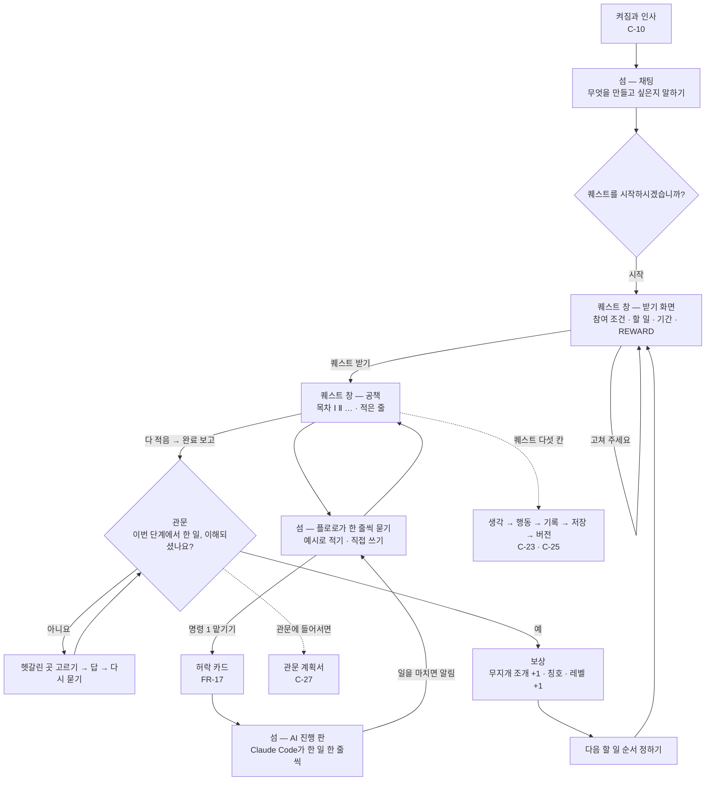

<!-- claude-drafted: 2026-10-17 — 고한결의 요청("이슈에서 내 할 일을 다 하자", 형식은 "문서 + 흐름 그림")으로 Claude가 UC-01·UC-02, 서재 설계, 화면 구조 초안(PR #58), 프로토타입의 문구·동작, #12에 올린 K1에서 K5·W1에서 W5 답을 옮겨 그린 가설안이다(1판). -->
<!-- claude-drafted: 2026-10-24 — 고한결의 요청("인터뷰 제외한 작업 진행해줘", "너가 알아서 다 진행해")으로 Claude가 2판으로 다시 그렸다. 1판 뒤 C-22에서 C-30까지(이재엽 2026-10-21 · 10-23)로 화면 짜임이 바뀌어, main의 코드(02-frontend/navigator/app.js · 03-backend/navigator/quest.js, PR #175까지)와 요구서 · 퀘스트 스토리보드에서만 옮겼다. 7절은 아직 없는 화면의 [제안]이다. 인터뷰(#11)는 고한결 결정으로 보류 — 9절은 비워 둔다. -->

# 화면 흐름 · 와이어 (#12) — 2판: 퀘스트 섬

> **2판 (2026-10-24).** 1판(2026-10-17)은 "패널 + 넓은 화면" 가설이었다. 그 뒤 화면이 **섬 · 설정 창 · 퀘스트 창** 셋으로 바뀌어(C-22), 지금 main의 앱 모양에 맞춰 다시 그렸다. 1판에서 무엇이 어디로 갔는지는 8절, 1판 원문은 git 이력(PR #82)에 있다.
> **인터뷰(#11)는 보류다**(고한결 2026-10-24). 그래서 9절 "인터뷰로 바뀐 곳"은 비워 두고, 이 판도 사람에게 확인받지 않은 **가설**이다.

| 항목 | 내용 |
|---|---|
| 이슈 | #12 화면 흐름·와이어 (Jira로 옮김 — [#102](https://github.com/2026-Codyssey-Final-Proj/Final-Proj/issues/102)) |
| 담당 | 고한결 (UI/UX) |
| 리뷰어 | 임유정 |
| 마감 | 1판 가설 10/22(10/17 병합, PR #82) · 2판 10/25 |
| 재료 | [요구서](../00-overview/requirements.md) 2-2절 C-22에서 C-30 · [퀘스트 스토리보드](game-overlay/quest-storyboard.md) 10 · 11절 · [첫 5분 스토리보드](onboarding-storyboard.md) · 코드 [app.js](../../02-frontend/navigator/app.js) · [quest.js](../../03-backend/navigator/quest.js) · [tutorial.js](../../03-backend/navigator/tutorial.js) · [readme-book.js](../../03-backend/navigator/readme-book.js) · PR #173 · #174 · #175 |

## 목차

1. 이 와이어가 따르는 결정
2. 화면 흐름도
3. 창과 화면 목록
4. 와이어 — 섬
5. 와이어 — 퀘스트 창
6. 와이어 — 설정 창 · 뽑기
7. 11/1 전에 만들 화면 — 제안 와이어 (C-23 · C-25 · C-27)
8. 1판에서 바뀐 곳
9. 인터뷰로 바뀐 곳 (보류)
10. 아직 정하지 않은 것

## 1. 이 와이어가 따르는 결정

| 결정 | 내용 | 출처 |
|---|---|---|
| 창 셋 | **섬**(채팅 · 늘 있음) · **설정 창** · **퀘스트 창**. 앱에서는 Electron 창 셋, 브라우저에서는 섬 옆의 판 | C-22, 스토리보드 10-1 (이재엽 2026-10-21) |
| 게임처럼 | 단계 하나 = **퀘스트** 하나. 할 일은 공책의 목차 Ⅰ Ⅱ Ⅲ …, 보상은 무지개 조개 · 칭호 | C-22 |
| 단계 번호 | 화면은 **1단계부터 8단계**(코드 · 기록은 0부터 7 그대로) | 스토리보드 10-5의 13 (이재엽 2026-10-21) |
| 레벨 | **사람에게** 붙는다. 관문마다 +1, 프로젝트를 바꿔도 줄지 않는다. 묶음은 초기 개발자 → 중급자 → 상급자 | C-28 (이재엽 2026-10-23) |
| 명령 네 칸 | 채팅 아래 늘 **맡기기 · 살피기 · 책 · 배우기**(숫자 1에서 4) | C-29 (이재엽 2026-10-23) |
| 책 | 프로젝트 저장소의 README.md를 받아 와 **보여 주기만**. 고치는 곳은 README | C-26 |
| 서재 | **잠시 뺐다**(`SHELF_ON = false`) — 대회 뒤 다시 연다 | C-26 · C-29 (이재엽 2026-10-23) |
| 모아 보기 창 | **기능째 뺐다**. 알림 · AI 진행은 섬 안의 판에 | C-11 (이재엽 2026-10-23, PR #174) |
| 알림 | Claude Code가 **일을 마쳤을 때만** 알린다 | FR-7, PR #175 |
| 확정 · 이해 여부 | 사람이 누른다 | FR-3 · FR-4 (1판과 같음) |
| 쉬운 말 | 화면에 전문 용어를 크게 쓰지 않고, 나오면 그 자리에서 한 줄로 푼다 | FR-13 (1판과 같음) |
| 이름 · 테마 | 제품 Floe, 마스코트 플로로, 얼음 파랑 | #51 안건 7 (1판과 같음) |

**단계 이름** (`navigator.js` `STAGES`, 화면 번호는 1부터) — 1판과 같다.

| 화면 번호 | 이름 | 칭호 (`quest.js` `RANKS` — 처음 시작한 사람이 그 단계에 있을 때. 관문을 넘으면 다음 줄의 칭호) |
|---|---|---|
| 1단계 | 무엇을 만들지 정하기 | 출발한 사람 |
| 2단계 | 아이디어 적어 두기 | 적어 두는 사람 |
| 3단계 | 꼭 필요한 기능 정리하기 | 기능 정리꾼 |
| 4단계 | 만드는 방법 고르기 | 길 고르는 사람 |
| 5단계 | 뼈대 먼저 이어 보기 | 뼈대 세우는 사람 |
| 6단계 | 하나씩 만들고 확인하기 | 만드는 사람 |
| 7단계 | 실제로 써 보고 재 보기 | 재 보는 사람 |
| 8단계 | 돌아보고 배운 것 남기기 | 책 한 권 지은이 |

## 2. 화면 흐름도

처음 실행부터 한 장(단계)을 넘을 때까지. 점선은 아직 없는 화면(7절 — 11/1 전에 만든다).



- 명령 **3 책 · 4 배우기**는 퀘스트 창을 그 탭으로 연다. **2 살피기**는 지금 단계 · 남은 할 일 · 완료 보고 판정이다(FR-1 · FR-2).
- 파일을 섬 위로 끌고 오면 **파란 먹이 층**(C-18)이 뜨고, 놓으면 먹이 주기 화면(C-15)으로 간다. 먹이를 검사하는 동안 다른 작업은 막힌다(C-19).
- 무지개 조개는 위 줄 · 설정 창의 '조개 열기'에서 **뽑기 창**으로 간다(6절).

## 3. 창과 화면 목록

| # | 화면 | 창 | 하는 일 | 요구 | 지금 앱 |
|---|---|---|---|---|---|
| ① | 섬 — 위 줄 | 섬 | 집 · 단계 띠 · 조개 수 · ⚙ · 핀 · 접기 | C-22 | 있음 |
| ② | 섬 — 채팅 | 섬 | 왼쪽 큰 플로로(칭호 · 기분), 가운데 플로로 말 · 내 말 · 고르는 칩 · 입력 | C-22 | 있음 |
| ③ | 명령 네 칸 | 섬 | 맡기기 · 살피기 · 책 · 배우기 | C-29 | 있음 |
| ④ | 시작 묻기 | 섬 | "퀘스트를 시작하시겠습니까?" | C-22 | 있음 |
| ⑤ | 관문 | 섬 | "이번 단계에서 한 일, 이해되셨나요?" 예 / 아니요 | FR-4 · FR-5 | 있음 |
| ⑥ | 허락 카드 · AI 진행 판 · 알림 판 | 섬 | 맡기기 → 허락 → Claude Code가 한 일 한 줄씩 → 마치면 알림 | FR-17 · C-12 · FR-7 | 있음 |
| ⑦ | 받기 화면 | 퀘스트 창 — 퀘스트 탭 | 제목 · ? · 그림 · 참여 조건 · 할 일 · 기간 · REWARD · 퀘스트 받기 / 고쳐 주세요 / 나중에 | C-22 | 있음 |
| ⑧ | 공책 | 퀘스트 창 — 퀘스트 탭 | 왼쪽 목차(Ⅰ Ⅱ … · 곁 퀘스트), 오른쪽 적은 줄 · 왜 하나요 · 보상 · 완료 보고 | C-22 | 있음 |
| ⑨ | 도전과제 | 퀘스트 창 — 도전과제 탭 | 세로 탭 = 장 여덟, 그림만, 마우스를 올리면 설명 | C-22 | 있음 |
| ⑩ | 책 | 퀘스트 창 — 책 탭 | README의 제목 · 버전 줄(V.1 → V.n) · 장(목차) — 보기만 | C-26 | 있음 |
| ⑪ | 배우기 | 퀘스트 창 — 배우기 탭 | 기능 열 개 튜토리얼(어떻게 움직이나 · 예시 · 막히면 · 해 보기) | C-30 | 있음 |
| ⑫ | 설정 창 | 설정 창 | '○○ 님의 작업실' · 레벨 묶음 · 설정 줄 · 조개 열기 | C-22 · C-28 | 있음 |
| ⑬ | 뽑기 · 꾸미기 | 섬 위의 창 | 확률표 늘 보임, 조개 셋에 한 번 | C-22 | 있음 |
| ⑭ | 퀘스트 다섯 칸 | 공책 | 생각 → 행동 → 기록 → 저장 → 버전, 지금 칸 표시 | C-23 | **없음 — 7절 [제안]** |
| ⑮ | 기록 한 장 · 저장 허락 | 퀘스트 창 · 섬 | 기록 초안 → 고쳐 확정 → README 한 절 → 커밋 허락 | C-25 | **없음 — 7절 [제안]** |
| ⑯ | 관문 계획서 | 퀘스트 창 — 책 탭 | 목차 다섯 절, 누르면 그 절로 | C-27 | **없음 — 7절 [제안]** |

## 4. 와이어 — 섬

와이어 안의 글(동아리 행사 신청 앱)은 **화면을 보이기 위한 가상 예시**다. `[ ]`는 단추, `·` 뒤는 단축키다.

### ①②③ 섬 펼침 — 위 줄 · 채팅 · 명령 네 칸

```
┌─ 섬 ───────────────────────────────────────────────────
│ ⌂  2단계 · 아이디어 적어 두기 · 3개 중 1번째 할 일 ●○○   🐚 4  ⚙  📌  ⌃
├────────────────────────────────────────────────────────
│  ( 🦭 )      플로로  "왜 이 앱이 필요한지 한 줄로 적어 볼까요?"
│ 적어 두는     [ 예시로 적어 줘 ]  [ 직접 쓸게요 ]
│  사람                                       나  "동아리 신청을
│ 신났어요                                        종이로 받아서요"
│ ┌ 플로로에게 말하기 ──────────────────────────────┐
│ └──────────────────────────────────────────────┘
│ [ 1 맡기기 ]  [ 2 살피기 ]  [ 3 책 ]  [ 4 배우기 ]
└────────────────────────────────────────────────────────
```

| 자리 | 내용 | 근거 |
|---|---|---|
| 단계 띠 | "N단계 · 제목 · M개 중 k번째 할 일 ●○○" — **위 줄에만** 보인다 | C-22, `app.js` `stageBand` |
| 🐚 | 무지개 조개 그림과 수. 누르면 뽑기 창 | PR #175 `SHELL_ICO` |
| 큰 플로로 | 아래에 칭호 · 기분 한 마디(`MOOD_WORD`). 채팅 안에는 플로로 그림이 없다 | 스토리보드 9-6 |
| 칩 | 지금 정할 것 하나의 단추. 플로로의 마지막 말에 붙는다 | `momentToday` · `momentGate` |
| 명령 네 칸 | 숫자 1에서 4는 **칩이 숫자를 쓰지 않을 때만** 보이고 동작한다. 알림 · AI 진행 판에도 같이 있다 | C-29, PR #173 |
| 접기 | 펼침 → 한 줄 → 띠. 마우스가 나간 뒤 '접히기까지' 시간(기본 15초), 테두리 빛이 차오르면 접힌다 | C-14 · C-17 · C-20 |

### ④ 시작 묻기

```
┌─ 섬 ────────────────────────────────────────
│  ( 🦭 )   "동아리 행사 신청을 받는 앱"
│           퀘스트를 시작하시겠습니까?
│           [ 시작 · Enter ]   [ 조금 더 말할게요 ]
└─────────────────────────────────────────────
```

[시작]을 누르면 퀘스트 창이 **받기 화면으로 바로 뜬다**(설정 '받으면 바로 뜨기'가 켜져 있을 때 — 기본).

### ⑤ 관문 — 이해되셨나요?

```
┌─ 섬 ────────────────────────────────────────
│  ( 🦭 ) !  2단계 · 아이디어 적어 두기
│           이번 단계에서 한 일, 이해되셨나요?
│           잘 모르겠으면 헷갈린 곳을 골라 같이 풀어요. 몇 번이고 괜찮아요.
│           [ 네, 이해했어요 · Y ]   [ 아니요, 같이 풀어요 · N ]
└─────────────────────────────────────────────
```

| 자리 | 내용 | 근거 |
|---|---|---|
| 네 | 확인 질문 하나(맞든 틀리든 정답과 까닭을 보이고 넘어간다) → 조개 +1 · 칭호 · **레벨 +1** → 다음 할 일 순서 정하기(▲ ▼ · '나중에') | FR-4 · C-28 · FR-12 |
| 아니요 | 헷갈린 곳 고르기 → 답 → 다시 묻기. 다시 물어본 횟수가 보인다 | FR-5 |
| 관문 계획서 | **아직 없다** — 7절 ⑯ [제안] | C-27 |

### ⑥ 맡기기 → 허락 카드 → AI 진행

```
┌─ 섬 ────────────────────────────────────────
│  ( 🦭 )   "이렇게 정리해서 Claude Code에 넘길게요"
│           ┌ 넘길 요구 ─────────────────────────┐
│           │ 신청 폼에 이름 · 학번 · 참여 날짜 칸을 둔다 │
│           └──────────────────────────────────┘
│           [ 허락 · Enter ]  [ 고치기 ]  [ 나중에 · Esc ]
├─ AI 진행 판 ─────────────────────────────────
│  14:02  만듦   form.html          +38 −0
│  14:03  실행함  npm test
│  [ 1 맡기기 ] [ 2 살피기 ] [ 3 책 ] [ 4 배우기 ]
└─────────────────────────────────────────────
```

| 자리 | 내용 | 근거 |
|---|---|---|
| 허락 | **섬에서 사람이 누른다**. 누르기 전에는 아무것도 넘기지 않는다 | FR-17 |
| AI 진행 판 | 때 · 한 일 · 파일 이름이나 명령 첫 줄 · 고친 줄 수만. 파일 내용은 받지도 보이지도 않는다 | C-12 |
| 알림 | 일을 **마쳤을 때만** 플로로가 알린다. 일을 시작할 때는 조용하다 | FR-7, PR #175 |

## 5. 와이어 — 퀘스트 창

설정 창의 **반대쪽**에 뜬다. 머리띠: 세션 고르기 · 크기 S / M / L · 접기 · ×(닫기만). 탭 넷: **퀘스트 · 도전과제 · 책 · 배우기**.

### ⑦ 받기 화면

```
┌─ 퀘스트 창 ─ [퀘스트] 도전과제  책  배우기 ──── S M L  × ─┐
│        아이디어 적어 두기                          [?]   │
│  ┌──────────── 그림 ────────────┐                       │
│  │        2단계 · 아이디어 적어 두기 │                       │
│  └──────────────────────────────┘                       │
│  참여 조건   1단계 관문을 넘었어요                          │
│  할 일       정해진 빈칸 채우기 1개 · 왜·어디까지·언제 1개 …   │
│  기간        이번 주                                       │
│  REWARD     [🐚] [🔖] [🏅]                                │
│             [        퀘스트 받기        ]                  │
│             [ 고쳐 주세요 ]   [ 나중에 ]                   │
└──────────────────────────────────────────────────────────┘
```

| 자리 | 내용 | 근거 |
|---|---|---|
| ? | 마우스를 올리면 "이 퀘스트가 왜 있나요" | `app.js` `questPane` |
| 고쳐 주세요 | 그 자리에서 이름 · 할 일 개수(1에서 5)를 고치고 "이대로 받기" | C-22, 스토리보드 10-5의 7 · 12 |
| 글 | 조건 · 기간은 코드, 설명 · 왜 · 질문은 AI(진짜 AI 모드, `/api/quest`). 못 받으면 기본 글 | 스토리보드 11-2의 2 |

### ⑧ 공책

```
┌─ 퀘스트 창 ─ [퀘스트] 도전과제  책  배우기 ──────────── × ─┐
│ 목차 · 2단계            │ 아이디어 적어 두기                  │
│ Ⅰ. 빈칸 채우기   지금   │ 2단계 · 플로로가 만들었어요 · 하는 중  │
│ Ⅱ. 왜·어디까지·언제 ★아직│ ✓ 빈칸 채우기                       │
│ Ⅲ. 한 문장 한 가지 ★아직 │    동아리 신청을 종이로 받아서요       │
│ ── 곁 퀘스트 — 안 해도 돼요 │   왜·어디까지·언제                  │
│ 🔒 … ★ 더 크게 만들 때   │    아직 — 채팅에서 한 줄 적어요        │
│                         │ 왜 하나요 — …                       │
│                         │ 보상  🐚 무지개 조개 ×1 · 🏅 기능 정리꾼  │
│                         │ [ 완료 보고 ] [ 힌트 ] [ 고치기 ]      │
└──────────────────────────────────────────────────────────┘
```

| 자리 | 내용 | 근거 |
|---|---|---|
| 목차 | 할 일 하나 = 한 줄. 끝냄 ✓ / 적음 / 지금 / ★ 아직 | `questPane` |
| 곁 퀘스트 | 지금 등급에서 빠진 할 일. 잠긴 채 보인다 | 스토리보드 11-2의 4 |
| 완료 보고 | 다 적어야 눌린다. 판정은 전처럼(진짜 AI는 `/api/judge`) | 스토리보드 11-1 |

### ⑨ 도전과제

```
┌─ 퀘스트 창 ─ 퀘스트 [도전과제] 책  배우기 ──────────── × ─┐
│ 1 ✓ │   (그림)──(그림)──(그림)──[관문]                     │
│ 2 ● │      ✓      지금    🔒                              │
│ 3 🔒 │   마우스를 올리면: "지금 하는 할 일 — 채팅에서 플로로와  │
│ …   │                    같이 해요"                        │
│ 8 🔒 │                                                    │
└──────────────────────────────────────────────────────────┘
```

세로 탭 = 장 여덟. 글은 마우스를 올릴 때만 — 그림만 크게(스토리보드 9-7).

### ⑩ 책

```
┌─ 퀘스트 창 ─ 퀘스트  도전과제 [책] 배우기 ──────────── × ─┐
│ 동아리 행사 신청 앱                                          │
│ V.1 → V.2 → V.3                                           │
│ 목차                     │  (고른 장의 내용 — 보기만)          │
│  1. 왜 만드나              │                                │
│  2. 꼭 필요한 기능          │                                │
│  3. 고른 방법              │                                │
│ 고치는 곳은 README예요 — 책에서는 보기만 해요                   │
└──────────────────────────────────────────────────────────┘
```

| 자리 | 내용 | 근거 |
|---|---|---|
| 받아 오는 곳 | 연결한 폴더의 README.md(`GET /api/readme`). 연습 모드는 예시 README | C-26, PR #173 |
| 나누기 | `#` 제목 · 버전 줄 · `##` 장 = 목차 | `readme-book.js` |
| 서재 | 잠시 뺀 동안은 책 **한 권**만. 확인할 먹이와 "이 프로젝트의 단계 문서"가 옆에 | PR #173 |

### ⑪ 배우기

```
┌─ 퀘스트 창 ─ 퀘스트  도전과제  책 [배우기] ──────────── × ─┐
│ 기능            │ 맡기기와 허락                    있음      │
│ ▸ 퀘스트 받기     │ 어떻게 움직이나 — 장면 그림 · 순서            │
│ ▸ 맡기기와 허락   │ 예시 — 넣는 것 → 나오는 것                   │
│ ▸ 살피기         │ 막히면 — 무엇을 보나                         │
│ ▸ 기록 한 장     │ [ 연습으로 해 보기 ]                         │
│ … 열 개          │                                           │
└──────────────────────────────────────────────────────────┘
```

| 자리 | 내용 | 근거 |
|---|---|---|
| 기능 목록 | 퀘스트 받기 · 맡기기와 허락 · 살피기 · 기록 한 장 · 저장소 만들기와 저장 · 버전과 레벨 · 관문 계획서 · 책 · 먹이 주기 · 공부 묶음 | C-30, `tutorial.js` |
| 있음 / 만드는 중 | 기능마다 표시 — 아직 없는 기능도 목록에는 있다 | PR #173 |
| 해 보기 | 연습 모드에서만, AI를 부르지 않는다 | C-30 |

## 6. 와이어 — 설정 창 · 뽑기

### ⑫ 설정 창

```
┌─ 설정 창 ───────────────────── × ─┐
│ ○○ 님의 작업실                       │
│  ( 🦭 )  레벨 3 · 길 고르는 사람        │
│  초기 개발자 → [중급자] → 상급자        │
│ ─ 창 ─────────────────────────     │
│  설정 창 자리   (●) 왼쪽  ( ) 오른쪽   │
│  퀘스트 창 처음 크기  S [M] L          │
│  받으면 바로 뜨기   [켬]               │
│  🐚 4  [ 조개 열기 ]                  │
│ ─ 세션 · 등급 · 말투 · 꾸미기 · Claude Code 이어짐 · │
│   허락 카드 · 접히기까지 · 바람 소리 · 내 정보 ─       │
└─────────────────────────────────────┘
```

'서재로 가기'는 서재를 잠시 뺀 동안 숨겨져 있다(`SHELF_ON`).

### ⑬ 뽑기 · 꾸미기

```
┌─ 무지개 조개 뽑기 ─────────── × ─┐
│        (큰 조개 그림)               │
│  가진 조개 4 · 한 번에 3             │
│  확률표 — 늘 보여요                  │
│  [ 열기 ]                          │
│  조개는 퀘스트에서만 받아요 · 돈으로 사지 않아요 │
└───────────────────────────────────┘
```

나온 것(모자 · 목)은 플로로가 바로 쓰고, 설정 창의 꾸미기 줄에서 벗거나 바꾼다. **그림은 지금 이모지 자리표시 — 진짜 그림은 고한결**(스토리보드 10-5의 2 · 5).

## 7. 11/1 전에 만들 화면 — 제안 와이어 (C-23 · C-25 · C-27)

이재엽 2026-10-23 결정으로 **11/1 기능 동결 전에** 만든다([team-priorities.md](../00-overview/team-priorities.md) 0절 — 10/26에서 11/1까지). 아래는 요구 문장만 보고 그린 **[제안]**이고, 화면 구현 담당과 이재엽이 고른다. 원칙은 지금 화면과 같다 — 새 창을 만들지 않고 **공책 · 섬 · 책 탭 안에** 넣는다.

### ⑭ 퀘스트 다섯 칸 (C-23) — 공책 위에 한 줄

```
│ 아이디어 적어 두기 · Ⅰ. 빈칸 채우기
│ ① 생각 ✓ ─ ② 행동 ● ─ ③ 기록 ─ ④ 저장 ─ ⑤ 버전
│   "지금은 ② 행동 — 적은 생각을 Claude Code에 넘길 차례예요"
│   [ 1 맡기기로 넘기기 ]
```

| 제안 | 이유 |
|---|---|
| 다섯 칸을 **공책 오른쪽 맨 위 한 줄**에 둔다. 지금 칸만 진하게, 지난 칸은 ✓ | 단계 띠(위 줄)와 겹치지 않게 — 위 줄은 "어느 단계", 이 줄은 "그 할 일의 어느 칸" |
| 칸 이름 아래에 **다음에 누를 명령 칸 하나**를 같이 보인다(② 행동 → 1 맡기기, ③ 기록 → 기록 한 장) | 명령 네 칸과 다섯 칸이 따로 놀지 않게. 사용자는 "지금 무엇을 누르나"만 보면 된다 |
| 칸 이름은 그대로 쓰고, 처음 한 번만 마우스 설명("기록 — 한 일 · 정한 것 · 배운 말을 한 장으로") | FR-13 — 다섯 단어는 쉬운 말이라 풀이는 짧게 |

### ⑮ 기록 한 장 · 저장 허락 (C-25)

```
┌─ 퀘스트 창 · 공책 — ③ 기록 ─────────────────────────────┐
│ 기록 한 장 (플로로가 쓴 초안 — 고쳐서 확정해요)                 │
│  생각        동아리 신청을 종이로 받아서 불편했다               │
│  한 일       신청 폼을 만들었다 (form.html)                   │
│  정한 것     [채워 주세요: 무엇을 정했나요]                     │
│  배운 말     폼(form) — 입력 칸을 모은 화면                    │
│  다음 할 일   신청 목록 보기                                  │
│ [ 직접 고치기 ]  [ 확정 — README에 한 절로 더하기 ]              │
└──────────────────────────────────────────────────────────┘
┌─ 섬 — ④ 저장 ─────────────────────────────────┐
│  ( 🦭 )  "README와 바뀐 파일을 한 커밋으로 저장할게요"    │
│          README.md · form.html                     │
│          [ 허락 · Enter ]  [ 나중에 · Esc ]          │
└──────────────────────────────────────────────┘
```

| 제안 | 이유 |
|---|---|
| 모르는 칸은 `[채워 주세요: …]`로 **비운다** | FR-3 — 지어내지 않는다(1판 설계도 와이어와 같은 규칙) |
| 확정은 사람만. 확정 뒤에만 ④ 저장으로 간다 | FR-3 · C-25 |
| 저장 허락은 **맡기기와 같은 허락 카드 모양**으로 섬에서 | FR-17 — 허락 화면을 하나로 익히게 |
| 저장소가 없으면 같은 카드로 "저장소를 만들어 드릴까요?" | C-25 첫 문장 |
| ⑤ 버전은 허락 뒤 저절로 V.n +1, 위 줄 조개 옆에 잠깐 "V.3" | 따로 누를 일이 없는 칸이라 화면을 늘리지 않는다 |

### ⑯ 관문 계획서 (C-27) — 책 탭의 그 단계 자리

```
┌─ 퀘스트 창 ─ 퀘스트  도전과제 [책] 배우기 ──────────── × ─┐
│ 2단계 관문 계획서                                            │
│ 목차                         │ ② 일곱 단계 그림과 지금 자리     │
│  ① 목차                      │  1 ✓ ─ 2 ● ─ 3 ─ 4 ─ … ─ 8   │
│  ② 일곱 단계 그림과 지금 자리 ◀ │                              │
│  ③ 이번 단계에서 한 일 · 정한 것 · 배운 말 │                    │
│  ④ 다음 단계의 할 일 · 끝 조건   │                              │
│  ⑤ 공부할 말 → [ 공부 묶음 만들기 ] │                           │
│ [ 관문으로 돌아가기 ]                                         │
└──────────────────────────────────────────────────────────┘
```

| 제안 | 이유 |
|---|---|
| 관문(⑤ 섬 카드)에 **"계획서 보기"** 단추를 더해 책 탭의 이 자리로 연다 | C-27 "게이트에 들어서면 만든다" — 이해 여부를 누르기 **전에** 볼 수 있게 |
| 목차는 왼쪽 고정, 누르면 오른쪽이 그 절로 | C-27 "목차의 줄을 누르면 그 절로 바로" |
| ② 그림은 단계 이름 대신 번호 1에서 8 + 지금 자리 ● | 좁은 폭(퀘스트 창 S)에서도 한 줄 |
| ⑤ 공부할 말에서 **공부 묶음**(C-24)으로 바로 | C-24와 C-27이 같은 자리에서 이어진다 |

## 8. 1판에서 바뀐 곳

| 1판 화면 | 2판에서 | 까닭 |
|---|---|---|
| 패널 + 넓은 화면 | **섬 · 설정 창 · 퀘스트 창** 셋 | C-22 (이재엽 2026-10-21) |
| ① 처음 | 섬 채팅에서 말하기 → ④ 시작 묻기 | C-22 |
| ② 어디쯤인지 | 위 줄 단계 띠 + 명령 **2 살피기** + ⑧ 공책 | C-22 · C-29 |
| ③ 선택지 카드 | 플로로 마지막 말에 붙는 **칩** | C-22 |
| ④ 설계도(넓은 화면) | 단계 문서는 책에 — 지금은 책 탭(README 보기만), 기록은 ⑮ [제안] | C-16 → C-26 · C-25 |
| ⑤ 게이트 · ⑥ 아니요 | ⑤ 관문 — 섬 카드로 그대로, 블록 그림은 ⑨ 도전과제의 관문 칸으로 | FR-4 · FR-5 그대로 |
| ⑦ 다음 할 일 | 관문 뒤 순서 정하기 — 그대로 | FR-12 |
| ⑧ 한곳에서 보기 | 모아 보기 창으로 갔다가 **기능째 뺐다**. 알림 · AI 진행은 섬 안의 판 | C-11 (PR #174) |
| ⑨ 서재 짧게 보기 · ⑩ 책장 · ⑪ 표지 · ⑫ 가져오기 | **서재를 잠시 뺐다** — 지금은 ⑩ 책(한 권) | C-26 · C-29 (대회 뒤 다시) |
| 레벨 · 경험치 | 레벨은 **사람에게**, 관문마다 +1 · 보상은 조개 · 칭호 | C-22 · C-28 |
| 마스코트는 패널에만(W4) | 섬 왼쪽 **큰 플로로**, 채팅 안에는 그림 없음 | 스토리보드 9-6 |
| 마스코트 표정 6가지(K5) | 코드는 기분 열 가지 넘게 쓴다(`MOOD_WORD` — 같이 보고 있어요 · 귀 기울이는 중 · 살펴보는 중 · 신났어요 · 뿌듯해요 · 레벨 업! · 잠깐! · 안 돼요! 등) | C-19 · `app.js` |

**그대로인 것:** 지금 할 일은 한 번에 하나(공책의 "지금"), 확정 · 이해 여부는 사람만, 쉬운 말과 그 자리 풀이, "아니요"는 몇 번이고 괜찮다, 키보드(Enter · Esc · 숫자 · ㅛ ㅜ도 Y N).

## 9. 인터뷰로 바뀐 곳 (보류)

인터뷰(#11)는 고한결 결정으로 **보류**다(2026-10-24). 결과가 오면 이 표를 채운다. 1판의 줄을 2판 화면에 맞춰 고쳤다.

| 가설 | 인터뷰에서 들을 곳 | 결과 | 바꿀 곳 |
|---|---|---|---|
| 지금 할 일은 한 번에 하나 | Q7 — 한 번에 몇 개쯤 보면서 일했는지 | | ⑧ 공책 목차의 "지금" |
| 용어는 그 자리에서 한 줄로 푼다 | Q11 — 뜻을 몰라 멈췄던 단어 | | ⑪ 배우기 · 풀이 · 공부 묶음 |
| 관문에서 이해 여부를 사람이 누른다 | Q8 — 설명이 이어졌는지, 어디서 멈췄는지 | | ⑤ 관문 · ⑯ 계획서 |
| 배운 것을 책(README)으로 남긴다 | Q9 — 새로 알게 된 걸 어디에 남겼는지 | | ⑩ 책 · ⑮ 기록 한 장 |
| 퀘스트 · 도전과제 말이 통한다 | 인터뷰보다 사용 테스트(#13)에서 — 스토리보드 10-5의 4 | | ⑦ ⑧ ⑨ |

## 10. 아직 정하지 않은 것

| 질문 | 정할 사람 |
|---|---|
| ⑭ 다섯 칸을 공책 위 한 줄에 둘지 · 다음 명령 칸을 같이 보일지 | 이재엽 · 화면 구현 |
| ⑮ 저장 허락을 맡기기와 같은 허락 카드로 할지 | 이재엽 |
| ⑯ 관문 카드에 "계획서 보기"를 더할지, 계획서를 관문 **전에** 보일지 | 이재엽 · 고한결 |
| 휴대폰 폭(600px 이하)의 모양 — 지금은 전처럼 탭 둘 | 화면 구현 |
| 뽑기 · 꾸미기의 진짜 그림, 플로로 기분 그림 | 고한결 (#13) |
| 앱을 사람 눈으로 본 기록(창 끌기 · 노치 · 두 화면) | 전원 — team-priorities.md 0절 10/25 |

**이 문서가 하지 않는 것:** 코드는 쓰지 않았다. 색 값 · 글꼴 · 간격은 정하지 않았다(지금 앱과 [첫 5분 스토리보드](onboarding-storyboard.md) 2절의 층 · 간격을 따른다). 와이어 안의 글과 숫자는 가상 예시다.
