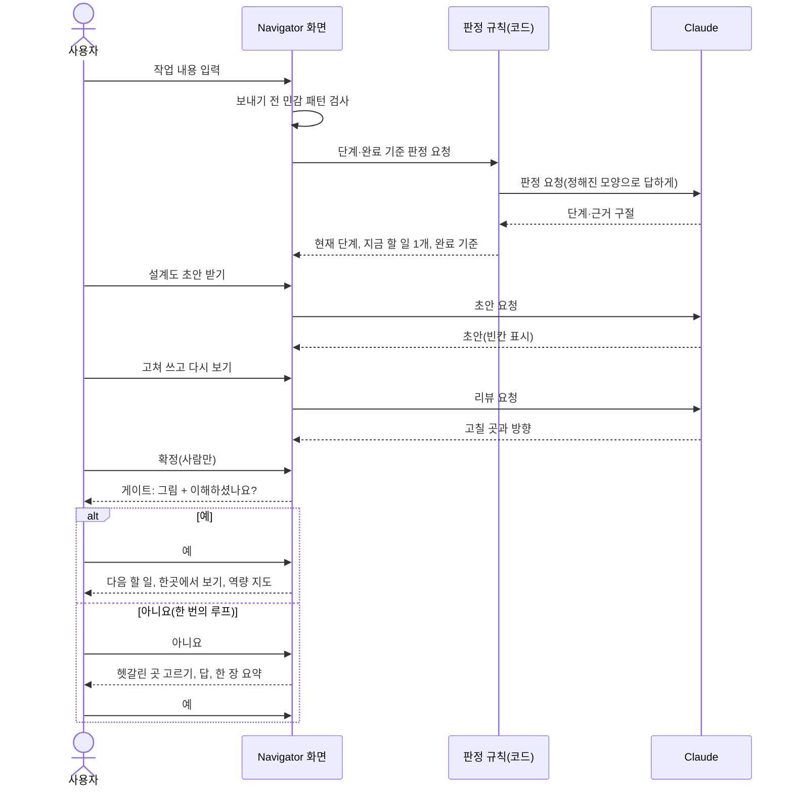

# UC-01 — 작업을 입력하고 게이트를 한 번 통과한다 (시연 시나리오 전체)

<!-- claude-drafted: 2026-10-16 — 이재엽의 요청("유스케이스 초안 써줘")으로 Claude가 requirements.md 2절 FR-1~13, 10~13-1절의 확정값, 팀 결정(2026-10-15·16)에서만 옮겨 쓴 **초안**이다. 확정은 이재엽, 화면 문구와 와이어는 고한결·임유정이 맞춘다. 상태 표시: [확정]=requirements.md에 이미 확정, [제안]=이 초안이 읽어 넣은 것. -->

> **닫음(2026-10-30, [결정 모음](../../00-overview/기록/결정-모음-2026-10-28.md) X-01 · X-08):** '확정 대기'로 두지 않는다 — 앱이 이 초안보다 앞서 10/16 초안으로 보관한다. 지금 모습은 [기능 현황](../../features/2026-10-30-기능-현황.md). <!-- claude-drafted: 2026-10-30 -->

**유스케이스는 하나로 시작한다**(이재엽 2026-10-16). 막히는 곳이 보이면 나눈다. 이 문서는 시연 시나리오 전체를 UC 하나로 쓴 것이다.

## 1. 한눈에

| 항목 | 내용 |
|---|---|
| 이름 | 작업을 입력하고 게이트를 한 번 통과한다 |
| 목적 | 바이브 코딩을 하는 사람이 **지금 어느 단계이고 무엇을 하면 되는지** 알고, 설계도를 함께 만들고, 단계를 넘어가기 전에 **이해했는지 확인**받는다 |
| 주 행위자 | **사용자** — 바이브 코딩을 하는 사람, 비전공자를 포함(FR-13) |
| 보조 행위자 | **Claude**(이 컴퓨터의 구독으로 호출, 실패하면 미리 만든 응답) · **코딩 도구**(Claude Code·Codex, FR-7) |
| 범위 | Project Navigator 화면과 그 뒤의 판정 규칙(서버 없음, FR-10) |
| 등급 | **Must 10개**(FR-1·2·3·4·5·6·8·9·10·13)를 한 줄기로 묶는다 [확정] |
| 시연에서의 모습 | 연습용 예시(fixture)로 처음부터 끝까지 돈다. 실제 대화도 가능하다 [확정 2026-10-15] |

## 2. 사전 조건

| # | 조건 | 근거 |
|---|---|---|
| P1 | 화면이 열려 있다. 서버가 꺼져 있어도 연습 모드로 돈다 | FR-10 |
| P2 | 실제 대화를 쓰려면 이 컴퓨터에 Claude 구독이 로그인돼 있다. 시연용 가상 프로젝트의 새 세션만 연결한다 | 2026-10-15 결정, 안전장치 S1 |
| P3 | 사용자가 올린 글은 기본이 **나만 보기**다 | FR-9 |

## 3. 기본 흐름

| # | 사용자 | 시스템 | FR |
|---|---|---|---|
| 1 | 만들고 있는 것을 한두 줄로 입력한다(질문은 일상의 말로) | 입력을 받고 비밀값·전화번호 같은 모양이 보이면 **보내기 전에 한 번 묻는다** | FR-1, FR-13, FR-9 |
| 2 | — | **현재 단계와 지금 할 일 1개**를 보인다. 나머지 할 일은 눌러야 펼쳐진다 [확정 2026-10-16] | FR-1 |
| 3 | — | 그 단계의 **완료 기준과 충족 여부**를 항목마다 보인다. 충족 근거는 사용자가 쓴 글에서 따온 구절이다 | FR-2 |
| 4 | 용어가 나오면 그 옆의 풀이를 본다 | 모르는 말은 **그 자리에서 한 줄로 풀어 준다** | FR-13 |
| 5 | 설계도가 필요한 단계에서 "초안 받기"를 누른다 | Claude가 **초안**을 쓴다. 모르는 자리는 `[채워 주세요: …]`로 비운다 | FR-3 |
| 6 | 초안을 고쳐 쓴다 | Claude가 **다시 리뷰하고 안내**한다(고칠 곳과 방향만, 정답 문장은 안 줌). 시연은 **한 바퀴** [확정 2026-10-16] | FR-3 |
| 7 | **"확정"을 직접 누른다** | 사람이 확정한 것만 확정으로 쓴다(빈칸이 남았으면 한 번 더 묻는다) | FR-3 |
| 8 | 단계의 할 일을 모두 마친다 | **게이트**가 열린다 — 이번 단계에서 한 일을 **그림(블록)으로 이어 보이고** "이해하셨나요?"를 묻는다 | FR-4, FR-13 |
| 9 | **"예"** | 다음 할 일들을 정리해 보인다. 순서는 사용자가 정한다 | FR-12 |
| 10 | 한곳에서 보기를 연다 | **진행 상황 · 내가 할 일 · 일정 충돌 · 토큰 사용**을 한 화면에 보인다(가상 숫자, 화면에 "가상" 표시) | FR-6, FR-10 |
| 11 | 지식 창고(역량 지도)를 연다 | 이 프로젝트에서 **어떤 역량을 어떤 노력으로 쌓았는지** 보인다(레벨 4단계, 항목은 인터뷰 뒤) | FR-8 |

## 4. 대안 흐름

| 번호 | 갈래 | 흐름 | FR |
|---|---|---|---|
| A1 | 8단계에서 **"아니요"** | ① 어디가 헷갈렸는지 **고르게** 한다 ② 질문을 받아 쉬운 말로 답한다 ③ 이번 단계 **한 장 요약 계획서**를 보인다 ④ 다시 "이해하셨나요?"를 묻는다. 시연은 **한 번의 루프**로 "예"까지 간다. 설계상 **"아니요"가 3회 쌓이면 Hold**(사람에게 넘김) [확정 2026-10-16] | FR-5 |
| A2 | 코딩 도구에서 작업이 끝남 | 화면이 **알림**을 받고 해당 할 일을 **끝났다고 표시**한다. 시연은 버튼 하나로 흉내 낸다 | FR-7 (Could) |
| A3 | 사용자가 작업 글을 바꿔 다시 살펴보게 한다 | 단계·할 일을 다시 판정한다. 근거가 없는 항목은 "충족 아님"이다 | FR-1·2 |
| A4 | 단계를 건너뛰려 한다 | 앞 단계의 미충족 항목을 이유와 함께 보이고 **막는다**(회색 버튼만 두지 않는다) | FR-2 |

## 5. 예외 흐름

| 번호 | 상황 | 시스템 | 근거 |
|---|---|---|---|
| E1 | Claude 호출이 실패하거나 시간이 초과된다 | "잘 안 됐어요"라고 **솔직하게** 보이고 지어내지 않는다. 연습 모드의 미리 만든 응답으로 돌아갈 수 있다 | FR-10, 판정 규칙 검토 |
| E2 | Claude의 답이 정해진 모양이 아니다 | 쓰지 않는다("살펴보지 못함") | 판정 규칙 검토 |
| E3 | 입력에 키·전화번호 같은 모양이 있다 | 막지 않고 "그대로 진행 / 수정"을 고르게 한다. 무엇이 의심되는지만 말하고 값을 다시 보이지 않는다 | 보안 기준 6-3 |
| E4 | 받은 알림(코딩 도구)에 개인 대화가 섞였다 | 화면에 보이기 전에 같은 검사를 거친다. 시연 전 점검표를 통과해야 한다 | 안전장치 S1~S6 [확정: 필수] |
| E5 | 서버가 꺼져 있다 | 연습 모드로 처음부터 끝까지 돈다. "connect.js로 연결해 주세요" 문구는 숨긴다 | FR-10, #47 부탁 2 |
| E6 | 전문 용어가 화면에 크게 보인다 | 화면 문구 검사가 거절한다 | FR-13 |

## 6. 사후 조건

| 조건 | 내용 |
|---|---|
| 성공 | 한 단계의 설계도가 **사람이 확정**했고, 게이트에서 "예"가 나왔고, 다음 할 일이 사용자가 정한 순서로 보인다 |
| 기록 | 사용자가 올린 글과 설계도는 **나만 보기**다. 팀에 보이는 것은 규칙을 거친 공유본뿐이다(FR-9) |
| 실패 | 끝까지 못 갔어도 **어디서 막혔는지**가 남는다. 3회 "아니요"는 Hold로 간다 |

## 7. 시험으로 옮기면 (Given-When-Then 한 줄씩, 수용 테스트 #17 입력)

| FR | Given | When | Then |
|---|---|---|---|
| FR-1 | 작업 글이 입력됐다 | 살펴보기를 누른다 | **현재 단계 1개와 지금 할 일 1개**가 보이고 나머지는 접혀 있다 |
| FR-2 | 한 단계의 할 일이 일부 충족됐다 | 단계 화면을 연다 | 항목마다 충족 여부가 보이고, 충족된 항목에는 **입력 글에서 따온 구절**이 붙는다 |
| FR-3 | 설계도가 필요한 단계다 | 초안 → 고쳐 쓰기 → 다시 보기를 한 바퀴 한다 | 초안에는 빈칸이 표시되고, **확정은 사람이 버튼을 눌렀을 때만** 된다 |
| FR-4 | 단계의 할 일을 모두 마쳤다 | 게이트가 열린다 | **그림과 예/아니요**가 함께 나온다 |
| FR-5 | 게이트에서 "아니요"를 눌렀다 | 헷갈린 곳을 고르고 질문한다 | 답과 **한 장 요약**이 나오고 다시 묻는다. "아니요"가 3번이면 Hold로 간다 |
| FR-6 | 가상 데이터가 있다 | 한곳에서 보기를 연다 | 네 항목이 한 화면에 보이고 **"가상"** 표시가 있다 |
| FR-8 | 단계를 마쳤다 | 지식 창고를 연다 | 역량 레벨(4단계)과 한 일이 보인다 |
| FR-9 | 사용자가 글을 올렸다 | 공유 규칙을 거치지 않았다 | **나만 보기**이고 팀에는 안 보인다(시험 17개로 이미 확인) |
| FR-10 | 서버가 꺼져 있다 | 처음부터 끝까지 돌린다 | 연습 모드로 **끝까지 돈다** |
| FR-13 | 비전공자가 첫 화면을 본다 | 용어 설명 없이 첫 장면을 읽는다 | 화면에 **전문 용어가 없고**, 합격 기준은 고한결이 정한 수(K4)를 따른다 |

## 8. 흐름 그림

## 9. 이 초안이 읽어 넣은 것 (확인해 주세요)

| # | 내용 | 이유 |
|---|---|---|
| 1 | A4 "단계를 건너뛰려 하면 막는다"는 FR-2의 완료 기준·충족 여부에서 읽은 것이다 | 요구에는 "건너뛰기" 문장이 없다 |
| 2 | 판정 규칙(R)을 화면 뒤의 **코드**로 두었다 | ADR-0003 제안과 2026-10-15 판정 규칙 결정을 따름. ADR은 아직 Proposed → **Accepted(2026-10-17)** <!-- claude-drafted: 2026-10-30 --> |
| 3 | A1에서 "Hold로 넘김"의 뜻은 담당(사람)에게 넘기는 것으로 읽었다 | 요구에 Hold의 내용이 없다 |
| 4 | FR-8 "역량 지도" 항목은 쓰지 않았다 | 인터뷰 뒤 확정 |
| 5 | 시연에서 FR-7은 버튼으로 흉내 낸다 | 13-1 확정 |

## 10. 다음에 정할 것

| # | 일 | 담당 |
|---|---|---|
| 1 | 이 초안을 읽고 고치기, 확정 → **닫음(2026-10-30, 결정 모음 X-01)** — 초안으로 보관 <!-- claude-drafted: 2026-10-30 --> | 이재엽 |
| 2 | 화면 문구·와이어에 반영 | 고한결(#12), 두승현(구현) |
| 3 | 7절을 수용 시나리오(#17)로 옮기기 | 두승현 |
| 4 | `requirements.md`에 UC 절을 더하기(PR #64 병합 뒤) | Claude가 PR 제안, 병합은 이재엽 |
