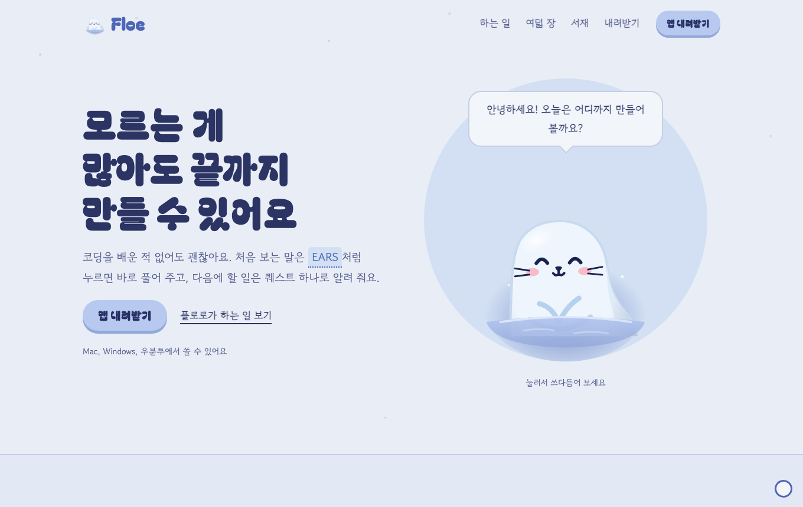

<!-- claude-drafted: 2026-10-21 — 이재엽의 요청("우리 내용으로 웹사이트를 제작해보고 싶어 … 미리 먼저 캔버스에서 디자인하고 초안들을 만들어서 보여주게 하자")으로 Claude가 만든 소개 웹사이트 초안 둘과 이 안내. 방향은 이재엽이 버튼과 말로 골랐고, "넣고 pr 올려줘"로 레포에 올렸다. -->

# Floe 소개 웹사이트 — 초안

**지금 고른 방향은 'C-1 플로로 그림책'을 파스텔로 낮춘 한 페이지다**(이재엽 2026-10-21). 제품 코드는 그대로이고, 내려받기 단추는 아직 어디에도 잇지 않았다.

| 파일 | 무엇 |
|---|---|
| [floe-site.html](floe-site.html) | 웹사이트 한 페이지 — 첫 화면 → 플로로와 보내는 하루 → 여덟 장(관문) → 퀘스트 → 서재 → 섬 → 내려받기. 섬 고르기 · 관문 · 퀘스트 선택지 · 허용/거절 · 쓰다듬기 · 용어 풀이는 눌러 볼 수 있다 |
| [floe-canvas.html](floe-canvas.html) | 고르기까지 거친 캔버스 — 처음 네 방향과 C 안의 변형 셋을 줄여 걸고, 누르면 실제 크기로 연다. 노란 메모에 잘 맞는 사람 · 강점 · 걱정 |

## 어떻게 골랐나

| 차례 | 보인 것 | 고른 것 (이재엽) |
|---|---|---|
| 1 | 네 방향 — A 밤의 얼음 서재 · B 항로 해도 · C 플로로 그림책 · D 작업 화면 위의 섬 | **C 플로로 그림책** (버튼) |
| 2 | C 안에서 색 · 글꼴 · 플로로 크기만 바꾼 셋 — C-1 밤바다 · C-2 어른 그림책 · C-3 플로로가 화면 | **C-1**, 바탕은 흰색으로 — "C-1 으로 근데 화이트로 해줘" |
| 3 | C-1의 글꼴 · 큰 플로로 · 부드러운 선을 흰 바탕 한 페이지로 | **파스텔로** — "눈이 너무 아파 … 조금 파스텔 톤으로 줄이고 눈이 아픈 색감은 사용하지마" |

파스텔로 바꾼 것: 순백 바탕 → 옅은 하늘빛, 진한 파랑 단추 + 흰 글씨 → 파스텔 파랑 + 남색 글씨, 검은 섬 · 아주 진한 터미널 → 회남색. 본문 글자 대비는 4.5:1 이상으로 남겼다.

## 내용은 어디서 왔나

| 칸 | 출처 |
|---|---|
| 여덟 장의 이름 | [navigator.js](../../../03-backend/navigator/navigator.js) `STAGES`의 `title` · `short` |
| 장마다 하는 일 · 받는 조각, 관문, 보상(조각 · 도장 · 책갈피 · 책 한 권), 퀘스트 흐름 | [quest-storyboard.md](../game-overlay/quest-storyboard.md) 4 · 5 · 10절 (앱 10.0.0, C-22) |
| 내려받기 · 처음 열기 · 폴더 연결 | [팀 작업 가이드](../../00-overview/team-guide.md) 2-c |
| 하는 일 · 미션 문장 · 결정 예시("행사 등록은 누가 하나요?") | [README](../../../README.md), [기획안](../../00-overview/final-project-plan.md), [requirements.md](../../00-overview/requirements.md) |

완주율 같은 숫자와 사용 후기는 아직 정하지 않았으므로 넣지 않았다. 서버 주소 · 저장소 주소 · 팀원 이름도 페이지에 없다.

## 플로로 그림

- [floro.svg](../../../02-frontend/assets/mascot/floro.svg)에서 배경만 빼고 표정 클래스(기쁨 · 생각 · 하트 · 다 했어요 · 잠)만 바꿔 페이지 안에 넣었다.
- 웹사이트에서만 물빛과 표정 표시(물음표 · 하트 · 별)를 파스텔로 낮췄다. **원본 파일은 고치지 않았다.**
- 원본 그림 mascot-v1과 꾸미기 그림은 이용 조건 확인 전이라 쓰지 않았다([마스코트 README](../../../02-frontend/assets/mascot/README.md)).

## 여는 법

파일을 브라우저로 바로 연다(서버 없이). 글꼴(Bagel Fat One · 고운 돋움 · 나눔고딕코딩)은 Google Fonts에서 받으므로 인터넷이 없으면 컴퓨터 글꼴로 보인다. 같은 내용이 claude.ai 아티팩트에도 있다 — 비공개라 이재엽이 공유해야 열린다.

## 확인한 것 · 남은 것

- 헤드리스 Chrome으로 데스크톱 폭(1360px)과 약 500px 폭에서 한 번씩 봤다. 휴대폰 폭(390px)은 아직 직접 보지 못했다 — 사람이 휴대폰으로 열어 볼 것.
- 캔버스의 A~D와 C 변형은 비교 기록이라 파스텔로 다시 칠하지 않았다.
- 정할 것: 내려받기 단추를 어디로 이을지(지금 Releases는 비공개 저장소라 팀원만 받는다), 웹사이트를 어디에 올릴지.

봐 주셨으면 하는 것 — 캐릭터(플로로 색을 이 페이지에서만 낮춘 것이 괜찮은지), 프론트엔드(휴대폰 폭), 검증(내려받기 칸의 처음 여는 법이 지금 앱과 맞는지), 모두(첫 화면만 보고 30초 안에 무엇을 해 주는지 알 수 있는지).
