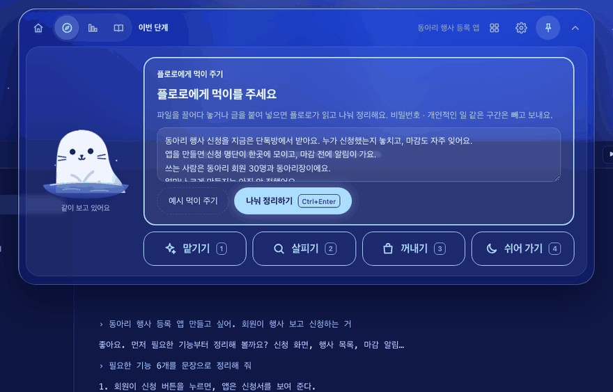
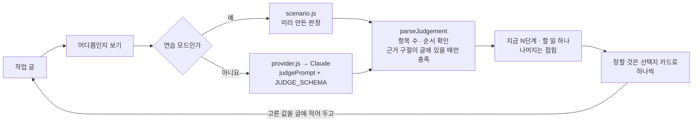

<!-- claude-drafted: 2026-10-18 — 이재엽의 요청으로 Claude가 requirements.md(FR-1·2, 13-1), navigator.js 머리 주석, navigator-prototype-rules-review.md, 커밋 기록에서 옮겨 썼다. 틀린 곳은 담당이 고친다. -->

# 01 단계 안내 — 지금 몇 단계인지, 다음 할 일, 완료 기준 (FR-1 · FR-2)

## 무엇을 하나

만들고 있는 것을 한두 줄 넣으면, 7단계(0 정하기 → 7 돌아보기) 중 **지금 어디인지**와 **지금 할 일 하나**를 보인다. 나머지 할 일은 눌러야 펼쳐지고,
항목마다 **했는지 안 했는지**와 그 **근거 구절**(사용자가 쓴 글에서 따온 말)이 붙는다. "얼마나 크게 만들까요?"처럼 정해야 할 것은 선택지 카드로 하나씩 묻는다.

| 요구 | 문장 (requirements.md 2절) | 등급 |
|---|---|---|
| FR-1 | 작업 내용을 입력하면 **현재 단계와 다음에 할 일**을 보여 준다 | Must · Basic — 최소 기능만 |
| FR-2 | 현재 단계에서 **어디까지 해야 하는지**(완료 기준과 충족 여부)를 보여 준다 | Must · Performance — 여기에 시간을 쓴다 |

## 왜 이렇게 만들었나

| 결정 | 내용 | 근거 |
|---|---|---|
| 판정은 **코드 규칙**이 한다 | 어느 단계인지는 `navigator.js`가 정하고, AI는 "이 단계의 할 일을 했는가"만 답한다 | [ADR-0003](../../03-pattern-analysis/adr/0003-ai-boundary-and-judgement.md) — 같은 입력에 같은 판정이 나와야 시험할 수 있고, "API를 그대로 쓴 것"으로 보이지 않는다 |
| **근거 구절이 글에 없으면 "충족 아님"** | AI가 "했다"고 해도 사용자의 글에서 그 구절이 안 보이면 안 한 것으로 둔다 | 판정 규칙 ①(2026-10-16), [판정 규칙 검토](../../00-overview/navigator-prototype-rules-review.md) 4절 |
| 다음 할 일은 **1개**만 | 나머지는 접어 둔다 | 이재엽 확정 2026-10-16 (requirements.md 13-1) |
| 단계·할 일 표는 **임시** | 단계는 requirements.md 1절, 할 일은 gates.md DoD·checklist.md를 쉬운 말로 줄였다 | 확정본은 #7(이재엽) |

## 어떻게 돌아가나

단계 표(`STAGES`)는 0~7단계마다 받는 것 · 하는 일 · 나가는 것 · 할 일(2~4개)을 갖는다. 할 일의 큰 글에는 전문 용어가 없고, 용어는 `term` 칸에만 작게 둔다([07 쉬운 말](../07-plain-words/README.md)).

## 어떻게 진행됐나

| 날짜 | 일 | 누가 · 어디 |
|---|---|---|
| 10/12 | 요구 FR-1·FR-2 확정, 7단계 워크 프로세스 확정 | 이재엽 · requirements.md |
| 10/14 | 프로토타입 첫 화면 — CouCou식 옆자리 동료, 쉬운 말, 집중 모드(한 화면에 한 결정) | 두승현 · PR #41 |
| 10/14 | 우선순위 확정 — FR-1 Basic(최소), FR-2 Performance | 이재엽 · PR #34 |
| 10/15 | 판정 규칙을 기준과 대조 — "먼저 고칠 것 4가지" | Claude 초안 → 이재엽 결정 · rules-review |
| 10/16 | 판정 규칙 ①·② — 근거 구절 확인, 지금 단계는 코드가 정함. 0~7단계를 연습 모드로 끝까지 시연 | 두승현 · PR #73 (#47 부탁 1~3) |
| 10/16 | 숫자 확정 — FR-1 다음 할 일 1개 | 이재엽 · PR #64 |
| 10/17 | 실제 AI 판정 점검 도구 `live-check.js` — 정답 판정과 몇 칸 맞는지, 토큰은 얼마나 드는지 | 이재엽 · PR #76·#78 |
| 10/18 | 전원이 코디세이 키로 진짜 AI 판정 켜 보기 | 모두 · 이슈 #79 (세 명 코멘트) |

## 코드 · 시험 · 담당

| | 어디 |
|---|---|
| 규칙 | [`03-backend/navigator/navigator.js`](../../../03-backend/navigator/navigator.js) — `STAGES`, `judgePrompt`, `parseJudgement` |
| 화면 | [`02-frontend/navigator/app.js`](../../../02-frontend/navigator/app.js) — 지금 탭, 선택지 카드, 할 일 펼치기 |
| 연습 예시 | [`03-backend/navigator/scenario.js`](../../../03-backend/navigator/scenario.js) — "동아리 행사 등록 앱" 가상 사용자, 0~7단계 |
| 시험 | [`04-tests/navigator/navigator.test.js`](../../../04-tests/navigator/navigator.test.js) 50개 — 판정 규칙 · 쉬운 말 · 키 보호, [`live-check.test.js`](../../../04-tests/navigator/live-check.test.js) 12개 |
| 담당 | 판정 규칙·프롬프트 **이재엽 #7**(10/25, 리뷰 두승현) · 4가지 수정 중 남은 것(빠진 항목 · 등급별 5단계) 두승현 10/20 · 화면 두승현(#15 이어받음) |
| 장면 주소 | `navigator/index.html#start` · `#ex=0` · `#ex=0&crit` — [3분 시연 스토리](../../04-pattern-implementation/demo-story-3min.md) 장면 2·3 |

## 아직 아닌 것 · 미정

- **단계·할 일 표는 임시**다 — #7에서 확정되면 `STAGES`와 프롬프트만 바꾼다.
- FR-1 "다음 할 일" 표시 개수(지금 1개)와 FR-2 단계마다 완료 기준 항목 수는 **인터뷰 뒤**에 정한다 — [인터뷰 결과 → 결정](../../interviews/results-to-decisions.md) 3절 (이재엽, 10/26).
- 입력 글에 키·전화번호 모양이 있으면 보내기 전에 한 번 묻는다(UC-01 E3) — 규칙은 [sensitive.js](../../../03-backend/navigator/sensitive.js)(2026-10-19, 나만 보기를 지우며 옮김).
