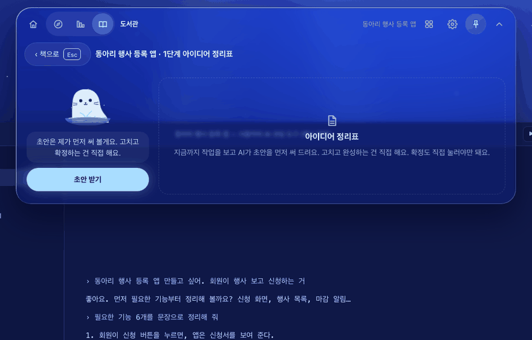
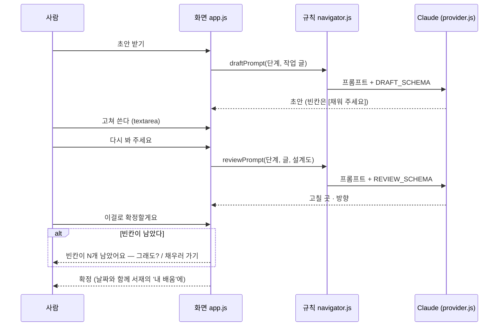

<!-- claude-drafted: 2026-10-18 — 이재엽의 요청으로 Claude가 requirements.md(FR-3, 13-1), UC-01, app.js·navigator.js 주석, 커밋 기록에서 옮겨 썼다. 틀린 곳은 담당이 고친다. -->

# 02 설계도 함께 쓰기 — 초안(AI) → 고치기(사람) → 리뷰(AI) → 확정(사람) (FR-3)

> **2026-10-19 바뀜(이재엽):** 서재의 '내 배움' · 역량 지도를 지웠고(`learn.js` · `skills.js`), 지식 은하는 길을 막아 두었다(파일은 남김), 나만 보기(FR-9)는 Won't. 아래에서 그것들을 말하는 줄은 바뀌기 전 기록이다 — [requirements.md](../../00-overview/requirements.md) 13-1, [고칠 목록](../../07-maintenance/fix-map.md) F-25. GIF는 다시 찍기 전이다.

## 무엇을 하나

설계도가 필요한 단계(1 아이디어 정리표 · 2 꼭 필요한 기능 목록 · 3 방법을 고른 기록 · 4 작은 할 일 목록)에서 **AI가 초안을 먼저 쓰고**, 모르는 자리는 `[채워 주세요: …]`로 비운다.
사람이 고쳐 쓰면 AI가 **다시 봐 주고**(고칠 곳과 방향만 — 정답 문장은 주지 않는다), **확정은 사람만 누른다.** 빈칸이 남은 채 확정하려 하면 "빈칸이 N개 남았어요"라고 한 번 더 묻는다. 확정한 설계도는 서재의 '내 배움'(`library/index.html#lib-learn`)에서 다시 본다(2026-10-18 F-05 — 오버레이의 '내 배움' 탭을 서재로 옮김).

| 요구 | 문장 | 등급 |
|---|---|---|
| FR-3 | 단계가 설계도를 요구하면 Claude가 **초안**을 만들고, 사용자가 **수정·작성**하면 Claude가 **다시 리뷰하고 안내**한다. 사람이 승인한 것만 확정으로 쓴다 | Must · Performance |

## 왜 이렇게 만들었나

| 결정 | 내용 | 근거 |
|---|---|---|
| 초안은 AI, 확정은 사람 | "클로드가 초안 … 사용자가 수정 … 너가 다시 리뷰" | 이재엽 원문(requirements.md 2절). "성장하는 건 사람" |
| 이 기능이 **기획 20점의 큰 자리** | "AI API를 그대로 쓴 수준을 넘어"를 보이는 곳 | team-priorities.md 2절 |
| 시연은 **한 바퀴**, 리뷰 횟수 상한 없음 | 초안 → 고치기 → 다시 보기 → 확정을 한 번 | 이재엽 확정 2026-10-16 (PR #64) |
| 따로 된 승인 팝업 없이 `[확정]` 버튼이 승인 | 와이어 ④와 맞춤 | 임유정 · 고한결 #12 (PR #90, 2026-10-17) |
| 리뷰는 방향만 | 정답 문장을 그대로 주면 배우는 쪽이 사람이 아니게 된다 | UC-01 기본 6, 리뷰 모드와 같은 원칙 |

## 어떻게 돌아가나

연습 모드에서는 `scenario.js`의 `drafts`·`reviewFixture`가 AI 자리를 맡는다. 진짜 AI 답을 시연에서 보이려면 1~4단계 초안·리뷰를 미리 녹화해 재생한다([09 AI 연결](../09-ai-connection/README.md) "녹화·재생").

## 어떻게 진행됐나

| 날짜 | 일 | 누가 · 어디 |
|---|---|---|
| 10/12 | FR-3 확정 (승인 규칙은 [해석]) | 이재엽 · requirements.md |
| 10/14 | "준비 중"이던 설계도를 실제 동작으로 — 초안은 AI, 고치기·확정은 사람. 기록은 이 브라우저에만 | 두승현 · PR #41 |
| 10/16 | 숫자 확정 — 시연 1바퀴, 리뷰 상한 없음 | 이재엽 · PR #64 |
| 10/16 | UC-01 기본 흐름 5~7(초안 → 고침 → 리뷰 → 확정) | Claude 초안 · PR #67 (확정 대기) |
| 10/17 | 녹화 대상에 1~4단계 설계도 초안·리뷰 포함 | 이재엽 · PR #77 |
| 10/17 | 와이어 #12에 맞춤 — 승인 팝업 대신 설계도 확정 | 임유정 · PR #90 |

## 코드 · 시험 · 담당

| | 어디 |
|---|---|
| 화면 | `02-frontend/navigator/app.js` — `docBody`, `draft`, `review`, `confirmDoc`, `reopen-doc` |
| 프롬프트·스키마 | `03-backend/navigator/navigator.js` — `draftPrompt`, `reviewPrompt`, `DRAFT_SCHEMA`, `REVIEW_SCHEMA` |
| 연습 예시 | `03-backend/navigator/scenario.js` — `drafts`, `reviewFixture` |
| 시험 | `04-tests/navigator/navigator.test.js` 안의 설계도 항목, `record-demo.test.js` 3개 |
| 담당 | 프롬프트 **이재엽 #7** · 화면 두승현(#15) · 와이어 고한결 #12 ④ |
| 장면 주소 | `navigator/index.html#ex=1&tab=doc` — 시연 스토리 장면 4 |

## 아직 아닌 것 · 미정

- 설계도 **문서 틀**(단계마다 어떤 칸을 갖는지)은 프롬프트 안의 제안이다 — #7 확정본에서 정한다.
- 실제 호출 한 경로를 시연에 넣을지는 ADR-0002 "한 경로만"(채택)에 따라 녹화본 재생으로 보인다.
- 설계도를 사용자의 코딩 도구(Claude Code·Codex)로 **넘겨주는 화면**은 와이어에만 있고(⑦ 넘겨주기) 아직 만들지 않았다.
