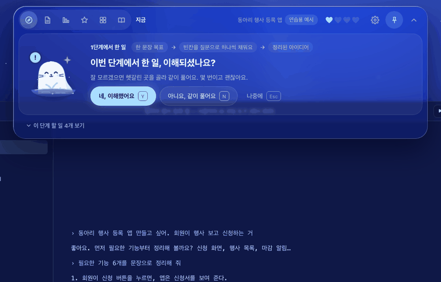
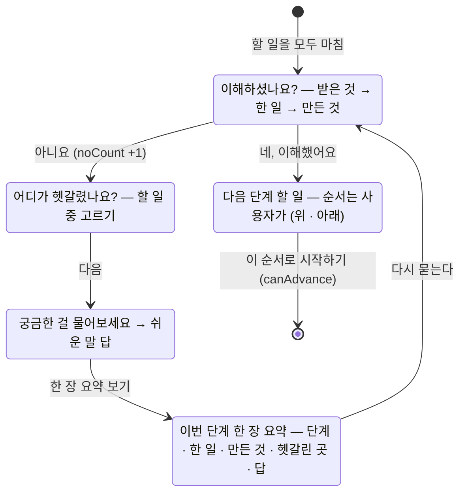

<!-- claude-drafted: 2026-10-18 — 이재엽의 요청으로 Claude가 requirements.md(FR-4·5·12, 13-1), gates.md, UC-01 A1, app.js·navigator.js 주석, 커밋 기록에서 옮겨 썼다. 틀린 곳은 담당이 고친다. -->

# 03 넘어가기 전 확인 — 그림 + "이해하셨나요?", 아니요 루프, 다음 할 일 순서 (FR-4 · FR-5 · FR-12)

## 무엇을 하나

한 단계의 할 일을 모두 마치면 **게이트**가 열린다. 이번 단계에서 한 일을 **블록(받은 것 → 한 일 → 만든 것)** 으로 이어 보이고 "이해하셨나요?"를 묻는다.
**아니요**면 ① 어디가 헷갈렸는지 고르게 하고 ② 질문을 받아 쉬운 말로 답하고 ③ 이번 단계 **한 장 요약**을 보인 뒤 다시 묻는다. **예**면 다음 단계의 할 일을 늘어놓고 **순서는 사용자가 정한다**(위로 · 아래로).
할 일을 다 하지 않았거나 "예"가 없으면 넘어가지 못한다 — `canAdvance(met, understood)`.

| 요구 | 문장 | 등급 |
|---|---|---|
| FR-4 | 게이트가 끝나면 그 게이트의 작업을 **다이어그램으로 보이며** "이해하셨나요?"를 묻고 **예/아니요**를 받는다 | Must · Performance |
| FR-5 | "아니요"면 **어느 부분을 모르는지 확인**하고, **질문을 받아 답하고**, **요약한 계획서**를 확인하게 하며, "예"가 나올 때까지 돕는다 | Must · Performance — 시연은 1회 루프 |
| FR-12 | 게이트가 끝나면 **다음 할 일들을 정리**해 사용자가 **우선순위를 생각하고 정할 수 있게** 한다 | Should — 순서는 사용자가 정한다 |

## 왜 이렇게 만들었나

| 결정 | 내용 | 근거 |
|---|---|---|
| 완료 기준 충족 **+** 이해 "예" 둘 다 | 둘 중 하나로는 못 넘어간다 | requirements.md 1절 "게이트 한 번에 일어나는 일", `navigator.js` `canAdvance` |
| 설명할 수 있는가 대신 **그림을 보이며 예/아니요** | "설명할 수 있는가보다 다이어그램을 보이며 … 예 아니요" | 이재엽 원문 FR-4 |
| 그림은 **블록**으로 — (다) 다이어그램 → 예/아니요 → 확인·질문·요약 | FR-13 원칙 7 "가+나+다" 확정 | 이재엽 2026-10-14 |
| "아니요" 3회면 **Hold**(사람에게 넘김), 해제 조건을 적는다 | 반복이 길어질 때의 출구 | 이재엽 확정 2026-10-12 · 2026-10-16 (Hold 3회) |
| 판정은 코드 규칙 | 같은 입력에 같은 판정 — 시험 가능 | [ADR-0003](../../03-pattern-analysis/adr/0003-ai-boundary-and-judgement.md) |
| "성장하는 건 사람" | 이해 확인이 차별점 — 발표의 중심(가설 H3) | team-priorities 2절, [인터뷰 결과 → 결정](../../interviews/results-to-decisions.md) 2절 |

## 어떻게 돌아가나

답(`/api/answer`)은 연습 모드에서 `scenario.js`의 `answers`, 진짜 AI 모드에서 `provider.js`를 거친다. 넘어간 기록은 `'잘 모르겠어요' N번`과 날짜로 '내 배움'에 남는다.

## 어떻게 진행됐나

| 날짜 | 일 | 누가 · 어디 |
|---|---|---|
| 10/12 | FR-4 · FR-5 · FR-12 확정, Hold(해제 조건 적기) 확정 | 이재엽 · requirements.md |
| 10/14 | 프로토타입에 게이트 — 예/아니요 · 헷갈린 곳 · 질문 · 한 장 요약. 블록 디자인 가+나+다 확정 | 두승현 · PR #41, 이재엽 · PR #34 |
| 10/16 | 연습 모드로 0~7단계를 끝까지 — 모든 단계에서 게이트를 거친다. FR-5 Hold 3회 확정 | 두승현 · PR #73, 이재엽 · PR #64 |
| 10/16 | UC-01 기본 8~9 · 대안 A1("아니요" 루프) | Claude 초안 · PR #67 (확정 대기) |
| 10/17 | 와이어 ⑤ 게이트 · ⑥ 아니요 · ⑦ 다음 할 일 (가설안) | 고한결 · PR #82 |
| 10/17 | 와이어에 맞춤 — **할 일을 마친 뒤 게이트** | 임유정 · PR #90 |

## 코드 · 시험 · 담당

| | 어디 |
|---|---|
| 규칙 | `03-backend/navigator/navigator.js` — `canAdvance`, `reorder`(원본을 바꾸지 않음), `answerPrompt` |
| 화면 | `02-frontend/navigator/app.js` — `gateBody`, `flow`(블록), `step` ask · which · question · plan · next, `up`/`down` |
| 연습 예시 | `03-backend/navigator/scenario.js` — `answers` |
| 시험 | `04-tests/navigator/navigator.test.js` — `canAdvance` · `reorder` 항목 |
| 담당 | 판정 규칙 **이재엽 #7** · 화면 두승현 #15 · 그림이 "다이어그램"으로 읽히는지 고한결 #12 |
| 장면 주소 | `navigator/index.html#ex=1&done&gate` — 시연 스토리 장면 5 |

## 아직 아닌 것 · 미정

- **Hold 화면은 2026-10-18에 생겼다**(`v2/screen-gaps`). 같은 확인에서 "아니요" 세 번째부터 "잠시 멈추기"를 권하고, 누가·언제 다시 볼지 적으면 오늘 카드에 "보류 중 · 10/20에 다시 보기"가 남는다(`03-backend/navigator/understand.js`). 화면은 아직 사람이 보지 않았다 — [수용 테스트](../../../04-tests/acceptance/README.md) 5-3. 같은 날 "예" 뒤 짧은 확인 질문 1개(4-3)도 더했다.
- FR-12의 **우선순위 방식**(MoSCoW×Kano 재사용 제안)은 제안 상태 — 지금은 위 · 아래로 순서만 정한다.
- 블록 그림이 비전공자에게 "다이어그램"으로 읽히는지는 인터뷰 · 와이어에서 확인한다([기획 확정 한 장](../../00-overview/plan-confirm-2026-10-18.md) 4절).
