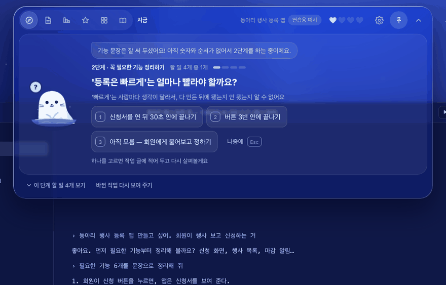
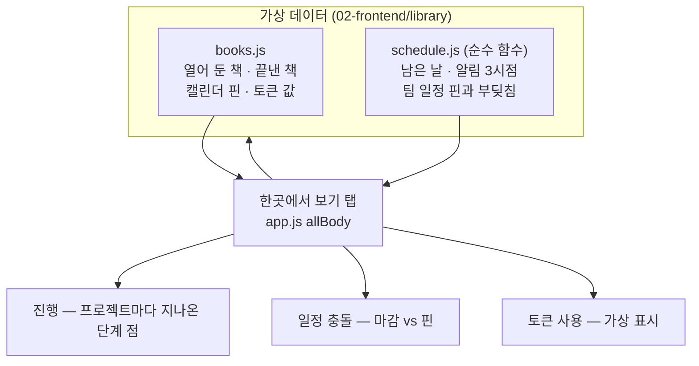

<!-- claude-drafted: 2026-10-18 — 이재엽의 요청으로 Claude가 requirements.md(FR-6), plan-confirm 4절, library README, schedule.js·books.js 주석, 커밋 기록에서 옮겨 썼다. 틀린 곳은 담당이 고친다. -->

# 04 한곳에서 보기 — 진행 · 내가 할 일 · 일정 충돌 · 토큰 (FR-6)

## 무엇을 하나

내비게이터의 **'한곳에서 보기' 탭** 하나에 네 가지를 모은다 — 여러 프로젝트의 진행(이 화면의 프로젝트는 "이 화면" 표시), 내가 할 일, 다른 일정과 부딪치는 마감(일정 충돌), Claude 토큰 사용.
숫자는 모두 **가상**이고 화면에 "가상 숫자예요"라고 표시한다(FR-10).

| 요구 | 문장 | 등급 |
|---|---|---|
| FR-6 | **진행 상황, 내가 할 일, 다른 프로젝트·일정과의 충돌, Claude 토큰 사용**을 한 화면에 보여 준다 | Must (초안 Should → 2026-10-14 상승, 이재엽 "보기 편해서") |

## 왜 이렇게 만들었나

| 결정 | 내용 | 근거 |
|---|---|---|
| 시연은 가상 숫자 | 캘린더·토큰의 실제 데이터원은 미확인 → 베타 | FR-10, plan-confirm 4절 "캘린더 읽기는 베타" |
| 서고 시안의 위젯을 **내비게이터 탭으로 옮김** | 작업 화면 위 오버레이는 내비게이터 하나 — 같은 화면이 둘이 되지 않게 | 2026-10-17 시연 연결(PR #88), plan-confirm 4절 |
| 마감은 단계마다 붙인다 | 프로젝트 일정을 따로 만들지 않고 단계에 마감 날짜를 붙인다. 알림 시점은 세컨드 브레인의 3일 전 · 1일 전 · 당일 아침 8시 | `schedule.js` 머리 주석, 세컨드 브레인 Q2 |
| 서재는 따로(`/library`), 한곳에서 보기는 `/overview` | 성격이 다르다 — 서재는 3장, 한곳에서 보기는 숫자 | 임유정 2026-10-17 (#14 리뷰 2번) |

## 어떻게 돌아가나

## 어떻게 진행됐나

| 날짜 | 일 | 누가 · 어디 |
|---|---|---|
| 10/12 | FR-6 확정 ("다른 프로젝트나 일정이 없는지 … 토큰 알림 … 한곳에서") | 이재엽 · requirements.md |
| 10/14 | 등급 Should → Must | 이재엽 · PR #34 |
| 10/16 | 서재 설계 초안에 '한곳에서 보기' 자리 | 이재엽 · PR #68 |
| 10/17 | 서재 시안에서 마감이 붙은 단계 지도 → Must 빈칸 채우기(FR-6 한곳에서 보기) | 이재엽 · PR #85 |
| 10/17 | 시연 연결 — 위젯을 내비게이터 '한곳에서 보기' 탭으로 옮김 | 이재엽 · PR #88 |

## 코드 · 시험 · 담당

| | 어디 |
|---|---|
| 화면 | `02-frontend/navigator/app.js` — 한곳에서 보기 탭, `library-tab.css` |
| 데이터·계산 | `02-frontend/library/books.js`(가상 값), `schedule.js`(마감 계산) |
| 시험 | `04-tests/library/schedule.test.js` 10개 — 남은 날 · 알림 · 충돌 |
| 담당 | 두승현 #15(이어받음) · 리뷰 고한결 |
| 장면 주소 | `navigator/index.html#tab=all` — 시연 스토리 장면 6 |

## 아직 아닌 것 · 미정

- 캘린더·토큰의 **실제 데이터원**은 정하지 않았다(데이터원 미확인 → 베타, [시연에서 베타까지](../../00-overview/roadmap-demo-to-beta.md)).
- 토큰 사용의 실제 값은 [09 AI 연결](../09-ai-connection/README.md)의 `usage.js`가 세지만, 이 탭은 아직 그 값을 읽지 않는다(가상 표시).
