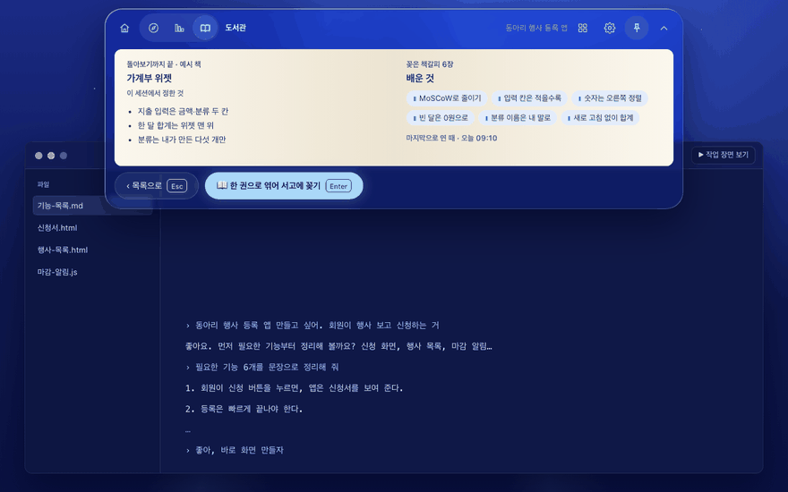
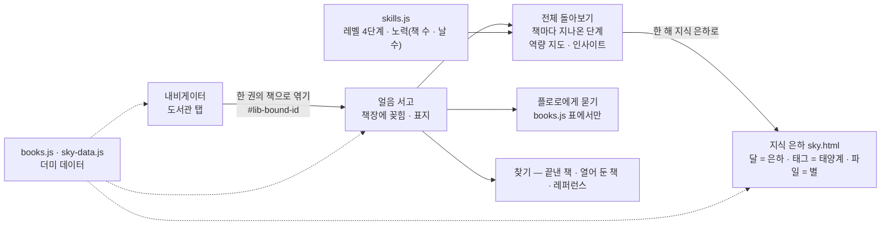
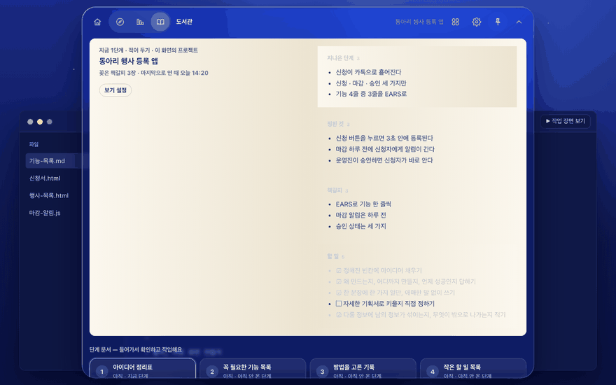

<!-- claude-drafted: 2026-10-18 — 이재엽의 요청으로 Claude가 requirements.md(FR-8), ADR-0004·0006, library README, skills.js·knowledge-sky.js 주석, plan-confirm 3절, 커밋 기록에서 옮겨 썼다. 틀린 곳은 담당이 고친다. -->

# 05 지식 창고 — 도서관 탭 · 얼음 서고 (FR-8)

> **2026-10-19 바뀜(이재엽):** 서재의 '내 배움' · 역량 지도를 지웠고(`learn.js` · `skills.js`), 지식 은하는 길을 막아 두었다(파일은 남김), 나만 보기(FR-9)는 Won't. 아래에서 그것들을 말하는 줄은 바뀌기 전 기록이다 — [requirements.md](../../00-overview/requirements.md) 13-1, [고칠 목록](../../07-maintenance/fix-map.md) F-25. GIF는 다시 찍기 전이다.

## 무엇을 하나

프로젝트가 끝나면 그 기록이 **책 한 권**이 되어 서고에 꽂히고, 책들이 모여 **역량 지도**(무엇을 어느 레벨로, 얼마나 노력했나)와 **지식 은하**(한 해 하늘)가 된다. 세 겹이다.

| 겹 | 어디 | 보이는 것 |
|---|---|---|
| 도서관 탭 | 내비게이터 안 | 열어 둔 책 4권 → 고르고 · 보고 · 덮고 · 세션 덮기. 완주한 책은 **한 권의 책으로 엮기** |
| 플로로의 얼음 서고 | `library/index.html` | 끝낸 책 책장(같은 배움을 쓴 책끼리 금빛 선), 펼친 책(단계마다 정한 것 · 배운 것 · 만든 것), **전체 돌아보기**(끝낸 책 · 책갈피 · 역량 지도 · 인사이트), 플로로에게 묻기, 찾기, 레퍼런스 서가 |
| 지식 은하 | `library/sky.html` | 달 = 은하, 태그 = 태양계, 지식 파일 = 별. 별의 밝기 = 이해 수준 |

| 요구 | 문장 | 등급 |
|---|---|---|
| FR-8 | 프로젝트가 남으면 지식 창고에 기록을 쌓아 **역량이 무엇인지, 어떤 노력을 해 왔는지** 보여 준다 | Must (2026-10-14 상승) · **미정:** 역량·노력의 항목과 단위 |

## 왜 이렇게 만들었나

| 결정 | 내용 | 근거 |
|---|---|---|
| 장기 기억은 **파일**로, 검색은 인터페이스 뒤 | 서버 없이 시연(FR-10), V1 세컨드 브레인에 코드·시험이 있다. RAG는 나중에 바꿀 수 있게 | [ADR-0004](../../03-pattern-analysis/adr/0004-long-term-memory.md) Accepted |
| 세컨드 브레인(V1)과 통합 | 지식 창고 + 마감 알림을 Floe 안으로 | [ADR-0006](../../03-pattern-analysis/adr/0006-second-brain-integration.md) Accepted |
| 역량 레벨 4단계는 **가설** | 끝낸 책 1권 이해함 · 2권 직접 씀 · 3권+ 응용함 · 열어 둔 책에만 있으면 처음 봄 | `skills.js` 머리 주석 — 항목·단위는 인터뷰 뒤 |
| 테마는 얼음 파랑 | 팀 화면 테마 확정 | 이재엽 2026-10-16 (서재 설계 7절 8번) |
| AI 적용 합리성의 주력은 판정 규칙 **+ 장기 기억** 둘 다 | 2026-10-19 장기 기억은 서고의 책(펼치기 · 전체 돌아보기)으로만 — 역량 지도 · '내 배움'은 뺌(F-25). 발표 근거는 판정 규칙 중심 | 이재엽 확정 2026-10-14, 범위 줄임 확인 2026-10-19 |
| Neo4j · GitHub 실제 연결은 **안 함(제안)**, 별자리 하늘은 발표의 비전 장면 | 15일 범위, 토큰·개인 데이터 부담 | [기획 확정 한 장](../../00-overview/plan-confirm-2026-10-18.md) 3절 — 결정 칸은 이재엽이 채운다 |

## 어떻게 돌아가나

## 어떻게 진행됐나

| 날짜 | 일 | 누가 · 어디 |
|---|---|---|
| 10/14 | 세컨드 브레인 서재 설계(V1 승격) | 이재엽 · PR #33 |
| 10/16 | 서재 화면 설계 초안 · 테마 얼음 파랑 · 서재 질문 묶음 · UC-02(짧게 · 전체 · 세션별 · 책별) | 이재엽 · PR #68 · #69 · #67 |
| 10/17 | 플로로의 얼음 서고 시안 — 오버레이 위젯과 내 서고 → 찾기 → 지식 별자리 하늘(1~12월) · GitHub 지식 파일 연동 시안 | 이재엽 · PR #85 |
| 10/17 | 마감이 붙은 단계 지도 · 책으로 엮기 · 책 표지 · 전체 돌아보기 → FR-8 역량 지도 → 은하(달) · 태양계(태그) · 별(책) | 이재엽 · PR #85 · #88 |
| 10/17 | 시연 연결 — 위젯은 내비게이터 탭으로, 이 시안은 서고만 | 이재엽 · PR #88 |
| 10/17 | 서고 책장 디자인 · 플로로 자연스럽게 | 두승현 · PR #91 |
| 10/18 | 서고로 물속 전환 · 책 날아오기와 펼치기 · 서고 책·UI 키움 | 이재엽 · PR #93 |

**2026-10-20 — 서재 전환(F-30 · F-31, 이재엽 요청):** 서고로 들어갈 때 플로로는 **오버레이 한가운데**에서 곧게 잠수하고(앱은 창을 먼저 넓힌 뒤 섬을 제자리에 붙든 채),
서고에서 **← 작업 화면으로**를 누르면 물이 차오르고 플로로가 잠수한 뒤 작업 화면이 물속에서 떠오른다(`dive.js` `leave` · `surface`, 주소 끝 `&back`). 앱에서는 서고에 있는 동안
창을 **사람이 조절**할 수 있고(최소 640×480, 조절한 크기는 켜져 있는 동안 기억) 돌아오면 섬 자리로 줄어든다. 플로로 크기는 창의 짧은 변을 따른다(`library.css`). 들어갈 때 걸리던
약 4.3초를 2.4초로 줄였다(`dive.js` 상수 · `dive.test.js`). <!-- claude-drafted: 2026-10-20 -->

## 책 보기 설정 — 구조 · 칸 · 보기 · 크기 (C-3 · C-9 → FR-8 세부, 2026-10-20)

이재엽 "아니 지금 하자"(2026-10-20)로 베타가 아니라 지금 만들었다. 책 화면의 **보기 설정** 하나에 넷이 있고, 섬의 도서관 탭과 서고의 펼친 책이 **같은 설정**(`floe:book-view`, 이 컴퓨터에만 저장 — FR-10)을 읽고 쓴다.

| 설정 | 고를 것 | 기본(이재엽 버튼) | 하는 일 |
|---|---|---|---|
| 구조 | 간결 · 탭 | **간결** | 간결은 켜 둔 칸을 위에서 아래로, 탭은 칸마다 탭 — 한 번에 한 칸 |
| 보기 | 책별 · 세션별 | **책별** | 세션별은 날짜가 남은 기록(지나온 단계 · 확정한 문서 · 받은 먹이)을 작업한 날짜로 묶는다 — '세션'은 코딩 도구에서 연 작업 한 번으로 읽었다 [해석]. 기록이 없는 예시 책은 책별로 보이고 그렇다고 알린다 |
| 크기 | 짧게 · 전체 화면 | 짧게 | 짧게는 섬의 도서관 탭, 전체 화면은 서고의 펼친 책(열어 둔 책도 `#lib-open-<id>`로 펼친다). 고르면 그 자리에서 건너간다 |
| 칸 | 지나온 단계 · 정한 것 · 배운 것 · 만든 것 · 책갈피 · 할 일 | 모두 켬 | 끄면 숨길 뿐 **내용은 지우지 않는다**. 칸을 새로 만들거나 옮기지는 않는다(규격화한 길, C-6) |

| | 어디 |
|---|---|
| 규칙 | [`02-frontend/library/book-view.js`](../../../02-frontend/library/book-view.js) — `normalize` · `read` · `write` · `choose` · `toggle` · `sections` · `sessions` · `bodyHTML` · `panelHTML`(순수, Node · 브라우저). 모양은 `book-view.css` |
| 화면 | `navigator/app.js` 도서관 탭(`bv-open` · `data-bv` 손잡이, `&view=1`로 판을 연 채) · `library/library.js` 펼친 책(`renderBook` · `#rd-view`). 내 책의 날짜 재료는 `my-books.js`의 `dated` |
| 시험 | [`04-tests/library/book-view.test.js`](../../../04-tests/library/book-view.test.js)(기본값 · 저장 · 칸 · 세션별 · HTML · 두 화면이 같은 모듈) · e2e [`modes-flow.test.js`](../../../04-tests/e2e/modes-flow.test.js) "C-9 · C-3" · [`responsive.test.js`](../../../04-tests/e2e/responsive.test.js) 장면 `#ex=1&tab=lib&book=s1&view=1` · `#lib-open-s1` |
| 아직 | 누가 어떤 칸을 끄고 싶은지(C-9 ①)는 사용 테스트에서 — "어떤 칸을 끄고 싶나요?". 끝낸 책(서고)은 날짜 기록이 없어 세션별이 책별로 보인다 |

<!-- claude-drafted: 2026-10-20 -->

## 코드 · 시험 · 담당

| | 어디 |
|---|---|
| 화면 | [`02-frontend/library/`](../../../02-frontend/library/README.md) — `index.html` · `library.js` · `sky.html` · `sky.js`, 내비게이터 도서관 탭은 `navigator/app.js` + `library-tab.css`, 물속 전환 `navigator/dive.js` |
| 데이터·계산 | `books.js`(더미) · `skills.js`(역량 지도) · `search.js`(찾기) · `knowledge-sky.js`(은하) · `sky-data.js`(더미 지식 파일 40개) |
| 시험 | `04-tests/library/` 39개 — 마감 10 · 역량 지도 3 · 검색 8 · 하늘 12 · 내 배움 기록 6 |
| 설계 문서 | [서재 설계](../../04-pattern-implementation/library-view-design.md) · [지식 별자리 GitHub 연동](../../04-pattern-implementation/knowledge-sky-github.md) · [책갈피 별자리 계획](../../00-overview/library-constellation-plan-2026-10-17.md) · [UC-02](../../04-pattern-implementation/uc/UC-02-library-views.md) |
| 담당 | 화면 두승현 #15 · 역량 항목 고한결 #11(인터뷰) + 이재엽 · 시안 이재엽 |
| 장면 주소 | `navigator/index.html#tab=lib&book=s3` → `library/index.html#lib-bound-s3` · `#lib-review` · `sky.html#year` — 시연 스토리 장면 7·8·9. 내 배움(내비게이터에서 지나온 단계 · 배운 말 · 확정한 설계도, F-05): `library/index.html#lib-learn` |

## 아직 아닌 것 · 미정

- **실제 세션·저장소를 읽지 않는다.** 내비게이터에서 덮은 책은 그 화면에서만 사라진다(엮은 책만 서고가 받는다). 플로로의 답은 표에서만 찾고 지어내지 않는다.
- **역량·노력의 항목과 단위**는 인터뷰 Q9·Q10 뒤 정한다 — [인터뷰 결과 → 결정](../../interviews/results-to-decisions.md) 3절 (이재엽 · 고한결, 10/27).
- GitHub 지식 파일 가져오기는 시안(더미)이다. 서재 설계 결정 1~7은 "모두 예" 제안 상태(plan-confirm 5절).
- 책 표지 자동 생성기는 제출 뒤(2026-10-14 결정).
