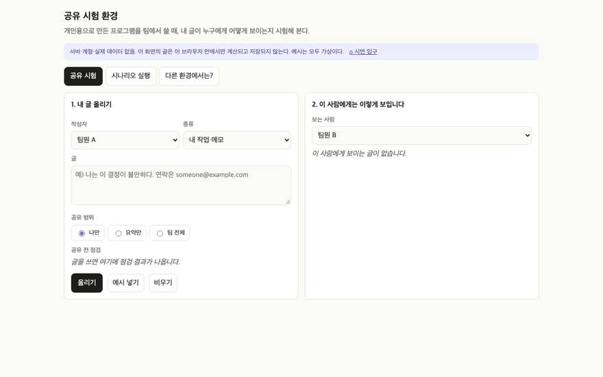
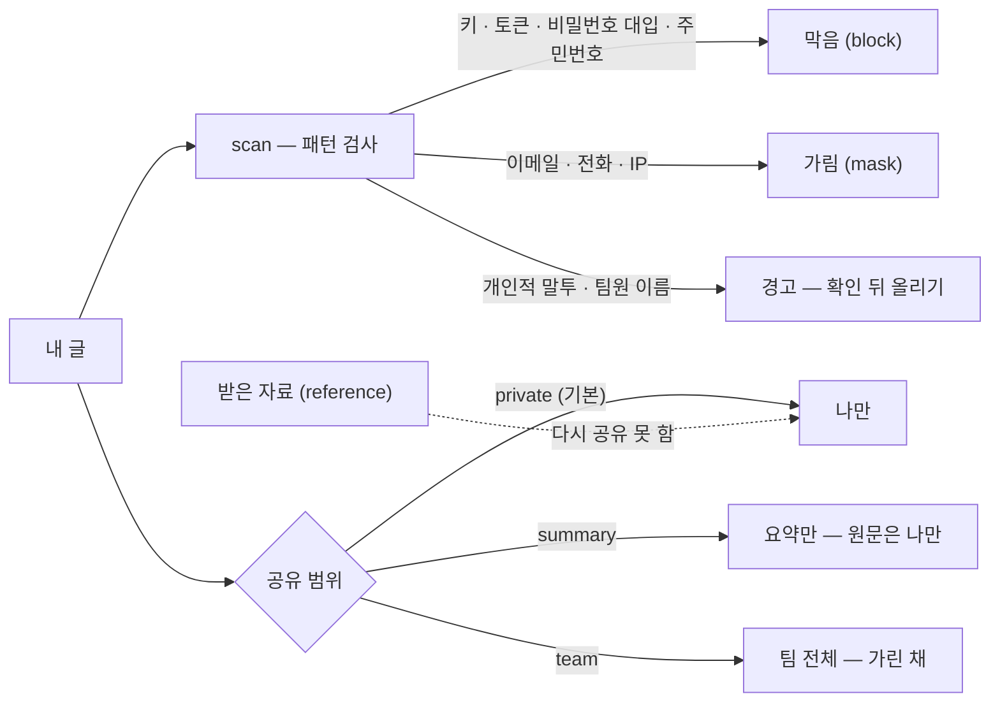

<!-- claude-drafted: 2026-10-18 — 이재엽의 요청으로 Claude가 requirements.md(FR-9), share-rules.js 머리 주석, team-sharing-security.md, ADR-0005, 커밋 기록에서 옮겨 썼다. 틀린 곳은 담당이 고친다. -->

# 06 나만 보기 — 공유 규칙과 시험 화면 (FR-9)

## 무엇을 하나

사용자가 올린 글은 **기본이 나만 보기**다. 팀에 보이는 것은 규칙을 거친 공유본뿐이다. 올리기 전에 글을 점검해 **비밀값 모양은 막고**, 이메일·전화·IP는 **가리고**, 개인적인 말투나 다른 팀원 언급은 막지 않고 **경고**한다(사람이 판단). 받은 자료는 다시 공유하지 못한다.

| 요구 | 문장 | 등급 |
|---|---|---|
| FR-9 | 사용자가 올린 글은 **기본이 나만 보기**이고, 팀에 보이는 것은 규칙을 거친 공유본뿐이다 | Must — 이미 구현·시험 완료(비용 0) |

## 왜 이렇게 만들었나

| 결정 | 내용 | 근거 |
|---|---|---|
| 기본값은 나만 보기 | "개인적인 말이나 행동이 … 위험" | 이재엽 원문, [공유·보안 규칙](../../00-overview/team-sharing-security.md) |
| 개인 원문과 공유본의 저장을 분리 | 원문은 각자 컴퓨터(로컬 파일), 팀과는 공유본만 | [ADR-0005](../../03-pattern-analysis/adr/0005-personal-vs-shared-storage.md) Accepted |
| 비밀값은 어떤 범위로도 안 나간다 | 키·토큰·비밀번호 대입·주민번호 모양은 `block` | share-rules.js 원칙 2, [기록·보안 기준](../../../.claude/rules/security-records.md) 6-3 |
| 민감 패턴은 **막지 않고 경고**(비밀값 제외) | "그대로 진행 / 수정"을 고르게 하고 값을 다시 보이지 않는다 | Intent-Specify S1 민감정보 경고(사용자 채택 2026-10-04) |
| 같은 검사를 두 곳에서 | 보내기 전(입력) · 받은 알림(코딩 도구)이 화면에 보이기 전 | 안전장치 S4, [09 AI 연결](../09-ai-connection/README.md) |

## 어떻게 돌아가나

화면(`share/index.html`)은 세 탭이다 — **공유 시험**(글 → 점검 → 보는 사람별 모습), **시나리오 실행**(`scenarios.js`를 node 시험과 같이 쓴다), **다른 환경에서는?**(개인용 가정이 팀에서 깨지는 곳 `environment-checks.js`).

## 어떻게 진행됐나

| 날짜 | 일 | 누가 · 어디 |
|---|---|---|
| 10/12 | 기획안·요구사항과 함께 **공유 시험 환경** 초안 — 규칙 · 시나리오 · 화면 · 시험 | 이재엽 · 초기 커밋 |
| 10/14 | 우선순위 — Must(이미 구현·시험 완료) | 이재엽 · PR #34 |
| 10/15 | ADR-0005 개인 원문과 공유본 분리 초안 → 10/17 채택 | 이재엽 · PR #45 · #80 |
| 10/17 | 폴더 정리 — 규칙은 `03-backend/share/`, 화면은 `02-frontend/share/`, 시험은 `04-tests/share/` | 두승현 · PR #87 |
| 10/17 | 시연 입구에 "안전장치 — 공유 시험 환경" 카드 | 이재엽 · PR #88 |

## 코드 · 시험 · 담당

| | 어디 |
|---|---|
| 규칙 | [`03-backend/share/share-rules.js`](../../../03-backend/share/share-rules.js) — `LEVELS`, `PATTERNS`, `scan` (순수 함수) |
| 시나리오·환경 점검 | `03-backend/share/scenarios.js`(가상 데이터만) · `environment-checks.js`(E1 승인 · E2 저장 …) |
| 화면 | [`02-frontend/share/index.html`](../../../02-frontend/share/index.html) — 서버 없이 브라우저로 연다 |
| 시험 | `04-tests/share/share-rules.test.js` (루트 README 기준 17개, 2026-10-17 측정) |
| 담당 | 이재엽(초안·규칙) · 민감도 구분은 팀 합의 |
| 장면 | 시연 스토리에는 없다 — 입구 카드 "안전장치"에서 연다 |

## 아직 아닌 것 · 미정

- 기록의 **민감도 구분**(저장 가능 / 조심해서 저장 / 저장 금지)은 팀이 채울 칸이다 — [기록·보안 기준](../../../.claude/rules/security-records.md) 5절.
- 패턴은 **약한 휴리스틱**이다(개인적 말투 등은 놓칠 수 있다) — 그래서 막지 않고 사람에게 알린다.
- 인터뷰 기록의 보관 기간·지우는 방법은 인터뷰 설계 때 정한다.
