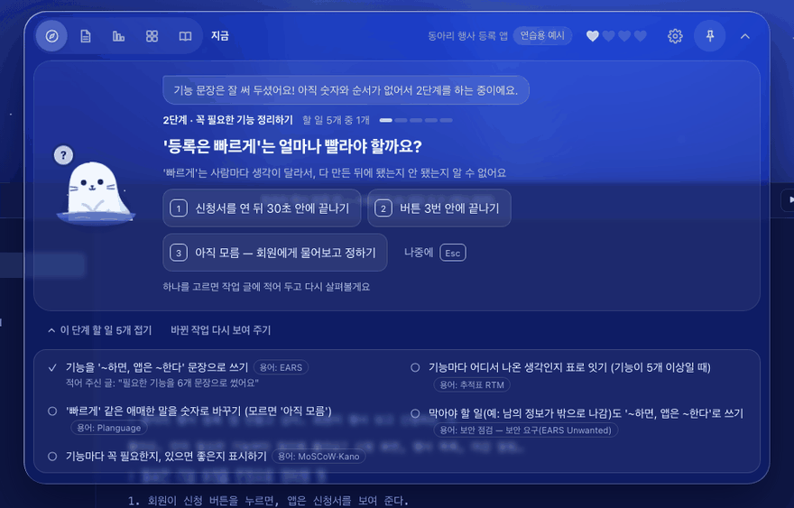
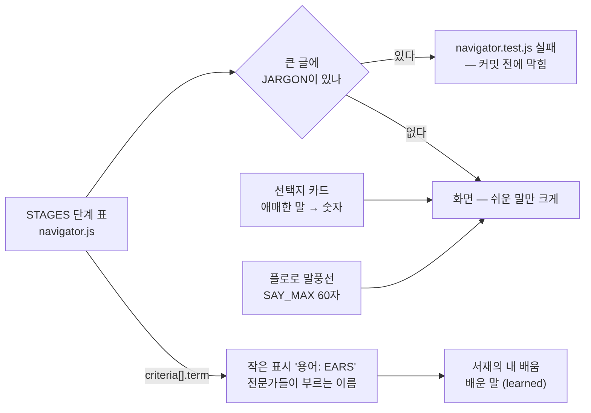

<!-- claude-drafted: 2026-10-18 — 이재엽의 요청으로 Claude가 requirements.md(FR-13, 2-1), navigator.js 쉬운 말 규칙, results-to-decisions.md, 커밋 기록에서 옮겨 썼다. 틀린 곳은 담당이 고친다. -->

# 07 쉬운 말 — 용어는 작게, 배운 말 모으기 (FR-13)

> GIF는 2026-10-18 전 화면이다 — 그때는 오버레이의 '내 배움' 탭에서 배운 말을 봤다. 지금은 서재의 '내 배움'(F-05). 다시 녹화는 F-13과 함께.

## 무엇을 하나

프로그래밍을 배우지 않은 사람이 써도 **단계 · 완료 기준 · 선택지가 전문 용어 없이** 읽히게 한다. 전문 용어는 할 일 옆에 작게 `용어: EARS`처럼만 보이고(배우고 싶은 사람만 본다), 한 번 만난 용어는 **서재의 '내 배움' → "배운 말"** 에 모인다(`library/index.html#lib-learn`, 2026-10-18 오버레이 탭에서 옮김 — F-05). 플로로의 말풍선은 60자 안(한 번에 읽히는 길이)이다.

| 요구 | 문장 | 등급 |
|---|---|---|
| FR-13 | 프로그래밍을 배우지 않은 사용자가 쓸 때, 단계·완료 기준·선택지를 **전문 용어 없이 쉬운 말과 그림**으로 안내하고, 모르는 말은 **그 자리에서 풀어 준다** | Must — 2026-10-14 추가·확정(이재엽) |

## 왜 이렇게 만들었나

| 결정 | 내용 | 근거 |
|---|---|---|
| 대상은 "코딩을 모르지만 AI와 함께 바이브 코딩으로 자신만의 프로젝트를 하고 싶은 사람" | 문서마다 달랐던 대상 이름을 하나로 | 이재엽 2026-10-18 ([기획 확정 한 장](../../00-overview/plan-confirm-2026-10-18.md) 7절) |
| 쉬운 말 규칙을 **시험으로 강제** | 큰 글(`title·short·gets·does·gives·criteria[].text`)에 `JARGON` 목록의 말이 있으면 시험이 실패한다 | `navigator.js` 머리 주석, [code.md](../../../.claude/rules/code.md) 6 "아키텍처 규칙은 도구로 강제" |
| 원칙 7개 | ① 용어 대신 질문 ② 지금 위치를 한 줄로 ③ 말보다 그림 ④ 선택지는 장단점과 함께, 결정은 사용자 ⑤ 모르면 막히지 않는다 ⑥ 모르는 말은 그 자리에서 ⑦ 블록으로 이어 보인다(가+나+다 확정) | requirements.md 2-1 — ⑥은 새 원칙, 1~5는 FR-1~5의 근거 |
| 접근 4단계는 **가설** | ① 인터뷰에 비전공자 1명 이상 ② 첫 장면을 용어 없이 이해하는지 ③ 쓰던 도구 그대로 ④ 사용 테스트 5명 이상에 비전공자 포함 | 인터뷰로 검증(고한결 #10·#11, 두승현 #18·#20) |

## 어떻게 돌아가나

## 어떻게 진행됐나

| 날짜 | 일 | 누가 · 어디 |
|---|---|---|
| 10/14 | 프로토타입에 "비개발자가 알아듣는 쉬운 말" — 용어는 `term` 칸에만 | 두승현 · PR #41 |
| 10/14 | FR-13 추가 · 등급 Must · 원칙 7(블록 가+나+다) 확정 | 이재엽 · PR #34 (requirements.md 13-1) |
| 10/15 | 인터뷰 질문지에 "멈췄던 단어"(Q11) · 비전공자 1명 이상 | 고한결 · PR #55 |
| 10/16 | 인터뷰 대상 가설 H5 · 미정 값 표 | Claude 초안 · PR #65 |
| 10/17 | 인터뷰 결과 → 결정 — 멈춘 단어를 용어 목록에(응답자 이름 없이) | Claude 초안 · PR #86 |
| 10/18 | 대상 이름 확정 | 이재엽 · plan-confirm 7절 |

## 코드 · 시험 · 담당

| | 어디 |
|---|---|
| 규칙 | `03-backend/navigator/navigator.js` — `JARGON`, `SAY_MAX`, `STAGES[].criteria[].term` |
| 화면 | `02-frontend/navigator/app.js` — `termTag`, 선택지 카드 · 서재의 '내 배움' `02-frontend/library/library.js` `openLearn`(기록 읽기 `learn.js`) |
| 시험 | `04-tests/navigator/navigator.test.js` — 쉬운 말 항목(큰 글에 용어가 없는지) |
| 담당 | 문구 **고한결**(#11 인터뷰 · #12 와이어) · 화면 임유정 #15(두승현 이어받음) — team-priorities 4-1 "용어 즉시 풀이" 담당 대기 |
| 장면 주소 | `navigator/index.html#ex=0&crit` · `#ex=2&crit` — 시연 스토리 장면 3 |

## 아직 아닌 것 · 미정

- **"비전공자"의 기준**, 용어 풀이의 수준, 첫 장면 이해의 합격 기준(수치)은 미정 — 값은 지어내지 않는다(requirements.md 2-1).
- 용어 목록은 인터뷰 Q11 "멈췄던 단어"로 채운다 — [인터뷰 결과 → 결정](../../interviews/results-to-decisions.md) 3절 (고한결, 10/27).
- 용어를 **그 자리에서 한 줄로 풀어 주는** 풀이는 2026-10-18에 생겼다(`v2/screen-gaps`, `03-backend/navigator/glossary.js`) — "용어: ○○"를 누르면 한 줄이 펼쳐진다. 풀이의 수준은 위처럼 미정이라 인터뷰 뒤 고친다. 화면은 아직 사람이 보지 않았다 — [수용 테스트](../../../04-tests/acceptance/README.md) 13-2.
