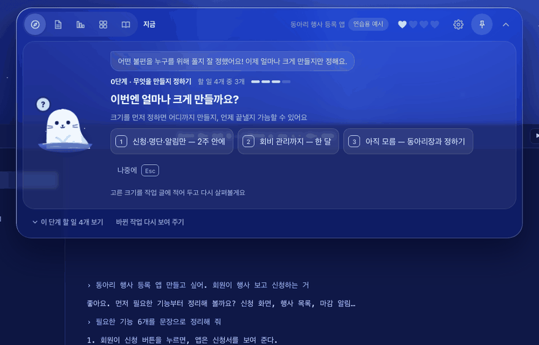
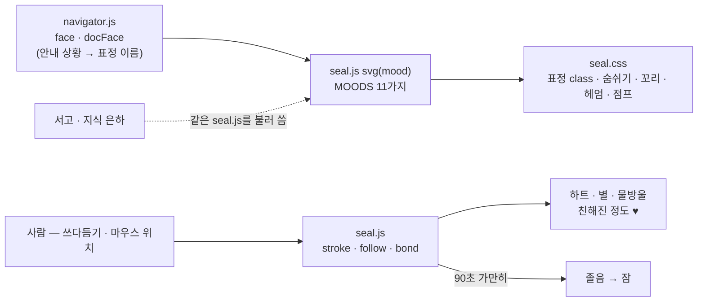
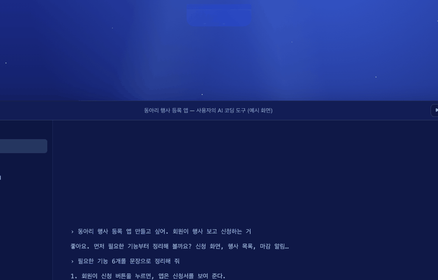
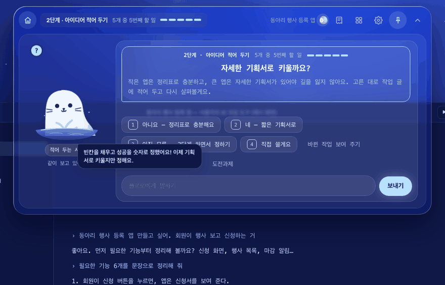

<!-- claude-drafted: 2026-10-18 — 이재엽의 요청으로 Claude가 마스코트 README, seal.js·seal.css 주석, 커밋 기록에서 옮겨 썼다. 그림·표정·움직임의 세부는 마스코트 README가 원천이라 여기 다시 적지 않는다. -->

# 08 길잡이 플로로 — 표정 · 움직임 · 교감 (워크플로우 밖, 보조)

> **낡음(2026-10-30):** <!-- claude-drafted: 2026-10-30 --> 접히기 전 테두리 빛은 2026-10-29 F-89로 뺐다. 켤 때 인사는 알약 안에서 하루 한 번(C-46), 켜면 바로 작업실 + 말풍선(C-55) — '켤 때마다'가 아니다. [기능 현황](../2026-10-30-기능-현황.md) C-10 · C-20.

## 무엇을 하나

플로로는 Floe의 **안내 캐릭터**다 — 지금 단계를 말해 주고, 기다리는 동안 곁을 지킨다. 요구(FR)가 아니라 **FR-13(쉬운 말·그림) 접근의 한 부분**이다: 표정이 안내 상황(살펴보는 중 · 다 했어요 · 생각 중 …)에 맞춰 바뀌어 글을 읽기 전에 상태가 보인다.

| | 원본 그림 | 화면 속 플로로 |
|---|---|---|
| 파일 | `02-frontend/assets/mascot/mascot-v1.webp` | `02-frontend/navigator/seal.js`(그림) · `seal.css`(색 · 표정 · 움직임) |
| 누가 | **이재엽** 제작 — 두승현이 제안한 스킬로 (두승현 정정 2026-11-04 — 2026-10-15에는 고한결로 적혀 있었다) | **두승현** — 코드로 그린 SVG — 목업 영상 속 물범을 보고 다시 그림 |
| 쓰는 곳 | **아직 화면에 쓰지 않는다** — 이용 조건 확인 전 | 내비게이터 · 서고 · 지식 은하 전부 |

## 왜 이렇게 만들었나

| 결정 | 내용 | 근거 |
|---|---|---|
| 이름은 **플로로**(Floro), 제품은 Floe | 합의 안건 | 이재엽 확정 2026-10-17, 이슈 #51 |
| 이용 조건 확인 전에는 **제출물에 원본 그림을 넣지 않는다** → 2026-10-29 이재엽 확인, 바로 사용 가능(결정 모음 B-09 · X-15) <!-- claude-drafted: 2026-10-30 --> | 그래서 GIF도 코드 플로로만 | 마스코트 README "아직 정해지지 않은 것", plan-confirm 5절 11번 |
| 표정은 다시 그리지 않고 class만 바꾼다 | 눈·입은 `m-*`, 상태는 머리 밖 작은 표시 `s-*` | `seal.js` 머리 주석 |
| 움직임 줄이기 설정을 존중 | `prefers-reduced-motion`이 켜진 사람에게는 움직이지 않는다 | 루트 README |
| 입체감은 Coucou의 Mochi와 같은 **방식**만 | MIT, 그림·코드는 우리 것 | `seal.js` 2026-10-17 주석 |

## 어떻게 돌아가나

앞의 여섯 표정(idle · happy · look · done · think · alert)은 **안내 화면**이 쓰고, 뒤의 다섯(love · purr · sleep · yawn · wow)은 **교감할 때** 잠깐 짓는다.

## 어떻게 진행됐나

| 날짜 | 일 | 누가 · 어디 |
|---|---|---|
| 10/14 | 프로토타입의 첫 길잡이는 치즈 고양이 '나비'(임시) | 두승현 · PR #41 |
| 10/15 | 길잡이를 **물범 '몽돌'** 로, PC 화면을 리퀴드 글래스로. 마스코트 원본 `mascot-v1` 올림(제작 이재엽) | 두승현 · PR #59, 이재엽 · PR #49 |
| 10/17 | 이름 확정 **플로로** — 프로토타입 화면도 같은 날 치환 | 이재엽 · 이슈 #51, PR #83 |
| 10/17 | 입체감(둥근 그늘 · 반짝임) · 고개 돌리기 → 움직임(꼬리 · 숨쉬기 · 지느러미 박수 · 헤엄 · 배로 통통) → 숨구멍을 물웅덩이로 → 어깨까지 물에 담그고 얼굴 내밀기 | 두승현 · PR #91 |
| 10/17 | 바뀐 플로로를 반영해 저장소 첫 화면과 마스코트 README를 새로 씀 | 두승현 · PR #92 |
| 10/18 | 서고로 물속 전환 — 책을 안은 플로로가 내려가고 서고에서 점프 | 이재엽 · PR #93 |

**2026-10-20 — 켤 때 인사(C-10, F-28):** 켤 때마다 띠의 물결 선이 그어지고(앱은 서버를 기다리는 동안도 — `electron/lib.js bootPage`), 섬이 인사 크기로 열리며,
플로로가 물속에서 솟아 옆으로 가 앞지느러미를 흔들고 시간대 인사말을 한 뒤 글과 단추가 나타난다 — 3.4초, 상한 5초(`greet.js` 시간표 · `app.css` `[data-greet]`).
누르거나 아무 키를 누르면 바로 끝난다. 주소 끝 장면 · 휴대폰 · 움직임 줄이기면 하지 않고, 처음 설정은 인사가 끝난 뒤 열린다. coucou(MIT)의 **순서**만 참고했고
그림 · 소리 · 코드는 가져오지 않았다. 시험 `greet.test.js`. <!-- claude-drafted: 2026-10-20 -->

**2026-10-20 — 섬의 움직임(C-14, F-34):** 섬이 접히고 펼쳐질 때(띠 ↔ 한 줄 ↔ 펼침) 모양을 순간적으로 갈아 끼우는 대신 **바탕 껍데기가 처음 상자에서 끝 상자로 늘어나고 줄어든다**(`morph.js` — FLIP, `transform` · `opacity`만, 펼치기 0.3초 살짝 튕김 · 접기 0.24초, 내용은 바탕이 60% 자란 뒤 나타남).
앱에서는 커질 때 창을 먼저 키우고 안에서 움직이며, 작아질 때는 움직임이 끝난 뒤 창을 줄인다(움직이는 동안 크기를 보내지 않는다 — F-24의 버벅임이 돌아오지 않게). 접힌 한 줄에 마우스를 올리면 **세로 +6 · 가로 +24px** 살짝 커져 "여기 있어요"를 알리고 떠나면 돌아온다 — 창은 바꾸지 않는다(접힌 창에 늘 그만큼 여유).
켤 때 인사 · 잠수 · 떠오름 · 움직임 줄이기 · 휴대폰에서는 하지 않는다. 시험 `morph.test.js`. 숫자는 넘김 문서의 [제안]이라 **앱에서 본 느낌으로 이재엽이 바꾼다**. <!-- claude-drafted: 2026-10-20 -->

## 2026-10-20 — 기준점 하나 · 접히기 설정과 테두리 빛 · 화난 플로로 (F-45 · F-46 · C-17 · C-20 · C-19)

| 무엇 | 내용 | 근거 |
|---|---|---|
| 기준점 하나(F-45 · C-17) | 창도 섬도 **섬의 위 가운데**를 붙든다 — 앱 안 섬을 창 가운데에 두고(`left:50%` + `translate`), 설정 창이 옆에 열릴 때만 왼쪽 고정. 모양이 바뀔 때 전 · 새 상자의 가운데를 맞추고, 커질 때는 창을 먼저 키운다. 하트 · 별 · 서고 말풍선의 가운데 맞춤은 `translate` 속성으로 분리(키프레임마다 -50%를 다시 적지 않는다). 시간 · 곡선 묶음 `--t-short/base/long` · `--ease-in/out/base` | 이재엽 "애니메이션 위치가 이상 … 기준을 잡아야" · 넘김 문서 motion 3절 |
| 랙(F-46) | 헤드리스 Chrome timeline으로 잰 숫자는 [고칠 목록](../../07-maintenance/fix-map.md) F-46. 고친 것: 말풍선 따라가기를 0.1초마다로, 경험치 막대를 `transform`으로, 띠로 접혔거나 창이 가려지면 물범 움직임 정지 | 넘김 문서 motion 2절 |
| 접히기까지 · 테두리 빛(C-20) | 설정 '접히기까지' **5 · 10 · 15 · 30 · 60초**(기본 15, 이 컴퓨터에 저장). 마우스가 나가면 아래 게이지바 대신 **테두리 빛**이 위 가운데에서 양쪽으로 내려가 아래에서 만나면 접힌다(같은 시계). 리퀴드 글래스 반짝임 정도의 흰빛, 움직임 줄이기면 은은하게 켜진 채. 한 줄 → 띠(30초)는 그대로 [제안] | 이재엽 버튼 "단추로 고르기" · "양옆으로 나눠 한 바퀴" |
| 화난 플로로(C-19) | 막을 때 표정 **angry**(치켜뜬 눈썹)와 왼쪽 지느러미의 **X 표지판**(`s-sign`, 네 번 흔듦 — 움직임 줄이기면 들고만). 언제 막나는 [12-feed](../12-feed/README.md) | 이재엽 "플로로 눈을 화난 눈으로 바꾸고 손에는 X모양 표지판" |

코드: [`seal.js`](../../../02-frontend/navigator/seal.js) `MOODS` angry · `SIGN`, [`seal.css`](../../../02-frontend/navigator/seal.css) `.m-angry` · 멈춤 규칙, [`app.js`](../../../02-frontend/navigator/app.js) `foldDelay` · `countdown`(`.glow`) · `morphFrom` · `refuse`, [`app.css`](../../../02-frontend/navigator/app.css) `.glow` · `.in-app .nav`. 시험 [`app-9.test.js`](../../../04-tests/navigator/app-9.test.js) · e2e "C-20" · "C-19". **앱에서 튀지 않는지 · 빛의 밝기 · 랙은 사람이.** <!-- claude-drafted: 2026-10-20 -->

## 코드 · 시험 · 담당

| | 어디 |
|---|---|
| 그림·교감 | [`02-frontend/navigator/seal.js`](../../../02-frontend/navigator/seal.js) · [`seal.css`](../../../02-frontend/navigator/seal.css) · 물속 전환 `dive.js` |
| 원본·설명 | [`02-frontend/assets/mascot/README.md`](../../../02-frontend/assets/mascot/README.md) — 색 이름 · 표정 11가지 · 움직임 · 고칠 때 규칙 |
| 시험 | 없음(그림·움직임) — 표정 이름은 `navigator.test.js`의 `face` 항목이 본다 |
| 담당 | 화면 속 플로로 **두승현** · 원본 그림 이재엽(후속: 투명 배경 · 표정) · 코드 두승현 · 이재엽 |

## 아직 아닌 것 · 미정

- ~~원본 그림의 **이용 조건**(제작자 확인) — 확인 전에는 제출물에 넣지 않는다(11/7 내부 제출 전).~~ → **닫음** — 이재엽 확인, 바로 사용 가능(2026-10-29, 결정 모음 B-09 · X-15) <!-- claude-drafted: 2026-10-30 -->
- 투명 배경 · 표정 변형 버전의 원본 그림은 아직 없다.
- 이 폴더의 GIF는 코드 플로로만 담았다.
