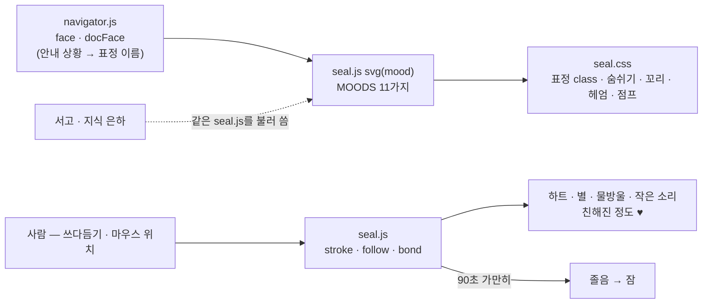

<!-- claude-drafted: 2026-10-18 — 이재엽의 요청으로 Claude가 마스코트 README, seal.js·seal.css 주석, 커밋 기록에서 옮겨 썼다. 그림·표정·움직임의 세부는 마스코트 README가 원천이라 여기 다시 적지 않는다. -->

# 08 길잡이 플로로 — 표정 · 움직임 · 교감 (워크플로우 밖, 보조)

## 무엇을 하나

플로로는 Floe의 **안내 캐릭터**다 — 지금 단계를 말해 주고, 기다리는 동안 곁을 지킨다. 요구(FR)가 아니라 **FR-13(쉬운 말·그림) 접근의 한 부분**이다: 표정이 안내 상황(살펴보는 중 · 다 했어요 · 생각 중 …)에 맞춰 바뀌어 글을 읽기 전에 상태가 보인다.

| | 원본 그림 | 화면 속 플로로 |
|---|---|---|
| 파일 | `02-frontend/assets/mascot/mascot-v1.webp` | `02-frontend/navigator/seal.js`(그림) · `seal.css`(색 · 표정 · 움직임) |
| 누가 | **고한결** 제작 (이재엽 확인 2026-10-15) | 코드로 그린 SVG — 목업 영상 속 물범을 보고 다시 그림 |
| 쓰는 곳 | **아직 화면에 쓰지 않는다** — 이용 조건 확인 전 | 내비게이터 · 서고 · 지식 은하 전부 |

## 왜 이렇게 만들었나

| 결정 | 내용 | 근거 |
|---|---|---|
| 이름은 **플로로**(Floro), 제품은 Floe | 합의 안건 | 이재엽 확정 2026-10-17, 이슈 #51 |
| 이용 조건 확인 전에는 **제출물에 원본 그림을 넣지 않는다** | 그래서 GIF도 코드 플로로만 | 마스코트 README "아직 정해지지 않은 것", plan-confirm 5절 11번 |
| 표정은 다시 그리지 않고 class만 바꾼다 | 눈·입은 `m-*`, 상태는 머리 밖 작은 표시 `s-*` | `seal.js` 머리 주석 |
| 움직임 줄이기 설정을 존중 | `prefers-reduced-motion`이 켜진 사람에게는 움직이지 않는다 | 루트 README |
| 입체감은 Coucou의 Mochi와 같은 **방식**만 | MIT, 그림·코드는 우리 것 | `seal.js` 2026-10-17 주석 |

## 어떻게 돌아가나

앞의 여섯 표정(idle · happy · look · done · think · alert)은 **안내 화면**이 쓰고, 뒤의 다섯(love · purr · sleep · yawn · wow)은 **교감할 때** 잠깐 짓는다.

## 어떻게 진행됐나

| 날짜 | 일 | 누가 · 어디 |
|---|---|---|
| 10/14 | 프로토타입의 첫 길잡이는 치즈 고양이 '나비'(임시) | 두승현 · PR #41 |
| 10/15 | 길잡이를 **물범 '몽돌'** 로, PC 화면을 리퀴드 글래스로. 마스코트 원본 `mascot-v1` 올림(제작 고한결) | 두승현 · PR #59, 이재엽 · PR #49 |
| 10/17 | 이름 확정 **플로로** — 프로토타입 화면도 같은 날 치환 | 이재엽 · 이슈 #51, PR #83 |
| 10/17 | 입체감(둥근 그늘 · 반짝임) · 고개 돌리기 → 움직임(꼬리 · 숨쉬기 · 지느러미 박수 · 헤엄 · 배로 통통) → 숨구멍을 물웅덩이로 → 어깨까지 물에 담그고 얼굴 내밀기 | 두승현 · PR #91 |
| 10/17 | 바뀐 플로로를 반영해 저장소 첫 화면과 마스코트 README를 새로 씀 | 두승현 · PR #92 |
| 10/18 | 서고로 물속 전환 — 책을 안은 플로로가 내려가고 서고에서 점프 | 이재엽 · PR #93 |

## 코드 · 시험 · 담당

| | 어디 |
|---|---|
| 그림·교감 | [`02-frontend/navigator/seal.js`](../../../02-frontend/navigator/seal.js) · [`seal.css`](../../../02-frontend/navigator/seal.css) · 물속 전환 `dive.js` |
| 원본·설명 | [`02-frontend/assets/mascot/README.md`](../../../02-frontend/assets/mascot/README.md) — 색 이름 · 표정 11가지 · 움직임 · 고칠 때 규칙 |
| 시험 | 없음(그림·움직임) — 표정 이름은 `navigator.test.js`의 `face` 항목이 본다 |
| 담당 | 캐릭터 **고한결**(#13 후속: 투명 배경 · 표정) · 코드 두승현 · 이재엽 |

## 아직 아닌 것 · 미정

- 원본 그림의 **이용 조건**(고한결 확인) — 확인 전에는 제출물에 넣지 않는다(11/7 내부 제출 전).
- 투명 배경 · 표정 변형 버전의 원본 그림은 아직 없다.
- 이 폴더의 GIF는 코드 플로로만 담았다.
