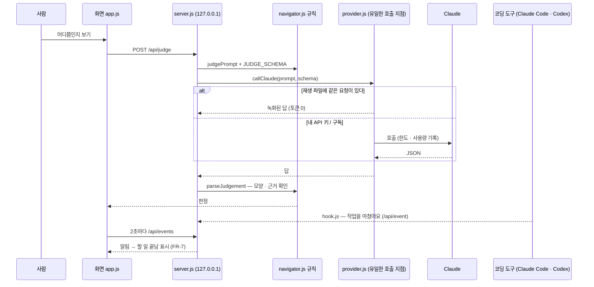
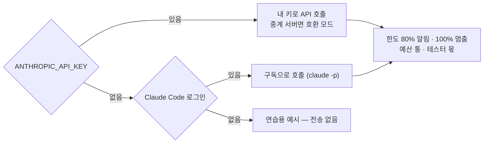

<!-- claude-drafted: 2026-10-18 — 이재엽의 요청으로 Claude가 ADR-0002·0003·0009, provider.js·hook.js·connect.js·server.js 머리 주석, backend navigator README, rules-review 6절, 커밋 기록에서 옮겨 썼다. 틀린 곳은 담당이 고친다. -->

# 09 AI 연결 — 각자 키/구독, 판정은 코드, 녹화·재생, 코딩 도구 알림 (FR-7 · FR-10 · ADR-0003 · 0009)

GIF는 없다 — 이 기능은 화면보다 **뒤에서 지키는 규칙**이다. 켜는 법은 [backend navigator README](../../../03-backend/navigator/README.md).

## 무엇을 하나

| 일 | 어떻게 |
|---|---|
| **누구의 AI로 부르나** | 내 API 키(`ANTHROPIC_API_KEY`) → 없으면 이 컴퓨터에 로그인된 Claude Code(구독, `claude -p`) → 둘 다 없으면 **연습용 예시**(미리 만든 응답, 전송 없음) |
| **외부 호출은 한 곳** | `provider.js`에서만. 키는 로그 · 오류 · 화면 어디에도 싣지 않는다. 시험이 확인한다 |
| **판정은 코드** | 몇 단계인지 · 넘어갈 수 있는지는 `navigator.js` 규칙. AI 답은 정해진 모양(스키마)이 아니면 쓰지 않는다 |
| **한도** | 토큰 한도 80%에서 알리고 100%에서 멈춤. 예산 통(dev 40만 · test 20만 · demo 20만 · reserve 20만), 테스터마다 몫 |
| **녹화·재생** | 진짜 AI 답을 한 번 녹화(`record-demo.js`) → 시연 · 리허설은 토큰 0으로 재생(`NAV_REPLAY`). 요청 글자가 같을 때만 |
| **코딩 도구 알림(FR-7)** | Claude Code · Codex 훅(`hook.js`)이 작업을 마치면 127.0.0.1 서버로 알리고, 화면은 2초마다 `/api/events`를 본다. 알림만으로 AI에 보내지 않는다 |
| **중계 서버** | 코디세이 가상 키는 `ANTHROPIC_BASE_URL` → 호환 모드 자동(JSON만), 받는 모델 `claude-opus-4-8` · `4-7` |

| 요구·결정 | 내용 | 등급·상태 |
|---|---|---|
| FR-10 | 대회 시연은 **서버·도메인 없이** 가상 데이터와 미리 만든 응답으로 | Must — 전제 |
| FR-7 | Claude에서 작업하면 **알림으로 기록**하고 할 일을 끝났다고 표시 | Could — 시연은 시뮬레이션, 실제 연동은 후속 |
| [ADR-0002](../../03-pattern-analysis/adr/0002-demo-structure.md) | 서버 없이 도는 화면 + 실제 Claude 호출은 **한 경로만** | Accepted 2026-10-17 |
| [ADR-0003](../../03-pattern-analysis/adr/0003-ai-boundary-and-judgement.md) | 게이트 판정은 코드 규칙, Claude 호출은 한 모듈 | Accepted 2026-10-17 |
| [ADR-0009](../../03-pattern-analysis/adr/0009-ai-provider-subscription-first.md) | 기본은 사용자 본인의 Claude 구독 — Claude만 구매한 사람도 쓴다. 남의 컴퓨터를 대신해 우리 키로 호출하지 않는다 | Accepted 2026-10-17 |

## 왜 이렇게 만들었나

| 결정 | 근거 |
|---|---|
| 판정을 프롬프트에 맡기지 않는다 | 같은 입력에 다른 답이 나오면 시험할 수 없고(#17 · #19), "API를 그대로 쓴 것"으로 보인다(기획 20점) — ADR-0003 |
| 각자 자기 키·구독 | 키나 로그인은 저장소에 없다. 한도·사용량도 각자 것. 구독 토큰을 저장 · 전송 · 중계하지 않는다 — ADR-0009, 이재엽 2026-10-17 "각자의 토큰을 사용할 수 있도록" |
| 서버는 127.0.0.1에서만 | 다른 웹페이지가 내 구독으로 Claude를 부르지 못하게 — ADR-0009 |
| 녹화·재생 | 대회 장소에서 네트워크가 불안할 때의 백업이자 토큰 절약 — backend README |
| 안전장치 S1~S6은 **필수** | 시연에서 실제 대화를 보이려면 개인 대화가 화면에 나오지 않아야 한다 — 이재엽 결정 2026-10-15, [판정 규칙 검토](../../00-overview/navigator-prototype-rules-review.md) 6절 |

## 어떻게 돌아가나

## 어떻게 진행됐나

| 날짜 | 일 | 누가 · 어디 |
|---|---|---|
| 10/14 | Claude Code 훅 연결 — 작업을 알아채고 조언 → Codex 연결 · 기록 저장 | 두승현 · PR #41 |
| 10/15 | ADR 0002 · 0003 초안(Proposed) — 시연 구조, AI 호출 경계 | 이재엽 · PR #45 |
| 10/15 | 안전장치 S1~S6 필수 결정 | 이재엽 · rules-review 6절 |
| 10/17 | **각자 자기 API 키**로 호출 — 공급자 분리, 토큰 한도 | 이재엽 · PR #74 |
| 10/17 | 코디세이 중계 서버(가상 키) 호환 모드 · 받는 모델 opus-4-8 · 4-7 | 이재엽 · PR #75 · #85 |
| 10/17 | 실제 AI 판정 점검 `live-check.js` · `--report`(검증 기록 파일) | 이재엽 · PR #76 · #78 |
| 10/17 | 예산 통 · 테스터 몫 · 예비 잠금 · 시연 녹화·재생 · 사용량 보기 | 이재엽 · PR #77 |
| 10/17 | ADR 0002~0006 · 0008 채택, **ADR-0009(구독 기본)** 추가 | 이재엽 · PR #80 |
| 10/17 | 팀 작업 가이드 — 내 키는 어디에 두고 작업은 어디에 올리나 | 이재엽 · PR #74 |
| 10/18 | 전원이 코디세이 키로 진짜 AI 켜 보기(각자 10분) | 모두 · 이슈 #79 |

## 코드 · 시험 · 담당

| | 어디 |
|---|---|
| 호출 | [`03-backend/navigator/provider.js`](../../../03-backend/navigator/provider.js) — 순서 · 호환 모드 · 한도 · 예산 통 |
| 서버 | `server.js`(127.0.0.1:4317, `/api/judge · draft · review · answer · events · usage`) · `smoke.js`(작은 호출 1번) |
| 녹화·점검 | `record-demo.js` · `recording.js` · `live-check.js` · `usage.js` |
| 코딩 도구 | `hook.js`(훅 → 서버) · `connect.js`(훅을 더하고 빼기, 백업) |
| 시험 | `04-tests/navigator/` — provider 43 · live-check 12 · record-demo 3 · usage 3 (= 61), `navigator.test.js`가 "외부 호출은 provider.js 한 곳"을 확인 |
| 담당 | **이재엽 #7(프롬프트 · API 계약 10/25) · #8(API 구현·연동 11/1)** · 계약 테스트 두승현 #19(11/1) |
| 문서 | [backend navigator README](../../../03-backend/navigator/README.md) · [팀 작업 가이드](../../00-overview/team-guide.md) · [다른 API를 받으면](../../04-pattern-implementation/api-intake.md) |

## 아직 아닌 것 · 미정

- **API 계약**(#7)과 **계약 테스트**(#19)는 아직이다 — `/api/*`의 요청·응답 모양은 코드에만 있다.
- FR-7 실제 연동은 후속 — 시연은 버튼 하나로 흉내 낸다(Could).
- 안전장치 S1~S6 중 무엇이 코드로 들어갔는지는 두승현이 #7·#15에서 확인한다(점검표의 "위반 시도 시험"이 기준).
- 이 저장소는 키를 담지 않는다. `.env`는 `.gitignore`와 `check-secrets.sh`가 막는다.
