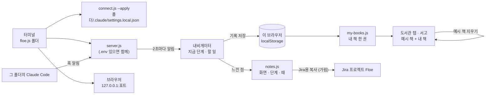

<!-- claude-drafted: 2026-10-19 — 이재엽의 결정(2026-10-18 "화면에서만 실행해서 보이는게 아니라 실질적으로 테스트를 진행할 수 있도록 하고 우리가 사용하면서 느끼고 싶어")으로 Claude가 만들고 썼다. 내용은 requirements.md 13-1, roadmap-demo-to-beta.md 4절, 코드 머리 주석에서 옮겼다. 틀린 곳은 담당이 고친다. -->

# 10 실제로 써 보기 — 한 줄로 켜기 · 내 책 · 예시 책 지우기 · 느낀 점 (v2.0)

> **2026-10-19 바뀜(이재엽):** 서재의 '내 배움' · 역량 지도를 지웠고(`learn.js` · `skills.js`), 지식 은하는 길을 막아 두었다(파일은 남김), 나만 보기(FR-9)는 Won't. 아래에서 그것들을 말하는 줄은 바뀌기 전 기록이다 — [requirements.md](../../00-overview/requirements.md) 13-1, [고칠 목록](../../07-maintenance/fix-map.md) F-25. GIF는 다시 찍기 전이다.

GIF는 아직 없다 — 이 기능은 **내 프로젝트 폴더와 내 Claude Code**가 있어야 보이는 것이라, 파일로 연 연습 화면으로는 찍히지 않는다. 사람이 써 본 뒤 화면을 찍어 넣는다.

## 무엇을 하나

시연 장면(연습 예시 · 가상 데이터)이 아니라 **팀원이 지금 Claude Code로 만드는 자기 프로젝트**에 Floe를 붙여 쓰고, 쓰다가 느낀 것을 그 자리에서 남긴다. 느낀 점은 Jira 프로젝트 Floe로 모인다.

| 조각 | 무엇 | 어디 |
|---|---|---|
| **한 줄로 켜기** | `node 03-backend/navigator/floe.js <폴더>` — 훅 연결(`connect.js --apply`) → 서버(`.env`가 있으면 함께) → 브라우저. `--off`로 훅 해제 | 터미널 |
| **오버레이 앱** (v3.0) | 같은 화면 · 서버를 **항상 위에 뜨는 창**으로 감싼 실행 파일 — `Floe-<버전>-arm64.dmg`(Mac), `.exe`(Windows), `.AppImage` · `.deb`(우분투 Linux, v6.0) — 셋 다 CI가 Release에 올린다. 메뉴에서 폴더 연결 · `.env` 폴더 | [`02-frontend/electron/`](../../../02-frontend/electron/README.md), [팀 가이드 2-c](../../00-overview/team-guide.md) |
| **내 책** | 열어 둔 책에 **이 화면의 프로젝트**가 한 권으로 — 지금 단계 · 할 일 · 확정한 설계도 · 배운 말 · 지나온 단계. 마감은 없다 | 오버레이 도서관 탭 · 서고 |
| **예시 책 지우기 / 다시 보기** | 처음에는 예시 책(꼬리표 '예시')과 내 책이 같이 보이고, 누르면 예시 책 · 레퍼런스 · 물어볼 것 · 캘린더가 비고 '오늘'이 실제 날짜가 된다 | 도서관 탭 아래 · 서고 오른쪽 위 |
| **느낀 점 남기기** | 한 줄 적으면 어느 화면 · 몇 단계 · 어느 탭 · 연습/진짜 AI · 때가 저절로 붙는다. 이 컴퓨터에만 남는다 | 톱니(설정) → 느낀 점 |
| **Jira용 복사** | 느낀 점을 시간 순 글머리표 글로 클립보드에 — 비밀값 · 이메일 · 전화 모양은 공유 규칙으로 가린다. 붙이는 건 사람 | 같은 자리 |

## 왜 이렇게 만들었나

| 결정 | 내용 | 근거 |
|---|---|---|
| 세 단계를 한 줄로 | 훅 · 서버 · 브라우저가 따로여서 "써 보자"의 문턱이 높았다. `floe.js`는 켜기만 하고 AI는 부르지 않는다(외부 호출은 `provider.js` 하나 — 시험) | 2026-10-18 결정, ADR-0003 · code.md 6번 |
| 예시 책을 바로 버리지 않는다 | "예시 책들로 처음에 실사용 테스트 이후에 예시책 지우기 예" → 같이 보이다가 단추로 숨긴다 **[해석]** | requirements.md 13-1 (2026-10-18) |
| 내 책은 저장된 기록이 아니라 **지금 상태**에서 | 오버레이는 자기 상태(`st`)로 그때그때 만들고, 서고는 같은 브라우저 기록(localStorage, `learn.js`와 같은 열쇠)에서 읽는다 | 같은 기록을 두 곳이 읽는 F-05 방식 그대로 |
| 연습 모드에서 예시가 보일 때는 옛 동작 | 첫 예시 책(s1)이 이 화면을 따른다 — 시연 장면 · GIF · 수용 테스트가 그대로 돈다 | FR-10 시연 보호 |
| 느낀 점은 밖으로 나가는 길이 하나 | 저장은 이 브라우저, 나가는 건 'Jira용 복사'만 — 그때 가린다 | security-records.md 3절 |

## 어떻게 돌아가나

## 어떻게 진행됐나

| 날짜 | 일 | 누가 · 어디 |
|---|---|---|
| 10/16 | 베타 이정표 — M3 알파 "팀 안 5명 안팎이 실제 일에 써 봄" | 이재엽 · roadmap-demo-to-beta.md |
| 10/18 | "실질적으로 테스트 … 사용하면서 느끼고 싶어" 결정 · 예시 책은 처음엔 같이, 뒤에 지우기 | 이재엽 · requirements.md 13-1 |
| 10/18 | 무엇이 진짜로 돌고 무엇이 가짜인지 확인 — 오버레이는 실제 프로젝트에서 이미 동작, 서재는 전부 예시, 빈 책장에서 깨지는 곳 셋 | Claude(계획만, 코드 전) |
| 10/19 | 구현 — `floe.js` · `my-books.js` · `notes.js`, 화면 연결, 빈 책장 · 마감 없는 책 보호, 시험 24개, 문서 | 이재엽 요청 · Claude 초안 · **v2.0** |

## 코드 · 시험 · 담당

| | 어디 |
|---|---|
| 켜기 | `03-backend/navigator/floe.js` — `parseArgs` · `serverArgs` · `openCommand` · `summary` |
| 내 책 · 숨김 | `02-frontend/library/my-books.js` — `fromState` · `apply` · `readHidden/writeHidden`. 화면은 `app.js`(`openBooks` · `exToggle`) · `library.js`(머리 표시 · `ex-toggle`) |
| 느낀 점 | `02-frontend/navigator/notes.js` — `add` · `where` · `toJira`. 화면은 `app.js`(`notesCard`) |
| 보호 | `schedule.js` `findClashes`(마감 없는 책 건너뜀), `library.js` `openReview`(책 없음) |
| 시험 | `04-tests/navigator/floe.test.js`(임시 폴더에 진짜로 켠다, AI 호출 없음) · `notes.test.js` · `04-tests/library/my-books.test.js` · `e2e/responsive.test.js`의 `&noex` 장면 |
| 담당 | 켜기 · 내 책 이재엽 · 화면 임유정(버전 기록이 알림) · 느낀 점 모으기 두승현 |
| 쓰는 법 | [팀 작업 가이드](../../00-overview/team-guide.md) 2-b절 |

## 아직 아닌 것 · 미정

- **사람이 써 본 기록이 없다.** 시험은 통과했지만 팀원이 자기 프로젝트에 붙여 본 것은 아직이다 — 첫 느낀 점이 Jira에 모이면 이 줄을 고친다.
- 지식 은하(`sky.html`)는 아직 더미 그대로다. 내 책이 끝나 엮인 뒤 하늘에 별로 보이는 것은 베타 범위.
- 내 책을 엮어 책장에 꽂은 뒤 새 프로젝트를 시작하면, 꽂힌 책과 새 내 책이 둘 다 보인다(기록이 하나라 이름은 같다). 프로젝트가 여러 개일 때의 기록 구조는 미정(ADR-0004).
- 느낀 점을 Jira로 **자동으로** 보내지 않는다 — 복사해 붙인다. Atlassian MCP를 들이면 세션에서 바로 이슈를 만들 수 있다(external-tools.md 후보, 판정 대기).
