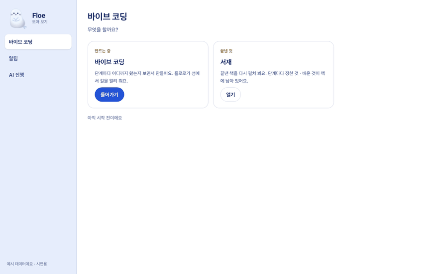
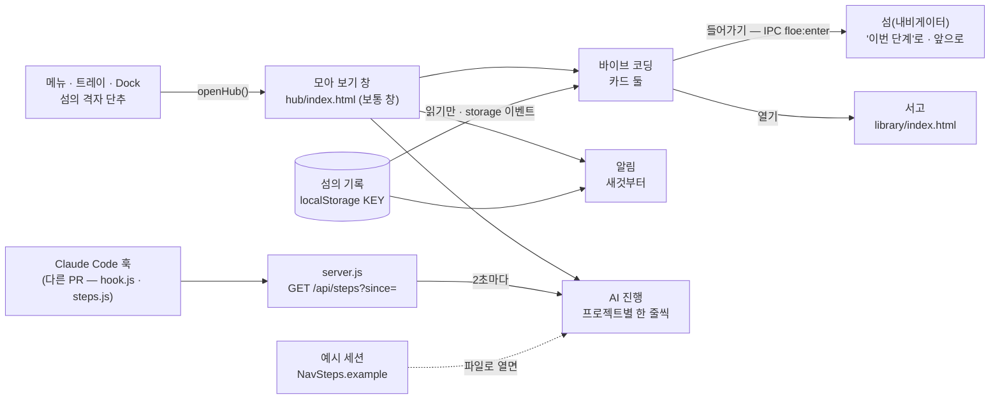
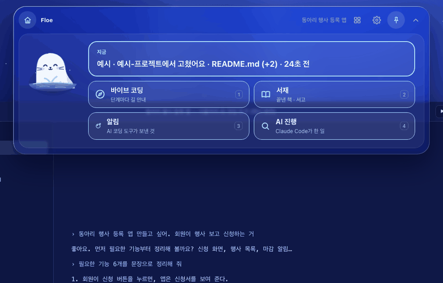

<!-- claude-drafted: 2026-10-20 — 이재엽의 요청("이 바이브 코딩을 선택해서 들어오는 공간 알람을 보는 공간 / 우리 AI가 진행하면 보이는 공간" + 버튼 "따로 창 하나" · "할 일 종류 고르기" · "Claude Code의 일 — 바이브 코딩이 아니야")으로 Claude가 만들고 썼다. 내용은 requirements.md 2-2의 C-11 · C-12, 페이블 넘김 문서 4 · 5절, 코드 머리 주석에서 옮겼다. 틀린 곳은 담당이 고친다. -->

# 11 모아 보기 창 — 바이브 코딩 고르기 · 알림 · AI 진행 (C-11 · C-12 화면)

<!-- claude-drafted: 2026-10-23 -->
> **2026-10-23 뺐다** — 이재엽 "퀘스트도 지우고 브라우저 창도 켜지는거 지워줘 그리고 브라우저 나오는건 기능자체를 빼줘". 따로 뜨는 창(`hub/index.html` · `hub.css`), 여는 길(메뉴 · 트레이 · Dock · 섬의 격자 단추 · 판의 '크게 보기' · 브라우저의 새 탭), 바이브 코딩 '들어가기'(IPC `floe:enter`)를 모두 지웠다. 알림 · AI 진행은 섬 안의 판(C-13 기본 화면의 판)에 남고, `hub.js`에는 그 판이 쓰는 순수 함수만 있다. 아래는 만들 때의 기록이다.

## 무엇을 하나

섬(내비게이터)은 그대로 코딩 도구 위에 떠 있고, **따로 보통 창 하나**가 더 있다. 왼쪽에 세 공간, 오른쪽에 고른 공간. 서버 없이 파일로 열어도 돌아간다(FR-10).

| 공간 | 무엇 | 어디서 읽나 |
|---|---|---|
| **바이브 코딩** | "무엇을 할까요?" — 할 일 종류 카드 둘. **바이브 코딩**(들어가기 → 섬의 '이번 단계') · **서재**(열기 → 서고). 아래 한 줄에 지금 단계 · 연결한 프로젝트, 없으면 "아직 시작 전이에요" | 섬의 기록(`localStorage` 열쇠 `KEY`)을 **읽기만** |
| **알림** | AI 코딩 도구가 보낸 알림(FR-7)을 새것부터 — 때 · 도구 · 한 줄 · 끝낸 할 일. 비밀값 모양이면 "비밀값 모양이라 숨겼어요". 왼쪽 칸에 읽지 않은 수 | 같은 기록의 `alerts`(`alerts.js`가 만든 모양 그대로). 섬이 기록을 바꾸면 `storage` 이벤트로 바로 다시 그린다 |
| **AI 진행** (C-12) | Claude Code가 한 일을 **한 줄씩** 프로젝트(세션)별로 — 머리에 프로젝트 · 상태(일하는 중 · 마쳤어요) · 마지막 시각, 아래에 줄(읽었어요 · 고쳤어요 `+N −M` · 실행했어요 …). 새것이 아래, 최근 50줄. **판정 · 단계 · 토큰을 부르지도 보이지도 않는다** | 서버로 열렸으면 `GET /api/steps?since=`를 2초마다. 파일로 열렸거나 서버가 거절하면 예시 세션 + "예시 데이터예요 · 시연용". 줄 글 모듈(`steps.js`의 `NavSteps`)이 아직 없으면 "아직 준비 중이에요" |

여는 길(앱): 메뉴 **Floe → 모아 보기 열기**, 트레이 클릭, Mac Dock 클릭, 섬 위쪽 줄의 격자 단추. 브라우저로 연 섬에서는 같은 단추가 새 탭으로 연다. 주소 끝 `#vibe`(기본) · `#alerts` · `#ai`로 공간을 바로 연다(시험 · 녹화용).

## 왜 이렇게 만들었나

| 결정 | 내용 | 근거 |
|---|---|---|
| 섬과 따로, 보통 창 하나 | 섬은 작게 코딩 도구 위에 떠야 하고, 알림 기록 · 할 일 고르기는 넓은 자리가 필요하다. 테두리 있는 창 · 항상 위 아님 · Dock에 앉음 · 하나만(이미 열려 있으면 앞으로) · 닫아도 섬 · 서버는 그대로 | 이재엽 버튼 "따로 창 하나"(2026-10-20), coucou 0.4의 자기 창 참고 |
| 바이브 코딩 공간은 할 일 종류 고르기 | 카드 둘(바이브 코딩 · 서재)뿐. 지식 은하는 길을 막아 두어 넣지 않는다 | 이재엽 버튼 "할 일 종류 고르기", 2026-10-19 지식 은하 보류 |
| AI 진행은 바이브 코딩이 아니다 | 지켜보기 전용 — 승인 · diff 내용 · 지시 보내기는 C-4에 남긴다. 파일 내용 · 고친 글 · 명령 결과는 받지 않는다(이름 · 첫 줄 · 줄 수만) | 이재엽 "이건 바이브 코딩이 아니야", C-12 |
| 기록은 섬의 것을 읽기만 | 저장 열쇠 `navigator-prototype:v1`은 섬 · 서고 · 이 창이 같이 쓴다 — 이 창은 쓰지 않는다. 열쇠가 같은지 시험이 맞대어 본다 | 서고의 `my-books.js` 전례, 넘김 문서 10절 함정 |
| 읽지 않은 수는 이 창의 `sessionStorage` | 이 창이 열린 뒤(또는 알림 공간을 마지막으로 본 뒤) 새로 온 알림만 센다 — 섬의 기록에 "읽음"을 쓰지 않으려고 | 읽기만 원칙 |
| 서버 없이도 같은 화면 | 파일로 열면 알림은 이 브라우저의 섬 기록, AI 진행은 예시 세션 | FR-10 |
| 이름은 '모아 보기' | '허브' 같은 외래어 대신. FR-6 '한곳에서 보기'와 헷갈리면 바꾼다 | FR-13, 넘김 문서 9절 1번 기본값 |
| 크기 900×600, 최소 480×420 | 작업 영역보다 크면 줄이고 가운데. 켜 있는 동안 지난 크기 · 자리를 기억한다. 휴대폰 폭(390px)에서는 왼쪽 칸이 위로 접혀 탭 줄이 된다 | 넘김 문서 4절 [제안] |

## 어떻게 돌아가나

## 어떻게 진행됐나

| 날짜 | 일 | 누가 · 어디 |
|---|---|---|
| 10/20 | "기능을 사용하기 전의 상태 … 바이브 코딩을 선택해서 들어오는 공간 · 알람을 보는 공간 · AI가 진행하면 보이는 공간" + 버튼 답 셋 | 이재엽 · requirements.md 13-1, C-10~C-12 |
| 10/20 | 페이블 넘김 문서 — 화면 [제안] · 창 · 여는 길 · 시험 표 | Claude(계획) |
| 10/20 | 시험 먼저(`hub.test.js` · `electron-hub.test.js` · e2e 장면 셋) → 화면 `02-frontend/hub/` · 앱 창(`openHub` · IPC 둘 · 메뉴 · 트레이 · Dock) · 섬의 단추 · 서버 목록 | 이재엽 요청 · Claude 초안(격리 worktree, 브랜치 `v2/agent-hub`) |

## 코드 · 시험 · 담당

| | 어디 |
|---|---|
| 화면 | `02-frontend/hub/index.html` · `hub.css` · `hub.js` — 순수 함수(`alertLine` · `unread` · `nowLine` · `mergeSessions` · `aiHTML`)는 `window.FloeHub`로, Node에서는 `require` |
| 앱 창 | `02-frontend/electron/main.js` `openHub` · `floe:open-hub` · `floe:enter`, `preload.js` `openHub` · `enter` · `onEnter`, `lib.js` `hubBounds` |
| 섬의 단추 · 신호 받기 | `02-frontend/navigator/app.js` — 위쪽 줄 `data-act="hub"`(격자 아이콘 `I.grid`), 파일 끝 `onEnter` → '이번 단계' |
| 서버 목록 | `03-backend/navigator/server.js` `STATIC`의 `02-frontend/hub` · `steps.js` |
| AI 진행의 뒤쪽 | `03-backend/navigator/hook.js` · `server.js` `/api/steps` · `steps.js` — **다른 PR**. merge 전에는 `steps.js`가 자리표시(`NavSteps = null`)라 화면에 "아직 준비 중이에요" |
| 시험 | `04-tests/navigator/hub.test.js`(공간 셋 · 카드 둘 · 열쇠 맞대기 · 알림 줄 · 빈 상태 · 판정 안 부름 · NavSteps 없음) · `electron-hub.test.js`(창 · 여는 길 넷 · IPC · preload · `hubBounds`) · `static-files.test.js` · `e2e/responsive.test.js`(`hub/index.html` · `#alerts` · `#ai` — 390px 가로 스크롤 없음, axe 0) |
| 담당 | 이재엽(요청 · 앱) · 화면 임유정(버전 기록이 알림) |

## 섬의 기본 화면 — 같은 것을 섬 안에서 바로 (C-13, 2026-10-20)

이재엽(2026-10-20): "우리 알람이나 작업들을 보여주는 공간이 저렇게 버튼식으로 준비가 되어있는 공간이 기본값이면 좋겠어" + 버튼 "섬 안에서 바로". 그래서 섬(내비게이터)은 켜면 늘 **기본 화면**이다 —
플로로와 **지금 한 줄**(알림과 AI가 한 일 중 더 최근 것, 없으면 인사), 단추 넷 **바이브 코딩 · 서재 · 알림 · AI 진행**(1~4 키). 알림 · AI 진행을 누르면 그 판이 섬 안에서 펼쳐지고(왼쪽 플로로 · 프로젝트 · 도구 · 한 일의 종류별 수, 오른쪽 목록 — 이 창의 순수 함수 `alertsHTML` · `aiHTML`을 그대로 써서 **같은 말 · 같은 기록**),
**크게 보기**가 이 창을 그 칸(`#alerts` · `#ai`)으로 연다. 바이브 코딩 단추를 누르면 **바이브 코딩 모드**(이번 단계 · 설계도 · 단계 지도 · 도서관)로 바뀌고, 섬이 접혔다 펼쳐지거나 서고에 다녀와도 그대로다 — 위쪽 줄 맨 왼쪽의 **집** 단추로 기본 화면에 돌아온다. 앱을 다시 켜면 늘 기본 화면(이 창에만 기억 — `sessionStorage`).
규칙은 `navigator.js` `nextPlace`(접힘 `nextView`와 따로), 화면은 `app.js` `baseBody` · `basePane`, 시험 `04-tests/navigator/modes.test.js`. 주소 끝 `#base` · `#base&pane=alerts` · `#base&pane=ai`로 바로 연다(녹화 · e2e). 이 창의 화면 코드는 왼쪽 칸(`[data-space]`)이 있는 페이지에서만 돌아 섬에서는 순수 함수만 쓰인다. <!-- claude-drafted: 2026-10-20 -->

## 아직 아닌 것 · 미정

- **사람이 앱에서 켜 보지 않았다** — 메뉴 · 트레이 · Dock · 섬 단추로 열리는지, 닫아도 섬이 남는지, '들어가기'가 섬의 '이번 단계'로 가는지는 묶은 앱에서 확인해야 한다(넘김 문서 8절). 브라우저(파일)로는 세 공간 · 들어가기 · 서재 열기 · 알림 · 예시 AI 진행을 자동으로 봤다.
- AI 진행의 진짜 줄은 훅 · `/api/steps` · `steps.js`(다른 PR)가 들어와야 보인다. Codex가 같은 모양으로 오는지는 미정.
- 기본 화면(C-13)의 등급은 미정이다. 켤 때 인사가 끝나면 인사 카드(보여 주기 / 이어서 하기) 대신 기본 화면이 된다 — '보여 주기'(연습 예시)는 바이브 코딩 모드 안에 있다.
- '알림 기록 비우기'는 섬의 설정에만 있다(넘김 문서 9절 7번 기본값). 켤 때 이 창을 같이 열지 않는다(9절 2번).
- 창 자리는 앱이 켜져 있는 동안만 기억한다(끄면 다시 가운데).
