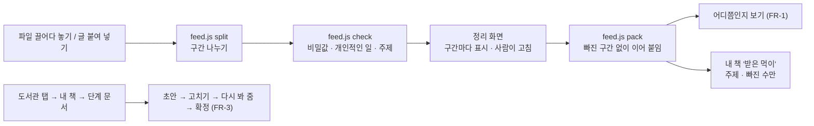

<!-- claude-drafted: 2026-10-20 — 이재엽의 요청("설계도는 너무 어려운 말 같아 … 파일을 오버레이에 주면 설계도 받는 화면이 나와서 … 분석을 시작하는거야 … 기능을 한곳에 통합시켜줘")과 버튼 답으로 Claude가 만들고 썼다. 내용은 requirements.md 2-2의 C-15 · C-16, 넘김 문서 fable-handoff-2026-10-20-feed.md, 코드 머리 주석에서 옮겼다. 틀린 곳은 담당이 고친다. -->

# 12 플로로에게 먹이 주기 — 받기 · 나누기 · 확인 · 정리를 한곳에서, 단계 문서는 책 안에서 (C-15 · C-16)

## 무엇을 하나

처음 카드가 **먹이 주기**다. 글 파일(`.md` · `.txt`, 1MB 아래)을 섬(띠 · 한 줄 · 펼침 어디든)에 끌어다 놓거나 글을 붙여 넣으면 플로로가 **구간으로 나누어** 주제를 보이고, 구간마다 표시한다 —
**"이건 못 먹어요 — 비밀번호 같아요"**(비밀값 모양), **"이건 안 먹을게요 — 개인적인 일 같아요"**(이메일 · 전화번호 · 흔한 말), **"먹어요"**. 사람이 구간마다 '빼 주세요 / 먹어도 돼요'로 고친 뒤 **확인**하면 빠진 구간 없이 이어 붙인 글로 어디쯤인지 본다(FR-1).
정리(주제 · 빠진 수 · 까닭 — **글은 없다**)는 도서관의 내 책에 '받은 먹이'로 남는다. 서버 없이 열면(FR-10) '예시 먹이 주기'로 같은 흐름을 보인다 — 구간 셋(주제 · 개인적인 일 · 비밀번호 모양의 자리표시).

**단계 문서는 책 안에서(C-16).** '설계도' 탭을 없앴다 — 단계마다 만드는 문서(아이디어 정리표 · 꼭 필요한 기능 목록 · 방법을 고른 기록 · 작은 할 일 목록)는 도서관 탭의 내 책에 들어가 **단계 문서**에서 하나를 고르면 그 자리에서 초안 받기 → 고치기 → 다시 봐 주세요 → 확정(FR-3 그대로 — 확정은 사람만, 빈칸이 남으면 한 번 더 묻기). 이번 단계 카드의 '살피기' 길과 옛 주소 `#ex=1&tab=doc`은 그 책의 그 단계 문서를 연다. 화면 글에서 '설계도'라는 말은 뺐다(FR-13).

| 요구 | 문장 요지 | 등급 |
|---|---|---|
| C-15 | 파일 · 붙여 넣기를 한 화면에서 받아 구간으로 나누고, 비밀값 · 개인적인 일 구간은 AI에게 보내지 않고 '빠짐'으로, 확인하면 책에 꽂고 FR-1 · FR-3이 빠지지 않은 구간을 쓴다 | 미정 |
| C-16 | 단계 문서는 도서관의 책에 저장하고 책에 들어가 확인한 뒤 그 자리에서 작업, 화면에 '설계도'를 쓰지 않는다 | 미정 |

## 왜 이렇게 만들었나

| 결정 | 내용 | 근거 |
|---|---|---|
| 보내기 전에 이 컴퓨터에서 나눈다 | 구간 나누기 · 표시는 순수 규칙(`feed.js` — `sensitive.js`의 비밀값 찾기 그대로). 빠진 구간의 글은 AI로 보내는 글 · 책 · 알림 어디에도 싣지 않는다 | 이재엽 버튼 "그 구간만 빼고 보냄", 보안 기준 6-1 · 6-3 |
| 정리 먼저, 초안은 그대로 | FR-3 문장 · `/api/draft` · `/api/review` · 확정 규칙을 바꾸지 않았다 — 입구(먹이 주기)와 자리(책 안)만 바뀜 | 이재엽 버튼 "정리 먼저, 초안은 그대로" |
| 파일 + 붙여 넣기 한곳 | 끌어다 놓아도, 붙여 넣어도 같은 화면 · 같은 규칙 | 이재엽 버튼 "파일 + 붙여 넣기" |
| 이름은 '플로로에게 먹이 주기' | '설계도'는 어려운 말 — 비유가 처음 보는 사람에게 통하는지는 사용 테스트에서 묻는다 | 이재엽 "플로로에게 먹이를 주세요 어때?" |
| 탭을 없애고 책으로 | 기능을 하나씩 합친다 — 문서는 책에 저장하고 책에 들어가 작업 | 이재엽 "우리 도서관이 있잖아 … 지금의 목표는 기능들을 하나씩 합쳐야할 거 같아" |
| 연습 모드의 예시 먹이는 연습 첫 장면으로 | 연습용 예시는 정해진 글만 알아서(FR-10) 확인하면 연습 첫 글로 이어진다. 진짜 AI면 먹은 글 그대로 | 넘김 문서 3절 1-4 |
| 글 파일만, 1MB 아래 | 다른 파일은 "아직 글 파일만 먹을 수 있어요". PDF · 그림 · 여러 파일은 뒤로 | 넘김 문서 [제안] |

## 어떻게 돌아가나

빠진 구간(비밀값 · 개인적인 일 · 사람이 뺀 것)의 글은 **E · F · G 어디에도 들어가지 않는다** — `feed.test.js`가 확인한다.

## 코드 · 시험 · 담당

| | 어디 |
|---|---|
| 규칙 | [`03-backend/navigator/feed.js`](../../../03-backend/navigator/feed.js) — `split` · `check` · `pack` · `accept` · `EXAMPLE`(순수, Node · 브라우저) |
| 화면 | [`02-frontend/navigator/app.js`](../../../02-frontend/navigator/app.js) — `feedSortMoment` · `feedSort` · `feedConfirm` · 끌어다 놓기(`dragover` · `drop`), 책 안 `bookDocs` · `deskDoc(s)` · `openBookDoc`, `TABS` 셋 |
| 책 | [`02-frontend/library/my-books.js`](../../../02-frontend/library/my-books.js) — 내 책의 `fed`(받은 먹이) · `docStages` |
| 시험 | [`04-tests/navigator/feed.test.js`](../../../04-tests/navigator/feed.test.js)(나누기 · 표시 · 빠진 글이 없음 · 사람의 표시 우선 · 파일 규칙 · 화면 글에 '설계도' 없음) · e2e [`modes-flow.test.js`](../../../04-tests/e2e/modes-flow.test.js)(끌어다 놓기 · 주소 그대로 · 책 안 단계 문서) · [`responsive.test.js`](../../../04-tests/e2e/responsive.test.js)(`#feed` · `#ex=1&tab=doc` 장면) · [`my-books.test.js`](../../../04-tests/library/my-books.test.js) |
| 담당 | 이재엽(요청 · 규칙) · 화면 임유정(버전 기록이 알림) · 서버 목록 두승현 |

## 아직 아닌 것 · 미정

- 등급 · 11/3 전에 넣을지(C-15 · C-16 모두 미정).
- '먹이' 비유가 처음 보는 사람에게 통하는지 — 사용 테스트에서 "무엇을 하는 단추 같아요?"를 묻는다(기대 답을 암시하지 않게).
- 개인적인 일을 규칙(이메일 · 전화번호 · 흔한 말)으로 얼마나 맞히는지는 미정 — 사람이 구간마다 고칠 수 있다.
- 주제를 AI에게 받는 것, PDF · 그림 먹이, 여러 파일 한 번에 — 뒤로.
- 휴대폰 화면에는 단계 문서 · 도서관이 없다(PC 먼저).
- 앱 창에서 파일을 놓았을 때 창이 파일로 넘어가지 않는지는 브라우저(헤드리스)로만 봤다 — **묶은 앱에서 사람이 한 번**.
