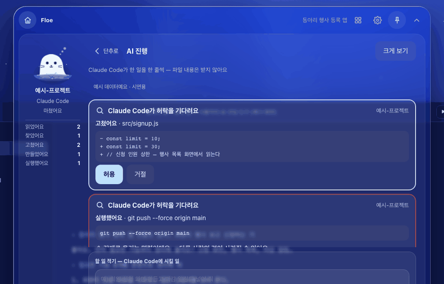
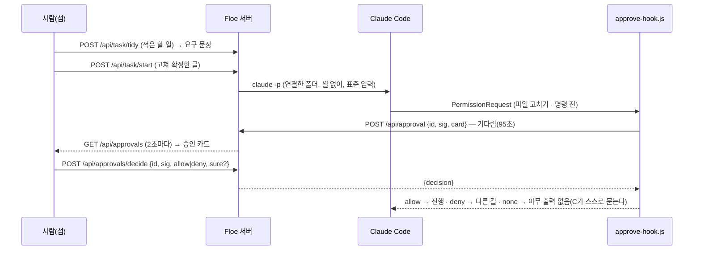

<!-- claude-drafted: 2026-10-20 — 이재엽의 버튼 답("섬에서 진짜 승인" · "허락하면 세션이 진행하는 내용을 오버레이에서도 작동을 하면 좋겠는걸?" · "Go — 이대로")으로 Claude가 만들고 썼다. 내용은 requirements.md FR-17 · 2-2 C-4, 넘김 문서 fable-handoff-2026-10-20-c4-views.md, 코드 머리 주석, Claude Code 훅 문서(code.claude.com/docs/en/hooks, 2026-10-20 확인)에서 옮겼다. 틀린 곳은 담당이 고친다. -->

# 13 대화로 일 넘기기 · 섬에서 허용 · 거절 (FR-17 · C-4)

## 무엇을 하나

섬의 **AI 진행** 판에서 두 가지가 된다.

1. **대화로 일 넘기기** — 할 일을 적으면 플로로가 **요구 문장**(한 줄에 한 가지)으로 정리해 보이고, 사람이 고쳐 **허락하고 넘기기**를 누르면 Floe가 연결한 프로젝트 폴더에서 사용자의 **Claude Code**를 열어 그 일을 이어서 하게 한다. 진행은 같은 판에 한 줄씩(C-12) 쌓인다.
2. **섬에서 허용 · 거절** — Claude Code가 파일을 고치거나 명령을 쓰기 전에 허락을 구하면 섬에 **승인 카드**(무엇을 · 바뀔 내용, 가려서)가 뜨고, 사람이 누른 **허용 · 거절을 그대로** 따른다. 되돌리기 어려운 일(삭제 · 강제 푸시 · 키 노출)은 '정말 허용'을 **한 번 더** 묻는다. **답이 늦거나(90초) Floe 서버가 꺼져 있으면 대신 허용하지 않고** Claude Code가 터미널에서 스스로 묻는다.

서버 없이 열면(FR-10) 주소 끝 `#base&pane=ai&approve=1`로 예시 카드 둘을 보이고, 연습 모드의 '정리'는 적은 글을 줄로만 나누며, '넘기기'는 보내지 않고 예시 카드를 보인다.

| 요구 | 문장 요지 | 등급 |
|---|---|---|
| FR-17 | 대화창의 할 일 → 요구 문장 → 허락하면 Claude Code에 넘겨 이어서, 허락을 구하면 섬의 승인 카드 → 누른 대로. 되돌리기 어려우면 한 번 더. 늦거나 서버가 꺼지면 대신 허용하지 않음 | Should(이재엽 2026-10-20 "아니 지금 하자") |

## 왜 이렇게 만들었나

| 결정 | 내용 | 근거 |
|---|---|---|
| 허락은 섬에서 **진짜로** | 보여 주기만이 아니라 Claude Code의 PermissionRequest 훅이 섬의 결정을 기다린다 | 이재엽 버튼 "섬에서 진짜 승인" |
| **대신 허용하는 길이 없다** | 훅은 서버가 `allow` · `deny`라고 할 때만 그 JSON을 출력하고, 그 밖(없음 · 시간 초과 · 서버 꺼짐 · 이상한 답)은 **아무것도 출력하지 않는다** → Claude Code 보통 흐름. 훅 문서: 결정 없이 끝나면 허용되지 않는다 | 요구서 FR-17, 보안 기준 6-3 새 줄, 훅 문서 확인(2026-10-20) |
| 결정은 요청과 짝이 맞을 때만 | 훅이 만든 `id`와 지문 `sig`(세션 · 도구 · 입력)를 서버가 맞춘다 — 늦은 결정 404, 다른 요청의 결정 409 | 요구서 C-4 ③, 장부 W-25 · W-26 |
| 기다리는 훅은 **새로** | 지켜보기 훅(`hook.js`)은 300ms 안에 끝나는 원칙 그대로. 허락 훅(`approve-hook.js`)만 95초까지 기다린다(훅 시간 상한 120초) | 넘김 문서 3절 |
| 바뀔 내용은 카드에서만 | 뺀 줄 · 넣을 줄 12줄씩 · 200자, `sensitive.js`로 가리고, 서버는 메모리에만 두고 결정하면 지운다. AI 진행(C-12)의 '이름 · 첫 줄 · 줄 수만'은 그대로 — 두 길을 섞지 않는다 | 넘김 문서 3절, 보안 기준 6-1 |
| claude는 **셸 없이**, 연결한 폴더에서만 | `provider.js startTask` — 훅 알림이 알려 준 가장 최근 세션의 폴더에서 `claude -p`, 글은 표준 입력. 권한 건너뛰기 · 설정 끄기 · 세션 잇기 옵션 없음. 화면이 보낸 경로는 받지 않는다 | 넘김 문서 3절, code.md 6번(외부 AI 호출은 한 곳) |
| 세션을 잇지 않는다 [제안] | `--resume` · `--continue`를 쓰면 열어 둔 창과 한 세션을 두 곳에서 쓸 수 있어 같은 폴더의 새 세션으로 연다 — 이어서 하는 맥락은 넘기는 글에 적는다 | Claude가 정한 기본값(요구서 13-1) |
| 되돌리기 어려운 일의 목록 | `rm -r/-f` · `git push --force/-f` · `reset --hard` · `clean -f` · `branch -D` · 표 지우기 · `.env` · `.pem` · 키 파일 · 글에 비밀값 모양 → 쉬운 말 까닭 + 한 번 더 | 요구서 FR-17 "삭제 · 강제 푸시 · 키 노출" |
| coucou는 동작만 | 승인 · 바뀔 내용 화면의 동작만 참고, 이름 · 그림 · 소리 · 예시는 옮기지 않았다 | legal.md D-1 |

## 어떻게 돌아가나

## 코드 · 시험 · 담당

| | 어디 |
|---|---|
| 규칙 | [`03-backend/navigator/approve.js`](../../../03-backend/navigator/approve.js) — `card` · `sig` · `decisionOutput` · `EXAMPLE`(순수, Node · 브라우저) |
| 훅 | [`approve-hook.js`](../../../03-backend/navigator/approve-hook.js)(PermissionRequest) · [`connect.js`](../../../03-backend/navigator/connect.js)(훅 넷 — **이미 연결한 폴더는 다시 연결**) · 앱 [`electron/lib.js`](../../../02-frontend/electron/lib.js) `connectDir`(같은 규칙, `app.asar.unpacked` 경로) · `package.json` `asarUnpack`(navigator 스크립트 전부) |
| 서버 | [`server.js`](../../../03-backend/navigator/server.js) `holdApproval` · `decideApproval` · `startTask`, [`provider.js`](../../../03-backend/navigator/provider.js) `startTask`, [`navigator.js`](../../../03-backend/navigator/navigator.js) `taskPrompt` · `parseTask` · `taskLines`. 약속: [API.md](../../../03-backend/navigator/API.md) 3-13~3-16, 2-1 "짝 확인" |
| 화면 | [`02-frontend/navigator/app.js`](../../../02-frontend/navigator/app.js) `taskBox` · `apCard` · `decideApproval` · `pollApprovals`, `app.css` `.tbox` · `.ap` |
| 시험 | [`approve.test.js`](../../../04-tests/navigator/approve.test.js)(카드 · 가림 · 위험한 일 · 지문 · 출력 · 훅을 실제로 돌림 · asarUnpack) · [`task-api.test.js`](../../../04-tests/navigator/task-api.test.js)(길게 열기 · 짝 · 한 번 더 · none · 가짜 claude) · [`navigator.test.js`](../../../04-tests/navigator/navigator.test.js)(요청문 · 연습 나누기) · e2e [`modes-flow.test.js`](../../../04-tests/e2e/modes-flow.test.js) "FR-17" · [`responsive.test.js`](../../../04-tests/e2e/responsive.test.js) 장면 `#base&pane=ai&approve=1` |
| 담당 | 이재엽(요청 · 규칙 · AI 연동) · 서버 두승현 · 화면 임유정(버전 기록이 알림) |

## 아직 아닌 것 · 미정

- **진짜 Claude Code와 사람이 써 본 기록이 없다** — 가짜 claude · 흉내 낸 훅 입력으로만 시험했다. 확인할 것: `-p` 세션에서 PermissionRequest 훅이 실제로 불리는지(문서: `-p`에서도 `dontAsk`가 아니면 돈다), 90초 뒤 Claude Code가 어떻게 하는지(`-p`면 거절).
- 넘긴 일의 **결과**(Claude Code의 마지막 답)는 지켜보기 훅의 '작업 마침' 알림(FR-7)으로 온다 — 따로 보이지 않는다.
- Codex는 승인 훅이 없다(지켜보기만).
- 한 번에 하나만 넘긴다. 줄을 서는 것은 뒤로.
