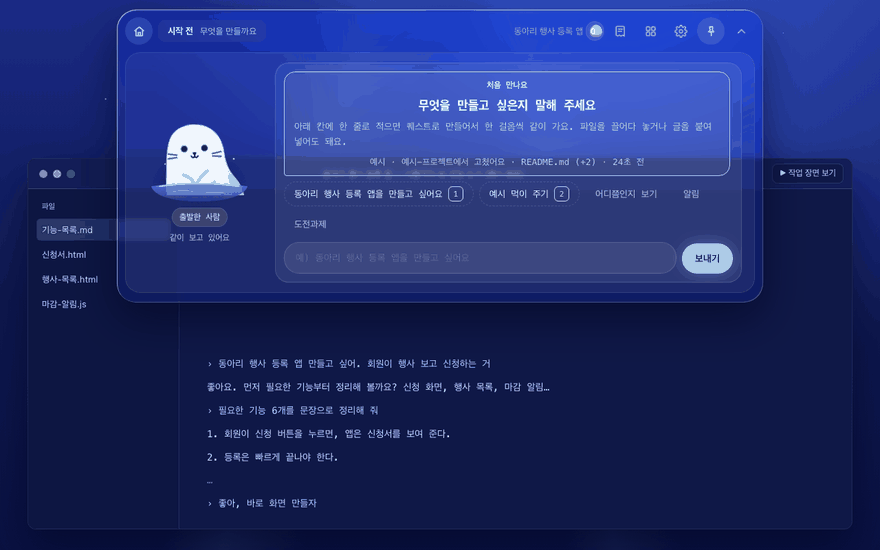
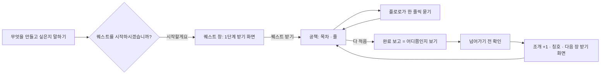

<!-- claude-drafted: 2026-10-21 — 이재엽의 결정("설정 창과 퀘스트 창 그리고 채팅을 입력하는 창 이렇게 3개 · 단계는 1단계부터 시작 · 지금부터 만들어서 릴리즈", 버튼: 제자리에서 고치기 · 첫 PR은 뼈대)으로 Claude가 만들고 썼다. 내용은 requirements.md 2-2 C-22, 스토리보드 10 · 11절, 코드 머리 주석에서만 옮겼다. GIF는 02-frontend를 파일로 열어(서버 · AI 없이, 연습 모드) 녹화했다 -->

# 14 게임처럼 — 플로로와 대화하며 퀘스트 (C-22)

## 무엇을 하나

섬이 **플로로와 대화하는 곳**이 된다. 단추로 고르던 것을 플로로의 말과 칩으로, 단계의 할 일을 **퀘스트**로, 7단계를 **도전과제**로 보인다. 창은 셋이다(이재엽 2026-10-21).

| 창 | 켜고 끄기 | 안에 |
|---|---|---|
| **섬**(채팅) | 늘 | 위 줄 하나(집 · 단계 띠 "N단계 · 제목 · M개 중 k번째 할 일 ●○○" · 조개(무지개 조개 그림 + 수, 2026-10-23) · ⚙ · 핀 · 접기 — 📜 · 모아 보기 단추는 2026-10-23에 뺐다) · 왼쪽 큰 플로로(칭호 · 기분) · 가운데 채팅(플로로 말 왼쪽 · 내 말 오른쪽 · 고르는 칩 · 입력 칸) |
| **설정 창** | ⚙ · × · Esc | '○○ 님의 작업실' + 플로로 · 초기 개발자 → 중급자 → 상급자 · 서재로 가기 · 창 줄(이름 · **설정 창 자리 왼쪽 / 오른쪽** · 퀘스트 창 처음 크기 · 받으면 바로 뜨기 · 조개) · 전부터 있던 설정(보기 · 연결 · 알림 · 느낀 점 · 기록) |
| **퀘스트 창** | 위 줄의 **'퀘스트' 단추**(켜고 끄기, 2026-10-24 C-35 — 명령 칸의 책 · 배우기 대신), 채팅의 '공책 보기' · × · Esc, 퀘스트를 받으면 · 계획을 확정하면 저절로(위 줄의 📜는 2026-10-23에 뺐다) | 설정 창의 **반대쪽**. 크기 S/M/L. 탭 — 퀘스트(받기 화면 → 공책) · 도전과제(세로 탭 = 장, 그림만, 마우스를 올리면 설명 — 2026-10-24부터 나무 위에 그 장의 '관문 전에 알아 둘 것': 튜토리얼 · 말 풀이) · 서고(전의 도서관 탭 — 책 · 책 안 단계 문서 · 확인할 먹이). 계획을 확정하면 퀘스트 탭 위에 '지금 할 퀘스트'(단계 퀘스트 · 맡길 일)를 고른다(C-35) |

**처음 실행:** 무엇을 만들고 싶은지 말하면 → "**퀘스트를 시작하시겠습니까?**" → [시작할게요] → 퀘스트 창이 바로 떠서 **1단계 받기 화면**(제목 띠 + ? · 그림 · 참여 조건 · 할 일 · 기간 · REWARD · 큰 '퀘스트 받기', '고쳐 주세요'로 이름 · 개수 고침) → 받으면 **공책**(왼쪽 목차 Ⅰ Ⅱ Ⅲ Ⅳ · 오른쪽 줄 · 완료 보고 · 힌트 · 고치기) → 플로로가 **한 줄씩** 묻고 채팅 칸에 적는다(연습은 '예시로 적어 줘') → 다 적으면 **완료 보고** → 전처럼 어디쯤인지 보고(판정) → 넘어가기 전 확인 → **무지개 조개 +1 · 칭호** → 다음 장 받기 화면.

**단계 번호는 화면에 1~8**(이재엽 "1단계부터"). 코드 · 서버 · 기록은 0~7 그대로다.

## 왜

- 이재엽 2026-10-21: "새로운 사람들도 어렵지 않게 … 게임처럼 다가가기 쉽게 … 메인으로 하는 것은 버튼이 아니라 플로로와 소통 … 초등학생도 쉽게." 레프런스 여섯(글 · 그림)은 [스토리보드 9절](../../04-pattern-implementation/game-overlay/quest-storyboard.md), 캔버스 목업은 [quest-canvas.html](../../04-pattern-implementation/game-overlay/quest-canvas.html).
- 규칙은 바꾸지 않는다 — 판정(`navigator.js` · 서버), 넘어가기(FR-4), 설계도, 먹이, 허락 카드, 서고는 그대로. 바뀐 것은 **보이는 방식**이다(ADR-0003 그대로).

## 어떻게 진행됐나

| 때 | 무엇 |
|---|---|
| 2026-10-21 낮 | 스토리보드 · 첫 목업(PR #160), 레프런스 여섯을 받아 캔버스 목업(PR #161 — 마무리, 10절 = 만들 때 보는 요약) |
| 2026-10-21 밤 | 이재엽 결정: 창 셋 · 1단계부터 · 지금부터 만들어 릴리즈. 버튼: 제자리에서 고치기 · 첫 PR은 뼈대 → **1차 뼈대 PR**(이 문서) |
| 2026-10-21 밤 · 같은 PR | 이재엽 "전부 해보자" → 앱에서는 설정 창 · 퀘스트 창이 **Electron 창 둘**(상태는 섬 하나, 창은 내용을 보이고 누름을 돌려보낸다), **AI 퀘스트 제작**(`/api/quest` — 설명 · 질문 · 예시, 말투는 `FLORO_VOICE` 한 줄 — 이재엽), **뽑기 · 꾸미기**(조개 셋 · 확률표 · 플로로에 얹기), 서고 · 모아 보기 창의 번호 1~8, 곁 퀘스트, 채팅의 '일하고 있어요' 띠 — [스토리보드 11-2](../../04-pattern-implementation/game-overlay/quest-storyboard.md) |
| 아직 | 앱(Electron)에서 사람이 창 둘을 켜 본 기록, 진짜 AI로 퀘스트 글을 받아 본 기록, 휴대폰, 진짜 그림(고한결), 앱 버전업 |

## 흐름

## 코드 · 시험

| 무엇 | 어디 |
|---|---|
| 규칙(순수) | [`03-backend/navigator/quest.js`](../../../03-backend/navigator/quest.js) — 장 = 퀘스트, 곁 퀘스트, 번호 1~8, 한 줄씩 · 고치기, AI 글 얹기, 칭호 · 묶음, 창 자리 · 크기, 뽑기 확률 · 꾸미기, 연습의 완료 보고 |
| AI(한 곳) | [`navigator.js`](../../../03-backend/navigator/navigator.js) `questPrompt` · `QUEST_SCHEMA` · `parseQuest` · `FLORO_VOICE`, [`server.js`](../../../03-backend/navigator/server.js) `POST /api/quest`([API.md 3-17](../../../03-backend/navigator/API.md)) — 부르는 곳은 전처럼 `provider.js` 하나 |
| 앱의 창 둘 | [`electron/main.js`](../../../02-frontend/electron/main.js) `openSideWin`, [`lib.js`](../../../02-frontend/electron/lib.js) `sideWinBounds`, [`preload.js`](../../../02-frontend/electron/preload.js), [`navigator/win.html`](../../../02-frontend/navigator/win.html) · [`win.js`](../../../02-frontend/navigator/win.js) |
| 화면 | [`02-frontend/navigator/app.js`](../../../02-frontend/navigator/app.js) — `topbar` · `chatCard` · `send` · `momentQuest` · `questReport` · `qwinHTML` · `questPane` · `treePane` · `setwinHTML`, 모양은 [`app.css`](../../../02-frontend/navigator/app.css) 맨 아래 |
| 시험 | [`quest.test.js`](../../../04-tests/navigator/quest.test.js)(규칙 14개), [`api-contract.test.js`](../../../04-tests/navigator/api-contract.test.js)(`/api/quest`), [`electron-side.test.js`](../../../04-tests/navigator/electron-side.test.js)(창 둘), [`modes.test.js`](../../../04-tests/navigator/modes.test.js) · [`app-9.test.js`](../../../04-tests/navigator/app-9.test.js)(새 모양), [e2e `modes-flow.test.js`](../../../04-tests/e2e/modes-flow.test.js)(처음 실행 흐름 · 창 자리 · 게이트의 칩 · 뽑기 · 곁 퀘스트) |
| 주소 장면 | `#start` · `#start&ask` · `#ex=1&q=draft` · `#ex=1&q=quest` · `#ex=1&q=done` · `&tab=map` · `&tab=lib` · `&set=1` · `&side=right` · `&shells=3`(뽑기) · `&tier=Lite&q=quest`(곁 퀘스트) |

## 담당 · 정할 것

- 화면 담당 임유정 — 이 PR은 이재엽(팀장)이 Claude와 만들었다(`claude-drafted`). 그림(이모지)은 자리표시, 진짜 그림은 고한결([스토리보드 10-5](../../04-pattern-implementation/game-overlay/quest-storyboard.md) 2 · 5).
- **앱(Electron)으로 켜서 자동으로 눌러 본 기록(2026-10-21, Claude — `electron . --remote-debugging-port`에 puppeteer를 붙여):** ⚙ → 설정 창이 따로 뜸(작업실 · 창 줄 · 전부터 있던 설정) → 창에서 '오른쪽'을 누르면 섬에 저장되고 창이 반대쪽에 다시 뜸 → 채팅에 말하기 → "시작하시겠습니까?" → 시작 → 퀘스트 창이 따로 떠 받기 화면 → 창의 큰 단추로 받기 → 공책 → 창에서 고치기(이름)가 섬의 기록에 반영 → S → L로 창 크기 바뀜 → 도전과제 탭 → Esc로 닫히고 섬의 📜가 꺼짐. 오류 0. **사람 눈으로 본 기록은 아직** — 끌어 옮기기 · 노치 Mac · 두 화면은 사람이 본다.
- 플로로 말투는 `navigator.js`의 `FLORO_VOICE` 한 줄 — 이재엽이 다듬는 자리(모양 · 개수 규칙은 그대로).
