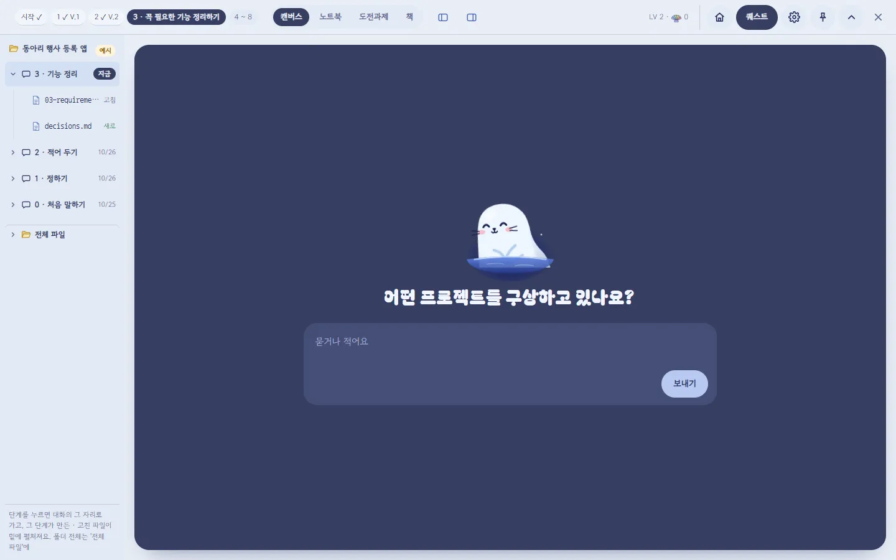
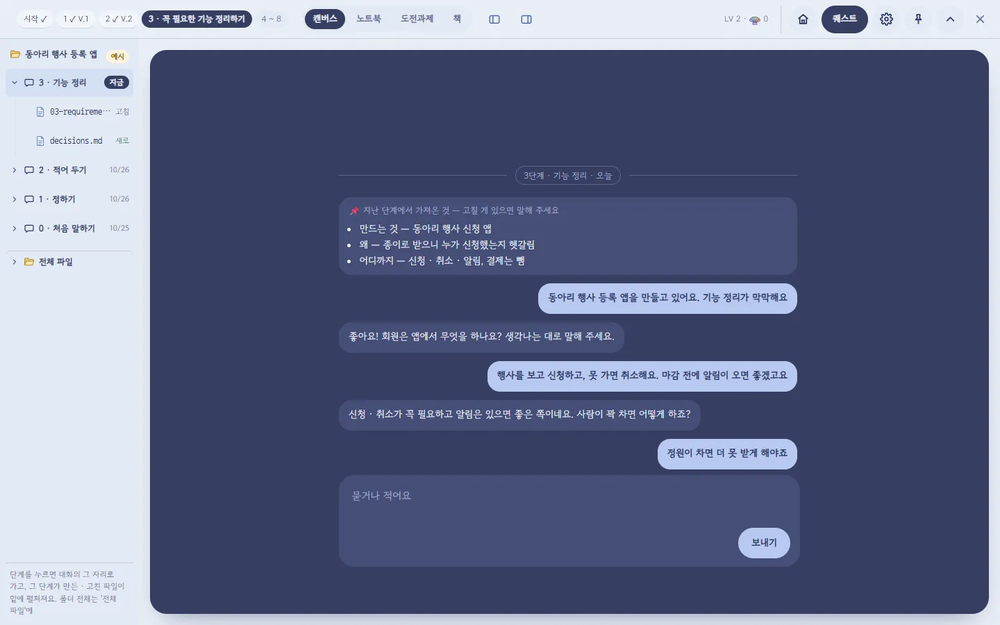
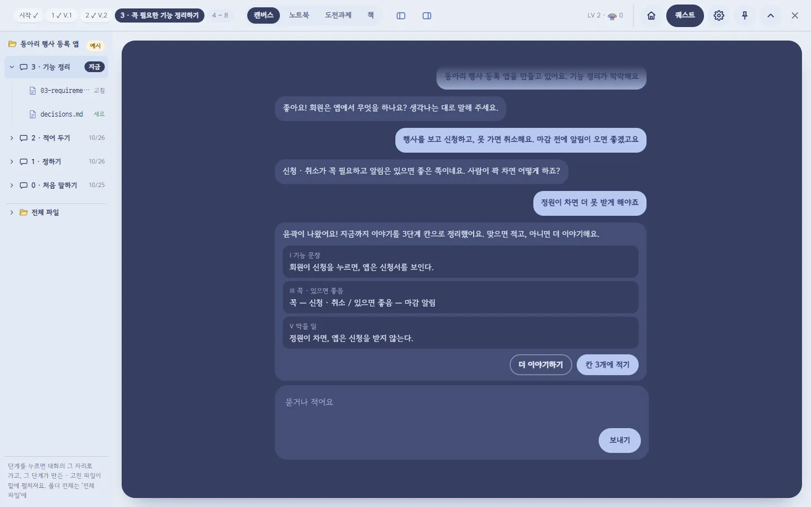
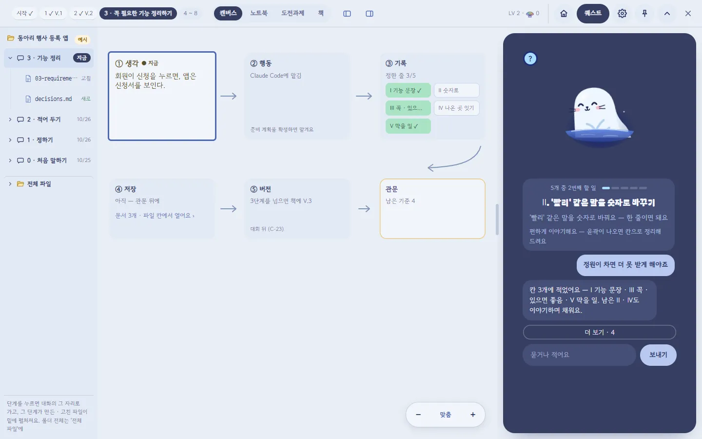
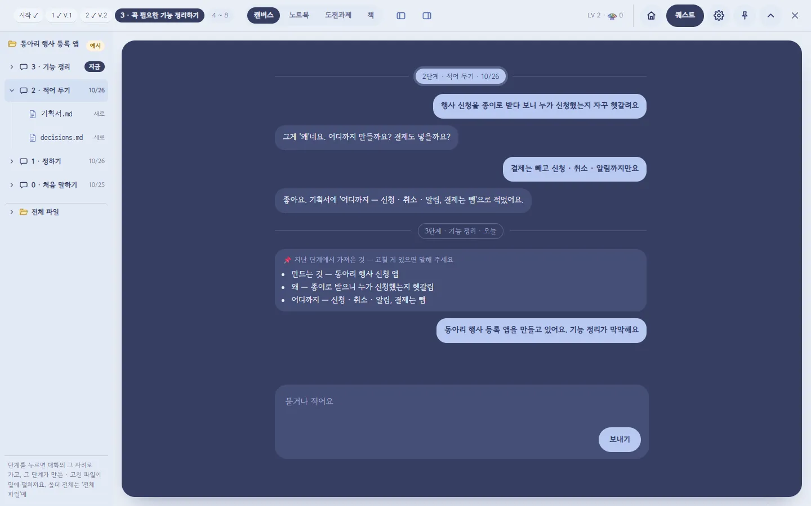
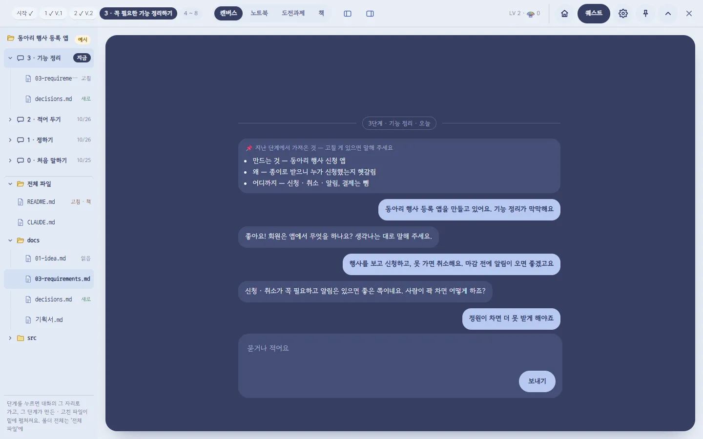
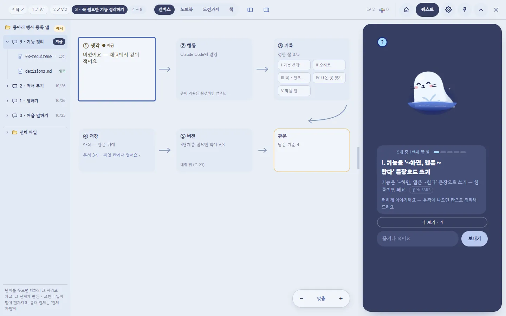
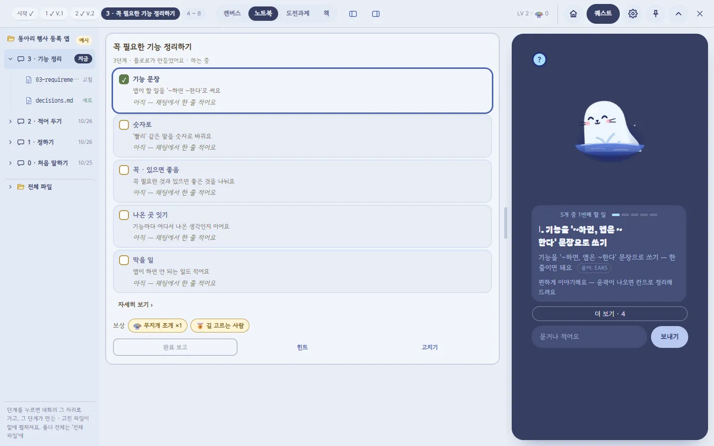
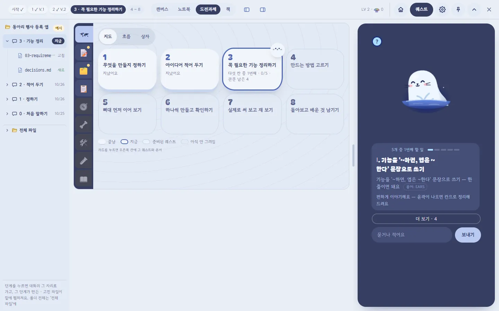
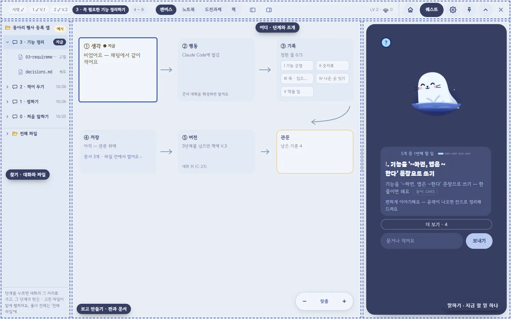

claude-drafted: 2026-10-28 — 두승현 요청("변경한 내용들을 PRD로 정리해줘 이 내용을 바탕으로 실제 UI를 변경할거야")으로 Claude가 썼다. 바탕은 PR #236(화면 · 기능 정리 · 스토리보드 호환 준비)과 그 뒤 같은 날 두승현이 비교 페이지에서 정한 것. 요구 번호는 임시(안)이고 확정 · 등급은 이재엽이 정한다.

# 작업실 개편 PRD — 한 가족 테마 · 덜어내기 · 플로로 자리 · 대화 목록

> **한 줄로:** 섬과 작업실을 같은 색 · 글꼴로 맞추고(한 가족), 같은 정보를 한 번만 보이고(덜어내기), 플로로와는 가운데서 편하게 이야기하다가 칸에 적는 순간 옆으로 비켜서게(플로로 자리), 왼쪽 칸은 폴더 대신 대화 목록으로(대화는 하나, 단계는 바로가기) 바꾼다.

## 0. 먼저 — 그래서 무엇을 하면 되나

1. **이재엽에게 정해 달라고 할 것 넷**(9절): 요구 번호 · 11/1 기능 동결 전에 어디까지 넣을지 · 스토리보드 기준을 바꿀지 · 대화를 어디에 저장할지.
2. **만드는 차례는 8절**의 1차 → 2차. 1차(작은 고침 · 덜어내기 · 테마)는 #232(C-57 디자인 바탕)가 병합된 뒤 그 위에서, 2차(대화 → 칸 정리 · 대화 목록)는 새 AI 길 · 저장이 필요해 대회 뒤를 권한다.
3. 화면 모습은 3절 사진과 [비교 페이지](https://claude.ai/artifact/NbtkqdzR5K6GGuev86xgCs)(넘겨 보기 · 움직임), 0 ~ 8단계에 적용한 모습은 스토리보드 사본(두승현 계정 — 공유 필요)에 있다.

---

## 1. 관련자 · 상태 (Participants · Status)

| | |
|---|---|
| 정하는 사람 | 이 브랜치의 화면 제안은 **두승현**(2026-10-28 두승현). 요구 번호 · 등급 · 11/1 범위 · 스토리보드 기준은 **이재엽** |
| 알릴 사람 | 프론트엔드(작업실 · 섬 화면), C-57을 만드는 #232 담당 |
| 상태 | **결정 대기** — 화면 목업까지 끝(2026-10-28). 앱 코드는 고치지 않았다 |
| 기준 커밋 | main `7345d6a`(#237 병합 뒤). #232(C-57)는 열림 |
| 바탕 문서 | [화면 · 기능 정리](2026-10-28-화면-기능-정리.md) 4 ~ 8절 · [스토리보드 호환 준비](../00-overview/기록/스토리보드-호환-준비-2026-10-28.md) · [요구서](../00-overview/requirements.md) C-41 · C-46 · C-53 ~ C-57 |

## 2. 왜 하는가 (Background & Strategic Fit)

| 두승현이 본 문제(2026-10-28) | 원인 (잰 값) | 이 PRD의 답 |
|---|---|---|
| "한 화면에 너무 많은 기능과 책임이 들어가 있다" | 기능이 많아서가 아니라 **같은 기능이 여러 곳에서 다른 모양으로** 되풀이된다 — 퀘스트 다섯 칸 7곳, 문서 · 파일 7곳, 관문 5곳. 캔버스 한 화면에 단계 이름 · 진행이 3번, '지금' 모양이 5가지 | 덜어내기(C-58 · C-59 · C-60) |
| "플로로와 다른 UI가 색상과 테마가 달라서 통일감이 떨어진다" | 색 묶음이 둘이고 서로 모른다 — 섬은 리퀴드 글래스 남색(`app.css` 526줄), 작업실은 따로 된 파스텔(1218줄). 섬 대화는 코드용 글꼴 | 한 가족 테마(C-62) |
| "플로로가 우측에만 있어 피로감" · "GPT처럼 자유롭게 대화하다가 오른쪽으로 이동" | 지금은 보내는 말이 곧바로 칸에 적힌다(`app.js` 1050줄) — 그냥 묻는 말도 답이 된다 | 플로로 자리 · 대화 → 칸으로 정리(C-61) |
| "클로드 코드처럼 세션 리스트" · "세션을 나누면 맥락 유지가 안 되지 않나" | 왼쪽 칸이 폴더뿐이라 무슨 이야기를 했는지 찾을 곳이 없다. 대화는 최근 60개 · 켜져 있는 동안만 기억한다(`app.js` 139 · 934줄) | 대화는 하나, 단계는 바로가기(C-63) |

**전체 목표와의 연관:** Floe는 "끝까지 만들고, 이해하고, 배움을 쌓도록" 돕는다([요구서](../00-overview/requirements.md)). 같은 것을 일곱 번 다른 모양으로 다시 익히게 하는 화면은 이해를 방해하고, 대화가 사라지면 "왜 이렇게 정했지?"를 되찾을 수 없다(배움이 쌓이지 않는다).

## 3. 화면 (UX 설계)

사진은 지금 앱 화면에 바꿀 것만 적용해 찍었다(1440 × 900, 연습 예시 "동아리 행사 등록 앱" 3단계, 2026-10-28). 글 · 날짜 · 파일은 예시다.

### 3-1. 플로로 자리 — 가운데서 대화, 칸에 적으면 옆으로

| 차례 | 화면 |
|---|---|
| ① 시작 — 플로로 · 질문 하나 · 입력 상자 하나 |  |
| ② 대화 — 마스코트와 질문은 사라지고 채팅만. 맨 위에 단계 구분선과 '가져온 것' 카드 |  |
| ③ 칸으로 정리 — 윤곽이 나오면 플로로가 칸 셋으로 정리한 카드, [칸 3개에 적기] |  |
| ④ 작업 — 칸 셋이 판에 적히고(정한 줄 3/5) 섬은 옆 칸으로 0.3초 |  |

### 3-2. 왼쪽 칸 — 대화는 하나, 단계는 바로가기

| 목록에 보이는 줄 | 무엇인가 |
|---|---|
| 동아리 행사 등록 앱 | 프로젝트 이름 — 맨 위 한 줄 |
| ▾ 3 · 기능 정리 `지금` | 단계 바로가기 — 펼쳐져 있음. 최근 단계가 위 |
| 03-requirements.md `고침` · decisions.md `새로` | 그 단계에서 고친 · 새로 만든 파일 |
| ▸ 2 · 적어 두기 `10/26` | 지난 단계 바로가기 — 접혀 있음, 날짜는 그 단계를 이야기한 날 |
| ▸ 전체 파일 | 폴더 전체 — 펼치면 지금의 폴더 모양 그대로 |

| 2단계 바로가기를 누르면 — 같은 대화의 2단계 구분선 자리로 | 전체 파일까지 펼치면 |
|---|---|
|  |  |

### 3-3. 한 가족 테마 · 덜어내기

| 캔버스 | 노트북 | 도전과제 지도 |
|---|---|---|
|  |  |  |

칸마다 일 하나 — 머리 줄은 '어디', 왼쪽 칸은 '찾기', 작업 칸은 '보고 만들기', 섬은 '말하기':

지금 앱(전)은 [화면 · 기능 정리 6절](2026-10-28-화면-기능-정리.md)의 사진(`mock-*-before`).

## 4. 사용자 이야기 (User Stories)

- 처음 쓰는 사람으로서, 앱을 열면 **무엇을 해야 하는지 질문 하나**만 보고 싶다 — 그래야 어디부터 볼지 헤매지 않는다.
- 바이브 코딩을 하는 사람으로서, 플로로에게 **칸에 적힐 걱정 없이 그냥 물어보고** 싶다 — 그래야 모르는 것을 편하게 묻는다.
- 같은 사람으로서, 이야기를 하다 보면 **플로로가 칸으로 정리해 주고 나는 맞는지만 확인**하고 싶다 — 칸을 직접 채우는 부담이 줄어든다.
- 며칠 뒤 다시 연 사람으로서, **지난번에 무슨 이야기를 했고 그래서 어떤 파일이 바뀌었는지** 바로 찾고 싶다.
- 화면을 오래 보는 사람으로서, **같은 정보가 한 번씩만, 한 가지 모양으로** 보이면 좋겠다.

## 5. 범위 (Scoping)

**넣는 것:** 아래 6절 요구 여덟(C-58 ~ C-63 · F-76 · F-77, 모두 (안)).

**넣지 않는 것:**
- 노트북의 책 모양 · 장 보기의 게임 타일을 같은 판으로, 탭 넷 → '지금 · 전체' 둘 — C-22 · C-54 · C-57(이재엽 결정)을 바꾸는 일이라 팀 결정으로 남긴다.
- 섬을 위 · 아래 · 왼쪽에 붙였을 때의 머리 줄 배치 — 목업은 오른쪽만 그렸다(9절).
- 다크 모드 — 작업실은 지금처럼 늘 밝다.
- 아이콘 다시 그리기 · 처음 설정 · 관문 · 허락 판 다시 칠하기 — C-57 범위.

## 6. 요구 (Feature Overview) — EARS · 끝 조건

번호는 임시다. **F-73 ~ F-75는 #237이 먼저 썼다** — PR #236 문서의 'F-73 · F-74(안)'은 여기서 F-76 · F-77(안)으로 옮겼다. 등급은 이재엽이 정한다.

### C-58(안) 정보마다 집 하나

- 시스템은 같은 정보를 한 화면에 한 곳에만 보인다 — 몇 단계인가는 머리 줄의 단계 칩, 지금 할 일과 진행은 섬 카드, 프로젝트 이름은 왼쪽 칸 맨 위, 조개 · LV는 머리 줄.
- **While** 섬이 펼쳐져 있는 동안, 시스템은 캔버스의 '지금 하는 일' 줄과 지금 칸 위의 작은 플로로를 그리지 않는다. **While** 섬이 접혀 있는 동안에는 그 둘을 보인다.
- 시스템은 판의 지난 장 · 다음 장 보드, 배울 말 카드, 파일 · 바뀐 줄 카드를 그리지 않는다 — 지난 · 다음은 단계 칩, 배울 말은 섬 카드 칩, 바뀐 파일은 왼쪽 대화 목록(C-63)의 파일 줄.
- **끝 조건:** 1440 캔버스에서 단계 이름 · 할 일 진행이 한 번씩(지금 3번 → 1번). 보이는 글 줄 91 → 58 언저리(2026-10-28 테마 전 잼).
- **코드:** `app.js` 1229 · 1230(`cv-bd`) · 1254(`cv-learn`) · 1257(`cv-flo`) · 1268(`cv-file`), 섬 위 줄의 `tb-stage`(1900).

### C-59(안) 상태는 한 가지 모양

- 시스템은 끝남 · 지금 · 준비됨 · 아직을 앱 전체에서 도전과제 지도의 범례와 같은 모양으로 보인다 — 지금은 바다색 테두리 하나, 끝남은 종이 카드, 아직은 흐린 면, 관문은 금색 테두리, 문제는 볼색 글자.
- 시스템은 노란 포스트잇 · 연두 칩 · `●` 점으로 상태를 나타내지 않는다.
- **끝 조건:** 캔버스 · 노트북 · 지도 · 왼쪽 칸의 '지금'이 같은 모양(지금 5가지 → 1가지).

### C-60(안) 덜 펼치기 · 주 행동 하나

- 시스템은 한 화면에 주 단추를 하나만 둔다 — 섬의 '보내기'. 노트북의 '완료 보고'는 다섯 칸을 다 채우기 전에는 보조 단추다.
- 시스템은 섬(옆 칸)의 칩을 '더 보기' 하나로 접어 두고 누르면 펼친다. 가운데 대화(C-61)에는 칩 줄을 두지 않는다.
- 시스템은 '자세히 보기 · 왜 하나요', 관문의 남은 기준 목록, 아직 그려지지 않은 단계의 설명을 처음에는 접어 둔다.
- **코드:** `app.js` 1029(`opts fixed`).

### C-61(안) 플로로 자리 · 대화 → 칸으로 정리

- **While** 그 단계의 칸이 판에 하나도 적히지 않았고 섬이 펼쳐져 있는 동안, 시스템은 섬을 작업 칸 전체의 둥근 카드로 펼친다(머리 줄 · 왼쪽 칸은 그대로).
- **While** 그 단계의 대화가 비어 있는 동안, 시스템은 플로로 · 질문 하나 · 입력 상자 하나만 보인다. 질문은 "어떤 프로젝트를 구상하고 있나요?" · "어떤 미션을 수행하고 계시나요?" · "지금 작업 중인 내용을 공유해 주세요, 함께 논의해요~" 중 하나(문구는 예시).
- **When** 사용자가 첫 말을 보내면, 시스템은 플로로 그림과 질문을 숨기고 채팅만 보인다. 입력 상자는 아래에 붙고 단추는 [보내기] 하나다.
- 시스템은 [보내기]로 보낸 말을 칸에 적지 않는다.
- **When** 플로로의 답이 지금 단계 칸 n개(n ≥ 1)를 채울 수 있다고 알리면, 시스템은 정리 카드(칸 이름 · 칸마다 한 줄 · [칸 n개에 적기] · [더 이야기하기])를 보인다.
- **When** 사용자가 [칸 n개에 적기]를 누르면, 시스템은 그 칸들을 판에 적고(누가 정했나: '대화') 섬을 고른 가장자리의 옆 칸으로 0.3초 동안 옮긴다. **Where** 움직임 줄이기를 켰으면 옮기지 않고 바로 바꾼다.
- 시스템은 AI의 판단만으로 섬의 자리를 바꾸지 않는다 — 자리가 바뀌는 것은 사람이 [칸 n개에 적기]를 누를 때뿐이다.
- **When** 켤 때(C-55), 시스템은 지금처럼 접힌 알약으로 시작한다. 알약을 펼쳤을 때 위 규칙을 따른다.
- 가운데로 다시 오는 때(제안, 9절에서 정함): 새 단계를 시작할 때 · 관문에서 이해했는지 물을 때 · 섬 머리의 '크게'.
- **끝 조건:** ① 시작 → ② 대화 → ③ 정리 카드 → ④ 적고 옆으로 한 바퀴가 3-1절 사진대로. 보내기만으로는 정한 줄 수가 바뀌지 않는다.
- **코드 · 새로 필요한 것:**
  - 있는 것 — 칸마다 초안을 만드는 AI 길 `POST /api/stagedraft`([API.md](../../03-backend/navigator/API.md) 3-22), 초안을 칸에 붙이기 `QU.withStageDraft`, 한 번에 적기 `QU.fillAll`, 누가 정했나 기록(C-39), 섬 칸의 0.3초 움직임(`win.html` 26줄).
  - 새로 — ① 보내기와 칸 적기를 나누기(`app.js` 1050줄 `fillNow`), ② 플로로와 자유 대화하는 AI 길(서버의 `AI_ROUTES` · 확인 값 · 토큰 장부와 같은 규칙), ③ 초안 AI에 대화 글을 넘기는 칸(받은 글처럼 길이 상한 · 비밀값 가림), ④ '윤곽' 신호 — 대화 AI가 답할 때 "칸 몇 개를 채울 수 있나"를 같이 돌려준다, ⑤ 누가 정했나에 '대화' 값(`quest.js` `BY`), ⑥ 섬 칸을 작업 칸 전체로 그리는 자리 규칙(`app.js` 2261 `islCol` · `win.html` · `win.js`).

### C-62(안) 섬과 작업실 한 가족

- 시스템은 섬과 작업실의 색 · 글꼴을 C-57 토큰 한 벌에서만 고른다(새 색을 짓지 않는다). 글은 Gowun Dodum, 섬의 큰 질문 · 지도 숫자는 Bagel Fat One, 코드 · 파일 이름은 Nanum Gothic Coding — 글꼴은 `02-frontend/assets/fonts/`의 파일로(C-57 규칙, 밖으로 요청하지 않음).
- 시스템은 섬을 작업실과 같은 바탕 위에 놓인 둥근 섬 카드로 그린다(칸을 섬 색으로 통째로 칠하지 않는다). 별 · 유리 · 점 격자 · 판 안의 판은 쓰지 않는다.
- 시스템은 섬의 '보내기'와 작업실의 주 단추를 같은 하늘색 알약으로 그린다.
- 시스템은 작업실의 '고른 것 · 지금' 표시(고른 탭 · 지금 단계 칩 · 왼쪽 칸 '지금' · 지도의 장 탭 줄)를 섬 색으로 칠한다(색의 메아리 — 넣을지 9절).
- 시스템은 작업실 머리 줄과 섬의 위 줄을 창 전체 폭의 머리 줄 하나로 합치고, 섬을 다루는 단추(홈 · 퀘스트 · 설정 · 고정 · 접기)를 섬 쪽 끝에 둔다.
- **끝 조건:** 1440 작업 중 화면에서 위 줄이 하나. 메아리 색 위 글자 대비 4.5:1 이상(`#EEF1FA` / `#363E62` 9.20, 색 값으로 잼).
- **코드:** `app.css` 526(리퀴드 글래스) · 1218(작업실 파스텔), `win.html` 21 ~ 27(`#root` 줄 배치), `app.js` 1877(`tbRight` — 머리 줄로 옮김). **#232(C-57)가 병합된 뒤 그 위에서** 한다 — 같은 곳을 고친다.

### C-63(안) 대화는 하나, 단계는 바로가기 — 왼쪽 대화 목록

- 시스템은 프로젝트마다 대화 하나를 저장하고, 앱을 다시 켜도 이어서 보인다.
- **When** 단계가 바뀌면, 시스템은 대화에 구분선(단계 · 이름 · 날짜)을 넣고 그 밑에 '지난 단계에서 가져온 것' 카드(정한 칸과 말로만 한 것의 요약)를 붙인다. 사용자는 말로 고칠 수 있다.
- 시스템은 작업실 왼쪽 칸에 프로젝트 이름 아래 단계 바로가기를 최근 단계가 위로 보인다 — 지금 단계에는 '지금', 지난 단계에는 그 단계를 이야기한 날짜.
- **When** 사용자가 단계 바로가기를 누르면, 시스템은 새 대화를 열지 않고 같은 대화를 그 단계 구분선으로 옮겨 잠깐 강조하며, 그 줄 밑에 그 단계가 만든 · 고친 파일('새로' · '고침')을 펼친다. 다시 누르면 접는다.
- 시스템은 맨 아래 '전체 파일'에 지금의 폴더 모양을 둔다(펼치면 한 칸 들여서).
- 입력 상자는 늘 대화 맨 아래이고, 보낸 말은 지금 단계에 이어진다.
- **끝 조건:** 3-2절 사진대로. 앱을 껐다 켜도 지난 단계 대화가 남아 있다.
- **코드 · 새로 필요한 것:** 대화 저장(지금은 `st.chat` 하나에 최근 60개 · 켜짐 동안만 — `app.js` 139 · 934줄), 왼쪽 칸 그리기(`app.js` 1470 `fileNav` → 대화 목록), 단계마다 '만든 · 고친 파일'을 모으는 출처(Claude Code 훅 알림 `/api/event` · 단계 결과 중 무엇으로 할지 — 9절).

### F-76(안) 작업실 낱말 중간 줄바꿈 — 작은 고침

- 시스템은 작업실 · 섬의 한국어를 낱말 사이에서만 줄바꿈한다(`word-break: keep-all`, 긴 영문 · 경로는 칸 안에서 끊음). 지금 `app.css`에 0곳, `library.css`에는 2026-10-19에 같은 까닭으로 4곳.
- **끝 조건:** 지도 카드 · 포스트잇 · 섬 제목에 '적 / 어요' · '정 / 하기' 같은 끊김이 없다.

### F-77(안) 섬 칩 글자 잘림 · 위 줄 겹침 — 작은 고침

- 시스템은 섬 옆 칸(320 ~ 760)에서 칩 글자를 자르지 않는다 — 넘치면 두 줄로 감싼다. 섬 위 줄의 단추가 글 위에 겹치지 않는다.
- **끝 조건:** 섬 옆 칸 420에서 '바뀐 작업 보여 주기'가 다 보인다(지금 '작업 보여'). C-60 · C-62가 들어가면 칩은 '더 보기' 하나 · 위 줄은 머리 줄로 옮겨 저절로 풀린다 — 그 전에 1차로 고칠지 9절.

## 7. 보안 · 기록 (Security & Compliance)

작성 기준: [security-records.md](../../.claude/rules/security-records.md).

- **AI로 나가는 것이 는다.** 자유 대화(C-61)와 '가져온 것' 요약(C-63)은 사용자가 쓴 글을 AI 서비스로 보낸다. 받은 글 · 초안과 같은 규칙 — 확인 값이 있어야 부르고, 비밀값처럼 보이면 가리고(`sensitive.js`), 길이 상한을 둔다. 토큰은 토큰 장부(3-5)에 쌓인다.
- **대화 저장(C-63).** 대화에는 사용자의 말이 그대로 있다. 작업 폴더(공유 저장소)에 커밋하지 않고 **이 컴퓨터의 앱 저장 곳**에 두기를 권한다 — 위치는 9절. 저장 전에 비밀값 가림을 거친다.
- **사람이 정한다.** 판에 적는 것 · 화면 자리를 바꾸는 것은 사람의 누름(C-61)뿐이다 — FR-17(섬에서 진짜 승인)과 같은 방향.
- 새 외부 서비스 · 새 의존성은 없다. 글꼴은 파일로 넣는다(C-57).

## 8. 만드는 차례 (Technical Architecture · 순서)

| 차례 | 무엇 | 왜 이 차례 | 크기 |
|---|---|---|---|
| **1차-가** | F-76 · F-77 | 작은 고침, 다른 것과 부딪치지 않는다 | 작음 |
| **1차-나** (#232 병합 뒤) | C-62 테마 → C-59 상태 모양 → C-58 덜어내기 → C-60 주 단추 | C-57과 같은 CSS를 고치므로 그 위에서. 화면만 바뀌고 서버 · 저장은 그대로 | 보통 |
| **2차** (권함: 대회 뒤) | C-61 대화 → 칸 정리 · C-63 대화 목록 · 저장 | 새 AI 길 · 대화 저장 · 판정과 이어지는 '누가 정했나' 값이 필요하다. 토큰 · 보안 확인이 같이 필요해 11/1 전 사흘에 끝내기 빠듯하다 | 큼 |

- 1차는 PR을 둘(가 · 나)로, 2차는 C-61(대화 · 정리)과 C-63(저장 · 목록)을 나눠 올린다. 2차의 화면 자리 규칙(작업 칸 전체 ↔ 옆 칸)은 C-61 PR에 둔다.
- 앱 버전은 팀이 정할 때만 올린다(작업 PR은 건드리지 않음).

## 9. 정할 것 (이재엽 · 두승현)

| # | 무엇 | 권함 | 누가 |
|---|---|---|---|
| 1 | 요구 번호 · 등급 — C-58 ~ C-63 · F-76 · F-77을 요구서 2-2 · 고칠 목록에 올릴지 | 올린다 — 번호는 그날 마지막 번호 다음으로 | 이재엽 |
| 2 | 11/1 기능 동결 전에 어디까지 | 1차(가 · 나)까지, 2차는 대회 뒤 | 이재엽 |
| 3 | 스토리보드 기준을 바꿀지 — 1(작업실을 줄이지 않음) · 2(작업실 안 구성) · 3(섬 모양 · 위 줄) · 8(움직임 0.3초 — 이 PRD는 맞춤) · 10(왼쪽 칸) | 1 · 2 · 3 · 10을 이 PRD대로. 5 · 7은 이미 앱과 달라 따로 맞춤([호환 준비](../00-overview/기록/스토리보드-호환-준비-2026-10-28.md) 3절) | 이재엽 |
| 4 | 대화 저장 곳 | 이 컴퓨터의 앱 저장 곳(작업 폴더에 커밋하지 않음) | 이재엽 |
| 5 | '색의 메아리'(C-62) · '같은 책상' · '상단 하나'를 넣을지 | 셋 다 — 메아리는 C-57에 없는 제안이라 이재엽 확인 | 두승현 → 이재엽 |
| 6 | 단계와 상관없는 질문(예: 깃허브 연결)은 | 지금 단계 구간에 그대로 둔다(따로 표시하지 않음) | 두승현 |
| 7 | 단계마다 '만든 · 고친 파일'의 출처 | Claude Code 훅 알림으로 그 단계 동안 바뀐 파일 + 단계 문서 | 두승현 · 프론트엔드 |
| 8 | 섬을 위 · 아래 · 왼쪽에 붙였을 때 머리 줄의 섬 단추 묶음 | 섬 쪽 끝으로 따라간다 | 두승현 |

<!-- claude-drafted: 2026-10-28 --> **2026-10-28 밤 두승현이 정함:** 5번 색의 메아리 **넣는다**(이재엽 확인 남음) · 6번 **그대로**(지금 단계 구간, 따로 표시 없음) · 7번 **훅 알림으로 모은 바뀐 파일 + 단계 문서 둘 다** · 8번 **없어짐 — 섬을 위 · 아래 · 왼쪽에 붙이는 단추를 빼기로 합의**(섬은 오른쪽만) · F-77은 **1차-가에서 안 고치고** 1차-나가 저절로 풀게. 작업으로 옮긴 것은 [TASK](2026-10-28-작업실-개편-TASK.md) 3절.

## 10. 시험 (Testing Strategy)

수용 시험은 Given-When-Then으로, 시험 파일은 `04-tests/navigator/` · `04-tests/e2e/`에 둔다(이름은 예시).

| 요구 | Given | When | Then | 시험 |
|---|---|---|---|---|
| C-61 | 3단계, 칸이 하나도 적히지 않음, 섬 펼침 | '기능 정리가 막막해요'를 보낸다 | 정한 줄 0/5 그대로, 마스코트 · 질문이 숨고 채팅만 | `chat-split.test.js` |
| C-61 | 정리 카드(칸 셋)가 떠 있음 | [칸 3개에 적기] | 정한 줄 3/5, 세 칸의 누가 정했나 '대화', 섬 자리 = 옆 칸 | e2e `quest-flow` 보강 |
| C-61 | 움직임 줄이기 켬 | [칸 n개에 적기] | 옮김 시간 0 | e2e |
| C-63 | 3단계 진행 중, 앱을 껐다 켬 | 작업실을 연다 | 2단계 구분선 · 대화가 남아 있다 | `chat-store.test.js` |
| C-63 | 대화 목록 | '2 · 적어 두기'를 누른다 | 같은 대화가 2단계 구분선으로, 그 줄 밑에 그 단계 파일, 다시 누르면 접힘 | e2e |
| C-58 | 섬 펼침, 캔버스 | 화면을 그린다 | '지금 하는 일' 줄 · 작은 플로로 · 보드 · 배울 말 · 파일 카드가 없다 | `canvas-distill.test.js` |
| C-62 | 1440 작업 중 | 화면을 그린다 | 위 줄이 하나, 섬 단추 묶음은 섬 쪽 끝 | e2e 사진(`FLOE_SHOTS`) |
| F-76 | 지도 카드 | 좁은 폭으로 그린다 | 한국어가 낱말 중간에서 끊기지 않는다 | 브라우저 계산 스타일 확인 |

- 커밋 전에 `python 04-tests/run_all_tests.py`(노드 시험 포함)와 링크 검사.
- 사진은 바꾼 뒤 1440 × 900 · 1280 × 800 · 1024 × 768(스토리보드 기준 화면)로 다시 찍어 이 문서 3절과 맞대어 본다.

## 11. 확인하지 못한 것

- 사진은 화면 파일을 Chrome으로 연 것이다 — 데스크톱 앱 창 · Mac · 1280 · 1024 화면에서는 보지 않았다.
- 잰 값(91 → 58 등)은 테마를 입히기 전에 셌다. 테마 뒤에는 다시 세지 않았다.
- 대화 · 정리 카드 · '가져온 것'의 글은 예시다 — AI가 실제로 그렇게 정리하는지는 만들어 보기 전에는 모른다.
- #232(C-57)가 섬 칩 · 위 줄을 어떻게 그리는지는 그 PR의 사진 한 장으로만 봤다.

## 12. 출처

- 사진 · 넘겨 보기: [비교 페이지](https://claude.ai/artifact/NbtkqdzR5K6GGuev86xgCs)(링크가 있는 누구나) — 사진은 테마 CSS 한 벌로 찍었다(2026-10-28).
- 0 ~ 8단계에 적용한 모습: 스토리보드 사본(두승현 계정, 다섯째 손질 — 공유 필요). 원본은 이재엽 계정의 둘째 판.
- 바탕: [화면 · 기능 정리](2026-10-28-화면-기능-정리.md) · [스토리보드 호환 준비](../00-overview/기록/스토리보드-호환-준비-2026-10-28.md) · [고칠 목록](../07-maintenance/fix-map.md).
