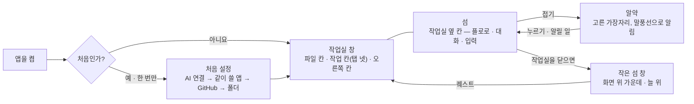
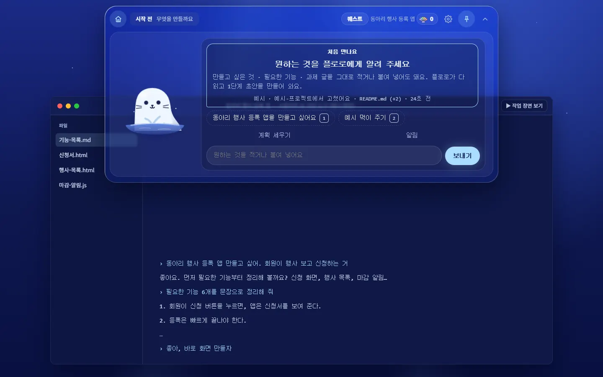
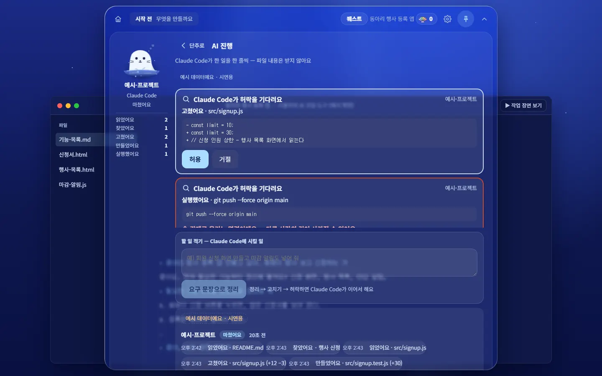
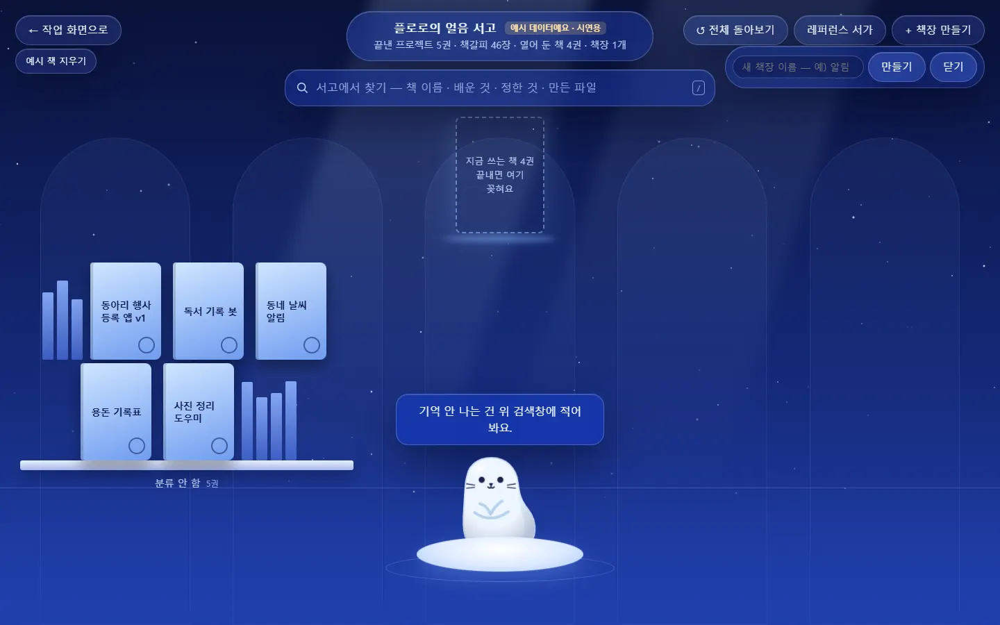

claude-drafted: 2026-10-28 — 두승현 요청("일단 지금 어떤 기능이 있고 그게 UIUX로 어떻게 만들었졌는지도 문서로 정리해줘" · "점검표도 붙이고")으로 Claude가 썼다. 기준은 `main` 5c93126(v38.0 · 앱 10.0.0). 틀린 곳은 담당이 고친다.

# 지금 Floe의 기능과 화면 — UI/UX로 어떻게 만들어졌나 (2026-10-28)

> **이 문서는 그날의 모습을 찍어 둔 기록이다.** 요구의 원천은 [requirements.md](../00-overview/requirements.md), 기능마다 왜 · 어떻게 진행됐나는 [기능 지도](README.md)(10/18 ~ 10/21 기준)에 있다.
> 이 문서는 그 뒤 들어온 작업실 · 섬 옆 칸 · 알약 · 지도(C-41 ~ C-55, v30 ~ v38)까지 넣어 **"사용자가 화면에서 무엇을 보고 누르나"** 쪽에서 다시 묶었다.

**사진은 어떻게 찍었나:** 2026-10-28, 화면 파일(`02-frontend/`)을 Chrome으로 바로 열어 연습 예시("동아리 행사 등록 앱", 3단계)로 찍었다 — e2e 시험과 같은 길이라 서버 · AI 호출이 없다.
Windows · 1440×900 · 라이트 모드. **데스크톱 앱 창을 띄워 찍은 것은 아니다** — 창 테두리 · 투명한 섬의 그림자는 앱에서 조금 다르게 보일 수 있다.

---

## 1. 한눈에 — 창 둘, 섬 하나

| 무엇 | 어떤 창인가 | 바탕 | 코드 |
|---|---|---|---|
| **작업실** | 테두리 있는 보통 창 · 처음엔 화면 가득 · 옮기거나 늘린 크기를 기억 | 밝은 회청색 `#E9EEF6` | `navigator/win.html` · `win.js`(보이기만), 내용은 섬이 그려 보냄(`app.js` `qwinHTML`) |
| **섬** | 작업실이 열려 있으면 그 안의 **옆 칸**(`.isl-col`), 닫혀 있으면 테두리 없는 투명 창 · 늘 위 · 화면 위 가운데 | 짙은 남색 유리 `#16225E` | `navigator/index.html` · `app.js` · `app.css`, 창은 `electron/main.js` |
| **알약** | 섬을 접은 모양. 옆에 붙으면 세로 알약 | 남색 | `win.js` `FOLD` · `greet.js` |
| **서고(도서관)** | 따로 열리는 화면. 물속으로 내려가는 전환을 지나 들어감 | 밤하늘 남색 그라데이션 | `library/index.html` · `library.css`, 전환은 `navigator/dive.js` |

섬의 자리는 작업실의 **위 · 아래 · 왼쪽 · 오른쪽** 넷 중 하나다(섬 머리의 ▲ ▼ ◀ ▶, 설정 '섬 자리'). 옆 칸의 너비는 손잡이로 320 ~ 760까지 바꾼다.

---

## 2. 기능 → 어느 화면에서 · 어떤 모양으로

### 2-1. 켜기 · 처음 설정

| 기능 | 화면에서 | UI/UX로 어떻게 | 요구 |
|---|---|---|---|
| 처음 설정 | 섬 위에 겹쳐 뜨는 카드 | 왼쪽 플로로 그림 + 오른쪽 큰 제목 한 줄 · 설명 한 줄. **주 단추 하나**('준비 시작하기', 키 안내 `Enter`)와 글 단추 하나('나중에 할게요'). 아래 점 여섯으로 몇 번째 단계인지. AI 연결 → 같이 쓸 앱 → GitHub → 폴더를 한 화면에 하나씩 | FR-10 · C-38 |
| 켜면 바로 작업실 | 작업실 + 접힌 알약 | 큰 인사 카드 대신 **알약 옆 말풍선**에 시간대 인사(하루 한 번) · 멈춘 곳 · '섬 펼치기 / 나중에' | C-55 (v38.0) |

### 2-2. 섬 — 플로로와 대화하는 곳

| 부분 | 무엇이 있나 | UI/UX로 어떻게 |
|---|---|---|
| 위 줄 | 홈 · **지금 단계와 할 일 진행**(가는 막대 다섯) · '퀘스트' 단추 · 조개 수 · 설정 톱니 · 고정 핀 · 접기 ⌃ | 한 줄에 상태와 단추를 모두 둔다. 진행은 숫자 대신 막대 |
| 플로로 | 왼쪽의 큰 물범 | 상황마다 표정(11가지)이 바뀌고 마우스 쪽으로 고개를 돌림. 움직임 줄이기를 켠 사람에게는 움직이지 않음 |
| 대화 카드 | 단계 · "5개 중 n번째 할 일" · 할 일 제목 · 설명 · 용어 칩(예: `용어: EARS`) | **한 번에 하나만** 묻는다. 어려운 말은 작은 칩으로, 누르면 그 자리에서 풀이(FR-13) |
| 칩 | 공책 보기 · 작업 보여 · 계획 세우기 · 알림, 예시 칩(번호 키 1 · 2) | 자주 하는 일을 한 번에. 키보드 숫자로도 |
| 입력 | 한 줄 입력 + '보내기' | 대화가 중심 — 단추보다 글로 정한다 |

| 섬 안의 판 | 화면에서 | UI/UX로 어떻게 | 요구 |
|---|---|---|---|
| **관문** | 대화 카드 테두리가 금색, "이번 단계에서 한 일, 이해되셨나요?" | 한 일을 칩과 화살표로 이어 보여 주고, 주 단추 '네, 이해했어요 `Y`' / 보조 '아니요, 같이 풀어요 `N`'. 플로로는 반짝이 표정. 빈칸 · 증거 없는 칸은 넘어가지 못하고, 넘기려면 채우거나 까닭을 적는다 | FR-4 · 5 · F-60 · F-62 |
| **AI 진행 · 허락** | '단추로 ‹' 뒤로 가기가 있는 판 | 왼쪽에 플로로와 '읽었어요 2 · 고쳤어요 2 …' 세기, 오른쪽에 **허락 카드**(무엇을 · 어느 파일 · 바뀐 줄) — 주 단추 '허용' / '거절'. 되돌리기 어려운 일(강제 푸시 등)은 빨간 테두리와 경고. 아래에 '할 일 적기 → 요구 문장으로 정리', 한 일 타임라인 | FR-17 |
| **알림** | 같은 모양의 판 | AI 코딩 도구가 보낸 알림을 새것부터. 없으면 "아직 알림이 없어요 — 프로젝트 폴더를 연결하면…" | FR-7 |
| **먹이 주기** | 대화 카드 안 목록 | 붙여 넣은 글을 구간으로 나누고 구간마다 '먹어도 돼요 / 빼 주세요'. 개인적인 일 · 비밀번호처럼 보이면 노란 글로 이유. '확인하고 어디쯤인지 보기 `Ctrl+Enter`' / '다시 쓰기 `Esc`' | FR-15 |

### 2-3. 작업실 — 세 칸과 탭 넷

| 칸 | 무엇이 있나 | UI/UX로 어떻게 | 요구 |
|---|---|---|---|
| 머리 한 줄 | 프로젝트 · 단계 이름 · **탭 넷** · 칸 접기 단추 둘 · `LV 2 · 🐚 0` · 닫기 | 탭은 둥근 묶음 단추(고른 것만 흰 바탕) | C-41 |
| 왼쪽 · 파일 칸 | 연결한 폴더의 파일 나무 | 파일마다 작은 꼬리표 — `● 지금`(파랑) · `새로`(초록) · `읽음` · `고침 · 책`, 폴더를 연결하기 전엔 `예시`(노랑). 누르면 작업 칸에 열린다 | C-43 · C-53 |
| 가운데 · 작업 칸 | 탭에 따라 바뀜(아래) | 연 파일이면 문서 도구 줄(서식 · 목록 · 넣기 · 글 크기 · 목차 · 찾기)과 상태 줄(저장 · 바뀐 줄 · 줄 수). md는 보기 좋게 / 원문 | C-43 ~ C-45 · C-53 |
| 오른쪽 칸 | **이 문서**(목차 · 빈 절 · 재료) · **퀘스트**(다섯 칸 목록, 지금 칸만 테두리) · **관문**(남은 기준을 노란 칩으로) | 섬을 펼치면 이 칸은 접힌다 — 한 번에 너무 많이 보이지 않게 | C-53 |

| 탭 | UI/UX로 어떻게 | 요구 |
|---|---|---|
| **캔버스** | 점 격자 바탕 위 1100×640 판. 위에 지금 하는 일 한 줄과 **단계 칩**(지난 단계는 연두 `✓ V.n`, 지금은 파랑, 뒤는 흐림). 판에는 퀘스트 한 바퀴 다섯 칸(① 생각 → ② 행동 → ③ 기록 → ④ 저장 → ⑤ 버전)이 화살표로 이어지고, **지금 칸은 노란 포스트잇**, 나머지는 점선 상자. 끌어서 옮기고 − 맞춤 + 로 크기를 바꾼다. 칸이 좁으면 격자로 다시 배치 | C-41 · C-42 · F-66 |
| **노트북** | **책 모양** — 갈색 표지 · 베이지 종이 · 왼쪽 스프링 구멍. 왼쪽 목차 Ⅰ ~ Ⅴ(끝냄 ✓ / ★ 아직), 오른쪽 할 일마다 체크 상자 · 한 줄 설명 · "아직 — 채팅에서 한 줄 적어요". 아래 자세히 보기 · 보상 칩(무지개 조개 ×1 · 칭호) · '완료 보고 / 힌트 / 고치기' | C-22 |
| **도전과제** | 안에 **지도 · 흐름 · 상자** 세 보기. 지도는 단계 카드 여덟 장(네 장씩 두 줄) — 카드 하나 = 한 단계의 퀘스트와 문서, 상태 넷(끝남 · 지금 · 준비된 퀘스트 · 아직 안 그려짐)을 테두리로. 맨 아래 단계 밖 문서(README · CLAUDE · 결정 기록). 왼쪽 갈색 세로 줄에 그림 아이콘 아홉. 카드를 누르면 오른쪽 칸에 그 단계 | C-54 (v38.0 — 문서 지도 탭을 여기로 합침) |
| **책** | 흰 카드 하나. 버전 알약(V.1 · V.2 · V.3, 날짜와 제목), 왼쪽 목차 · 오른쪽 내용(생각 · 한 일 · 정한 것 · 배운 말 · 다음 할 일). 아래 '이 프로젝트의 단계 문서 · 정한 것 펼치기' | C-26 |

### 2-4. 서고(도서관)

| 기능 | UI/UX로 어떻게 | 요구 |
|---|---|---|
| 끝낸 책 모으기 · 찾기 | 밤하늘 아래 아치 모양 책장, 책은 하늘색 표지 카드. 위에 '서고에서 찾기' 검색창(`/` 키), '전체 돌아보기 · 레퍼런스 서가 · 책장 만들기'. 지금 쓰는 책은 점선 자리로 "끝내면 여기 꽂혀요". 아래 얼음판 위 플로로가 말풍선으로 안내. 숫자는 모두 예시 데이터라고 머리에 표시 | FR-8 · C-21 |
| 들어가는 길 | 작업 화면에서 물속으로 내려가는 전환(책을 안은 플로로) → 서고에서 물이 걷힘 | 2026-10-18 |

### 2-5. 화면 전체에 걸친 것

| 무엇 | 어떻게 |
|---|---|
| 글자 크기 | 설정에서 바꾸면 모든 글자에 같은 배율을 곱한다(`--ui-scale`) |
| 움직임 줄이기 | 컴퓨터 설정을 따른다 — 플로로 · 전환이 멈춘다 |
| 키보드 | 주 단추마다 키를 작은 상자로 보여 준다(`Enter` · `Y` · `N` · `Esc` · 숫자) |
| 예시 표시 | 연습 예시일 때 `예시` · "예시 데이터예요 · 시연용"을 화면에 남긴다 — 가짜를 진짜처럼 보이지 않게 |
| 조개 · 칭호 · LV | 머리 줄의 `LV · 🐚`, 노트북의 보상 칩, 관문을 넘으면 받음 |

---

## 3. 지금 무엇으로 그렸나 — 디자인 바탕

| 자리 | 바탕 · 색 | 글꼴 | 모양 |
|---|---|---|---|
| 섬 · 처음 설정 · 관문 | 짙은 남색 유리(`#16225E`), 하늘색 주 단추 | 시스템 글꼴. **대화 카드 · 입력은 코드용 고정폭 글꼴**(`.chat`) | 크게 둥근 판, 알약 단추 |
| 작업실(캔버스 · 파일 칸 · 오른쪽 칸 · 책) | 밝은 회청색 · 흰 판, 강조는 파랑 | 시스템 글꼴, 파일 이름은 고정폭 | 얇은 테두리 상자, 점 격자 바탕 |
| 노트북 탭 | 갈색 · 베이지 · 올리브 | 시스템 글꼴 | 책 표지 · 종이, 각진 단추 |
| 도전과제 탭 | 연보라 판 + 갈색 세로 줄 | 시스템 글꼴 | 크게 둥근 카드, 갈색 줄의 그림 아이콘 |
| 서고 · 시연 입구 | 밤하늘 남색 그라데이션 · 별 | 시스템 글꼴(`Pretendard`가 글꼴 목록에 있음) | 아치 · 알약 단추 |

- **색 이름(토큰):** 작업실 · 섬은 `navigator/app.css` 맨 위 `:root`(다크 모드는 같은 이름에 다른 값), 서고는 `library/library.css`의 `:root`에 **따로** 있다.
- **글꼴 파일은 앱에 넣지 않았다** — 시스템 글꼴(-apple-system → Apple SD Gothic Neo → Noto Sans KR → Malgun Gothic)을 쓴다. 그래서 Mac과 Windows에서 글자 모양이 다르다.
- **아이콘:** 그림 아이콘(설정 톱니 · 핀 · 파일)과 글자 기호(✓ ● ★ ▶ ⌃ ▲ ▼ ◀ ▶)가 섞여 있다.
- **다크 모드:** 컴퓨터를 다크 모드로 바꿔 찍어도 작업실은 밝은 판, 섬은 남색 그대로였다(2026-10-28 확인).

### 다음 계획 — C-57 디자인 바탕 (계획만, 아직 만들지 않음)

이재엽이 2026-10-28에 "앱 전체 한 번에" 다시 칠하기로 정했다 — 팀 웹사이트 초안의 색(바탕 `#E9EEF6` · 종이 `#F2F5FA` · 섬 `#363E62` · 단추 `#B8C9F0` …)과 글꼴 셋(제목 Bagel Fat One · 글 Gowun Dodum · 코드 Nanum Gothic Coding)을 앱에 넣고, 글자 기호 아이콘을 선 아이콘으로 바꾼다.
기준 목업은 캔버스 v10이다. 자세히 → [디자인 넘김 문서](../00-overview/기록/fable-handoff-2026-10-28-design.md) · [requirements.md](../00-overview/requirements.md) C-57.
작업실 창 바탕은 이미 `#E9EEF6`이다(`electron/main.js`).

---

## 4. 이 문서에 없는 것

- **사진이 없는 화면:** 파일을 열어 고치는 작업 칸, 단계 초안 함께 쓰기(예시 셋 고르기), 알약 모양, 설정 창, 흐름 · 상자 보기. 이번에 찍지 않았다.
- **앱으로 띄운 모습:** 위 사진은 화면 파일을 브라우저로 연 것이다. 데스크톱 앱 창에서는 확인하지 않았다.
- **Mac에서의 모습 · 휴대폰 폭.**
- 루트 [README](../../README.md)는 "탭 다섯(문서 지도 포함)"이라고 적혀 있지만, v38.0(#228)부터 문서 지도는 도전과제 안으로 들어가 **탭은 넷**이다. README 사진(`shots/*.webp`)도 그 전에 찍은 것이다.

---

## 5. 통일감 점검 (2026-10-28)

claude-drafted: 2026-10-28 — 두승현 요청("1,2 점검부터 진행해줘" · "점검표도 붙이고")으로 Claude가 점검했다. 고치지 않고 지적만 했다.

**어떻게 쟀나:** 위 1 ~ 4절과 같은 사진(화면 21장 — 이 폴더에는 9장만 둠)을 찍으면서, 화면마다 **보이는 요소의 실제 스타일**(브라우저가 계산한 글꼴 · 글자 크기 · 색 · 둥글기 · 단추 모양)을 셌다.
지적의 근거는 [`impeccable-review`](../../.claude/skills/impeccable-review/SKILL.md) 스킬의 기준 파일이다.
**통일감 점수: 4점 중 1점** — "비슷한 것이 다르게 보이고 다르게 움직인다"(`critique.md` 4번 Consistency and Standards).

### 5-1. 숫자로 본 통일감 (화면 21장 합계)

| 항목 | 서로 다른 값 | 보통이라면 |
|---|---|---|
| 글자 크기 | **25가지** (11 · 11.5 · 12 · 12.5 · 13 · 13.5 · 14 …) | 5 ~ 6단계 |
| 모서리 둥글기 | **19가지** | 3 ~ 4가지 |
| 단추 모양(크기 · 둥글기 · 여백 · 높이 · 색의 조합) | **63가지** — 높이만 31가지 | 주 · 보조 · 글자 단추 3종 |
| 글자색 · 바탕색 | 45 · 71가지 | 색 이름(토큰)에서만 고름 |
| `navigator/app.css`에서 색을 직접 적은 곳 | 573곳(hex 183종) | 색 이름으로만 |

### 5-2. 어긋난 곳

| # | 어디 | 무엇이 어긋나나 | 근거 | C-57이 고치나 |
|---|---|---|---|---|
| 1 | 작업실 한 창 | 한 창 안에 디자인 말투가 셋 — 밝은 유리판(캔버스 · 파일 칸), 나무 · 종이 책(노트북: 갈색 테두리 · 베이지 종이 · 올리브 단추), 짙은 남색 섬. 다크 모드로 바꿔도 작업실은 밝은 판 그대로 | `critique.md` 4번 "다른 제품을 꿰매 붙인 느낌" | ✅ 색 |
| 2 | 내비게이터 ↔ 서고 | 같은 이름의 색(`--ink` · `--acc` · `--glass`)을 따로 다른 값으로 정한다 — `--acc`가 `#2860EE`와 `#7fb6ff` | `colorize.md` "같은 뜻은 같은 색으로" | ✅ |
| 3 | 섬 대화 · '처음 만나요' · 관문 질문 | 보통 문장에 **코드용 고정폭 글꼴**(17개 화면). Windows에서는 한글이 다른 글꼴로 바뀌어 자간이 넓고 낯설다 | `craft-floor.md` "고정폭은 코드 · 숫자에만" | ✅ 글꼴 |
| 4 | 화면 곳곳 | 글자 기호(✓ ● ★ ▶ ← ↺ ⚠)와 그림 아이콘 · 픽셀 그림(도전과제 갈색 줄)이 섞임 | `craft-floor.md` "아이콘은 한 가지 선 굵기로" | ✅ |
| 5 | 단추 | 같은 '주 단추'가 화면마다 다르다 — 노트북은 8px 네모 + 갈색 테두리, 섬 '보내기'는 하늘색 알약, '허용 / 거절'은 10px, 서고는 테두리 알약. 섬 아래 '공책 보기 · 계획 세우기 · 알림'은 단추처럼 보이지 않는다 | `critique.md` 4번 | ❌ 빠져 있음 |
| 6 | 글자 크기 | 0.5px 차이 값이 많고 정해 둔 단계가 없다 | `typeset.md` "같은 역할은 같은 크기로" | ❌ 빠져 있음 |
| 7 | 번호 매기기 | 노트북 Ⅰ ~ Ⅴ, 캔버스 ① ~ ⑤, 지도 1 ~ 8 | `polish.md` "같은 것은 같은 말 · 모양으로" | ❌ 빠져 있음 |
| 8 | 이름 | 같은 단계가 '3 기능 정리'(칩)와 '3단계 · 꼭 필요한 기능 정리하기'(제목). 책을 모으는 곳이 '도서관'(시연 입구) · '얼음 서고'(서고 머리) · '책'(탭) | `critique.md` "용어는 처음부터 끝까지 같게" | ❌ 빠져 있음 |
| 9 | 글 잘림 | 도전과제 지도 아래 문서 칸의 '소 개' · '아 직'이 한 글자씩 세로로, 카드 제목 '아이디어 적 / 어 두기'. AI 진행 판의 두 번째 허락 카드 경고 줄이 반쯤 잘림 | `polish.md` "줄바꿈 · 길이를 시험" | ❌ 빠져 있음 |
| 10 | `docmap.html` 빈 상태 | 검은 바탕에 흐린 회색 한 줄 — 넷째 색 묶음. 문서 지도가 도전과제 안으로 옮겨졌으니 이 화면이 아직 쓰이는지부터 확인 | `critique.md` 4번 | — |

### 5-3. 잘된 점

- 색 이름(토큰) 체계가 이미 있다 — `app.css` 맨 위, 다크 모드도 같은 이름. 처음 설정(`setup.css`)은 색을 직접 적은 곳이 5곳뿐이라 토큰만 쓰면 이렇게 된다는 본보기다.
- 섬 · 처음 설정 · 관문 · 서고는 남색 밤하늘 한 계열로 서로 맞는다.
- 모든 글자 크기에 `--ui-scale`이 곱해진다 — 다시 칠할 때 그대로 가져갈 바탕이다.

### 5-4. 제안

C-57은 1 ~ 4번(색 · 글꼴 · 아이콘)을 고친다. **5 ~ 9번은 C-57 문장에 없다** — 색 · 글꼴만 바꾸면 다시 칠한 뒤에도 통일감이 낮게 남는다. C-57의 끝 조건에 더할지는 이재엽이 정한다.

### 5-5. 확인하지 못한 것

- 데스크톱 앱 창 · Mac(3번은 Mac에서 덜 거슬릴 수 있다) · 휴대폰 폭.
- 사진을 찍고 스타일을 센 스크립트는 저장소 밖에서 돌렸다(`puppeteer-core`로 화면 파일을 열어 `getComputedStyle`을 셈) — 다시 재려면 e2e의 `FLOE_SHOTS`처럼 시험에 붙이는 편이 낫다.
