claude-drafted: 2026-10-28 — 두승현 요청("지금 어떤 기능이 있고 그게 UIUX로 어떻게 만들었졌는지도 문서로 정리해줘" · "점검표도 붙이고" · "작업실 쪽 UI를 특히 수정해야하니 중점적으로 재검토해서 정리해")으로 Claude가 쓰고 점검했다. 고치지 않고 지적만 했다. 기준은 `main` 5c93126(v38.0 · 앱 10.0.0). 틀린 곳은 담당이 고친다.

# 작업실 UI — 지금 무엇이 있고, 어떻게 보이고, 어디를 고칠까 (2026-10-28)

> **이 문서는 그날의 모습을 찍어 둔 기록이다.** 요구의 원천은 [requirements.md](../00-overview/requirements.md), 기능마다 왜 · 어떻게 진행됐나는 [기능 지도](README.md)(10/18 ~ 10/21 기준)에 있다.
> 작업실 UI를 고치기 위해 **작업실을 중심으로** 다시 봤다. 섬 · 처음 설정은 9절에 짧게만 둔다. **원칙 2 → 6 → 3 · 4 → 1 차례의 목업은 6절, 플로로 자리(처음엔 작업 칸 전체 · 작업할 땐 오른쪽)는 7절, 섬과 작업실을 한 가족으로 다시 칠한 테마는 8절**이다.

## 0. 먼저 볼 것 — 여섯 줄 요약

1. **문제는 가운데 작업 칸에 몰려 있다.** 머리 줄 · 파일 칸 · 오른쪽 칸은 글자 크기가 3 ~ 4가지로 정돈돼 있는데, 작업 칸 하나에 글자 크기 17 · 둥글기 13 · 테두리 23 · 바탕색 32가지가 있다. 탭마다 디자인이 다르다(캔버스 = 파스텔 카드, 노트북 = 갈색 책, 도전과제 = 게임 판).
2. **바로 고칠 수 있는 원인이 둘 있다.** 한국어가 낱말 중간에서 끊기는 것(`app.css`에 `word-break: keep-all`이 없음)과, 섬 옆 칸의 칩 글자가 잘리는 것('바뀐 작업 보여 주기' → '작업 보여').
3. **C-57(디자인 바탕, 계획만)은 색 · 글꼴 · 아이콘만 다룬다.** 아래 점검 중 9개는 C-57에 없다 — 5절.
4. **같은 기능이 여러 곳에서 다른 모양으로 되풀이된다** — 퀘스트 다섯 칸 7곳, 문서 7곳, 관문 5곳. 원칙 2 → 6 → 3 · 4 → 1 차례로 바꾼 목업은 6절(캔버스 글 줄 91 → 58, '지금' 모양 다섯 → 하나).
5. **플로로 자리를 상황에 맞춘다** — 처음엔 플로로가 작업 칸 전체를 채워 대화, 첫 줄을 보내면 오른쪽 옆 칸으로 비켜서고 판이 주인공이 된다. 목업은 7절.
6. **섬과 작업실을 한 가족으로 칠한다** — 같은 책상 · 같은 글꼴 · 같은 단추 · 색의 메아리 · 같은 규칙 · 상단 하나. C-57 토큰만 썼다. 목업은 8절.

**어떻게 봤나:** 2026-10-28, 화면 파일(`02-frontend/`)을 Chrome으로 열어 e2e 시험과 같은 길로 작업실 장면 19개를 찍었다(연습 예시 "동아리 행사 등록 앱", 3단계).
파일 보기는 서버를 켜고 임시 프로젝트 폴더를 붙여 찍었다. 장면마다 **보이는 요소의 실제 스타일**(브라우저가 계산한 값)을 칸별로 셌다.
**데스크톱 앱 창을 띄워 찍은 것은 아니다**(Windows · 라이트 모드).

---

## 1. 작업실 한눈에 — 칸 다섯

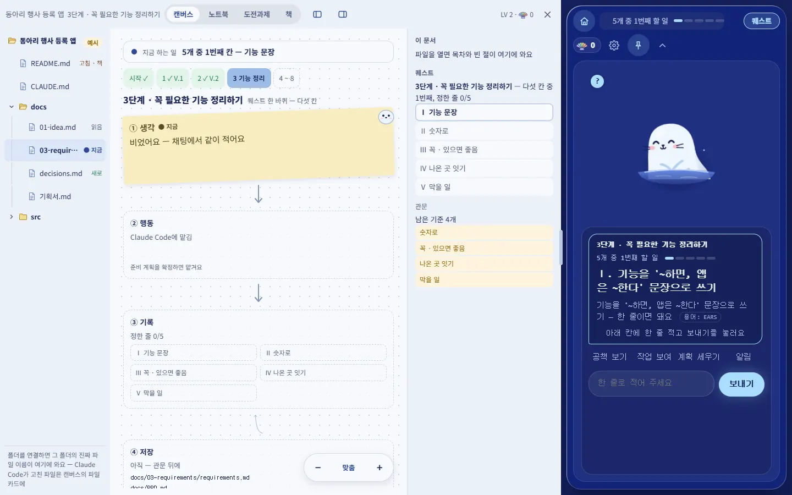

| 칸 | 무엇 | 너비 |
|---|---|---|
| **머리 줄** | 프로젝트 · 단계 이름 · 탭 넷(캔버스 · 노트북 · 도전과제 · 책) + 연 파일 탭 · 칸 접기 단추 둘 · `LV · 🐚` · 닫기 | — |
| **파일 칸** | 연결한 폴더의 파일 나무, 열어 둔 파일, 이름 찾기 | 200px |
| **작업 칸** | 고른 탭이나 연 파일 | 나머지 전부 |
| **오른쪽 칸** | 이 문서(목차 · 빈 절) · 퀘스트(다섯 칸) · 관문(남은 기준) | 280px — **섬이 접혔을 때만** |
| **섬 옆 칸 / 알약** | 플로로 · 대화 카드 · 칩 · 입력. 접으면 알약 | 420px / 56px |

**칸이 바뀌는 규칙** — 코드 `app.js` `sideOn`(1424줄) · `app.css` `.wside`:

- 섬이 **펼쳐져 있으면** 오른쪽 칸을 그리지 않는다 → 파일 칸 | 작업 칸 | 섬.
- 섬을 **접으면** 오른쪽 칸이 나오고 섬은 알약이 된다 → 파일 칸 | 작업 칸 | 오른쪽 칸 | 알약.
- 창이 좁으면(760 아래) 파일 칸 · 단계 이름을 숨긴다. 머리의 칸 접기 단추로 파일 칸 · 오른쪽 칸을 각각 접는다.
- 섬의 자리는 위 · 아래 · 왼쪽 · 오른쪽 넷 중 하나(섬 머리의 ▲ ▼ ◀ ▶).

**화면 크기마다 작업 칸이 얼마나 남나** (섬 오른쪽 · 펼침, 2026-10-28에 잰 값):

| 화면 | 파일 칸 | 작업 칸 | 섬 | 섬이 차지하는 몫 |
|---|---|---|---|---|
| 1024 | 숨김 | 604 | 420 | **41%** |
| 1280 | 200 | 660 | 420 | 33% |
| 1440 | 200 | 820 | 420 | 29% |
| 1728 | 200 | 1108 | 420 | 24% |
| 1440, 섬 접힘 | 200 | 904 | 56(알약) + 오른쪽 칸 280 | — |

---

## 2. 칸마다 — 무엇이 있고 UI로 어떻게 만들었나

### 2-1. 머리 줄

| 무엇 | UI로 어떻게 |
|---|---|
| 프로젝트 · 단계 이름 | 왼쪽에 작은 회색 글 한 줄 |
| 탭 | 둥근 묶음 단추(고른 것만 흰 바탕). 파일을 열면 그 이름의 탭이 오른쪽에 붙고 닫기 `×` |
| 칸 접기 | 그림 아이콘 단추 둘(파일 칸 · 오른쪽 칸) |
| `LV 2 · 🐚 0` · 닫기 | 오른쪽 끝, 작은 글과 `×` |

### 2-2. 파일 칸 (C-43 · C-53)

| 무엇 | UI로 어떻게 |
|---|---|
| 파일 나무 | 폴더는 ⌄ › 로 접고 펼친다. 줄 높이 44px |
| 꼬리표 | `● 지금`(파랑) · `새로`(초록) · `읽음`(회색) · `고침 · 책` · 폴더 연결 전 `예시`(노랑). 폴더 옆 숫자(그 안에 바뀐 파일 수) |
| 열어 둔 파일 | 맨 위 묶음, 지금 연 파일은 파란 바탕 |
| 찾기 · 바닥 줄 | '파일 이름 찾기' 칸, 바닥에 "6개 · 깊이 3까지 · 이름만 봐요" |

### 2-3. 작업 칸 — 탭 넷과 파일 보기

| 탭 | UI로 어떻게 | 요구 |
|---|---|---|
| **캔버스** | 점 격자 위 1100×640 판. 위에 지금 하는 일 한 줄과 **단계 칩**(지난 단계 연두 `✓ V.n` · 지금 파랑 · 뒤는 흐림). 판에 퀘스트 다섯 칸(① 생각 → ② 행동 → ③ 기록 → ④ 저장 → ⑤ 버전)과 관문이 화살표로 이어진다. **지금 칸은 기울어진 노란 포스트잇**, 나머지는 점선 상자. 옆에 '파일 · 바뀐 줄 수'(초록 줄) · '배울 말'(보라) · 지난 장 / 다음 장 카드. 관문은 연보라 상자에 빨간 '안 됨'. 오른쪽 아래 `− 맞춤 +`, 끌어서 옮기고 ⌘/Ctrl+휠로 크게 작게 | C-41 · C-42 · F-66 |
| **노트북** | **책 모양** — 갈색 표지 · 베이지 종이 · 왼쪽 스프링 구멍. 왼쪽 목차 Ⅰ ~ Ⅴ(끝냄 ✓ / ★ 아직), 오른쪽 할 일마다 체크 상자 · 설명 · "아직 — 채팅에서 한 줄 적어요". 아래 자세히 보기 · 보상 칩 · '완료 보고 / 힌트 / 고치기' | C-22 |
| **도전과제** | 왼쪽 갈색 세로 줄 = **장 탭**(지도 하나 + 단계 여덟, 그림 아이콘). 지도에서는 **지도 · 흐름 · 상자** 세 보기 — 지도는 단계 카드 여덟 장(네 장씩 두 줄, 상태 넷: 끝남 · 지금 · 준비된 퀘스트 · 아직 안 그려짐) + 맨 아래 단계 밖 문서, 흐름은 모눈 종이 위 단계마다 넣은 것 → 플로로가 한 것 → 내가 정한 것 → 관문, 상자는 문서 지도(폴더를 연결한 앱에서만). 장 탭을 누르면 그 단계의 **게임 판 길**(네모 타일 아이콘이 세로로 이어지고 끝에 관문 문) | C-54 · C-39 · C-45 |
| **책** | 흰 카드 하나 — 버전 알약(V.1 · V.2 · V.3), 왼쪽 목차 · 오른쪽 내용(생각 · 한 일 · 정한 것 · 배운 말 · 다음 할 일), '단계 문서 · 정한 것 펼치기' | C-26 |
| **파일 보기** | 머리에 파일 경로(고정폭) · 종류 · '원문 / 보기'. 도구 줄: '고치기' · '틀로 맡기기…'(고르기 상자) · '저장'(둥근 파란 단추) · 서식(제목 · 굵게 · 목록 · 넣기 · 머리말) · 글 크기 `− 100% +` · 목차 · '이 문서에서 찾기'. md는 보기 좋게, 코드는 줄 번호. 바닥 상태 줄 "13줄 · UTF-8 · LF" | C-43 ~ C-45 · C-53 |

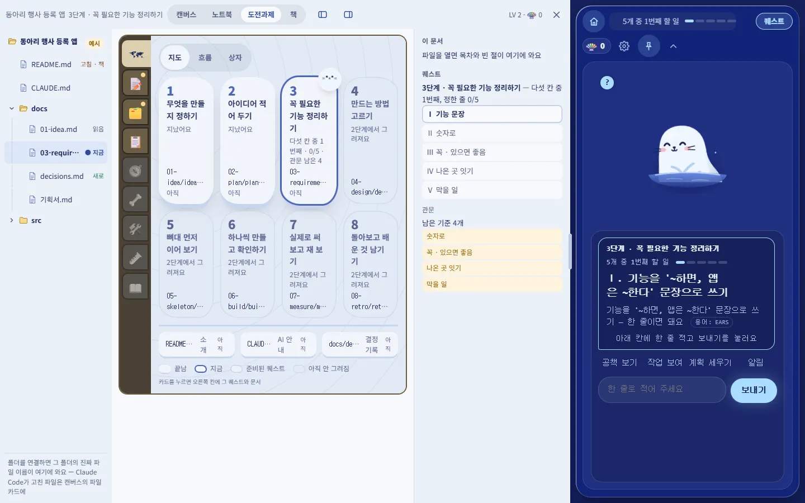

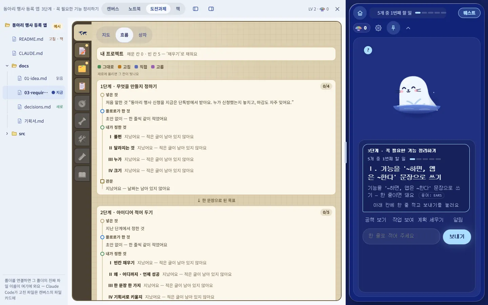

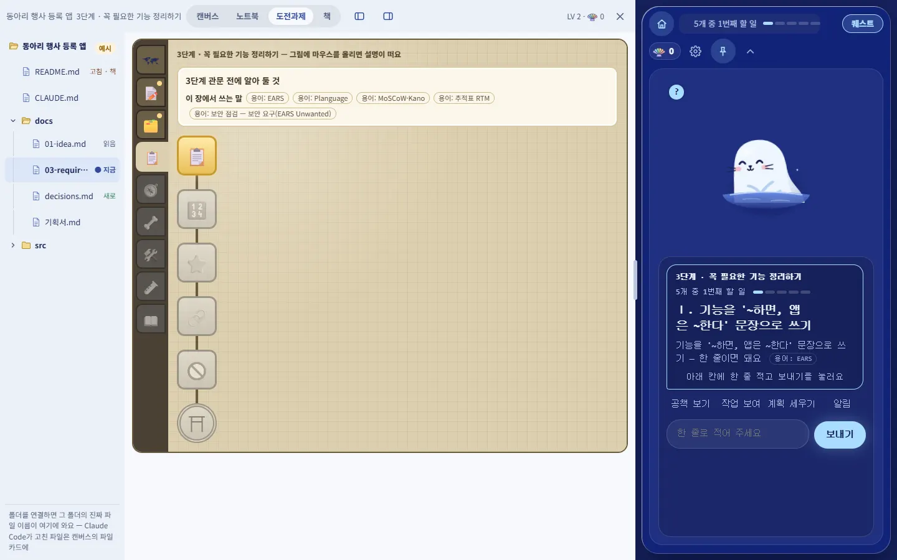

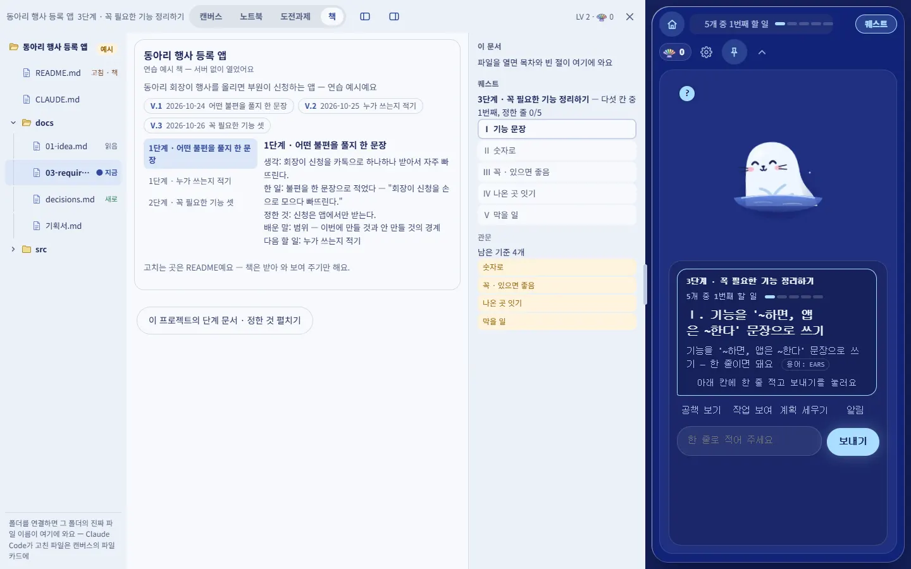

### 2-4. 오른쪽 칸 (C-53, 섬이 접혔을 때)

| 무엇 | UI로 어떻게 |
|---|---|
| 이 문서 | 파일 이름 · 절 수 · 빈 절 수, 목차(빈 절은 빨간 '비었어요' 꼬리표, 누르면 그 절로) |
| 퀘스트 | 지금 단계 · 다섯 칸 목록(Ⅰ ~ Ⅴ), 지금 칸만 테두리 |
| 관문 | 남은 기준을 노란 줄로 |

### 2-5. 섬 옆 칸과 알약

| 무엇 | UI로 어떻게 |
|---|---|
| 섬 옆 칸 | 남색 판 — 위 줄(홈 · 진행 막대 · 퀘스트 · 조개 · 설정 · 고정 · 접기), 큰 플로로, 대화 카드(단계 · 할 일 · 설명 · 용어 칩), 칩 넷(공책 보기 · 바뀐 작업 보여 주기 · 계획 세우기 · 알림), 한 줄 입력 + '보내기'. 손잡이로 너비 320 ~ 760 |
| 알약 | 섬을 접으면 가장자리의 세로 알약(플로로 얼굴 · 단계 · 지금 할 일을 세로 글로). 켤 때는 알약 옆 말풍선에 인사 · 멈춘 곳 · '섬 펼치기 / 나중에'(C-55) |

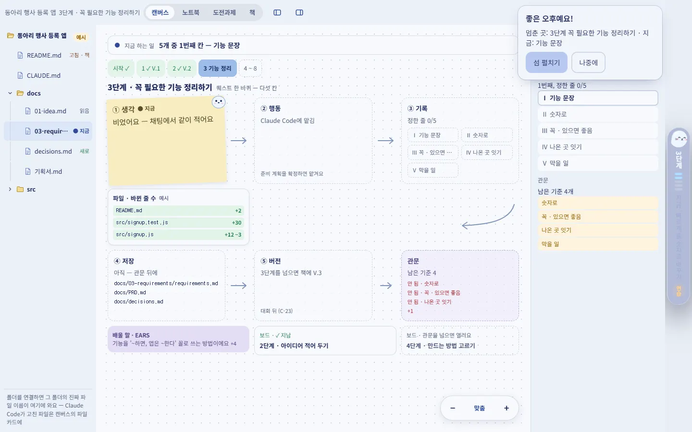

---

## 3. 작업실 점검 — 숫자

**칸별로 본 통일감** (장면 19개 합계, 2026-10-28):

| 칸 | 글자 크기 | 둥글기 | 글자색 | 바탕색 | 테두리 |
|---|---|---|---|---|---|
| 머리 줄 | 4 | 4 | 4 | 4 | 1 |
| 파일 칸 | 3 | 3 | 6 | 4 | 1 |
| 오른쪽 칸 | 3 | 2 | 4 | 4 | 0 |
| **작업 칸** | **17** | **13** | **22** | **32** | **23** |
| 섬 옆 칸 | 7 | 10 | 8 | 13 | 5 |

작업 칸의 글자 크기는 10 · 10.4 · 11 · 11.5 · 12 · 12.5 · 13 · 13.5 · 14 · 15 · 16 · 17.5 · 18 · 20 · 21 · 22 · 30px이다.

**누르는 곳 44px**(넘김 문서의 꼭 지킬 것): 한 장면에 보이는 단추 중 가로나 세로가 44px보다 작은 것 — 캔버스 16/23 · 노트북 20/29 · 도전과제 16/40 · 책 18/24 · 파일 고치기 8/29.
파일 칸 · 오른쪽 칸 줄은 44px을 지킨다. 작은 것은 주로 머리 줄 탭(28 ~ 30px)과 섬의 칩 · 아이콘 단추(19 ~ 40px)다.

---

## 4. 작업실 점검 — 어긋난 곳

근거는 [`impeccable-review`](../../.claude/skills/impeccable-review/SKILL.md) 스킬의 기준 파일이다. 통일감 점수는 **4점 중 1점** — "비슷한 것이 다르게 보이고 다르게 움직인다"(`critique.md` 4번).
**먼저**는 사용자가 바로 느끼고 고치는 자리가 분명한 것, **다음**은 디자인 바탕을 정해야 하는 것, **확인**은 앱 창에서 다시 봐야 하는 것이다.

| # | 차례 | 어디 | 무엇이 어긋나나 | 근거 | 고칠 방향 | C-57 |
|---|---|---|---|---|---|---|
| 1 | 먼저 | 작업 칸 전체 | **한국어가 낱말 중간에서 끊긴다** — 포스트잇 '적 / 어요', 지도 카드 '정 / 하기' · '두 / 기' · '확 / 인하기', 문서 칸 '아 / 직'이 세로로. `app.css`에 `word-break: keep-all`이 없다(서고 `library.css`에는 2026-10-19에 같은 문제로 넣었다) | `polish.md` "줄바꿈 · 길이를 시험" | 작업실 바탕에 한 줄 | ❌ |
| 2 | 먼저 | 섬 옆 칸 칩 | 420px 칸에서 '바뀐 작업 보여 주기'가 '작업 보여'로 잘린다. 섬을 아래에 붙이면 칩 넷이 폭 전체로 흩어져 단추처럼 보이지 않는다 | `polish.md` 같은 줄, `critique.md` 4번 | 칩을 두 줄로 감싸거나 이름을 줄임. 칩에 바탕 · 테두리 | ❌ |
| 3 | 먼저 | 작업 칸 탭끼리 | **한 칸 안에 디자인이 셋** — 캔버스는 흰 점 격자 + 파스텔 카드 다섯 색(노랑 포스트잇 · 초록 파일 · 보라 배울 말 · 연보라 관문 · 빨강 '안 됨'), 노트북은 갈색 책 · 베이지 종이 · 올리브 단추, 도전과제는 갈색 장 탭 + 모눈 종이 + 게임 타일. 탭을 바꿀 때마다 다른 앱처럼 보인다 | `critique.md` 4번 "다른 제품을 꿰매 붙인 느낌" | 작업 칸의 판 · 카드 한 종류를 정하고 탭은 그 안에서 내용만 다르게 | 🟡 색만 |
| 4 | 다음 | 단추 | 같은 '주 단추'가 다 다르다 — '저장'은 동그란 파란 단추, 노트북 '완료 보고'는 올리브 네모, 섬 '보내기'는 하늘 알약, `− 맞춤 +`는 흰 알약. 섬 칩은 테두리 · 바탕이 없어 글처럼 보인다 | `critique.md` 4번 | 주 · 보조 · 글자 단추 세 종류로 | ❌ |
| 5 | 다음 | 누르는 곳 | 3절 숫자 — 머리 탭 28 ~ 30px, 섬 칩 · 아이콘 19 ~ 40px | 넘김 문서 "누르는 곳 44px" | 탭 · 칩 높이를 44px로 | ❌(지키라고만) |
| 6 | 다음 | 번호 | 노트북 · 오른쪽 칸 · ③ 기록 칸은 Ⅰ ~ Ⅴ, 캔버스는 ① ~ ⑤, 지도는 1 ~ 8 — 한 화면에 셋이 같이 보인다 | `polish.md` "같은 것은 같은 말 · 모양으로" | 단계는 숫자, 칸은 하나로 | ❌ |
| 7 | 다음 | 이름 | 섬 칩은 '공책 보기'인데 탭은 '노트북'. 단계 칩은 '3 기능 정리', 제목은 '3단계 · 꼭 필요한 기능 정리하기' | `critique.md` "용어는 처음부터 끝까지 같게" | 한 이름으로 | ❌ |
| 8 | 다음 | 섬 대화 · 입력 | 보통 문장에 **코드용 고정폭 글꼴**. Windows에서는 한글이 다른 글꼴로 바뀌어 자간이 넓다 | `craft-floor.md` "고정폭은 코드 · 숫자에만" | 글꼴 바꾸기 | ✅ |
| 9 | 다음 | 아이콘 | 칸 접기는 그림 아이콘, 상태는 글자 기호(✓ ● ★ ▸), 도전과제는 게임풍 그림 | `craft-floor.md` "아이콘은 한 가지 선 굵기로" | 선 아이콘 한 벌 | ✅ |
| 10 | 다음 | 작업실 ↔ 섬 | 밝은 작업실 옆에 짙은 남색 섬이 늘 붙어 있다. 컴퓨터를 다크 모드로 바꿔도 작업실은 밝은 판 그대로 | `critique.md` 4번 | 섬 색을 작업실과 한 계열로(C-57의 `#363E62`), 다크 모드를 할지 정하기 | ✅ 섬 색 · 다크 모드는 미정 |
| 11 | 확인 | 좁은 화면 | 1024에서 섬이 창의 41%(420px) — 작업 칸 604px | `adapt.md` | 좁은 화면에서 섬 기본 너비를 줄이거나 알약으로 시작 | ❌ |
| 12 | 확인 | 알약 · 말풍선 | 알약의 세로 글씨가 흐려 읽기 어렵고, 켤 때 인사 말풍선이 오른쪽 칸 머리('이 문서')를 가린다 | `polish.md` | 세로 글은 줄이고 말풍선 자리를 칸 밖으로 | ❌ |
| 13 | 확인 | 파일 탭 | 연 파일 탭의 닫기 `×`가 탭 위쪽 바깥에 떠 있다 — 브라우저 미리보기에서 봤고 앱 창에서는 확인 못 함 | `polish.md` | 탭 안 오른쪽으로 — **#235(2026-10-28 병합)가 '제 탭 오른쪽 위 작은 배지'로 고쳤다** | — |

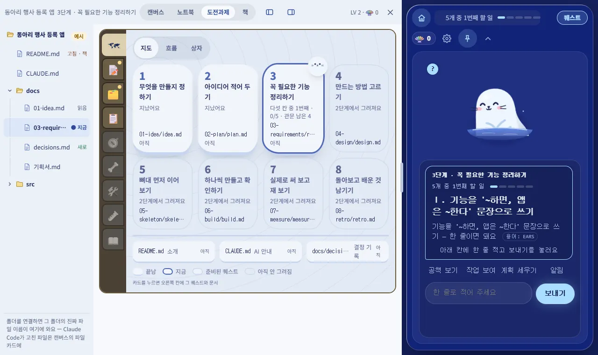

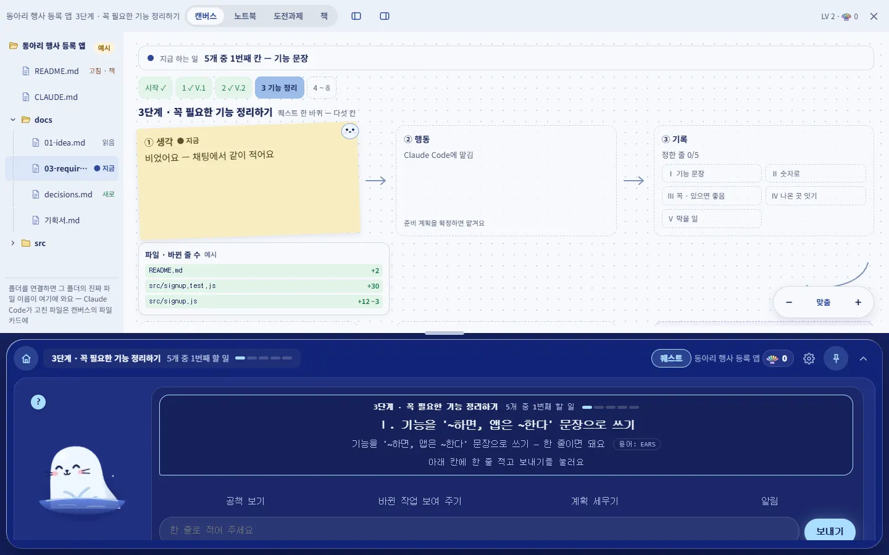

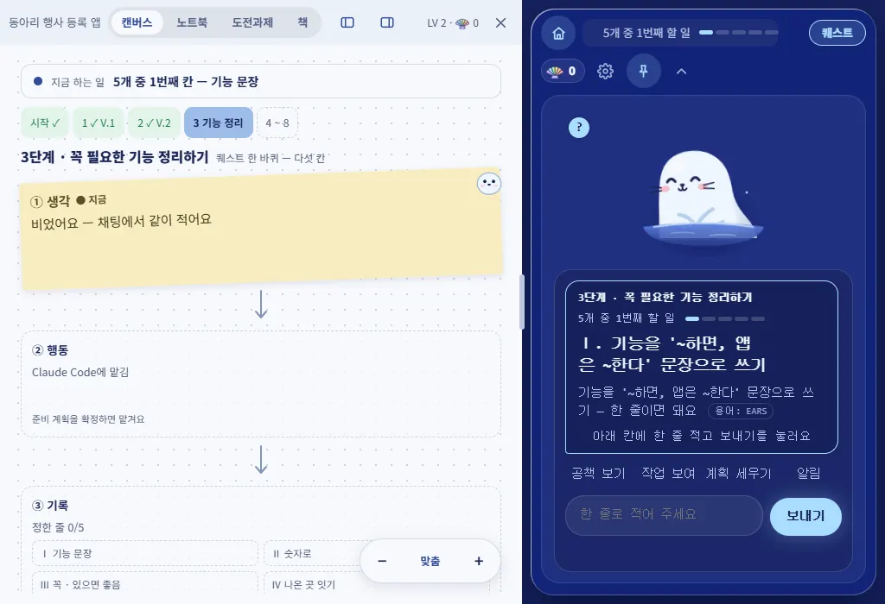

### 잘된 점

- **파일 칸 · 오른쪽 칸 · 머리 줄은 이미 정돈돼 있다** — 글자 크기 3 ~ 4가지, 줄 높이 44px. 작업 칸을 고칠 때 이 칸들의 규칙을 본보기로 쓰면 된다.
- 칸 수를 상황에 맞춰 줄인다 — 섬을 펼치면 오른쪽 칸을 접고, 좁은 창에서는 파일 칸을 숨긴다(1절 너비 표).
- 캔버스의 '지금 칸 = 기울어진 노란 포스트잇'은 한눈에 어디인지 보인다.
- 모든 글자 크기에 `--ui-scale`(글자 크기 설정)이 곱해진다.

---

## 5. 제안 — 무엇부터

1. **1 · 2번은 디자인 바탕과 상관없이 지금 고칠 수 있다** — 줄바꿈 한 줄, 칩 감싸기. 다시 칠한 뒤에도 그대로 남는 문제다.
2. **C-57(색 · 글꼴 · 아이콘)을 할 때 3 · 4 · 5 · 6 · 7번을 같은 끝 조건에 넣자** — C-57 문장에는 8 · 9 · 10번(과 3번의 색)만 있다. 색 · 글꼴만 바꾸면 탭마다 다른 판 · 단추 · 번호 · 이름은 그대로 남는다.
3. 11 ~ 13번은 데스크톱 앱 창에서 다시 본 뒤 정한다.

C-57에 더할지는 이재엽이 정한다. 자세히 → [디자인 넘김 문서](../00-overview/기록/fable-handoff-2026-10-28-design.md) · [requirements.md](../00-overview/requirements.md) C-57.

---

## 6. 목업 — 원칙 2 → 6 → 3 · 4 → 1 차례로

claude-drafted: 2026-10-28 — 두승현 요청("한 화면에 너무 많은 기능과 책임이 들어가 있다는 인상이야 해소할 방안 없을까?" · "덜어냈을 때의 목업을 생성해줄 수 있을까? 팀원들 설득이 필요해" · "2 → 6 → 3·4 → 1 순서로 목업 만들어줘")으로 Claude가 만들었다. **이 브랜치(`v2/ui-consistency_du`)의 결정은 두승현이 한다**(2026-10-28 두승현). 앱 코드는 고치지 않았다.

**왜:** 기능이 많아서라기보다 **같은 기능이 여러 곳에서 다른 모양으로 되풀이**된다. 장면 19개에서 센 값 — 퀘스트 다섯 칸 7곳, 문서 · 파일 7곳, 관문 5곳, 배울 말 4곳, 지난 · 다음 단계 4곳. 한 화면(캔버스)에서도 단계 이름 · 할 일 진행이 3번씩 보인다.

**어떻게 만들었나:** 새로 그리지 않았다. 지금 앱 화면(e2e와 같은 길, 섬이 펼쳐지면 오른쪽 칸 없음)에 단계마다 바꿀 것만 **쌓아서** 적용해 찍었다 — 3 · 4단계 사진에는 2 · 6단계도 들어 있다. 기능은 하나도 빼지 않았고, 같은 정보가 있던 자리만 줄이거나 모양을 맞췄다.

### 6-1. 단계마다 바꾼 것

| 단계 | 원칙 | 바꾼 것 |
|---|---|---|
| **2** | 정보마다 집 하나 | 몇 단계인가 → **머리 줄 단계 칩**(모든 탭, 지금 칩에 전체 이름) · 지금 할 일과 진행 → **섬 카드** · 프로젝트 이름 → **파일 칸 맨 위** · 조개 → **머리 줄** · 플로로 → **섬** · 지난 · 다음 단계 → 단계 칩(판의 '보드' 카드 둘을 뺌) · 배울 말 → 섬 카드 칩(판의 보라 카드를 뺌) · 파일 · 바뀐 줄 수 → 파일 칸(판의 초록 카드를 뺌) · 판 ④ 저장의 경로 셋 → "문서 3개 · 파일 칸에서 열어요 ›" 한 줄 · 노트북 왼쪽 목차 Ⅰ ~ Ⅴ → 뺌(오른쪽 할 일 다섯과 같다) · 지도 카드의 문서 경로와 단계 밖 문서 줄 → 파일 칸 · 오른쪽 칸 → 파일을 열었을 때만 |
| **6** | 같은 상태는 같은 모양 | 도전과제 지도에 이미 있는 **범례 넷**(끝남 · 지금 · 준비됨 · 아직)을 기준으로 — **지금**은 바다색 테두리(판의 지금 칸 · 지금 단계 칩 · 파일 칸 '지금' · 노트북의 지금 줄), **끝남**은 종이 카드, **아직**은 흐린 면. 관문은 금색 테두리, '안 됨' 줄만 볼색. 노란 포스트잇 · 연두 칩 · `● 지금` 점이 사라진다 |
| **3 · 4** | 조금씩 펼쳐 보이기 · 주 행동 하나 | 섬 칩 넷 → **'더 보기 · 4'** 하나 · 노트북 '자세히 보기 · 왜 하나요' → 접힘 · 지도의 아직 카드 설명 → 제목만 · 판 관문 → '남은 기준 4'만(자세히는 눌러서) · 주 단추는 섬 **'보내기' 하나** — 노트북 '완료 보고'는 보조 단추, '힌트 · 고치기'는 글자 단추 |
| **1** | 칸마다 일 하나 | 칸마다 이름표 — 머리 줄 **어디**, 파일 칸 **찾기**, 작업 칸 **보고 만들기**, 섬 **말하기**. 새 요소를 넣을 때 "어느 칸의 일인가"를 묻는 기준 |

노트북 '완료 보고'는 지금 앱에서도 다섯 칸을 다 채우기 전엔 흐리게(눌리지 않게) 되어 있다 — 4번 원칙을 이미 반쯤 지키고 있다. 목업은 모양만 보조 단추로 바꿨다.

### 6-2. 잰 값 (2026-10-28, 1440 · 연습 예시 3단계)

| 화면 | 보이는 글 줄 (전 → 2 → 6 → 3 · 4) | 누를 수 있는 것 (전 → 3 · 4) |
|---|---|---|
| 캔버스 | 91 → 65 → 65 → **58** | 24 → **20** |
| 노트북 | 76 → 65 → 65 → **59** | 30 → **21** |
| 도전과제 지도 | 98 → 78 → 78 → **70** | 41 → **37** |
| 섬을 접은 캔버스 | 95 → … → **52** | 11 → 11 |

- 단계 이름 · 할 일 진행이 한 화면에 보이는 횟수: 3 → **1**.
- '지금'을 나타내는 모양: 다섯(노란 포스트잇 · 파란 칩 · `● 지금` · 굵은 테두리 · 오른쪽 칸 테두리) → **하나**(바다색 테두리).
- 섬을 접으면 작업 칸 너비 904 → 1184px(+31%).
- 6단계는 글을 줄이지 않고 모양만 맞추므로 글 줄 수가 그대로다.

### 6-3. 사진

**캔버스** — 전 · 2 · 6 · 3 · 4 · 1

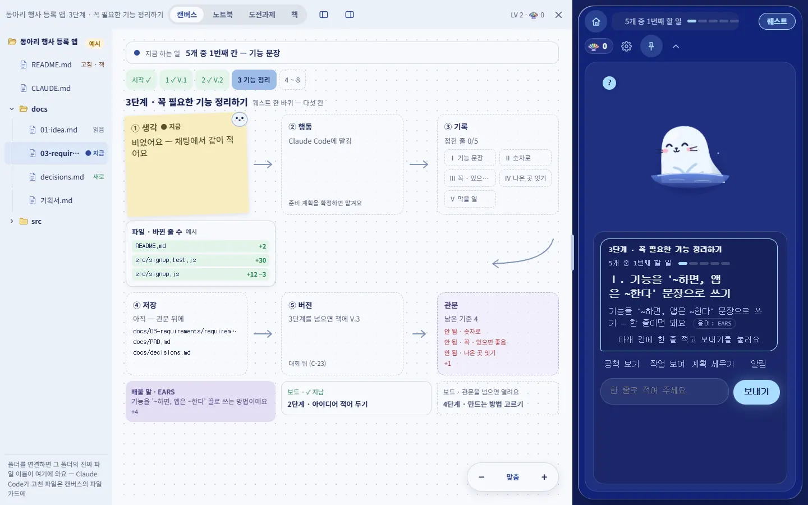

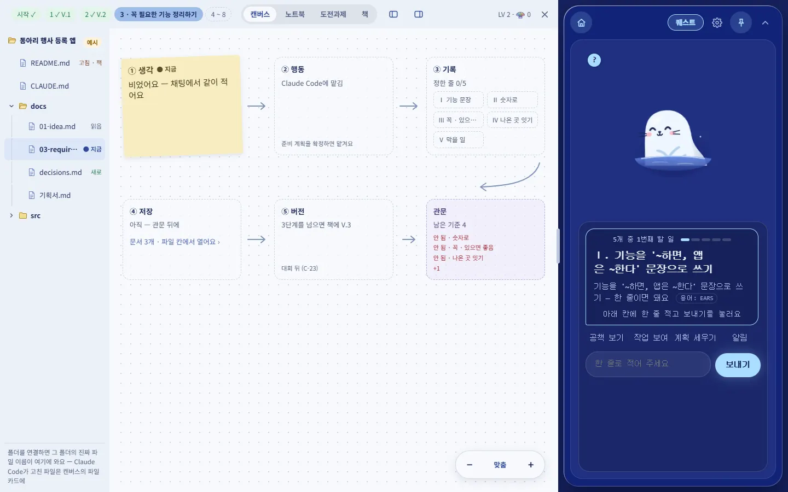

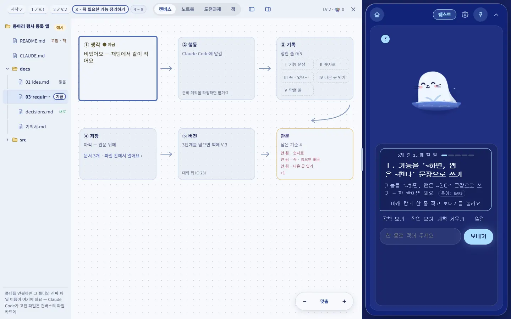

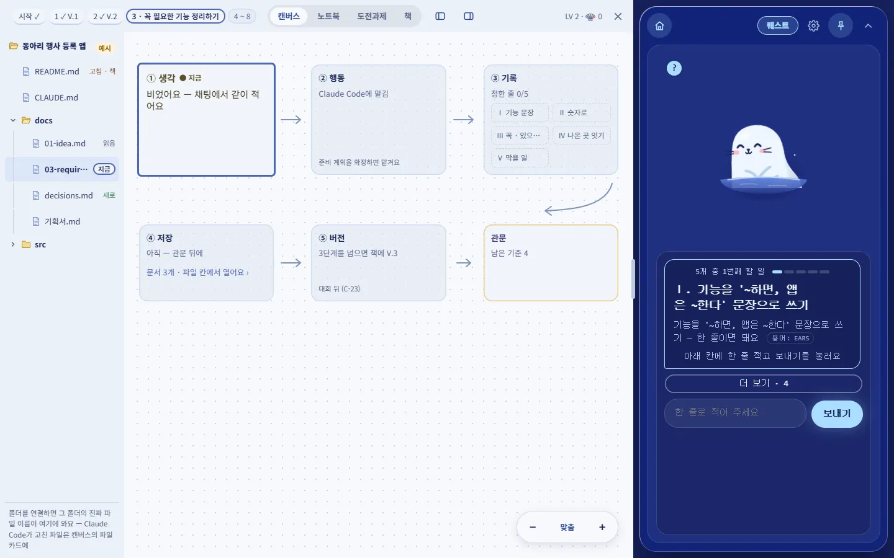

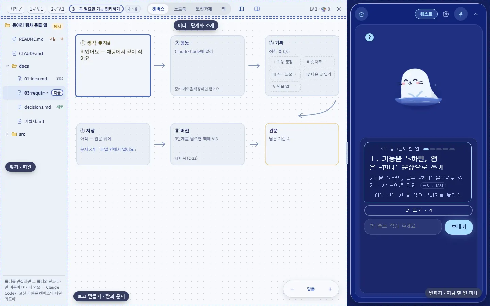

**노트북** — 전 · 2 · 6 · 3 · 4

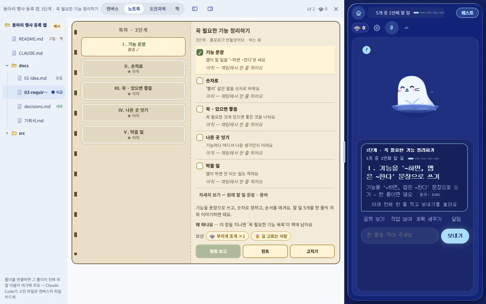

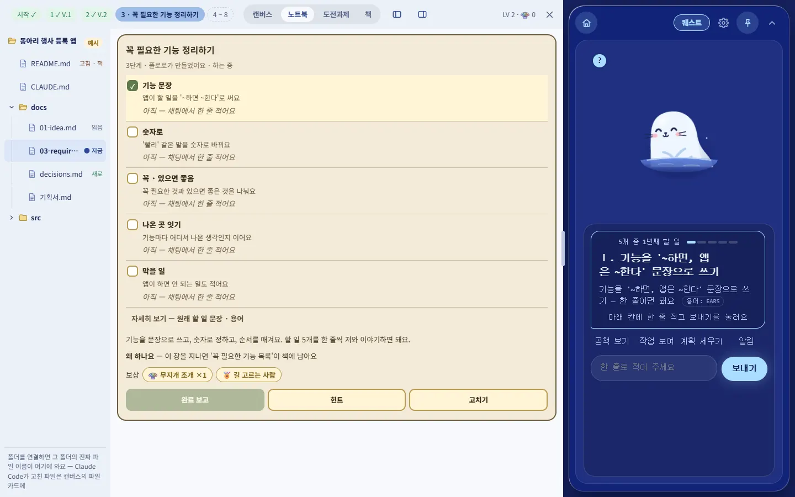

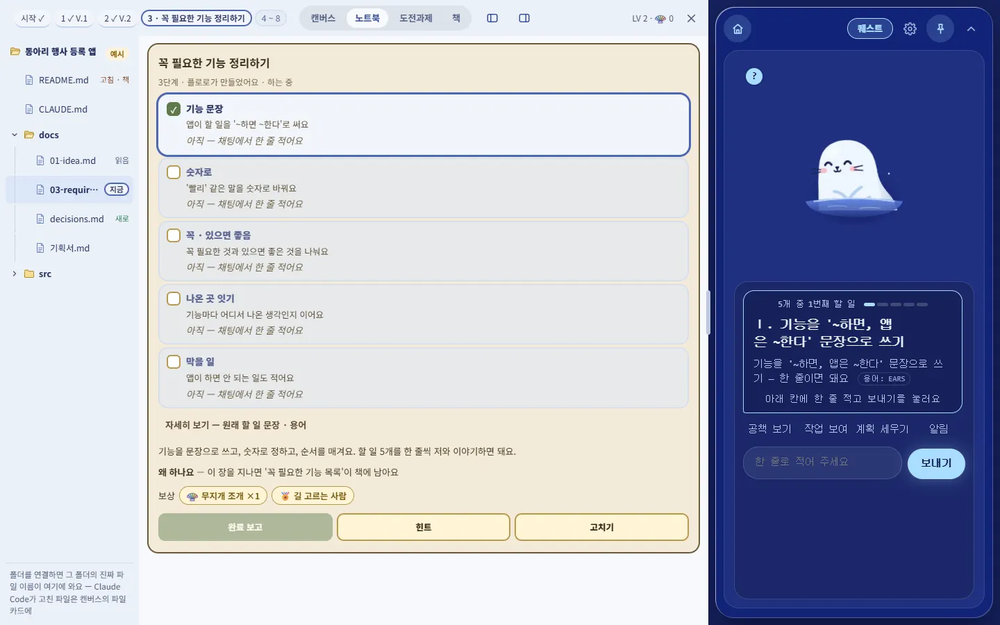

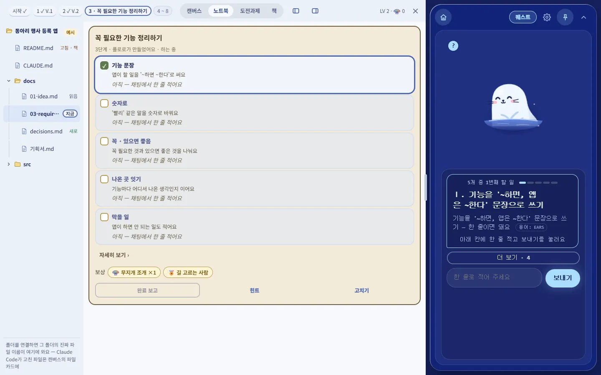

**도전과제 지도** — 전 · 2 · 6 · 3 · 4

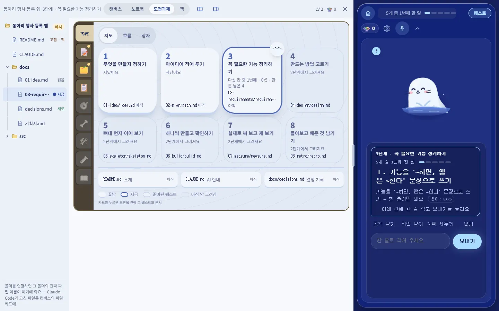

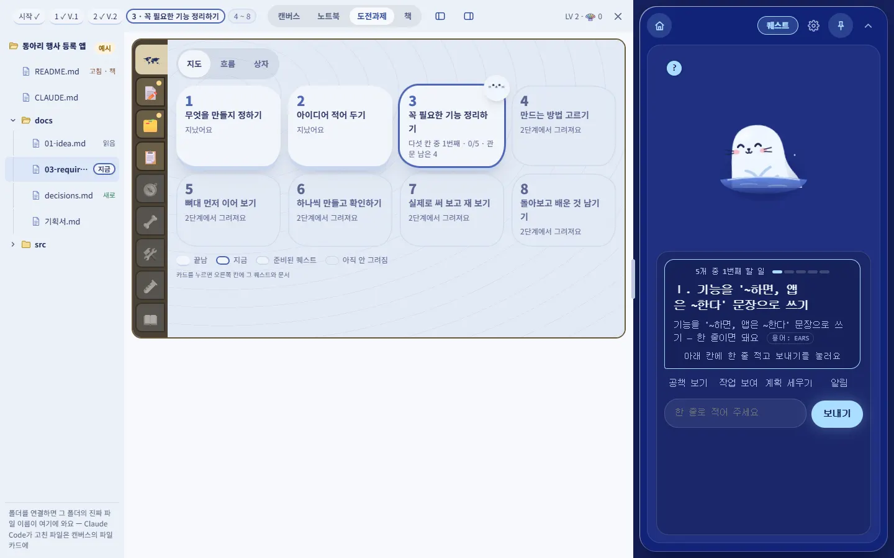

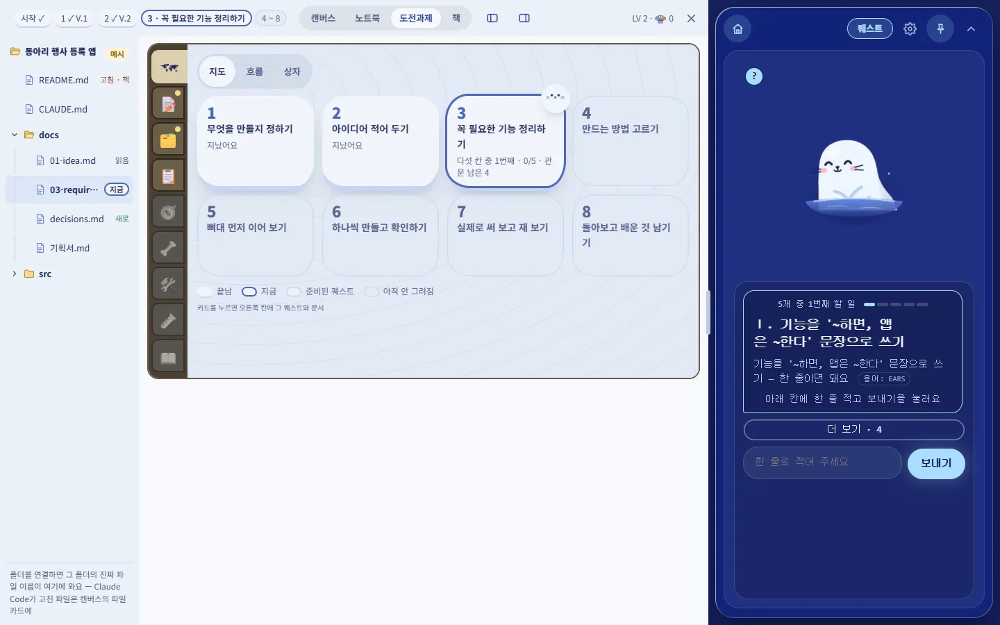

**섬을 접었을 때** — 전 · 3 · 4

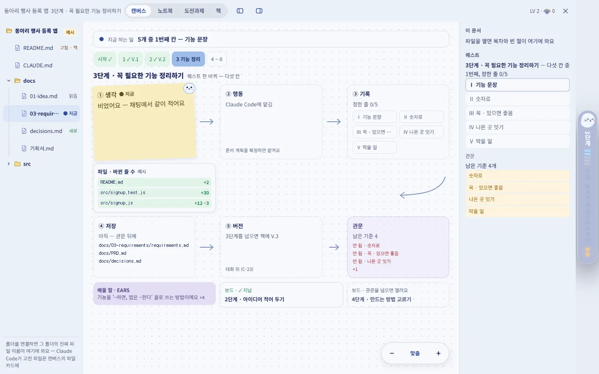

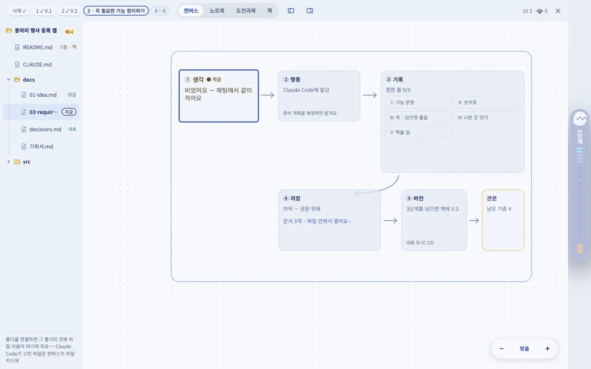

### 6-4. 정할 것 (이 브랜치에서 두승현이)

1. 단계마다 넣을지 — 2 · 6 · 3 · 4 · 1을 한 번에 / 골라서.
2. 판 제목을 뺐을 때 판이 무엇인지 알 수 있는지 — 단계 칩이 머리 줄에 있어 뺐다.
3. 섬 칩 넷을 '더 보기' 하나로 접을지, 지금 칸에 맞는 칩 하나만 꺼내 둘지.
4. 팀에 올릴 것 — 노트북의 책 모양 · 장 보기의 게임 타일을 같은 판으로(원칙 5), 탭 넷 → '지금 · 전체' 둘(원칙 7). C-22 · C-54 · C-57(이재엽 결정)을 바꾸는 일이라 이 목업에는 넣지 않았다.

### 6-5. 목업이 하지 않은 것

- 낱말 중간 줄바꿈('정리하 / 기')과 섬 칩 글 잘림은 그대로다 — 4절 1 · 2번의 따로 된 고침이다.
- 색 · 글꼴(C-57)은 바꾸지 않았다. 6단계의 상태 모양은 지도의 범례 색(이미 팀 웹사이트 토큰)을 그대로 썼다.
- 노트북에 상태가 서로 맞지 않는 곳이 있다 — 왼쪽 목차는 'Ⅰ. 기능 문장 끝냄 ✓', 오른쪽 같은 줄은 "아직 — 채팅에서 한 줄 적어요", 판은 '정한 줄 0/5'. 연습 예시 데이터 탓인지 코드 탓인지 확인하지 못했다.

---

## 7. 플로로 자리 — 처음엔 작업 칸 전체, 작업할 땐 오른쪽

**두승현이 정리한 것 (2026-10-28, 그대로 옮김)**

| | |
|---|---|
| 문제 | 플로로가 우측에 배치되어 있으나 일관성과 통일감이 없고, 많은 정보가 화면에 배치되어서 피로감을 준다 |
| 원인 | 기존에 작업한 플로로를 그저 우측에 배치하는 수준으로 고민이 낮았다 |
| 제안 | 초기에는 플로로가 캔버스 중앙영역에 배치되어서 대화를 하고 이후 작업을 할 때는 우측에 배치한다 |
| 출력 | 플로로 배치가 UX적으로 개선된 모습을 보여준다. 따라서 자연스러운 흐름을 보여주는 의도를 만족시킨다 |
| 덧붙임 | (첫 목업을 보고) 흰색 배경이 있으면 플로로가 일부만 채운 화면이다. 내 의도는 모든 화면을 채우는 것 — 화면이 넓을수록 보기 편하고 많은 내용을 담아도 판단하기 편하다 |

claude-drafted: 2026-10-28 — 위 제안으로 Claude가 목업을 만들었다(6절 3 · 4단계 화면 위에). 앱 코드는 고치지 않았다.

**왜 맞는 방향인가:** 처음에는 할 일이 정해지지 않아 판에 보여 줄 것이 없고, 사용자가 할 일은 플로로와 말하는 것 하나다 — 그때는 대화가 주인공이어야 한다(`distill.md` "다음 행동은 하나"). 할 일이 정해지면 주인공이 판(만들기)으로 바뀌고, 플로로는 옆에서 다음 할 일을 묻는 자리로 비켜선다. 지금은 두 순간 모두 플로로가 같은 자리 · 같은 크기라서 언제 무엇을 볼지를 화면이 알려 주지 않는다.

### 7-1. 흐름

| 차례 | 화면 | 무엇이 일어나나 |
|---|---|---|
| ① 시작 | 플로로가 **작업 칸 전체**를 채운다(머리 줄 · 파일 칸은 그대로). 플로로 · 대화 카드 · 입력은 가운데 한 줄기(폭 720) | 첫 할 일을 묻는다 — 지금 할 수 있는 일은 대답 하나 |
| ② 대답 | 같은 자리 | 첫 줄을 적어 '보내기' |
| ③ 작업 | 플로로가 **오른쪽 옆 칸**으로 줄어들며 옮겨 가고 그 자리에 판이 나타난다 | 방금 보낸 줄이 판의 ① 생각 칸과 ③ 기록 'Ⅰ ✓'에 들어가고(정한 줄 1/5), 섬 카드는 다음 할 일(Ⅱ)을 묻는다 |
| ④ 접기 | 지금처럼 가장자리 알약 | 판을 넓게 쓸 때 |

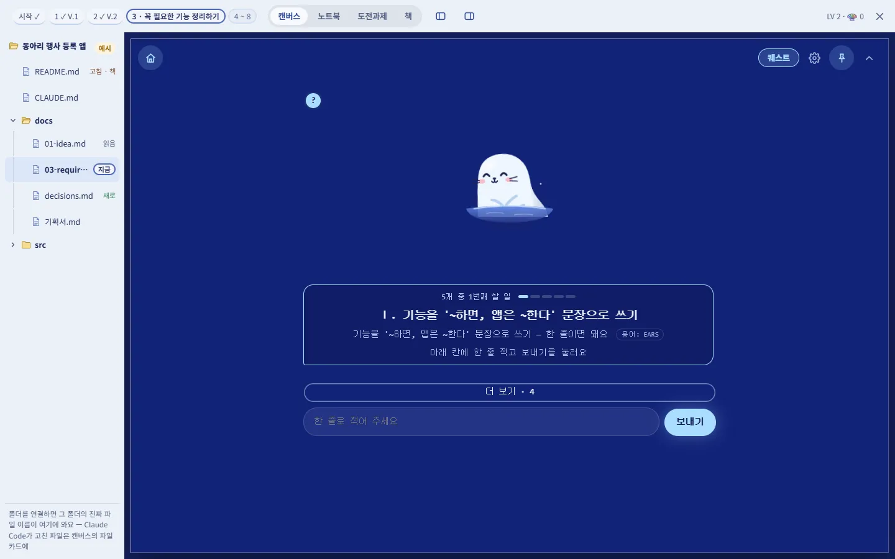

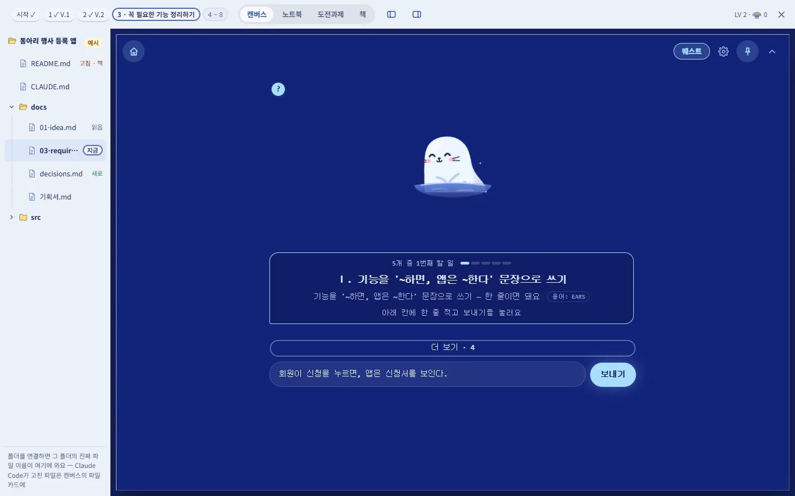

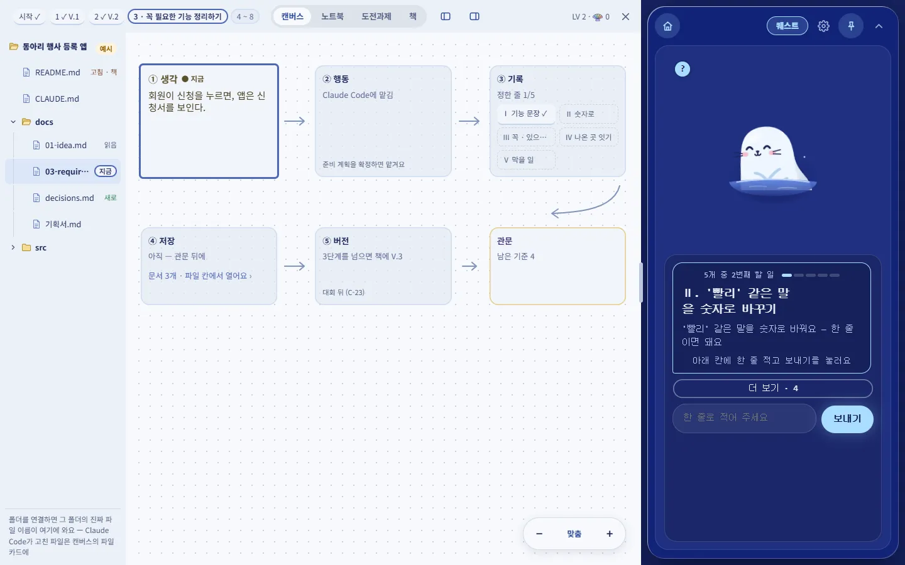

② → ③을 실제로 옮겨 가는 움직임은 비교 페이지(PR 본문에 링크)에서 볼 수 있다.

### 7-2. 움직임 규칙 (제안)

- 옮겨 가는 시간은 앱에 이미 있는 큰 전환 값 `--t-long`(0.4초) · 곡선 `--ease-base`를 쓴다(`app.css` 맨 위 움직임 묶음, F-45). 새 값을 만들지 않는다.
- 판은 플로로가 줄어들며 비켜서는 동안 나타나고, 방금 들어간 줄만 '지금' 테두리로 한 번 강조한다.
- 작업 칸 전체를 채울 때는 바깥 판 두 겹(판 안의 판)을 빼고 대화 카드 하나만 테두리를 둔다 — C-57 넘김 문서 "카드 안에 카드를 넣지 않는다".
- 컴퓨터의 **움직임 줄이기**를 켠 사람에게는 옮겨 가지 않고 바로 바뀐다(지금 플로로 움직임과 같은 규칙).

### 7-3. 정할 것 (이 브랜치에서 두승현이)

1. **언제 다시 작업 칸 전체로 오나** — 후보: 새 단계를 시작할 때(첫 할 일을 정하는 대화) · 관문(이해했는지 묻는 대화) · 사용자가 섬 머리를 눌러 '크게'.
2. 작업 칸 전체일 때 파일 칸을 그대로 둘지, 접을지 — 목업은 그대로 뒀다.
3. 가운데 한 줄기의 폭 — 목업은 720px. 넓은 화면에서 남는 양옆에 무엇을 둘지(비워 둠 / 지난 단계에서 정한 것 · 배울 말을 곁에).
4. 섬 자리 넷(위 · 아래 · 왼쪽 · 오른쪽) 설정과의 관계 — ③ 작업에서 옮겨 갈 곳은 그 설정을 따른다(목업은 오른쪽).

### 7-4. 목업이 하지 않은 것

- 작업 칸 전체 상태는 섬 옆 칸을 작업 칸 안으로 옮겨 칸 전체로 늘려 찍은 것이다. 앱에서는 작업실 창(`win.html`)이 섬 칸을 어디에 그릴지 정하는 규칙(`app.js` `islCol` · `win.js`)을 바꿔야 한다.
- 진행 막대(5개 중 n번째)의 점은 바꾸지 않았다 — 글만 '2번째'로.
- 판 위의 낱말 중간 줄바꿈('신 / 청서를')은 그대로다 — 4절 1번의 따로 된 고침.

---

## 8. 한 가족 테마 — 섬과 작업실을 같은 토큰으로

**두승현 (2026-10-28):** "플로로와 다른 UI가 색상과 테마가 달라서 통일감이 떨어진다, 통일감을 맞춰서 다시 디자인해줘. 이질적인 두 존재가 어울려야 함." · 목업을 본 뒤 "상단부분이 현재는 플로로 부분과 작업실 부분이 나눠져 있는데 … 캔버스 부분으로 통일되게 만들면 좋겠다" → 다리 6.

claude-drafted: 2026-10-28 — 위 요청으로 Claude가 6 · 7절 목업 위에 다시 칠했다. 앱 코드는 고치지 않았다.

**왜 따로 노나:** 색 묶음이 둘이고 서로를 모른다. 섬은 "PC 리퀴드 글래스"(`app.css` 526줄 — 별이 뜬 밤바다, 유리, `#16225E`)와 섬 칸의 고정 남색(1340줄), 작업실은 따로 된 파스텔 묶음(1217줄)이다. 글꼴도 섬 대화는 코드용 고정폭, 작업실은 시스템 글꼴이다. 반면 오늘 들어온 켤 때 말풍선(`.hello-bub`)은 이미 C-57 색을 써서 작업실과 잘 붙는다 — 같은 토큰을 쓰면 어울린다는 증거다.

**어떻게 — 같은 가족의 밝은 얼굴과 어두운 얼굴, 다리 여섯.** 색 · 글꼴은 이재엽이 정한 C-57 표([디자인 넘김 문서](../00-overview/기록/fable-handoff-2026-10-28-design.md) 2절)에서만 골랐다. 새 색을 짓지 않았다.

| 다리 | 무엇 | 전 | 후 |
|---|---|---|---|
| 1 같은 책상 | 섬이 칸을 남색으로 통째로 칠하지 않고, 작업실과 같은 바탕 `#E9EEF6` 위에 놓인 둥근 섬 카드 `#363E62`가 된다 | 칸 전체 `#16225E` · 유리 · 별 | 바탕 위 카드(둥글기 24) |
| 2 같은 글꼴 | 글은 Gowun Dodum, 섬의 큰 질문 · 지도 단계 숫자는 Bagel Fat One, 코드 · 파일 이름은 Nanum Gothic Coding | 섬 대화가 코드용 고정폭 | 양쪽 같은 글꼴 |
| 3 같은 단추 | 섬 '보내기'와 작업실 주 단추가 같은 `#B8C9F0` 알약 + `#263066` 글자 | 하늘 알약 · 올리브 네모 따로 | 하나 |
| 4 색의 메아리 | 밝은 쪽의 '고른 것 · 지금'(고른 탭 · 지금 단계 칩 · 파일 칸 '지금' · 지도의 장 탭 줄)을 섬 색 `#363E62`로 — 밝은 화면 곳곳에 섬의 조각이 보인다 | 파랑 · 갈색 · 테두리 제각각 | 섬 색 하나 |
| 5 같은 규칙 | 별 · 유리 · 점 격자 · 판 안의 판을 뺀다. 끝남은 민트 `#A9E2C4`, 관문은 금 `#E6CB86` 테두리, 칸 면은 종이 `#F2F5FA` · 눈 `#E2E9F4` | 갈색 책 · 모눈 · 점 격자 | 종이와 눈 |
| 6 상단 하나 | 작업실 머리 줄과 섬의 위 줄을 **창 전체 폭의 머리 줄 하나**로 — 왼쪽은 단계 칩 · 탭 · 칸 접기, 오른쪽 끝은 섬을 다루는 단추 묶음(홈 · 퀘스트 · 설정 · 고정 · 접기)을 섬 바로 위에. 섬 카드는 머리 줄 아래에서 시작한다 | 위 줄이 둘(작업실 · 섬)로 나뉨 | 한 줄 |

Bagel Fat One은 작은 글씨(판 칸 제목)에서 뭉개져서 큰 곳(섬의 질문 제목 · 지도 단계 숫자)에만 썼다 — 굵은 개성은 한 곳(`mode-operate.md` "대표 장면 하나").

### 8-1. 전과 후

**작업 칸 전체 — 플로로가 묻는 순간**

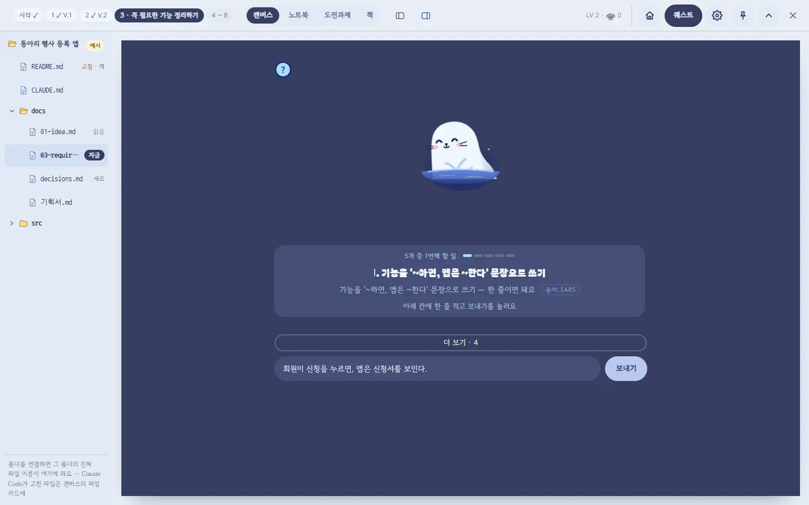

**작업 중 — 판과 섬이 나란히**

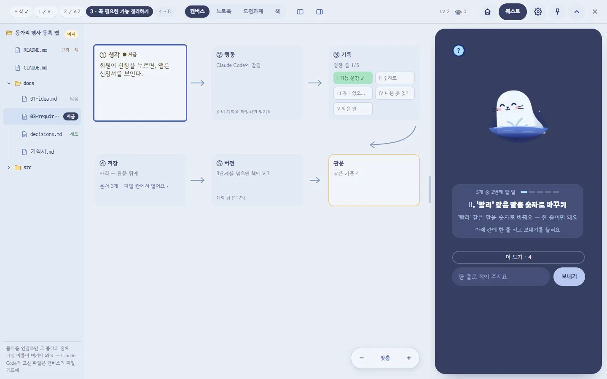

**노트북 · 도전과제 지도**

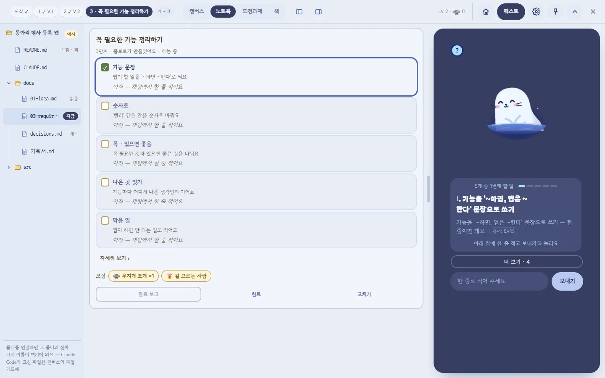

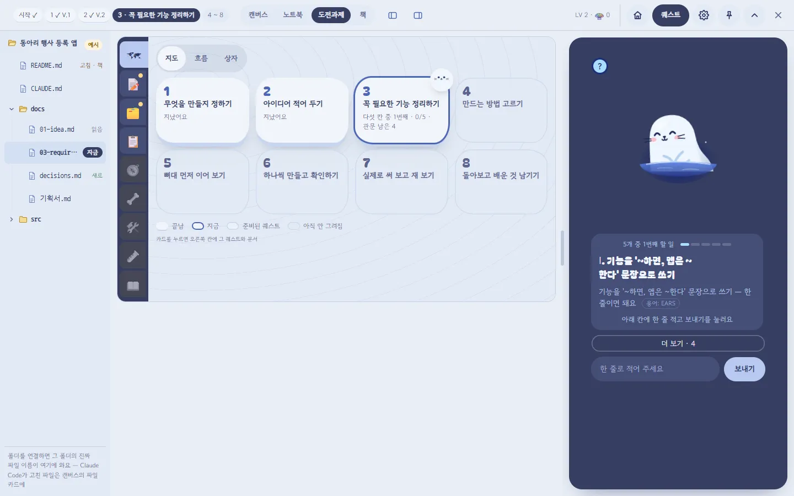

### 8-2. 정할 것 (이 브랜치에서 두승현이)

1. **'색의 메아리'(다리 4)를 넣을지** — C-57에 없는 제안이다. 넣으면 밝은 쪽의 강조색이 바다 `#4D66B5`와 섬 `#363E62` 둘이 된다(지금 칸 테두리는 바다, 고른 것 · 지금 표시는 섬).
2. **'같은 책상'(다리 1)을 넣을지** — C-57은 섬 색만 `#363E62`로 바꾸라고 했고, 칸을 통째로 칠할지 카드로 놓을지는 정하지 않았다.
3. 노트북의 책 모양을 종이 판으로 바꾼 것 — 색을 바꾸다 보니 책 표지 · 스프링 모양이 사라졌다. 원칙 5(개성은 한 곳)와 같은 방향이지만 C-22(게임처럼)를 건드리므로 팀에 올릴지.
4. 머리 줄의 '퀘스트' 단추 — 작업실을 켜고 끄는 단추라서, 작업실 안의 머리 줄에서는 오른쪽 끝 닫기(×)와 일이 겹친다. 뺄지 이름을 바꿀지.
5. 이재엽에게 이 목업을 C-57의 미리 보기로 보낼지 — C-57은 이 목업보다 넓다(아이콘 · 처음 설정 · 지도 얼음 조각).

### 8-3. 목업이 하지 않은 것

- **글꼴은 목업을 찍을 때만 Google Fonts에서 불러왔다.** 앱에 넣을 때는 C-57 규칙대로 `02-frontend/assets/fonts/`에 파일로 넣는다(밖으로 요청하지 않기).
- 낱말 단위 줄바꿈(4절 1번)은 이 테마 목업에만 같이 넣었다 — 섬 제목이 '앱은 ~ / 한다'로 끊기는 것이 보기 싫어서.
- 아이콘(글자 기호 → 선 아이콘), 처음 설정 · 관문 · 허락 판, 도전과제의 흐름 · 장 보기, 알약은 다시 칠하지 않았다. 플로로 그림과 얼음판 색도 그대로다.
- 다크 모드는 없다 — 작업실은 지금처럼 늘 밝다(4절 10번).
- 상단 하나는 섬이 오른쪽에 있을 때만 찍었다. 섬을 위 · 아래 · 왼쪽에 붙일 때 섬 단추 묶음이 어디로 갈지(섬 쪽 끝으로 따라가는지)는 정하지 않았다. 앱에서는 `win.html`의 `#root` 줄 배치와 `app.js`의 섬 위 줄(`tbRight`)을 머리 줄로 옮겨야 한다.

---

## 9. 작업실 밖 — 짧게

| 화면 | 무엇 | UI로 어떻게 | 요구 |
|---|---|---|---|
| 처음 설정 | 한 번만 — AI 연결 → 같이 쓸 앱 → GitHub → 폴더 | 섬 위에 겹쳐 뜨는 카드, 주 단추 하나 '준비 시작하기 `Enter`' + 글 단추 '나중에 할게요', 아래 점 여섯 | FR-10 · C-38 |
| 관문 | 단계를 넘기 전 | 섬의 대화 카드 테두리가 금색, 한 일을 칩과 화살표로, '네, 이해했어요 `Y`' / '아니요, 같이 풀어요 `N`'. 빈칸 · 증거 없는 칸은 넘지 못하고, 넘기려면 채우거나 까닭을 적는다 | FR-4 · 5 · F-60 · F-62 |
| 섬에서 허용 · 거절 | Claude Code가 허락을 구할 때 | 허락 카드(무엇 · 파일 · 바뀐 줄) + '허용 / 거절', 되돌리기 어려운 일은 빨간 테두리와 경고 | FR-17 |
| 알림 · 먹이 주기 | 섬 안의 판 | 알림은 새것부터, 먹이는 구간마다 '먹어도 돼요 / 빼 주세요' | FR-7 · FR-15 |

---

## 10. 확인하지 못한 것 · 다시 재는 법

- **데스크톱 앱 창:** 위 사진은 화면 파일을 Chrome으로 연 것이다. 작업실 창은 앱과 같은 화면(`win.html`)에 섬이 보내는 HTML을 넣었고, 실제 앱처럼 섬이 펼쳐진 장면에서는 오른쪽 칸을 뺐다. 파일 보기만은 브라우저 미리보기(떠 있는 판)로 찍었다.
- **Mac · 다크 모드의 앱 창 · 섬을 왼쪽 · 위에 붙인 모습 · 고치는 중의 상태(저장 안 함 · 비밀값 경고).**
- **사진에 없는 것:** 단계 초안 함께 쓰기(예시 셋 고르기), 설정 창, 흐름 보기 끝까지, 상자 보기(폴더 연결 필요).
- **다시 재는 법:** 사진 · 숫자를 낸 스크립트는 저장소 밖에서 돌렸다(`puppeteer-core`로 장면을 만들고 `getComputedStyle`을 칸별로 셈). 계속 쓰려면 e2e의 `FLOE_SHOTS`처럼 시험에 붙이는 편이 낫다.
- 루트 [README](../../README.md)는 "탭 다섯(문서 지도 포함)"이지만 v38.0(#228)부터 **탭은 넷**이다. README 사진(`shots/*.webp`)도 그 전에 찍었다.
