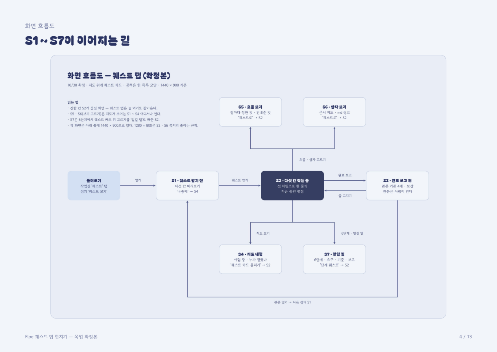
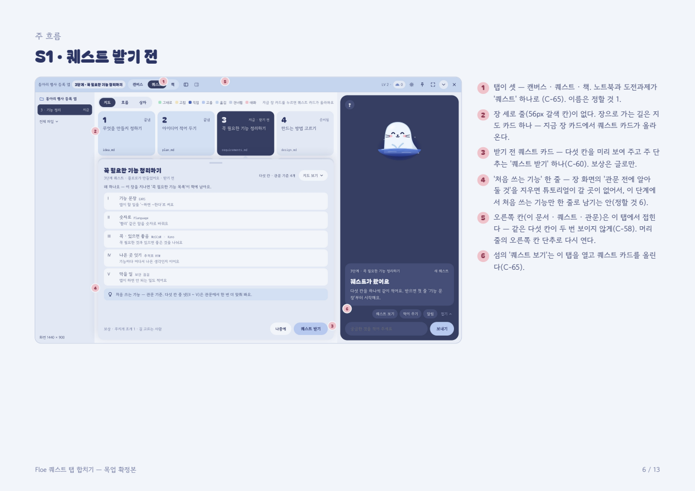
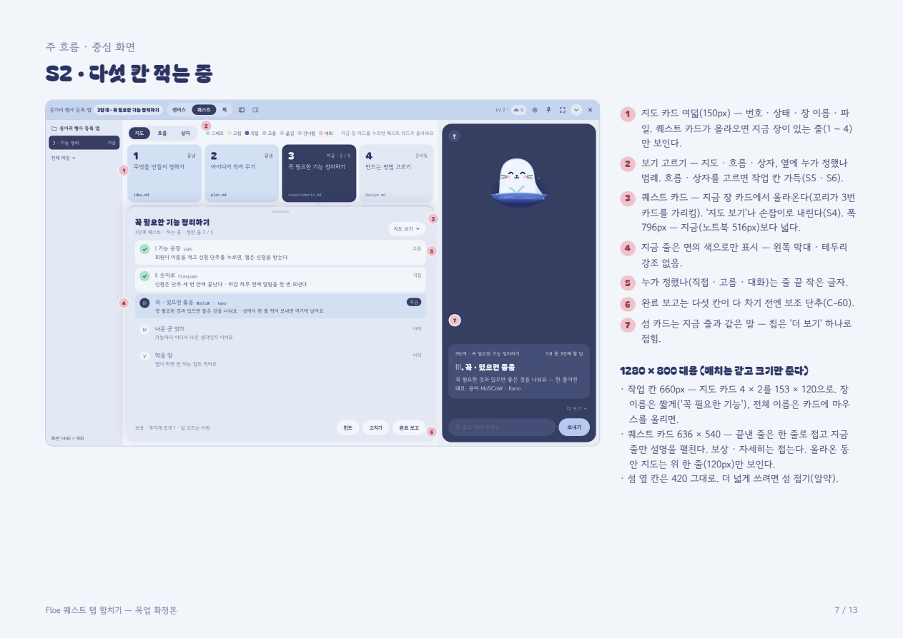
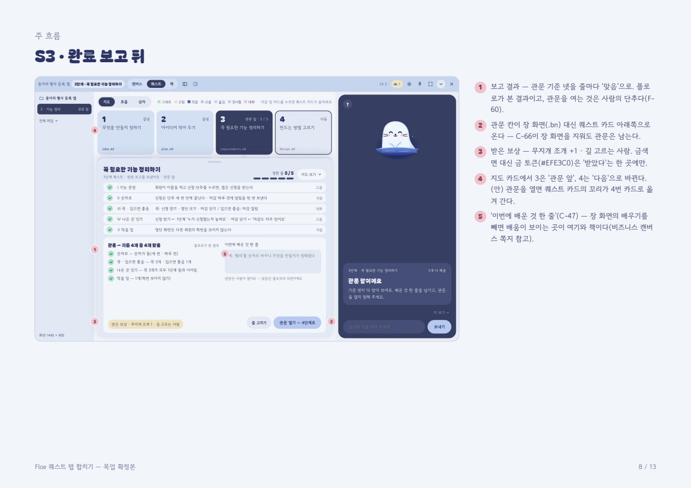
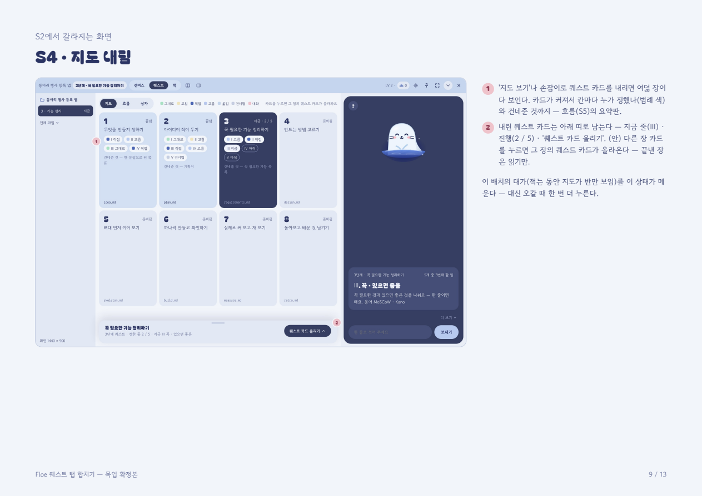
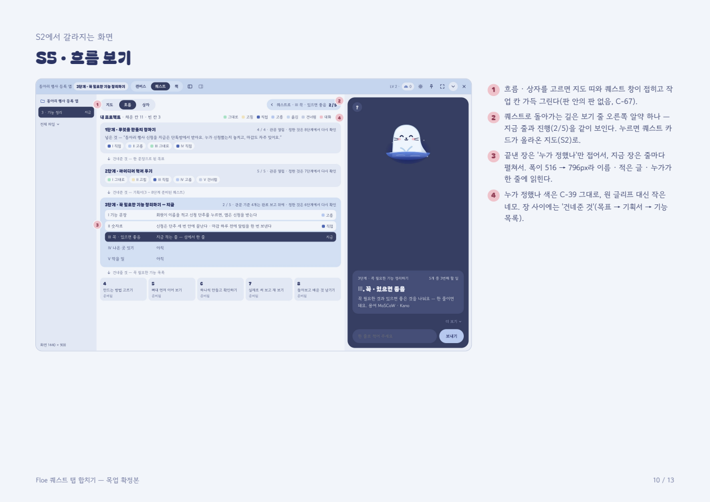
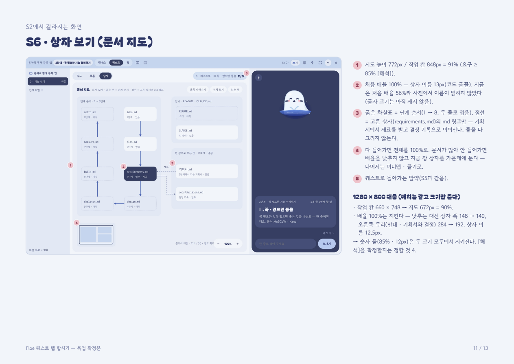
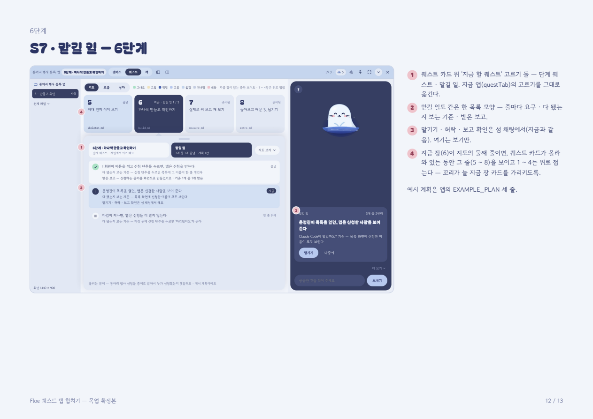
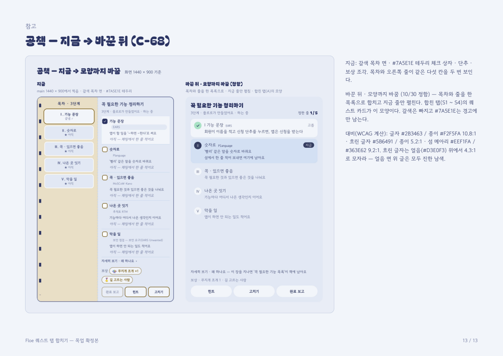

<!-- claude-drafted: 2026-10-30 — 두승현 요청("퀘스트 탭 목업 수정작업이 필요한 상황이고 작업전 PRD를 작성해야해 … 최대한 상세하고 빠짐없이 MECE 방식으로", 이재엽 사전 승인을 두승현이 전함)으로 Claude가 썼다. 바탕은 [노트북 + 도전과제 합치기 요구(PRD, 2026-10-29)](2026-10-29-노트북-도전과제-합치기-PRD.md)와 두승현의 목업 확정본(2026-10-30, 13쪽 PDF). 요구 C-65 ~ C-68은 (안) 그대로이고, 새로 더한 (안)은 C-69 ~ C-73으로 적었다 — 등급 · 번호 확정은 이재엽. 코드 자리는 2026-10-30 main `85e087d`에서 grep으로 찾았다. 만들지 않았다. -->

# 퀘스트 탭 합치기 PRD — 노트북 + 도전과제를 한 탭으로 (만들기 판)

> **한 줄로:** 작업실의 노트북(퀘스트 받는 창)과 도전과제(한눈에 보기)를 **'퀘스트' 탭 하나**로 합친다 — 지도 카드 위에 퀘스트 카드가 올라오는 배치. 장 세로 줄과 장 화면은 빼고, 흐름 · 상자(문서 지도)는 작업 칸 가득 그리고, 갈색 공책은 한 목록 모양 · 우리 색으로 바꾼다.
> 앞 PRD(2026-10-29)는 **요구를 정한 판**이고, 이 문서는 목업 확정본으로 배치 · 모양 · 숫자가 정해진 뒤의 **만들기 판**이다 — 화면 · 요구 · 코드 자리 · 시험 · 차례를 빠짐없이 적어 작업 목록(TASK)으로 바로 쪼갤 수 있게 했다.

## 0. 먼저 — 그래서 무엇을 하면 되나

1. **두승현 몫은 다 정했다(2026-10-30):** 머리 줄 '화면 가득'은 **뺀다**(3-4절 1번), 범례는 **S4 · S5에서만**, 목업은 **쪽 사진으로 레포에**(3절), 카드 올림 · 내림은 **기억**(9절 7 ~ 9번). 남은 일은 목업 그림에서 ⛶를 지우는 것뿐.
2. **이재엽에게 받을 것(9절):** ① 언제 만드나(10/31 PR / 11/1 뒤 고칠 목록 / 대회 뒤) ② 탭 이름 ③ 튜토리얼 · 곁 퀘스트가 갈 곳 ④ 새 (안) C-69 ~ C-73의 번호 · 등급 ⑤ C-67 숫자 둘 확정 ⑥ 받기 전 '고쳐 주세요'를 섬 채팅으로 옮길지(C-22는 이재엽 결정이라).
3. **만드는 차례는 8절** — PR 셋(ⓐ 모양 · 색 → ⓑ 합치기 · 빼기 → ⓒ 크게 · 관문). 시험은 10절대로 **먼저 쓰고** 구현한다. 작업 28개로 쪼갠 것은 [TASK](2026-10-30-퀘스트-탭-합치기-TASK.md).
4. 화면 모습은 3절(목업 확정본 S1 ~ S7). 화면 사이의 길은 3-3절 표.

---

## 1. 관련자 · 상태 (Participants · Status)

| | |
|---|---|
| 정하는 사람 | 화면 · 목업 · 만들기는 **두승현**(이재엽이 2026-10-30 맡김 — [기능 현황](2026-10-30-기능-현황.md) 1절 1번 "두승현님께 갔어"). 요구 번호 · 등급 · 11/1 범위 · 튜토리얼이 갈 곳은 **이재엽** |
| 알릴 사람 | `02-frontend/navigator/` 담당(임유정) — 작업실 화면 전체를 고친다. 튜토리얼(`tutorial.js`)을 지우면 그 서버 파일 담당(이재엽) |
| 상태 | **결정 대기 → 만들기 전.** 목업 확정본까지 끝(2026-10-30). 앱 코드는 고치지 않았다 |
| 기준 커밋 | main `85e087d`(v54.3, 2026-10-30). 목업은 `e844f9e` 작업실을 바탕으로 그렸다 — 그 뒤 들어온 변경은 이 화면과 겹치지 않는다(F-105 훅 · F-107 토큰 장부 · 알려진 실패 목록) |
| 바탕 문서 | [노트북 + 도전과제 합치기 요구(PRD)](2026-10-29-노트북-도전과제-합치기-PRD.md) · [작업실 개편 PRD](2026-10-28-작업실-개편-PRD.md)(C-58 ~ C-63) · [요구서](../00-overview/requirements.md) 2-2 C-65 ~ C-68 · [기능 현황](2026-10-30-기능-현황.md) 1절 1번(FR-6을 이 탭이 맡는다) · 목업 확정본(두승현 보관, 12절) |
| 이 탭이 맡는 요구 | **FR-6 한곳에서 보기(Must)** — 진행 · 할 일만(이재엽 2026-10-30 "진행 · 할 일만"). 토큰은 설정, 일정 충돌은 다루지 않는다 |

## 2. 왜 하는가 (Background & Strategic Fit)

| 이재엽이 본 문제(2026-10-29 밤) | 지금 화면에서 잰 것(2026-10-30 코드) | 이 PRD의 답 |
|---|---|---|
| "도전과제와 노트북을 합치고 싶은데 그러면 저 도전과제 라인 자체가 의미가 없어지더라고" | 탭이 넷(캔버스 · 노트북 · 도전과제 · 책, `QTABS`). 도전과제 왼쪽에 56px 세로 줄(한눈에 보기 + 장 여덟, `.vtabs`) | 한 탭으로(C-65), 세로 줄 없앰 |
| "이거들을 전부 기능들을 없애 주고"(장 화면) | 장을 고르면 설명 줄 · '관문 전에 알아 둘 것'(튜토리얼 칩 · 카드) · '이 장에서 쓰는 말' · 그림 사슬 · 곁 퀘스트 · 관문 칸(`treePane`의 `treeChap !== null` 가지, `.learnbox` · `.tu-chips` · `.chain` · `.bn`) | 장 화면을 뺀다(C-66). 관문 칸은 퀘스트 카드 아래로(C-71) |
| "퀘스트 받는 창이랑 보는 창 그리고 [문서 지도] 이거 크게 해줘" | 노트북 폭 516px(두 쪽 공책). 문서 지도는 판 안의 판(보기 막대 → `.board` → iframe `.docmap` `min-height:360px`) — 처음 배율에서 상자 이름이 읽히지 않았다 | 퀘스트 카드 796px, 흐름 · 상자는 작업 칸 가득(C-67). 상자 처음 배율 100% |
| "갈색갈 책처럼 나오는 것도 잘 안맞아서" | 공책 왼쪽 쪽 `#E9DFC6`, 세로 줄 `#6B5E48`, 끝낸 칸 금색 그라데이션 `#EFE3C0 → #E6CB86`, 체크 상자 · 입력 · 단추 · 목차 고름 · 보상 조각 테두리 `#7A5E1E`(`app.css` 925 · 930 · 934 · 952 · 955 · 959 · 963 · 968 · 970 · 976 · 1126 · 1128) | 한 목록 모양 · C-57 토큰으로(C-68) |
| 두승현(2026-10-28) "같은 정보가 여러 곳에" | 노트북의 목차와 오른쪽 줄이 **같은 다섯 칸을 두 번** 보인다. 오른쪽 칸(`.wside`)에도 퀘스트 다섯 칸 · 관문이 또 있다 | 목차 · 줄을 한 목록으로(C-68), 이 탭에서 오른쪽 칸 접음(C-72 — C-58의 적용) |

**전체 목표와의 연관:** Floe는 "끝까지 만들고, 이해하고, 배움을 쌓도록" 돕는다. 퀘스트(지금 할 일)와 지도(어디까지 왔나)가 두 탭에 갈라져 있으면 "지금 무엇을 하고, 그게 전체 어디인가"를 한 번에 보지 못한다. FR-6(한곳에서 보기)을 이 탭이 맡는 까닭이다.

## 3. 화면 (UX 설계) — 목업 확정본 S1 ~ S7

기준 1440 × 900, 작업실(머리 줄 · 왼쪽 칸 · 작업 칸) + 오른쪽 섬 옆 칸 420. 예시 프로젝트는 연습 장면 "동아리 행사 등록 앱" 3단계. 글은 목업용 예시다. 사진은 두승현의 목업 확정본 PDF(12절)에서 쪽마다 뽑은 것 — [shots/2026-10-30-quest-tab/](shots/2026-10-30-quest-tab/)(두승현 결정 2026-10-30, 9절 8번). 쪽마다 오른쪽의 번호 글이 그 화면의 설명이다.

**화면 사이의 길(흐름도):**

### 3-1. 화면 일곱 장 — 무엇이 보이나

| 번호 | 화면 | 보이는 것 | 요구 |
|---|---|---|---|
| **S1** | 퀘스트 받기 전 | 탭 셋(캔버스 · **퀘스트** · 책). 지도 카드 1 ~ 4(지금 장이 있는 줄만, 150px). 지금 장 카드에서 **퀘스트 카드**가 올라온다(꼬리가 카드를 가리킴) — 다섯 칸 미리보기(이름 · 용어 · 쉬운 한 줄) · '왜 하나요' 한 줄 · **'처음 쓰는 기능' 한 줄** · 보상은 글로만 · 단추 **[나중에] [퀘스트 받기]**(주 단추 하나). 오른쪽 칸은 접힘 | C-65 · C-60 · C-70 · C-72 |
| **S2** | 다섯 칸 적는 중 (**중심 화면**) | 위와 같은 지도 띠 + 퀘스트 카드. 한 목록 — 끝낸 줄은 체크 · 한 줄, **지금 줄만 펼침**(면의 색으로만 표시, 막대 · 테두리 강조 없음), 아직 줄은 흐리게. 줄 끝에 누가 정했나(직접 · 고름 · 대화 …) 작은 글. 머리에 '정한 줄 2 / 5' 점 다섯. 단추 [힌트] [고치기] [완료 보고] — 완료 보고는 다 차기 전엔 보조 단추. 섬 카드는 지금 줄과 같은 말, 칩은 '더 보기' 하나 | C-65 · C-68 · C-60 |
| **S3** | 완료 보고 뒤 | 다섯 줄 모두 체크 · 한 줄. 아래에 **관문 칸** — 기준 넷 줄마다 '맞음'(플로로가 본 결과) · '이번에 배운 것 한 줄' 입력(C-47) · "관문은 사람이 열어요 — 맞음은 플로로의 의견이에요". 받은 보상 조각(금 토큰은 여기 한 곳만). 단추 [줄 고치기] [관문 열기 — 4단계로]. 지도 카드 3은 '관문 앞', 4는 '다음' | C-71 · C-47 · C-68 |
| **S4** | 지도 내림 | 퀘스트 카드를 내리면 여덟 장이 다 보인다(두 줄). 카드가 커져 칸마다 누가 정했나 칩과 '건네준 것'까지 — 흐름(S5)의 요약판. 내린 카드는 아래 띠(지금 줄 · 진행 · [퀘스트 카드 올리기]). (안) 다른 장 카드를 누르면 그 장의 카드가 올라온다 — 끝낸 장은 읽기만 | C-65 · C-69 |
| **S5** | 흐름 보기 | 보기 고르기 '흐름' → 지도 띠 · 퀘스트 카드가 접히고 **작업 칸 가득**. 끝낸 장은 '누가 정했나' 칩만, 지금 장은 줄마다 펼침, 장 사이 '건네준 것'. 오른쪽 위 알약 **'‹ 퀘스트로 · Ⅲ 꼭 · 있으면 좋음 2/5'** → S2 | C-67 · C-39 |
| **S6** | 상자 보기(문서 지도) | 작업 칸 가득, 높이 772 / 848 = 91%. 처음 배율 100%, 상자 이름 13px. 굵은 선 = 단계 순서(두 줄로 접음), 점선 = 고른 상자의 md 링크만. 안 들어가면 배율을 낮추지 않고 지금 장 상자를 가운데에 · 미니맵 · 끌기. 같은 알약 → S2 | C-67 · C-45 |
| **S7** | 맡길 일 — 6단계 | 퀘스트 카드 위 '지금 할 퀘스트' 고르기 둘(단계 퀘스트 · 맡길 일, 지금 `questTab`의 `.qsel` 그대로). 맡길 일도 한 목록 — 줄마다 요구 · 다 됐는지 보는 기준 · 받은 보고. 맡기기 · 허락 · 보고 확인은 섬 채팅(지금과 같음). 지금 장(6)이 지도 둘째 줄이면 그 줄(5 ~ 8)을 보이고 1 ~ 4를 접는다 | C-65 · C-73 |
| 참고 | 공책 지금 → 바꾼 뒤 | 갈색 두 쪽 공책 → 한 목록(합친 탭 퀘스트 카드와 같은 모양). 대비: 글자 `#2B3463` / 종이 `#F2F5FA` 10.8:1, 흐린 글자 `#5B6491` / 종이 5.2:1, 섬 메아리 `#EEF1FA` / `#363E62` 9.2:1. **흐린 글자는 얼음(`#D3E0F3`) 위에서 4.3:1로 모자라 — 얼음 면 위 글은 모두 진한 남색** | C-68 |

**사진 — 쪽마다(목업 확정본 6 ~ 13쪽, 1440 × 900. 머리 줄의 ⛶는 3-4절 1번대로 뺀다):**

| | |
|---|---|
|  |  |
|  |  |
|  |  |
|  |  |

### 3-2. 1280 × 800 — 따로 그리지 않고 줄이는 규칙 (10/30 결정)

| 무엇 | 1440 × 900 | 1280 × 800 |
|---|---|---|
| 작업 칸 | 796 × 848 | 660 × 748 |
| 지도 카드 | 4 × 2, 150px 높이 | 4 × 2, **153 × 120**. 장 이름은 짧게('꼭 필요한 기능'), 전체 이름은 마우스를 올리면 |
| 퀘스트 카드 | 796 폭, 올라온 동안 지도는 한 줄(150) | **636 × 540**. 끝낸 줄은 한 줄로 접고 지금 줄만 설명을 펼침. 보상 · 자세히는 접음. 올라온 동안 지도는 한 줄(120) |
| 문서 지도 | 772 높이 = 91%, 상자 이름 13px | 672 높이 = **90%**. 배율 100% 유지 — 상자 폭 148 → 140, 오른쪽 무리(안내 · 기획서 · 결정) 284 → 192, 상자 이름 **12.5px** |
| 섬 옆 칸 | 420 | 420 그대로. 더 넓게 쓰려면 섬 접기(알약) |

→ C-67의 [해석] 숫자 둘(높이 ≥ 85% · 이름 ≥ 12px)은 두 크기 모두에서 지켜진다. 확정할지는 9절.

### 3-3. 넘어가는 길 — 어디서 무엇을 누르면 어디로

| 어디서 | 무엇을 누르면 | 어디로 | 지금 코드 |
|---|---|---|---|
| 들어오기 | 작업실 '퀘스트' 탭 · 섬의 '퀘스트 보기' 칩 · `openQwin("quest")` · `openQwin("tree")`를 부르는 모든 곳 | S1(받기 전) 또는 S2(받은 뒤) | `qtab` · `qwin-quest` · `qwin-tree` · `openQwin` 13곳(5절) |
| S1 | '퀘스트 받기' | S2 | `quest-ok` |
| S1 | '나중에' | **S4**(안 — 지금은 작업실을 닫는다) | `quest-later` → `closeQwin()` |
| S2 | '완료 보고'(다섯 칸이 다 찬 뒤 주 단추) | S3 | `quest-report` |
| S3 | '줄 고치기' | S2(고치기 모드) | `quest-edit` |
| S3 | '관문 열기 — 다음 단계로' | **다음 장의 S1**(안 — 꼬리가 다음 카드로) | 관문 열기(섬 채팅의 '이해되셨나요' 흐름) |
| S2 | '지도 보기' · 손잡이로 내리기 | S4 | 새로 |
| S4 | '퀘스트 카드 올리기' · 장 카드 누르기 | S2 (끝낸 장은 읽기만 — 안) | `map-card` |
| S1 ~ S4 | 보기 고르기 '흐름' / '상자' | S5 / S6 | `tree-view` |
| S5 · S6 | '퀘스트로' 알약 | S2 | 새로 |
| S2(6단계) | '지금 할 퀘스트'에서 '맡길 일' | S7 | `qfocus` |
| S7 | '단계 퀘스트' 고르기 | S2 | `qfocus` |

(안) 표시 셋 — S1 '나중에' → S4, 관문을 연 뒤 꼬리가 다음 장 카드로, 끝낸 장 카드는 읽기만 — 은 목업에서 정한 안이다. 요구로는 C-69에 적었다.

### 3-4. 목업과 지금 결정 · 코드가 어긋나는 곳 — 만들기 전에 정리

| # | 어긋남 | 근거 | 권함 |
|---|---|---|---|
| 1 | **머리 줄에 '화면 가득'(⛶) 단추가 남아 있다.** 목업 2쪽은 "LV · 조개 · 설정 · 열어 두기 · 화면 가득 · 접기 · 닫기"로 그렸다 | 두승현 2026-10-29 결정으로 '화면 가득'은 뺐다 — [workspace-col.test.js](../../04-tests/navigator/workspace-col.test.js) 22줄 "'화면 가득'(R-1)은 2026-10-29 두승현 결정으로 뺐다(OS 창의 최대화)". 지금 섬 단추 묶음(`hisl`)은 설정 · 열어 두기 · 섬 크게/작게(`isl-big`) · 접기 넷 | **정함(두승현 2026-10-30 "어제 빼기로 했으니 빼도 된다"):** 목업의 ⛶는 **뺀다**. 만들 때 새 단추를 넣지 않고, 머리 줄은 지금 코드(설정 · 열어 두기 · 섬 크게/작게 · 접기 · 닫기)대로. 목업 그림을 고칠 때 ⛶를 지운다 |
| 2 | **받기 전(S1)에 '고쳐 주세요' 단추가 없다.** 지금은 받기 전 화면에서 이름 · 할 일 수를 고칠 수 있다(`quest-fix` → `edit` 모드 → '이대로 받기') | **이재엽 작업이다** — `4779f1d`(2026-10-21 이재엽, C-22 1차 뼈대)에서 받기 화면의 '고쳐 주세요' 단추와 `quest-fix`가 같이 들어왔다. [요구서](../00-overview/requirements.md) C-22 줄 "'이대로 / 고쳐 주세요' 확인을 받은 뒤 진행한다", [14-quest](14-quest/README.md) "'고쳐 주세요'로 이름 · 개수 고침". 지금 자리: `58-workspace.js` `questPane` `.sub`(고쳐 주세요 · 나중에). 섬 채팅의 초안 확인 카드(C-36 · C-37)에도 같은 뜻의 '고쳐 주세요'가 있다 | 받기 전 카드에서 빼면 **C-22(이재엽 결정)를 바꾸는 일**이라 이재엽이 정한다(9절 6번). 권함: 섬 채팅의 초안 확인 카드에서만 고치고, S1에는 [나중에] [퀘스트 받기]만 — 같은 고치기가 두 곳에 있는 것은 C-58에 어긋난다 |
| 3 | **지도 카드 상태 '관문 앞' · '다음'(S3)이 지금 상태 다섯에 없다** | `stagemap.js` 29줄 상태는 `done · now · ready · pending · later`, 화면 글은 `STATE_WORD`(끝남 · 지금 · 준비됨 · 준비됨 — 확인 전 · 2단계에서 그려져요) | `now`에 '관문 앞'(완료 보고 뒤 · 관문 전) 세부 상태, 바로 다음 `ready` 카드에 '다음' 글 — 상태 이름은 그대로, 글만 더한다(C-71) |
| 4 | **'누가 정했나' 범례 일곱(그대로 · 고침 · 직접 · 고름 · 옮김 · 건너뜀 · 대화)이 지도 화면에도 보인다** — 지금은 흐름 보기(C-39)에만 | `quest.js` 83 ~ 84줄 `BY` · `BY_WORD` 일곱 — 목업과 같다 | 그대로 쓴다. 지도 화면 범례는 S4(카드가 커질 때)에서 뜻이 있다 — S1 ~ S3에도 둘지는 두승현(9절) |
| 5 | **S4 큰 카드에 '건네준 것'이 보인다** — 지금 지도 카드(`cardsMap`)에는 없고 흐름(`treeMap`)에만 | `N.STAGES` `gives`(C-37) | 지도 카드에 `gives` 한 줄을 더한다 — 데이터는 있다 |

## 4. 사용자 이야기 (User Stories)

- 바이브 코딩을 하는 사람으로서, **지금 할 일(퀘스트)과 전체 어디쯤인지(지도)를 한 화면에서** 보고 싶다 — 탭을 오가며 맥락을 잃지 않게.
- 같은 사람으로서, 퀘스트 다섯 칸 중 **지금 줄 하나만 또렷이** 보이고 나머지는 접혀 있으면 좋겠다 — 무엇을 적어야 하는지 헤매지 않게.
- 완료 보고를 한 사람으로서, **관문 기준이 맞았는지와 그것이 플로로의 의견일 뿐임을** 같은 자리에서 보고, 내가 관문을 열고 싶다.
- 문서가 어떻게 이어지는지 보려는 사람으로서, **문서 지도의 상자 이름이 처음부터 읽히는 크기**로 보이면 좋겠다.
- 6단계에서 Claude Code에 일을 맡기는 사람으로서, **맡길 일의 요구 · 기준 · 보고가 퀘스트와 같은 모양**으로 보이면 좋겠다 — 두 가지 모양을 익히지 않게.
- 화면을 오래 보는 사람으로서, 갈색 공책 · 금색 타일 대신 **앱의 나머지와 같은 색**이면 좋겠다.

## 5. 범위 (Scoping)

**넣는 것 — 요구 아홉:** C-65 · C-66 · C-67 · C-68(앞 PRD, (안)) + 목업이 더한 **C-69 ~ C-73(안, 새 번호)**. 6절.

**넣지 않는 것:**
- 캔버스 탭 · 책 탭 · 파일 보기(`file`) · 문서 지도의 데이터(`docmap.js` · `docmap.html`의 그리기 규칙) — 자리와 크기만 바꾼다, 내용은 그대로.
- 퀘스트의 데이터 · 판정 · 저장(`quest.js` · `st.quest` · `st.results` · 관문 규칙 `gateRules`) — 바뀌지 않는다. 화면만.
- 섬(옆 칸)의 모양 · 카드 · 칩 — C-60 · C-62에서 이미 정함. 이 PRD는 섬 카드가 **지금 줄과 같은 말**인지만 본다.
- 맡기기 · 허락 · 보고 확인 — 지금처럼 섬 채팅에서. S7은 보기만.
- 1024 이하 · 휴대폰 — 작업실은 PC 전용(프로토타입은 PC 중심 — 2026-10-14 결정). 1280 × 800까지만 규칙을 둔다.
- 튜토리얼(`tutorial.js`) **내용**을 고치는 일 — 갈 곳만 정한다(9절). 지우기로 하면 파일과 시험을 같이 지운다.
- 다크 모드 — 작업실은 늘 밝다.
- 책(라이브러리) 탭에서 지난 장을 다시 펼치는 흐름 — 그대로.

**C-54(지도 — 도전과제와 문서 지도를 한 탭으로)와의 관계:** C-54가 만든 '보기 셋(지도 · 흐름 · 상자)'은 그대로 살아 이 탭의 보기 고르기가 된다. 바뀌는 것은 그 위의 세로 줄 · 장 화면뿐이다.

## 6. 요구 (Feature Overview) — EARS · 끝 조건 · 코드 자리

번호: C-65 ~ C-68은 앞 PRD(요구서 2-2에 (안)으로 있음). **C-69 ~ C-73은 이 문서가 처음 적는 (안)** — 요구서의 다음 빈 번호가 C-69다(기능 현황 3절 "C-1 ~ C-68"). 이재엽이 올릴 때 번호가 바뀔 수 있다. 코드 자리는 `02-frontend/navigator/app/` **조각 이름 · 함수 · class**로 적었다(줄 번호는 밀린다). 조각을 고친 뒤 `node 02-frontend/navigator/app-parts.js join`.

### C-65(안) 노트북과 도전과제를 한 탭으로

- 시스템은 작업실 탭을 **셋**으로 보인다 — 캔버스 · [퀘스트] · 책. 탭 이름은 9절 2번(목업은 '퀘스트').
- 시스템은 합친 탭에서 **지도 카드 띠(위)와 퀘스트 카드(아래)**를 한 판에 그린다 — 퀘스트 카드는 지금 장 카드에서 올라오고(꼬리), 카드가 올라와 있는 동안 지도는 **지금 장이 있는 줄만**(1 ~ 4 또는 5 ~ 8) 보인다.
- 시스템은 장 세로 줄(한눈에 보기 단추 + 장 여덟 칸)을 그리지 않는다. 장으로 가는 길은 지도 카드 하나다.
- **When** 다른 화면이 노트북 · 도전과제를 열려고 하면(`openQwin("quest")` · `openQwin("tree")` · 저장된 탭 값 `quest` · `tree` · 주소의 `tab=learn`), 시스템은 합친 탭을 연다.
- **When** 섬의 '퀘스트 보기' 칩을 누르면, 시스템은 합친 탭을 열고 퀘스트 카드를 올린다(내려 있었으면).
- **끝 조건:** 1440 × 900 작업실에서 `.wtabs` 탭이 셋, `.vtabs` 0개. 합친 탭 하나에서 **받기 → 다섯 칸 적기 → 완료 보고 → 지도 카드 누르기**가 다 된다. 섬 '퀘스트 보기'가 합친 탭을 연다. 옛 저장 값 `tree`로 켜도 열린다.
- **코드:** `45-knowledge.js` `QTABS`(넷 → 셋, `quest` 이름) · `openQwin` · `58-workspace.js` `qwinHTML`의 `pane` 고르기(`tree` 가지 제거) · `treePane`(세로 줄 `.vtabs` · `mapTab` · `chapTabs` 제거 → 보기 막대 + 지도 띠 + 퀘스트 카드) · `questPane`(공책 → 한 목록) · `90-acts.js` `qwin-tree` · `first-go` · `peek` · `quest-fix` · `gate-fill` · `plan-confirm`(`openQwin("tree")` → `"quest"`) · `95-boot.js` 166줄(`tab=learn` → `quest`) · `50-chatlist.js`(섬 칩 '공책 보기' → '퀘스트 보기', 10곳 문구). CSS `.adv`(격자 56px 칸 제거) · `.vtabs` 삭제.

### C-66(안) 장 화면과 그 기능을 뺀다

- 시스템은 장 화면을 그리지 않는다 — 설명 줄(`.bt` "그림에 마우스를 올리면 설명이 떠요"), '관문 전에 알아 둘 것'(`.learnbox` · `.tu-chips` · `tuCard`), '이 장에서 쓰는 말'(`.lb-terms`), 할 일 그림 사슬(`.chain` · `.bn` · `.sides` · `.vline`), 곁 퀘스트(`.sidebn`), 관문 칸(`.bn.gate`).
- 시스템은 `tree-chap` · `tree-map` · `tu-sel` 누르기를 받지 않는다(표에서 지움). `treeChap` 변수는 없앤다.
- 용어 풀이(FR-13)는 남는다 — 퀘스트 줄의 `termTag`('용어:' 칩)와 섬 카드의 용어 칩은 이 화면이 아니다.
- **같이 바뀌는 요구(요구서 줄 고침):** C-22(도전과제 나무 그림 판 → 지도 카드로) · C-30(배우기 — 보이는 곳이 없어진다, 9절 3번) · C-35의 '배우기는 도전과제의 장마다' · C-54의 '세로 줄' 언급.
- **끝 조건:** 작업실 어디에도 `.learnbox` · `.tu-chips` · `.chain` · `.bn` · `.vtabs` 0개(e2e로 셈). `tree-chap` · `tu-sel` 누름이 아무 일도 하지 않는다(ACT에 없음). 퀘스트 줄의 '용어:' 칩은 그대로. 섬 카드 `peek`(다음 장 미리 보기)는 합친 탭의 **그 장 카드를 고른 상태**로 연다(장 화면 대신).
- **코드:** `58-workspace.js` `treePane` 145 ~ 160줄 가지 삭제 · `tuCard`(`60-library.js` — `treePane`에서만 부른다, 삭제 또는 9절 3번에 따라 '처음 쓰는 기능' 한 줄로 축소) · `90-acts.js` `tree-chap` · `tree-map` · `tu-sel` · `peek` · `first-go`. CSS `.chain` · `.bn*` · `.learnbox*` · `.tu-chips*` · `.lb-terms` · `.sides` · `.vline` · `.sidebn` · `.bt`와 `prefers-reduced-motion`의 `.bn.cur`. 서버 `tutorial.js` `forChap` — 부르는 곳이 없어진다(9절 3번).

### C-67(안) 퀘스트 카드 · 한눈에 보기 · 문서 지도를 크게

- 시스템은 합친 탭의 퀘스트 카드를 작업 칸 폭(1440에서 796px)에 맞춰 그린다 — 지금 노트북 516px보다 넓다. 글자 · 단추는 지금보다 작아지지 않는다.
- **When** 사용자가 보기 고르기에서 '흐름' 또는 '상자'를 고르면, 시스템은 지도 띠와 퀘스트 카드를 접고 그 보기를 **작업 칸 가득**(머리 줄 · 보기 고르기 줄을 뺀 나머지) 그린다. 판 안에 판을 겹으로 두지 않는다(`.board` 안의 `.docmap` 겹을 없앤다).
- **While** 흐름 · 상자 보기인 동안, 시스템은 보기 고르기 줄 오른쪽에 **'‹ 퀘스트로 · [지금 줄 이름] [k/n]' 알약**을 보인다. 누르면 퀘스트 카드가 올라온 지도(S2)로 돌아간다.
- **When** 상자 보기를 그리면, 시스템은 문서 지도의 처음 배율을 **100%**로 하고 상자 이름이 읽히는 크기(≥ 12px [해석])로 한다. 문서가 많아 다 들어가지 않으면 배율을 낮추지 않고 **지금 장 상자를 가운데에** 둔다 — 나머지는 미니맵 · 끌기.
- 시스템은 1280 × 800에서 3-2절 규칙으로 줄인다 — 배치는 같고 크기만.
- **끝 조건:** 1440 × 900 · 1280 × 800에서 문서 지도 높이 ≥ 작업 칸의 **85% [해석]**(목업 잰 값 91% · 90%), 처음 화면 상자 이름 계산 글자 ≥ **12px [해석]**(13 · 12.5). 퀘스트 카드 폭 ≥ 지금(516). 흐름 · 상자 보기에 `.docmap` 바깥 격자 칸이 없다.
- **코드:** `58-workspace.js` `treePane`의 `viewBar` · `treeView` 가지 → 새 판 배치, `55-files.js` `mapPane`(iframe을 `.board` 밖 작업 칸 가득으로), `docmap.html`(처음 배율 · 지금 장 가운데 — 지금 배율 규칙은 코드에서 찾지 못했다, 11절), CSS `.docmap`(`min-height:360px` → 작업 칸 높이 채움) · `.sm-views`(알약 자리). 폭 숫자는 CSS 변수로 두어 1280 규칙을 미디어 쿼리 하나로.

### C-68(안) 갈색 책 모양을 우리 색 · 한 목록으로

- 시스템은 퀘스트 카드를 **한 목록 모양**으로 그린다 — 목차와 줄을 합쳐 다섯 줄, 끝낸 줄은 체크 · 한 줄(이름 · 적은 글 · 누가 정했나), **지금 줄만 펼침**(이름 · 용어 · 쉬운 한 줄 · "섬에서 한 줄 적어 보내면 여기에 남아요"), 아직 줄은 흐린 글자 · 이름만. 두 쪽 공책(`.book` · `.page.l` · `.toc`)은 그리지 않는다. 맡길 일(S7)도 같은 모양.
- 시스템은 노트북 · 도전과제의 갈색 · 금색 — `#E9DFC6`(공책 왼쪽 쪽) · `#6B5E48`(세로 줄) · `#454E77`(세로 줄 바탕) · `#E6CB86` · `#EFE3C0 → #E6CB86` 그라데이션(끝낸 칸) · 경고 밖에 쓴 `#7A5E1E`(체크 상자 · 입력 테두리 · 단추 테두리 · 목차 고름 · 보상 조각 · 튜토리얼 칩) — 를 C-57 토큰으로 바꾼다. 파스텔 바탕 + 남색 글씨.
- `#7A5E1E`는 경고 토큰(`--warn` · `--t-amber-ink`)이기도 하다 — 경고 표시(`.qs-skip` 건너뜀 · `.sm-ban`)는 그대로 둔다. 받은 보상 조각(S3)에 금 토큰 `#EFE3C0`을 **'받았다'는 한 곳에만** 쓴다.
- 얼음(`#D3E0F3`) 면 위의 글은 모두 진한 남색(`#2B3463`) — 흐린 글자(`#5B6491`)는 얼음 위에서 4.3:1로 모자란다(목업 13쪽 계산).
- **끝 조건:** `app.css`의 노트북 · 합친 탭 규칙(`.book` · `.page` · `.toc` · `.ln` · `.pacts` · `.piece` · `.adv` · `.vtabs` · `.bn` · `.tu-chips` · `.learnbox`)에서 위 색이 경고 밖에 0곳(grep으로 셈). 글자 대비 4.5:1 이상(`design.test.js`의 계산 방식). 1440 × 900 사진에서 갈색 면이 없다. 지금 줄이 면의 색으로만 구분된다(막대 · 테두리 없음).
- **코드:** `58-workspace.js` `questPane` 80 ~ 91줄(`toc` · `.book` · `.page` → 한 목록) · `70-tasks.js` `planQuestPane` 113 ~ 120줄(같은 모양) · CSS 922 ~ 999줄(`.book` ~ `.sidebn`) · 1119 ~ 1128(`.learnbox` · `.tu-chips`) · 1279(`.vtabs button.map`).

### C-69(안) 지도 카드 위의 퀘스트 카드 — 올리기 · 내리기 · 장 고르기

- **When** 사용자가 퀘스트 카드 머리의 '지도 보기'를 누르거나 카드 위 손잡이를 아래로 끌면, 시스템은 카드를 내리고 지도 여덟 장을 두 줄로 다 보인다(S4). 내린 카드는 아래 띠(지금 줄 이름 · 진행 k/n · [퀘스트 카드 올리기])로 남는다.
- **While** 카드가 내려가 있는 동안, 시스템은 지도 카드를 크게 그려 칸마다 누가 정했나 칩(Ⅰ 직접 · Ⅱ 고름 …)과 '건네준 것' 한 줄을 보인다(흐름 보기의 요약판).
- **When** 사용자가 '퀘스트 카드 올리기'나 **지금 장** 카드를 누르면, 시스템은 그 장의 퀘스트 카드를 올린다(S2).
- **When** 사용자가 **끝낸 장** 카드를 누르면, 시스템은 그 장의 결과를 같은 한 목록 모양으로 **읽기만** 되게 올린다(고치기 · 완료 보고 단추 없음). **When** 아직 장(준비됨) 카드를 누르면, 준비된 퀘스트 미리보기(C-56 `prepared`)만 보이고 받기 단추는 없다.
- **When** 받기 전 화면(S1)에서 '나중에'를 누르면, 시스템은 작업실을 닫지 않고 카드를 내린다(S4). (지금은 `closeQwin()` — 작업실이 닫힌다.)
- **When** 지금 장이 지도 둘째 줄(5 ~ 8)이면, 카드가 올라와 있는 동안 시스템은 둘째 줄을 보이고 첫째 줄을 접는다 — 꼬리가 늘 지금 장 카드를 가리킨다.
- **Where** 움직임 줄이기를 켰으면, 올리기 · 내리기는 움직임 없이 바로 바뀐다(0.3초 규칙은 C-62와 같다).
- **끝 조건:** S2 → '지도 보기' → 여덟 카드 보임 · 아래 띠 있음 → '올리기' → S2. 끝낸 장 카드 → 읽기만 카드(단추 0개). 6단계에서 열면 5 ~ 8 줄이 보인다. 카드 올림 · 내림 상태는 이 컴퓨터에 기억(`localStorage`, 다른 저장 값처럼).
- **코드:** `58-workspace.js` `cardsMap`(`row1` · `row2` 고르기 · `big` 카드에 `by` 칩 · `gives`) · `map-card`(끝낸 장 → 읽기만) · 새 누르기 `quest-down` · `quest-up`(등록식 — `Object.assign(ACT, …)` 조각 끝) · 새 상태 `questUp`(기본 올림) · `90-acts.js` `quest-later`(→ 내리기). CSS 새 `.qcard`(꼬리 · 손잡이 · 0.3초). `keep(["questUp"])`.

### C-70(안) 받기 전 퀘스트 카드 — 다섯 칸 미리보기 · '처음 쓰는 기능' 한 줄

- **While** 퀘스트가 받기 전(`phase === "draft"`)인 동안, 시스템은 지금 장 카드 위에 받기 전 퀘스트 카드를 올린다 — 제목 · '3단계 퀘스트 · 플로로가 만들었어요 · 받기 전' · '다섯 칸 · 관문 기준 n개' · '왜 하나요' 한 줄 · **다섯 칸 미리보기**(번호 · 이름 · 용어 · 쉬운 한 줄, 모두 접힌 모양) · **'처음 쓰는 기능' 한 줄**(이 장에서 처음 쓰는 기능 이름 — 9절 3번에 따라) · 보상은 글로만('보상 · 무지개 조개 1 · 길 고르는 사람') · 단추 [나중에] [퀘스트 받기] — 주 단추 하나(C-60).
- 시스템은 이벤트 창 모양(`.ev` — 밤하늘 그림 `PIC` · 참여 조건 · 할 일 개수 · 기간 · REWARD 칸 일곱 · 큰 '퀘스트 받기')을 그리지 않는다.
- 받기 전 '고쳐 주세요'(이름 · 할 일 수 고치기)는 9절 5번에 따라 — 권함: 섬 채팅의 초안 확인 카드에서만.
- **끝 조건:** 받기 전 카드에 `.ev` · `.pic` · `.slots` 0개, 단추 둘. '퀘스트 받기' → S2(지금 줄 Ⅰ 펼침).
- **코드:** `58-workspace.js` `questPane` 71 ~ 79줄(`.ev` 가지) · `PIC` · `rewardSlots` 삭제, `90-acts.js` `quest-fix`(자리 바꿈 또는 삭제) · `quest-ok`. 데이터는 `st.quest`(`title` · `why` · `objs` · `cond` · `when`) 그대로 — `cond` · `when`은 카드에 보이지 않게 된다(요구서 C-22의 "참여 조건 · 기간"은 받기 카드에서 뺀다고 적는다). '처음 쓰는 기능'은 `TU.forChap(n)`의 이름만.

### C-71(안) 관문 칸은 퀘스트 카드 아래로 — 완료 보고 뒤

- **When** 사용자가 완료 보고를 보내 판정이 오면(`st.j`), 시스템은 퀘스트 카드 아래에 **관문 칸**을 그린다 — 머리 '관문 — 기준 n개 중 m개 맞음 · 플로로가 본 결과', 기준마다 체크 · 한 줄, '이번에 배운 것 한 줄' 입력(C-47, 자리표시 글 예시 "'빨리'를 숫자로 바꾸니 무엇을 만들지가 정해졌다"), 각주 "관문은 사람이 열어요 — 맞음은 플로로의 의견이에요", 받은 보상 조각, 단추 [줄 고치기] [관문 열기 — N+1단계로].
- 시스템은 관문 열기를 사람의 누름으로만 한다(FR-17 · F-60) — 기준이 다 맞아도 저절로 열지 않는다.
- **While** 완료 보고 뒤 · 관문 전인 동안, 지도의 지금 장 카드는 '관문 앞 · n/n', 다음 장 카드는 '다음'으로 보인다. **When** 관문이 열리면, 퀘스트 카드의 꼬리가 다음 장 카드로 옮겨 가고 다음 장의 받기 전 카드(S1)가 된다.
- **끝 조건:** 완료 보고 → 관문 칸 보임(기준 수 = `st.j.criteria.length`), '관문 열기' 전에는 `st.results[n]`이 안 생긴다, 배운 것 한 줄은 C-47의 저장 길로 간다. 끝 조건을 e2e `gate-stop`과 맞춘다.
- **코드:** `58-workspace.js` 새 `gateBox(q, j)`(지금은 `wsideHTML`의 관문 · 섬 채팅의 '이해되셨나요' 카드에 흩어짐 — `wsideHTML` 관문 부분을 옮긴다) · `cardsMap` 카드 글('관문 앞' · '다음' — `STATE_WORD` 그대로, `body` 줄만) · 관문 열기 누르기(섬 채팅의 것을 그대로 부른다 — 새 판정 길 없음) · C-47 배운 것 입력(`45-knowledge.js`의 저장 길 재사용).

### C-72(안) 이 탭에서는 오른쪽 칸을 접는다 — C-58의 적용

- **While** 합친 탭이 보이는 동안, 시스템은 오른쪽 칸(`.wside` — 이 문서 · 퀘스트 · 관문)을 접는다 — 같은 다섯 칸 · 관문이 두 번 보이지 않게(C-58 정보마다 집 하나). 머리 줄의 오른쪽 칸 단추(`wside-toggle`)로 다시 펼 수 있다.
- **When** 다른 탭(캔버스 · 책 · 파일)으로 가면, 오른쪽 칸은 사용자가 두었던 상태(`floe:ws-side`)로 돌아온다.
- **끝 조건:** 합친 탭을 처음 열면 `.wside` 없음, 단추를 누르면 생김, 캔버스로 가면 전 상태. 앱(섬이 옆 칸에 펼쳐진 상태)에서는 지금처럼 `sideOn()`이 거짓이라 바뀌는 것이 없다.
- **코드:** `58-workspace.js` `sideOn`(3줄 — `st.qtab === "quest"`이면 거짓, 단추로 켠 예외 `wsideQuest`) · `wside-toggle`. 오른쪽 칸의 퀘스트 · 관문 부분(`wsideHTML`)은 C-71이 카드 아래로 옮기므로 **캔버스 · 파일 탭에서만** 뜻이 있다.

### C-73(안) 맡길 일(6단계)도 한 목록 — 고르기 둘은 그대로

- **While** 6단계이고 계획(`st.plan`)이 있는 동안, 시스템은 퀘스트 카드 위에 '지금 할 퀘스트' 고르기 둘(단계 퀘스트 · 맡길 일, `.qsel`)을 그대로 보인다.
- **When** '맡길 일'을 고르면, 시스템은 맡길 일을 퀘스트와 같은 한 목록으로 보인다 — 줄마다 요구 · '다 됐는지 보는 기준' · 받은 보고(끝낸 줄) · '맡기기 · 허락 · 보고 확인은 섬 채팅에서 해요'(지금 줄) · '앞 줄 뒤에'(아직 줄). 머리에 '맡길 일 · n개 중 k개 끝냄 · 계획 v판', 아래에 '풀려는 문제 — … · 예시 계획이에요'(연습).
- 시스템은 맡기기 · 허락 · 보고 확인 단추를 여기에 두지 않는다 — 섬 채팅(FR-17 · C-32)뿐이다.
- **끝 조건:** 6단계 연습(`EXAMPLE_PLAN` 세 줄)에서 고르기 둘 · 한 목록 세 줄 · `.book` 0개. 섬 카드 '맡길 일 3개 중 2번째'와 같은 줄.
- **코드:** `70-tasks.js` `questTab`(그대로) · `planQuestPane` 113 ~ 120줄(공책 → 한 목록, `questPane`과 같은 줄 그리기 함수를 쓴다).

## 7. 보안 · 기록 (Security & Compliance)

작성 기준: [security-records.md](../../.claude/rules/security-records.md).

- **AI로 나가는 것은 늘지 않는다.** 이 PRD는 화면 배치 · 모양만 바꾼다. 판정(완료 보고) · 초안 · 대화 · 배운 것 한 줄(C-47)은 **있는 길**(`/api/judge` · `/api/stagedraft` · `/api/chat` · C-47의 저장)을 그대로 부른다 — 새 `AI_ROUTES` · 새 확인 값 없음.
- **사람이 정한다.** 관문 열기(C-71) · 퀘스트 받기(C-70) · 카드 올리기 · 내리기(C-69)는 모두 사람의 누름이다. 기준이 다 맞아도 저절로 열지 않는다(FR-17 방향, F-60).
- **저장이 느는 것:** 카드 올림 · 내림 상태(`questUp`) 하나 — 이 컴퓨터의 `localStorage`(다른 화면 상태 `floe:ws-side` 등과 같은 자리). 사용자의 글은 아니다.
- **지우는 것:** 장 화면의 튜토리얼 글(`tutorial.js`)은 코드 안의 글이라 개인정보 · 비밀값과 무관. 지울 때 시험 `tutorial.test.js`를 같이 지운다.
- **문서 지도(C-67):** 서버 `GET /api/docmap`이 주는 폴더 이름 · 파일 이름이 iframe에 보이는 것은 지금과 같다 — 크기만 바뀐다. 가림(`sensitive.js`)은 서버 쪽 그대로.
- 새 외부 서비스 · 새 의존성 없음. 글꼴은 C-57 파일(`02-frontend/assets/fonts/`).

## 8. 만드는 차례 (Technical Architecture · 순서)

전제: **모두 화면(`02-frontend/navigator/app/` 조각 · `app.css` · `docmap.html`)** — 서버는 `tutorial.js`를 지우는지 여부뿐. 데이터 · 저장 모양은 바뀌지 않는다. 시험을 먼저 쓴다(10절).

| 차례 | PR(브랜치 예시) | 무엇 | 왜 이 차례 | 고쳐도 되는 파일 | 건드리면 안 되는 파일 | 크기 |
|---|---|---|---|---|---|---|
| **ⓐ** | `v2/quest-card-shape_du` | **C-68 한 목록 · 우리 색** + **C-73 맡길 일 한 목록** — `questPane` · `planQuestPane`의 공책을 한 목록으로, 갈색 · 금색 토큰으로. 탭은 아직 넷 그대로 | 다른 요구가 모두 이 카드 모양 위에 올라간다. 탭을 안 건드려 지금 e2e가 덜 깨진다 | `58-workspace.js` `questPane` · `70-tasks.js` `planQuestPane` · `app.css` 922 ~ 999 · `04-tests/` | `QTABS` · `treePane` · `cardsMap` · 서버 | 보통 |
| **ⓑ** | `v2/quest-tab-merge_du` | **C-65 한 탭 + C-66 장 화면 빼기 + C-69 올리기 · 내리기 + C-70 받기 전 카드 + C-72 오른쪽 칸 접기** — `QTABS` 셋, `treePane` → 지도 띠 + 퀘스트 카드, 세로 줄 · 장 화면 삭제, `openQwin("tree")` 13곳, 저장 값 호환 | 한 묶음이어야 화면이 중간 상태(탭은 셋인데 장 화면이 남음)로 main에 올라가지 않는다 | `45-knowledge.js` `QTABS` · `58-workspace.js` `treePane` · `cardsMap` · `questPane`(받기 전) · `sideOn` · `90-acts.js` · `95-boot.js` · `50-chatlist.js` 문구 · `60-library.js` `tuCard` · `app.css` · `04-tests/` · 요구서 C-22 · C-30 · C-35 · C-54 줄 · [14-quest](14-quest/README.md) | `quest.js` · `stagemap.js` 규칙 · 판정 길 · `docmap.*` | 큼 |
| **ⓒ** | `v2/quest-tab-big_du` | **C-67 흐름 · 상자 가득 + C-71 관문 칸** — 보기 가득 · '퀘스트로' 알약 · 문서 지도 100% · 지금 장 가운데 · 1280 규칙, 관문 칸을 카드 아래로 · '관문 앞' · '다음' 글 | ⓑ의 새 판 위에서 크기를 맞춘다. 문서 지도는 `docmap.html`까지 손대 따로 떼는 편이 되돌리기 쉽다 | `58-workspace.js` 보기 가지 · `gateBox` · `55-files.js` `mapPane` · `docmap.html` · `app.css` `.docmap` · 미디어 쿼리 · `04-tests/` | `docmap.js`(서버) · 판정 | 보통 |
| 뒤 | — | `tutorial.js` · `tutorial.test.js` 지우기(9절 3번 '뺀다'일 때) | 결정 뒤 따로 작은 PR | `03-backend/navigator/tutorial.js` · `04-tests/navigator/tutorial.test.js` · 요구서 C-30 | — | 작음 |

- PR마다 [`changes/<브랜치 끝 이름>.md`](../../changes/README.md) 조각 — ⓐ · ⓒ 큰 묶음(화면이 바뀐다), ⓑ 큰 묶음. '건드린 곳'에 `02-frontend/navigator/`(담당 임유정).
- ⓐ와 ⓑ는 같은 `questPane`을 고치므로 **ⓐ 병합 뒤 ⓑ**. ⓒ는 ⓑ 뒤. 셋 다 10/31 안에 넣으려면 ⓐ는 10/30 밤, ⓑ · ⓒ는 10/31 — 빠듯하다(9절 1번).
- 앱 버전은 건드리지 않는다. `app.js`는 조각을 고친 뒤 `join`으로 — 둘을 같이 커밋한다.
- **알려진 실패 목록(`04-tests/known-failures.json` F-102)**과의 관계: 그 목록의 e2e(stage-map C-54 · modes-flow C-35 · quest-flow 연습 · gate-stop 등)는 이 화면을 찾는다. ⓑ에서 **그 시험들을 새 화면에 맞춰 고치고 목록에서 뺀다** — 목록 기한이 2026-11-03이라 그 전에 끝나야 커밋이 막히지 않는다.

## 9. 정할 것 (이재엽 · 두승현)

앞 PRD 3절 · 목업 3쪽 '남은 것'의 번호를 **여기 번호로 합친다**(둘의 번호가 달랐다 — 앞으로는 이 표).

| # | 무엇 | 선택지 | 권함 | 누가 | 막는 것 |
|---|---|---|---|---|---|
| 1 | **언제 만드나** | 10/31까지 PR 셋 / 11/1 뒤 고칠 목록(F-)으로 / 대회 뒤 | **ⓐ는 10/31 PR**(모양 · 색 — 사진이 바로 좋아진다). ⓑ · ⓒ는 11/1 뒤 고칠 목록으로 — 녹화(11/2 ~ 3) 전에 들어가면 녹화가 새 화면 | 이재엽 | 8절 전체 |
| 2 | 탭 이름 | 노트북 / 퀘스트 / 도전과제 / 새 이름 | **퀘스트** — 섬 위 줄 단추 · 14-quest 문서 · 섬 칩 '퀘스트 보기'와 같은 말 | 이재엽 | ⓑ `QTABS` |
| 3 | 튜토리얼(C-30) · 곁 퀘스트가 갈 곳 | 뺀다 / 받기 전 카드의 '처음 쓰는 기능' 한 줄(C-70) / 섬 채팅에서 물을 때만 | **'처음 쓰는 기능' 한 줄**(이름만, 누르면 섬 채팅에서 설명) — `tutorial.js`는 남기되 `forChap` 이름만 쓴다. 곁 퀘스트는 **뺀다**(그림 사슬에서만 보였고 등급을 키우는 흐름이 없다) | 이재엽 | ⓑ C-66 · C-70 |
| 4 | 새 (안) C-69 ~ C-73의 번호 · 등급, C-65 ~ C-68 등급 | 요구서 2-2에 올림 → 등급 | 올린다. 등급은 C-65 · C-68 Must(FR-6을 맡는다), 나머지 Should | 이재엽 | 요구서 |
| 5 | C-67 숫자 둘 확정 | 높이 ≥ 85% · 이름 ≥ 12px 그대로 / 잰 값(90% · 12.5px)으로 올림 | **그대로(85% · 12px)** — 잰 값은 여유로 둔다 | 이재엽 | ⓒ 시험 |
| 6 | 받기 전 '고쳐 주세요'(이름 · 할 일 수 고치기) — **이재엽의 C-22(2026-10-21 `4779f1d`)에서 온 단추**, 3-4절 2번 | 받기 전 카드에 둔다(C-22 그대로) / 섬 채팅 초안 확인 카드에서만 / 뺀다 | **섬 채팅에서만** — 목업대로 S1 단추 둘, 받은 뒤에는 [고치기]. C-22 줄의 "'이대로 / 고쳐 주세요' 확인"은 섬 채팅 카드가 맡는다고 고쳐 적는다 | **이재엽**(두승현 2026-10-30 "내 기억에 없는데 이재엽 작업인지 확인" → 확인됨) | ⓑ C-70 |
| 7 | '누가 정했나' 범례를 S1 ~ S3(카드 올림)에도 둘지 | 늘 / S4 · S5에서만 | **정함(두승현 2026-10-30 "권함대로"): S4 · S5에서만** — 카드가 올라와 있을 때 지도 띠 한 줄에는 칩이 없어 범례가 뜻이 없다(C-58). S1 ~ S3의 그 자리는 "지금 장 카드를 누르면 퀘스트 카드가 올라와요" 안내 글 | 두승현 | ⓑ |
| 8 | 목업 확정본 PDF(2.8MB)를 레포에 넣을지 | `shots/2026-10-30-quest-tab/`에 쪽 사진 PNG / PDF 그대로 / 링크만 | **정함(두승현 2026-10-30 "권함대로"): 쪽 사진 PNG** — 흐름도 1장 + S1 ~ S7 · 공책 8장 = 9장(1.8MB), 3절에 넣음. 앞 PRD들과 같은 방식, PDF 원본은 두승현 보관 | 두승현 | 3절 사진 |
| 9 | 카드 올림 · 내림 상태를 기억할지 | 기억(이 컴퓨터) / 늘 올림으로 시작 | **정함(두승현 2026-10-30 "권함대로"): 기억** — 이 컴퓨터의 `localStorage`(다른 접힘 상태 `floe:ws-nav` · `floe:ws-side`와 같은 자리, 값은 올림 · 내림 하나). 지도를 보려고 내린 사람이 다시 열 때 또 내리지 않게 | 두승현 | ⓑ C-69 |

## 10. 시험 (Testing Strategy)

수용 시험은 Given-When-Then. 시험 파일은 `04-tests/navigator/`(글자 모양 · 규칙) · `04-tests/e2e/`(화면). **시험을 먼저 쓰고 실패를 본 뒤 구현한다.** e2e는 `PUPPETEER_PATH=<puppeteer-core 폴더> timeout 280 node --test 04-tests/e2e/<파일>.test.js`, 전체는 `python 04-tests/run_all_tests.py`.

### 10-1. 요구 ↔ 시험

| 요구 | Given | When | Then | 시험(이름은 예시) | PR |
|---|---|---|---|---|---|
| C-68 | 3단계 퀘스트 받음, 줄 Ⅰ 적음 | 작업실 노트북(→ 퀘스트) 탭 | `.book` · `.page` · `.toc` 0개, 줄 다섯, 체크 1, 펼친 줄 1(Ⅱ), 흐린 줄 3 | e2e `quest-card.test.js` | ⓐ |
| C-68 | `app.css` | 노트북 · 합친 탭 규칙을 grep | `#E9DFC6` · `#6B5E48` · `#454E77` · `#E6CB86` 0곳, `#7A5E1E`는 `--warn` · `.qs-skip` · `.sm-ban` 밖 0곳 | `design.test.js` 보강 | ⓐ |
| C-68 | 퀘스트 카드 색 값 | 대비 계산 | 글자/종이 ≥ 4.5, 얼음 면 위 글자 = `#2B3463` | `design.test.js` | ⓐ |
| C-73 | 6단계 연습(`EXAMPLE_PLAN`) | '맡길 일' 고르기 | `.qsel` 둘, 한 목록 세 줄, `.book` 0 | e2e `plan-flow` 보강 | ⓐ |
| C-65 | 작업실 열림 | 화면을 그린다 | `.wtabs button` 셋(캔버스 · 퀘스트 · 책), `.vtabs` 0 | e2e `quest-tab.test.js` | ⓑ |
| C-65 | 받기 전 → 받음 → 다섯 칸 → 완료 보고 | 한 탭에서 끝까지 | 탭을 바꾸지 않고 S1 → S2 → S3 | e2e `quest-flow` 고침 | ⓑ |
| C-65 | 저장 값 `qtab = "tree"` · 주소 `tab=learn` | 켠다 | 합친 탭이 열린다 | `modes.test.js`(글자 모양) + e2e | ⓑ |
| C-65 | 섬 칩 '퀘스트 보기' | 누른다 | 합친 탭 · 카드 올림 | e2e `modes-flow` 고침 | ⓑ |
| C-66 | 어느 화면이든 | 작업실 전체를 훑음 | `.learnbox` · `.tu-chips` · `.chain` · `.bn` 0, `ACT["tree-chap"]` · `ACT["tu-sel"]` 없음 | `workspace.test.js`(글자 모양) + e2e | ⓑ |
| C-66 | 퀘스트 줄 Ⅰ(EARS) | 그린다 | '용어:' 칩(`termTag`) 있음 | e2e `quest-card` | ⓑ |
| C-69 | S2 | '지도 보기' | 카드 여덟 · 아래 띠 · 큰 카드에 누가 정했나 칩 | e2e `quest-tab` | ⓑ |
| C-69 | S4 | 끝낸 장(1) 카드 | 읽기만 카드 — `[data-act=quest-edit]` · `[data-act=quest-report]` 0 | e2e | ⓑ |
| C-69 | S1 | '나중에' | 작업실 열린 채 S4(`.qwin` 있음) | e2e | ⓑ |
| C-69 | 6단계 | 탭을 연다 | 보이는 지도 줄이 5 ~ 8 | e2e `plan-flow` | ⓑ |
| C-70 | 받기 전 | 그린다 | `.ev` · `.pic` · `.slots` 0, 미리보기 다섯 줄, 단추 둘, '처음 쓰는 기능' 한 줄(결정 3에 따라) | e2e `quest-tab` | ⓑ |
| C-72 | 합친 탭 처음 열림 | 그린다 | `.wside` 없음 → `wside-toggle` → 있음 → 캔버스 탭 → 전 상태 | e2e `workspace-md` 보강 | ⓑ |
| C-67 | 1440 × 900 · 1280 × 800 | '상자' 고름 | `.docmap` 높이 / 작업 칸 높이 ≥ 0.85, 상자 이름 계산 글자 ≥ 12px, `.docmap` 바깥 격자 칸 없음 | e2e `docmap` 고침 | ⓒ |
| C-67 | '흐름' 고름 | 그린다 | 지도 띠 · 퀘스트 카드 없음, 알약 '퀘스트로 · … k/n' 있음 → 누르면 S2 | e2e `stage-map` 고침 | ⓒ |
| C-71 | 다섯 칸 다 적음 | '완료 보고' | 관문 칸(기준 수 = `st.j.criteria.length`), 각주 문구, `st.results[n]` 없음 → '관문 열기' → 있음 · 다음 장 S1 | e2e `gate-stop` 고침 | ⓒ |
| C-71 | 완료 보고 뒤 | 지도 카드 | 3 '관문 앞', 4 '다음' | e2e | ⓒ |

### 10-2. 이 화면을 찾는 기존 시험 — 어느 PR에서 고치나

| 시험 | 지금 찾는 것 | 고칠 PR |
|---|---|---|
| `04-tests/navigator/workspace.test.js` · `workspace-family.test.js` · `modes.test.js` · `file-view.test.js` · `screen-bug-hunt.test.js` · `setup-ui.test.js` | `QTABS` 넷 · `treePane` · `.book` · `.vtabs` 글자 모양 | ⓐ(`.book`) · ⓑ(나머지) |
| `04-tests/navigator/tutorial.test.js` | `TU.forChap` · 튜토리얼 열 개 | 결정 3 뒤(남기면 그대로, 빼면 삭제) |
| `04-tests/navigator/docmap.test.js` · `e2e/docmap.test.js` | 서버 데이터 · iframe 자리 | 서버 쪽 그대로, e2e는 ⓒ |
| `04-tests/e2e/stage-map.test.js`(C-54) · `modes-flow.test.js`(C-35 · C-22) · `quest-flow.test.js` · `gate-stop.test.js` · `chat-split.test.js` · `plan-flow.test.js` · `start-flow.test.js` | 노트북 · 도전과제 탭 · 장 화면 · `.qwin .ln .full` | ⓑ(탭 · 카드) · ⓒ(관문 · 보기) — 이 중 F-102 목록에 든 것은 고친 뒤 `known-failures.json`에서 뺀다 |
| `04-tests/acceptance/one-place.test.js` | FR-6 화면 시험이 `skip` | ⓑ에서 **합친 탭 기준으로 살린다**(기능 현황 1절 1번) — '진행 · 할 일'이 한 화면에 |
| `04-tests/navigator/app-parts.test.js` · `app-register.test.js` | 조각 ↔ `app.js` 일치, 누르기 이름 겹침 | 모든 PR — `join` 뒤 통과해야 |

- 커밋 전 `python 04-tests/run_all_tests.py`(PUPPETEER_PATH 없이 — 기준선: Windows `files-api` · C-49 실패 둘은 원래부터). 링크 검사는 `bash .claude/hooks/check-links.sh`.
- 사진: PR마다 1440 × 900 · 1280 × 800을 다시 찍어 3절(목업)과 맞대어 본다 — `shots/2026-10-30-quest-tab/after-*.png`.

## 11. 확인하지 못한 것

- **목업은 Chrome에서 그린 그림이다** — 데스크톱 앱 창(win.html) · Mac에서는 보지 않았다. 폭 796 · 848은 1440 × 900 브라우저 기준.
- **문서 지도의 처음 배율 56%**(앞 PRD)는 사진에서 본 값이다. `docmap.html` · `docmap.js`에서 배율 규칙을 grep(`scale` · `zoom` · `fit` · `transform`)으로 찾지 못했다 — 만들 때 어디서 정해지는지 먼저 본다(ⓒ 첫 작업).
- 1280 × 800의 숫자(636 × 540 · 153 × 120 · 상자 폭 140)는 목업에서 **계산한 값**이지 실제 화면에서 잰 것이 아니다.
- 대비 값(10.8 · 5.2 · 9.2 · 4.3)은 색 값으로 계산했다 — 실제 글꼴(Gowun Dodum)의 굵기 · 크기에서 다시 재지 않았다.
- `openQwin("quest" | "tree")`를 부르는 곳은 grep으로 13곳을 셌다(2026-10-30) — 섬 칩 문구('공책 보기')가 든 글은 따로 세지 않았다.
- 카드 올리기 · 내리기의 0.3초 움직임이 `prefers-reduced-motion`에서 어떻게 보이는지는 만들어 보기 전에는 모른다.
- 이 PRD의 (안) C-69 ~ C-73은 이재엽이 아직 보지 않았다 — 번호 · 등급 · 내용이 바뀔 수 있다.

## 12. 출처

- **목업 확정본** — 두승현, 2026-10-30, "Floe_퀘스트탭_목업_확정본_1030.pdf" 13쪽(두승현 컴퓨터 보관 · claude.ai 아티팩트 "Floe 퀘스트 탭 합치기 목업"에서 내보냄). 4 · 6 ~ 13쪽을 PNG(1.5배)로 뽑아 [shots/2026-10-30-quest-tab/](shots/2026-10-30-quest-tab/)에 넣었다(9절 8번).
- 앞 PRD(요구 판): [2026-10-29 노트북 + 도전과제 합치기 요구](2026-10-29-노트북-도전과제-합치기-PRD.md) — 이재엽의 말 · 사진 셋(`shots/2026-10-29-merge/`).
- 이재엽 결정: 2026-10-30 FR-6 "이게 퀘스트창이 될거 같아" · "진행 · 할 일만" · "두승현님께 갔어"([기능 현황](2026-10-30-기능-현황.md) 1절). 2026-10-30 이 PRD 작성 사전 승인(두승현 전함).
- 두승현 결정: 2026-10-29 머리 줄의 집 · 화면 가득 단추 뺌([workspace-col.test.js](../../04-tests/navigator/workspace-col.test.js) 22줄). 2026-10-30 목업 결정 셋(배치 · 공책 모양 · 1280 규칙).
- 코드 자리: main `85e087d`의 `02-frontend/navigator/app/` 조각([조각 지도](../../02-frontend/navigator/app/README.md)) · `app.css` · `03-backend/navigator/quest.js` `BY_WORD` · `stagemap.js` 상태.
- 관련 요구: [요구서](../00-overview/requirements.md) 2-2 C-22 · C-30 · C-35 · C-37 · C-39 · C-45 · C-47 · C-54 · C-56 · C-57 · C-58 · C-60 · C-62 · C-65 ~ C-68, [작업실 개편 PRD](2026-10-28-작업실-개편-PRD.md) · [TASK](2026-10-28-작업실-개편-TASK.md)(차례 · 범위 계약 틀).
- 기한: [결정 모음](../00-overview/기록/결정-모음-2026-10-28.md) A-19 — 새 기능 PR은 10/31까지, 11/1부터 고침만. 알려진 실패 목록 F-102 기한 2026-11-03.
