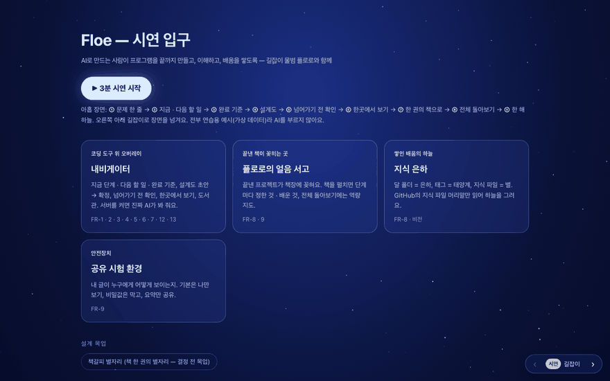
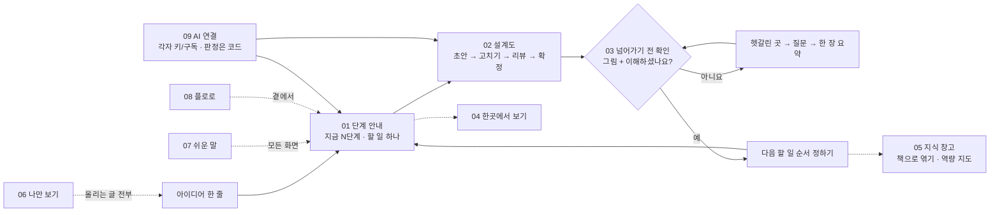

<!-- claude-drafted: 2026-10-18 — 이재엽의 요청("기능별로 사람이 읽을 수 있도록 다이어그램을 이용하고, 시연은 GIF로")으로 Claude가 썼다. 내용은 requirements.md · ADR · 커밋/PR 기록 · 코드 머리 주석에서만 옮겼고, GIF는 02-frontend를 파일로 직접 열어(서버·AI 호출 없이, 연습 예시만) Playwright로 녹화했다. 틀린 곳은 담당이 고친다. -->

# Floe 기능 지도 — 무엇을, 왜, 어떻게 만들었나

**이 폴더는:** Floe의 기능 하나에 폴더 하나다. 폴더마다 README(무엇 · 왜 · 어떻게 진행됐나 · 흐름 그림 · 시험 · 담당)와 **움직이는 시연 GIF**(`demo.gif`)가 있다.
요구의 원천은 [requirements.md](../00-overview/requirements.md)이고, 이 폴더는 그 요구가 **코드 어디에서 어떻게 되는지**를 사람이 읽을 수 있게 모은 것이다. 어긋나면 requirements.md가 맞다.

## 1. 기능 아홉 개

| 폴더 | 기능 | 요구 | 등급 | 지금 상태 (2026-10-18) |
|---|---|---|---|---|
| [`01-stage-guide/`](01-stage-guide/README.md) | 단계 안내 — 지금 몇 단계, 다음 할 일, 완료 기준 | FR-1 · FR-2 | Must | 연습 예시 · 진짜 AI 둘 다 동작 · 시험 50개(navigator) |
| [`02-blueprint/`](02-blueprint/README.md) | 설계도 함께 쓰기 — 초안(AI) → 고치기(사람) → 리뷰(AI) → 확정(사람) | FR-3 | Must | 동작 · 시연 1바퀴 |
| [`03-gate/`](03-gate/README.md) | 넘어가기 전 확인 — 그림 + "이해하셨나요?", 아니요 루프, 다음 할 일 순서 | FR-4 · FR-5 · FR-12 | Must · Should | 동작 · 1회 루프 |
| [`04-overview/`](04-overview/README.md) | 한곳에서 보기 — 진행 · 할 일 · 일정 충돌 · 토큰 | FR-6 | Must | 가상 숫자(화면에 표시) |
| [`05-library/`](05-library/README.md) | 지식 창고 — 도서관 탭 · 얼음 서고 · 역량 지도 · 지식 은하 | FR-8 | Must | 목업 · 시험 33개 · 항목은 인터뷰 뒤 |
| [`06-share/`](06-share/README.md) | 나만 보기 — 공유 규칙과 시험 화면 | FR-9 | Must | 시험 완료(8개) |
| [`07-plain-words/`](07-plain-words/README.md) | 쉬운 말 — 용어는 작게, 배운 말 모으기 | FR-13 | Must | 규칙 + 시험으로 강제 · 용어 목록은 인터뷰 뒤 |
| [`08-floro/`](08-floro/README.md) | 길잡이 플로로 — 표정 · 움직임 · 교감 (워크플로우 밖, 보조) | — | — | 동작 · 원본 그림은 이용 조건 확인 전 |
| [`09-ai-connection/`](09-ai-connection/README.md) | AI 연결 — 각자 키/구독, 판정은 코드, 녹화·재생, 코딩 도구 알림 | FR-7 · FR-10 · ADR-0003 · 0009 | Could · Must | 동작 · 시험 61개 |

Must 10개 중 **FR-10(서버 없이 시연)** 은 모든 기능의 전제라 폴더가 따로 없다 — 09의 "연습 모드"가 그것이다. FR-11(도와준 사람)은 문서([ACKNOWLEDGEMENTS](../ACKNOWLEDGEMENTS.md))다.

## 2. 한 바퀴 — 기능이 어떻게 이어지나

세로축으로 보면 — **판정은 코드 규칙**(`navigator.js`), **AI는 한 곳**(`provider.js`)에서만, **확정·순서·이해 여부는 사람이 누른다**(ADR-0003). 전체 구조 그림은 [층 그림(ArchiMate)](../03-pattern-analysis/navigator-archimate.md).

## 3. 어떻게 여기까지 왔나 — 한눈에

| 날짜 | 일 | PR |
|---|---|---|
| 10/12 | 기획안 · 요구사항 13개 · 공유 규칙 시험 환경(FR-9) | 초기 커밋 |
| 10/14 | 우선순위 확정(Must 10) · 프로토타입 첫 화면(CouCou식 옆자리 동료) · 설계도 루프(FR-3) · Claude Code 훅 연결(FR-7) | #34 · #41 |
| 10/15 | 길잡이를 물범으로 · 마스코트 원본 · ADR 0002~0006 초안 · 화면 구조 초안 | #49 · #45 · #58 · #59 |
| 10/16 | 판정 규칙 ①·②(근거 구절 · 단계는 코드가) · 0~7단계 전부 시연 · UC-01 · 서재 설계 | #73 · #67 · #68 |
| 10/17 | 각자 키/구독 · 중계 서버 호환 · 녹화·재생 · 예산 통 · ADR 채택 · 서고·역량 지도·지식 은하 · 시연 9장면 연결 · 폴더 정리 | #74~#78 · #80 · #85 · #87 · #88 |
| 10/17~18 | 플로로 움직임·입체감 · 서고 물속 전환 · 와이어(#12)에 맞춤 | #89~#93 |

각 폴더 README의 "어떻게 진행됐나"가 기능별 상세다. 사람별 할 일은 [team-priorities.md](../00-overview/team-priorities.md) "내 몫".

## 4. GIF는 어떻게 만들었나 · 다시 만들기

- `02-frontend/*/index.html`을 **파일로 직접 열어**(file://) 녹화했다 — 이때는 코드가 연습 예시(fixture)만 쓰므로 **서버도 AI 호출도 없다**(토큰 0). 장면은 [3분 시연 스토리](../04-pattern-implementation/demo-story-3min.md)의 주소(`#ex=0` 등)를 그대로 썼다.
- 숫자 · 책 · 캘린더는 모두 **가상 데이터**다(FR-10). 마스코트 원본 그림(`mascot-v1.webp`)은 넣지 않았다 — 코드로 그린 플로로만.
- 다시 만들려면: Playwright(Chromium)와 Pillow가 있는 컴퓨터에서 `01-docs/features/record-demo-gifs.py`를 돌린다. 화면 폭 1280, 내비게이터 장면은 패널 영역만 잘라 880px로 저장한다.
- 제출용 구동 영상(#16, 임유정)은 이것과 별개다 — 이 GIF는 **문서 안에서 기능을 보는 용도**다.
