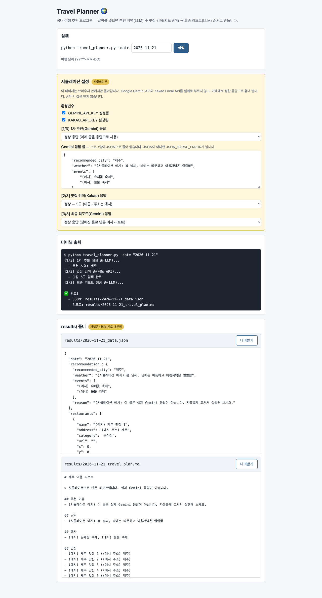
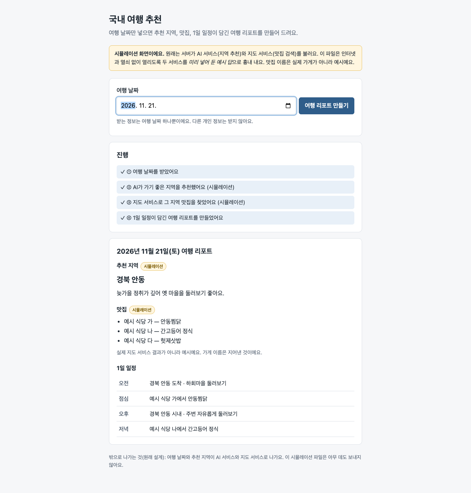

# 같은 미션, 두 기록 — 사람이 짠 코드 vs Floe 단계 문서를 Claude가 읽고 HTML로 만들어 보기

<!-- claude-drafted: 2026-11-07 — 이재엽의 요청("K-Travel-Assistant가 이 문제였고 test-1은 그대로 두고 이걸 html로 만든 테스트 결과값을 올려줘")으로 비교를 돌리고 적었다. 숫자는 이 날 실제로 잰 값이다. -->

코디세이 AI 활용 **미션 1 "국내 여행 추천 프로그램"**(여행 날짜를 넣으면 LLM이 지역을 추천하고, 지도 API로 맛집을 찾고, 리포트를 만든다)을 두 방식으로 남긴 저장소를 비교했다.

| | A · [K-Travel-Assistant](https://github.com/gamercross/K-Travel-Assistant) | B · [test-1](https://github.com/gamercross/test-1/tree/floe-run-1) |
|---|---|---|
| 무엇 | 사람이 직접 짠 Python 명령줄 프로그램(Gemini + Kakao Local) | Floe 여덟 단계를 지나며 남은 단계 문서 · 기획서 · 결정 기록 |
| 안에 든 것 | 파일 9개 — 코드 6개(그중 빈 파일 2), 짧은 README, 설정 2개 | 파일 27개 — 모두 Markdown, **코드 0줄** |

두 저장소 모두 브라우저로 볼 결과물이 없다. 그래서 **맥락이 없는 새 Claude 두 개에게 저장소 하나씩만 주고 같은 지시로 HTML 한 장을 만들게 했다.** 읽는 데 드는 토큰, 만들면서 추측한 것, 만들어진 화면을 비교했다.

## 한 줄 결론

**Claude는 코드(A)를 더 쉽게 이해했다 — 4/5 대 3/5, 읽는 토큰은 15.5분의 1.** 코드는 test-1이 "아직 모름"으로 남긴 것(맛집 몇 곳, 일정 칸, 추천 답의 모양, 실패할 때)을 모두 정해 두었다. 반대로 **왜 · 누구를 위해 · 무엇을 막을지는 test-1에만 있었다.** 둘 다 "다 됐다"와 실제가 어긋났다 — A는 코드가 있지만 적힌 대로 설치하면 실행되지 않고, B는 코드가 아예 없는데 만들고 커밋했다고 적혀 있다. **도는 코드로 만들게 하면 A는 2줄 고쳐 끝냈고(새로 읽은 토큰 71,439 · 쓴 토큰 12,243), B는 343줄을 새로 썼다(128,919 · 18,870 — 약 1.5 ~ 1.8배)** — 그리고 B를 만든 Claude는 어떤 AI 서비스를 쓸지부터 추측해야 했다.

## 숫자로

토큰은 Claude Opus 5.5의 토크나이저로 잰 입력 토큰이다(재는 법은 맨 아래).

| 잰 것 | A · K-Travel-Assistant | B · test-1 | B ÷ A |
|---|---:|---:|---:|
| 저장소 전체를 읽는 데 드는 입력 토큰 | **3,544** | **55,053** | **15.5배** |
| 글자 수 | 7,948 | 55,587 | 7.0배 |
| 같은 문장이 되풀이된 비율(25자 이상 조각, 글자 기준) | 3% | 43% | — |
| 만드는 데 쓸모 있던 비율(만든 Claude의 어림) | 약 85% | 약 10 ~ 15% | — |
| → 쓸모 있던 토큰(어림) | 약 3,000 | 약 5,500 ~ 8,300 | 약 2 ~ 3배 |
| 만드는 동안 새로 읽은 토큰(처음 보는 내용 — 캐시에 새로 쓴 양) | 94,973 | 120,092 | 1.3배 |
| 만드는 동안 쓴 토큰(코드 · 글 · 생각) | 17,526 | 18,489 | 1.1배 |
| 끝날 때 문맥 크기(마지막에 붙들고 있던 양) | 95,615 | 141,448 | 1.5배 |
| 도구 호출 · 걸린 시간 | 7번 · 162초 | 13번 · 181초 | — |
| 원본이 정해 주지 않아 **추측한 것** | 9 | 10 | — |
| 원본 안에서 **서로 맞지 않는 곳** | 9 | 10 | — |
| 오프라인 HTML로 못 해서 흉내 낸 것 | 5 | 4 | — |
| 이해하기 쉬웠던 정도(만든 Claude가 1 ~ 5로) | **4** | **3** | — |
| 원본에 코드가 있나 | 있음 — Python 6개(그중 빈 파일 2) | **없음** — 문서만 27개 | — |
| 원본이 실제로 도는가 | **아니오** — 적힌 대로 설치하면 `import google.genai`에서 멈추고, 그 패키지를 따로 넣어도 `genai.configure`가 없어 다시 멈춤(둘 다 직접 돌려 확인). 키가 없을 때의 안내만 동작 | 돌릴 코드가 없음 | — |
| **도는 코드로 만들 때 새로 읽은 · 쓴 토큰**(아래 절) | **71,439 · 12,243** — 2줄 고치고 시험 추가 | **128,919 · 18,870** — 343줄 새로 씀 | 1.8배 · 1.5배 |

### 토큰이 어디에 쓰였나

| A · K-Travel-Assistant | 토큰 | 몫 |
|---|---:|---:|
| 코드 6개(`travel_planner.py` · `src/*.py`) | 3,039 | 86% |
| `README.md` | 412 | 12% |
| `.gitignore` · `requirements.txt` | 89 | 3% |

| B · test-1 | 토큰 | 몫 |
|---|---:|---:|
| 단계 문서 8개(`docs/0N-*/*.md`) | 21,128 | 38% |
| 관문 계획서 8개(`gate-plan.md`) | 17,579 | 32% |
| 결정 기록(`decisions.md`) | 7,966 | 14% |
| 기획서(`PRD.md`) | 4,645 | 8% |
| 루트 `README.md` | 1,928 | 4% |
| 폴더 안내 README 7개 | 1,438 | 3% |
| `CLAUDE.md` | 369 | 1% |

B의 핵심 기능 문장 "지역이 정해지면, 앱은 지도 서비스로 맛집을 찾는다"는 **7개 파일에 16번** 나온다. 한 칸이 본문 → "플로로 초안" 인용 → 완료 기준 표 → 결정 기록(초안 · 정한 것 두 칸) → 기획서 → 관문 계획서 → README 버전 기록으로 되풀이된다.

## 무엇이 만들어졌나

두 HTML은 이 폴더에 그대로 두었다 — 브라우저로 바로 열린다.

| | A | B |
|---|---|---|
| 파일 | [A-k-travel-assistant.html](code-vs-floe-2026-11-07/A-k-travel-assistant.html) | [B-test-1.html](code-vs-floe-2026-11-07/B-test-1.html) |
| 모양 | **명령줄 프로그램을 그대로 흉내 낸 화면.** `python travel_planner.py -date` 칸 → 터미널 출력([1/3] · [2/3] · [3/3]) → `results/` 폴더의 JSON · Markdown 두 파일(내려받기 가능) | **날짜 넣기 → 리포트 웹 한 장.** 진행 ① ~ ④, 추천 지역 · 맛집 3곳 · 1일 일정(오전 · 점심 · 오후 · 저녁) |
| 흉내 낸 것 | Gemini 추천 · 리포트, Kakao 검색, 환경변수 키, 파일 쓰기, 종료 코드 | AI 지역 추천(달마다 고정 표), 지도 맛집 검색(지어낸 "예시 식당"), 서버와 `.env` |
| 눈에 띄는 점 | 코드의 **오류 갈래를 모두 고를 수 있다** — 추천 실패 뒤 1회 재시도, Kakao 401 · 403 · 0건 · 네트워크 오류, 리포트 실패로 멈춤. Gemini 답(JSON)도 직접 고쳐 넣을 수 있다 | **막을 일이 화면에 들어갔다** — "받는 정보는 여행 날짜 하나뿐", "밖으로 나가는 것(원래 설계)" 안내 |
| 확인 | 스크립트 문법 검사 통과, 일곱 갈래(성공 · 날짜 오류 · 재시도 · 최종 실패 · 키 없음 · 리포트 실패 · 칸 빠짐)를 node로 돌림, 브라우저에서 2026-11-21로 실행 | 스크립트 문법 검사 통과, 빈 날짜 안내와 1 · 7 · 11 · 12월을 돌림, 브라우저에서 2026-11-21로 실행 |
| 화면 |  |  |
| 만든 Claude의 기록 | [A-build-log.md](code-vs-floe-2026-11-07/A-build-log.md) | [B-build-log.md](code-vs-floe-2026-11-07/B-build-log.md) |

A 화면의 추천 예시(제주 · 봄 날씨)는 날짜와 상관없는 고정 예시 글이다. 원본에서 이 내용은 Gemini가 정하므로 코드에 없다.

## 도는 코드로 만들면 — 토큰과 결과

HTML 흉내가 아니라 **실제로 도는 프로그램**을 만들게 했다. 새 Claude 둘에게 저장소만 주고 같은 지시를 줬다 — 원본이 정한 언어 · 서비스를 따르고, 기능은 더하지 않고, 진짜 키 없이 (가) 외부 AI · 지도 호출을 가짜로 바꾼 시험으로 흐름 전체를 돌리고 (나) 키 없이 실제로 실행해 보고 (다) 고정한 패키지로 import가 되는지 확인하기. 시험은 끝난 뒤 이쪽에서 다시 돌려 같은 결과를 확인했다.

| | A · K-Travel-Assistant에서 | B · test-1에서 |
|---|---:|---:|
| 새로 읽은 토큰 | **71,439** | **128,919** |
| 쓴 토큰(코드 · 글 · 생각) | **12,243** | **18,870** |
| 끝날 때 문맥 크기 | 92,820 | 151,125 |
| 도구 호출 · 걸린 시간 | 13번 · 147초 | 23번 · 197초 |
| 한 일 | 원본 코드를 옮겨 **2줄만 고침**(import 이름, 패키지 0.4.0 → 0.8.6) + 시험 121줄 | 코드가 없어 **새로 343줄**(`travel.py` 105 · `app.py` 38 · `index.html` 46 · 시험 154) |
| 모양 | 원본 그대로 명령줄 프로그램 | 4단계 결정대로 서버가 있는 웹(Flask) |
| 시험 | **9개 통과** — 정상 흐름, Kakao 401 · 403 · 0건 · 네트워크 오류, Gemini 1회 재시도 · 두 번 실패, 키 없음, 날짜 오류 | **11개 통과** — 정상 흐름, 빈 날짜, 키 없음, 날짜 말고 다른 정보를 보내도 AI · 지도로 넘어가지 않음, 코드에 키 모양이 없는지 |
| 키 없이 실행 | "GEMINI_API_KEY 환경변수가 설정되지 않았습니다" 후 종료 코드 1 | 서버는 뜨고 경고, 리포트 요청에 503 "OPENAI_API_KEY 없음" |
| 추측한 것 | 8 — 대부분 "고친 방법"(어느 패키지 · 어느 버전) | **12 — 쓸 서비스부터 추측** |
| 확인 못 한 것 | 진짜 Gemini · Kakao 응답, `gemini-1.5-flash`가 아직 서비스되는지 | 진짜 OpenAI · Kakao 응답, 브라우저 화면 |
| 결과 코드 | [A-코드/](code-vs-floe-2026-11-07/A-코드/build-log.md) | [B-코드/](code-vs-floe-2026-11-07/B-코드/build-log.md) |

**눈에 띄는 것: test-1은 어떤 AI · 어떤 지도 서비스를 쓸지 적지 않았다.** "AI 서비스 / 지도 서비스"라고만 있어서 B를 만든 Claude는 **OpenAI(`gpt-4o-mini`)와 Kakao, Flask를 스스로 골랐다.** 같은 미션의 사람 코드는 Gemini를 썼다. 맛집 수(5)도 이번에는 우연히 A와 같았지만 HTML 실험에서는 3이었다 — 비워 둔 칸은 돌릴 때마다 다르게 채워진다.

반대로 **B의 코드에만 있는 것**도 있다. "날짜 말고 다른 개인 정보는 받지 않는다"(3단계 막을 일)가 시험으로 들어갔고, "열쇠는 `.env`에만, 올리기 전에 검사"(5 · 6단계)가 `.env.example` · `.gitignore` · 키 모양 검사 시험으로 들어갔다. A에는 이런 시험이 없다.

위 토큰에는 원본을 읽는 값(A 3,544 · B 55,053)도 들어 있다 — 만든 Claude가 직접 읽었다. 정리하면 **코드가 있으면 "고치기"로 끝나 적게 들고, 코드가 없으면 문서가 길어도 처음부터 다시 짜야 해서 1.5 ~ 1.8배가 들었다.**

## 같은 질문에 누가 답했나

추측 수는 9 대 10으로 비슷하지만, **무엇을 추측했는지가 다르다.** A의 추측은 대부분 "외부 AI가 무엇이라 답할지"(원래 알 수 없는 것)였고, B의 추측은 "제품의 모양"(사람이 정했어야 하는 것)이었다.

| 질문 | A · 코드가 정한 것 | B · test-1에 적힌 것 | B를 만든 Claude가 고른 것 |
|---|---|---|---|
| 맛집 몇 곳? | 5곳(`size=5`) | 아직 모름 | 3곳 |
| 1일 일정의 칸 | 오전 / 오후 / 저녁(리포트 프롬프트) | 정하지 않음 | 오전 / 점심 / 오후 / 저녁 |
| 추천 답의 모양 | 도시 · 날씨 · 행사 · 이유(JSON) | 정하지 않음 | 지역 · 이유 · 볼거리 |
| "그 시기"란? | 날짜를 그대로 AI에 줌 | 정하지 않음 | 달(1 ~ 12월)마다 한 지역 |
| 실패하면? | 추천은 1회 재시도, 맛집 실패는 경고 후 계속 | 없음 | 없음 |
| 결과를 어디에? | `results/날짜_data.json` · `날짜_travel_plan.md` | "정보를 둘 곳: 서버" — 무엇을 둘지는 없음 | 저장하지 않음 |
| 리포트 시간 · 성공 기준 | 없음 | 아직 모름 | 없음 |
| 왜 · 누구를 위해 | README 첫 줄이 "조합하여..."에서 끊김 | **있음** — 불편 · 누가 · 달라지는 것 | 화면 머리말로 |
| 받지 말 정보 · 밖으로 나가는 것 | 없음(키를 숨기라는 주의만) | **있음** — 날짜 말고 받지 않음, 날짜와 지역이 AI · 지도로 나감 | 화면 안내로 |
| 키 다루기 | 환경변수 · `.env`, `.gitignore` | `.env`에만, 서버에서만 | 키를 쓰지 않음 |

## 막힌 곳

| | A · K-Travel-Assistant | B · test-1 |
|---|---|---|
| **답을 준 것** | `travel_planner.py`의 `main()` — print 문구와 `errors` 구조(`step` · `type` · `message`)가 그대로 화면 명세 노릇을 했다 | 5단계 "끝까지 잇기"(① 날짜 → ② AI 추천 → ③ 지도 맛집 → ④ 리포트)와 6단계 "작은 확인"(빈칸 안내, 맛집 하나 이상) |
| **기록과 실제가 어긋남** | `requirements.txt`는 `google-generativeai`인데 코드는 `import google.genai` — 적힌 대로 설치하면 시작하자마자 멈춘다. `report_generator.py`는 빈 파일, 리포트 단계는 오류 처리가 없음 | 코드가 없는데 "한 흐름으로 이었고 열쇠도 `.env`에 숨겼어요", "문서와 코드 — 커밋". 5단계 "도는지 보기"는 '이미 확인함', 6단계 "작은 확인"은 까닭 'ㅇ', 7단계는 기준 4개 중 3개를 '넘어가'로 넘김 |
| **문서끼리 어긋남** | README가 `.env` 쓰는 법을 말하지 않는데 코드는 `.env`를 읽음, 쓰지 않는 변수 | 4단계 "후보 찾기"(서버 웹 / 화면 하나짜리 웹 / 표 계산 도구)와 "견주기"(서버 웹 / 파이썬 프로그램 / 휴대폰 앱)의 후보가 다름. 미션은 Python인데 고른 방법은 "서버가 있는 웹" |
| **군더더기** | 빈 파일 2개, OS별 설치 안내(약 15%) | 같은 문장의 되풀이와 관문 계획서의 "공부할 말"(용어 풀이) |

정리하면 A는 **"얼마나 · 어떤 모양"은 다 있는데 "왜"가 없고 돌지 않는** 기록, B는 **"왜 · 누구 · 막을 일"은 또렷한데 "얼마나"가 비고 완료가 부풀려진** 기록이다. 둘을 합치면 서로의 빈칸이 채워진다.

## Floe에 주는 것 — 발표 · 고칠 목록 후보

아래는 이번 비교에서 나온 관찰이다. 고칠지는 팀이 정한다.

1. **관문이 "아직 모름"을 그대로 통과시킨다.** 코드는 이 질문들에 모두 답이 있었다(맛집 5곳, 오전 · 오후 · 저녁, 재시도 1회). Floe에서 비워 둔 칸은 다음 AI가 추측한다 — B에서 Claude가 고른 값은 A와 달랐다(3곳 · 4칸). B의 회고(8단계 "왜 다섯 번")도 같은 결론: "만들기 전에 '성공' 모습을 숫자로 정하지 않았어요".
2. **한 결정이 6 ~ 8번 적힌다.** 반복 43%, 같은 미션의 코드보다 토큰 15.5배. `PRD.md` + `CLAUDE.md`만 읽으면 5,014토큰(전체의 9%)이고, 만든 Claude는 "PRD 3 · 5 · 6절로 거의 다 정해졌다"고 적었다. *(PRD만 주고 다시 만들어 보는 것은 하지 않았다 — 가설.)*
3. **"만들었다 · 확인했다"를 증거 없이 적는다.** 코드도 커밋도 없는데 6 · 8단계 문서가 완료를 말한다. 확인 칸을 넘길 때 파일 · 커밋이 실제로 있는지 보는 장치가 필요해 보인다. *(사람이 짠 A도 "돌지 않는 코드"였다 — 실제로 돌려 보는 확인은 둘 다에 빠져 있었다.)*
4. **사람이 거의 고치지 않았다.** `decisions.md`의 35칸 중 플로로 초안을 그대로 받은 칸 12 · 셋 중에서 고른 칸 22 · 직접 쓴 칸 1 · 고친 칸 0. "사람이 이해하고 정한다"는 Floe의 목표와 맞대어 볼 숫자다.
5. **4단계 후보와 비교 대상이 다르게 나왔다.** 사람이 "고름"으로 받았으니 초안 단계에서 생긴 어긋남으로 보인다.
6. **쓸 외부 서비스의 이름이 남지 않는다.** test-1은 "AI 서비스 · 지도 서비스"까지만 적어, 코드를 만든 Claude가 OpenAI · Kakao · Flask를 골랐다. 4단계 "쓸 도구"에 서비스 이름을 한 줄 남기면 이 추측이 사라진다.
7. **Floe만 남긴 것도 분명히 있다.** 왜 · 누구를 위해 · 받지 말 정보 · 밖으로 나가는 것은 A에는 없고 B에만 있었고, B로 만든 화면에 그대로 들어갔다. 발표에서는 "Floe 문서 + 그 문서를 따르는 코드"가 함께 있을 때를 목표 모습으로 말할 수 있다.

## 이 비교의 한계

- **한 번씩만 돌렸다(n = 1).** 같은 지시로 다시 돌리면 추측 수 · 토큰이 조금씩 달라질 수 있다.
- **두 저장소를 같은 사람이 같은 때 만든 것이 아니다.** A는 2026-08-18, B는 2026-10-28 ~ 11-04 기록이다.
- "이해하기 쉬웠던 정도"와 "쓸모 있던 비율"은 **만든 Claude가 스스로 매긴 값**이다. 추측 · 모순 개수는 기록에 하나씩 적혀 있어 확인할 수 있다.
- A가 돌지 않는다는 확인은 이 Mac(Python 3.14)에서 했다. 두 오류(패키지 이름 · `configure` 없음)는 Python 버전과 상관없다. 다만 원본이 고정한 `google-generativeai==0.4.0`은 3.14에서 import되지 않아, 고친 코드는 0.8.6으로 올렸다 — 더 낮은 Python에서는 0.4.0도 될 수 있다.
- 만든 코드 둘 다 **진짜 Gemini · OpenAI · Kakao를 부르지 않았다**(키 없음). "돈다"는 것은 가짜 호출 시험 · 키 없는 실행 · import까지다.

## 재는 법 — 다시 돌리려면

1. 두 저장소를 `gh repo clone`으로 받았다(2026-11-07, A `e54974a` · B `efba487`).
2. **토큰:** `claude -p --model claude-opus-5-5 --output-format json --tools ""`에 "OK라고만 답해." 한 줄만 보낸 입력 토큰과, 그 뒤에 파일 내용을 붙여 보낸 입력 토큰의 차이. 입력 토큰 = `input_tokens + cache_creation_input_tokens + cache_read_input_tokens`. 묶음별 합이 전체 값과 맞는 것(A는 구분 줄 몇 토큰 차)을 확인했고 B 전체는 두 번 쟀다(같음).
3. **만들기:** 새 Claude(general-purpose, Opus 5.5) 둘에게 저장소 경로만 바꾼 같은 지시를 줬다 — 그 폴더만 읽기, 웹 · 외부 라이브러리 · 키 없이 `index.html` 한 장, 원본에 없는 기능은 더하지 않기, 못 하는 것은 화면에 "시뮬레이션"이라 밝히기, 끝나면 정해진 여덟 칸의 `build-log.md`. 비교 실험이라는 것은 알리지 않았다. 만드는 동안의 토큰은 그 Claude의 대화 기록에서 응답마다 붙은 사용량을 더했다 — "새로 읽은 토큰" = 캐시에 새로 쓴 입력(같은 내용을 다시 읽은 몫은 빼고), "쓴 토큰" = 출력. "끝날 때 문맥 크기"는 마지막 응답의 입력 + 출력이다. *(2026-11-07 처음 판에는 문맥 크기를 "쓴 토큰 합계"로 잘못 적었다 — 같은 날 바로잡음.)*
4. **원본 실행(A):** 새 가상환경에 `requirements.txt`를 설치하고 가짜 키로 `python travel_planner.py -date 2026-11-21` → `ModuleNotFoundError: No module named 'google.genai'`.
5. **도는 코드 만들기:** 같은 방식으로 새 Claude 둘에게 "원본이 정한 언어 · 서비스로 실제로 도는 프로그램 + 가짜 호출 시험 + 키 없이 실행 + import 확인"을 맡겼다(가상환경에 패키지 설치만 허용, 진짜 API 호출 금지). 끝난 뒤 이쪽에서 `pytest -q`를 다시 돌려 A 9개 · B 11개 통과를 확인했다. 가상환경 · 캐시는 빼고 코드만 `A-코드/` · `B-코드/`에 옮겼다.
6. **확인:** 두 HTML의 스크립트를 `node --check`로 검사(둘 다 통과), 브라우저(playwright)에서 둘 다 날짜 2026-11-21을 넣고 실행해 화면을 찍었다.
7. **반복 비율:** 모든 파일을 줄 · 구분자(` / ` · ` · ` · `|`)로 나눈 25자 이상 조각 중 같은 조각이 다시 나온 글자 비율. (A는 줄 단위로 셌다 — 코드에는 구분자 나누기가 맞지 않는다.)
