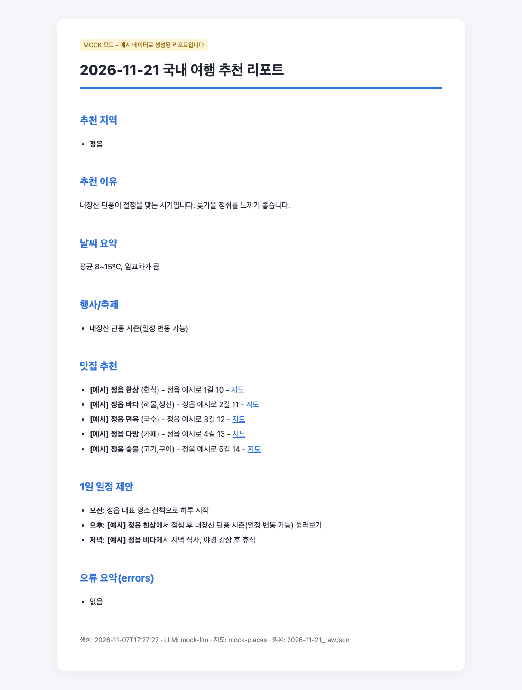

# 미션 원문만 받은 Claude vs Floe 단계 문서(test-1) — 같은 미션, 다른 준비

<!-- claude-drafted: 2026-11-07 — 이재엽의 요청("이 내용으로 너가 여기 있는 내용만 보고 만들고 보이는건 html로 … test-1이랑 비교해 … 내 스킬들을 활용하지 않고 그냥 바이브코딩하는 사람이 너한테 미션을 준 상태로")으로 돌리고 적었다. 숫자는 이 날 실제로 잰 값이다. -->

코디세이 AI 활용 **미션 1 "국내 여행 추천 프로그램"** 원문(아래 "미션 원문")을 **설정 · 스킬 · 메모리가 하나도 없는 새 Claude에게 그대로 붙여 넣고** 한 줄만 더했다 — "이거 만들어줘. 결과는 html로 볼 수 있게도 해줘. API 키는 아직 없어." 바이브 코딩하는 사람이 하는 방식 그대로다. 그 결과를 같은 미션을 Floe로 지나간 [test-1](https://github.com/gamercross/test-1/tree/floe-run-1)과, 사람이 짠 [K-Travel-Assistant](https://github.com/gamercross/K-Travel-Assistant)와 견줬다. 앞의 비교는 [code-vs-floe-2026-11-07.md](code-vs-floe-2026-11-07.md)에 있다.

## 한 줄 결론

**미션 원문만 받은 Claude는 미션 요구 21개를 모두 채운 프로그램을 한 번에 만들었다(시험 19개 통과, 보너스 2개까지).** test-1 문서에는 미션의 구체 요구가 **21개 중 2개만** 남아 있다. 까닭은 문서를 쓰는 방식이 아니라 **입구**다 — Floe는 붙여 넣은 미션 5,199자 중 **앞 400자만 AI 초안에 넘긴다**(고칠 목록 F-68, 원문 보관만 고침). 그 뒤에 있던 "CLI · argparse · 웹 UI 필요 없음 · JSON 키 · OpenAI/Gemini · Kakao/Naver · 맛집 5곳 · 오류 정책 · results 폴더 · README"가 단계 문서로 한 줄도 넘어가지 않았고, 4단계는 미션과 반대로 "서버가 있는 웹"을 골랐다. 미션의 **학습 목표**(REST · GET/POST · JSON · 오류 · 환경변수)도 test-1의 "공부할 말"에는 없다.

## 숫자로

| 잰 것 | 미션 원문만 → Claude | A · K-Travel-Assistant(사람 코드) | B · test-1(Floe 문서) |
|---|---:|---:|---:|
| 원본을 읽는 데 드는 입력 토큰 | **4,484** | 3,544 | **55,053** |
| 원본 글자 수 | 5,199 | 7,948 | 55,587 |
| 원본에 코드 | 없음(미션 글뿐) | 있음 — 돌지 않음 | 없음 |
| **미션 요구 21개 중 채운 것**(아래 표) | **21** | 16 + 일부 5 | **2 + 일부 1** |
| 도는 프로그램을 만들 때 새로 읽은 토큰 | 59,220 | 71,439 | 128,919 |
| 도는 프로그램을 만들 때 쓴 토큰(코드 · 글 · 생각) | 45,644 | 12,243 | 18,870 |
| 만든 결과 | **1,656줄** — 프로그램 · README · 시험 · HTML 리포트 · 보너스 2개 | 원본에서 2줄 고침 + 시험 121줄 | 새로 343줄(Flask 웹) |
| 시험 | **19개 통과** | 9개 통과 | 11개 통과 |
| 응답 수 · 걸린 시간 | 24번 · 409초 | 14번 · 147초 | 18번 · 197초 |
| 정가 환산 | 1.58달러 | — | — |

- "미션 원문만"의 토큰은 그 실행의 사용량 기록 그대로다(`claude -p` 결과). A · B는 [앞 비교](code-vs-floe-2026-11-07.md)에서 새 Claude에게 "이 저장소로 도는 코드를 만들라"고 맡긴 실행의 기록을 같은 기준(캐시에 새로 쓴 입력 · 출력)으로 더했다.
- 맡긴 일의 크기가 다르다. 미션 원문 쪽은 README · HTML 리포트 · 보너스까지 만들었고, A는 고치기만, B는 문서가 정한 웹 하나만 만들었다. 그래서 **쓴 토큰은 미션 원문 쪽이 가장 많지만 결과물도 가장 크다.**

## 미션 요구 21개 — 누가 채웠나

✓ 됨 · △ 일부 · ✗ 없음. "미션 원문만"과 "test-1로 만든 코드"는 실제로 돌려 확인했고, K-Travel은 코드를 읽어 판정했다(원본이 실행되지 않음). test-1 문서는 문서에 그 내용이 적혀 있는지로 판정했다.

| # | 미션 요구 | 미션 원문만 → Claude | A · K-Travel | B · test-1 문서 | B로 만든 코드 |
|---:|---|:-:|:-:|:-:|:-:|
| 1 | argparse로 CLI 실행 | ✓ | ✓ | ✗ "서버가 있는 웹"으로 정함 | ✗ Flask 웹 |
| 2 | `-date` 필수 | ✓ | ✓ | ✗ | ✗ |
| 3 | 날짜 형식이 틀리면 사용법 출력 후 종료 | ✓ | △ 오류 문구만 | ✗ | △ 400 응답 |
| 4 | LLM은 OpenAI 또는 Gemini | ✓ 둘 다, `.env`로 고름 | ✓ Gemini | ✗ 이름 없음 | ✓ OpenAI(추측으로 맞음) |
| 5 | 지도는 Kakao 또는 Naver | ✓ Kakao | ✓ Kakao | ✗ 이름 없음 | ✓ Kakao(추측으로 맞음) |
| 6 | 1차 JSON 4키(`recommended_city` · `weather` · `events` · `reason`) | ✓ | ✓ | ✗ | ✗ `region` · `reason`만 |
| 7 | 맛집 검색 입력 = 추천 도시 | ✓ | ✓ | ✓ 흐름에 있음 | ✓ |
| 8 | 맛집 5곳 + 필드(name · address · category · url · x/y) | ✓ | ✓ | ✗ "아직 모름" | △ 5곳 |
| 9 | 0건이어도 멈추지 않고 "데이터 없음" | ✓ | ✓ | ✗ | △ "현지 식당"으로 채움 |
| 10 | 리포트 Markdown — 지역 · 이유 · 날씨 · 행사 · 맛집 · 1일 일정 | ✓ | △ AI 프롬프트에 맡김 | △ 1일 일정만 | ✗ 날씨 · 행사 없음 |
| 11 | try-except로 호출 · 파싱 오류 처리 | ✓ | △ 리포트 단계 없음 | ✗ | △ |
| 12 | 키가 없으면 즉시 종료 + 설정 안내 | ✓ | ✓ | ✗ | △ 서버는 뜨고 503 |
| 13 | 지도 실패 → "데이터 없음"으로 계속 | ✓ 시험으로 확인(가짜 키로 실제 Kakao에 보내 401을 받았다는 것은 그 Claude의 보고) | ✓ | ✗ | ✗ 502로 멈춤 |
| 14 | JSON 파싱 실패 → 재시도 1회만 | ✓ 시험으로 확인 | ✓ | ✗ | ✗ |
| 15 | 오류 목록(errors) 관리 + 리포트에 요약 | ✓ | △ JSON에만 | ✗ | ✗ |
| 16 | 키는 환경변수 · `.env` | ✓ | ✓ | ✓ | ✓ |
| 17 | `results/` 폴더에 날짜 기준 저장 | ✓ | ✓ | ✗ | ✗ |
| 18 | 원본 JSON = 추천 + 맛집 + errors | ✓ | ✓ | ✗ | ✗ |
| 19 | 리포트 `.md` 저장 | ✓ | ✓ | ✗ | ✗ |
| 20 | README — 개요 · 실행 · 키 설정 · 결과 확인 · 유출 주의 | ✓ | △ 개요가 "조합하여..."에서 끊김 | ✗ | ✗ |
| 21 | Python 3.10+, 터미널(웹 UI 필요 없음) | ✓ | ✓ | ✗ 웹으로 정함 | ✗ |
| — | 보너스: 복수 지역 · 결과 캐싱 | ✓ ✓ | ✗ ✗ | ✗ ✗ | ✗ ✗ |
| | **합계** | **21** | **16 + △5** | **2 + △1** | **4 + △5** |

## 문서가 어떻게 다른가 — 미션 원문 vs test-1

| | 미션 원문 | test-1(Floe 단계 문서) |
|---|---|---|
| 무엇인가 | **무엇을 만들라**는 명세 — 결과물 3개, 기능 요구, 오류 정책, 제약, 결과 예시 | **어떻게 정했나**의 기록 — 단계마다 칸 · 초안 · 사람이 고른 것 · 관문 · 배운 것 |
| 길이 | 1장, 5,199자 · 4,484토큰 | 27개 파일, 55,587자 · 55,053토큰(12배) |
| 미션 원문이 남은 양 | 전부 | **앞 399자**(5,199자 중 8% — "…지도 API로 맛집 정보를 검색한 뒤,"에서 끊김) — 1단계 · 기획서의 "처음 말한 것" |
| 숫자 | 정해져 있음 — 맛집 5곳 권장, 행사 1 ~ 3개, 이유 2 ~ 4문장, 재시도 최대 1회 | "아직 모름" 63번 |
| 기술 선택 | 정해져 있음 — CLI · argparse · Python 3.10+ · OpenAI/Gemini · Kakao/Naver · 웹 UI 필요 없음 | 4단계에서 **"서버가 있는 웹"을 고름**(미션과 반대). 서비스 이름 없음 |
| 오류 정책 | 정해져 있음 — 키 없음 · 지도 실패 · 파싱 실패마다 할 일, 결과 예시까지 | 없음 |
| 보안 | 키를 코드 · README · 결과물에 쓰지 않기 + **왜**(세 줄) | `.env`에만 · 올리기 전 검사 · 서버에서만 + **받지 말 정보 · 밖으로 나가는 것** ← 미션에 없던 것 |
| 배울 것 | **과제 목표 4개** — REST 구조와 GET/POST, LLM 출력을 JSON으로 다음 단계에 잇기, 대표 오류와 대응, `.env`를 쓰는 이유 | "공부할 말" — EARS · Planguage · ATAM · Walking Skeleton · TDD · 5 Whys 같은 **방법론 용어**. REST · HTTP · GET · POST · JSON · 파싱 · 쿼터 · 환경변수는 **0번** |
| 준비시키는 것 | 만들 사람이 **확인할 기준**(결과 예시 · 실패 예시) | 단계마다 "이 단계 전에 준비할 것"(예: 여행 날짜 하나 정해 보기, 성공이라고 느낄 숫자 생각해 보기) |
| 사람이 정한 흔적 | 없음(출제자의 글) | 결정 35칸 — 초안 그대로 12 · 셋 중 고름 22 · 직접 1 · 고침 0 |
| 완료 주장 | — | 코드 없이 "한 흐름으로 이었고 … 커밋" |

## 왜 이렇게 됐나 — Floe의 입구

1. **붙여 넣은 미션이 앞 400자에서 잘린다.** Floe는 처음 받은 글의 앞 400자(`IDEA_MAX = 400`, [navigator.js](../../03-backend/navigator/navigator.js))만 AI 초안 · 다음 단계에 넘긴다. [고칠 목록 F-68](../07-maintenance/fix-map.md)이 바로 이 test-1을 보고 2026-10-28에 찾았고, 고친 것은 "원문 전부를 `docs/00-source/idea.md`로 보관"까지다 — **AI에 넘기는 앞 400자는 그대로**라고 적혀 있다. test-1에는 그 보관 파일도 없다(고침 전에 시작한 것으로 보인다).
2. 그래서 1 ~ 3단계 초안은 미션의 첫 문단(미션 소개)만 보고 만들어졌고, "언제 성공 · 숫자 · 쓸 서비스"는 원문에 다 있었는데도 "아직 모름"으로 남았다. 사람은 그 초안을 그대로 받거나(12) 셋 중에서 골랐다(22).
3. 4단계는 원문의 "터미널에서 실행 · 웹 UI 필요 없음"을 보지 못한 채 "서버가 있는 웹"을 골랐다. 그 문서로 코드를 만든 Claude도 Flask 웹을 만들었다 — 문서를 충실히 따를수록 미션에서 멀어졌다.

## 같은 미션, 무엇을 얻었나

| | 미션 원문만 → Claude | Floe(test-1) |
|---|---|---|
| 결과물 | 바로 낼 수 있는 프로그램(요구 21/21, 시험 19) | 코드 없음 |
| 사람이 이해한 것 | 기록 없음 — README의 "학습 정리"는 **Claude가 썼다**. 사람이 GET/POST를 설명할 수 있는지는 모른다 | 결정 35칸과 관문 기록이 남았다. 다만 사람이 고친 칸 0, 미션의 학습 목표는 다루지 않음 |
| 막을 일 · 밖으로 나가는 것 | 키 가리기(오류 메시지 속 키까지 `***`), `.env` | 받지 말 정보 · 밖으로 나가는 정보까지 적음 — 미션보다 넓다 |

Floe의 목표는 결과물만이 아니라 "사람이 끝까지 만들고, 이해하고, 배움을 쌓는 것"이다. 이번 비교는 그 목표를 재지 못한다(사람을 인터뷰하지 않았다). 다만 **입구에서 미션이 잘리면 결과물도, 미션이 바란 배움도 함께 빠진다**는 것은 보였다.

## Floe에 주는 것 — 발표 · 고칠 목록 후보

고칠지는 팀이 정한다.

1. **F-68을 끝까지 — AI 초안이 원문 전체(또는 요약)를 보게.** 지금은 보관만 하고 초안은 400자만 본다. 미션처럼 긴 명세는 뒤쪽이 핵심이다(기능 요구 · 제약 · 결과 예시).
2. **원문에 이미 답이 있는 칸은 "아직 모름" 대신 원문을 가리키게.** 맛집 5곳 · 재시도 1회 · 서비스 이름은 원문에 있었다.
3. **4단계가 원문의 제약과 맞대어 보게.** "웹 UI 필요 없음 · CLI"와 반대인 선택을 관문이 잡지 못했다(4단계 "약속과 맞대기" 칸이 있었지만 원문을 못 봤다).
4. **미션의 학습 목표를 "공부할 말"로.** 지금은 방법론 용어가 고정으로 나온다. 미션이 적은 배울 것(REST · GET/POST · JSON · 오류 · 환경변수)을 그 자리에 둘 수 있다.
5. 앞 비교의 관찰(코드 없이 완료를 적음 · 결정 칸을 거의 고치지 않음 · 문장 되풀이 43%)은 그대로다 — [code-vs-floe-2026-11-07.md](code-vs-floe-2026-11-07.md).

## 만든 것 — 보기

| 무엇 | 어디 |
|---|---|
| 미션 원문만 받은 Claude가 만든 프로그램 전체(가상환경 빼고) | [C-미션만-코드/](code-vs-floe-2026-11-07/C-미션만-코드/README.md) · 공개 저장소 [gamercross/Final-Proj-Result](https://github.com/gamercross/Final-Proj-Result)에 HTML 셋 · 코드 셋과 함께 올림([PR #1](https://github.com/gamercross/Final-Proj-Result/pull/1)) |
| 그 프로그램이 만든 HTML 리포트(키 없는 예시 모드, 2026-11-21) | [C-미션만-리포트.html](code-vs-floe-2026-11-07/C-미션만-리포트.html) |
| 화면 |  |
| test-1로 만든 HTML · 코드, K-Travel로 만든 HTML · 코드 | [code-vs-floe-2026-11-07/](code-vs-floe-2026-11-07/B-build-log.md) 폴더의 A- · B- 파일 |

## 이 비교의 한계

- **한 번씩만 돌렸다(n = 1).**
- 미션 원문 쪽에는 "결과는 html로도"라는 한 줄을 더 줬다(바이브 코딩하는 사람이 할 법한 말). A · B로 코드를 만든 실험에는 그 말이 없었고, 대신 "기능을 더하지 말라 · 시험으로 확인하라"를 줬다 — 지시가 같지 않다.
- 진짜 OpenAI · Gemini는 아무도 부르지 않았다(키 없음). 미션 원문 쪽은 가짜 키로 진짜 Kakao 서버에 요청해 401 처리만 확인했다.
- 채점(✓ · △ · ✗)은 이쪽(Claude)이 미션 글과 대조해 매겼다. 표의 근거는 각 폴더의 코드와 기록에 있다.
- test-1이 F-68 고침 뒤에 시작됐다면 원문 보관 파일은 생겼겠지만, AI 초안이 앞 400자만 보는 것은 같다(F-68 기록 기준, 앱으로 다시 돌려 보지는 않았다).

## 재는 법 — 다시 돌리려면

1. **깨끗한 Claude:** `/tmp` 아래 빈 폴더(git 아님)에서 `CLAUDE_CODE_DISABLE_AUTO_MEMORY=1 claude -p --model claude-opus-5-5 --output-format json --setting-sources project --disable-slash-commands --strict-mcp-config --dangerously-skip-permissions`. 먼저 "주어진 CLAUDE.md · 메모리 · 스킬이 있으면 나열해"를 물어 "없음"을 받은 뒤 돌렸다(`~/.claude` 아래 폴더에서는 메모리가 따라 들어와 옮겼다).
2. **보낸 글:** 미션 원문 전체 + "이거 만들어줘. 결과는 html로 볼 수 있게도 해줘. API 키는 아직 없어." 한 번. 이어서 묻거나 고치지 않았다.
3. **토큰:** 그 실행의 `usage` — 새로 읽은 = `cache_creation_input_tokens`(59,220), 쓴 = `output_tokens`(45,644, 그중 생각 8,358). 누적 입력(캐시 다시 읽기 포함)은 1,036,337. 원문 토큰(4,484)은 [앞 비교](code-vs-floe-2026-11-07.md)와 같은 "빈 질문과의 차이" 방법.
4. **확인:** 끝난 뒤 이쪽에서 `python -m unittest`(19개 통과), 틀린 날짜 · 키 없음 · `--mock` 실행, HTML 리포트를 브라우저(playwright)로 열어 찍었다.
5. **test-1 대조:** 미션의 핵심 낱말(argparse · CLI · -date · results/ · JSON · OpenAI · Gemini · Kakao · Naver · 5곳 · errors · 재시도 · 401 · "데이터 없음" · 날씨 · 행사 · REST · HTTP · GET · POST · 파싱 · 쿼터 · 환경변수)이 test-1의 `.md` 27개 중 몇 개에 나오는지 셌다 — 모두 0("5개"는 "기능이 5개 이상일 때"라는 다른 뜻으로만 나옴).

## 그 뒤 — 같은 날 이어서 <!-- claude-drafted: 2026-11-07 -->

- 결과 화면이 제각각이라 **미션을 토대로 기준 v1과 수용 시험 24개**를 만들고(가짜 OpenAI · Kakao 서버), 같은 글(미션 + 기준)을 **Claude만**과 **Floe를 거쳐(사람 몫은 Claude가 '맞아요'로 대신)** 다시 만들었다 — 둘 다 24/24. Floe 쪽 단계 문서는 이번에도 4단계 "서버가 있는 웹" · 숫자 "아직 모름"이었고, 맡은 Claude Code가 보관된 원문을 읽고 CLI로 만든 뒤 '정할 것' 빈칸 8개를 남겼다. 표 · 코드 · 화면: [Final-Proj-Result](https://github.com/gamercross/Final-Proj-Result).
- 발표용으로 소개 웹사이트에 두 절을 더했다 — [floe-site.html](../04-pattern-implementation/website/floe-site.html)의 "같은 미션, 세 가지 길로 만들어 봤어요" · "빨리 끝나는 것과 남는 것은 달라요", 숫자의 출처는 [website/README.md](../04-pattern-implementation/website/README.md).
- 위 표의 "도는 프로그램을 만들 때" 토큰은 새로 읽은 · 쓴 토큰으로 바로잡은 값이다(처음 판의 "만들기 한 번에 쓴 토큰"은 끝날 때 문맥 크기였다 — [code-vs-floe](code-vs-floe-2026-11-07.md) 재는 법).
