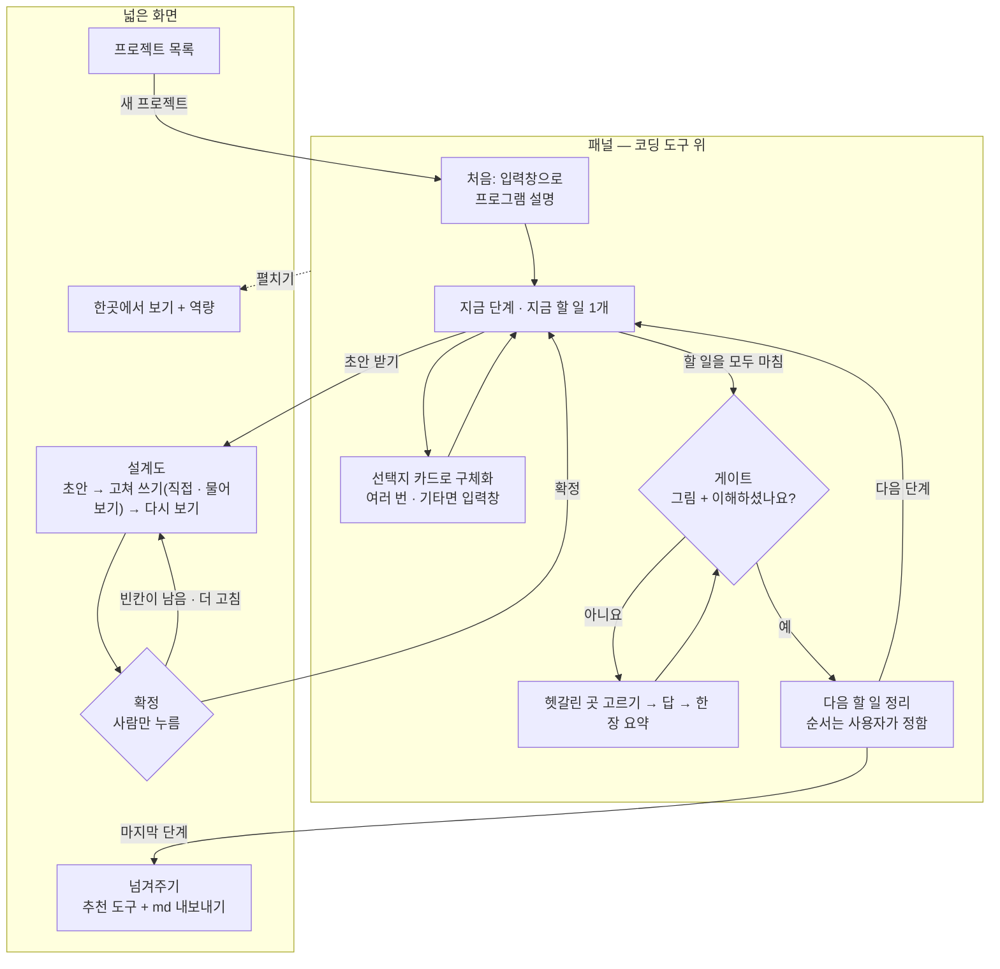

<!-- claude-drafted: 2026-10-14, 2026-10-15 수정 — 임유정의 요청("README 초안 작성해줘", "README에 반영해줘")으로 Claude가 대화(2026-10-13~15)에서 정한 내용을 옮겼다. 화면·흐름·폴더 구조·레이아웃은 임유정의 가설, 7절은 이재엽의 결정(2026-10-14·15)이다. 임유정이 읽고 고친 뒤 확정한다. -->

# Floe 화면 — 구조 초안

## 한눈에 (2026-10-17)

**이 폴더는:** 사용자가 보는 화면이다.

| 폴더 | 무엇 |
|---|---|
| [`navigator/`](navigator/README.md) | **지금 시연에 쓰는 화면**(프로토타입) — 여는 법은 그 폴더 README |
| [`library/`](library/README.md) | 도서관 시안 — 플로로의 얼음 서고, 지식 별자리 하늘. `library/index.html`을 바로 연다(더미 데이터) |
| `share/` | 공유 규칙 시험 화면 — `share/index.html`을 브라우저로 바로 연다 |
| [`assets/mascot/`](assets/mascot/README.md) | 마스코트 그림 (이용 조건 확인 전) |

**아래 본문은 Next.js·Electron으로 옮길 때의 계획**(임유정 가설, 이슈 #14)이다. 지금 돌아가는 코드는 위 `navigator/`이고, 본문 5절의 폴더 구조는 아직 만들지 않았다.
**2026-10-19:** 2절의 Electron 오버레이는 Next.js 없이 **지금 화면을 그대로 감싸는 껍데기**로 먼저 만들었다 — [`electron/`](electron/README.md)(`npm run dist` → `.dmg`, 알파). 본문의 Next.js 계획은 그대로 남긴다.

담당: 임유정(시험 기간 동안 두승현이 이어받음) · 리뷰: 고한결 · 서버 쪽: [backend](../03-backend/README.md)

*(위 "한눈에"는 사람용 안내 — Claude 초안 2026-10-17, 두승현 요청. 아래는 원래 본문이다.)*

> **가설이다.** 사용자 인터뷰와 화면 흐름·와이어(고한결, 10/25) 전에 문서만 보고 잡은 구조라, 그 결과에 따라 바뀔 수 있다.

| 항목 | 내용 |
|---|---|
| 이슈 | #14 화면 구조 초안 — 인터뷰 전이라 가설 |
| 담당 | 임유정 (프론트엔드). 화면 담당은 임유정 · 두승현 둘이고, **시험 기간 동안은 두승현이 이어받아 진행하고 임유정은 확인·테스트**를 맡는다 (이재엽 2026-10-15) |
| 리뷰어 | 고한결 |
| 마감 | 10/22 |
| 다음 산출물 | 시연 화면 (11/1), 구동 GIF·영상 (11/4) — [일정 3-2-1](../01-docs/00-overview/schedule.md) |

요구의 원천은 [requirements.md](../01-docs/00-overview/requirements.md)다. 이 문서의 FR 번호는 그 문서 2절을 가리킨다.

## 1. 무엇을 보여 주나

- 사용자가 코딩하는 동안 **코딩 도구 위에 작게 붙어 있는 동료**처럼, 대화로 프로그램을 구체화하고 7단계 워크 프로세스에 따라 **지금 단계 · 어디까지 · 다음 할 일**을 보여 준다. 단계마다 설계도(md) 초안 → 확정을 거치고, 그 단계의 할 일을 마치면 게이트(이해 확인)를 거친다.
- **시연에서도 실제 대화가 가능해야 한다** (이재엽 2026-10-15). 로컬 서버가 꺼져 있거나 연습 모드면 fixture(미리 만든 응답)로 돈다 — FR-10은 이 구조로 만족한다. 화면에는 지금 **연습 / 실제** 중 무엇인지 늘 표시한다.
- **실제 대화에는 안전장치가 필수다.** 개인 대화가 시연 화면에 나오지 않게 한다 — 점검표 S1~S6은 [navigator-prototype-rules-review.md](../01-docs/00-overview/navigator-prototype-rules-review.md) 6절.
- **AI는 프로토타입과 같은 순서로 부른다** (임유정 2026-10-17, #14 리뷰 1번): 각자의 **API 키**가 있으면 그 키 → 없으면 이 컴퓨터의 **Claude 구독**(로그인된 Claude Code) → 둘 다 없으면 **연습 예시**. 키는 각자 컴퓨터의 `.env`에만 둔다. 순서는 [`03-backend/navigator/provider.js`](../03-backend/navigator/provider.js)와 같다. 다른 외부 API는 필요할 때만 붙인다 (이재엽 2026-10-15). 데이터를 가져오는 곳은 처음부터 한 곳(`lib/api.js`)으로 모은다.
- 판정(완료 기준 충족, 게이트 통과, 도구 추천)은 **화면에서 계산하지 않는다.** 받은 값을 보여 주기만 한다.

## 2. 기술 선택

| 항목 | 선택 | 이유 | 정한 사람 |
|---|---|---|---|
| 프레임워크 | **Next.js** (App Router) | 나중에 API를 같은 로컬 Next 안(Route Handler)에 둘 수 있다 | 이재엽 (2026-10-14) |
| 실행 환경 | **로컬 Next**, 다른 서버에 올리지 않음 | | 이재엽 (2026-10-14) |
| AI 호출 | **API 키 → Claude 구독 → 연습 예시** 순서 (프로토타입 `provider.js`와 같음). 키는 각자 `.env`에만 | 각자의 키·한도로 진짜 AI를 돌릴 수 있고(#79), 키가 없어도 구독이나 연습으로 돈다 | 이재엽 (2026-10-15, 구독) → 임유정 (2026-10-17, PR #74 순서에 맞춤) |
| 언어 | JavaScript (`.jsx`) | 사용 경험 | 임유정 |
| 스타일 | Tailwind CSS | 사용 경험 (React + Tailwind) | 임유정 |
| 다이어그램 | mermaid | fixture 안의 mermaid 글을 그대로 그림으로 | 임유정 |
| md 표시·편집 | react-markdown, 편집은 `textarea` | 단계 md 초안을 보고 고치기 | 임유정 |
| 데스크톱 껍데기 | **Electron 오버레이** — Next.js 화면을 항상 위에 떠 있는 창으로 띄운다. 시연부터 쓴다 | 패널이 실제 코딩 도구 위에 겹쳐 떠야 한다. JS·Node 그대로라 새로 배울 것이 적다 (Tauri는 Rust, 브라우저 확장은 브라우저 밖에 못 뜸) | 임유정 제안 (2026-10-15) — 이재엽 확인 대기 |
| 선택 | shadcn/ui | 선택지 카드 같은 컴포넌트만 가져다 쓸 수 있음 — 쓸지 미정 | 임유정 |

## 3. 화면 — 패널 + 넓은 화면 (섞기)

평소에는 **패널**(코딩 도구 위에 작게)로 쓰고, 넓은 공간이 필요한 일만 **넓은 화면**으로 펼친다 (임유정 2026-10-15).
이유: 함께 코딩하는 동료처럼 가까이 있으면서도, md 읽기·역량 지도처럼 넓어야 하는 것은 따로 본다.

**서재는 `/overview` 안이 아니라 따로 `/library`에 둔다** (임유정 2026-10-17, #14 리뷰 2번). 이유: 서재는 화면이 3장(책장 · 표지와 목차 · 가져오기, #12 W1)이라 하위 주소가 필요하고, 한곳에서 보기는 숫자를 모아 보는 화면이라 성격이 다르다. 지금 프로토타입(`navigator/`)도 "한곳에서 보기"와 "도서관"을 따로 된 탭으로 두고 있어(10/17 합침) 나중에 옮길 때 그대로 맞는다. 고칠 일이 생기면 서로의 파일을 건드리지 않는다. 와이어는 고한결의 [화면 흐름·와이어](../01-docs/04-pattern-implementation/screen-flow-wireframe.md) ⑨~⑫를 따른다.

| 구분 | 주소 | 하는 일 | FR |
|---|---|---|---|
| **패널** | `/` | 마스코트 한마디, **대화**(처음 설명 · 선택지로 구체화), 지금 단계 · 지금 할 일 1개 · 완료 기준, 게이트(그림 + 예/아니요), 다음 할 일(순서는 사용자가 정함), 작업 완료 알림 | FR-1·2·3·4·5·7·12 |
| 넓은 화면 — 설계도 | `/projects/[id]/draft` | 단계 md 초안 → 고쳐 쓰기(직접 편집 · 물어보기 둘 다) → 다시 보기 → **확정**(사람만 누름). 따로 된 승인 팝업 없이 이 `[확정]`이 승인이다 | FR-3 |
| 넓은 화면 — 한곳에서 보기 | `/overview` | 진행 · 할 일 · 충돌 · 토큰, 역량 · 노력 기록 (가상 숫자) | FR-6·8 |
| 넓은 화면 — 서재 | `/library` (책장) · `/library/[book]` (책 표지와 목차) · `/library/import` (가져오기) | 쌓인 지식을 책으로 보기 — 책장(책 한 줄), 표지와 목차(본문은 "열기"를 눌러야 가져옴), 가져오기(시연은 모두 가상, 표지만). 패널에서는 "서재 짧게 보기"로 지금 단계와 이어지는 책 몇 권만 보이고 "전체 화면으로"를 누르면 여기로 온다 | FR-8 · FR-9(가져오기) |
| 넓은 화면 — 프로젝트 목록 | `/projects` | 이전 프로젝트 목록, 새 프로젝트 시작, 공유 버튼 | FR-9 (보이기만) |
| 넓은 화면 — 넘겨주기 | (설계도 화면 안 또는 별도 — 미정) | 추천 도구 + 확정된 md 내보내기 | (FR 없음 — 7절 5번) |

**패널 안 대화의 모양** (임유정 2026-10-15). 평소엔 **선택지 카드**로 조용히 두고, 자유롭게 말해야 할 때만 입력창을 연다. 이슈 #47(두승현의 화면 방식 실험)의 "정할 것 하나만 묻는 카드"를 참고했다.

| 상황 | 모양 |
|---|---|
| 맨 처음 — 만들고 싶은 프로그램 설명 | **채팅 입력창** |
| 평소 — 구체화 질문, 게이트 예/아니요, 다음 할 일 | **선택지 카드** 하나 (질문 + 선택지 2~4개, 클릭이나 숫자 키) |
| 선택지에 맞는 답이 없을 때 | 카드의 **"기타"** → 그때만 입력창이 열림 |
| 설계도 고쳐 쓰기 — 물어보기 | 설계도 화면의 "물어보기" → 입력창이 열림 |

- 지난 대화는 평소에 접어 두고, 펼쳐서 볼 수 있다.
- **마스코트:** #47 프로토타입의 고양이 "나비"는 **임시**다 (이재엽 2026-10-15). 그 자리에 고한결이 만든 [mascot-v1](assets/mascot/README.md)이 들어간다 (임유정 2026-10-15). 이름은 **플로로**(2026-10-17 확정, #51)이고 프로토타입 화면도 같은 날 바꿨다. 이미지 이용 조건을 확인하기 전에는 제출물에 넣지 않는다. 표정 변형·투명 배경 버전은 아직 없다.
- Navigator에서 대화로 단계 md를 만들고, 그 md를 사용자가 쓰는 코딩 도구(Claude Code, Codex 등)로 넘겨 "이대로 만들어 달라"고 한다. 코딩 도구에서 작업하는 동안 Navigator는 알아채고 끝남을 표시한다(FR-7).

- **오버레이:** 패널은 **Electron 창으로 실제 코딩 도구(VS Code, 터미널 등) 위에 겹쳐 뜬다** — 시연부터. 유튜브 화면 속 화면(PIP)처럼 다른 창을 눌러도 맨 위에 남는다.

  | 동작 | Electron 창 옵션 |
  |---|---|
  | 늘 맨 위 | `alwaysOnTop: true` |
  | 테두리 없는 둥근 카드 | `frame: false`, `transparent: true` |
  | 상황마다 크기 바꾸기 (한 줄 ↔ 카드 ↔ 단계 지도) | `setBounds()` |
  | 투명한 곳은 클릭이 아래 창으로 통과 | `setIgnoreMouseEvents()` |
  | 눌러도 코딩 도구의 키보드 입력을 빼앗지 않기 | `focusable: false` — 입력창을 열 때만 켠다 |
  | 넓은 화면(설계도·도서관·한곳에서 보기) | 넓은 창을 따로 연다 |

- 브라우저로 `npm run dev`만 열 때(개발·연습)는 페이지 안에 **예시 코딩 도구 화면**을 그리고 그 위에 패널을 얹는다.
- 프로젝트 목록은 직접 대응하는 FR이 없다. 11/1까지 시간이 모자라면 가장 먼저 줄인다.

## 4. 흐름



- md는 **대화마다가 아니라 큰 단계마다** 만든다 (토큰 절약).
- **승인과 게이트의 순서** (임유정 2026-10-17, 고한결의 [화면 흐름·와이어](../01-docs/04-pattern-implementation/screen-flow-wireframe.md)대로): 설계도는 넓은 화면에서 **확정**하고(승인 팝업 없음), 게이트는 확정 직후가 아니라 그 단계의 **할 일을 모두 마쳤을 때** 열린다.
- 게이트는 **모든 단계 사이**에 있다. 시연의 "아니요" 루프는 1회 (FR-5 우선순위).
- 7단계의 이름·순서는 사용자가 바꿀 수 없다. 단계 안의 md 내용만 고친다.

## 5. 폴더 구조

```
02-frontend/
├── README.md
├── package.json
├── next.config.mjs
├── electron/
│   ├── main.js                 오버레이 창(패널)과 넓은 창을 만들고 크기를 바꾼다
│   └── preload.js              화면 ↔ 창 사이 통로 (패널 크기 바꾸기, 넓은 창 열기만 연다)
└── src/
    ├── app/
    │   ├── layout.jsx                     모든 화면 공통 틀
    │   ├── globals.css                    Tailwind
    │   ├── page.jsx                       패널 (Electron에서는 오버레이 창, 브라우저에서는 예시 코딩 도구 위)
    │   ├── projects/page.jsx              프로젝트 목록 (넓게)
    │   ├── projects/[id]/draft/page.jsx   설계도 md (넓게)
    │   ├── overview/page.jsx              한곳에서 보기 + 역량 (넓게)
    │   └── library/                       서재 (넓게) — 3절
    │       ├── page.jsx                   책장
    │       ├── [book]/page.jsx            책 표지와 목차
    │       └── import/page.jsx            가져오기 (시연은 가상)
    ├── components/
    │   ├── panel/
    │   │   ├── Panel.jsx              접힘(한 줄) ↔ 펼침
    │   │   ├── Mascot.jsx             마스코트(mascot-v1)와 한마디 — 3절
    │   │   └── DemoCodingTool.jsx     브라우저로 열 때만 쓰는 예시 코딩 도구 화면 (진짜 도구 아님)
    │   ├── chat/                      패널 안의 대화
    │   │   ├── ChoiceCard.jsx         질문 하나 + 선택지 2~4개 + "기타"
    │   │   ├── MessageInput.jsx       처음 설명 · "기타" · 설계도 물어보기일 때만 보임
    │   │   ├── MessageList.jsx        지난 대화 (평소엔 접힘)
    │   │   ├── StageStatus.jsx        현재 단계 · 완료 기준 (FR-1, 2)
    │   │   ├── GateCheck.jsx          그림 + 예/아니요, 단계마다 재사용 (FR-4, 5)
    │   │   └── NextTasks.jsx          다음 할 일 — 순서는 사용자가 정함 (FR-12)
    │   ├── draft/
    │   │   ├── DraftPanel.jsx         md 보기 ↔ 편집
    │   │   └── MarkdownView.jsx       md → 화면, mermaid는 MermaidDiagram에 넘김
    │   ├── handoff/
    │   │   ├── ToolRecommendations.jsx    이 프로그램에 맞는 도구 추천
    │   │   └── ExportButton.jsx           확정된 md 모아 내보내기
    │   ├── overview/
    │   │   └── NotificationList.jsx       작업 완료 알림 · 끝남 표시 (FR-7)
    │   ├── library/                       서재 — 화면과 패널이 같이 쓴다
    │   │   ├── LibraryPeek.jsx            패널 안 "서재 짧게 보기" — 이 단계와 이어지는 책 몇 권 (제안만, 여는 건 사용자)
    │   │   ├── Bookshelf.jsx              책 한 줄(책등 · 권수), 빈 서재 문구, 좁은 화면에선 두 줄
    │   │   ├── BookCover.jsx              표지 · 목차 · [열기] · [이 단계에 쓰기]
    │   │   └── ImportForm.jsx             폴더 · 링크 · GitHub (가상), 걸린 것 경고
    │   └── common/
    │       ├── MermaidDiagram.jsx
    │       ├── ModeBadge.jsx          지금 "연습(가상 데이터) / 실제" 표시, 한 번에 해제 (FR-10, 안전장치 S2)
    │       └── ShareButton.jsx        나만 / 요약만 / 팀 전체 — 보이기만, 기본 "나만" (FR-9)
    ├── lib/
    │   └── api.js                     데이터를 가져오는 곳은 여기 하나. 연습이면 fixture, 실제면 app/api/
    └── fixtures/                      연습 모드와 서버가 꺼졌을 때 쓰는 미리 만든 응답
        ├── projects.json
        ├── conversation.json          단계별 질문 + 선택지 · 초안 · 리뷰 · 게이트(아니요 → 예)
        ├── overview.json              진행 · 할 일 · 충돌 · 토큰 · 역량 · 알림
        ├── library.json               가상 책 — 표지 · 목차 · 열기용 본문 한 줄
        └── tools.json                 추천 도구 예시
```

**지키는 것**
- 화면과 컴포넌트는 `lib/api.js`만 부른다. fixture를 직접 읽지 않는다 — 연습과 실제를 바꿀 때 고칠 곳이 한 군데다.
- 실제 대화는 `src/app/api/`(Route Handler)가 위 1절의 순서(API 키 → Claude 구독 → 연습)로 부르는 안이다. **외부 AI 호출은 이 한 곳에서만** 한다 (CLAUDE.md 역할표, code.md 6번). #47 프로토타입의 `server.js`가 같은 방식(로그인된 Claude Code 호출, 도구·MCP·사용자 설정 잠금)이라 참고할 수 있다. 만드는 시점은 8절.
- 실제 대화를 시연에 쓰기 전에 안전장치 S1~S6을 모두 갖춘다 — 각 항목은 위반 시도 시험을 먼저 쓴다 ([navigator-prototype-rules-review.md](../01-docs/00-overview/navigator-prototype-rules-review.md) 6절).
- 입력창에 자유롭게 쓴 글(처음 설명, "기타", 설계도 물어보기)은 보내기 전에 **비밀값 경고**를 거친다 — 키·비밀번호 같은 게 보이면 막지 않고 "그대로 / 수정"을 고르게 한다([security-records.md](../.claude/rules/security-records.md) 6-3). 검사 규칙은 `03-backend/navigator/sensitive.js`(2026-10-19 공유 규칙을 지우며 남긴 안전장치)를 쓴다.
- 클릭·입력에 반응하는 컴포넌트와 mermaid는 `'use client'`로 둔다.
- 패널과 넓은 화면은 같은 컴포넌트를 다시 쓴다. 레이아웃이 바뀌어도 `components/`는 그대로 두고 `app/`만 고친다.

## 6. 실행

```bash
npm install
npm run dev
```

브라우저에서 열면 예시 코딩 도구 위에 패널이 보인다. 오버레이 창으로 띄우는 명령(Electron)은 `electron/`을 만들 때 여기에 적는다.

## 7. 이재엽 확정 사항 (2026-10-14 · 15)

| # | 질문 | 결정 | 화면에 생기는 것 |
|---|---|---|---|
| 1 | 설계도 수정 방식 | 7단계 틀은 고정, 그 안의 내용은 직접 편집 · 대화 수정 모두 가능 | DraftPanel 편집, 수정 요청 |
| 2 | FR-7 작업 완료 알림 | 끝남 표시를 넣는다 | NotificationList, 할 일 완료 표시 |
| 3 | FR-9 공유 | 다른 사람이 자기 프로그램을 보게 하는 장치로, **기능이 보이기만** 하면 된다 | ShareButton (동작 없음) |
| 4 | 게이트 위치 | 모든 단계 사이 | GateCheck 재사용, 단계별 fixture |
| 5 | AI 코딩 도구로 넘기기 | 만드는 프로그램에 맞는 도구를 추천하고, md도 내보낸다 | handoff/ |
| 6 | 서버 | 로컬 Next 안에서 돌고 다른 서버에 올리지 않는다 | `src/app/api/` |
| 7 | 시연 데이터 | ~~fixture. 시연에는 API가 필요 없다~~ → **10/15에 바뀜**(아래 8번) | |

**2026-10-15 결정** — 출처: [requirements.md](../01-docs/00-overview/requirements.md) 결정 기록, [navigator-prototype-rules-review.md](../01-docs/00-overview/navigator-prototype-rules-review.md) 6절

| # | 질문 | 결정 | 화면에 생기는 것 |
|---|---|---|---|
| 8 | 시연 때 실제 대화를 연결할까 | **실제 대화가 가능해야 한다.** 서버가 꺼지면 미리 만든 응답으로 돈다(FR-10). 개인 대화 노출을 막는 **안전장치는 필수** | ModeBadge(연습/실제), 안전장치 S1~S6 |
| 9 | 외부 API를 어디까지 쓸까 | 기능 판단은 **이 컴퓨터의 Claude 구독**에서, 다른 외부 API는 필요할 때만 → **10/17에 바뀜**: API 키가 있으면 키 먼저(2절, PR #74) | `src/app/api/` 한 곳 |
| 10 | 화면 담당 | 임유정 · 두승현 둘. 시험 기간 동안 **두승현이 이어받아 진행, 임유정은 확인·테스트** | — |
| 11 | #47 화면 방식 실험 | 기간을 정하지 않고 **가설로 이어 간다** | 3절 선택지 카드가 이 실험을 참고함 |
| 12 | 캐릭터 | 프로토타입의 고양이는 **임시**. 캐릭터는 팀이 정해 만든다. 이름은 **플로로**(Floro, 2026-10-17 확정, #51) | Mascot에 고한결의 mascot-v1 (3절) |

**요구사항 문서 반영 요청 (이재엽):** FR-9 시연 범위, 넘겨주기(도구 추천 + md 내보내기)는 아직 FR에 없음.

## 8. 아직 정하지 않은 것

**10/17에 정함** (임유정, #12 와이어 가설안에 동의): 승인과 게이트의 순서 → 4절 / 시연에서 설계도 고치는 방법은 직접 편집 · 물어보기 **둘 다** 보인다 / 선택지 카드 세부(카드 색 · 단축키 · 접히는 시간)는 **프로토타입 값 그대로**([와이어](../01-docs/04-pattern-implementation/screen-flow-wireframe.md) 6절).

| 질문 | 정할 사람 |
|---|---|
| 패널 + 넓은 화면(섞기) 가설이 화면 흐름·인터뷰와 맞는가 | 고한결 (10/25) · 임유정 |
| 선택지 카드에 맞는 AI 응답 형식(질문 + 선택지 2~4개) — #47 프로토타입은 `next.question` + `next.options` | 이재엽 (#7) |
| Electron 오버레이(2절) 확인 — 실제 대화의 Claude 호출을 `src/app/api/`에 둘지 Electron의 Node 쪽에 둘지(어느 쪽이든 한 곳) | 이재엽 · 임유정 |
| 오버레이를 Windows와 맥에서 각각 띄워 시험 — 항상 위, 클릭 통과, 입력 안 빼앗기, 전체 화면 앱 위에서 뜨는지 | 임유정(확인·테스트) · 두승현 |
| 한곳에서 보기가 전체 프로젝트용인지 프로젝트별인지 | 임유정 |
| 넘겨주기를 설계도 화면 안에 둘지 따로 둘지 | 임유정 |
| #47 프로토타입(HTML + JS, 화면 `02-frontend/navigator/` · 서버 `03-backend/navigator/`)과 이 `02-frontend/`(Next.js)의 관계 — 나중에 옮기나, 하나만 가나 | 이재엽 · 두승현 · 임유정 |
| `src/app/api/`(실제 대화)를 언제 만드나 — 안전장치 S1~S6과 함께 | 이재엽 · 두승현 |
