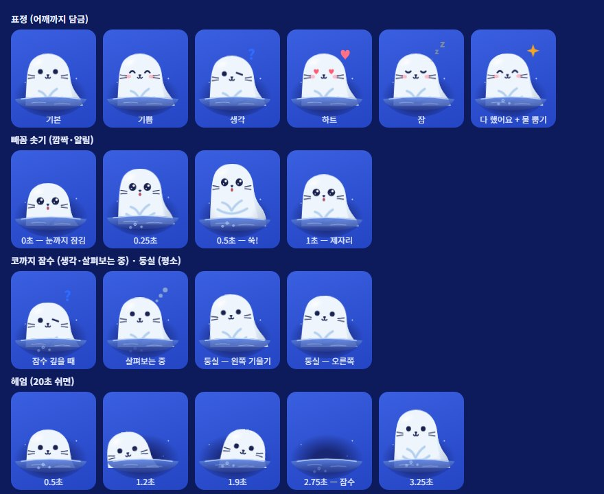

# 마스코트 — 플로로 (Floro)

<!-- claude-drafted: 2026-10-15 — 이재엽의 요청("저장소에 올려줘")으로 Claude가 올리면서 쓴 설명이다. 제작자는 이재엽이 알려 준 것이다. -->
<!-- claude-drafted: 2026-10-17 — 두승현의 요청("변경된 마스코트를 고려하여 리치하게")으로 Claude가 PR #91 뒤의 플로로(seal.js · seal.css)를 반영해 다시 썼다. 숫자와 동작은 같은 날 코드에서 읽은 값이다. -->

**길잡이 물범 플로로** — Floe를 쓰는 사람 곁에서 지금 단계와 다음 할 일을 알려 주는 안내 캐릭터다. 물에서 고개를 내밀고, 쓰다듬으면 좋아하고, 가만히 두면 헤엄치다 졸고 잠든다.


## 플로로는 두 가지로 있다

| | 원본 그림 | 화면 속 플로로 |
|---|---|---|
| 파일 | 이 폴더의 `mascot-v1.webp` | [`../../navigator/seal.js`](../../navigator/seal.js)(그림) · [`../../navigator/seal.css`](../../navigator/seal.css)(색 · 표정 · 움직임) |
| 무엇 | 이재엽이 마스코트 제작 스킬로 만든 그림 한 장 (1024×1024) | 두승현이 코드(SVG)로 그린 플로로. 목업 영상 속 물범을 보고 다시 그렸다(`seal.js` 머리 주석) |
| 지금 쓰는 곳 | **아직 화면에 쓰지 않는다** — ~~이용 조건 확인 대기~~ 이용 조건은 이재엽 확인, 바로 사용 가능(2026-10-29, 결정 모음 B-09 · X-15) <!-- claude-drafted: 2026-10-30 --> | 내비게이터 · 서고 · 지식 은하 전부 |
| 표정 | 1가지 | 11가지 |
| 움직임 | 없음 | 숨쉬기 · 꼬리 · 고개 돌리기 · 헤엄 등 (아래 "움직임") |

## 원본 그림 — `mascot-v1.webp`

| 항목 | 내용 |
|---|---|
| 파일 | `mascot-v1.webp` (1024×1024, 19KB) |
| 제작 | **이재엽** — 두승현이 제안한 마스코트 캐릭터 제작 스킬로 만듦 (두승현 정정 2026-11-04: 2026-10-15 PR #49에는 고한결로 적혀 있었다) |
| 올린 사람 | 이재엽(Claude와 함께) |
| 모습 | 크림색 둥근 몸, 점 눈, 작은 코와 웃는 입, 겹친 지느러미 선, 남색 배경 |
| 쓰임 | Floe의 안내 캐릭터. 이름 **플로로**(이재엽 확정 2026-10-17, 이슈 #51). 프로토타입 화면의 이름도 2026-10-17에 몽돌 → 플로로로 바꿨다 |

## 화면 속 플로로

### 생김새

푸른 기가 도는 하얀 강낭콩 몸(왼쪽은 곧게, 아래 오른쪽이 불룩) · 작은 남색 점 눈 · 아주 작은 코와 ω 입 · 하늘색 Y자 앞지느러미 · 오른쪽 아래로 뻗은 꽃잎 두 장 꼬리 · **수염은 늘** · 기쁘거나 잘 때만 분홍 볼.
몸 가장자리가 은은하게 어두워지는 둥근 그늘과 왼쪽 위 반짝임으로 도톰해 보인다(2D를 계산으로 입체처럼 — Coucou의 Mochi와 같은 방식, MIT, 코드는 복사하지 않음).

| 색 이름 (`seal.css`의 `:root`) | 값 | 어디에 |
|---|---|---|
| `--seal` | `#EEF5FD` | 몸 |
| `--seal-shade` | `#E0EBF8` | 오른쪽 아래 그늘 |
| `--seal-line` | `#C8DAEE` | 몸 테두리 |
| `--seal-fin` | `#B5D1EE` | 앞지느러미 · 꼬리 |
| `--seal-ink` | `#1A2350` | 눈 · 코 · 입 · 수염 |
| `--seal-q` · `--seal-zz` | 페이지마다 | 머리 밖 ? · z (서고는 밤하늘이라 더 밝게) |

### 네 가지 모습 — 자리마다 다르게 그린다

| 모습 | 그리는 법 | 어디에 (크기) |
|---|---|---|
| **숨구멍** — 물빛 웅덩이에서 어깨까지 잠겨 얼굴을 내민다 | `{ hole: true }` | 내비게이터 인사 카드(116) · 안내 패널(108) · 도서관 탭(100) · 설계도 옆(92) · 친해진 정도(64) |
| **얼굴만** — 얼굴 가운데를 둥글게 잘라 크게 | `{ face: true }` | 접힌 알약(36) · 완전히 접힌 띠(58, 물결 선 위로 빼꼼) |
| **몸 전체** — 얼음판 위에 선 모습 | 옵션 없음 | 서고(170) · 서고 입구(150) · 지식 은하(92) · 전체 돌아보기(72) · 검색 결과(28) |
| **한 줄 표시** — 앞지느러미를 걸친 모습 | `{ paws: true }` | 단계 지도에서 지금 단계 위(34) |

32px보다 작으면 입 · 지느러미 · 수염을 빼고 눈을 키운다(점처럼 뭉개지지 않게).

### 표정 11가지

| 표정 | 코드 | 얼굴 | 머리 밖 표시 |
|---|---|---|---|
| 기본 | `idle` | 점 눈 | — |
| 기쁨 | `happy` | 웃는 눈, 분홍 볼 | — |
| 살펴보는 중 | `look` | 위를 보는 눈 | 점점점 |
| 다 했어요 | `done` | 웃는 눈, 분홍 볼 | 반짝 |
| 생각 | `think` | 두 눈이 위를 봄 | ? |
| 알림 | `alert` | 크게 뜬 눈, 벌린 입 | ! |
| 하트 (쓰다듬음) | `love` | 하트 눈, 분홍 볼 | 하트 |
| 흥얼 (문지름) | `purr` | 감은 눈, 분홍 볼 | 하트 |
| 하품 | `yawn` | 감은 눈, 벌린 입 | — |
| 잠 | `sleep` | 감은 눈, 분홍 볼 | z z z |
| 깜짝 | `wow` | 반짝이는 큰 눈, 벌린 입 | — |

모르는 표정 이름을 주면 `idle`로 그린다.

### 움직임



| 움직임 | 언제 | 어디 |
|---|---|---|
| 고개 돌리기 | 늘 — 눈 · 코 · 볼이 마우스 쪽으로. 머리를 공으로 보고 얼굴을 그 겉면에 붙여, 옆으로 돌면 얼굴이 좁아진다 | 내비게이터 · 서고 |
| 깜빡임 | 2.4~6.2초 사이 들쭉날쭉, 가끔 두 번 | 내비게이터 |
| 숨쉬기 | 늘 (잘 때는 크게) | 전부 |
| 꼬리 살랑 → 파닥 | 늘 살랑, 기쁨 · 다 했어요 · 하트 · 흥얼이면 파닥, 잘 때 · 하품할 때 멈춤 | 꼬리가 보이는 몸 전체(56px 이상) |
| 둥실 | 늘 — 물결 따라 살짝 기울며 오르내림 | 숨구멍 |
| 지느러미 박수 | 기쁨 · 다 했어요 · 깜짝 — 몇 번 | 지느러미가 보이는 모습 |
| 빼꼼 솟기 | 깜짝 · 알림 — 눈까지 잠겼다가 물방울과 함께 쑥 | 숨구멍 |
| 코까지 잠수 | 생각 · 살펴보는 중 — 물방울 보글보글 | 숨구멍 |
| 물 뿜기 | 다 했어요 | 숨구멍 |
| 두리번 | 마우스를 8초 가만히 두면 한 번 (왼쪽 → 오른쪽 → 앞) | 내비게이터 |
| 헤엄 | 20초 가만히 두면 한 번 — 머리만 내놓고 헤엄치다 잠수, 뿅 | 내비게이터 숨구멍 |
| 하품 → 잠 | 1분 가만히 두면 하품, 1분 30초면 잠. 움직이면 "앗, 깜빡 졸았어요!" | 내비게이터 |
| 얼음판째 둥실 · 배로 통통 · 두리번 | 늘 둥실, 12~20초마다 통통이나 두리번 중 하나 | 서고 |

컴퓨터에서 **'움직임 줄이기'를 켠 사람에게는 모두 하지 않는다**(`seal.css`의 `prefers-reduced-motion` 블록, `app.js` · `library.js`도 확인).

### 교감 — 내비게이터

| 무엇 | 어떻게 |
|---|---|
| 쓰다듬기 | 플로로를 누르면 하트 몇 개와 한마디. 좌우로 문지르면(12px 넘게 간 뒤 방향을 4번 바꾸기, 0.7초 안에) 흥얼흥얼 |
| 친해진 정도 | 쓰다듬은 횟수로 네 칸 — 처음 만난 사이(0) · 친해지는 중(5) · 단짝(20) · 둘도 없는 단짝(50). 칸이 오르면 별이 튄다 |
| 시간 인사 | 아침(5~11시) · 점심(11~14시) · 오후(14~18시) · 저녁(18~22시) · 늦은 밤 — 이 컴퓨터의 시각으로 |
| 축하 | 할 일을 다 했을 때 · 단계를 넘어갔을 때 · 설계도를 확정했을 때 — 기쁨 표정, 별 · 물방울, 깡충 |
| 작은 소리 | 녹음 파일 없이 브라우저가 만든 짧은 음. 설정에서 켠 사람에게만(기본 꺼짐) |

## 코드에서 쓰는 법

```js
// 그림 — 문자열(SVG)을 돌려준다. 브라우저에서는 window.NavSeal, 시험에서는 require
NavSeal.svg("happy", 116, { hole: true });   // 숨구멍
NavSeal.svg("idle", 36, { face: true });     // 얼굴만
NavSeal.svg("think", 170);                   // 몸 전체
// opts: hole · face · paws · noTail · extra("oops"면 땀방울)

// 고개 돌리기 — container 안의 플로로가 point(화면 좌표) 쪽을 본다
NavSeal.follow(container, { x: e.clientX, y: e.clientY });
```

- 한 번 하는 움직임은 플로로를 감싼 요소에 class를 붙인다 — `.swim`(헤엄) · `.galumph`(배로 통통). 끝나면 떼어 낸다.
- 페이지에서는 **`seal.css`를 페이지 CSS보다 먼저** 읽는다. 페이지마다 다른 것(예: 진한 배경에서 테두리 빼기)은 페이지 CSS가 덮는다.
- 서버(`03-backend/navigator/server.js`)로 열 때는 `STATIC` 표에 있는 파일만 나간다 — 새 파일을 만들면 거기에도 더한다.

| 파일 | 맡은 일 |
|---|---|
| [`navigator/seal.js`](../../navigator/seal.js) | 그림 · 표정 이름 · 고개 돌리기 계산 · 쓰다듬기 · 친해진 정도 · 인사 · 졸음 · 화면 효과(하트 · 별 · 물방울) |
| [`navigator/seal.css`](../../navigator/seal.css) | 색 · 표정마다 보이는 부분 · 움직임 전부 |
| [`navigator/app.js`](../../navigator/app.js) | 내비게이터에서 언제 움직일지 — 쓰다듬기 · 축하 · 깜빡임 · 두리번 · 헤엄 · 졸음 |
| [`library/library.js`](../../library/library.js) | 서고에서 언제 움직일지 — 눈 따라오기 · 통통 · 두리번 |
| [`04-tests/navigator/navigator.test.js`](../../../04-tests/navigator/navigator.test.js) | 플로로 시험 — 표정 · 작은 크기 · 고개 돌리기 계산 · 얼굴만 · 숨구멍 · 쓰다듬기 · 친해진 정도 |
| 이 폴더의 `floro.svg` · `floro-moods.svg` | 저장소 첫 화면 README에 쓰는 플로로 그림(움직임 포함). **손으로 고치지 않는다** — `seal.js`·`seal.css`를 고친 뒤 `node 02-frontend/assets/mascot/make-svg.js`로 다시 뽑는다 |
| 이 폴더의 [`make-svg.js`](make-svg.js) | 위 두 그림을 뽑는 스크립트 |

## 고칠 때

- **화면 속 플로로의 생김새는 두승현의 작업물이다.** 모양(몸 윤곽 · 얼굴 · 색)을 바꾸려면 먼저 두승현 · 이재엽과 맞춘다. 움직임 · 연출은 PR에 개선 전후 그림을 붙여 리뷰를 받는다(PR #91처럼).
- 색은 `seal.css`의 `:root` 한 곳에서만 바꾼다. 페이지 CSS에 플로로 색을 다시 적지 않는다(두 벌이 어긋났던 일, 2026-10-17 정리).
- 새 움직임은 `seal.css`의 `prefers-reduced-motion: no-preference` 블록 안에 넣는다.
- 고친 뒤에는 `python 04-tests/run_all_tests.py`를 돌리고, 화면을 직접 열어 본다 — 움직임은 시험이 잡지 못한다.
- 원본 그림을 고치거나(색 · 크기 · 표시 제거) 새 버전을 올릴 때는 `mascot-v2.webp`처럼 **새 이름으로** 올리고 위 표를 고친다. 원본을 덮어쓰지 않는다.

## 걸어온 길

| 날짜 | 무엇 |
|---|---|
| 2026-10-14 | 프로토타입의 임시 길잡이는 치즈 고양이 "나비"(`cat.js`) |
| 2026-10-15 | 목업 영상 속 물범으로 처음부터 다시 그림(`seal.js`, 이름 "몽돌"). 이재엽이 만든 원본 그림 `mascot-v1.webp`를 올림 |
| 2026-10-17 | 이름을 **플로로**로 확정(#51) |
| 2026-10-17 | PR #91 — 입체감 · 고개 돌리기, 숨구멍을 물웅덩이로, 어깨까지 담그기, 얼굴만 접기, 물범다운 움직임, 플로로 스타일을 `seal.css` 하나로 |

## 아직 정해지지 않은 것

| 칸 | 상태 |
|---|---|
| 원본 그림의 출처 · 이용 조건 | **닫음 — 이재엽 확인, 바로 사용 가능**(2026-10-29 "내가 확인한거고 그냥 바로 사용 가능", [결정 모음](../../../01-docs/00-overview/기록/결정-모음-2026-10-28.md) B-09 · X-15) <!-- claude-drafted: 2026-10-30 --> ~~**확인 대기.**~~ 아래는 그 전 기록: 이미지 오른쪽 아래 가장자리에 작은 별 모양 표시가 있다. 이미지 생성 도구의 표시일 수 있어 대회 규정과 도구 이용 조건에서 생성 이미지 사용 가능 여부를 제작자(이재엽)가 확인해야 한다. 확인 전에는 **제출물에 넣지 않는다** |
| 원본 그림의 투명 배경 버전 | 없음 — 지금은 남색이 칠해져 있어 밝은 화면에서 쓰려면 필요 |
| 원본 그림의 표정 변형 | 없음 — 화면 속 플로로는 코드로 11가지를 그린다(위 "표정 11가지") |
| 원본 그림과 화면 속 플로로를 맞출지 | 미정 — 지금 둘은 따로 그린 것이다. 제출물에 어느 쪽을 대표 그림으로 쓸지 팀이 정한다 |

## 쓸 때

- 화면에 넣을 때 대체 글: "플로로 — 웃는 크림색 물범 모양 캐릭터"
- 화면 속 플로로는 꾸밈 그림이라 `aria-hidden`으로 그린다. 누를 수 있는 플로로(쓰다듬기 · 띠)는 감싼 버튼에 "플로로 쓰다듬기" · "플로로 부르기" 같은 이름을 붙인다.
