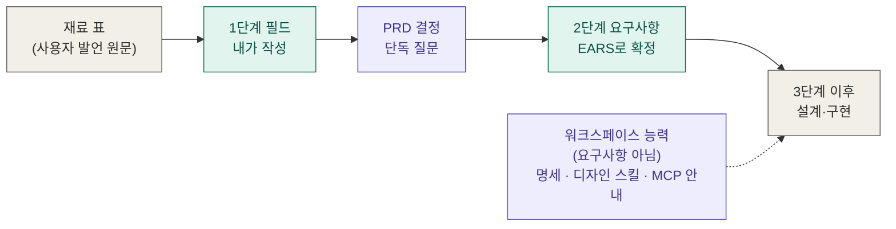
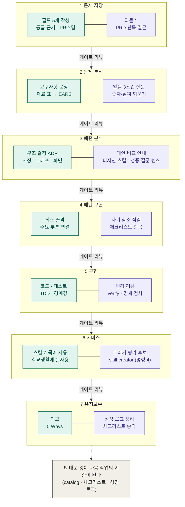

# 세컨드 브레인

학교생활 동안 쓰는 개인 지식 창고를 이 워크스페이스의 기능으로 만드는 프로젝트입니다.
무엇을 왜 만드는지는 사용자가 [세션 파일](PROGRESS.md)에
직접 씁니다.

**상태는 이 문서에 적지 않습니다.** 진행 상태의 원천은 세션 파일의 게이트 로그입니다.

## 어떻게 만들어지는가

이 프로젝트는 워크스페이스의 7단계 워크플로우를 **Full 등급**으로 밟습니다. 작업물은 내가
쓰고, Claude는 질문·리뷰·도구 안내를 맡습니다([리뷰 모드](../../.claude/rules/review-mode.md)).
지금 어느 단계인지는 이 그림에 적지 않습니다 — [게이트 로그](PROGRESS.md)를
보세요.

### 재료가 요구사항이 되기까지

대화에서 나온 말은 세션 파일의 "재료 표"에 원문으로 모이고, 내가 1단계 필드로 옮긴 뒤 2단계에서
요구사항으로 확정됩니다. 워크스페이스에 들인 스킬·명세는 요구사항이 아니라 만들 때 쓰는
도구입니다.

### Full 등급 7단계

단계마다 왼쪽이 내가 쓰는 작업물, 오른쪽이 Claude의 질문·리뷰와 도구입니다. 단계 사이의
모든 화살표에서 게이트 리뷰를 합니다(내 자기 판정을 먼저 적고, 그다음 리뷰 판정).

초록은 내가 쓰는 것, 보라는 Claude의 질문·리뷰와 도구입니다. 3단계 이후의 구체적인 내용
(학교 내용을 어디에 둘지, 그래프를 직접 만들지 외부 도구를 쓸지, 화면 형태)은 그 단계에서
정합니다 — 이 그림은 누가 무엇을 하는지만 보여 줍니다.

## 문서 지도

| 무엇을 보고 싶은가 | 어디에 있나 |
|---|---|
| 문제·PRD·명세·게이트 | [세션 파일](PROGRESS.md) |
| 프로젝트 안내(Claude용) | [CLAUDE.md](CLAUDE.md) |
| 진행 중인 항목 한눈에 | [트래커](../../01-docs/01-problem-save/sessions/README.md) |
