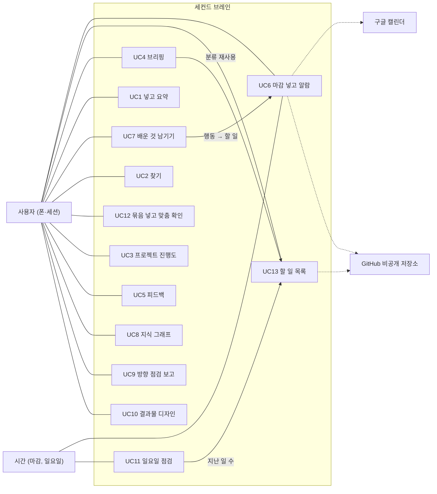

# 세컨드 브레인 — 유즈케이스별 기능 계획서

> **출처: 이재엽의 개인 프로젝트 "Alcovibe" 파일에서 가져온 것.** 팀 기준이 아니라 **제안·참고 자료**이며, 팀 결정은 각 담당 역할과 합의로 한다. 개인 프로젝트 소개: [alcovibe/README.md](../../../../01-docs/references/alcovibe/README.md)

<!-- claude-drafted: 2026-10-11 — 이재엽의 개인 프로젝트(Alcovibe) 파일에서 가져온 초안. 팀 기준 확인 전. -->

## 이 문서의 자리

- **원천은 세션 파일이다.** 요구·유즈케이스·결정·게이트는 [세션 파일](../../PROGRESS.md)에 있고, 이 문서는 그것을
  **유즈케이스 기준으로 다시 묶어 "무엇을 어떤 순서로 만들까"를 보여 줄 뿐**이다. 진행 상태는 여기 적지 않는다 — "구현 근거" 칸은
  상태 문장이 아니라 **코드·테스트 링크**다([프로젝트 안내](../../CLAUDE.md)의 "상태는 문서에 적지 않는다").
- **이 계획서는 확정되지 않은 유즈케이스 개요 위에 서 있다.** UC1~UC12는 2026-10-03에 사용자가 "보류"한 초안이다(세션 파일 "2·3-b").
  UC6·UC13만 상세까지 있다. 개요 확정이 이 문서의 선행 조건이다 — 아래 "정해야 할 것" 1번.
- 만드는 방식은 프로젝트 규칙 그대로다: **테스트를 먼저**(Red → Green), 코드는 Claude가 짜고 PR 전에 karpathy-guidelines로 자체 검수,
  PR 본문에 "자동 테스트로 확인한 것 / 사람이 써 본 것"을 따로 적는다.

## 1. 한눈에

| | |
|---|---|
| **목적** | 학교생활 동안 쓰는 개인 지식 창고. 핵심은 **지식 사이클(넣기 → 요약 → 저장 → 찾기 → 배운 것 남기기, P1)**과 **놓친 일 줄이기(P2)**다 |
| **성공 기준** | Q1: 일주일에 생기는 놓친 일을 지금 약 2개에서 **1개 이하**로(일요일에 셈) · Q4: 배운 것 주 3개·다시 꺼내 쓰기 주 2번 |
| **구조** | 서버 없이 **파일 + Claude 세션**([ADR-0003](../03-pattern-analysis/adr/0003-first-version-structure.md)). 데이터는 main이 아니라 **`data` 브랜치**([ADR-0007](../03-pattern-analysis/adr/0007-data-branch.md)) |
| **액터** | 사용자(폰·세션) · Claude(세션) · 시간(마감·일요일) · 외부: GitHub 비공개 저장소, 구글 캘린더(`마감` 캘린더) |
| **밖으로 나가는 것** | Claude(대화·읽은 파일), GitHub 비공개 저장소, 캘린더 일정 제목 **한 줄**(메모·원문 없음) — [기록·보안 기준](../../../../.claude/rules/security-records.md) 3절 |

## 2. 유즈케이스 한 장 표

우선순위는 묶인 요구 중 가장 높은 MoSCoW다(세션 파일 "5. 우선순위"). **구현 근거 = 지금 저장소에 있는 코드·테스트.**

| UC | 목표 (액터가 이루려는 것) | 묶은 요구 | 우선순위 | 구현 근거 | 선행 |
|---|---|---|---|---|---|
| **UC6** | 폰으로 마감 한 줄을 넣으면 문서·캘린더 알람·실행 기록이 한 건으로 이어진다 (수정·완료·번호 포함) | F8b·F11·S2a~d·S4·S1b | Must | [`intake.py`](../../implementations/skeleton/intake.py) · [`test_intake.py`](../../implementations/skeleton/test_intake.py) 30개 | — |
| **UC13** | 흩어진 할 일 문서를 한 장의 목록으로 모아 폰에서 본다 | F4a·F6·F7a·F8a·Q1(가) | Must | [`listing.py`](../../implementations/skeleton/listing.py) · [`test_listing.py`](../../implementations/skeleton/test_listing.py) 10개 (T1~T8 + 2) | UC6의 번호 |
| UC4 | 대화를 시작하면 진행 중인 일과 마감 3일 이내의 남은 날을 먼저 듣는다 | F7a·F8a | Must | 분류(지남·임박)는 `listing.py`에 있음. **브리핑 자체는 없음** | UC13 분류 |
| UC11 | 일요일에 그 주의 놓친 일을 센다 | Q1·Q4 | Must (성공 기준) | 목록의 "지난 일 N개"(T2)가 Q1의 (가)를 센다. **절차는 없음** | UC13 · UC6 실행 기록 |
| UC1 | 정보를 넣으면 고정 형식으로 요약해 창고에 쌓는다 | F1·F2·F3·S1a~c·S3 | Must | **없음** | **지식 폴더 ADR** |
| UC7 | 배운 것을 관찰·해석·행동으로 남기고 행동을 할 일로 잇는다 | F10a·F10b·F13a·F13b | Must (F10b·F13은 Should) | **없음** | 지식 폴더 ADR · UC6 |
| UC2 | 필요한 지식을 낱말로 10초·2번 안에 찾는다 | F4a(Must)·F4b(Could) | Must | 번호·이름으로 문서 열기만 있음(T7). **낱말 찾기는 없음** | UC1(찾을 지식) |
| UC12 | 많은 자료를 묶음으로 넣고 진행 중인 프로젝트에 맞는지 본다 | F15a~c·F16a~c·S9 | Must(S9)·나머지 Should | 사람 손으로만 한다([참고 자료 받기](../../CLAUDE.md)) | UC1 |
| UC3 | 프로젝트를 올려 7단계·게이트 기준 진행도를 정리한다 | F5·F6·S8 | Should | 없음 | — |
| UC5 | 진행 상황에 게이트·목적에 비춘 피드백을 받는다 | F7b | Should | 없음 | UC3 |
| UC8 | 쌓인 지식을 지식 그래프와 추세로 본다 | F9 | Should | 없음 | UC1 · UC7 |
| UC9 | 목적 → 방향 → 상태 순서의 방향 점검 보고를 받는다 | F12 | Should | 지금은 사람이 만드는 claude.ai 스냅숏 페이지(코드 없음) | — |
| UC10 | 발표·과제 결과물을 개요 → 시안 → 완성 순서로 디자인한다 | F14 | Could | 없음 | — |

**유즈케이스로 만들지 않은 것:** F11(폰으로 넣기)은 목표가 아니라 **경로**라서 UC1·UC6·UC7의 대체 흐름이고, S5(비밀값 검사)·S6(공개 전 인증)·S7(확인 기록)은
**모든 UC의 공통 규칙**이다(아래 4).

## 3. 이미 만든 것 — 인수 기준 ↔ 테스트

두 UC의 상세 흐름은 세션 파일에 있다(UC6 상세, UC13). 여기는 "무엇이 어느 테스트로 지켜지는지"만 모았다.
**사람이 실제로 써 본 것은 게이트 로그 4 → 5 행이 원천**이다 — 폰 이슈로 새 일·수정·완료·번호를 돌린 기록이 거기 있고 여기 다시 적지 않는다.

### UC6 — 마감을 넣으면 알람이 걸린다

| 인수 기준 | 요구·결정 | 테스트 (`test_intake.py`) |
|---|---|---|
| 제목 틀이 맞지 않거나 목적이 다섯 가지 밖이면 만들지 않는다 | ADR-0005 | `test_parse_rejects_purpose_outside_the_five` |
| 기한이 없으면 지어내지 않는다 | S1b | `test_parse_rejects_missing_deadline_without_inventing_one` |
| 지난 날짜·잘못된 날짜는 거부한다 | S1b | `test_parse_rejects_past_and_invalid_dates` |
| 경로를 벗어나는 이름은 막는다 (위반 시도) | 6-3 | `test_parse_rejects_unsafe_names` |
| 오류 문구에 입력을 다시 보이지 않는다 | S4 | `test_errors_never_echo_the_title` |
| 알람 한 줄은 `목적 / 이름 / 마감`이고 내용은 들어가지 않는다 | D2·D7 | `test_alarm_line_is_purpose_name_deadline` · `test_alarm_line_never_contains_the_content` |
| 일정에 알림 3개(3일 전·1일 전·당일 8시) | Q2 | `test_calendar_event_has_three_reminders_at_8am` |
| 지난 알림은 오늘 저녁 8시 하나로 대신, 8시가 지났으면 넣지 않는다 | D11 | `test_a_past_reminder_is_replaced_by_tonight_8pm` 외 3개 |
| 번호는 목적별 범위에서 다음 번호, 다시 쓰지 않는다 | D10 | `test_next_number_starts_at_each_purpose_range` · `test_numbers_are_never_reused_even_after_archiving` |
| 완료는 일정 제목에 `[완료]`·알림 제거, 수정은 같은 일정을 고친다 | D9 | `test_done_event_marks_complete_clears_reminders_and_keeps_the_event_id` · `test_edit_event_carries_the_event_id_and_new_times` |
| 같은 일을 두 번 만들지 않는다 | D5 | `test_duplicate_new_is_refused` |
| 의심되는 값은 종류만 알리고 확인 후 진행한다 | 6-3 | `test_sensitive_hints_names_the_kind_not_the_value` · `test_sensitive_input_asks_first_then_proceeds_without_leaking` |
| 실패는 알리고 기록한다 | S2a·S2d | `test_failure_is_logged_and_reported_not_hidden` |

**아직 이 UC에 없는 것** (세션 파일 게이트 4 → 5 행의 보완 항목): 폰에서 알림이 실제로 울리는지 확인 · 캘린더 연결이 실제로 허용한 권한 범위 확인 ·
**S2b 재시도(1·2·4초, 최대 3번)** · 보관으로 옮기기.

### UC13 — 목록으로 모아 폰에서 본다

세션 파일의 인수 기준 T1~T8이 `test_listing.py`의 `test_t1_…` ~ `test_t8_…`와 이름으로 짝지어져 있다(목적별 묶음·번호순, 지남·임박·진행·완료 분류, 본문 미포함,
읽을 수 없는 문서 표시, 빈 창고, 같은 입력은 같은 출력, 정확한 경로, 보관 문서). 추가로 지난 일 개수(Q1 (가))와 목록 파일 쓰기가 있다.

## 4. 모든 UC에 걸치는 규칙 (공통 기능)

UC마다 새로 만들지 않고 **한 곳에서 재사용**한다 [제안]. 지금 `intake.py`에 있는 것은 그대로 쓰고, 없는 것만 더한다.

| 공통 기능 | 요구 | 지금 | 계획 |
|---|---|---|---|
| 비밀값·주민번호 패턴 점검 | S4·6-3 | `intake.SENSITIVE`(키·비밀번호·주민번호) | UC1·UC12가 같은 함수를 쓴다. UC12의 S9(주소·남의 정보 가리기)는 여기에 종류를 더한다 |
| 팀원·남의 정보는 이름·직책·한 줄만 | S3·S8 | 없음 | UC1(요약)과 UC3(팀 저장소)에서 같이 쓰는 점검 하나 |
| 실행 기록(언제·무엇을·성공/실패) | S2d | UC6가 `run-log.md`에 씀 | 모든 자동 동작이 같은 기록을 쓴다. 기록에 본문·비밀값을 쓰지 않는다 |
| 실패 알림·재시도·일부 실패 표시 | S2a·S2b·S2c·Q5 | 알림(S2a)만 있음 | 재시도(1·2·4초 최대 3번, 연결·시간 초과만)와 "빠진 것 표시"를 한 곳에 |
| "이렇게 정리할게요" 한 장 + "예" 한 번 | D12 | UC6에서 쓰는 흐름 | UC1·UC7도 같은 확인 한 장 |
| 커밋 전 비밀값 검사 · data 브랜치 | S5·ADR-0007 | 훅·pre-commit이 있음 | 그대로 |
| 확인 기록 | S7·6-2 | PR 본문 | 그대로 — 자동 테스트와 사람이 써 본 것을 따로 |

## 5. 아직 없는 UC의 기능 계획

Must인 다섯 개를 카드로 쓰고, Should·Could는 마지막 표에 한 줄씩 둔다. **인수 기준 후보는 구현 전에 테스트로 먼저 쓴다.** 숫자는 확정된 설정값 표에서만 가져왔다.

### UC4 — 대화를 시작하면 브리핑을 받는다 (F7a·F8a)

- **목표:** 사용자가 대화를 시작하면 Claude가 먼저 진행 중인 일과 **마감 3일 이내**의 남은 날을 말한다.
- **기본 흐름:** ① 세션이 열린다 ② Claude가 창고를 읽어 지남·임박·진행을 나눈다 ③ 지난 일을 맨 앞에, 임박한 일을 남은 날과 함께 말한다 ④ 사용자가 이어서 말한다.
- **만드는 것 [제안]:** `listing.py`의 분류를 그대로 쓰는 짧은 브리핑 문장 생성기. 새 분류 규칙을 만들지 않는다.
- **인수 기준 후보:**

| # | 준다 | 하면 | 이어야 한다 | 요구 |
|---|---|---|---|---|
| B1 | 어제 마감 진행 중 일 1, 모레 마감 1, 완료 1 | 브리핑을 만든다 | 지난 일이 맨 앞, 임박은 남은 날(2일), 완료는 말하지 않는다 | F8a |
| B2 | 마감이 5일 뒤인 진행 중 일 | 브리핑을 만든다 | 남은 날을 말하지 않고 "그 밖의 진행 N개"로만 센다 | Q2 범위 |
| B3 | 빈 창고 | 브리핑을 만든다 | 오류 없이 "진행 중인 일 없음" | S2a |
| B4 | 본문에 키 모양 문자열이 있는 문서 | 브리핑을 만든다 | 브리핑에 본문이 없다 | S4 |

- **열린 결정:** 대화 시작 때 **자동으로** 말하게 할지(세션 시작 훅), 사용자가 "브리핑"이라고 말할 때만 할지.

### UC11 — 일요일에 놓친 일을 센다 (Q1·Q4)

- **목표:** 일요일에 그 주의 놓친 일 수를 세어 Goal(주 1개 이하)과 견준다.
- **기본 흐름:** ① 사용자가 "점검"이라고 한다(또는 목록 정리와 함께) ② Claude가 마감이 지났는데 완료가 아닌 일 수를 센다 — **Q1의 (가)** ③ "이번 주에 늦게 알게 된 일이 있나요?"를 묻고 사용자가 답한 수를 받는다 — **Q1의 (다)** ④ 두 수를 기록한다 ⑤ 배운 것 개수·다시 꺼내 쓴 횟수도 함께 센다(Q4, UC7이 있어야 함).
- **인수 기준 후보:**

| # | 준다 | 하면 | 이어야 한다 | 요구 |
|---|---|---|---|---|
| C1 | 마감이 지난 진행 중 일 2개 | 점검한다 | (가) = 2이고 목록의 "지난 일" 수와 같다 | Q1 Meter |
| C2 | 사용자가 "1개"라고 답함 | 점검한다 | (다) = 1, Claude가 값을 추정하거나 채우지 않는다 | S1a 취지 [해석] |
| C3 | 같은 주에 두 번 돌림 | 점검한다 | 그 주 기록이 하나이고 이중으로 세지 않는다 | 재현 가능 |
| C4 | 기록 | 점검 기록을 읽는다 | 일 이름·번호·수만 있고 본문·비밀값이 없다 | S2d·S4 |

- **열린 결정:** 점검 기록을 어디에 남길지(`run-log.md`에 한 줄 / 별도 파일), 주의 경계(월~일인지), 목표 대비 표시 방식.
- **이 UC가 필요한 이유:** 성공 기준(Q1)을 **실제로 재는 절차**가 지금 없다. 알람만 있고 센다는 절차가 없다(게이트 4 → 5 보완 4).

### UC1 — 정보를 넣고 요약을 받는다 (F1·F2·F3·S1a~c·S3)

- **선행:** **지식을 어디에 쌓을지**가 아직 정해지지 않았다 — [ADR-0004](../03-pattern-analysis/adr/0004-vault-location-and-layout.md)가 "P1을 구현할 때 새 ADR로 정한다"고 미뤘다.
- **목표:** 사용자가 넣은 정보를 Claude가 고정 다섯 칸(결정사항 / 할 일(업무·기한) / 리스크 / 후속 일정 / 확인 필요 사항)으로 요약해 창고에 쌓는다.
- **기본 흐름:** ① 사용자가 정보를 넣는다(세션에서 말로·붙여넣기, 폰은 UC6와 같은 이슈 길) ② 의심되는 값과 남의 정보를 본다 ③ 원문이 부족하면 확인 질문 **최대 2개** ④ 다섯 칸으로 요약(원문에 없는 정보는 쓰지 않고, 기한이 없으면 "확인 필요") ⑤ "이렇게 정리할게요" 한 장 → "예" ⑥ 마크다운으로 저장하고 실행 기록, data 브랜치 커밋.
- **기계로 확인하는 것과 사람이 확인하는 것을 나눈다 [제안]:** 다섯 칸 모양·20줄 이내(Q7)·기한 없음 표시·팀원 정보 형식·비밀값 점검은 테스트로 막는다. **요약이 원문에 충실한지**(환각 여부)는 자동 테스트로 확인할 수 없고, 사람이 써 보고 PR에 따로 적는다(6-2).
- **인수 기준 후보:**

| # | 준다 | 하면 | 이어야 한다 | 요구 |
|---|---|---|---|---|
| U1 | 기한이 없는 할 일이 든 원문 | 요약한다 | 그 할 일이 "확인 필요"로 표시된다 | S1b |
| U2 | 확인 질문이 3개 필요한 원문 | 요약한다 | 질문은 2개까지만 한다 | S1c·Q6 |
| U3 | 요약 결과 | 형식을 검사한다 | 다섯 칸이 모두 있고 20줄 이내다 | F2·Q7 |
| U4 | 팀원 이름·피드백 원문이 든 정보 | 요약한다 | 팀원은 이름·직책·한 줄만, 내 할 일 중심이다 | S3 |
| U5 | 비밀값 모양이 든 원문 | 요약한다 | 종류만 알리고 "그대로 진행 / 수정"을 묻고, 확인 전에는 쓰지 않는다 | 6-3 |
| U6 | 요약이 끝남 | 저장한다 | 창고에 마크다운 파일이 하나 생기고 실행 기록에 한 줄이 남는다 | F3·S2d |

### UC7 — 배운 것을 남기고 할 일로 잇는다 (F10a·F10b·F13a·F13b)

- **선행:** UC1과 같은 **지식 폴더 ADR**. 행동을 할 일로 잇는 쪽은 UC6의 형식을 그대로 쓴다.
- **기본 흐름:** ① 사용자가 배운 것을 말한다 ② Claude가 관찰 / 해석 / 행동 세 칸으로 나눠 보여 준다 ③ 사용자가 확인하면 저장한다 ④ 행동 칸이 채워지면 "기한이 있는 할 일로 만들까요?"를 **묻는다** ⑤ "예"일 때만 UC6 형식으로 넘긴다.
- **인수 기준 후보:**

| # | 준다 | 하면 | 이어야 한다 | 요구 |
|---|---|---|---|---|
| L1 | 해석 칸이 비어 있는 입력 | 저장한다 | 칸을 지어내지 않고 되묻는다 | F10a |
| L2 | 행동 칸이 채워진 배운 것 | 저장한다 | 할 일로 만들지 묻고, 대답 전에는 만들지 않는다 | F10b |
| L3 | 사용자 태그가 붙은 항목에 Claude가 태그를 붙이려 함 (위반 시도) | 태그를 붙인다 | 사용자 태그는 바뀌거나 지워지지 않는다 | F13b |
| L4 | 사용자 태그와 Claude 태그 | 저장한다 | 둘이 구분되어 저장된다 | F13a |

### UC2 — 필요한 지식을 찾는다 (F4a, 즐겨찾기 F4b는 Could)

- **목표:** 낱말로 찾아 **10초 이내·조작 2번 이내**(Q3)에 원하는 문서를 연다.
- **먼저 쓸 수 있는 부분 [제안]:** 지식 문서가 없어도 **할 일 문서**는 이미 있다. UC1을 기다리지 않고 할 일 문서의 이름·내용에서 낱말 찾기를 먼저 만들 수 있다.
- **인수 기준 후보:** 낱말이 문서 이름이나 내용에 있으면 번호·이름·경로·마감·상태가 나온다 · 결과가 없으면 오류가 아니라 "없음" · 결과에 본문 전체를 쏟지 않는다.
- **측정은 6단계:** 자주 찾는 질문 10개를 정해 한 번씩 찾으며 초와 조작 횟수를 기록한다(Q3 Meter).

### 나머지 (Should·Could)

| UC | 만들 것 한 줄 [제안] | 시험 방법 | 열린 점 |
|---|---|---|---|
| UC12 묶음 맞춤 확인 | UC1의 요약 앞에 "글자만 옮기기"와 "추정한 줄 표시"를 붙이고, 프로젝트 단계(1~7)별 해당 여부를 표시 | S9: 키·주소·남의 정보가 든 묶음에서 가려진 채 나오는가(위반 시도) | Q10 점수 방식(후보: 단계별 해당 여부 표시 — 사용자가 고른다) |
| UC3 프로젝트 진행도 | 올린 저장소나 작업 내용을 7단계·게이트 기준으로 정리 | 팀 저장소를 올려도 팀원은 이름·직책·한 줄만(S8) | 첫 버전은 손으로 넣어도 Q1을 잴 수 있다(F5 근거) |
| UC5 피드백 | UC3의 정리에 게이트·목적을 비춘 한두 줄 | 게이트 DoD를 어긴 입력에서 그 항목을 짚는가 | UC3 선행 |
| UC8 지식 그래프 | UC1·UC7이 쌓은 지식의 연결과 주간 개수 추세를 한 문서로 | 같은 입력은 같은 출력 | **화면이 없는 첫 버전**이라 마크다운 문서 [해석] |
| UC9 방향 점검 보고 | 목적 → 방향 → 상태 순서의 보고를 문서로 | 순서와 원천 링크 확인 | 지금은 claude.ai 스냅숏이라 보안 3절 조건이 걸림 |
| UC10 결과물 디자인 | 개요 → 시안 → 완성 순서 안내 | — | Could. 핵심 목적 밖 |

## 6. 만드는 순서 [제안]

5 → 6 게이트의 기준이 **EARS 요구를 전부 커버**하는 것이라(세션 파일 게이트 4 → 5 보완 5) 5단계가 짧지 않다. 아래 순서의 이유는 **쓰는 코드가 작고 이미 있는 것을 재사용하고,
성공 기준(Q1)을 재고, 가장 큰 막힘(지식 폴더)을 일찍 풀기** 위해서다.

| 단계 | 내용 | 끝 조건 | 이유 |
|---|---|---|---|
| **M0 결정** | UC 개요 확정 + **지식 폴더 새 ADR** (UC1·UC7의 선행) | 사용자 확정, ADR Accepted | 이 둘이 없으면 M3가 시작할 수 없다 |
| **M1 P2 줄기 닫기** | 게이트 보완 (1)·(3) 확인, **S2b 재시도·S2c 일부 실패 표시·보관 이동** 구현·시험 | 위반 시도(연결 실패 3번)가 상한에서 멈추고 알린다, 폰 알림이 실제로 울린 기록 | 이미 돌고 있는 줄기를 닫아 Must를 먼저 끝낸다 |
| **M2 보고하는 쪽** | UC4 브리핑 + UC11 일요일 점검 | B1~B4·C1~C4 통과, 일요일에 **실제로 한 번** 돌려 Q1 숫자를 기록 | 둘 다 `listing.py` 분류를 재사용해 작고, **성공 기준을 처음으로 실제로 잰다** |
| **M3 P1 줄기** | UC1 → UC7 → UC2(지식 부분) | U1~U6·L1~L4 통과, 넣기 → 요약 → 저장 → 찾기 → 배운 것 남기기를 **실제로 한 바퀴** | 핵심 목적이지만 가장 크고 ADR이 필요하다. 게이트 보완 (2) |
| **M4 Should·Could** | UC12(S9) → UC3·UC5 → UC8·UC9 → UC10 | 각 UC 인수 기준 통과, 또는 사용자가 명시적으로 뺀 것 | 5 → 6 기준이 "전부 커버"이므로 구현하거나 **명시적으로 제외** |

M1과 M2는 서로 기다리지 않는다(M2가 보관 이동을 쓰지 않는다). M0의 ADR을 기다리는 동안 M1·M2를 진행할 수 있다.

## 정해야 할 것 (사용자)

1. **UC 개요(UC1~UC12)를 확정하는가** — 지금 "보류" 초안이다. 이 계획서 전체가 그 위에 있다. (확정 / 고칠 줄 / 일부만)
2. **지식을 어디에 쌓는가** — 할 일 문서에 붙일지, 따로 폴더를 둘지(ADR-0004가 P1 구현 때로 미룬 것). M3의 선행이다.
3. **만드는 순서**(M0 → M1·M2 → M3 → M4)가 맞는가.
4. **5 → 6 게이트의 "전부 커버"에서 Could(F4b 즐겨찾기, F14 결과물 디자인)를 구현할지, 명시적으로 뺄지.**
5. **브리핑(UC4)을 대화 시작 때 자동으로 말하게 할지**, 말로 부를 때만 할지.
