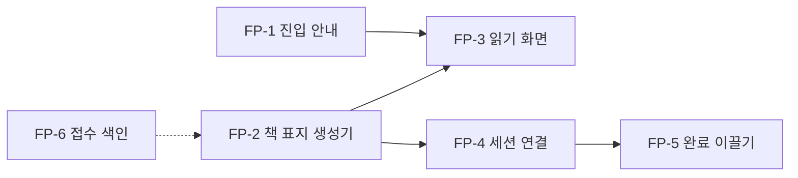

# 기능 계획 — 접수된 요구를 기능 단위로 묶은 초안

> **출처: 이재엽의 개인 프로젝트 "Alcovibe" 파일에서 가져온 것.** 팀 기준이 아니라 **제안·참고 자료**이며, 팀 결정은 각 담당 역할과 합의로 한다. 개인 프로젝트 소개: [alcovibe/README.md](../../../../01-docs/references/alcovibe/README.md)

<!-- claude-drafted: 2026-10-15 — 이재엽의 개인 프로젝트(Alcovibe) 파일에서 가져온 초안. 팀 기준 확인 전. -->

> **같은 이름의 다른 문서:** 10/11에 쓴 유즈케이스별 기능 계획서(230줄)는 [feature-plan-usecases.md](feature-plan-usecases.md)로 옮겨 두었다(원본 커밋 `17a97b5`). 이 문서는 접수된 요구를 기능 단위로 묶은 것이고, 저쪽은 유즈케이스 기준이다.

이 문서는 **새로 정한 것이 없다.** 이미 접수·확정된 요구가 코드·시험이 되기까지의 단위를 한 장으로 본다.
원천은 각각 아래 링크이고, 어긋나면 원천이 맞다.

## 1. 지금 있는 것과의 경계

| 구분 | 어디에 있나 | 상태의 원천 |
|---|---|---|
| 5단계에서 만든 기능(T00~T14) | [tasks-and-traceability.md](tasks-and-traceability.md) 1절 | 세션 파일 게이트 로그 |
| 6단계 실사용·측정 | [stage6-plan.md](../06-service/stage6-plan.md) | 같은 곳 |
| **접수된 새 요구(아래 2절)** | [requirement-intake.md](../07-maintenance/requirement-intake.md) 6절 | 같은 곳 |

## 2. 접수된 요구 → 기능 단위

일정 결정은 모두 같다: **설계 확정은 7단계(11/2~11/7), 구현은 제출(11/8) 이후**, 6단계 측정 대상은 바뀌지 않는다(이재엽 결정 2026-10-14).

| 단위 | 요구 (접수) | 만들 것 | 시험 후보 | 먼저 정해야 할 것 | 근거 문서 |
|---|---|---|---|---|---|
| FP-1 | 터미널 없이 진입 (접수 1) | `GETTING_STARTED.md` 한 절, 세션 시작 안내 문구 | "안내 문장이 있다" 수준 | 어느 앱에서 폴더를 열어 말하나 | [requirement-intake.md](../07-maintenance/requirement-intake.md) 접수 1 |
| FP-2 | 책 표지·목차 생성 (L1~L6) | 폴더별 대표 README 생성기, `n판 m쇄` | 두 번 돌려 같은 결과, 구조가 바뀌면 판+1 | 목록·지식목록을 표지로 합치는 시점(확정: 합친다) | [library-catalog-design.md](../07-maintenance/library-catalog-design.md) 7·10절 |
| FP-3 | 읽기 화면 (접수 1) | 책장·표지·목차를 정적 HTML로 | 생성기 시험, 390px 가로 스크롤 없음 | 스타일 가이드(Alcovibe) 결정 | [style-guide-options.md](../../../../01-docs/references/alcovibe/style-guide-options.md) |
| FP-4 | 세션 연결 (접수 1) | 할 일 문서 머리말에 세션 파일 경로 한 칸, 표지 목차에 표시 | `intake.py`·`listing.py` 시험 | 새 ADR(번호·머리말 규칙 ADR-0005·0006과 정합) | 같은 곳 접수 1 |
| FP-5 | 완료까지 이끌기 (접수 1) | 브리핑에 진행 중인 일마다 "다음 한 걸음"과 막힌 이유 | `briefing.py` 시험 | 사용자가 "다음 한 걸음"을 적는 칸 | 같은 곳 (F7a 확장) |
| FP-6 | 전체 접수 색인 (접수 2, direction.md P-1) | 접수 한 줄씩 모으는 표 | 표 행 수 = 접수 수 | D-1·D-2 결정 | 개인 프로젝트의 방향 문서(direction) |
| FP-7 | 작업 저장소 읽기 (접수 2) | 기록·보안 기준 3절에 행 추가 | (규칙 문서라 시험 없음) | 사용자 확정 | requirement-intake.md 접수 2 "저장 위치" |

## 3. 순서 제안

의존 관계만 적었다. 순위는 개인 프로젝트의 우선순위 초안에서 정한다.

## 4. 이 문서가 하지 않는 것

- 구현하지 않는다(제출 이후).
- 6단계 측정 대상을 바꾸지 않는다.
- 이재엽이 확정하지 않은 값(스타일, 관계, 저장 위치)을 정하지 않는다.
