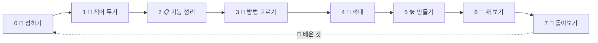

<!-- claude-drafted: 2026-10-16, 2026-10-17 갱신 — 이재엽의 요청으로 Claude가 README를 새로 썼고, 10/17에 이름 확정(이슈 #51)과 진행 상황을 반영했다. 같은 날 두승현의 요청으로 PR #91 뒤의 플로로(그림 · 표정 · 움직임)와 다시 잰 시험 개수를 반영했다.
     2026-10-19 갱신(이재엽 요청 "총합 리드미에 올려줘") — 실제로 써 보기(v2.0, PR #108)와 오버레이 앱 .dmg(v3.0, PR #111), 버전 기록 vN.M · Jira로 옮긴 할 일을 반영했다. -->

<p align="center">
  
</p>

<h1 align="center">🧊 Floe</h1>

<p align="center">
  <b>얼음 위 서재에서, 플로로와 함께 🦭</b><br>
  바이브 코딩을 끝까지 · 이해하며 · 배움을 쌓는다 📚
</p>

<p align="center">
  🧭 길 안내 &nbsp;·&nbsp; ✅ 이해 확인 &nbsp;·&nbsp; 🧱 배움 쌓기 &nbsp;·&nbsp; 🔒 안전한 공유
</p>

<p align="center">
  <sub>코디세이 Final-Project · 🗓 제출 11/8 18:00 · 🧊 동결 11/1 · 작업 이름 Project Navigator</sub>
</p>

<p align="center">
  <sub>🏷 이름: <b>Floe</b>(제품) · <b>플로로</b>(마스코트, Floro) — 2026-10-17 확정 · 이슈 <a href="https://github.com/2026-Codyssey-Final-Proj/Final-Proj/issues/51">#51</a></sub>
</p>

<p align="center">
  <sub>📦 버전 <b>v3.0</b> (2026-10-19) — 올릴 때마다 <a href="CHANGELOG.md">CHANGELOG.md</a>에 한 줄, 동의 없이 병합 · 할 일은 Jira 프로젝트 Floe (<a href="01-docs/00-overview/jira.md">jira.md</a>)</sub>
</p>

---

## 🎯 이런 분을 위해

| 👤 누구 | 😵 겪는 일 | 🦭 플로로가 |
|---|---|---|
| 깃허브 계정 있음 · Claude 구독 중인 입문자 | 뭘 해야 할지 모름 · 구조가 비어 감 · 세션이 쌓이면 길을 잃음 | 지금 단계와 다음 할 일을 알려 줌 |

---

## ✨ 하는 일

| | 기능 | |
|---|---|---|
| 🧭 | **단계 안내** | 지금 어디? 다음은? |
| ✍️ | **설계도 함께 쓰기** | 초안 🤖 → 수정 🙋 → 리뷰 🤖 → 확정 🙋 |
| ✅ | **이해 확인** | 그림 보고 "이해했나요?" |
| 📚 | **서재 책장** | 배운 것을 한 장씩 꽂기 *(목업)* |
| 👀 | **한곳에서 보기** | 진행 · 할 일 · 충돌 · 토큰 *(일부)* |
| 🦭 | **길잡이 플로로** | 표정 11가지 · 쓰다듬기 · 가만히 두면 헤엄치다 졸아요 |
| 🧊 | **실제로 써 보기** *(v2.0)* | 내 프로젝트에 한 줄로 붙이기 · 서재에 **내 책** · 예시 책 지우기 · **느낀 점 남기기** → Jira용 복사 |
| 🖥 | **오버레이 앱** *(v3.0 알파 · v6.0 Linux)* | 내려받아 더블클릭 — 코딩 도구 위에 **항상 위로** 뜨는 창. Mac `.dmg` · Windows `.exe` · **우분투 `.AppImage` / `.deb`**(CI가 셋을 같은 Release에) |

---

## 🦭 플로로를 소개합니다


물에서 고개를 내민 **길잡이 물범**. 지금 단계를 알려 주고, 기다리는 동안 곁을 지켜요.

| | 이런 플로로 | |
|---|---|---|
| 😊 | **표정 11가지** | 기쁨 · 생각 · 살펴보는 중 · 다 했어요 · 하트 · 잠 … 안내 상황에 맞춰 바뀜 |
| 👀 | **고개 돌리기** | 눈 · 코가 마우스 쪽으로 — 2D 그림을 계산으로 입체처럼 |
| 🌊 | **물범다운 움직임** | 둥실 · 빼꼼 솟기 · 코까지 잠수 · 물 뿜기 · 두리번 · 헤엄 |
| 🤲 | **교감** | 누르거나 문지르면 하트 · 쓰다듬을수록 단짝 · 1분 30초 가만히 두면 쿨쿨 |
| 🧊 | **자리마다 다른 모습** | 패널은 물웅덩이 · 접히면 얼굴만 · 서고에서는 얼음판 위 |
| ♿ | **움직임 줄이기 존중** | 컴퓨터 설정을 켠 사람에게는 움직이지 않음 |

🎨 캐릭터 고한결 · 🦭 자세히 → [마스코트 README](02-frontend/assets/mascot/README.md) (그림 · 표정 · 움직임 · 고칠 때 규칙)

---

## 🗺 7단계



> 🚪 문 하나: **완료 기준 ✔ + "이해했어요" 🙋** 둘 다 있어야 다음으로.

---

## 🚦 지금 어디까지?

| | 영역 | 상태 |
|---|---|---|
| 📋 | 요구사항 13개 · 우선순위 | ✅ |
| 🏛 | 구조 결정 ADR | ✅ 확정 (0002~0006 · 0008 · 0009, 10/17) |
| 🖼 | 캔버스 · 화면 구조 | ✅ 초안 |
| 🦭 | **프로토타입** (단계 · 이해 확인 · 설계도 · Claude 연결) | ✅ 시험 111개 |
| 🦭 | **플로로** (표정 11 · 움직임 · 교감, PR #91) | ✅ |
| 🧭 | 시연 입구 · 장면은 주소로 (길잡이 띠는 v2.1에서 지움) | ✅ |
| 🎤 | 인터뷰 질문지 | ✅ 초안 |
| 📚 | 서재 책장 · 전체 돌아보기 | 🔵 목업 (역량 지도 · 내 배움 · 나만 보기는 v7.0에서 지움, 지식 은하는 보류) |
| 👀 | 한곳에서 보기 | 🔵 일부 |
| 🧪 | 수용 · 계약 테스트 | ✅ PR #95 · #100 (사람이 화면으로 보는 줄은 대기) |
| 🚦 | Floe 게이트 | 🟡 1→2 · 2→3 · 3→4 · 4→5 Go(10/18), **5단계 — 주요 기능 11/3까지** · [게이트 로그](01-docs/01-problem-save/sessions/project-track/2026-10-18-floe.md) · [고칠 목록](01-docs/07-maintenance/fix-map.md) |
| 🧊 | **실제로 써 보기** — 한 줄로 켜기 · 내 책 · 예시 책 지우기 · 느낀 점 | ✅ v2.0 (10/19, PR #108) · 시험 24개 · **사람이 써 본 기록은 아직** → [10-real-use](01-docs/features/10-real-use/README.md) |
| 🖥 | **오버레이 앱** — Electron 껍데기, `npm run dist` → `.dmg` · `dist:win` · `dist:linux` | ✅ v3.0 알파 (10/19, PR #111) → v6.0 **Linux(우분투) 묶음**(10/19) · 서명 없음 · 셋은 CI가 Release에 → [electron/README](02-frontend/electron/README.md) |
| 🎬 | 구동 영상 | ⚪ 시작 전 |

✅ 됨 &nbsp; 🟡 진행 · 대기 &nbsp; 🔵 목업 &nbsp; ⚪ 전

🧪 시험 개수는 2026-10-19에 `python3 04-tests/run_all_tests.py`로 잰 값 — 노드 시험 320개 · 파일 21/21 통과 (위 표의 영역별 개수는 10/17 값)

---

## 📁 폴더 안내

| | 폴더 | 무엇 |
|---|---|---|
| 📄 | [`01-docs/`](01-docs/README.md) | 문서 — 문서 지도부터 |
| 🗂 | [`01-docs/features/`](01-docs/features/README.md) | **기능별 README + 시연 GIF** — 무엇 · 왜 · 어떻게 진행됐나 · 흐름 그림 |
| 🖥 | [`02-frontend/`](02-frontend/README.md) | 화면 |
| 📦 | [`02-frontend/electron/`](02-frontend/electron/README.md) | **오버레이 앱 껍데기** — 화면 · 서버를 그대로 감싸 `.dmg` / `.exe` / `.AppImage` · `.deb`로 묶는다 (알파) |
| ⚙️ | [`03-backend/`](03-backend/README.md) | 서버 · 판정 규칙 · AI 연결 |
| 🧪 | [`04-tests/`](04-tests/README.md) | 시험 |
| 📦 | [`05-projects/`](05-projects/README.md) | 팀 제품 밖 프로젝트 (세컨드 브레인) |
| 🤖 | [`.claude/`](.claude/README.md) | Claude가 읽는 설정 — 사람은 안 고쳐도 됨 |

---

## 🚀 써 보기

```bash
git clone https://github.com/2026-Codyssey-Final-Proj/Final-Proj.git
cd Final-Proj
node 03-backend/navigator/server.js   # 🦭 → http://127.0.0.1:4317 · 시연 입구 /index.html
node 03-backend/navigator/floe.js ~/내-프로젝트   # 🧊 내 프로젝트에 붙여 실제로 써 보기 — 훅 연결 → 서버 → 브라우저 (끝나면 --off)
python3 04-tests/run_all_tests.py             # 🧪
cd 02-frontend/electron && npm install && npm run dist   # 📦 오버레이 앱 묶기 → dist/Floe-<버전>-arm64.dmg (Windows: dist:win · 우분투: dist:linux)
```

📦 **앱으로 쓰려면** [Releases](https://github.com/2026-Codyssey-Final-Proj/Final-Proj/releases)에서 Mac은 `.dmg`(우클릭 → 열기, 서명 없음), Windows는 `.exe`, 우분투는 `.AppImage`(실행 권한 주고 더블클릭) 또는 `.deb`를 받아 → 메뉴(Windows · 우분투는 **창 우클릭** 또는 트레이 아이콘) **Floe → 프로젝트 폴더 연결…** → 그 폴더에서 Claude Code를 새로 연다. 자세히 → [팀 작업 가이드 2-c](01-docs/00-overview/team-guide.md)

📘 **처음이라면 → [팀 작업 가이드](01-docs/00-overview/team-guide.md)** (내 키는 어디에 두고, 작업은 어디에 올리나, 한 줄로 켜기 · 앱으로 쓰기)

🔑 **각자 자기 것으로** 동작: 내 API 키(`ANTHROPIC_API_KEY`) → 없으면 이 컴퓨터의 Claude 구독 → 없으면 미리 만든 응답으로 시연 모드 · 켜는 법 → [프로토타입 README](03-backend/navigator/README.md)

---

## 👥 팀

| | 이름 | 맡은 일 |
|---|---|---|
| 🧑‍✈️ | 이재엽 | 총괄 · 제출 · 판정 규칙 · API |
| 🎨 | 고한결 | UI/UX · 인터뷰 · 캐릭터 |
| 🖥 | 임유정 | 프론트엔드 · 시연 화면 |
| 🧪 | 두승현 | 테스트 · 검증 · 프로토타입 |

🤖 Claude는 브랜치에만 · 병합은 사람이 &nbsp;|&nbsp; 상세 → [TEAM.md](TEAM.md)

---

## 🔗 더 보기

📋 [요구사항](01-docs/00-overview/requirements.md) &nbsp;·&nbsp; 🗓 [일정](01-docs/00-overview/schedule.md) &nbsp;·&nbsp; 🎯 [우선순위](01-docs/00-overview/team-priorities.md) &nbsp;·&nbsp; 🏛 [ADR](01-docs/03-pattern-analysis/adr/) &nbsp;·&nbsp; 🔒 [공유·보안](01-docs/00-overview/team-sharing-security.md) &nbsp;·&nbsp; 📦 [버전 기록](CHANGELOG.md) &nbsp;·&nbsp; 🛠 [고칠 곳 지도](01-docs/07-maintenance/fix-map.md) &nbsp;·&nbsp; 🧭 [시작하기](GETTING_STARTED.md)
