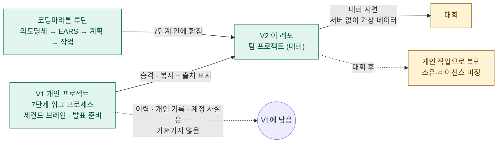
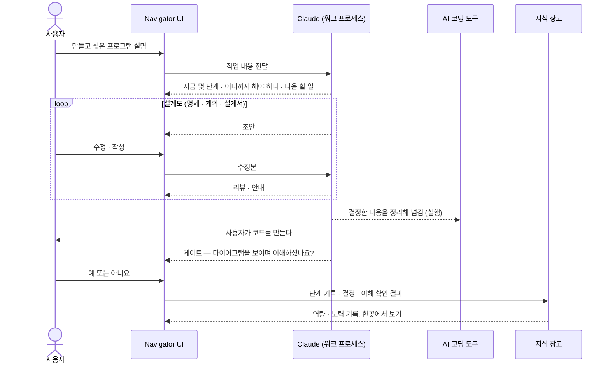
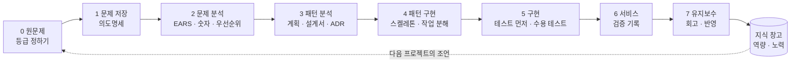
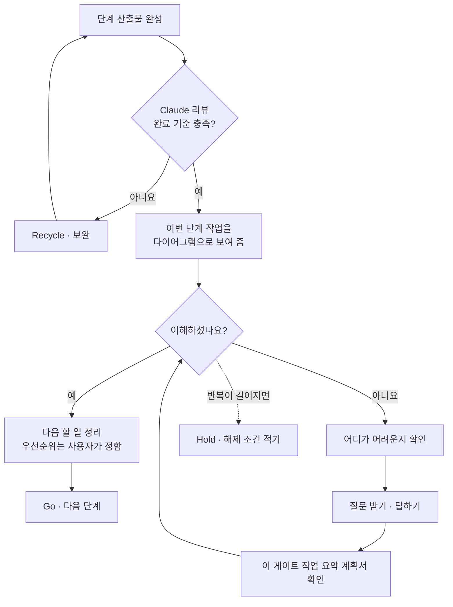
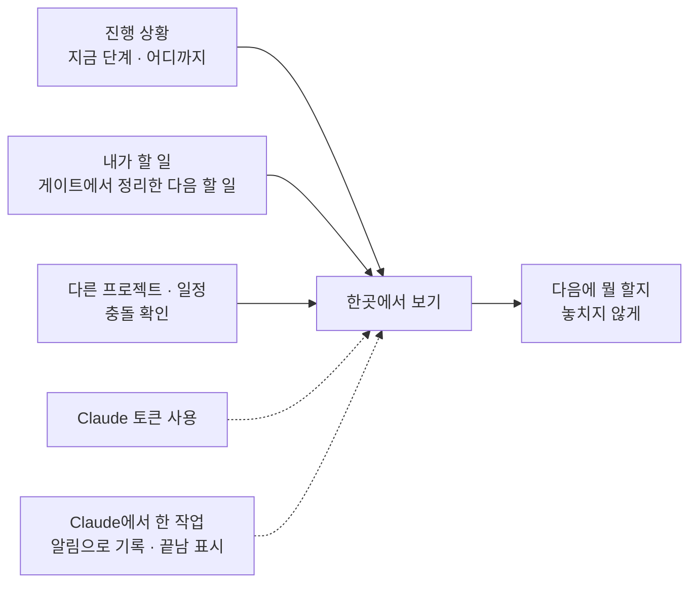
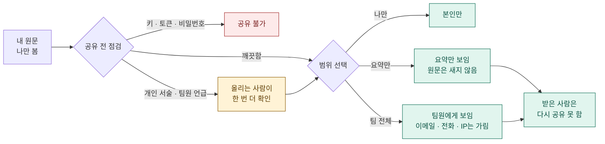
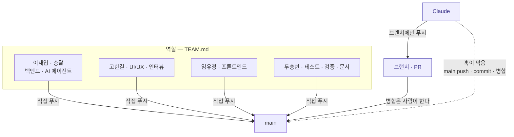
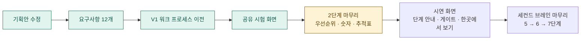

<!-- claude-drafted: 2026-10-12 — 이재엽의 요청("지금 하는 내용과 전체 과정을 리드미로, 다이어그램 포함")으로 Claude가 requirements.md와 이전 기록을 모아 썼다. 원천은 requirements.md이고, 어긋나면 그쪽이 맞다. -->

# Project Navigator

> **AI로 바이브 코딩을 하는 사람**이 프로그램을 끝까지 만들고, 이해하고, 배움을 쌓도록 **길을 안내하는** 서비스.
> *"AI가 일하는 시대에도, 성장하는 건 사람이어야 한다."*

코디세이 AI 네이티브 응용 학습 Final-Project · 팀: 이재엽(총괄) · 고한결 · 임유정 · 두승현 — 역할은 [TEAM.md](TEAM.md)

| 알고 싶은 것 | 어디 |
|---|---|
| 무엇을 만드나, 요구사항 12개 | [requirements.md](docs/00-overview/requirements.md) — **요구의 원천** |
| 기획안 | [final-project-plan.md](docs/00-overview/final-project-plan.md) |
| **일정 · 역할 · 평가 기준** | [schedule.md](docs/00-overview/schedule.md) — 제출 11/8(일) 18:00, 평가 11/12~13 |
| **우선순위 · 누가 무엇을 이어 받나** | [team-priorities.md](docs/00-overview/team-priorities.md) — 길잡이(원천은 requirements.md 10절·이슈) |
| V1에서 무엇을 옮겼나 | [migration.md](docs/00-overview/migration.md) |
| 공유·보안 규칙 | [team-sharing-security.md](docs/00-overview/team-sharing-security.md) |
| Claude에게 일을 시킬 때 | [CLAUDE.md](CLAUDE.md) — 처음 세션이면 이름·역할부터 묻는다 |
| 이 시스템을 처음 쓰는 법 | [GETTING_STARTED.md](GETTING_STARTED.md) |

---

## 1. 전체 그림 — 개인 프로젝트에서 팀 프로젝트로



---

## 2. 제품이 하는 일 — 사용자가 한 번 쓰면 일어나는 일

Navigator는 사용자의 프로그램을 **직접 만들지 않는다.** 안내하고, 사용자가 쓰는 AI 코딩 도구로 넘겨 준다.



---

## 3. 워크 프로세스 — 7단계에 코딩마라톤 루틴을 합친 하나의 흐름



| 단계 | 하는 일 | 나가는 것 |
|---|---|---|
| 0 원문제 | 문제·원하는 결과·적용 대상을 묻고 **규모(즉시/Lite/Xpress/Full)** 를 정한다 | 한 문장 정의, 등급 |
| 1 문제 저장 | 되묻기로 필드를 채운다 | 의도명세 캔버스, 문제 필드 |
| 2 문제 분석 | 요구 수집 → EARS → **모호한 말을 숫자로** → 우선순위 → 출처 추적 | 확정 요구 목록, 수용 테스트 명세 |
| 3 패턴 분석 | 후보 구조 → 대안 비교 → 결정 기록 | 계획, 설계서, ADR |
| 4 패턴 구현 | 가장 얇은 end-to-end 흐름을 연결, 작업 분해 | 최소 흐름, 작업 목록 |
| 5 구현 | 테스트 먼저, 수용 테스트 실행 | 통과한 코드 |
| 6 서비스 | 목표 수치를 실제로 재서 기록 | 검증 기록(고친 결함·못 한 것) |
| 7 유지보수 | 회고, 근본 원인 → 지식 창고 반영 | 역량·노력 기록 갱신 |

### 게이트 — 단계 사이마다 일어나는 일

완료 기준 충족(Claude 리뷰) **그리고** 사용자의 이해 "예"가 모두 있어야 다음 단계로 간다. "아니요"가 계속되면 막히지 않게 Hold를 고르고 해제 조건을 적는다.



---

## 4. 한곳에서 보기 — 알림

진행 상황, 내가 할 일, 다른 프로젝트·일정 충돌, Claude 토큰 사용을 한 화면에서 본다. **대회 시연에서는 가상 숫자**로 보여 준다.



점선은 데이터원이 아직 확인되지 않은 것(토큰 사용량, Claude 작업 이벤트)이다 — 시연은 시뮬레이션, 실제 연동은 후속.

---

## 5. 공유와 보안 — 내 글이 누구에게 어떻게 보이는가

개인용일 때는 나만 읽었다. 팀이 되면 같은 글이 *읽는 사람이 있는 글*이 된다. 기본값은 **나만 보기**이고, 팀에 보이는 것은 규칙을 거친 공유본뿐이다.



직접 써 볼 수 있다 — 서버 없이 브라우저로 연다. 가상 데이터만 쓴다.

```bash
open implementations/share-prototype/index.html
node --test implementations/share-prototype
```

---

## 6. 팀이 일하는 방식



- **사람은 `main`에 직접 커밋·푸시한다. Claude는 `main`에 올리지 않는다** — `.claude/hooks/block-claude-main.sh`가 Claude의 명령만 막는다.
- 새 Claude가 이 레포를 처음 열면 **이름을 묻고 TEAM.md에서 역할을 찾아** 부여한다([CLAUDE.md](CLAUDE.md)).
- 작업물은 담당자가 만들고 Claude는 질문·리뷰·힌트를 준다. 단 세컨드 브레인 코드는 Claude가 짠다.
- 비밀값·서버 주소·인터뷰 응답자 이름은 올리지 않는다. 훅이 한 번 더 막는다.

---

## 7. 레포 구조

```
Final-Proj/
├── README.md · CLAUDE.md · TEAM.md · GETTING_STARTED.md
├── docs/
│   ├── 00-overview/      요구사항 · 기획안 · 이전 기록 · 게이트 · 등급 · 공유·보안
│   ├── 01~07-*/          7단계 방법론 문서 (템플릿 · 예시)
│   ├── catalog/          체크리스트 · 외부 도구 · 후보 장부
│   └── ACKNOWLEDGEMENTS.md   도와준 사람들 (이름은 이재엽이 채움)
├── .claude/              규칙 10 · 훅 9 · 스킬 · 에이전트 · settings.json
├── implementations/
│   ├── run_all_tests.py  전체 테스트
│   └── share-prototype/  공유 규칙 시험 화면 (서버 없음)
└── projects/second-brain/   지식 창고 + 마감 알림 (V1에서 이어 마무리)
```

---

## 8. 지금 어디까지 왔나



| 항목 | 상태 |
|---|---|
| 기획안·요구사항 | 초안 완료 — PR #1 병합 |
| V1 워크 프로세스·세컨드 브레인 이전 | 완료 — PR #2 병합 |
| 공유 규칙 시험 화면 | 완료 — 시나리오 10개, 테스트 17개 |
| **우리 작업의 위치** | **2단계 중간** — EARS 요구는 있고, 숫자 확정·우선순위·출처 추적표·유스케이스가 없다 |
| Navigator UI (시연 화면) | **아직 없음** — 미리 만든 응답으로 움직이게 만들 예정 |
| 세컨드 브레인 | 4→5단계 Go까지(V1). 5·6·7단계 남음, 데이터 저장 구조 결정 필요 |

### 정해야 할 것

| 칸 | 누가 |
|---|---|
| "Claude에서 작업하면 알림으로 끝남 표시"(FR-7)의 해석이 맞는가 | 이재엽 |
| "예"를 못 받는 사용자가 막히지 않게 하는 길 — Hold + 해제 조건 | 이재엽 |
| 7단계 "반영"의 범위 — 지식 창고만인가, 체크리스트까지인가 | 이재엽 |
| 역량·노력 기록의 항목과 단위 | 이재엽 + 고한결(인터뷰 뒤) |
| **라이선스·대회 후 소유** | 이재엽 + **팀원 동의** + 대회 규정 |
| 도와준 사람 명단 | 이재엽(추후) |

---

## 9. 시작하기

```bash
git clone https://github.com/2026-Codyssey-Final-Proj/Final-Proj.git
cd Final-Proj
python3 implementations/run_all_tests.py        # 전체 테스트
node --test implementations/share-prototype     # 공유 규칙 시험
```

Claude Code를 열면 이름과 역할을 묻는다. 대답하면 `.claude/identity.local.md`(커밋되지 않음)가 만들어지고, 그 뒤 역할에 맞게 돕는다.
