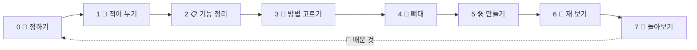

<!-- claude-drafted: 2026-10-16, 2026-10-17 갱신 — 이재엽의 요청으로 Claude가 README를 새로 썼고, 10/17에 이름 확정(이슈 #51)과 진행 상황을 반영했다. -->

<p align="center">
  
</p>

<h1 align="center">🧊 Floe</h1>

<p align="center">
  <b>얼음 위 서재에서, 플로로와 함께 🦭</b><br>
  바이브 코딩을 끝까지 · 이해하며 · 배움을 쌓는다 📚
</p>

<p align="center">
  🧭 길 안내 &nbsp;·&nbsp; ✅ 이해 확인 &nbsp;·&nbsp; 🧱 배움 쌓기 &nbsp;·&nbsp; 🔒 안전한 공유
</p>

<p align="center">
  <sub>코디세이 Final-Project · 🗓 제출 11/8 18:00 · 🧊 동결 11/1 · 작업 이름 Project Navigator</sub>
</p>

<p align="center">
  <sub>🏷 이름: <b>Floe</b>(제품) · <b>플로로</b>(마스코트, Floro) — 2026-10-17 확정 · 이슈 <a href="https://github.com/2026-Codyssey-Final-Proj/Final-Proj/issues/51">#51</a></sub>
</p>

---

## 🎯 이런 분을 위해

| 👤 누구 | 😵 겪는 일 | 🦭 플로로가 |
|---|---|---|
| 깃허브 계정 있음 · Claude 구독 중인 입문자 | 뭘 해야 할지 모름 · 구조가 비어 감 · 세션이 쌓이면 길을 잃음 | 지금 단계와 다음 할 일을 알려 줌 |

---

## ✨ 하는 일

| | 기능 | |
|---|---|---|
| 🧭 | **단계 안내** | 지금 어디? 다음은? |
| ✍️ | **설계도 함께 쓰기** | 초안 🤖 → 수정 🙋 → 리뷰 🤖 → 확정 🙋 |
| ✅ | **이해 확인** | 그림 보고 "이해했나요?" |
| 📚 | **서재 책장** | 배운 것을 한 장씩 꽂기 *(목업)* |
| 👀 | **한곳에서 보기** | 진행 · 할 일 · 충돌 · 토큰 *(일부)* |
| 🔒 | **나만 보기 기본** | 공유본만 팀에 보임 |

---

## 🗺 7단계



> 🚪 문 하나: **완료 기준 ✔ + "이해했어요" 🙋** 둘 다 있어야 다음으로.

---

## 🚦 지금 어디까지?

| | 영역 | 상태 |
|---|---|---|
| 📋 | 요구사항 13개 · 우선순위 | ✅ |
| 🏛 | 구조 결정 ADR | ✅ 확정 (0002~0006 · 0008 · 0009, 10/17) |
| 🖼 | 캔버스 · 화면 구조 | ✅ 초안 |
| 🦭 | **프로토타입** (단계 · 이해 확인 · 설계도 · Claude 연결) | ✅ 시험 104개 |
| 🔒 | 공유 규칙 시험 화면 | ✅ 시험 17개 |
| 🎤 | 인터뷰 질문지 | ✅ 초안 |
| 📚 | 서재 책장 · 역량 지도 | 🔵 목업 |
| 👀 | 한곳에서 보기 | 🔵 일부 |
| 🧪 | 수용 · 계약 테스트 | ⚪ 시작 전 |
| 🎬 | 구동 영상 | ⚪ 시작 전 |

✅ 됨 &nbsp; 🟡 진행 · 대기 &nbsp; 🔵 목업 &nbsp; ⚪ 전

---

## 📁 폴더 안내

| | 폴더 | 무엇 |
|---|---|---|
| 📄 | [`01-docs/`](01-docs/README.md) | 문서 — 문서 지도부터 |
| 🖥 | [`02-frontend/`](02-frontend/README.md) | 화면 |
| ⚙️ | [`03-backend/`](03-backend/README.md) | 서버 · 판정 규칙 · AI 연결 |
| 🧪 | [`04-tests/`](04-tests/README.md) | 시험 |
| 📦 | [`05-projects/`](05-projects/README.md) | 팀 제품 밖 프로젝트 (세컨드 브레인) |
| 🤖 | [`.claude/`](.claude/README.md) | Claude가 읽는 설정 — 사람은 안 고쳐도 됨 |

---

## 🚀 써 보기

```bash
git clone https://github.com/2026-Codyssey-Final-Proj/Final-Proj.git
cd Final-Proj
node 03-backend/navigator/server.js   # 🦭 → http://127.0.0.1:4317
python3 04-tests/run_all_tests.py             # 🧪
```

📘 **처음이라면 → [팀 작업 가이드](01-docs/00-overview/team-guide.md)** (내 키는 어디에 두고, 작업은 어디에 올리나)

🔑 **각자 자기 것으로** 동작: 내 API 키(`ANTHROPIC_API_KEY`) → 없으면 이 컴퓨터의 Claude 구독 → 없으면 미리 만든 응답으로 시연 모드 · 켜는 법 → [프로토타입 README](03-backend/navigator/README.md)

---

## 👥 팀

| | 이름 | 맡은 일 |
|---|---|---|
| 🧑‍✈️ | 이재엽 | 총괄 · 제출 · 판정 규칙 · API |
| 🎨 | 고한결 | UI/UX · 인터뷰 · 캐릭터 |
| 🖥 | 임유정 | 프론트엔드 · 시연 화면 |
| 🧪 | 두승현 | 테스트 · 검증 · 프로토타입 |

🤖 Claude는 브랜치에만 · 병합은 사람이 &nbsp;|&nbsp; 상세 → [TEAM.md](TEAM.md)

---

## 🔗 더 보기

📋 [요구사항](01-docs/00-overview/requirements.md) &nbsp;·&nbsp; 🗓 [일정](01-docs/00-overview/schedule.md) &nbsp;·&nbsp; 🎯 [우선순위](01-docs/00-overview/team-priorities.md) &nbsp;·&nbsp; 🏛 [ADR](01-docs/03-pattern-analysis/adr/) &nbsp;·&nbsp; 🔒 [공유·보안](01-docs/00-overview/team-sharing-security.md) &nbsp;·&nbsp; 🧭 [시작하기](GETTING_STARTED.md)
