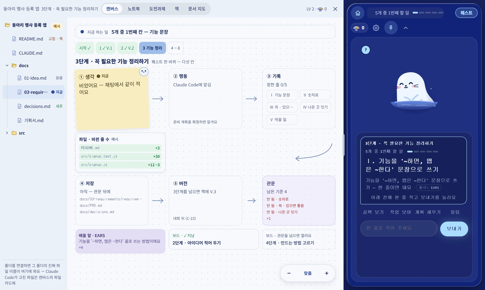
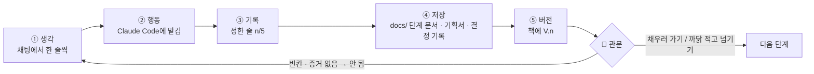
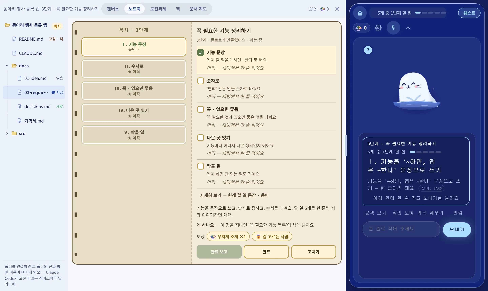
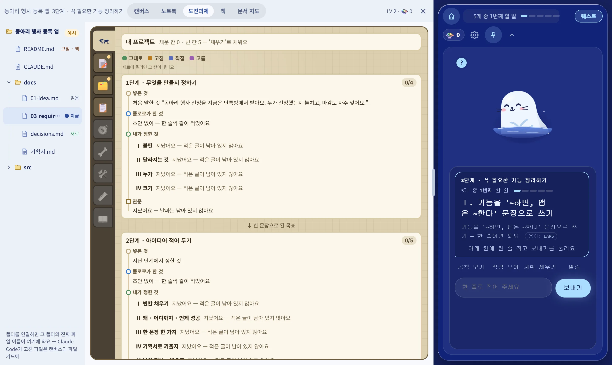
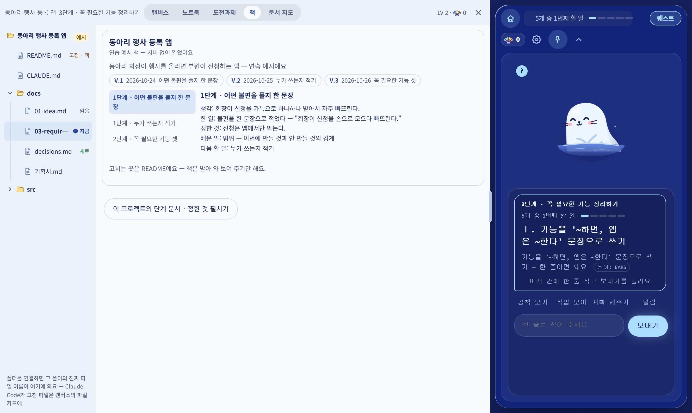
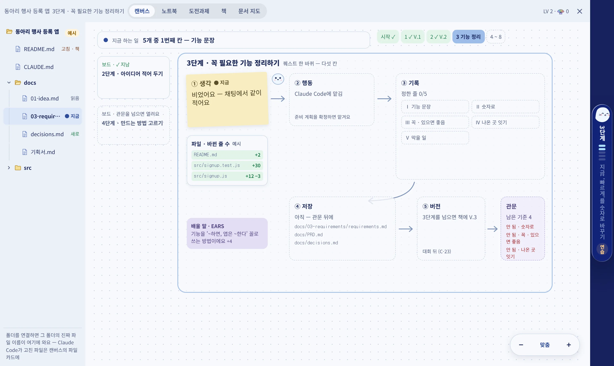

<!-- claude-drafted: 2026-10-16, 2026-10-17 갱신 — 이재엽의 요청으로 Claude가 README를 새로 썼고, 10/17에 이름 확정(이슈 #51)과 진행 상황을 반영했다. 같은 날 두승현의 요청으로 PR #91 뒤의 플로로(그림 · 표정 · 움직임)와 다시 잰 시험 개수를 반영했다.
     2026-10-19 갱신(이재엽 요청 "총합 리드미에 올려줘") — 실제로 써 보기(v2.0, PR #108)와 오버레이 앱 .dmg(v3.0, PR #111), 버전 기록 vN.M · Jira로 옮긴 할 일을 반영했다.
     2026-10-28 갱신(두승현 요청 "현재 리드미가 구식이어서 변경된 화면에 맞춰서 리드미 최신화하여 리치하게") — v37.4 · 앱 10.0.0 기준으로 다시 썼다. 화면 사진은 앱 없이 e2e와 같은 길(섬이 보내는 HTML을 작업실 창 화면에 넣음, 연습 예시)로 찍었다 — 01-docs/features/shots/. 원시 HTML은 뺐다(두승현 규칙: 마크다운에 HTML을 넣지 않는다). -->


# 🧊 Floe — 얼음 위 작업실에서, 플로로와 함께 🦭

**바이브 코딩을 끝까지 · 이해하며 · 배움을 쌓는다.**
AI에게 코드를 맡기는 입문자 곁에서, 지금 몇 단계인지 · 다음에 무엇을 할지 · 무엇을 정했는지를 한 화면에 붙잡아 두는 데스크톱 앱이다.

| 📦 버전 | 🖥 앱 | 🗓 일정 | 🏷 이름 |
|---|---|---|---|
| **v37.4** (2026-10-28) · [버전 기록](CHANGELOG.md) | **10.0.0** 알파 · Mac · Windows · 우분투 · [Releases](https://github.com/2026-Codyssey-Final-Proj/Final-Proj/releases) | 🧊 기능 동결 **11/1** · 📮 제출 **11/8 18:00** | **Floe**(제품) · **플로로**(마스코트) — 2026-10-17 확정 [#51](https://github.com/2026-Codyssey-Final-Proj/Final-Proj/issues/51) |

코디세이 Final-Project · 작업 이름 Project Navigator · 할 일은 Jira 프로젝트 Floe([jira.md](01-docs/00-overview/jira.md))

---

## 👀 한눈에 — 작업실



| 자리 | 무엇이 보이나 |
|---|---|
| 📁 **왼쪽 · 파일 칸** | 연결한 프로젝트 폴더의 진짜 파일 이름 — 지금 고치는 파일 `● 지금`, 새로 생긴 파일 `새로`, 폴더는 접고 펼친다 |
| 🗺 **가운데 · 캔버스** | 지금 하는 일 한 줄 · 단계 칩(`시작 ✓ · 1 ✓ V.1 · 2 ✓ V.2 · 3 기능 정리 · 4~8`) · **퀘스트 한 바퀴 다섯 칸**과 관문 · 바뀐 파일 줄 수 · 배울 말 · 지난 장 / 다음 장 |
| 🦭 **오른쪽 · 섬** | 플로로와 대화하는 곳 — 지금 할 일 카드, 칩(공책 보기 · 작업 보여 주기 · 계획 세우기 · 알림), 한 줄 입력 |

> 사진은 2026-10-28에 연습 예시("동아리 행사 등록 앱", 3단계)로 찍었다. 파일 칸의 `예시` 표시처럼, 폴더를 연결하기 전에는 예시 이름이 보인다.

---

## 🎯 이런 분을 위해

| 👤 누구 | 😵 겪는 일 | 🦭 Floe가 |
|---|---|---|
| GitHub 계정이 있고 Claude를 쓰는 **바이브 코딩 입문자** | 뭘 해야 할지 모름 · 문서와 구조가 비어 감 · 세션이 쌓이면 무엇을 정했는지 잃어버림 | 단계마다 할 일을 한 줄씩 묻고, 정한 것을 프로젝트 폴더의 문서로 남기고, 관문에서 빈칸을 막는다 |

---

## 🔁 어떻게 흘러가나

### 1~8단계 — 큰 길


화면의 단계 번호는 1~8이다(코드 `STAGES`는 0~7). 단계를 넘을 때마다 그 단계의 문서가 **책에 V.n**으로 쌓인다.

### 한 단계 안 — 퀘스트 한 바퀴 다섯 칸



| 칸 | 누가 | 무엇이 남나 |
|---|---|---|
| ① 생각 | 사람 + 플로로 | 플로로가 초안을 내고(예시 셋 중 고르기 · 그대로 · 고침 · 직접), 사람이 한 줄씩 정한다 |
| ② 행동 | Claude Code | 준비 계획을 확정하면 맡긴다 — 파일 고치기 · 명령 전의 허락은 **섬의 승인 카드**로(대신 허용하는 길 없음) |
| ③ 기록 | Floe | 칸마다 누가 정했는지(그대로 · 고침 · 직접 · 고름)와 날짜 |
| ④ 저장 | Claude Code | 작업 폴더의 `docs/` 단계 문서 · `docs/PRD.md` · `docs/decisions.md` · `CLAUDE.md` — 커밋 · 푸시는 Claude Code가 |
| ⑤ 버전 | Floe | 책에 V.n, 조개 · 칭호 |
| 🚪 관문 | Floe의 규칙 | 빈칸 · 증거 없는 칸은 **안 됨**. 넘기려면 채우거나 까닭을 적는다 — 까닭은 결정 기록에 |

---

## 🖼 화면 둘러보기

### 1. 처음 설정 — 플로로가 반기고 같이 준비


처음 켜면 한 번만 뜬다. **AI 연결 → 같이 쓸 앱 → GitHub → 프로젝트 폴더** 순서로 하나씩 고른다.

| 단계 | 고르는 것 |
|---|---|
| 🤖 AI 연결 | 이 컴퓨터의 **Claude Code**(구독)로 부를지, **API 키**로 부를지 — 키는 앱에만 두고 화면은 저장하지 않는다 |
| 🤝 같이 쓸 앱 | **Claude Desktop과 잇기** — 누르면 Claude Desktop이 Floe의 지금 할 일을 읽고 한 줄을 제안할 수 있다(내 컴퓨터 안에서만, 제안은 섬에서 "맞아요"를 눌러야 적힘) |
| 🐙 GitHub · 📁 폴더 | 내 계정과 작업할 프로젝트 폴더 — 연결하면 파일 칸에 진짜 이름이 온다 |

### 2. 작업실의 탭 다섯

| 탭 | 무엇 |
|---|---|
| 🗺 **캔버스** | 위 "한눈에" 사진 — 다섯 칸 판. 끌어서 옮기고 ⌘/Ctrl+휠 · − 맞춤 + 단추로 크게 작게, 좁은 화면에서는 격자로 다시 배치 |
| 📒 **노트북** | 이 단계의 목차와 할 일 다섯 — 칸마다 체크 · 자세히 보기 · 보상(조개 · 칭호) · 완료 보고 / 힌트 / 고치기 |
| 🏆 **도전과제** | 단계마다 네 칸 흐름(**넣은 것 → 플로로가 한 것 → 내가 정한 것 → 관문**) — 빈 칸은 '채우기'로 |
| 📚 **책** | 단계를 넘을 때마다 쌓인 V.1 · V.2 · V.3 — 생각 · 한 일 · 정한 것 · 배운 말 · 다음 할 일 |
| 🧭 **문서 지도** | 문서와 재료가 어떻게 이어지는지 보드로 — 상자를 누르면 파일 보기 |







### 3. 섬을 접으면 — 가장자리의 알약



섬은 작업실의 **위 · 아래 · 왼쪽 · 오른쪽** 중 고른 가장자리에 붙는다(섬 머리의 ▲ ▼ ◀ ▶). 접으면 그 자리의 **알약**(옆이면 세로)이 되고 캔버스가 넓어진다 — 누르거나 알릴 일이 오면 다시 펼친다. 켤 때도 큰 인사 카드 대신 알약 안에서 인사한다(하루에 한 번).

### 4. 파일 보기 · 고치기

파일 칸에서 파일을 누르면 작업실에 열린다. **md는 보기 좋게 / 원문**, 코드는 줄 번호와 git과 다른 줄. 고쳐 저장하면 바로 그 파일에 쓰고, 그 파일만 커밋 · 푸시하는 일은 Claude Code에 맡긴다. 비밀값 모양이 보이거나 연 뒤에 파일이 바뀌었으면 멈추고 묻는다. 연 파일 머리의 **틀로 맡기기**(열한 가지)로 "이 문서를 이렇게 고쳐 줘"를 Claude Code에 넘길 수도 있다.

---

## ✨ 하는 일

| | 기능 | 어떻게 | 요구 · 버전 |
|---|---|---|---|
| 🧭 | **단계 안내 · 퀘스트** | 채팅 중심 섬 · 지금 할 일 한 줄 · 단계 칩 · 다섯 칸 | FR-1 · 2 · C-22 · C-41 · C-42 |
| ✍️ | **단계 초안 함께 쓰기** | 2~8단계 모두 초안, 4~8단계는 칸마다 예시 셋, 다음 단계 초안을 뒤에서 미리 | C-37 ~ C-40 (v26 ~ v28) |
| 🚪 | **관문** | 빈칸 · 증거 없는 칸은 안 됨, 넘기려면 채우거나 까닭 적기 | FR-4 · 5 · F-60 (v35.0) |
| 📂 | **문서를 GitHub에** | 단계 폴더 · 기획서 · 결정 기록 · CLAUDE.md를 작업 폴더에, 커밋 · 푸시는 Claude Code | C-37 · C-39 |
| 🗂 | **작업실** | 화면 가득 · 바꾼 크기 기억 · 파일 칸 · 탭 다섯 · 섬은 옆 칸 | C-41 · C-42 · C-46 (v30 ~ v37) |
| 📝 | **파일 보기 · 고치기 · 틀로 맡기기 · 문서 지도** | 위 4번 | C-43 ~ C-45 (v37.0) |
| ✅ | **섬에서 허용 · 거절** | Claude Code가 허락을 구하면 섬의 카드로, 답이 없으면 허용되지 않은 채로 | FR-17 |
| 🐟 | **플로로에게 먹이 주기** | 파일 · 붙여 넣기를 구간으로 나누고 비밀값 · 개인적인 일은 빼고 보냄 | FR-15 |
| 🤝 | **같이 쓸 앱** *(시험판)* | Claude Desktop이 지금 할 일을 읽고 제안 — 원격(웹 Claude · 웹 GPT)은 기본 꺼짐 | C-38 (v29.0) |
| 🐚 | **조개 · 칭호 · 뽑기** | 관문을 넘으면 조개, 칭호, 조개 뽑기 | C-22 |
| 🔑 | **각자 자기 것으로** | 내 API 키 → 없으면 이 컴퓨터의 Claude 구독 → 없으면 연습 모드 | FR-10 · ADR-0003 |
| 🖥 | **데스크톱 앱** | Electron — Mac `.dmg` · Windows `.exe` · 우분투 `.AppImage` / `.deb` (서명 없음) | 앱 10.0.0 |

기능마다 무엇 · 왜 · 흐름 그림 · 시연 GIF → [기능 지도](01-docs/features/README.md)

---

## 🦭 플로로를 소개합니다


물에서 고개를 내민 **길잡이 물범**. 지금 단계를 알려 주고, 기다리는 동안 곁을 지켜요.

| | 이런 플로로 | |
|---|---|---|
| 😊 | **표정 11가지** | 기쁨 · 생각 · 살펴보는 중 · 다 했어요 · 하트 · 잠 … 안내 상황에 맞춰 바뀜 |
| 👀 | **고개 돌리기** | 눈 · 코가 마우스 쪽으로 — 2D 그림을 계산으로 입체처럼 |
| 🌊 | **물범다운 움직임** | 둥실 · 빼꼼 솟기 · 코까지 잠수 · 물 뿜기 · 두리번 · 헤엄 |
| 🤲 | **교감** | 누르거나 문지르면 하트 · 쓰다듬을수록 단짝 · 가만히 두면 쿨쿨 |
| 💊 | **자리마다 다른 모습** | 섬에서는 크게, 접으면 알약 안의 얼굴, 캔버스 한쪽에는 작은 플로로 |
| ♿ | **움직임 줄이기 존중** | 컴퓨터 설정을 켠 사람에게는 움직이지 않음 |

🎨 캐릭터 고한결 · 자세히 → [마스코트 README](02-frontend/assets/mascot/README.md)

---

## 🚦 지금 어디까지? (2026-10-28)

| | 영역 | 상태 |
|---|---|---|
| 🗂 | 작업실 · 섬 · 알약 · 캔버스 다섯 칸 | ✅ 들어감 (v30.0 ~ v37.2) — 기준은 [0~8단계 스토리보드](01-docs/04-pattern-implementation/stage-storyboard/README.md) |
| ✍️ | 단계 초안 · 관문 · 문서를 GitHub에 | ✅ 들어감 (v26.0 ~ v35.0) |
| 📝 | 파일 보기 · 고치기 · 틀 · 문서 지도 | ✅ 들어감 (v37.0) |
| 🤝 | Claude Desktop 같이 쓸 앱 | 🟡 시험판 (v29.0) — Claude Desktop에 도구 넷이 보이는 것까지 확인, 대화로 한 바퀴는 아직 |
| 🎨 | 다음 차례 — 작업실 세 칸 · MD 에디터 · 지도 = 도전과제 + 문서 · 켤 때 바로 작업실 · 맞춤 퀘스트 · 디자인 바탕 | ⚪ 계획만 (C-53 ~ C-57) |
| 🖥 | 데스크톱 앱 | 🟡 알파 10.0.0 (2026-10-21) — 그 뒤 기능은 각자 `npm run dist`로 묶어 써 본다 |
| 🧪 | 시험 | 아래 숫자 |
| 🎬 | 시연 녹화 · 수용 테스트 기록 | ⚪ 11/2 ~ 11/3 |

✅ 들어감 &nbsp; 🟡 진행 · 시험판 &nbsp; ⚪ 전

🧪 2026-10-28에 `python 04-tests/run_all_tests.py`(Windows)로 잰 값 — 노드 시험 793개 중 737 통과 · 1 실패 · 나머지는 브라우저 도구가 없어 건너뜀, 시험 파일 20/21. 실패 하나(`files-api`)는 Windows가 바로가기(symlink) 만들기를 막아서다(EPERM, 코드와 관계없음)

게이트 · 고칠 목록 → [게이트 로그](01-docs/01-problem-save/sessions/project-track/2026-10-18-floe.md) · [고칠 곳 지도](01-docs/07-maintenance/fix-map.md) · 일정 → [schedule.md](01-docs/00-overview/schedule.md)

---

## 🚀 써 보기

**앱으로** — [Releases](https://github.com/2026-Codyssey-Final-Proj/Final-Proj/releases)에서 내려받는다.

| 컴퓨터 | 받을 파일 | 여는 법 |
|---|---|---|
| 🍎 Mac | `.dmg` | 우클릭 → 열기 (서명 없음) |
| 🪟 Windows | `.exe` | 설치 뒤 실행 |
| 🐧 우분투 | `.AppImage` 또는 `.deb` | 실행 권한 주고 더블클릭 |

처음 설정에서 프로젝트 폴더를 고르고, 그 폴더에서 Claude Code를 새로 연다. 자세히 → [팀 작업 가이드 2-c](01-docs/00-overview/team-guide.md)

**코드로**

```bash
git clone https://github.com/2026-Codyssey-Final-Proj/Final-Proj.git
cd Final-Proj
node 03-backend/navigator/server.js              # 🦭 화면 + 서버 → 브라우저로 미리 보기
node 03-backend/navigator/floe.js ~/내-프로젝트   # 🧊 내 프로젝트에 붙여 써 보기 (끝나면 --off)
python3 04-tests/run_all_tests.py                # 🧪 전체 시험
cd 02-frontend/electron && npm install && npm run dist   # 📦 앱 묶기 (Windows: dist:win · 우분투: dist:linux)
```

**서버 없이** — `02-frontend/index.html`을 브라우저로 열면 연습 예시로 화면을 볼 수 있다(작업실 창은 앱에서만).

📘 처음이라면 → [팀 작업 가이드](01-docs/00-overview/team-guide.md) · 켜는 법 → [서버 README](03-backend/navigator/README.md)

---

## 📁 폴더 안내

| | 폴더 | 무엇 |
|---|---|---|
| 📄 | [`01-docs/`](01-docs/README.md) | 문서 — 문서 지도부터 |
| 🗂 | [`01-docs/features/`](01-docs/features/README.md) | **기능별 README + 시연 GIF** |
| 🎞 | [`01-docs/04-pattern-implementation/stage-storyboard/`](01-docs/04-pattern-implementation/stage-storyboard/README.md) | **0~8단계 스토리보드** — 앱이 따라가는 화면 기준 |
| 🖥 | [`02-frontend/`](02-frontend/README.md) | 화면 — 섬 · 작업실은 [`navigator/`](02-frontend/navigator/README.md) |
| 📦 | [`02-frontend/electron/`](02-frontend/electron/README.md) | 데스크톱 앱 껍데기 — 화면 · 서버를 감싸 `.dmg` / `.exe` / `.AppImage` · `.deb`로 |
| ⚙️ | [`03-backend/`](03-backend/README.md) | 서버 · 판정 규칙 · AI 연결 · 같이 쓸 앱(MCP) |
| 🧪 | [`04-tests/`](04-tests/README.md) | 시험 — 규칙 · 서버 · 실제 브라우저로 누르는 e2e |
| 📦 | [`05-projects/`](05-projects/README.md) | 팀 제품 밖 프로젝트 (세컨드 브레인) |
| 🤖 | [`.claude/`](.claude/README.md) | Claude가 읽는 설정 — 사람은 안 고쳐도 됨 |

---

## 👥 팀

| | 이름 | 맡은 일 |
|---|---|---|
| 🧑‍✈️ | 이재엽 | 팀장 · 총괄 · 제출 · AI 에이전트 · API 연동 |
| 🎨 | 고한결 | UI/UX · 인터뷰 · 발표 흐름 · 캐릭터 |
| 🖥 | 임유정 | 프론트엔드 · 시연 화면 |
| 🧪 | 두승현 | 시연 프로토타입 · 테스트 · 검증 · 문서 · 협업 증빙 |

🤖 Claude는 브랜치에만 올리고 병합은 사람이 · 올릴 때는 [`changes/`](changes/README.md) 조각 한 장 → 병합되면 버전 번호가 붙는다 · 상세 → [TEAM.md](TEAM.md)

---

## 🔗 더 보기

📋 [요구사항](01-docs/00-overview/requirements.md) · 🗓 [일정](01-docs/00-overview/schedule.md) · 🎯 [우선순위](01-docs/00-overview/team-priorities.md) · 🏛 [ADR](01-docs/03-pattern-analysis/adr/) · 🔒 [공유 · 보안](01-docs/00-overview/team-sharing-security.md) · 📦 [버전 기록](CHANGELOG.md) · 🛠 [고칠 곳 지도](01-docs/07-maintenance/fix-map.md) · 🧭 [시작하기](GETTING_STARTED.md)
